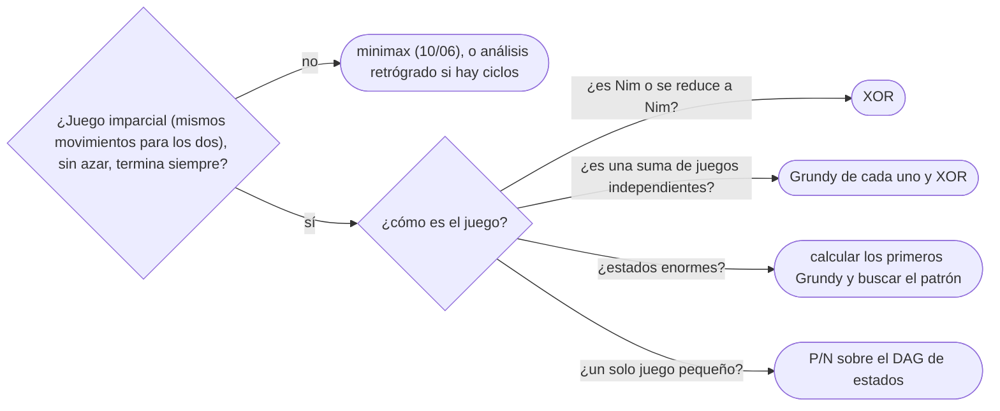

# 08 — Teoría de juegos

> Juegos imparciales de dos jugadores sin azar ni información oculta: posiciones ganadoras y perdedoras
> sobre un DAG de estados, el Nim y el teorema de Bouton (gana quien empieza si y solo si el XOR de los
> montones no es 0), y el teorema de Sprague-Grundy, que convierte cualquier juego imparcial en un montón de
> Nim y permite sumar juegos con un XOR.
>
> **Niveles:** juegos sobre DAG [B] · Nim [B] · Sprague-Grundy [B].
>
> **📚 Lectura troncal:** Berlekamp, Conway y Guy, *Winning Ways for Your Mathematical Plays*, 2.ª ed., vol.
> 1 (A K Peters, 2001); Laaksonen, *Guide to Competitive Programming*, 3.ª ed. (Springer, 2024), cap. 11.
>
> **Asume leído:** [`17/01` — Bits](01-bits.md).
>
> **Vigencia:** 2026-10-04.

**Salto rápido:** [1](#1--el-problema) · [2](#2--la-teoría) · [3](#3--juegos-sobre-dag) · [4](#4--nim) · [5](#5--sprague-grundy) · [6](#6-️-la-tabla-de-costes) · [7](#7--cómo-se-elige) · [8](#8--señales-del-enunciado) · [🧠](#-preguntas) · [🧩](#-problemas-propios)

---

## 1. 🎯 El problema

Seis montones de piedras: `5, 2, 9, 1, 5, 6`. Dos jugadores se turnan quitando cualquier cantidad positiva de
un solo montón; quien no puede mover, pierde. ¿Gana quien empieza? Simular todas las partidas es explorar
`6 · 10 · 3 · 2 · 6 · 7 = 15 120` estados combinados, y con montones de `10⁹` es imposible. La respuesta
cabe en una línea: `5 ⊕ 2 ⊕ 9 ⊕ 1 ⊕ 5 ⊕ 6 = 12 ≠ 0`, así que gana quien empieza, y la jugada ganadora es
dejar el 9 en 5.

Y el resultado se generaliza: cualquier juego imparcial equivale a un montón de Nim de cierto tamaño (su
número de Grundy), y varios juegos jugados a la vez equivalen al Nim de sus números. Así, juegos que parecen
exigir búsqueda exhaustiva se resuelven con una DP pequeña y un XOR.

> 🧠 **Modelo mental.** Una posición es perdedora si todo lo que puedes hacer deja al rival en una
> ganadora; es ganadora si puedes dejarle en una perdedora. Grundy es lo mismo con números: el valor de una
> posición es el menor número que **no** puedes alcanzar.

Los ejemplos usan los montones `[5, 2, 9, 1, 5, 6]` y el DAG D de [`14/01`](../14-grafos-recorridos/01-representaciones.md) como tablero.

---

## 2. 📐 La teoría

**Juego imparcial.** Los dos jugadores tienen los mismos movimientos desde cada posición (a diferencia del
ajedrez), no hay azar, y el juego termina siempre. Con la regla **normal**, pierde quien no puede mover.

**Posiciones P y N.** Una posición es **P** (pierde quien mueve) si todos sus movimientos van a posiciones
**N**; es **N** (gana quien mueve) si algún movimiento va a una **P**. Las finales (sin movimientos) son P.
Como el grafo de estados es un DAG, la clasificación se calcula hacia atrás.

**Teorema de Bouton (Nim).** Una posición de Nim con montones `a₁, …, a_k` es P si y solo si
`a₁ ⊕ … ⊕ a_k = 0`.

*Prueba.* (1) La posición final (todo 0) tiene XOR 0. (2) Desde XOR 0, cualquier movimiento cambia un solo
montón y deja XOR `≠ 0`. (3) Desde XOR `s ≠ 0`, sea `b` el bit más alto de `s`; algún montón `aᵢ` tiene el
bit `b`, y `aᵢ ⊕ s < aᵢ`: reducirlo a `aᵢ ⊕ s` deja XOR 0. Las posiciones con XOR 0 cumplen la definición de
P, y las demás, la de N.

**Mex y número de Grundy.** `mex(S)` es el menor natural que no está en `S`. El número de Grundy de una
posición es `g(x) = mex{ g(y) : y alcanzable desde x }`; las finales valen 0. Una posición es P si y solo si
`g(x) = 0`.

**Teorema de Sprague-Grundy.** Toda posición de un juego imparcial equivale a un montón de Nim de tamaño
`g(x)`; y la **suma** de juegos (en cada turno se mueve en uno de ellos) tiene número de Grundy
`g(x₁) ⊕ … ⊕ g(x_k)`.

*Esbozo.* Desde una posición de valor `g` se puede ir a cualquier valor menor (por la definición de mex),
como en un montón de Nim; los movimientos a valores mayores se pueden revertir. Con eso, la prueba de Bouton
se aplica a la suma.

---

## 3. 🧱 Juegos sobre DAG

**Qué es.** Clasificar cada estado de un juego finito como P o N recorriendo el grafo de estados desde los
finales: un estado es N si tiene algún sucesor P.

**Por qué es correcto.** Es la definición de §2, aplicada en un orden en que los sucesores ya están
calculados (orden topológico inverso, o memoización).

**Cómo va**, con una ficha sobre el DAG D (`A → B, C · B → D, E · C → E · D → F · E → F`), moviendo por una
arista; quien no puede mover pierde:

```text
F: sin movimientos → P
D → F (P) → N        E → F (P) → N
B → D, E (los dos N) → P        C → E (N) → P
A → B (P) → N        empezando en A, gana el primero: A → B
```

**Cuánto.** `Θ(estados + movimientos)`.

**La plantilla**, con memoización sobre un grafo de estados dado:

```cpp
#include <vector>

// win[v] = true si quien mueve desde v gana. adj = movimientos; el grafo es un DAG.
std::vector<int> memo;                                   // −1 sin calcular, 0 pierde, 1 gana
const std::vector<std::vector<int>>* G;

int wins(int v) {
    if (memo[v] != -1) return memo[v];
    int r = 0;
    for (int w : (*G)[v]) if (!wins(w)) { r = 1; break; }    // algún movimiento a una P
    return memo[v] = r;
}
// Con estados profundos, en orden topológico inverso en lugar de recursión (14/04).
```

```java
static int[][] moves;
static int[] memo;                                        // −1, 0, 1

static int wins(int v) {
    if (memo[v] != -1) return memo[v];
    int r = 0;
    for (int w : moves[v]) if (wins(w) == 0) { r = 1; break; }
    return memo[v] = r;
}
```

- **Los estados** suelen ser números (piedras que quedan) o tuplas pequeñas: se codifican en un índice.
- **Con ciclos** (juegos que pueden no terminar) hay empates: se propaga desde los finales con contadores de
  sucesores no resueltos (análisis retrógrado, Cat and Mouse en `10/06`).
- **Estados enormes**: calcular los primeros valores y buscar un patrón (periodicidad) suele ser la clave.

**Cuándo sí:** cualquier juego imparcial pequeño, como base y como fuerza bruta para descubrir patrones.
**Cuándo no:** con varios juegos simultáneos (el producto de estados explota): Sprague-Grundy.

> **Veredicto:** P si todo lleva a N, N si algo lleva a P; se calcula hacia atrás sobre el DAG de estados.

---

## 4. 🧱 Nim

**Qué es.** Decidir el ganador de Nim por el XOR de los montones, y encontrar la jugada ganadora.

**Por qué es correcto.** El teorema de Bouton (§2).

**Cómo va**, `[5, 2, 9, 1, 5, 6]`:

```text
5 ⊕ 2 ⊕ 9 ⊕ 1 ⊕ 5 ⊕ 6 = 12 = 1100₂ ≠ 0 → gana quien empieza
bit más alto de 12: el 3 (valor 8); el único montón con ese bit es 9 (1001₂)
9 ⊕ 12 = 5 < 9 → dejar el 9 en 5: el XOR queda 5 ⊕ 2 ⊕ 5 ⊕ 1 ⊕ 5 ⊕ 6 = 0
```

**Cuánto.** `Θ(k)` para decidir y para la jugada.

**La plantilla:**

```cpp
#include <vector>

// Devuelve el índice del montón a reducir y su nuevo tamaño, o {−1, −1} si la posición es perdedora.
std::pair<int, long long> nimMove(const std::vector<long long>& piles) {
    long long s = 0;
    for (long long p : piles) s ^= p;
    if (s == 0) return {-1, -1};
    for (int i = 0; i < (int)piles.size(); i++)
        if ((piles[i] ^ s) < piles[i]) return {i, piles[i] ^ s};
    return {-1, -1};                                     // inalcanzable si s ≠ 0
}
```

```java
static long[] nimMove(long[] piles) {                    // {índice, nuevo tamaño} o {−1, −1}
    long s = 0;
    for (long p : piles) s ^= p;
    if (s == 0) return new long[]{-1, -1};
    for (int i = 0; i < piles.length; i++)
        if ((piles[i] ^ s) < piles[i]) return new long[]{i, piles[i] ^ s};
    return new long[]{-1, -1};
}
```

- **Variantes con la misma respuesta**: Nim en escalera (solo cuentan los montones de posiciones impares),
  Poker Nim (añadir piedras no cambia nada: el rival las quita).
- **Misère Nim** (pierde quien hace el último movimiento): igual que Nim, salvo si todos los montones son 1,
  en cuyo caso gana quien empieza si el número de montones es par.
- **Nim con límite** (quitar como mucho `k`): cada montón vale `aᵢ mod (k + 1)` (es un juego de restar,
  §5).

**Cuándo sí:** el Nim y todo lo que se reduce a él. **Cuándo no:** si los movimientos no son «quitar
cualquier cantidad de un montón»: Grundy de cada componente.

> **Veredicto:** en Nim gana quien empieza si y solo si el XOR no es 0, y la jugada es reducir un montón a
> `aᵢ ⊕ s`.

---

## 5. 🧱 Sprague-Grundy

**Qué es.** Calcular el número de Grundy de cada componente (por mex sobre sus movimientos) y combinar las
componentes con XOR.

**Por qué es correcto.** El teorema de Sprague-Grundy (§2): cada componente equivale a un montón de Nim de
tamaño su Grundy, y la suma, a Nim con esos montones.

**Cómo va.** El juego de restar `{1, 3, 4}` piedras de un montón:

```text
n:     0 1 2 3 4 5 6 7 8 9 10 11 12 13 14
g(n):  0 1 0 1 2 3 2 0 1 0 1  2  3  2  0       (periódico de periodo 7)
montones 2, 5 y 7: g = 0 ⊕ 3 ⊕ 0 = 3 ≠ 0 → gana quien empieza
montones 4 y 4:    g = 2 ⊕ 2 = 0 → pierde quien empieza
fichas en D: g(F) = 0, g(D) = g(E) = 1, g(B) = g(C) = 0, g(A) = 1
```

**Cuánto.** `Θ(estados · movimientos)` para la tabla; `O(k)` para combinar `k` componentes.

**La plantilla:**

```cpp
#include <vector>

// Grundy del juego de restar un elemento de S (de un montón), para 0..maxN.
std::vector<int> grundySubtraction(int maxN, const std::vector<int>& S) {
    std::vector<int> g(maxN + 1, 0);
    std::vector<char> seen(S.size() + 2);
    for (int n = 1; n <= maxN; n++) {
        std::fill(seen.begin(), seen.end(), 0);
        for (int s : S) if (s <= n && g[n - s] <= (int)S.size()) seen[g[n - s]] = 1;
        int m = 0;
        while (seen[m]) m++;                             // mex: el g de n es ≤ |S|
        g[n] = m;
    }
    return g;
}
// Suma de juegos: XOR de los g de las componentes; gana quien empieza si no es 0.
```

```java
static int[] grundySubtraction(int maxN, int[] S) {
    int[] g = new int[maxN + 1];
    boolean[] seen = new boolean[S.length + 2];
    for (int n = 1; n <= maxN; n++) {
        java.util.Arrays.fill(seen, false);
        for (int s : S) if (s <= n && g[n - s] <= S.length) seen[g[n - s]] = true;
        int m = 0;
        while (seen[m]) m++;
        g[n] = m;
    }
    return g;
}
```

- **El mex está acotado** por el número de movimientos: con `|S|` movimientos, `g ≤ |S|`; el arreglo de
  vistos es pequeño.
- **Juegos que se parten** (un movimiento divide un montón en dos): el sucesor es la suma de dos juegos, y su
  Grundy, el XOR de los dos (Grundy's Game).
- **Patrones**: calcular `g` para los primeros valores y buscar periodicidad cuando los estados son enormes.

**Cuándo sí:** sumas de juegos imparciales independientes (varios montones, varias fichas, varios
tableros). **Cuándo no:** juegos partisanos (cada jugador con movimientos distintos) o con información
oculta; juegos de suma cero con puntuación (minimax, `10/06`).

> **Veredicto:** Sprague-Grundy convierte cada componente en un número por mex, y la suma de juegos en un
> XOR: gana quien empieza si no es 0.

---

## 6. ⏱️ La tabla de costes

| Técnica | Coste | Lo que la tabla no dice |
|---|---|---|
| P/N sobre el DAG de estados | `Θ(estados + movimientos)` | Base y fuerza bruta |
| Nim | `Θ(k)` | XOR de los montones |
| Grundy de una componente | `Θ(estados · movimientos)` | Mex acotado por los movimientos |
| Suma de `k` juegos | `O(k)` | XOR de los Grundy |
| Minimax con puntuación (comparación) | Según el árbol | Juegos con valor, no imparciales (`10/06`) |

---

## 7. 🧭 Cómo se elige



> **Regla de entrevista:** ante un juego, di primero «P si todo lleva a N»; calcula los primeros valores en
> voz alta, y busca el patrón antes que la fórmula.

---

## 8. 🔎 Señales del enunciado

| Señal | Técnica | Por qué |
|---|---|---|
| «Juegan de forma óptima», «pierde quien no puede mover» | P/N | Regla normal |
| «Quitan piedras de uno de los montones» | Nim o Grundy | Suma de juegos |
| «Pueden quitar 1, 3 o 4» | Juego de restar | Grundy periódico |
| «Varias fichas en un grafo; en cada turno se mueve una» | Grundy por vértice y XOR | Suma de juegos sobre un DAG |
| `n ≤ 10¹⁸` en un juego | Patrón o fórmula cerrada | No se puede tabular |

---

## ⚠️ Errores frecuentes

| Se dice | Lo preciso |
|---|---|
| «Hay que simular todas las partidas» | P/N hacia atrás, y con varios montones, el XOR |
| «En Nim gana quien tiene más piedras» | Decide el XOR, no la suma |
| «El Grundy de una suma es la suma de los Grundy» | Es el XOR |
| «Misère Nim es el mismo que Nim» | Cambia cuando todos los montones son 1 |
| «Sprague-Grundy vale para el ajedrez» | Solo para juegos imparciales |

---

## 📚 Para profundizar

- **Libro** — Berlekamp, Conway y Guy, *Winning Ways for Your Mathematical Plays*, 2.ª ed., vol. 1 (A K
  Peters, 2001): Nim, mex y sumas de juegos. *Lectura troncal.*
- **Libro** — Laaksonen, *Guide to Competitive Programming*, 3.ª ed. (Springer, 2024), cap. 11: teoría de
  juegos para concursos. *Lectura troncal.*
- **Referencia** — cp-algorithms, [*Games on arbitrary graphs*](https://cp-algorithms.com/game_theory/games_on_graphs.html).
- **Referencia** — cp-algorithms, [*Sprague-Grundy theorem. Nim*](https://cp-algorithms.com/game_theory/sprague-grundy-nim.html).

---

## 🧠 Preguntas

1. ¿Qué es una posición P y una posición N? 🟢
2. ¿Quién gana en Nim, según el teorema de Bouton? 🟢
3. ¿Qué es el mex y cómo se calcula el número de Grundy? 🟢
4. ¿Cómo encuentras la jugada ganadora en Nim? 🟡
5. ¿Qué dice el teorema de Sprague-Grundy sobre la suma de juegos? 🟡
6. ¿Por qué el número de Grundy está acotado por el número de movimientos? 🟡
7. ¿Qué cambia en Misère Nim? 🟡
8. Demuestra el teorema de Bouton. 🟠
9. Calcula los primeros números de Grundy del juego de restar `{1, 3, 4}` y di su periodo. 🟠
10. ¿Cómo calculas el Grundy de un juego en el que un movimiento parte un montón en dos? 🟠
11. ¿Qué haces si el juego puede tener ciclos y empates? 🔴
12. ¿Por qué Sprague-Grundy no sirve para juegos partisanos como el ajedrez? 🔴

---

## 🧩 Problemas propios

### Nim con jugada

**Nivel:** 🟡 · **Formato:** programa completo.

Para unos montones de Nim, imprime `First` y una jugada ganadora (el montón, desde 1, con menor índice que
sirva, y su nuevo tamaño), o `Second` si quien empieza pierde.

- **Entrada.** Una línea con `k`. Una línea con los `k` montones.
- **Salida.** `First i x`, o `Second`.
- **Restricciones.** `1 ≤ k ≤ 2·10⁵`; `0 ≤ aᵢ ≤ 10¹⁸`.

```text
Entrada         Salida
6               First 3 5
5 2 9 1 5 6

Entrada         Salida
2               Second
1 1
```

**Pista 1:** si el XOR de todos es `s ≠ 0`, ¿qué tamaño tiene que tener el montón que reduces para que el XOR
quede 0?

### Restar de un conjunto

**Nivel:** 🟠 · **Formato:** programa completo.

Varios montones; en cada turno un jugador quita de un montón una cantidad que pertenezca al conjunto `S`.
Pierde quien no puede mover. ¿Quién gana?

- **Entrada.** Una línea con `|S|` y los elementos de `S`. Una línea con `k`. Una línea con los `k`
  montones.
- **Salida.** `First` o `Second`.
- **Restricciones.** `1 ≤ |S| ≤ 100`; `1 ≤ sᵢ ≤ 10⁵`; `1 ≤ k ≤ 10⁵`; montones `≤ 10⁵`.

```text
Entrada         Salida
3 1 3 4         First
3
2 5 7

Entrada         Salida
3 1 3 4         Second
2
4 4
```

**Pista 1:** si cada montón fuera el único juego, ¿qué número le asignarías?

### Fichas en un DAG

**Nivel:** 🔴 · **Formato:** programa completo.

Un grafo dirigido sin ciclos y varias fichas en sus vértices (puede haber varias en el mismo). En cada turno,
un jugador mueve **una** ficha por una arista. Pierde quien no puede mover. ¿Quién gana?

- **Entrada.** Una línea con `n` y `m`. Después, `m` líneas con `u v`. Una línea con `t` y las `t` posiciones de
  las fichas.
- **Salida.** `First` o `Second`.
- **Restricciones.** `1 ≤ n ≤ 10⁵`; `0 ≤ m ≤ 2·10⁵`; `1 ≤ t ≤ 10⁵`.

```text
Entrada         Salida
6 7             First
1 2
1 3
2 4
2 5
3 5
4 6
5 6
2 1 3

Entrada         Salida
1 0             Second
1 1
```

Con el mismo grafo y las fichas en `4` y `5`, la salida es `Second`.

**Pista 1:** si solo hubiera una ficha, ¿qué número tendría cada vértice? ¿Y con varias?

---

## 🧩 Práctica externa

> 💡 **Truco.** Antes de pedir ayuda con un juego, calcula a mano (o con una fuerza bruta de cinco líneas)
> los valores P/N o Grundy de las 20 primeras posiciones: el patrón suele saltar a la vista. Si una IA te
> ayuda, que sea a revisar esa tabla ([`01/06`](../01-oficio-del-competidor/06-protocolo-de-resolucion.md)).
> Los juegos con puntuación y minimax (Stone Game, Predict the Winner, Can I Win, Cat and Mouse) están en
> [`10/06`](../10-busqueda-completa-y-divide-y-venceras/06-juegos-y-busqueda-adversarial.md).

### Núcleo

| ✔ | Problema | Plataforma | Nivel | Patrón | Pista 1 |
|---|---|---|---|---|---|
| [ ] | [Nim Game](https://leetcode.com/problems/nim-game/) | LeetCode | 🟢 | Patrón P/N | ¿Qué posiciones son perdedoras si puedes quitar 1, 2 o 3? |
| [ ] | [Divisor Game](https://leetcode.com/problems/divisor-game/) | LeetCode | 🟢 | Paridad | ¿Qué pasa con la paridad de `n` en cada movimiento? |
| [ ] | [Game of Stones](https://www.hackerrank.com/challenges/game-of-stones-1/problem) | HackerRank | 🟢 | P/N con periodo | Calcula P/N hasta 10: ¿qué periodo ves? |
| [ ] | [Stick Game](https://cses.fi/problemset/task/1729) | CSES | 🟡 | P/N sobre estados | ¿Qué posiciones ganan si puedes quitar cualquier elemento de un conjunto? |
| [ ] | [Nim Game I](https://cses.fi/problemset/task/1730) | CSES | 🟡 | Bouton | ¿Qué decide el ganador? |
| [ ] | [Nim Game II](https://cses.fi/problemset/task/1098) | CSES | 🟡 | Nim con límite | Si solo puedes quitar 1, 2 o 3, ¿cuánto vale cada montón? |
| [ ] | [Stair Game](https://cses.fi/problemset/task/1099) | CSES | 🟠 | Nim en escalera | ¿Qué escalones cuentan de verdad? |
| [ ] | [Misère Nim](https://www.hackerrank.com/challenges/misere-nim-1/problem) | HackerRank | 🟡 | Nim misère | ¿Qué cambia si todos los montones tienen una piedra? |

### Ampliación

| ✔ | Problema | Plataforma | Nivel | Patrón | Pista 1 |
|---|---|---|---|---|---|
| [ ] | [Poker Nim](https://www.hackerrank.com/challenges/poker-nim-1/problem) | HackerRank | 🟡 | Nim con añadidos | Si el rival añade piedras, ¿qué puedes hacer tú? |
| [ ] | [Chessboard Game, Again!](https://www.hackerrank.com/challenges/chessboard-game-again-1/problem) | HackerRank | 🟠 | Grundy en tablero y suma | ¿Cuál es el Grundy de una casilla para una sola moneda? |
| [ ] | [Grundy's Game](https://cses.fi/problemset/task/2207) | CSES | 🔴 | Juego que parte montones | Con `n` enorme, ¿a partir de dónde el Grundy deja de ser 0? |
| [ ] | [Another Game](https://cses.fi/problemset/task/2208) | CSES | 🔴 | Paridades | ¿Importa algo más que si cada montón es par o impar? |
| [ ] | [Chalkboard XOR Game](https://leetcode.com/problems/chalkboard-xor-game/) | LeetCode | 🔴 | XOR y paridad | Si el XOR no es 0 y hay un número par de elementos, ¿puedes evitar dejarlo en 0? |

---

## ✅ Criterio de dominio

- Clasificar P/N sobre un DAG de estados y encontrar patrones con una fuerza bruta.
- Demostrar Bouton y encontrar la jugada ganadora de Nim.
- Calcular números de Grundy con mex y combinar juegos con XOR, con la plantilla delante.
- Resolver Nim Game II y Stair Game sin pista 2.

---

**Anterior:** [`17/07` — Matrices y eliminación de Gauss](07-matrices-y-gauss.md) · **Siguiente:** [`17/09` — FFT y NTT](09-fft-y-ntt.md) ·
**Relacionado:** [`10/06` — Juegos y búsqueda adversarial](../10-busqueda-completa-y-divide-y-venceras/06-juegos-y-busqueda-adversarial.md).
