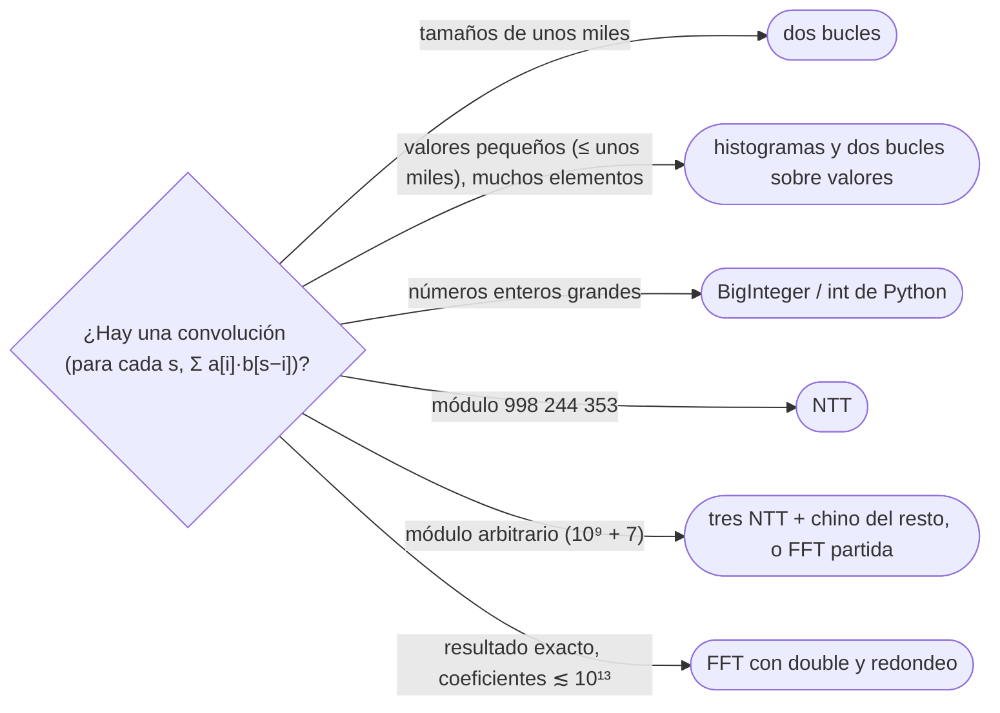

# 09 — FFT y NTT

> Dos polinomios de grado `n` se multiplican en `O(n log n)`, no en `O(n²)`: se evalúan en las raíces
> `n`-ésimas de la unidad, se multiplican los valores punto a punto y se interpola. La FFT lo hace con
> complejos y punto flotante; la NTT, con las mismas cuentas en un primo `p = c · 2ᵏ + 1`, sin errores de
> redondeo. Se reconocen y se nombran; no se escriben en una entrevista.
>
> **Niveles:** FFT [C] · NTT [C].
>
> **📚 Lectura troncal:** Cormen, Leiserson, Rivest y Stein, *Introduction to Algorithms*, 3.ª ed. (MIT
> Press, 2009), cap. 30; cp-algorithms, [*Fast Fourier transform*](https://cp-algorithms.com/algebra/fft.html).
>
> **Asume leído:** [`17/03` — Aritmética modular](03-aritmetica-modular.md).
>
> **Vigencia:** 2026-10-04.

**Salto rápido:** [1](#1--el-problema) · [2](#2--la-teoría) · [3](#3--fft) · [4](#4--ntt) · [5](#5--cómo-se-elige) · [6](#6--señales-del-enunciado) · [🧠](#-preguntas) · [🧩](#-problemas-propios)

---

## 1. 🎯 El problema

Muchas preguntas de conteo terminan en la misma cuenta: dados dos arreglos `a` y `b`, calcular para cada
`s` la suma

```text
c[s] = Σ a[i] · b[s − i]
```

Es la **convolución**, y es exactamente el producto de los polinomios `A(x) = Σ a[i] xⁱ` y
`B(x) = Σ b[j] xʲ`: el coeficiente de `xˢ` en `A · B` es `c[s]`. Aparece al contar sumas de pares («¿de
cuántas formas `a[i] + b[j] = s`?», con `a` y `b` como histogramas), al multiplicar números enormes (un
número en base 10 es un polinomio evaluado en `x = 10`), y al combinar distribuciones de dados o de
puntuaciones.

La cuenta directa son dos bucles: `Θ(n · m)`. Con `n = m = 5·10⁵`, `2,5·10¹¹` operaciones. Karatsuba
([`10/05`](../10-busqueda-completa-y-divide-y-venceras/05-divide-y-venceras.md)) baja a `Θ(n^{1,585})`,
todavía unos `10⁹`. La FFT baja a `Θ(n log n)`: unos `2·10⁷`.

> 🧠 **Modelo mental.** Un polinomio de grado `< n` queda determinado por sus `n` coeficientes **o** por sus
> valores en `n` puntos distintos. En coeficientes, multiplicar es cuadrático; en valores, es lineal (se
> multiplica punto a punto). La FFT es el cambio de representación rápido, de ida y de vuelta.

---

## 2. 📐 La teoría

**Tres pasos.** Para multiplicar `A` (grado `< n`) y `B` (grado `< m`), el producto tiene grado
`< n + m − 1`; se elige `N` potencia de 2 con `N ≥ n + m − 1` y:

1. **Evaluar** `A` y `B` en `N` puntos.
2. **Multiplicar** los valores: `C(xⱼ) = A(xⱼ) · B(xⱼ)`, `Θ(N)`.
3. **Interpolar**: recuperar los coeficientes de `C` a partir de sus `N` valores.

Con puntos cualesquiera, evaluar e interpolar cuestan `Θ(N²)`. La idea es elegir puntos especiales.

**Las raíces de la unidad.** `ω = e^{2πi/N}` cumple `ω^N = 1`, y sus potencias `1, ω, ω², …, ω^{N−1}` son
`N` puntos distintos con dos propiedades:

- **Cuadrados que se repiten.** Los cuadrados de las raíces `N`-ésimas son las raíces `N/2`-ésimas, cada una
  dos veces. Si `A(x) = A_par(x²) + x · A_impar(x²)`, evaluar `A` en `N` puntos es evaluar dos polinomios de
  la mitad de tamaño en `N/2` puntos y combinar: `T(N) = 2 T(N/2) + Θ(N) = Θ(N log N)`.
- **La inversa es la misma transformada.** Interpolar es aplicar la misma FFT con `ω⁻¹` en lugar de `ω` y
  dividir entre `N`.

**Un ejemplo a mano.** `A(x) = 1 + 2x + 3x²` y `B(x) = 4 + 5x`. El producto tiene grado 3: basta `N = 4`, con
`ω = i` y puntos `1, i, −1, −i`.

| Punto | `A` | `B` | `A · B` |
|---|---|---|---|
| `1` | `6` | `9` | `54` |
| `i` | `−2 + 2i` | `4 + 5i` | `−18 − 2i` |
| `−1` | `2` | `−1` | `−2` |
| `−i` | `−2 − 2i` | `4 − 5i` | `−18 + 2i` |

Interpolando (la transformada con `ω⁻¹ = −i`, dividida entre 4): `4 + 13x + 22x² + 15x³`, que es el producto
escolar. Por ejemplo, el término independiente es `(54 − 18 − 2i − 2 − 18 + 2i) / 4 = 4`.

---

## 3. 🧱 FFT

**Qué resuelve.** La convolución de dos arreglos de números (enteros o reales) en `Θ(N log N)`.

**Qué garantiza.** Con aritmética exacta, el resultado exacto. Con `double`, cada coeficiente sale con un
error de redondeo que crece con `N` y con el tamaño de los valores; para enteros se redondea al entero más
cercano, y el resultado es correcto **mientras los coeficientes del producto quepan con margen en los 53
bits de la mantisa**. Con `10⁶` coeficientes aleatorios, una FFT iterativa con las raíces calculadas una a
una redondea bien productos de hasta `2,5·10¹³` (error de `0,02`), va justa hacia `2·10¹⁴` (error de
`0,19`) y falla con `2,5·10¹⁵` (error de más de 2: cerca de la mitad de los coeficientes mal). Con entradas
de hasta `10⁹`, los coeficientes llegan a `10²³`, muy por encima de `2⁵³ ≈ 9·10¹⁵`: no hay redondeo que lo
salve.

**Cuánto.** Tres transformadas de tamaño `N` (dos de ida y una de vuelta) más el producto punto a punto. La
versión iterativa, con el reordenamiento por bits invertidos (*bit reversal*), evita la recursión.

**Cómo reconocerlo.** «Para cada `s`, cuántos pares suman `s`»; multiplicar números de `10⁵` cifras o más;
combinar dos distribuciones de tamaño `10⁵`; *matching* de cadenas con comodines (cada letra se convierte en
una convolución).

**Si no te la sabes.** Si los valores son pequeños, la convolución de los **histogramas** en
`Θ(V²)` con `V` el valor máximo, sin importar cuántos elementos haya. Si los tamaños son de unos miles, la
cuenta directa. Para números grandes, `BigInteger` de Java (que multiplica con Karatsuba y Toom-Cook) o los
enteros de Python.

**Dónde está entera.** CLRS, cap. 30, con la versión iterativa en §30.3; cp-algorithms, *Fast Fourier
transform*.

---

## 4. 🧱 NTT

**Qué resuelve.** La misma convolución, módulo un primo, sin punto flotante.

**Qué garantiza.** La FFT solo necesita un elemento `ω` con `ω^N = 1` y potencias distintas antes de
`N`. En `ℤ_p` existe para todo `N` que divida a `p − 1`. El primo de concurso es `p = 998 244 353 =
119 · 2²³ + 1`: `p − 1` tiene el factor `2²³`, así que admite transformadas de hasta `2²³ ≈ 8,4·10⁶`
puntos, y `3` es raíz primitiva ([`17/10`](10-teoria-de-numeros-avanzada.md)), de modo que `ω = 3^{(p−1)/N} mod p`. El resultado es **exacto
módulo `p`**.

**Cuánto.** El mismo `Θ(N log N)`, con multiplicaciones modulares en lugar de complejas; en la práctica,
parecida a la FFT y sin problemas de precisión.

**Cómo reconocerlo.** La convolución pedida **módulo 998 244 353** (es casi una firma del problema), o
conteos combinatorios módulo un primo donde aparecen productos de polinomios.

**Si el módulo no sirve.** Con `10⁹ + 7`, `p − 1 = 2 · 500 000 003` solo admite `N = 2`: no hay NTT directa.
Se hacen tres NTT con tres primos «amigables» y se reconstruye cada coeficiente con el teorema chino del
resto ([`17/03`](03-aritmetica-modular.md)), o una FFT partiendo cada valor en dos mitades de 15 bits para no
pasarse de la mantisa.

**Dónde está entera.** cp-algorithms, *Fast Fourier transform*, sección *Number theoretic transform*.

---

## 5. 🧭 Cómo se elige



> **Regla de entrevista:** si aparece, nombra la convolución y su coste: «es el producto de dos polinomios;
> con FFT o NTT sale en `n log n`». Después ofrece la alternativa que sí escribirías con las cotas dadas.

---

## 6. 🔎 Señales del enunciado

| Señal | Técnica | Por qué |
|---|---|---|
| «Para cada `s`, número de pares con `a[i] + b[j] = s`», valores `≤ 10⁵` | FFT de histogramas | Convolución de dos arreglos de `10⁵` |
| «Módulo 998 244 353» con productos de polinomios | NTT | El primo admite `2²³` puntos |
| Multiplicar números de `10⁵`–`10⁶` cifras | FFT, o `BigInteger` | Números como polinomios en `x = 10` |
| «Cuántas posiciones coinciden» entre un texto y un patrón, para cada desplazamiento | FFT por letra | Cada letra es una correlación |

---

## ⚠️ Errores frecuentes

| Se dice | Lo preciso |
|---|---|
| «Multiplicar polinomios es `O(n²)` sí o sí» | Con FFT o NTT es `Θ(n log n)`; Karatsuba ya es subcuadrático |
| «La FFT con `double` es exacta para enteros» | Lo es mientras los coeficientes del producto queden lejos de `2⁵³`; si no, redondea mal en silencio |
| «La NTT funciona con cualquier primo» | Necesita `N` dividiendo a `p − 1`; con `10⁹ + 7`, no |
| «El tamaño de la transformada es `max(n, m)`» | Es una potencia de 2 `≥ n + m − 1`: si no, los coeficientes altos se «enrollan» sobre los bajos |
| «La NTT es más rápida que la FFT» | El coste es el mismo `Θ(n log n)`; lo que gana es la exactitud módulo `p` |

---

## 📚 Para profundizar

- **Libro** — Cormen, Leiserson, Rivest y Stein, *Introduction to Algorithms*, 3.ª ed. (MIT Press, 2009),
  cap. 30: evaluación e interpolación, raíces de la unidad, FFT iterativa. *Lectura troncal.*
- **Referencia** — cp-algorithms, [*Fast Fourier transform*](https://cp-algorithms.com/algebra/fft.html):
  FFT, NTT y aplicaciones. *Lectura troncal.*
- **Referencia** — cp-algorithms, [*Operations on polynomials and series*](https://cp-algorithms.com/algebra/polynomial.html):
  lo que se construye encima (división, inversa de una serie), que retoma [`17/11`](11-funciones-generadoras.md).

---

## 🧠 Preguntas

1. ¿Qué es la convolución de dos arreglos y qué tiene que ver con multiplicar polinomios? 🟢
2. ¿Cuánto cuesta multiplicar dos polinomios de grado `n` de forma directa, con Karatsuba y con FFT? 🟢
3. ¿Cuáles son los tres pasos de la multiplicación por FFT? 🟢
4. ¿Por qué el producto de dos polinomios de grado `< n` necesita una transformada de tamaño `≥ 2n − 1`? 🟢
5. ¿Qué propiedad de las raíces de la unidad hace que la FFT sea `Θ(N log N)`? 🟡
6. ¿Cómo se calcula la transformada inversa? 🟡
7. ¿Por qué 998 244 353 sirve para la NTT y `10⁹ + 7` no? 🟡
8. ¿Cuándo da un resultado incorrecto la FFT con `double` al multiplicar enteros? 🟠
9. ¿Cómo haces una convolución módulo `10⁹ + 7` de arreglos de `10⁵`? 🟠
10. Te piden, para cada `s`, cuántos pares `(i, j)` cumplen `a[i] + b[j] = s`, con `n = 10⁵` y valores
    `≤ 10⁵`. ¿Qué haces? 🟠
11. ¿Cómo multiplicas dos números de `10⁶` cifras decimales con una FFT? 🔴
12. ¿Cómo cuentas, para cada desplazamiento, cuántas letras coinciden entre un texto y un patrón? 🔴

---

## 🧩 Problemas propios

### Todas las sumas

**Nivel:** 🟡 · **Formato:** programa completo.

Hay dos listas de enteros entre `0` y `m`. Para cada `s` de `0` a `2m`, imprime cuántos pares `(x, y)`, con
`x` de la primera lista e `y` de la segunda, cumplen `x + y = s`.

- **Entrada.** Una línea con `n`, `k` y `m`. Una línea con los `n` valores de la primera lista y otra con los
  `k` de la segunda.
- **Salida.** Una línea con `2m + 1` enteros.
- **Restricciones.** `1 ≤ n, k ≤ 10⁵`; `1 ≤ m ≤ 2 000`; `0 ≤` cada valor `≤ m`.

```text
Entrada         Salida
3 2 3           0 1 2 0 1 2 0
1 2 2
0 3

Entrada         Salida
2 2 1           0 2 2
0 1
1 1
```

**Pista 1:** con `10⁵` elementos pero valores hasta `2 000`, ¿cuántos valores distintos puede haber en cada
lista, y qué te basta guardar de ellos?

### Producto de gigantes

**Nivel:** 🔴 · **Formato:** programa completo.

Imprime el producto de dos enteros positivos.

- **Entrada.** Dos líneas, cada una con un entero sin ceros a la izquierda.
- **Salida.** El producto, sin ceros a la izquierda.
- **Restricciones.** Cada número tiene entre 1 y `2·10⁵` cifras.

```text
Entrada         Salida
12345           83810205
6789

Entrada         Salida
99999           9999800001
99999
```

**Pista 1:** si escribes cada número como la lista de sus cifras, ¿qué operación sobre esas dos listas da
las cifras del producto antes de propagar los acarreos?

---

## 🧩 Práctica externa

> 💡 **Truco.** Antes de escribir una transformada, comprueba si la alternativa entra: histogramas cuando los
> valores son pequeños, `BigInteger` o los enteros de Python para números grandes. Una IA puede ayudarte a
> hacer esa cuenta; pídele eso, no la transformada
> ([`01/06`](../01-oficio-del-competidor/06-protocolo-de-resolucion.md)). En Python, la conversión de un
> entero de más de 4 300 cifras a texto está limitada por defecto: hace falta
> `sys.set_int_max_str_digits(0)`.

Las bases no tienen problemas de transformadas; todo es 💀, por curiosidad.

### Por curiosidad

| ✔ | Problema | Plataforma | Nivel | Patrón | Pista 1 |
|---|---|---|---|---|---|
| [ ] | 💀 [Convolution](https://judge.yosupo.jp/problem/convolution_mod) | Library Checker | 🔴 | NTT | ¿Qué primo te dan, y qué potencia de 2 divide a `p − 1`? |
| [ ] | 💀 [Convolution (Mod 1,000,000,007)](https://judge.yosupo.jp/problem/convolution_mod_1000000007) | Library Checker | 🔴 | Tres NTT y chino del resto | ¿Cuánto puede valer un coeficiente del producto sin reducir, y cuántos primos de 30 bits necesitas para cubrirlo? |
| [ ] | 💀 [Convolution (Large)](https://judge.yosupo.jp/problem/convolution_mod_large) | Library Checker | 🔴 | NTT por bloques | Si el tamaño pasa de `2²³`, ¿cómo partes cada polinomio en trozos que sí caben? |
| [ ] | 💀 [Bitwise Xor Convolution](https://judge.yosupo.jp/problem/bitwise_xor_convolution) | Library Checker | 🔴 | Transformada de Walsh-Hadamard | Si en lugar de `i + j` el índice es `i ⊕ j`, ¿qué transformada separa cada bit como la FFT separa par e impar? |

---

## ✅ Criterio de dominio

- Explicar la convolución, los tres pasos de la FFT y por qué cuesta `Θ(n log n)`.
- Explicar cuándo la FFT con `double` falla y qué ofrece la NTT, y por qué 998 244 353.
- Resolver Todas las sumas y Producto de gigantes con las alternativas que sí se escriben.

---

**Anterior:** [`17/08` — Teoría de juegos](08-teoria-de-juegos.md) · **Siguiente:** [`17/10` — Teoría de números avanzada](10-teoria-de-numeros-avanzada.md) ·
**Relacionado:** [`10/05` — Divide y vencerás](../10-busqueda-completa-y-divide-y-venceras/05-divide-y-venceras.md).
