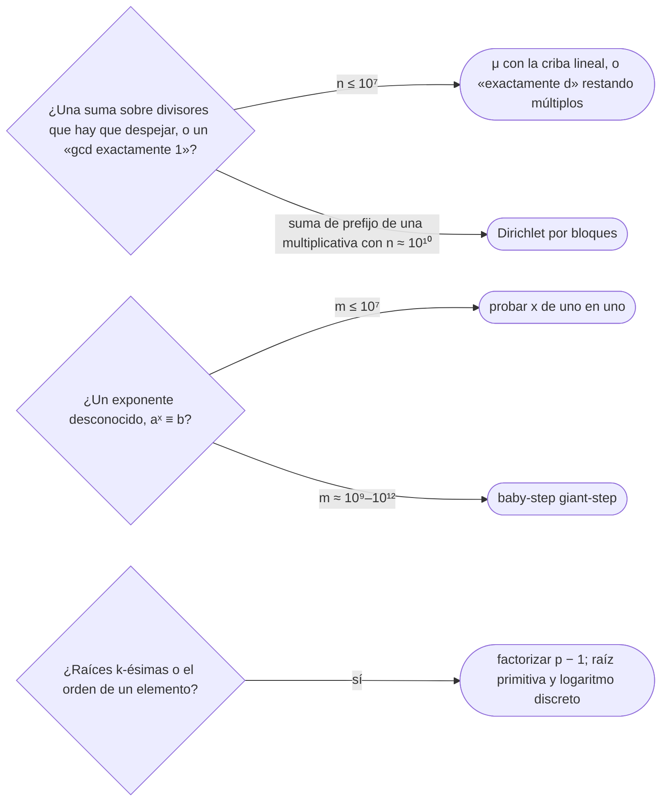

# 10 — Teoría de números avanzada

> Cuatro herramientas que se reconocen y se nombran: Möbius, que deshace sumas sobre divisores; la
> convolución de Dirichlet, el álgebra de las funciones multiplicativas; el logaritmo discreto en `Θ(√p)`; y
> las raíces primitivas, que convierten la multiplicación módulo `p` en suma de exponentes.
>
> **Niveles:** Möbius [C] · convolución de Dirichlet [C] · logaritmo discreto (*baby-step giant-step*) [C] ·
> raíces primitivas [C].
>
> **📚 Lectura troncal:** Graham, Knuth y Patashnik, *Concrete Mathematics*, 2.ª ed. (Addison-Wesley, 1994),
> cap. 4; cp-algorithms, [*Discrete Log*](https://cp-algorithms.com/algebra/discrete-log.html) y
> [*Primitive Root*](https://cp-algorithms.com/algebra/primitive-root.html). cp-algorithms no tiene página de
> Möbius ni de Dirichlet: para ellas, Graham, Knuth y Patashnik, §4.9.
>
> **Asume leído:** [`17/04` — Primos](04-primos.md).
>
> **Vigencia:** 2026-10-04.

**Salto rápido:** [1](#1--el-problema) · [2](#2--la-teoría) · [3](#3--möbius) · [4](#4--convolución-de-dirichlet) · [5](#5--logaritmo-discreto) · [6](#6--raíces-primitivas) · [7](#7--cómo-se-elige) · [8](#8--señales-del-enunciado) · [🧠](#-preguntas) · [🧩](#-problemas-propios)

---

## 1. 🎯 El problema

Dos familias de preguntas que `17/03` y `17/04` no cierran. La primera son **sumas sobre divisores** que hay
que «deshacer». Es fácil contar las cadenas binarias de
longitud `n`: `2ⁿ`. Es más difícil contar las **primitivas**, las que no son la repetición de una más corta
(`0101` no lo es: es `01` dos veces). Cada cadena de longitud `n` es la repetición de exactamente una
primitiva de longitud `d` con `d | n`, así que `2ⁿ = Σ_{d | n} P(d)`. La pregunta es cómo despejar `P`.

La segunda es **despejar un exponente**: `x` con `aˣ ≡ b (mod p)`, sin probar los `10⁹` valores de `x`.

> 🧠 **Modelo mental.** Las funciones aritméticas se multiplican con la convolución de Dirichlet, como los
> polinomios con la convolución de `17/09`, pero sumando sobre los divisores. La función de Möbius es la
> inversa de la función constante 1: sumar sobre divisores se deshace convolucionando con `μ`.

---

## 2. 📐 La teoría

**Funciones multiplicativas.** `f` es multiplicativa si `f(1) = 1` y `f(ab) = f(a) f(b)` cuando
`gcd(a, b) = 1`. Lo son `φ`, el número de divisores, la suma de divisores y `μ`. Basta conocerlas en las
potencias de primos, y la criba lineal de [`17/04`](04-primos.md) las calcula todas hasta `n` en `Θ(n)`.

**La convolución de Dirichlet.**

```text
(f * g)(n) = Σ_{d | n} f(d) · g(n / d)
```

Es conmutativa y asociativa, su neutro es `ε` (`ε(1) = 1` y `0` en el resto), y la convolución de dos
multiplicativas es multiplicativa. Con `1` la función constante y `id(n) = n`:

| Identidad | Lo que dice |
|---|---|
| `μ * 1 = ε` | `Σ_{d \| n} μ(d)` vale 1 si `n = 1` y 0 si no |
| `φ * 1 = id` | `Σ_{d \| n} φ(d) = n` |
| `1 * 1 = d(n)` | Número de divisores |
| `id * 1 = σ(n)` | Suma de divisores |

**La función de Möbius.** `μ(1) = 1`; `μ(n) = 0` si `n` tiene un factor primo al cuadrado; y `μ(n) = (−1)ᵏ` si
`n` es producto de `k` primos distintos. De 1 a 12: `1, −1, −1, 0, −1, 1, −1, 0, 0, 1, −1, 0`.

**La inversión de Möbius.** Como `μ * 1 = ε`, `g(n) = Σ_{d | n} f(d)` si y solo si
`f(n) = Σ_{d | n} μ(d) · g(n/d)`: `g = f * 1` equivale a `f = g * μ`.

**Ejemplo: cadenas primitivas.** `P(n) = Σ_{d | n} μ(d) · 2^{n/d}`. Para `n = 6`: `P(6) = 64 − 8 − 4 + 2 = 54`,
y, como debe ser, `P(1) + P(2) + P(3) + P(6) = 2 + 2 + 6 + 54 = 64`.

**Ejemplo: la suma de los `gcd`.** `Σ_{i=1}^{n} gcd(i, n)`, agrupando los `i` por `d = gcd(i, n)`, es
`(id * φ)(n)`, multiplicativa. Para `n = 12`: `Σ_{d | 12} d · φ(12/d) = 40`.

---

## 3. 🧱 Möbius

**Qué resuelve.** Despejar `f` de `g(n) = Σ_{d | n} f(d)`; contar objetos «exactamente con `gcd` 1» a partir
de los que tienen el `gcd` múltiplo de `d`, que son fáciles de contar. Es inclusión-exclusión
([`17/05`](05-combinatoria.md)) sobre los primos, con los signos ya calculados.

**Qué garantiza.** La inversión es exacta; `μ` hasta `n` sale de la criba lineal en `Θ(n)`.

**Cuánto.** `Θ(n)` la criba; cada suma sobre divisores, tantos pasos como divisores (1 344 como mucho para
`n ≤ 10⁹`).

**Cómo reconocerlo.** «Pares con `gcd` igual a 1» o «igual a `k`»; cadenas primitivas; «libre de cuadrados»;
una suma fácil para «múltiplos de `d`» que se pide para «exactamente».

**Si no te la sabes.** Inclusión-exclusión sobre los primos de `n` (son como mucho 9 para `n ≤ 10⁹`), o
calcular «exactamente `d`» de mayor a menor restando los múltiplos: `exacto[d] = múltiplos[d] −
Σ_{k ≥ 2} exacto[k·d]`, en `Θ(n log n)`.

**Dónde está entera.** Graham, Knuth y Patashnik, §4.9.

---

## 4. 🧱 Convolución de Dirichlet

**Qué resuelve.** Calcular funciones multiplicativas y sus **sumas de prefijo** `Σ_{i ≤ n} f(i)` para `n`
hasta `10¹⁰`–`10¹¹`, donde una criba hasta `n` no cabe.

**Qué garantiza.** Si `f * g = h` y las sumas de prefijo de `g` y `h` son fáciles (como en `φ * 1 = id`), la
de `f` sale recursivamente sobre los valores `⌊n/i⌋`: Dirichlet por bloques («criba de Du» en concursos).

**Cuánto.** `Θ(n^{3/4})`, y `Θ(n^{2/3})` cribando de antemano hasta `n^{2/3}`.

**Cómo reconocerlo.** La suma de `φ`, `μ` o el número de divisores hasta `10¹⁰`; una respuesta que es
`Σ_{i ≤ n}` de una función multiplicativa con `n` enorme.

**Si no te la sabes.** Con `n ≤ 10⁷`, la criba lineal y una suma. Por encima, no hay alternativa sencilla.

**Dónde está entera.** Graham, Knuth y Patashnik, §4.9; las sumas de prefijo, solo en la literatura de concursos.

---

## 5. 🧱 Logaritmo discreto

**Qué resuelve.** Encontrar `x` con `aˣ ≡ b (mod m)`.

**Qué garantiza.** *Baby-step giant-step* lo resuelve en `Θ(√m)` tiempo y memoria (con `log` extra si la
tabla es un mapa ordenado). Con `s = ⌈√m⌉` se escribe `x = i·s − j`, con `1 ≤ i ≤ s` y `0 ≤ j < s`, y la
ecuación queda `a^{i·s} ≡ b · aʲ`: se guarda `b · aʲ` para cada `j` (pasos de bebé) y se recorren `a^{i·s}`
(pasos de gigante) buscando coincidencias. Si `gcd(a, m) = 1` es directo; si no, hay que reducir antes.

**Ejemplo.** `3ˣ ≡ 13 (mod 17)`, `s = 5`. Pasos de bebé, `13 · 3ʲ` para `j = 0 … 4`: `13, 5, 15, 11, 16`. El
primer paso de gigante, `3⁵ ≡ 5`, coincide con `j = 1`: `x = 5 − 1 = 4`, y `3⁴ = 81 = 4 · 17 + 13`.

**Cuánto.** `Θ(√m)`: con `m ≈ 10⁹`, unas `3·10⁴` operaciones por consulta.

**Cómo reconocerlo.** «Encontrar el menor `k` tal que `aᵏ ≡ b`»; un exponente desconocido en una congruencia.

**Si no te la sabes.** Con `m ≤ 10⁷`, probar los `x` de uno en uno (el periodo divide a `φ(m)`).

**Dónde está entera.** cp-algorithms, *Discrete Log*.

---

## 6. 🧱 Raíces primitivas

**Qué resuelve.** Escribir todo elemento no nulo de `ℤ_p` como potencia de un único `g`, para pasar de
multiplicaciones a sumas de exponentes: raíces `k`-ésimas modulares (`xᵏ ≡ a` se vuelve `k·y ≡ log a (mod
p − 1)`), el `ω` de la NTT de [`17/09`](09-fft-y-ntt.md), y el número de soluciones de congruencias.

**Qué garantiza.** Existen módulo `1, 2, 4, pᵏ` y `2pᵏ` (con `p` primo impar), y solo ahí. Módulo un primo
`p` hay exactamente `φ(p − 1)` de ellas. `g` es raíz primitiva si y solo si `g^{(p−1)/q} ≢ 1` para cada primo
`q` que divide a `p − 1`. Módulo 7 son 3 y 5: las potencias de 3 son `1, 3, 2, 6, 4, 5`, todos los no nulos.

**Cuánto.** Factorizar `p − 1` (`Θ(√p)`) y probar candidatos pequeños: la menor suele serlo.

**Cómo reconocerlo.** Raíz `k`-ésima módulo un primo; «el orden multiplicativo»; elegir el `ω` de una NTT.

**Si no te la sabes.** Para el orden de un `a` concreto: el orden divide a `p − 1`; se prueban sus divisores.

**Dónde está entera.** cp-algorithms, *Primitive Root* y *Discrete Root*.

---

## 7. 🧭 Cómo se elige



> **Regla de entrevista:** si aparecen, nómbralas con su garantía («Möbius invierte las sumas sobre
> divisores», «el logaritmo discreto sale en raíz de `p`») y ofrece la alternativa que sí escribirías.

---

## 8. 🔎 Señales del enunciado

| Señal | Técnica | Por qué |
|---|---|---|
| «Número de pares con `gcd(i, j) = 1`» | Möbius | Múltiplos de `d` es fácil; exactamente 1, no |
| «Suma de `φ(i)` para `i ≤ 10¹⁰`» | Dirichlet por bloques | `φ * 1 = id` |
| «Menor `k` con `aᵏ ≡ b (mod p)`» | *Baby-step giant-step* | `Θ(√p)` |
| «`xᵏ ≡ a (mod p)`» | Raíz primitiva + logaritmo discreto | La multiplicación se vuelve suma |

---

## ⚠️ Errores frecuentes

| Se dice | Lo preciso |
|---|---|
| «El logaritmo discreto es como el real» | No es monótono ni continuo: `3ˣ mod 17` salta sin orden, y no hay búsqueda binaria posible |
| «`μ(n)` es `(−1)` elevado al número de factores primos» | Solo si son distintos; con un primo al cuadrado, `μ = 0` |
| «Todo módulo tiene raíz primitiva» | Solo `1, 2, 4, pᵏ` y `2pᵏ`; módulo 8 no hay |
| «Para despejar `f` de una suma sobre divisores hay que resolver un sistema» | Basta convolucionar con `μ` |
| «*Baby-step giant-step* no necesita memoria» | Guarda `Θ(√m)` valores: con `m ≈ 10¹⁸` serían mil millones de entradas |

---

## 📚 Para profundizar

- **Libro** — Graham, Knuth y Patashnik, *Concrete Mathematics*, 2.ª ed. (Addison-Wesley, 1994), cap. 4:
  funciones multiplicativas, `φ`, `μ` y la inversión (§4.9). *Lectura troncal.*
- **Referencia** — cp-algorithms, [*Discrete Log*](https://cp-algorithms.com/algebra/discrete-log.html),
  [*Primitive Root*](https://cp-algorithms.com/algebra/primitive-root.html) y
  [*Discrete Root*](https://cp-algorithms.com/algebra/discrete-root.html). *Lectura troncal.*

---

## 🧠 Preguntas

1. ¿Qué es una función multiplicativa? Da tres ejemplos. 🟢
2. ¿Cuánto vale `μ(n)`? 🟢
3. ¿Qué es una raíz primitiva módulo un primo? 🟢
4. ¿Qué es la convolución de Dirichlet y cuál es su neutro? 🟡
5. ¿Qué dice la inversión de Möbius? 🟡
6. ¿Cuántas cadenas binarias primitivas de longitud 6 hay, y cómo lo calculas? 🟡
7. ¿Cómo funciona *baby-step giant-step* y cuánto cuesta? 🟠
8. ¿Cómo compruebas si `g` es raíz primitiva módulo `p` sin calcular todas sus potencias? 🟠
9. ¿Por qué el logaritmo discreto no es como el real? 🟠
10. ¿Cómo calculas `Σ_{i=1}^{n} gcd(i, n)` sin calcular `n` `gcd`? 🟠
11. ¿Cómo resuelves `xᵏ ≡ a (mod p)` con una raíz primitiva? 🔴
12. ¿Cómo calcularías `Σ_{i ≤ n} φ(i)` con `n = 10¹⁰`? 🔴

---

## 🧩 Problemas propios

### Pares coprimos

**Nivel:** 🟡 · **Formato:** programa completo.

¿Cuántos pares ordenados `(i, j)`, con `1 ≤ i, j ≤ n`, cumplen `gcd(i, j) = 1`?

- **Entrada.** Un entero `n`.
- **Salida.** Un entero.
- **Restricciones.** `1 ≤ n ≤ 10⁷`.

```text
Entrada         Salida
4               11

Entrada         Salida
10              63
```

**Pista 1:** ¿cuántos pares tienen los dos elementos múltiplos de `d`, y cómo pasas de «`gcd` múltiplo de
`d`» a «`gcd` exactamente 1»?

### El orden de un elemento

**Nivel:** 🟠 · **Formato:** programa completo.

Para cada consulta, imprime el menor `k ≥ 1` con `aᵏ ≡ 1 (mod p)`.

- **Entrada.** Una línea con `q`. Después, `q` líneas con `a` y `p`.
- **Salida.** `q` líneas.
- **Restricciones.** `1 ≤ q ≤ 100`; `p` primo, `2 ≤ p ≤ 10⁹`; `1 ≤ a < p`.

```text
Entrada              Salida
3                    3
2 7                  6
3 7                  6
10 13

Entrada              Salida
2                    1
1 2                  2
999999936 999999937
```

**Pista 1:** por el pequeño teorema de Fermat, `a^{p−1} ≡ 1`. ¿Qué relación tiene el `k` buscado con `p − 1`?

---

## 🧩 Práctica externa

> 💡 **Truco.** Antes de escribir una de estas técnicas, comprueba si la criba hasta `n` o probar los
> exponentes de uno en uno entra en el tiempo. Una IA puede ayudarte a hacer esa cuenta; pídele eso, no la
> técnica ([`01/06`](../01-oficio-del-competidor/06-protocolo-de-resolucion.md)). Project Euler pide no
> publicar las respuestas.

Las bases no tienen problemas de estas técnicas; todo es 💀, por curiosidad.

### Por curiosidad

| ✔ | Problema | Plataforma | Nivel | Patrón | Pista 1 |
|---|---|---|---|---|---|
| [ ] | 💀 [Primitive Root](https://judge.yosupo.jp/problem/primitive_root) | Library Checker | 🔴 | Raíz primitiva con `p` de 64 bits | Para comprobar un candidato necesitas los primos de `p − 1`: ¿cómo factorizas un número de 18 cifras? |
| [ ] | 💀 [Sum of Totient Function](https://judge.yosupo.jp/problem/sum_of_totient_function) | Library Checker | 🔴 | Dirichlet por bloques | Si `Σ_{d \| n} φ(d) = n`, ¿qué da sumar esa identidad para todos los `n ≤ N`? |
| [ ] | 💀 [Counting Square-free Integers](https://judge.yosupo.jp/problem/counting_squarefrees) | Library Checker | 🔴 | Möbius sobre cuadrados | ¿Cuántos números `≤ n` son múltiplos de `d²`, y cómo combinas esos conteos para los que no lo son de ninguno? |
| [ ] | 💀 [Squarefree Numbers](https://projecteuler.net/problem=193) | Project Euler | 🔴 | Möbius sobre cuadrados | ¿Hasta qué `d` hace falta conocer `μ` si solo importan los `d²` que no pasan de `2⁵⁰`? |
| [ ] | 💀 [Gcd Sum](https://projecteuler.net/problem=625) | Project Euler | 🔴 | Dirichlet por bloques | Agrupa los pares por el valor del `gcd`: ¿qué suma de `φ` aparece, y hasta qué `n`? |

---

## ✅ Criterio de dominio

- Enunciar la inversión de Möbius y usarla para contar cadenas primitivas.
- Explicar *baby-step giant-step* con un ejemplo a mano, y qué es una raíz primitiva y cómo se comprueba.
- Resolver Pares coprimos y El orden de un elemento.

---

**Anterior:** [`17/09` — FFT y NTT](09-fft-y-ntt.md) · **Siguiente:** [`17/11` — Funciones generadoras y Berlekamp-Massey](11-funciones-generadoras.md) ·
**Relacionado:** [`17/03` — Aritmética modular](03-aritmetica-modular.md).
