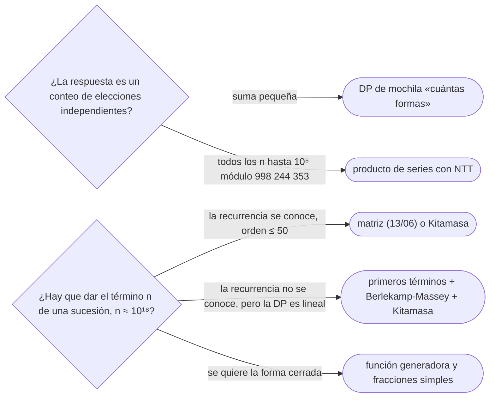

# 11 — Funciones generadoras y Berlekamp-Massey

> Una sucesión es también una serie: `G(x) = Σ aₙ xⁿ`. Sumar, desplazar y convolucionar sucesiones se vuelve
> álgebra de series, y una recurrencia lineal se vuelve una fracción de polinomios. Berlekamp-Massey hace el
> camino inverso: a partir de los primeros términos encuentra la recurrencia lineal más corta que los
> genera, aunque nadie la haya dado. Se reconocen y se nombran; no se escriben en una entrevista.
>
> **Niveles:** funciones generadoras [C] · Berlekamp-Massey [C].
>
> **📚 Lectura troncal:** Graham, Knuth y Patashnik, *Concrete Mathematics*, 2.ª ed. (Addison-Wesley, 1994),
> cap. 7; Sedgewick y Flajolet, *An Introduction to the Analysis of Algorithms*, 2.ª ed. (Addison-Wesley,
> 2013), cap. 3. cp-algorithms no tiene página de Berlekamp-Massey: para él, el artículo de Massey (§📚).
>
> **Asume leído:** [`13/06` — Recurrencias lineales y exponenciación de matrices](../13-dp-avanzada/06-recurrencias-lineales-y-matrices.md) ·
> [`17/09` — FFT y NTT](09-fft-y-ntt.md).
>
> **Vigencia:** 2026-10-04.

**Salto rápido:** [1](#1--el-problema) · [2](#2--la-teoría) · [3](#3--funciones-generadoras) · [4](#4--berlekamp-massey) · [5](#5--cómo-se-elige) · [6](#6--señales-del-enunciado) · [🧠](#-preguntas) · [🧩](#-problemas-propios)

---

## 1. 🎯 El problema

[`13/06`](../13-dp-avanzada/06-recurrencias-lineales-y-matrices.md) calcula el término `10¹⁸` de una
recurrencia lineal con exponenciación de matrices, **si se conoce la recurrencia**. Dos situaciones quedan
fuera.

La primera: el conteo no viene como recurrencia, sino como **combinación de elecciones independientes**
(«de cuántas formas se paga `n` con monedas de 1 y de 2»; «cuántas formas de sumar `s` con varios dados»), y
hay que encontrar la estructura. Las funciones generadoras convierten «elegir uno de cada grupo» en
«multiplicar series».

La segunda: se sabe (o se sospecha) que la respuesta sigue **alguna** recurrencia lineal —porque sale de una
DP con un número finito de estados y transiciones lineales—, pero deducirla a mano es largo o imposible. Se
calculan los primeros términos con la DP lenta y Berlekamp-Massey encuentra la recurrencia.

> 🧠 **Modelo mental.** Una función generadora es un tendedero: la serie cuelga los términos de la sucesión
> en los coeficientes, y las operaciones con la serie mueven todos los términos a la vez. Berlekamp-Massey es
> el detective: dados los primeros términos, devuelve la regla lineal más corta que los explica.

---

## 2. 📐 La teoría

**La serie como objeto.** `G(x) = Σ_{n ≥ 0} aₙ xⁿ` es una **serie formal**: no se evalúa en ningún `x` ni
importa si converge; es una forma de manipular la sucesión entera.

| Operación con la serie | Efecto en la sucesión |
|---|---|
| `F(x) + G(x)` | Suma término a término |
| `x · G(x)` | Desplaza: `aₙ₋₁` en la posición `n` |
| `F(x) · G(x)` | Convolución: `Σ fᵢ g_{n−i}` (la de [`17/09`](09-fft-y-ntt.md)) |
| `G(x) / (1 − x)` | Sumas de prefijo |
| `1 / (1 − x) = 1 + x + x² + …` | La sucesión constante 1 |
| `1 / (1 − c·x)` | `cⁿ` |

**Elegir es multiplicar.** Si un objeto se forma eligiendo una pieza de cada grupo y el tamaño total es la
suma, la serie del total es el producto de las series de los grupos. Pagar con monedas de 1 y de 2: las
monedas de 1 aportan `1 + x + x² + … = 1/(1 − x)`; las de 2, `1/(1 − x²)`; las formas de pagar `n` son el
coeficiente de `xⁿ` en `1 / ((1 − x)(1 − x²))`: `1, 1, 2, 2, 3, 3, 4, 4, …`, es decir `⌊n/2⌋ + 1`.

**Una recurrencia lineal es una fracción.** Si `aₙ = c₁ aₙ₋₁ + … + c_k aₙ₋ₖ` para `n ≥ k`, entonces
`G(x) · (1 − c₁x − … − c_k xᵏ)` es un polinomio `P(x)` de grado `< k`, que fijan los primeros términos:

```text
G(x) = P(x) / Q(x),    Q(x) = 1 − c₁x − c₂x² − … − c_k xᵏ
```

**Ejemplo.** `aₙ = aₙ₋₁ + 2aₙ₋₂` con `a₀ = a₁ = 1`: `1, 1, 3, 5, 11, 21, 43, …`. `Q(x) = 1 − x − 2x²` y
`P(x) = a₀ + (a₁ − a₀)x = 1`. Como `Q(x) = (1 − 2x)(1 + x)`, por fracciones simples
`G(x) = (2/3)/(1 − 2x) + (1/3)/(1 + x)`, y leyendo cada `1/(1 − c·x)` como `cⁿ`:

```text
aₙ = (2ⁿ⁺¹ + (−1)ⁿ) / 3        a₁₀ = (2 048 + 1) / 3 = 683
```

**Berlekamp-Massey.** Dados `N` términos de una sucesión sobre un cuerpo (los enteros módulo un primo), el
algoritmo devuelve la recurrencia lineal **más corta** que los genera. Si la sucesión cumple alguna
recurrencia de orden `≤ k`, con `2k` términos basta para que la encontrada sea la verdadera. Recorre los
términos uno a uno: mantiene la recurrencia actual, calcula la **discrepancia** (lo que predice frente a lo
que hay) y, si no es cero, la corrige con la última recurrencia que falló, escalada. Con `1, 1, 3, 5, 11, 21`
devuelve `aₙ = aₙ₋₁ + 2aₙ₋₂`, de orden 2.

---

## 3. 🧱 Funciones generadoras

**Qué resuelve.** Conteos que son combinaciones de elecciones independientes; recurrencias, incluidas las
no homogéneas, de forma exacta; la forma cerrada de una recurrencia lineal; el caso promedio de algoritmos
como *quicksort* (la misma herramienta que [`02/02`](../02-analisis/02-recurrencias-y-teorema-maestro.md)
deja como electiva).

**Qué garantiza.** Las operaciones de la tabla son exactas. Las que se calculan con computadora —producto de
series, inversa `1/Q(x)` hasta el término `n`, logaritmo y exponencial de una serie— salen en `Θ(n log n)`
con la NTT de `17/09` y el método de Newton.

**Cuánto.** Producto hasta el grado `n`: `Θ(n²)` directo, `Θ(n log n)` con NTT. El coeficiente `n`-ésimo de
`P(x)/Q(x)` con `Q` de grado `k`: `Θ(k² log n)` (o `Θ(k log k log n)` con NTT), calculando `xⁿ mod Q*(x)` (el
método de Kitamasa) en lugar de multiplicar matrices de `k × k` en `Θ(k³ log n)`.

**Cómo reconocerlo.** «De cuántas formas se obtiene una suma `s` eligiendo de cada grupo»; productos de
factores como `(1 + x + … + x^{c})`; un conteo cuya respuesta se pide para todos los `n` hasta `10⁵` módulo
998 244 353; recurrencias con forma cerrada.

**Si no te la sabes.** La DP de la mochila con «cuántas formas» hace la misma multiplicación de series, un
factor cada vez: `Θ(n · s)` para `n` grupos y suma `s`. Para el término `10¹⁸`, la matriz de `13/06`.

**Dónde está entera.** Graham, Knuth y Patashnik, cap. 7; Sedgewick y Flajolet, cap. 3; cp-algorithms,
[*Operations on polynomials and series*](https://cp-algorithms.com/algebra/polynomial.html).

---

## 4. 🧱 Berlekamp-Massey

**Qué resuelve.** Encontrar la recurrencia lineal mínima de una sucesión a partir de sus primeros términos.
Junto con Kitamasa, el término `10¹⁸` de una sucesión de la que solo se sabe calcular los primeros cientos.

**Qué garantiza.** Con `N` términos, la recurrencia más corta que los genera, en `Θ(N²)`. Si la verdadera
tiene orden `≤ k` y `N ≥ 2k`, es esa. Si la sucesión **no** cumple ninguna recurrencia lineal corta, el
algoritmo devuelve una de orden cercano a `N/2` que no predice nada: el resultado solo vale si el orden sale
claramente menor que `N/2`.

**Cuánto.** `Θ(N²)` operaciones modulares: con `N = 1 000`, un millón.

**Cómo reconocerlo.** Una DP con pocos estados y transiciones lineales (conteo de caminos en un grafo fijo,
de teselados de una franja de ancho fijo, de palabras que evitan patrones) y un `n` de `10¹⁸`; la sucesión
se calcula fácil para `n` pequeño, pero la matriz de transición es incómoda de escribir.

**Si no te la sabes.** Escribir la matriz de transición de la DP y exponenciarla (`13/06`). O, si se sabe que
el orden es `≤ k` con `k` pequeño, plantear los `k` coeficientes como incógnitas y resolver el sistema con
Gauss ([`17/07`](07-matrices-y-gauss.md)), probando órdenes de menor a mayor.

**Dónde está entera.** Massey, «Shift-register synthesis and BCH decoding», *IEEE Transactions on
Information Theory* 15(1), 1969.

---

## 5. 🧭 Cómo se elige



> **Regla de entrevista:** si aparecen, nómbralas con su garantía («una recurrencia lineal es una fracción
> de polinomios», «con `2k` términos, Berlekamp-Massey da la recurrencia») y ofrece la alternativa que sí
> escribirías.

---

## 6. 🔎 Señales del enunciado

| Señal | Técnica | Por qué |
|---|---|---|
| «De cuántas formas se suma `s` eligiendo de cada grupo» | Producto de series | Elegir es multiplicar |
| «El término `10¹⁸`» de una DP de pocos estados sin recurrencia evidente | Berlekamp-Massey | Los primeros términos dan la recurrencia |
| «Para cada `n` hasta `10⁵`, módulo 998 244 353» | Series con NTT | Toda la sucesión de una vez |
| Una recurrencia con forma cerrada pedida | Función generadora | Fracciones simples |

---

## ⚠️ Errores frecuentes

| Se dice | Lo preciso |
|---|---|
| «Sin la recurrencia no hay nada que hacer» | Con `2k` términos, Berlekamp-Massey la encuentra si su orden es `≤ k` |
| «La serie tiene que converger» | Es una serie formal: nunca se evalúa |
| «Berlekamp-Massey siempre acierta» | Solo si hay recurrencia de orden `≤ N/2`; si sale de orden `≈ N/2`, probablemente no la hay |
| «El término `n` exige multiplicar matrices de `k × k`» | Kitamasa lo hace en `Θ(k² log n)` con polinomios |
| «Berlekamp-Massey funciona con cualquier módulo» | Divide entre las discrepancias: necesita un cuerpo, es decir, un módulo primo |

---

## 📚 Para profundizar

- **Libro** — Graham, Knuth y Patashnik, *Concrete Mathematics*, 2.ª ed. (Addison-Wesley, 1994), cap. 7:
  funciones generadoras, fracciones simples, convoluciones. *Lectura troncal.*
- **Libro** — Sedgewick y Flajolet, *An Introduction to the Analysis of Algorithms*, 2.ª ed.
  (Addison-Wesley, 2013), cap. 3: funciones generadoras para el análisis de algoritmos. *Lectura troncal.*
- **Referencia** — cp-algorithms, [*Operations on polynomials and series*](https://cp-algorithms.com/algebra/polynomial.html):
  inversa, logaritmo y exponencial de series.
- **Artículo** — Massey, «Shift-register synthesis and BCH decoding», *IEEE Transactions on Information
  Theory* 15(1), 1969.

---

## 🧠 Preguntas

1. ¿Qué es la función generadora de una sucesión? 🟢
2. ¿Qué operación sobre sucesiones corresponde a multiplicar dos funciones generadoras? 🟢
3. ¿Cuál es la función generadora de la sucesión constante 1, y la de `cⁿ`? 🟢
4. ¿Qué hace Berlekamp-Massey? 🟢
5. ¿Por qué la función generadora de una recurrencia lineal es una fracción de polinomios? 🟡
6. ¿De cuántas formas se paga `n` con monedas de 1 y de 2, según su función generadora? 🟡
7. ¿Cuántos términos necesita Berlekamp-Massey para encontrar una recurrencia de orden `k`? 🟡
8. ¿Cómo calculas el término `10¹⁸` de una sucesión de la que solo sabes calcular los primeros 1 000? 🟠
9. ¿Qué pasa si aplicas Berlekamp-Massey a una sucesión que no cumple ninguna recurrencia lineal corta? 🟠
10. Obtén la forma cerrada de `aₙ = aₙ₋₁ + 2aₙ₋₂` con `a₀ = a₁ = 1`. 🔴
11. ¿Por qué Kitamasa es más rápido que la exponenciación de matrices? 🔴

---

## 🧩 Problemas propios

### Dados

**Nivel:** 🟡 · **Formato:** programa completo.

Se lanzan `n` dados de seis caras. ¿De cuántas formas (contando el orden de los dados) suman exactamente
`s`? Imprime la respuesta módulo `10⁹ + 7`.

- **Entrada.** Una línea con `n` y `s`.
- **Salida.** Un entero.
- **Restricciones.** `1 ≤ n ≤ 1 000`; `1 ≤ s ≤ 6 000`.

```text
Entrada         Salida
2 7             6

Entrada         Salida
3 10            27
```

**Pista 1:** ¿qué polinomio representa un dado, y qué operación representa lanzar otro más?

### La regla escondida

**Nivel:** 🟠 · **Formato:** programa completo.

Una sucesión cumple una recurrencia lineal de orden como mucho `k`, que no se da. Con sus primeros `2k`
términos, imprime el término `n` (empezando en el término 0), módulo 998 244 353.

- **Entrada.** Una línea con `k`. Una línea con los `2k` primeros términos. Una línea con `n`.
- **Salida.** Un entero.
- **Restricciones.** `1 ≤ k ≤ 10`; los términos están entre `0` y `998 244 352`; `0 ≤ n ≤ 10¹⁸`.

```text
Entrada         Salida
3               28
1 1 1 2 3 4
10

Entrada         Salida
2               2
2 2 2 2
1000000000000000000
```

**Pista 1:** si el orden fuera exactamente `r`, ¿cuántas ecuaciones lineales tendrías para los `r`
coeficientes, y qué haces si el sistema no tiene solución única?

---

## 🧩 Práctica externa

> 💡 **Truco.** Antes de lanzarte a las series, comprueba si la DP directa o la matriz de `13/06` entran en
> el tiempo. Una IA puede ayudarte a hacer esa cuenta; pídele eso, no la técnica
> ([`01/06`](../01-oficio-del-competidor/06-protocolo-de-resolucion.md)).

Las bases no tienen problemas de estas técnicas; todo es 💀, por curiosidad.

### Por curiosidad

| ✔ | Problema | Plataforma | Nivel | Patrón | Pista 1 |
|---|---|---|---|---|---|
| [ ] | 💀 [Find Linear Recurrence](https://judge.yosupo.jp/problem/find_linear_recurrence) | Library Checker | 🔴 | Berlekamp-Massey | ¿Qué devuelve el algoritmo con `N` términos, y en qué cuerpo trabaja? |
| [ ] | 💀 [Kth term of Linearly Recurrent Sequence](https://judge.yosupo.jp/problem/kth_term_of_linearly_recurrent_sequence) | Library Checker | 🔴 | Kitamasa o `P/Q` | Si `G = P/Q`, ¿cómo se reduce `[xᴺ] P/Q` a un problema de la mitad de tamaño? |
| [ ] | 💀 [Inv of Formal Power Series](https://judge.yosupo.jp/problem/inv_of_formal_power_series) | Library Checker | 🔴 | Newton sobre series | Si conoces la inversa módulo `xᵐ`, ¿cómo obtienes la inversa módulo `x²ᵐ` con dos productos? |
| [ ] | 💀 [Partition Function](https://judge.yosupo.jp/problem/partition_function) | Library Checker | 🔴 | Inversa de un producto | El número de particiones es el coeficiente de `Π 1/(1 − xᵏ)`: ¿qué sabes del producto `Π (1 − xᵏ)`? |

---

## ✅ Criterio de dominio

- Explicar la función generadora de una sucesión, qué hace el producto y por qué una recurrencia lineal es
  `P/Q`.
- Obtener una forma cerrada con fracciones simples.
- Explicar qué hace Berlekamp-Massey, cuántos términos necesita y cuándo su respuesta no sirve.
- Resolver Dados y La regla escondida.

---

**Anterior:** [`17/10` — Teoría de números avanzada](10-teoria-de-numeros-avanzada.md) · **Siguiente:** [`17/12` — Simulación](12-simulacion.md) ·
**Relacionado:** [`02/02` — Recurrencias y teorema maestro](../02-analisis/02-recurrencias-y-teorema-maestro.md).
