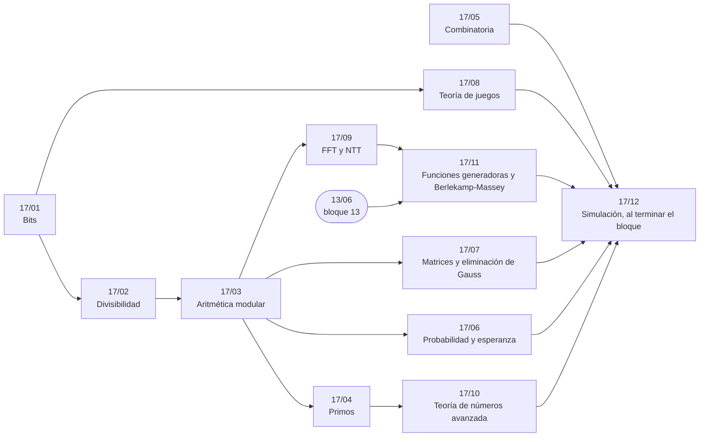

# Bloque 17 — Matemática

> La matemática que pide un juez: bits, divisibilidad, aritmética modular, primos, combinatoria,
> probabilidad y esperanza, matrices y Gauss, teoría de juegos, y como fichas FFT y NTT, la teoría de números
> avanzada y las funciones generadoras. Es el bloque más largo del corpus, y el que menos sale en una entrevista de
> empresa.
>
> Las respuestas de las preguntas y las pistas 2 y 3 de los problemas, en [`13` — Respuestas](13-respuestas.md).
>
> **Vigencia:** 2026-10-04.

---

## 🧭 Índice

| Capítulo | Niveles | Ruta corta |
|---|---|---|
| [`17/01` — Bits](01-bits.md) | operaciones y trucos [A] · `bitset` como optimización [B] · base XOR [B] |  |
| [`17/02` — Divisibilidad](02-divisibilidad.md) | Euclides [A] · extendido [A] · diofánticas [A] |  |
| [`17/03` — Aritmética modular](03-aritmetica-modular.md) | exponenciación modular [A] · inverso por Fermat y por extendido [A] · teorema chino del resto [B] |  |
| [`17/04` — Primos](04-primos.md) | criba de Eratóstenes [A] · criba lineal y menor factor primo [A] · criba segmentada [B] · φ [B] · Miller-Rabin [B] · Pollard rho [C] |  |
| [`17/05` — Combinatoria](05-combinatoria.md) | `nCr` con factoriales [A] · estrellas y barras [A] · Lucas [B] · Catalan [B] · inclusión-exclusión [B] · Burnside [C] |  |
| [`17/06` — Probabilidad y esperanza](06-probabilidad-y-esperanza.md) | linealidad de la esperanza [B] · indicadoras [B] |  |
| [`17/07` — Matrices y eliminación de Gauss](07-matrices-y-gauss.md) | exponenciación [B] · Gauss [B] · sobre GF(2) [B] |  |
| [`17/08` — Teoría de juegos](08-teoria-de-juegos.md) | juegos sobre DAG [B] · Nim [B] · Sprague-Grundy [B] |  |
| [`17/09` — FFT y NTT](09-fft-y-ntt.md) | FFT [C] · NTT [C] |  |
| [`17/10` — Teoría de números avanzada](10-teoria-de-numeros-avanzada.md) | Möbius [C] · convolución de Dirichlet [C] · logaritmo discreto (*baby-step giant-step*) [C] · raíces primitivas [C] |  |
| [`17/11` — Funciones generadoras y Berlekamp-Massey](11-funciones-generadoras.md) | funciones generadoras [C] · Berlekamp-Massey [C] |  |
| [`17/12` — Simulación](12-simulacion.md) | El examen del bloque: preguntas transversales y problemas cronometrados | |
| [`17/13` — Respuestas](13-respuestas.md) | Las preguntas en tres capas y las pistas 2 y 3 | |

---

## 🧭 Orden de lectura

- `17/01` → `17/02` → `17/03` es la cadena aritmética de la que cuelgan los primos, la probabilidad, Gauss y FFT.
- `17/05` (combinatoria) se lee aparte, y `17/08` (juegos) solo necesita los bits de `17/01`.

---

## 🔎 Mapa de señales del bloque

| Señal | Técnica | Capítulo |
|---|---|---|
| «Todos aparecen dos veces salvo…» | XOR de todos | [`17/01`](01-bits.md) |
| «Sin memoria extra», «`O(1)` de espacio» con números del 1 al `n` | XOR o sumas | [`17/01`](01-bits.md) |
| «Simplifica», «coprimos», «máximo divisor común» | Euclides | [`17/02`](02-divisibilidad.md) |
| «¿Cuándo vuelven a coincidir?» dos ciclos | mcm | [`17/02`](02-divisibilidad.md) |
| «Módulo `10⁹ + 7`» y una fracción o un cociente | Inverso por Fermat | [`17/03`](03-aritmetica-modular.md) |
| Exponentes de `10¹⁸`, «`a^(b^c)`» | Exponenciación binaria (y Fermat en el exponente) | [`17/03`](03-aritmetica-modular.md) |
| «Primos hasta `n`», `n ≤ 10⁷` | Criba | [`17/04`](04-primos.md) |
| «Factoriza cada uno de `q` números `≤ 10⁶`» | `spf` | [`17/04`](04-primos.md) |
| «De cuántas formas elegir», «subconjuntos de tamaño `k`» | `nCr` | [`17/05`](05-combinatoria.md) |
| «Repartir objetos iguales», «sucesiones no decrecientes» | Estrellas y barras | [`17/05`](05-combinatoria.md) |
| «Número esperado de…» | Indicadoras | [`17/06`](06-probabilidad-y-esperanza.md) |
| «Al azar», «uniformemente», «barajado» | Simetría | [`17/06`](06-probabilidad-y-esperanza.md) |
| «Cada valor es la media / combinación de sus vecinos» | Sistema lineal | [`17/07`](07-matrices-y-gauss.md) |
| «Esperanza en un grafo con ciclos» | Gauss sobre las esperanzas | [`17/07`](07-matrices-y-gauss.md) |
| «Juegan de forma óptima», «pierde quien no puede mover» | P/N | [`17/08`](08-teoria-de-juegos.md) |
| «Quitan piedras de uno de los montones» | Nim o Grundy | [`17/08`](08-teoria-de-juegos.md) |
| «Para cada `s`, número de pares con `a[i] + b[j] = s`», valores `≤ 10⁵` | FFT de histogramas | [`17/09`](09-fft-y-ntt.md) |
| «Módulo 998 244 353» con productos de polinomios | NTT | [`17/09`](09-fft-y-ntt.md) |
| «Número de pares con `gcd(i, j) = 1`» | Möbius | [`17/10`](10-teoria-de-numeros-avanzada.md) |
| «Suma de `φ(i)` para `i ≤ 10¹⁰`» | Dirichlet por bloques | [`17/10`](10-teoria-de-numeros-avanzada.md) |
| «De cuántas formas se suma `s` eligiendo de cada grupo» | Producto de series | [`17/11`](11-funciones-generadoras.md) |
| «El término `10¹⁸`» de una DP de pocos estados sin recurrencia evidente | Berlekamp-Massey | [`17/11`](11-funciones-generadoras.md) |

---

## 📚 Lectura troncal del bloque

La de cada capítulo, que es también la primera entrada de su «Para profundizar»:

- **`17/01`** — Warren, *Hacker's Delight*, 2.ª ed. (Addison-Wesley, 2012), caps. 2 y 5.
- **`17/02`** — Cormen, Leiserson, Rivest y Stein, *Introduction to Algorithms*, 3.ª ed. (MIT Press, 2009), §31.2; Graham, Knuth y Patashnik, *Concrete Mathematics*, 2.ª ed. (Addison-Wesley, 1994), cap. 4.
- **`17/03`** — Cormen, Leiserson, Rivest y Stein, *Introduction to Algorithms*, 3.ª ed. (MIT Press, 2009), §31.3–31.6; Graham, Knuth y Patashnik, *Concrete Mathematics*, 2.ª ed. (Addison-Wesley, 1994), cap. 4.
- **`17/04`** — Cormen, Leiserson, Rivest y Stein, *Introduction to Algorithms*, 3.ª ed. (MIT Press, 2009), §31.8–31.9; Crandall y Pomerance, *Prime Numbers: A Computational Perspective*, 2.ª ed. (Springer, 2005).
- **`17/05`** — Graham, Knuth y Patashnik, *Concrete Mathematics*, 2.ª ed. (Addison-Wesley, 1994), cap. 5; Laaksonen, *Guide to Competitive Programming*, 3.ª ed. (Springer, 2024), cap. 11.
- **`17/06`** — Mitzenmacher y Upfal, *Probability and Computing*, 2.ª ed. (Cambridge, 2017), caps. 1–2; Graham, Knuth y Patashnik, *Concrete Mathematics*, 2.ª ed. (Addison-Wesley, 1994), cap. 8.
- **`17/07`** — Cormen, Leiserson, Rivest y Stein, *Introduction to Algorithms*, 3.ª ed. (MIT Press, 2009), cap. 28; Strang, *Introduction to Linear Algebra*, 6.ª ed. (Wellesley-Cambridge, 2023), caps. 2–3.
- **`17/08`** — Berlekamp, Conway y Guy, *Winning Ways for Your Mathematical Plays*, 2.ª ed., vol. 1 (A K Peters, 2001); Laaksonen, *Guide to Competitive Programming*, 3.ª ed. (Springer, 2024), cap. 11.
- **`17/09`** — Cormen, Leiserson, Rivest y Stein, *Introduction to Algorithms*, 3.ª ed. (MIT Press, 2009), cap. 30; cp-algorithms, [*Fast Fourier transform*](https://cp-algorithms.com/algebra/fft.html).
- **`17/10`** — Graham, Knuth y Patashnik, *Concrete Mathematics*, 2.ª ed. (Addison-Wesley, 1994), cap. 4; cp-algorithms, [*Discrete Log*](https://cp-algorithms.com/algebra/discrete-log.html) y [*Primitive Root*](https://cp-algorithms.com/algebra/primitive-root.html). cp-algorithms no tiene página de Möbius ni de Dirichlet: para ellas, Graham, Knuth y Patashnik, §4.9.
- **`17/11`** — Graham, Knuth y Patashnik, *Concrete Mathematics*, 2.ª ed. (Addison-Wesley, 1994), cap. 7; Sedgewick y Flajolet, *An Introduction to the Analysis of Algorithms*, 2.ª ed. (Addison-Wesley, 2013), cap. 3. cp-algorithms no tiene página de Berlekamp-Massey: para él, el artículo de Massey (§📚).

---

## 🧭 Qué NO está aquí

- **El desbordamiento y el módulo básico**: en [`01/04` — Tipos, desbordamiento y el primer contacto con el módulo](../01-oficio-del-competidor/04-tipos-desbordamiento-y-modulo.md).
- **La DP de probabilidad**: en [`13/04` — DP de probabilidad y esperanza](../13-dp-avanzada/04-probabilidad-y-esperanza.md).
- **Los algoritmos aleatorizados**: en el [bloque `19`](../19-aleatorizados-y-probabilisticos/README.md).
- **La geometría**: en el [bloque `18`](../18-geometria/README.md).

---

**Anterior:** [Bloque 16 — Cadenas](../16-cadenas/README.md) ·
**Siguiente:** [Bloque 18 — Geometría](../18-geometria/README.md) ·
**Inicio:** [README del corpus](../README.md)
