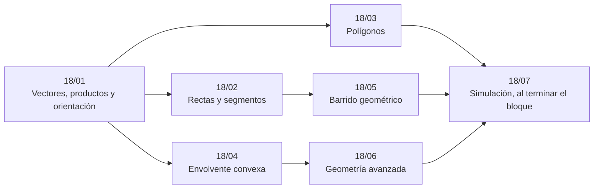

# Bloque 18 — Geometría

> La geometría computacional con enteros siempre que se pueda: vectores, productos y orientación, rectas y
> segmentos, polígonos (cordón, punto en polígono, Pick), la envolvente convexa, el barrido geométrico y, como
> fichas, la geometría avanzada. No está en ninguna ruta básica: es de concurso.
>
> Las respuestas de las preguntas y las pistas 2 y 3 de los problemas, en [`08` — Respuestas](08-respuestas.md).
>
> **Vigencia:** 2026-10-04.

---

## 🧭 Índice

| Capítulo | Niveles | Ruta corta |
|---|---|---|
| [`18/01` — Vectores, productos y orientación](01-vectores-y-orientacion.md) | vectores, punto y cruz [A] · orientación [A] · enteros frente a épsilon [A] |  |
| [`18/02` — Rectas y segmentos](02-rectas-y-segmentos.md) | intersección de segmentos [B] · distancias [B] |  |
| [`18/03` — Polígonos](03-poligonos.md) | fórmula del cordón [B] · punto en polígono [B] · Pick [B] |  |
| [`18/04` — Envolvente convexa](04-envolvente-convexa.md) | cadena monótona de Andrew [B] · *rotating calipers* [C] |  |
| [`18/05` — Barrido geométrico](05-barrido-geometrico.md) | par más cercano [B] · unión de rectángulos [C] · Bentley-Ottmann [C] |  |
| [`18/06` — Geometría avanzada](06-geometria-avanzada.md) | semiplanos [C] · Delaunay y Voronoi [C] · 3D [C] |  |
| [`18/07` — Simulación](07-simulacion.md) | El examen del bloque: preguntas transversales y problemas cronometrados | |
| [`18/08` — Respuestas](08-respuestas.md) | Las preguntas en tres capas y las pistas 2 y 3 | |

---

## 🧭 Orden de lectura

- `18/01` primero: la orientación con enteros es la primitiva de todo el bloque. El resto sigue el orden del bloque.

---

## 🔎 Mapa de señales del bloque

| Señal | Técnica | Capítulo |
|---|---|---|
| «¿Están alineados?», «¿forman un triángulo?» | `cross == 0` | [`18/01`](01-vectores-y-orientacion.md) |
| «¿A la izquierda o a la derecha de la recta?» | `orient` | [`18/01`](01-vectores-y-orientacion.md) |
| «¿Se cruzan las rutas, cables, paredes?» | Cuatro orientaciones + colineales | [`18/02`](02-rectas-y-segmentos.md) |
| «¿El recorrido se corta a sí mismo?» | Intersección entre tramos no consecutivos | [`18/02`](02-rectas-y-segmentos.md) |
| «Área del polígono», «¿en qué sentido van los vértices?» | Cordón | [`18/03`](03-poligonos.md) |
| «¿Está dentro?» con un polígono cualquiera | Rayo semiabierto | [`18/03`](03-poligonos.md) |
| «La valla más corta», «el área mínima que encierra» | Envolvente | [`18/04`](04-envolvente-convexa.md) |
| «Los dos puntos más lejanos», `n = 10⁵` | Envolvente + calipers | [`18/04`](04-envolvente-convexa.md) |
| «Las dos más cercanas» con `n = 10⁵` | Barrido con conjunto por `y` | [`18/05`](05-barrido-geometrico.md) |
| «Área total cubierta», `n = 10⁵` | Barrido con *segment tree* | [`18/05`](05-barrido-geometrico.md) |
| «Zona desde la que se ve todo el polígono» | Semiplanos (núcleo) | [`18/06`](06-geometria-avanzada.md) |
| «Cada casa al hospital más cercano», `10⁵` | Voronoi | [`18/06`](06-geometria-avanzada.md) |

---

## 📚 Lectura troncal del bloque

La de cada capítulo, que es también la primera entrada de su «Para profundizar»:

- **`18/01`** — de Berg y otros, *Computational Geometry: Algorithms and Applications*, 3.ª ed. (Springer, 2008), cap. 1; Cormen, Leiserson, Rivest y Stein, *Introduction to Algorithms*, 3.ª ed. (MIT Press, 2009), §33.1.
- **`18/02`** — Cormen, Leiserson, Rivest y Stein, *Introduction to Algorithms*, 3.ª ed. (MIT Press, 2009), §33.1; O'Rourke, *Computational Geometry in C*, 2.ª ed. (Cambridge, 1998), caps. 1 y 7.
- **`18/03`** — O'Rourke, *Computational Geometry in C*, 2.ª ed. (Cambridge, 1998), cap. 1.
- **`18/04`** — de Berg y otros, *Computational Geometry: Algorithms and Applications*, 3.ª ed. (Springer, 2008), cap. 1; Cormen, Leiserson, Rivest y Stein, *Introduction to Algorithms*, 3.ª ed. (MIT Press, 2009), §33.3.
- **`18/05`** — de Berg y otros, *Computational Geometry: Algorithms and Applications*, 3.ª ed. (Springer, 2008), cap. 2; Kleinberg y Tardos, *Algorithm Design* (Addison-Wesley, 2005), §5.4.
- **`18/06`** — de Berg y otros, *Computational Geometry: Algorithms and Applications*, 3.ª ed. (Springer, 2008), caps. 4, 7 y 9; cp-algorithms, [*Half-plane intersection*](https://cp-algorithms.com/geometry/halfplane-intersection.html) y [*Delaunay triangulation and Voronoi diagram*](https://cp-algorithms.com/geometry/delaunay.html).

---

## 🧭 Qué NO está aquí

- **El barrido de eventos sobre una recta**: en [`04/04` — Compresión de coordenadas y barrido de eventos](../04-secuencias/04-compresion-y-barrido.md).
- **Las estructuras espaciales** (árbol k-d): en [`19/05` — Estructuras espaciales](../19-aleatorizados-y-probabilisticos/05-estructuras-espaciales.md).
- **El par de puntos más cercano por divide y vencerás**: en [`10/05` — Divide y vencerás](../10-busqueda-completa-y-divide-y-venceras/05-divide-y-venceras.md).

---

**Anterior:** [Bloque 17 — Matemática](../17-matematica/README.md) ·
**Siguiente:** [Bloque 19 — Aleatorizados y probabilísticos](../19-aleatorizados-y-probabilisticos/README.md) ·
**Inicio:** [README del corpus](../README.md)
