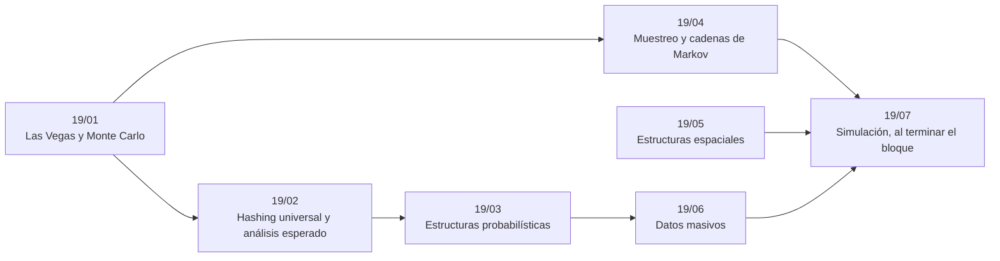

# Bloque 19 — Aleatorizados y probabilísticos

> El azar como herramienta y como hipótesis: Las Vegas y Monte Carlo, el *hashing* universal y el análisis
> esperado, las estructuras probabilísticas (Bloom, Count-Min), el muestreo (Fisher-Yates, *reservoir*), las
> estructuras espaciales y los datos masivos. Es el bloque más cercano al diseño de sistemas.
>
> Las respuestas de las preguntas y las pistas 2 y 3 de los problemas, en [`08` — Respuestas](08-respuestas.md).
>
> **Vigencia:** 2026-10-04.

---

## 🧭 Índice

| Capítulo | Niveles | Ruta corta |
|---|---|---|
| [`19/01` — Las Vegas y Monte Carlo](01-las-vegas-y-monte-carlo.md) | Las Vegas [B] · Monte Carlo [B] · *quicksort* aleatorio [B] · Freivalds [B] · Miller-Rabin como Monte Carlo [B] |  |
| [`19/02` — *Hashing* universal y análisis esperado](02-hashing-universal-y-analisis-esperado.md) | *hashing* universal [B] · análisis esperado de *treap* y *skip list* [B] |  |
| [`19/03` — Estructuras probabilísticas](03-estructuras-probabilisticas.md) | Bloom [B] · Count-Min [B] · HyperLogLog [C] · MinHash [C] |  |
| [`19/04` — Muestreo y cadenas de Markov](04-muestreo-y-markov.md) | Fisher-Yates [A] · *reservoir* [B] · cadenas de Markov [C] · MCMC y MCTS [C] |  |
| [`19/05` — Estructuras espaciales](05-estructuras-espaciales.md) | árbol k-d [C] · vecino más cercano [C] |  |
| [`19/06` — Datos masivos](06-datos-masivos.md) | MapReduce [C] · algoritmos de flujo de datos [C] · memoria externa [C] |  |
| [`19/07` — Simulación](07-simulacion.md) | El examen del bloque: preguntas transversales y problemas cronometrados | |
| [`19/08` — Respuestas](08-respuestas.md) | Las preguntas en tres capas y las pistas 2 y 3 | |

---

## 🧭 Orden de lectura

- `19/01` y `19/02` son la base teórica; `19/03` y `19/06` van juntos (estructuras para datos masivos); `19/04` solo necesita `19/01`, y `19/05` se lee aparte.

---

## 🔎 Mapa de señales del bloque

| Señal | Técnica | Capítulo |
|---|---|---|
| «Comprueba si `AB = C`», `n = 1 000` | Freivalds | [`19/01`](01-las-vegas-y-monte-carlo.md) |
| «¿Son iguales estos dos polinomios / expresiones?» | Evaluar en un punto al azar | [`19/01`](01-las-vegas-y-monte-carlo.md) |
| Juez con *hacks*, `unordered_map` con claves enteras | Semilla del reloj | [`19/02`](02-hashing-universal-y-analisis-esperado.md) |
| «Demuestra que la búsqueda es `O(1)` esperado» | Familia universal | [`19/02`](02-hashing-universal-y-analisis-esperado.md) |
| «¿Ya vimos esta URL?» con miles de millones | Bloom | [`19/03`](03-estructuras-probabilisticas.md) |
| «Las búsquedas más frecuentes de hoy» | Count-Min + *heap* | [`19/03`](03-estructuras-probabilisticas.md) |
| «Baraja», «permutación aleatoria uniforme» | Fisher-Yates | [`19/04`](04-muestreo-y-markov.md) |
| «Nodo al azar de una lista enlazada», «una sola pasada» | *Reservoir* con `k = 1` | [`19/04`](04-muestreo-y-markov.md) |
| «Puntos dentro de un rectángulo», muchas consultas en línea | Árbol k-d o de rangos | [`19/05`](05-estructuras-espaciales.md) |
| Las mismas consultas, conocidas de antemano | Barrido + Fenwick | [`19/05`](05-estructuras-espaciales.md) |
| «Ordenar 100 GB con 4 GB de memoria» | Ordenación externa | [`19/06`](06-datos-masivos.md) |
| «Los más frecuentes en una sola pasada» | Misra-Gries o Count-Min | [`19/06`](06-datos-masivos.md) |

---

## 📚 Lectura troncal del bloque

La de cada capítulo, que es también la primera entrada de su «Para profundizar»:

- **`19/01`** — Brassard y Bratley, *Fundamentos de algoritmia* (Prentice Hall, 1997), cap. 10; Mitzenmacher y Upfal, *Probability and Computing*, 2.ª ed. (Cambridge, 2017), cap. 1.
- **`19/02`** — Cormen, Leiserson, Rivest y Stein, *Introduction to Algorithms*, 3.ª ed. (MIT Press, 2009), §11.3; Mitzenmacher y Upfal, *Probability and Computing*, 2.ª ed. (Cambridge, 2017), cap. 15.
- **`19/03`** — La Rocca, *Advanced Algorithms and Data Structures* (Manning, 2021), cap. 4; Kubica, *Data Structures the Fun Way* (No Starch, 2022), cap. 13; Medjedovic, Tahirovic y Dedovic, *Algorithms and Data Structures for Massive Datasets* (Manning, 2022), caps. 3–5.
- **`19/04`** — Knuth, *The Art of Computer Programming*, Vol. 2, 3.ª ed. (Addison-Wesley, 1997), §3.4.2; Brassard y Bratley, *Fundamentos de algoritmia* (Prentice Hall, 1997), cap. 10; Blum, Hopcroft y Kannan, *Foundations of Data Science* (Cambridge, 2020), cap. 4.
- **`19/05`** — de Berg y otros, *Computational Geometry: Algorithms and Applications*, 3.ª ed. (Springer, 2008), cap. 5; La Rocca, *Advanced Algorithms and Data Structures* (Manning, 2021), cap. 9; Kubica, *Data Structures the Fun Way* (No Starch, 2022), cap. 9.
- **`19/06`** — La Rocca, *Advanced Algorithms and Data Structures* (Manning, 2021), cap. 13; Medjedovic, Tahirovic y Dedovic, *Algorithms and Data Structures for Massive Datasets* (Manning, 2022), caps. 6, 9 y 11.

---

## 🧭 Qué NO está aquí

- **El *quicksort* determinista y la selección**: en [`05/01` — Ordenación por comparación](../05-orden-y-busqueda/01-ordenacion-por-comparacion.md) y [`05/03` — Inversiones, selección y mediana](../05-orden-y-busqueda/03-inversiones-y-seleccion.md).
- **Las tablas *hash* por dentro**: en [`06/03` — Tablas *hash* por dentro y los *anti-hash tests*](../06-lineales-y-hashing/03-tablas-hash.md).
- **Miller-Rabin como algoritmo de primos**: en [`17/04` — Primos](../17-matematica/04-primos.md).
- **La probabilidad como matemática**: en [`17/06` — Probabilidad y esperanza](../17-matematica/06-probabilidad-y-esperanza.md).

---

**Anterior:** [Bloque 18 — Geometría](../18-geometria/README.md) ·
**Siguiente:** [Bloque 20 — Ad hoc, constructivos e interactivos](../20-ad-hoc-constructivos-e-interactivos/README.md) ·
**Inicio:** [README del corpus](../README.md)
