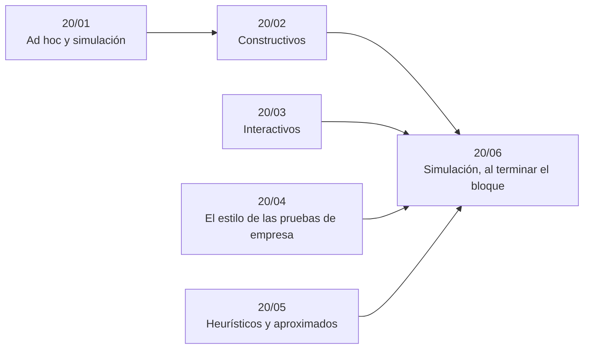

# Bloque 20 — Ad hoc, constructivos e interactivos

> Lo que no encaja en una técnica: los problemas ad hoc y de simulación, los constructivos, los interactivos
> con su protocolo, el estilo de las pruebas de empresa, y los heurísticos y aproximados cuando el óptimo no está
> al alcance.
>
> Las respuestas de las preguntas y las pistas 2 y 3 de los problemas, en [`07` — Respuestas](07-respuestas.md).
>
> **Vigencia:** 2026-10-04.

---

## 🧭 Índice

| Capítulo | Niveles | Ruta corta |
|---|---|---|
| [`20/01` — Ad hoc y simulación](01-ad-hoc-y-simulacion.md) | invariantes y paridad [A] · simulación [A] |  |
| [`20/02` — Constructivos](02-constructivos.md) | constructivos [B] |  |
| [`20/03` — Interactivos](03-interactivos.md) | el protocolo y el *flush* [B] · binaria interactiva [B] |  |
| [`20/04` — El estilo de las pruebas de empresa](04-el-estilo-de-las-pruebas-de-empresa.md) | el formato de empresa [A] | sí |
| [`20/05` — Heurísticos y aproximados](05-heuristicos-y-aproximados.md) | búsqueda local [B] · recocido simulado [B] · *beam search* [B] · aproximación con garantía [C] |  |
| [`20/06` — Simulación](06-simulacion.md) | El examen del bloque: preguntas transversales y problemas cronometrados | |
| [`20/07` — Respuestas](07-respuestas.md) | Las preguntas en tres capas y las pistas 2 y 3 | |

---

## 🧭 Orden de lectura

- `20/04` está en todas las rutas cortas y se lee sin los demás; `20/02` usa las ideas de `20/01`; `20/03` y `20/05` son independientes.

---

## 🔎 Mapa de señales del bloque

| Señal | Técnica | Capítulo |
|---|---|---|
| «¿Es posible llegar a…?» con operaciones que tocan dos cosas a la vez | Paridad | [`20/01`](01-ad-hoc-y-simulacion.md) |
| Tableros y fichas que cubren casillas | Coloración | [`20/01`](01-ad-hoc-y-simulacion.md) |
| «Imprime cualquier permutación / tabla / grafo que cumpla…» | Construcción | [`20/02`](02-constructivos.md) |
| «Si no existe, imprime `-1`» | Construcción + imposibilidad | [`20/02`](02-constructivos.md) |
| «This is an interactive problem» | Protocolo con *flush* | [`20/03`](03-interactivos.md) |
| «Como mucho 30 preguntas», `n = 10⁹` | Binaria | [`20/03`](03-interactivos.md) |
| «Tu puntuación es…», sin respuesta correcta única | Heurística | [`20/05`](05-heuristicos-y-aproximados.md) |
| Viajante, asignación, calendario con `n` de cientos o miles | Recocido o búsqueda local | [`20/05`](05-heuristicos-y-aproximados.md) |

---

## 📚 Lectura troncal del bloque

La de cada capítulo, que es también la primera entrada de su «Para profundizar»:

- **`20/01`** — Halim, Halim y Effendy, *Competitive Programming 4*, libro 1 (2020), cap. 1 (ad hoc); Engel, *Problem-Solving Strategies* (Springer, 1998), cap. 1 (el principio de invariancia).
- **`20/02`** — Engel, *Problem-Solving Strategies* (Springer, 1998), caps. 1–2; cp-algorithms.
- **`20/03`** — la guía de Codeforces *Interactive Problems: Guide for Participants*, citada por título (su web responde `403` a `curl`); Laaksonen, *Guide to Competitive Programming*, 3.ª ed. (Springer, 2024), cap. 15.
- **`20/04`** — McDowell, *Cracking the Coding Interview*, 6.ª ed. (CareerCup, 2015); Aziz, Lee y Prakash, *Elements of Programming Interviews in Java* (2015).
- **`20/05`** — Brassard y Bratley, *Fundamentos de algoritmia* (Prentice Hall, 1997), cap. 13; Russell y Norvig, *Artificial Intelligence: A Modern Approach*, 4.ª ed. (Pearson, 2020), cap. 4; Kleinberg y Tardos, *Algorithm Design* (Addison-Wesley, 2005), caps. 11–12.

---

## 🧭 Qué NO está aquí

- **Las técnicas que estos problemas acaban usando**: en los bloques [`04`](../04-secuencias/README.md) a [`19`](../19-aleatorizados-y-probabilisticos/README.md).
- **El protocolo para atacar un problema sin técnica evidente**: en [`01/06` — El protocolo de resolución, la repetición y el concurso](../01-oficio-del-competidor/06-protocolo-de-resolucion.md).
- **Los simulacros con el formato de empresa**: en el [bloque `21`](../21-simulacros/README.md).
- **La teoría de la aproximación y la NP-completitud**: en el bloque opcional [`22`](../22-teoria-de-la-computacion/README.md).

---

**Anterior:** [Bloque 19 — Aleatorizados y probabilísticos](../19-aleatorizados-y-probabilisticos/README.md) ·
**Siguiente:** [Bloque 21 — Simulacros](../21-simulacros/README.md) ·
**Inicio:** [README del corpus](../README.md)
