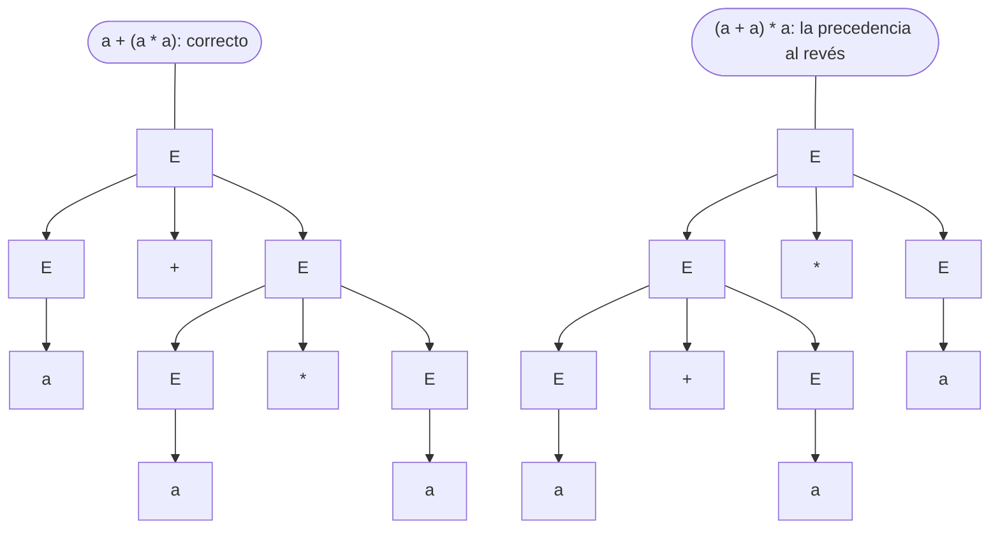

# 01 — Lenguajes y gramáticas

> **Opcional.** Ningún capítulo del hilo principal depende de este. Qué es un lenguaje formal, qué
> lenguajes reconoce un autómata finito y cuáles no, cómo se describen los que no con una gramática libre de
> contexto, y la herramienta que separa unos de otros: el lema de bombeo. Es el capítulo que responde de una
> vez a «¿por qué no puedo validar paréntesis con una expresión regular?».
>
> **Niveles:** lenguajes regulares, cierre y equivalencia [A] · gramáticas libres de contexto y ambigüedad
> [A] · el lema de bombeo [B].
>
> **📚 Lectura troncal:** Hopcroft, Motwani y Ullman, *Introducción a la teoría de autómatas, lenguajes y
> computación*, 3.ª ed. (Pearson, 2007), caps. 4 y 5.
>
> **Asume leído:** [`16/07` — Autómatas y expresiones regulares](../16-cadenas/07-automatas-y-expresiones-regulares.md).
>
> **Vigencia:** 2026-10-04.

**Salto rápido:** [1](#1--el-problema) · [2](#2--la-teoría) · [3](#3--lenguajes-regulares-cierre-y-equivalencia) · [4](#4--gramáticas-libres-de-contexto-y-ambigüedad) · [5](#5--el-lema-de-bombeo) · [6](#6--cómo-se-elige) · [7](#7--señales-del-enunciado) · [8](#8--dónde-aparece-de-verdad) · [🧠](#-preguntas)

---

## 1. 🎯 El problema

Un validador de fórmulas acepta `(a+b)*c` y rechaza `(a+b))*c`. Alguien propone resolverlo con una
expresión regular, y empieza: `\([^()]*\)` vale para un nivel; `\(([^()]|\([^()]*\))*\)` para dos; cada nivel
más alarga la expresión. Ninguna versión finita sirve para **cualquier** profundidad, y no es falta de
ingenio: es un teorema. Un autómata finito con `p` estados no puede distinguir `p + 1` profundidades
distintas, y los paréntesis equilibrados las exigen todas.

El capítulo da las dos herramientas que convierten esa intuición en algo que se dice con precisión en una
entrevista: la **gramática libre de contexto**, que describe los paréntesis equilibrados en una línea
(`S → ( S ) S | ε`), y el **lema de bombeo**, que demuestra que ninguna expresión regular lo hace.

> 🧠 **Modelo mental.** Un autómata finito tiene memoria acotada: lo único que recuerda es en cuál de sus
> estados está. Todo lenguaje que exige contar sin límite —abiertos frente a cerrados, `a` frente a `b`— queda
> fuera de su alcance.

En el camino aparecen dos algoritmos pequeños y útiles: decidir si dos autómatas aceptan exactamente lo
mismo, y calcular qué variables de una gramática pueden desaparecer. Los dos son la base de lo que hace un
generador de analizadores (`22/06`).

---

## 2. 📐 La teoría

**Alfabeto, cadena, lenguaje.** Un alfabeto `Σ` es un conjunto finito de símbolos; una cadena, una
secuencia finita de ellos (`ε` es la vacía); un **lenguaje**, un conjunto de cadenas, finito o infinito.
`Σ*` es el conjunto de todas las cadenas. Las operaciones con lenguajes son las de conjuntos (unión,
intersección, complemento respecto de `Σ*`) más la **concatenación** `L₁L₂` y la **estrella de Kleene** `L*`.

**Gramática.** Una cuádrupla `G = (V, T, P, S)`: variables (no terminales) `V`, terminales `T`, producciones
`P` de la forma `cabeza → cuerpo` y una variable inicial `S`. Una **derivación** reescribe una variable por el
cuerpo de una de sus producciones, paso a paso, desde `S`; el lenguaje `L(G)` son las cadenas de terminales
que se pueden derivar. El tipo de producción permitido decide qué lenguajes salen:

```text
Tipo   Gramática                    Producciones          Máquina que la reconoce
3      regular                      A → aB | a | ε        autómata finito (DFA, NFA)        16/07
2      libre de contexto            A → cualquier cuerpo  autómata de pila                  22/02
1      sensible al contexto         αAβ → αγβ, |γ| ≥ 1    autómata linealmente acotado      —
0      sin restricciones            α → β                 máquina de Turing                 22/03
```

Es la **jerarquía de Chomsky**, y cada nivel contiene estrictamente al de abajo: `aⁿbⁿ` es libre de contexto
y no regular; `aⁿbⁿcⁿ` es sensible al contexto y no libre de contexto.

**Teorema (Kleene).** Las expresiones regulares, los DFA y los NFA describen la misma clase: los lenguajes
regulares. Está en [`16/07`](../16-cadenas/07-automatas-y-expresiones-regulares.md), con las
construcciones de Thompson y de subconjuntos; aquí se usa sin repetirlo.

**Teorema (lema de bombeo para lenguajes regulares).** Si `L` es regular, existe una constante `p ≥ 1` tal
que toda cadena `w ∈ L` con `|w| ≥ p` se puede partir como `w = xyz` con `|xy| ≤ p`, `|y| ≥ 1` y `xyᵏz ∈ L`
para todo `k ≥ 0`. La prueba es el principio del palomar sobre los estados del DFA (§5).

**Lo que se puede decidir.** Para lenguajes regulares dados por un DFA: si una cadena pertenece (`Θ(n)`), si
el lenguaje es vacío (alcanzabilidad de un final), y si dos DFA son equivalentes (§3). Para libres de
contexto: la pertenencia (CYK, `22/02`) y si el lenguaje es vacío; **la equivalencia de dos gramáticas y si
una gramática es ambigua son indecidibles** ([`22/03`](03-maquinas-de-turing-y-decidibilidad.md)).

---

## 3. 🧱 Lenguajes regulares: cierre y equivalencia

**Qué es.** Las **propiedades de cierre** dicen qué operaciones no sacan de la clase: si `L₁` y `L₂` son
regulares, también lo son `L₁ ∪ L₂`, `L₁ ∩ L₂`, el complemento `Σ* − L₁`, `L₁L₂`, `L₁*` y la inversa. La
construcción que más se usa es el **autómata producto**: sus estados son pares `(q₁, q₂)` y lee cada símbolo
en los dos autómatas a la vez.

**Por qué es correcto.** El producto está en `(q₁, q₂)` después de leer `w` si y solo si `D₁` está en `q₁` y
`D₂` en `q₂` (inducción sobre `|w|`). Eligiendo los finales se obtiene cada operación: «los dos finales» es la
intersección, «alguno» la unión, «exactamente uno» la diferencia simétrica. El complemento es intercambiar
finales y no finales, **siempre que el DFA sea completo** (con transición para todo símbolo en todo estado; si
falta alguna, se añade un estado sumidero).

**Teorema (equivalencia de DFA).** Dos DFA completos con `n₁` y `n₂` estados aceptan el mismo lenguaje si y
solo si ningún par alcanzable del producto tiene un final en uno y un no final en el otro. Además, si no son
equivalentes, la cadena más corta que los distingue mide **menos de `n₁ · n₂`**: en su recorrido por el
producto no se repite ningún par, porque si se repitiera, quitar el tramo entre las dos apariciones daría una
cadena distintiva más corta.

**Cómo va**, con los dos DFA de `(a|b)*abb` de [`16/07`](../16-cadenas/07-automatas-y-expresiones-regulares.md):
el mínimo de 4 estados (`D₁`) y el que da la construcción de subconjuntos, de 5 (`D₂`). BFS sobre pares desde
`(0, 0)`:

```text
par      a        b        ¿final en uno solo?
(0,0)    (1,1)    (0,2)    no
(1,1)    (1,1)    (2,3)    no
(0,2)    (1,1)    (0,2)    no
(2,3)    (1,1)    (3,4)    no
(3,4)    (1,1)    (0,2)    no: los dos son finales
5 pares alcanzables, ninguno distingue  →  equivalentes
```

Si en `D₂` se cambia una sola transición, `4 →b 4` en lugar de `4 →b 2`, el BFS llega a `(0, 4)` con la cadena
`abbb`: `D₂` la acepta y `D₁` no.

**Cuánto.** `O(n₁ · n₂ · σ)` tiempo y `O(n₁ · n₂)` memoria: cada par se visita una vez y tiene `σ` salidas.

**La plantilla.** El producto no tiene estructura propia en la librería estándar de ningún lenguaje: es un
BFS ([`14/02`](../14-grafos-recorridos/02-bfs.md)) sobre pares. Se escribe en el ejemplo trabajado.

### De la versión ingenua a la buena

**El problema.** Dados dos DFA completos sobre `{a, b}`, decir si aceptan el mismo lenguaje y, si no, dar la
cadena más corta que los distingue. Con `D₁` y `D₂` de arriba: equivalentes; con el `D₂` modificado, `abbb`.

**La versión ingenua**, que prueba todas las cadenas por longitud creciente hasta la cota del teorema:

```java
// Ingenua: todas las cadenas de longitud < n1·n2, por longitudes crecientes. Correcta, Θ(σ^(n1·n2)).
static String distinguishNaive(int[][] d1, boolean[] f1, int[][] d2, boolean[] f2) {
    int limit = d1.length * d2.length;                  // la más corta que distingue mide < n1·n2
    for (int len = 0; len < limit; len++) {
        String w = search(d1, f1, d2, f2, 0, 0, len, new StringBuilder());
        if (w != null) return w;
    }
    return null;                                        // equivalentes
}

static String search(int[][] d1, boolean[] f1, int[][] d2, boolean[] f2,
                     int p, int q, int left, StringBuilder w) {
    if (left == 0) return f1[p] != f2[q] ? w.toString() : null;
    for (int c = 0; c < d1[0].length; c++) {
        w.append((char) ('a' + c));
        String r = search(d1, f1, d2, f2, d1[p][c], d2[q][c], left - 1, w);
        w.deleteCharAt(w.length() - 1);
        if (r != null) return r;
    }
    return null;
}
```

> «Es correcta porque la cota `n₁ · n₂` está demostrada, pero prueba `2²⁰` cadenas para dos autómatas de 4 y 5
> estados: es exponencial. Y está visitando una y otra vez los mismos pares de estados por cadenas
> distintas: lo único que importa de una cadena es a qué par lleva.»

**El camino a la buena.** BFS sobre los pares, con un conjunto de visitados: cada par se expande una vez, y
el primer par «final en uno solo» que se saca da la cadena más corta, porque BFS recorre por longitud.

```java
// Equivalencia por el autómata producto. O(n1·n2·σ) tiempo y memoria.
static String distinguish(int[][] d1, boolean[] f1, int[][] d2, boolean[] f2) {
    int n2 = d2.length, sigma = d1[0].length;
    String[] word = new String[d1.length * n2];          // cadena con que se llegó a cada par; null = no visto
    ArrayDeque<Integer> queue = new ArrayDeque<>();
    word[0] = "";
    queue.add(0);                                        // el par (0, 0) codificado como 0 · n2 + 0
    while (!queue.isEmpty()) {
        int pair = queue.poll(), p = pair / n2, q = pair % n2;
        if (f1[p] != f2[q]) return word[pair];           // la primera que sale es la más corta
        for (int c = 0; c < sigma; c++) {
            int next = d1[p][c] * n2 + d2[q][c];
            if (word[next] == null) { word[next] = word[pair] + (char) ('a' + c); queue.add(next); }
        }
    }
    return null;                                         // ningún par alcanzable distingue: equivalentes
}
```

- **Lo que cambió** es el conjunto de visitados: la ingenua recorre el árbol de todas las cadenas, la buena el
  grafo de pares, que tiene `n₁ · n₂` nodos. Con `D₁` y `D₂`, 5 pares frente a más de un millón de cadenas.
- **Guardar la cadena entera por par** cuesta `O(n₁ · n₂)` caracteres cada una; para autómatas grandes se
  guarda el padre y el símbolo, y se reconstruye al final, como en BFS.
- **Minimizar** los dos DFA (Hopcroft, `O(n σ log n)`) y comparar si son isomorfos es la otra forma de decidir
  la equivalencia; el producto es más corto de escribir.

**Cuándo sí:** comprobar que una optimización de un autómata (un lexer reescrito, un validador simplificado)
no cambió lo que acepta; intersecar o restar lenguajes regulares. **Cuándo no:** con NFA, el producto de dos
NFA decide la intersección, pero la equivalencia exige pasar antes a DFA, y eso puede ser exponencial
(`16/07`).

> **Veredicto:** los lenguajes regulares son cerrados bajo todas las operaciones de conjuntos, y el autómata
> producto es la construcción que lo demuestra y la que decide, en `O(n₁ · n₂ · σ)`, si dos DFA son
> equivalentes.

---

## 4. 🧱 Gramáticas libres de contexto y ambigüedad

**Qué es.** Una gramática cuyas producciones tienen **una sola variable a la izquierda**: `A → α`, con `α`
cualquier cadena de variables y terminales. «Libre de contexto» significa que `A` se reescribe igual esté
donde esté. Dos ejemplos que vuelven en todo el bloque:

```text
paréntesis equilibrados:      S → ( S ) S | ε
expresiones (ambigua):        E → E + E | E * E | ( E ) | a
expresiones (no ambigua):     E → E + T | T
                              T → T * F | F
                              F → ( E ) | a
```

**Por qué es correcto** que estas gramáticas generan lo que dicen se demuestra por **inducción** en las dos
direcciones: toda cadena derivada cumple la propiedad (inducción sobre la longitud de la derivación), y toda
cadena con la propiedad se deriva (inducción sobre su longitud). Para `S → ( S ) S | ε`: una cadena
equilibrada no vacía empieza por `(`, y su `)` pareja la parte en `( u ) v` con `u` y `v` equilibradas.

**Derivaciones y árboles.** Una derivación por la izquierda reescribe siempre la variable más a la izquierda.
El **árbol de derivación** olvida el orden de los pasos y guarda solo qué producción se usó en cada nodo. Una
gramática es **ambigua** si alguna cadena tiene dos árboles distintos (equivalentemente, dos derivaciones por
la izquierda). Con la gramática ambigua, `a + a * a` tiene dos:



La gramática no ambigua fuerza la precedencia con **niveles** (`E` suma términos, `T` multiplica factores) y
la asociatividad por la izquierda con la **recursión por la izquierda** (`E → E + T`). Es la que se convierte
en un analizador de descenso recursivo en `22/06`.

**Cuánto.** Decidir si una cadena pertenece a `L(G)` cuesta `O(n³ · |G|)` con CYK (`22/02`). Contar los
árboles de una cadena en la gramática ambigua da los **números de Catalan**: con `k` operadores, `Cₖ` árboles
(1, 1, 2, 5, 14, 42…), porque el operador de la raíz parte la expresión en dos subexpresiones independientes,
la misma recurrencia que cuenta los árboles binarios ([`17/05`](../17-matematica/05-combinatoria.md)).

**Las variables anulables.** Una variable es **anulable** si deriva `ε`. Calcularlas es el primer paso de casi
todo lo que se hace con una gramática: pasarla a forma normal de Chomsky (`22/02`), calcular los conjuntos
que usa un analizador, o saber si el lenguaje contiene la cadena vacía.

### De la versión ingenua a la buena

**El problema.** Dada una gramática, decir qué variables son anulables. Con

```text
S → A B C | d        A → a | ε        B → A A | b        C → c C | S
```

son `A` y `B`. `S` y `C` no: `S` necesita a `C`, y `C` solo escapa de sí misma por `S`.

**La versión ingenua**, una recursión que prueba cada producción y no vuelve a entrar en una variable que ya
está en el camino actual (las variables en mayúscula, los terminales en minúscula, `""` es `ε`):

```java
// Ingenua: ¿deriva A la cadena vacía? Correcta, exponencial en el caso peor.
// Llamada inicial: nullable('S', new HashSet<>(Set.of('S')), g).
static boolean nullable(char a, Set<Character> path, Map<Character, List<String>> g) {
    for (String body : g.get(a)) {
        boolean ok = true;
        for (char x : body.toCharArray()) {
            if (!g.containsKey(x) || path.contains(x)) { ok = false; break; }   // terminal, o ciclo
            path.add(x);
            boolean sub = nullable(x, path, g);
            path.remove(x);
            if (!sub) { ok = false; break; }
        }
        if (ok) return true;
    }
    return false;
}
```

> «Es correcta porque, si `A` deriva `ε`, tiene un árbol para `ε` sin variables repetidas en ningún camino de
> la raíz a una hoja: si se repitieran, el subárbol de abajo sustituye al de arriba. Pero el resultado depende
> del camino, así que no puedo memorizarlo, y la misma variable se recalcula para cada camino distinto que
> llega a ella: exponencial.»

**El camino a la buena.** Al revés: en lugar de preguntar por cada variable, construir el conjunto desde
abajo. Empieza vacío; en cada vuelta, una variable entra si tiene un cuerpo formado **solo** por variables que
ya están (el cuerpo vacío cuenta). Se para cuando una vuelta no añade nada.

```java
// Anulables por punto fijo. Como mucho |V| + 1 vueltas, cada una O(|G|): O(|V| · |G|).
static Set<Character> nullables(Map<Character, List<String>> g) {
    Set<Character> nul = new HashSet<>();
    boolean changed = true;
    while (changed) {
        changed = false;
        for (Map.Entry<Character, List<String>> e : g.entrySet()) {
            if (nul.contains(e.getKey())) continue;
            for (String body : e.getValue()) {
                if (body.chars().allMatch(c -> nul.contains((char) c))) {   // "" cumple: es ε
                    nul.add(e.getKey());
                    changed = true;
                    break;
                }
            }
        }
    }
    return nul;
}
```

- **Termina** porque cada vuelta útil añade al menos una variable, y hay `|V|`.
- **Da el menor conjunto cerrado** (el *punto fijo mínimo*), que es el correcto: `S` y `C` se apoyan la una en
  la otra, y el conjunto `{A, B, S, C}` también sería «cerrado», pero ninguna derivación finita sostiene a `S`.
  Empezar por el vacío es lo que evita aceptar esos ciclos.
- **Con una lista de trabajo** (para cada variable, qué producciones la mencionan, y un contador de símbolos
  aún no anulables por producción) baja a `O(|G|)`. El mismo esquema calcula las variables **generadoras** (que
  derivan alguna cadena de terminales) y las **alcanzables** desde `S`, que son las que limpia `22/02` antes de
  CYK.

**Cuándo sí:** describir lenguajes con anidamiento —paréntesis, expresiones, bloques de un lenguaje de
programación, JSON—. **Cuándo no:** si el lenguaje es regular, un DFA es más simple y más rápido; si exige
comparar tres cantidades (`aⁿbⁿcⁿ`) o que una variable esté declarada antes de usarse, ninguna gramática libre
de contexto alcanza, y los compiladores lo comprueban después, en el análisis semántico.

> **Veredicto:** una gramática libre de contexto describe el anidamiento en una línea; su precio es la
> ambigüedad, que se quita con niveles de precedencia. Las preguntas sobre una gramática —anulables,
> generadoras, alcanzables— se responden con un punto fijo desde el vacío, no con una recursión que pregunta.

---

## 5. 🧱 El lema de bombeo

**Qué es.** Una propiedad que **todo** lenguaje regular cumple, y que por eso sirve para demostrar que uno
**no** lo es: si no la cumple, no es regular.

**Por qué es correcto** (el enunciado de §2 y una frase): sea `D` un DFA de `L` con `p` estados y `w ∈ L` con
`|w| ≥ p`; al leer los `p` primeros símbolos, `D` pasa por `p + 1` estados, y por el palomar alguno se repite.
El tramo `y` entre las dos apariciones es un ciclo, y se puede recorrer `k` veces, incluida ninguna.

**Cómo va**, primero hacia delante, sobre el `D₁` de §3 (`p = 4`) y `w = aababb`:

```text
posición   0   1   2   3   4   5   6
símbolo      a   a   b   a   b   b
estado     0   1   1   2   1   2   3
           el estado 1 se repite en las posiciones 1 y 2  →  x = a · y = a · z = babb
xz = ababb ✓   xyz = aababb ✓   xyyz = aaababb ✓   (todas terminan en abb)
```

Y hacia atrás, como juego contra un adversario, para demostrar que los paréntesis equilibrados no son
regulares:

```text
1. El adversario elige p.
2. Tú eliges w = (ᵖ )ᵖ, que está en L y mide 2p ≥ p.
3. El adversario parte w = xyz con |xy| ≤ p y |y| ≥ 1: por |xy| ≤ p, y son solo «(».
4. Tú eliges k = 0: xz tiene menos «(» que «)», no está en L.  Contradicción: L no es regular.
```

La clave es el paso 2: la cadena se elige para que la restricción `|xy| ≤ p` deje al adversario sin
opciones. Con `w = ()ᵖ` no sale: el adversario elige `y = ()` y bombearlo deja la cadena equilibrada.

**Cuánto.** No es un algoritmo: es un argumento. La construcción hacia delante, encontrar `x`, `y`, `z` en un
DFA, es `O(p)`: un recorrido que anota en qué posición se vio cada estado.

**La plantilla.** No hay: es un método de demostración. Lo que se lleva en el cuaderno es el guion de los
cuatro pasos.

**Lo que el lema no dice.** Es una condición **necesaria**, no suficiente: hay lenguajes no regulares que
la cumplen (por ejemplo `{aⁱbʲcᵏ : i = 0 o j = k}`, donde cualquier cadena larga se puede bombear en su primer
símbolo). La caracterización exacta es el **teorema de Myhill-Nerode**: `L` es regular si y solo si la
relación «`u` y `v` no se distinguen por ningún sufijo» tiene un número finito de clases; ese número es el de
estados del DFA mínimo. Para los libres de contexto hay otro lema de bombeo, con `w = uvxyz` y dos tramos que
se bombean a la vez; con él se prueba que `aⁿbⁿcⁿ` no es libre de contexto.

**Cuándo sí:** demostrar que un lenguaje no es regular, en un examen o para cortar una discusión de diseño
(«esto no se valida con una expresión regular»). **Cuándo no:** para demostrar que uno **sí** es regular: eso
se hace dando el DFA, la expresión o la gramática regular.

> **Veredicto:** el lema de bombeo es el palomar sobre los estados de un DFA. Sirve para una sola cosa,
> demostrar que un lenguaje no es regular, y se juega eligiendo bien la cadena.

---

## 6. 🧭 Cómo se elige

```text
¿Hay que reconocer un patrón sin anidamiento (formato de fecha, número, identificador)?
    → regular: DFA o expresión regular (16/07)
¿Hay anidamiento sin límite (paréntesis, bloques, JSON)?
    → libre de contexto: gramática + analizador (22/02, 22/06)
¿Hay que comparar tres cantidades, o que algo esté declarado antes de usarse?
    → fuera de los libres de contexto: comprobación aparte, con una tabla
¿Hay que demostrar que algo NO es regular?
    → lema de bombeo, eligiendo la cadena; o Myhill-Nerode
¿Dos autómatas, aceptan lo mismo?
    → BFS sobre el producto
```

> **Regla de entrevista:** si te preguntan por qué no se puede validar HTML o paréntesis con una expresión
> regular, la respuesta tiene tres palabras: **memoria acotada, anidamiento sin límite**. Y la prueba, una:
> bombeo con `(ᵖ)ᵖ`.

---

## 7. 🔎 Señales del enunciado

| Señal | Técnica | Por qué |
|---|---|---|
| «¿Validar paréntesis / expresiones anidadas con una expresión regular?» | Lema de bombeo: no se puede | El anidamiento exige memoria sin límite |
| «¿Aceptan estos dos autómatas lo mismo?», «¿cambió el lexer al optimizarlo?» | Producto + BFS | La cadena distintiva más corta mide `< n₁ · n₂` |
| «Gramática», «producciones», «¿genera la cadena vacía?» | Punto fijo (anulables, generadoras, alcanzables) | Converge en `\|V\|` vueltas |
| «Hay dos formas de leer `a + a * a`» | Ambigüedad: reescribir por niveles | La precedencia vive en la estructura de la gramática |
| «Cuántas formas de poner paréntesis a una expresión» | Catalan | El operador de la raíz parte en dos |

---

## 8. 🔭 Dónde aparece de verdad

- **Las especificaciones de los lenguajes** se escriben con gramáticas libres de contexto: la *Java Language
  Specification* y la referencia de Python publican la suya, y los generadores de analizadores (ANTLR, Bison)
  las toman como entrada.
- **Los lexers** son autómatas finitos: la parte regular de un lenguaje (números, identificadores, palabras
  reservadas) se separa de la libre de contexto (expresiones, bloques), y cada una usa su máquina (`22/06`).
- **«No se parsea HTML con expresiones regulares»** es una frase famosa de los foros de programación, y su
  justificación es este capítulo: las etiquetas se anidan sin límite.
- **La verificación de protocolos** modela cada parte como un autómata finito y comprueba propiedades sobre el
  producto: la misma construcción de §3, con millones de estados.

---

## ⚠️ Errores frecuentes

| Se dice | Lo preciso |
|---|---|
| «Una expresión regular reconoce paréntesis equilibrados» | Ninguna lo hace para profundidad arbitraria; el lema de bombeo con `(ᵖ)ᵖ` lo demuestra. Las «expresiones» con recursión de PCRE ya no son regulares |
| «Si cumple el lema de bombeo, es regular» | El lema es necesario, no suficiente; la caracterización exacta es Myhill-Nerode |
| «Dos DFA se comparan probando muchas cadenas» | El producto lo decide exactamente en `O(n₁ · n₂ · σ)`, y da la cadena distintiva más corta |
| «Los libres de contexto son cerrados bajo intersección» | No: `aⁿbⁿcᵐ ∩ aᵐbⁿcⁿ = aⁿbⁿcⁿ`. La intersección con un regular, sí |
| «Toda gramática ambigua tiene una versión no ambigua» | Hay lenguajes inherentemente ambiguos, y decidir si una gramática es ambigua es indecidible |
| «El complemento de un DFA es intercambiar finales» | Solo si el DFA es completo; a uno parcial hay que añadirle el estado sumidero antes |
| «Las anulables se calculan preguntando por cada variable» | La recursión no se puede memorizar y es exponencial; el punto fijo desde el vacío es `O(\|V\| · \|G\|)` |

---

## 📚 Para profundizar

- **Libro** — Hopcroft, Motwani y Ullman, *Introducción a la teoría de autómatas, lenguajes y computación*,
  3.ª ed. (Pearson, 2007), cap. 4: lema de bombeo, propiedades de cierre, decisión y equivalencia de
  autómatas; cap. 5: gramáticas libres de contexto, árboles de derivación y ambigüedad. *Lectura troncal.*
- **Libro** — Hopcroft, Motwani y Ullman, *misma obra*, cap. 7: forma normal de Chomsky (con las anulables) y
  el lema de bombeo para libres de contexto.
- **Libro** — Aho, Lam, Sethi y Ullman, *Compiladores: principios, técnicas y herramientas*, 2.ª ed.
  (Pearson, 2008), cap. 2: la gramática de expresiones con precedencia y asociatividad.
- **Video** — Ullman, *Automata Theory* (Stanford Online): las clases de lenguajes regulares y libres de
  contexto.

---

## 🧠 Preguntas

1. ¿Qué es un lenguaje formal, y qué diferencia hay entre una gramática y el lenguaje que genera? 🟢
2. Nombra los cuatro niveles de la jerarquía de Chomsky con la máquina que reconoce cada uno. 🟢
3. Enuncia el lema de bombeo para lenguajes regulares. 🟢
4. ¿Por qué los lenguajes regulares son cerrados bajo complemento, y qué tiene que cumplir el DFA para que la construcción funcione? 🟡
5. ¿Qué diferencia hay entre una derivación por la izquierda y un árbol de derivación, y qué significa que una gramática sea ambigua? 🟡
6. ¿Por qué los lenguajes libres de contexto no son cerrados bajo intersección? Da el ejemplo. 🟡
7. Demuestra con el lema de bombeo que los paréntesis equilibrados no son un lenguaje regular. 🟠
8. ¿Por qué la cadena más corta que distingue dos DFA mide menos de `n₁ · n₂`, y qué algoritmo se sigue de eso? 🟠
9. Escribe una gramática no ambigua para las expresiones con `+`, `*`, paréntesis y `a`, con la precedencia habitual. ¿Qué la hace no ambigua? 🟠
10. ¿Por qué el cálculo de las anulables por punto fijo termina, y por qué da el menor conjunto y no otro? 🟠
11. Un lenguaje cumple el lema de bombeo. ¿Puedes concluir que es regular? Justifica con un ejemplo. 🔴
12. ¿Cuántos árboles de derivación tiene `a + a * a + a` con `E → E + E | E * E | a`? Da la fórmula para `k` operadores y de dónde sale. 🔴

---

## ✅ Criterio de dominio

- Dibujar la jerarquía de Chomsky con un lenguaje de ejemplo en cada frontera (`aⁿbⁿ`, `aⁿbⁿcⁿ`).
- Escribir sin mirar el BFS sobre el producto que decide la equivalencia de dos DFA.
- Escribir la gramática de expresiones no ambigua y explicar dónde viven la precedencia y la asociatividad.
- Demostrar con el lema de bombeo, en menos de cinco minutos, que `aⁿbⁿ` y los paréntesis equilibrados no son
  regulares.

---

**Anterior:** [`21` — Simulacros](../21-simulacros/README.md) ·
**Siguiente:** [`22/02` — Autómatas de pila](02-automatas-de-pila.md) ·
**Relacionado:** [`16/07` — Autómatas y expresiones regulares](../16-cadenas/07-automatas-y-expresiones-regulares.md);
[`22/06` — Análisis léxico y gramáticas simples](06-analisis-lexico-y-gramaticas-simples.md).
