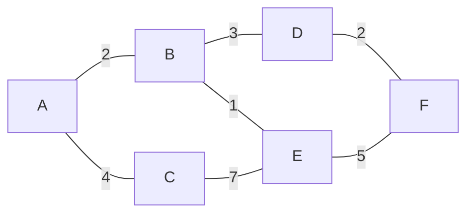
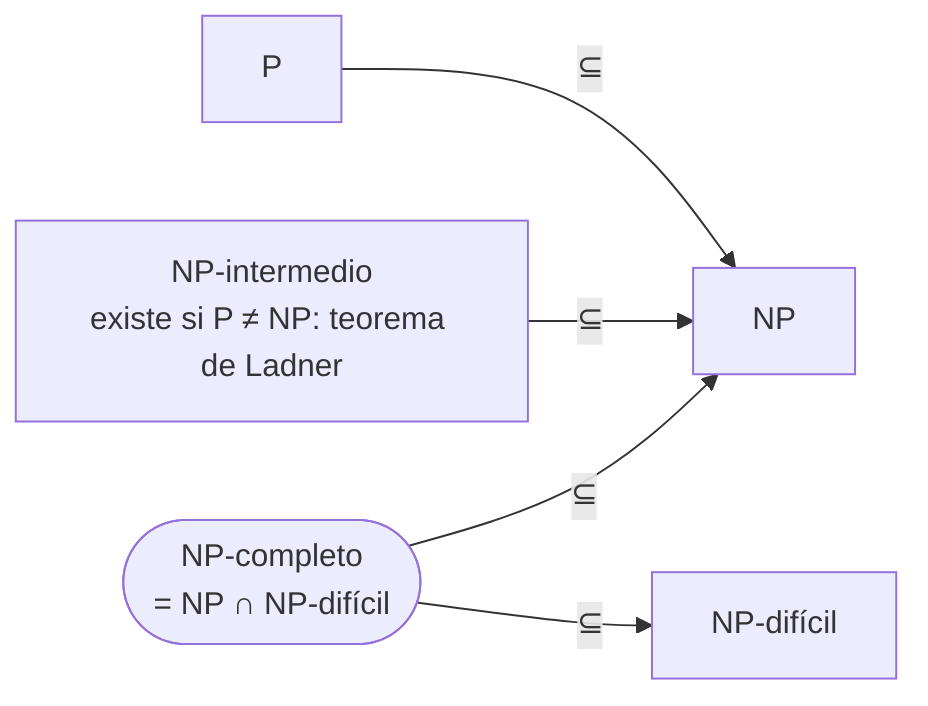
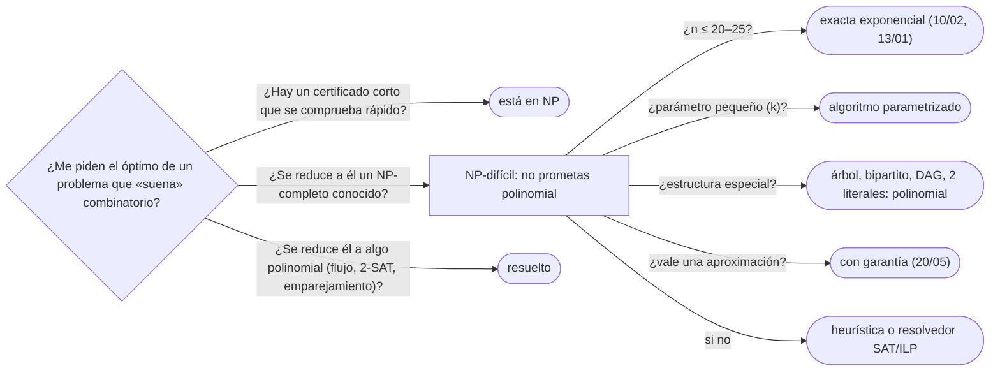

# 04 — P, NP y reducciones

> **Opcional.** Ningún capítulo del hilo principal depende de este. Las clases P y NP definidas con
> certificados, la reducción polinomial como la herramienta que compara problemas, y la frontera más famosa
> del corpus: 2-SAT se resuelve en tiempo lineal y 3-SAT es NP-completo. Lo que en
> [`10/05`](../10-busqueda-completa-y-divide-y-venceras/05-divide-y-venceras.md) se enunció para reconocerlo,
> aquí se define y se usa.
>
> **Niveles:** P y NP por certificados [A] · reducciones polinomiales [B] · 2-SAT frente a 3-SAT [B].
>
> **📚 Lectura troncal:** Kleinberg y Tardos, *Algorithm Design* (Addison-Wesley, 2005), §§8.1–8.4; Cormen,
> Leiserson, Rivest y Stein, *Introduction to Algorithms*, 3.ª ed. (MIT Press, 2009), §§34.1–34.3.
>
> **Asume leído:** [`14/05` — Componentes fuertemente conexas y 2-SAT](../14-grafos-recorridos/05-componentes-fuertes-y-2sat.md).
>
> **Vigencia:** 2026-10-04.

**Salto rápido:** [1](#1--el-problema) · [2](#2--la-teoría) · [3](#3--p-y-np-por-certificados) · [4](#4--reducciones-polinomiales) · [5](#5--2-sat-frente-a-3-sat) · [6](#6-️-la-tabla-de-costes) · [7](#7--cómo-se-elige) · [8](#8--señales-del-enunciado) · [9](#9--dónde-aparece-de-verdad) · [🧠](#-preguntas)

---

## 1. 🎯 El problema

Una ciudad quiere poner cámaras en los cruces de manera que cada calle tenga una cámara en alguno de sus dos
extremos, con el menor número de cámaras. En el grafo de juguete G (6 cruces, 7 calles) bastan 3: `{A, D, E}`.
Con 200 cruces, probar todos los subconjuntos son `2²⁰⁰` casos, y nadie conoce un algoritmo esencialmente
mejor en el caso general. El problema tiene nombre —**cobertura de vértices**— y es NP-completo.

Saberlo cambia la conversación. No se promete «el óptimo, rápido»; se pregunta qué estructura tiene la
entrada (¿es un árbol?, ¿es bipartito?, ¿el número de cámaras es pequeño?) y qué se acepta a cambio (¿vale una
solución a lo sumo el doble de la óptima?). Este capítulo da el vocabulario para esa conversación y la
herramienta para justificarla: la **reducción**.

> 🧠 **Modelo mental.** NP no es «difícil»: es «fácil de **comprobar**». Si alguien te da las 3 cámaras, ver
> que cubren las 7 calles cuesta un recorrido. Lo que nadie sabe es si **encontrarlas** puede ser igual de
> fácil.



```text
cobertura mínima: {A, D, E} o {B, C, F}  (3 vértices)
conjunto independiente máximo: el complemento, también 3
clique máxima: 2 (G no tiene triángulos)
```

---

## 2. 📐 La teoría

**Problemas de decisión.** La teoría se hace con preguntas de respuesta sí o no: «¿hay una cobertura de
tamaño `≤ k`?» en lugar de «¿cuál es la mínima?». No se pierde nada: con la versión de decisión y una búsqueda
binaria sobre `k` se obtiene el óptimo, y quitando vértices uno a uno y volviendo a preguntar se obtiene la
cobertura misma (**autorreducibilidad**).

**P.** Los problemas de decisión que resuelve un algoritmo en tiempo `O(nᶜ)` para alguna constante `c`,
con `n` el tamaño de la entrada **en bits**.

**NP.** Los problemas de decisión con un **verificador** polinomial: un algoritmo `V(x, c)` tal que la
respuesta para `x` es «sí» si y solo si existe un certificado `c`, de tamaño polinomial en `|x|`, con el que
`V` acepta. Equivale a «lo resuelve una máquina de Turing no determinista en tiempo polinomial», de donde
viene el nombre: *nondeterministic polynomial*, no «no polinomial».

**co-NP.** Los problemas cuyo «no» tiene certificado corto. «¿Es primo `n`?» está en NP y en co-NP (de hecho,
en P desde 2002); «¿esta fórmula es una tautología?» está en co-NP y no se sabe si en NP.

**PSPACE**, lo que se decide con memoria polinomial (sin límite de tiempo), contiene a NP y a co-NP. Su
problema completo típico es la fórmula booleana con cuantificadores alternados («existe `x` tal que para todo
`y` existe `z`…»), que es la forma de un juego de dos jugadores de duración polinomial. Más allá de esta
mención, queda fuera del corpus.

**Reducción polinomial (de Karp).** `A ≤ₚ B` si hay una función `f`, calculable en tiempo polinomial, con
`x ∈ A ⇔ f(x) ∈ B`. **Teorema:** si `A ≤ₚ B` y `B ∈ P`, entonces `A ∈ P`; y `≤ₚ` es transitiva, porque la
composición de polinomios es un polinomio.

**NP-difícil y NP-completo.** `B` es **NP-difícil** si todo problema de NP se reduce a él; **NP-completo** si
además está en NP. **Teorema (Cook-Levin):** SAT es NP-completo ([`22/05`](05-np-completitud.md)). Si
cualquier NP-completo estuviera en P, P = NP. Nadie lo sabe; casi todos creen que no.



```text
P ⊆ NP ∩ co-NP ⊆ NP ⊆ PSPACE ⊆ EXP
```

---

## 3. 🧱 P y NP por certificados

**Qué es.** Clasificar un problema enseñando su certificado y su verificador. Para la cobertura de vértices:
el certificado es el conjunto `S`; el verificador comprueba `|S| ≤ k` y que cada arista tiene un extremo en
`S`.

**Por qué es correcto.** **P ⊆ NP**: un problema de P se verifica sin certificado, resolviéndolo. **NP ⊆
EXP**: si el certificado mide `p(n)` bits, probar los `2^p(n)` posibles con el verificador decide el problema
en tiempo exponencial. Por eso todo NP-completo tiene un algoritmo exponencial obvio, y la pregunta es si lo
hay polinomial.

**Cómo va**, con G y `k = 3`:

```text
certificado S = {A, D, E}
A-B ✓ (A)   A-C ✓ (A)   B-D ✓ (D)   B-E ✓ (E)   C-E ✓ (E)   D-F ✓ (D)   E-F ✓ (E)   |S| = 3 ≤ 3  →  sí
el «no» para k = 2 no tiene certificado corto conocido: hay que convencerse de que ninguno de los 15 pares sirve
```

**Cuánto.** El verificador, `O(n + m)`. La búsqueda ingenua del certificado, `O(2ⁿ · m)`; con el tamaño fijado,
`O(C(n, k) · m)`.

**La plantilla**, el verificador de una cobertura, que es la forma de cualquier verificador de NP: leer el
certificado y comprobar cada restricción una vez.

```cpp
#include <utility>
#include <vector>

// Verificador de NP para la cobertura de vértices: ¿S es una cobertura de tamaño ≤ k? O(n + m).
bool verifyCover(int n, const std::vector<std::pair<int, int>>& edges, const std::vector<int>& cover, int k) {
    if ((int) cover.size() > k) return false;
    std::vector<bool> in(n, false);
    for (int v : cover) in[v] = true;
    for (auto [u, v] : edges) if (!in[u] && !in[v]) return false;   // arista sin cubrir
    return true;
}
```

```java
static boolean verifyCover(int n, int[][] edges, int[] cover, int k) {
    if (cover.length > k) return false;
    boolean[] in = new boolean[n];
    for (int v : cover) in[v] = true;
    for (int[] e : edges) if (!in[e[0]] && !in[e[1]]) return false;
    return true;
}
```

```python
def verify_cover(n, edges, cover, k):
    """Verificador de NP: ¿cover es una cobertura de vértices de tamaño <= k? O(n + m)."""
    if len(cover) > k:
        return False
    inside = [False] * n
    for v in cover:
        inside[v] = True
    return all(inside[u] or inside[v] for u, v in edges)
```

- **El certificado se valida entero**: tamaño, índices y cada restricción. Un verificador que se fía del
  certificado no prueba nada.
- **Los tres lenguajes** escriben lo mismo; la diferencia es solo el arreglo de marcas (`vector<bool>` empaqueta
  bits en C++, `boolean[]` usa un byte por posición en Java, la lista de Python un objeto por posición).

### De la versión ingenua a la buena

**El problema.** ¿Tiene un grafo una cobertura de vértices de tamaño `≤ k`, con `n` grande y `k` pequeño? En
G, con `k = 3`, sí (`{A, D, E}`); con `k = 2`, no.

**La versión ingenua**, que prueba todos los subconjuntos de tamaño `k` con el verificador:

```java
// Ingenua: todos los subconjuntos de k vértices, cada uno verificado. Correcta, O(C(n, k) · m).
static boolean hasCoverNaive(int n, int[][] edges, int k) {
    return tryFrom(0, n, edges, k, new int[k], 0);
}

static boolean tryFrom(int start, int n, int[][] edges, int k, int[] chosen, int size) {
    if (size == k) return verifyCover(n, edges, chosen, k);
    for (int v = start; v < n; v++) {
        chosen[size] = v;
        if (tryFrom(v + 1, n, edges, k, chosen, size + 1)) return true;
    }
    return false;
}
```

> «Es correcta, y con `n = 6` prueba 20 subconjuntos. Pero con `n = 1000` y `k = 10` son `2,6·10²³`. Estoy
> probando conjuntos que no tienen nada que ver con las aristas. Lo que sé seguro es que, para cualquier arista
> sin cubrir, **uno de sus dos extremos** tiene que estar en la cobertura.»

**El camino a la buena.** Ramificar sobre una arista sin cubrir: o entra `u`, o entra `v`. Cada rama gasta uno
de los `k`, así que el árbol de búsqueda tiene profundidad `k` y como mucho `2ᵏ` hojas.

```java
// Árbol de búsqueda acotado: O(2ᵏ · m), independiente de n salvo por m. Parametrizado en k.
static boolean hasCover(int[][] edges, int k, boolean[] in) {
    int[] open = null;
    for (int[] e : edges) if (!in[e[0]] && !in[e[1]]) { open = e; break; }   // arista sin cubrir
    if (open == null) return true;                                          // todas cubiertas
    if (k == 0) return false;
    for (int x : open) {                                                    // entra u, o entra v
        in[x] = true;
        boolean ok = hasCover(edges, k - 1, in);
        in[x] = false;
        if (ok) return true;
    }
    return false;
}
```

- **En G con `k = 3`**, el árbol visita 8 nodos: entra `A` (por `A-B`); con `{A, B}` no alcanza ninguna rama;
  con `{A, D}` la primera arista abierta es `B-E`, y entre sus dos extremos `B` falla y `E` cubre todo.
- **`2¹⁰ · m` frente a `C(1000, 10) · m`**: el coste ya no depende de `n` en el exponente. Es un algoritmo
  **parametrizado** (FPT): exponencial en el parámetro, polinomial en el resto.
- **No contradice la NP-completitud**: con `k` proporcional a `n`, `2ᵏ` vuelve a ser exponencial. Lo que dice es
  que la dificultad está concentrada en el tamaño de la cobertura.

**Cuándo sí:** clasificar un problema antes de buscarle algoritmo; argumentar en una entrevista que algo «está
en NP» enseñando el certificado. **Cuándo no:** para concluir que algo es difícil: estar en NP no lo hace
difícil (todo P está en NP). Para eso, una reducción desde un NP-completo (§4).

> **Veredicto:** NP es la clase de lo que se comprueba rápido con un certificado. Saber dar el certificado y el
> verificador es la mitad del trabajo; la otra mitad, demostrar que es difícil, es una reducción.

---

## 4. 🧱 Reducciones polinomiales

**Qué es.** Transformar cada entrada de un problema `A` en una de `B` con la misma respuesta, en tiempo
polinomial. La **dirección** es lo que más se confunde: para demostrar que `B` es difícil se reduce **un
problema difícil conocido a `B`** (`A ≤ₚ B`), no al revés.

**Por qué es correcto** (el enunciado y una frase): si `A ≤ₚ B` con `f` y `B` tuviera un algoritmo
polinomial, `A` lo tendría (calcular `f` y preguntar a `B`); así que si `A` es NP-difícil, `B` también.

**Cómo va**, las tres reducciones que unen tres problemas en un solo grafo:

```text
S es conjunto independiente de G  ⇔  V − S es cobertura de vértices de G     (toda arista tiene un extremo fuera de S)
S es conjunto independiente de G  ⇔  S es clique del complemento Ḡ          (sin aristas en G = todas en Ḡ)
en G:  {B, C, F} independiente  ⇔  {A, D, E} cobertura  ⇔  {B, C, F} clique en Ḡ
```

Las tres son NP-completas, y cada una se reduce a las otras con un cambio de `k` (`k ↦ n − k`) o un
complemento: `O(n²)`.

**Cuánto.** La reducción tiene que ser polinomial, y el tamaño de la salida también: una reducción que
multiplica el tamaño por `n` está bien; una que lo eleva a `2ⁿ` no prueba nada.

**La plantilla**, la reducción del conjunto independiente a la clique: el grafo complemento con matriz de
adyacencia.

```cpp
#include <utility>
#include <vector>

// Reducción IS(G, k) ≤ₚ CLIQUE(Ḡ, k): el complemento, como matriz. O(n²).
std::vector<std::vector<bool>> complementGraph(int n, const std::vector<std::pair<int, int>>& edges) {
    std::vector<std::vector<bool>> adj(n, std::vector<bool>(n, true));
    for (int v = 0; v < n; v++) adj[v][v] = false;                 // sin lazos
    for (auto [u, v] : edges) adj[u][v] = adj[v][u] = false;       // lo que estaba, desaparece
    return adj;
}
```

```java
static boolean[][] complementGraph(int n, int[][] edges) {
    boolean[][] adj = new boolean[n][n];
    for (int u = 0; u < n; u++) for (int v = 0; v < n; v++) adj[u][v] = u != v;
    for (int[] e : edges) adj[e[0]][e[1]] = adj[e[1]][e[0]] = false;
    return adj;
}
```

- **La respuesta se transporta sin cambios**: el mismo `k`, el mismo conjunto. En la de cobertura cambia `k` por
  `n − k` y el conjunto por su complemento.
- **El complemento de un grafo disperso es denso**: con `n = 10⁵` y `m = 10⁵`, `Ḡ` tiene unas `5·10⁹` aristas.
  Es polinomial, que es lo que la teoría pide, pero no se construye en la práctica: la reducción es un
  argumento, no un algoritmo que se ejecute.

**Cuándo sí:** demostrar que un problema nuevo es NP-difícil (reduciéndole un NP-completo), o resolverlo con un
algoritmo ajeno (reduciéndolo a algo que ya sabes resolver: flujo, 2-SAT, emparejamiento). **Cuándo no:** si la
transformación no es polinomial, o si va en la dirección equivocada.

> **Veredicto:** una reducción es un traductor de entradas. Para demostrar que tu problema es difícil, traduces
> **hacia** él uno que ya se sabe difícil; para resolverlo, lo traduces hacia uno que ya sabes resolver.

---

## 5. 🧱 2-SAT frente a 3-SAT

**Qué es.** SAT pregunta si una fórmula en forma normal conjuntiva (una conjunción de cláusulas, cada una una
disyunción de literales) tiene una asignación que la hace verdadera. `k`-SAT limita cada cláusula a `k`
literales.

**Por qué es correcto** (el enunciado y una frase): **2-SAT está en P**, porque cada cláusula `(a ∨ b)` es
exactamente dos implicaciones, `¬a → b` y `¬b → a`, y la fórmula es insatisfacible si y solo si alguna
variable y su negación caen en la misma componente fuerte del grafo de implicaciones ([`14/05`](../14-grafos-recorridos/05-componentes-fuertes-y-2sat.md)).
**3-SAT es NP-completo** ([`22/05`](05-np-completitud.md)).

**Cómo va**, lo que se rompe al pasar de dos a tres literales:

```text
(a ∨ b)          ⇔  ¬a → b            una implicación entre literales: arista del grafo
(a ∨ b ∨ c)      ⇔  ¬a → (b ∨ c)      la consecuencia es una disyunción, no un literal:
                                       ya no es una arista, y el razonamiento por caminos se cae
```

En 2-SAT, una elección fuerza otras por una cadena de implicaciones simples, y el grafo captura todas. En
3-SAT, falsificar `a` deja dos opciones abiertas, y esas ramas se multiplican.

**Cuánto.** 2-SAT, `Θ(n + m)` con Tarjan o Kosaraju. 3-SAT, el mejor algoritmo conocido es exponencial
(`O(1,307ⁿ)` aproximadamente, aleatorizado); un resolvedor SAT moderno resuelve en la práctica instancias de
millones de variables, pero sin garantía.

**La plantilla.** La de [`14/05`](../14-grafos-recorridos/05-componentes-fuertes-y-2sat.md), sin cambios.

**Las fronteras vecinas**, que se preguntan junto con esta:

```text
2-SAT              P (lineal)            MAX-2-SAT          NP-difícil
3-SAT              NP-completo           Horn-SAT           P (lineal): como mucho un literal positivo por cláusula
2-colorear         P (BFS, bipartito)    3-colorear         NP-completo
camino más corto   P (Dijkstra)          camino más largo   NP-difícil (en DAG, P: 13/03)
emparejamiento     P (Edmonds)           3-emparejamiento   NP-completo
```

**Cuándo sí:** reconocer que restricciones de «a lo sumo dos opciones» son 2-SAT y se resuelven en lineal.
**Cuándo no:** si una restricción encadena tres variables, el grafo de implicaciones no sirve; ahí búsqueda
([`10/03`](../10-busqueda-completa-y-divide-y-venceras/03-backtracking-y-poda.md)) o un resolvedor SAT.

> **Veredicto:** de dos a tres literales se pasa de lineal a NP-completo, porque una disyunción de dos
> literales es una implicación y una de tres no. Es la frontera que se cita cuando alguien pregunta «¿por qué
> P frente a NP importa?».

---

## 6. ⏱️ La tabla de costes

La cobertura de vértices según lo que se sabe de la entrada:

| Situación | Algoritmo | Coste | Lo que la tabla no dice |
|---|---|---|---|
| General, exacta | Todos los subconjuntos | `O(2ⁿ · m)` | Hasta `n ≈ 25` |
| General, `k` pequeño | Árbol de búsqueda acotado (§3) | `O(2ᵏ · m)` | Con reglas de reducción se baja a `≈ 1,27ᵏ` |
| Árbol | DP en árboles ([`13/03`](../13-dp-avanzada/03-dp-en-arboles-y-dag.md)) | `Θ(n)` | Exacta y lineal |
| Bipartito | König: emparejamiento máximo ([`15/06`](../15-grafos-pesos-y-flujos/06-emparejamientos.md)) | `O(m √n)` | Exacta y polinomial |
| General, aproximada | Emparejamiento maximal ([`20/05`](../20-ad-hoc-constructivos-e-interactivos/05-heuristicos-y-aproximados.md)) | `Θ(n + m)` | A lo sumo el doble del óptimo |

---

## 7. 🧭 Cómo se elige



> **Regla de entrevista:** antes de decir «es NP-completo», di **desde qué problema reduces y en qué
> dirección**. Y después, sin que te lo pidan, di qué harías con las restricciones reales.

---

## 8. 🔎 Señales del enunciado

| Señal | Técnica | Por qué |
|---|---|---|
| «Elegir el menor conjunto de vértices que toque todas las aristas» | Cobertura de vértices: NP-completo; ¿árbol, bipartito, `k` pequeño? | La estructura decide |
| «Grupo de personas que se conocen todas» / «que no se conocen ninguna» | Clique / conjunto independiente | Complementos uno del otro |
| «Cada restricción afecta a dos opciones booleanas» | 2-SAT, lineal | Implicaciones |
| «Cada restricción afecta a tres o más» | 3-SAT: búsqueda o resolvedor | NP-completo |
| «Demuestra que tu problema es difícil» | Reducir un NP-completo conocido **hacia** él | La dirección importa |

---

## 9. 🔭 Dónde aparece de verdad

- **Los gestores de paquetes**: resolver dependencias con versiones y conflictos es NP-completo en general, y
  varios usan por dentro un resolvedor SAT.
- **La asignación de registros** de un compilador es colorear un grafo de interferencias: NP-completo, resuelto
  con heurísticas que funcionan muy bien.
- **La verificación de hardware y software** traduce las preguntas a SAT y usa resolvedores que manejan
  millones de cláusulas: NP-completo no significa intratable en las instancias reales.
- **La criptografía** necesita problemas difíciles en el caso **promedio**, que es una exigencia más fuerte que
  la NP-dificultad (que habla del caso peor): por eso no se construye sobre problemas NP-completos sin más.

---

## ⚠️ Errores frecuentes

| Se dice | Lo preciso |
|---|---|
| «NP significa no polinomial» | Significa *nondeterministic polynomial*: verificable en tiempo polinomial con un certificado. P ⊆ NP |
| «NP-completo significa que no se puede resolver» | Se puede, en tiempo exponencial; y muchas instancias reales se resuelven bien |
| «Reduzco mi problema a SAT, así que es NP-difícil» | Al revés: eso dice que tu problema **no es más difícil** que SAT. Para dificultad, se reduce SAT a tu problema |
| «Todo NP-difícil está en NP» | No: la parada es NP-difícil y ni siquiera es decidible |
| «2-SAT es difícil porque SAT lo es» | 2-SAT es lineal; la frontera está en tres literales |
| «Si es NP-completo, mis entradas serán lentas» | La dificultad es del caso peor; árboles, grafos bipartitos o parámetros pequeños pueden ser polinomiales |
| «P ≠ NP está demostrado» | Es una conjetura abierta, uno de los problemas del milenio |

---

## 📚 Para profundizar

- **Libro** — Kleinberg y Tardos, *Algorithm Design* (Addison-Wesley, 2005), §§8.1–8.4: reducciones, SAT,
  certificados y la definición de NP. *Lectura troncal.*
- **Libro** — Cormen, Leiserson, Rivest y Stein, *Introduction to Algorithms*, 3.ª ed. (MIT Press, 2009),
  §§34.1–34.3: tiempo polinomial, verificación y reducibilidad. *Lectura troncal.*
- **Libro** — Brassard y Bratley, *Fundamentos de algoritmia* (Prentice Hall, 1997), cap. 12: complejidad
  computacional e introducción a la NP-completitud.
- **Libro** — Hopcroft, Motwani y Ullman, *Introducción a la teoría de autómatas, lenguajes y computación*,
  3.ª ed. (Pearson, 2007), cap. 10: P y NP con máquinas de Turing.
- **Libro** — Erickson, *Algorithms* (2019), cap. 12: NP-dificultad, con las reducciones contadas para
  programadores.
- **Referencia** — cp-algorithms, [2-SAT](https://cp-algorithms.com/graph/2SAT.html).

---

## 🧠 Preguntas

1. ¿Qué es un problema de decisión, y cómo se obtiene el óptimo a partir de su versión de decisión? 🟢
2. Define NP con certificados. ¿Qué significan las siglas? 🟢
3. ¿Qué diferencia hay entre NP-difícil y NP-completo? 🟢
4. ¿Por qué P ⊆ NP, y por qué NP ⊆ EXP? 🟡
5. Si `A ≤ₚ B`, ¿qué se deduce si `B ∈ P`? ¿Y si `A` es NP-difícil? 🟡
6. Compara el verificador de cobertura en C++, Java y Python: ¿qué estructura marca los vértices del certificado en cada uno y cuánta memoria usa? 🟡
7. ¿Por qué 2-SAT está en P y 3-SAT no se sabe? ¿Qué se rompe al pasar a tres literales? 🟠
8. Demuestra que `S` es un conjunto independiente de `G` si y solo si `V − S` es una cobertura de vértices. 🟠
9. ¿Por qué el árbol de búsqueda acotado para la cobertura de vértices no contradice que el problema sea NP-completo? 🟠
10. Un compañero dice «reduje mi problema a SAT, así que es NP-difícil». ¿Qué está mal? 🟠
11. ¿Por qué la parada es NP-difícil pero no NP-completa? 🟠
12. Traza el árbol de búsqueda acotado sobre G con `k = 3`, eligiendo siempre la primera arista sin cubrir en el orden `A-B, A-C, B-D, B-E, C-E, D-F, E-F`. ¿Cuántos nodos visita? 🔴
13. Te piden la menor cantidad de cámaras para 10⁵ cruces de una ciudad cuyo plano es un árbol, y después para una con ciclos. ¿Qué respondes en cada caso? 🔴

---

## ✅ Criterio de dominio

- Dar el certificado y el verificador de cobertura, clique, ciclo hamiltoniano y suma de subconjuntos.
- Escribir las tres reducciones entre conjunto independiente, cobertura y clique, en la dirección correcta.
- Escribir el árbol de búsqueda acotado para la cobertura con `k` pequeño y decir por qué es `O(2ᵏ · m)`.
- Explicar la frontera 2-SAT / 3-SAT con la implicación que se pierde.

---

**Anterior:** [`22/03` — Máquinas de Turing y decidibilidad](03-maquinas-de-turing-y-decidibilidad.md) ·
**Siguiente:** [`22/05` — NP-completitud](05-np-completitud.md) ·
**Relacionado:** [`14/05` — Componentes fuertemente conexas y 2-SAT](../14-grafos-recorridos/05-componentes-fuertes-y-2sat.md);
[`10/05` — Divide y vencerás](../10-busqueda-completa-y-divide-y-venceras/05-divide-y-venceras.md).
