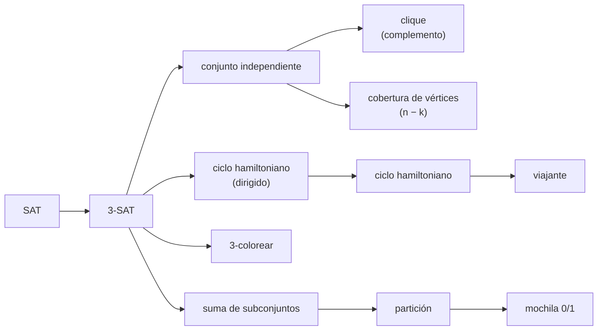
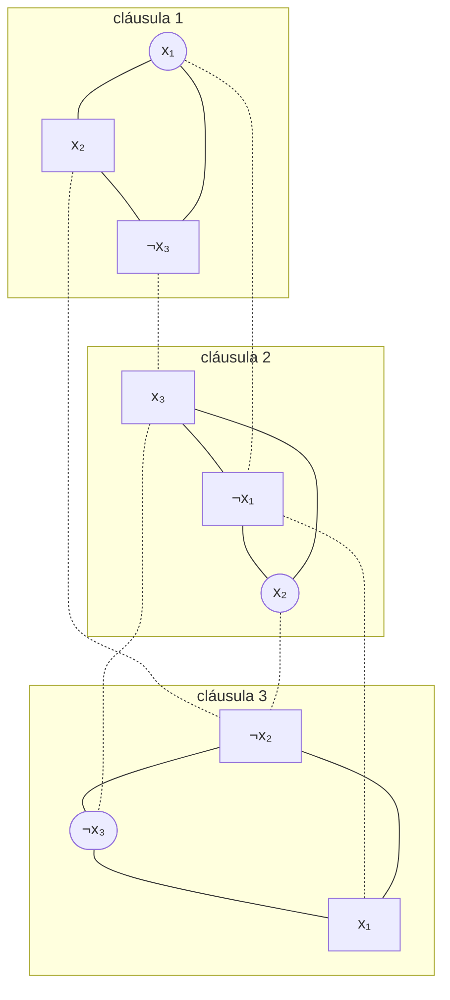
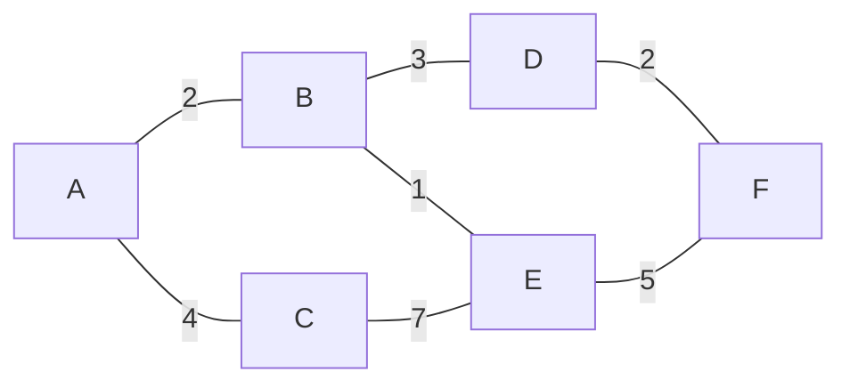

# 05 — NP-completitud

> **Opcional.** Ningún capítulo del hilo principal depende de este. El teorema de Cook-Levin, que da el primer
> problema NP-completo, la cadena de reducciones que de él saca los clásicos (3-SAT, conjunto independiente,
> clique, cobertura de vértices, ciclo hamiltoniano, suma de subconjuntos), y lo que de verdad importa
> después: qué se hace cuando el problema que te piden es uno de ellos.
>
> **Niveles:** Cook-Levin [B] · la cadena de reducciones clásicas [B] · suma de subconjuntos y lo
> pseudo-polinomial [B] · qué hacer con un NP-difícil [A].
>
> **📚 Lectura troncal:** Cormen, Leiserson, Rivest y Stein, *Introduction to Algorithms*, 3.ª ed. (MIT Press,
> 2009), §§34.4–34.5; Kleinberg y Tardos, *Algorithm Design* (Addison-Wesley, 2005), §§8.4–8.8.
>
> **Asume leído:** [`22/04` — P, NP y reducciones](04-p-np-y-reducciones.md).
>
> **Vigencia:** 2026-10-04.

**Salto rápido:** [1](#1--el-problema) · [2](#2--la-teoría) · [3](#3--cook-levin) · [4](#4--la-cadena-de-reducciones-clásicas) · [5](#5--suma-de-subconjuntos-y-lo-pseudo-polinomial) · [6](#6--qué-hacer-con-un-np-difícil) · [7](#7-️-la-tabla-de-costes) · [8](#8--señales-del-enunciado) · [🧠](#-preguntas)

---

## 1. 🎯 El problema

El equipo de logística te pide la ruta que pasa una vez por cada uno de sus 18 almacenes y vuelve al origen.
Sabes que es el **ciclo hamiltoniano** (y, con distancias, el viajante), y que es NP-completo. La respuesta
mala es «no se puede». La buena tiene dos partes: **por qué** no se espera un algoritmo polinomial —porque
3-SAT se reduce a él, y a 3-SAT se reduce cualquier problema de NP— y **qué sí se puede**: con 18 almacenes,
una DP sobre subconjuntos hace `2¹⁸ · 18 ≈ 4,7·10⁶` pasos, y probar las `17!` rutas serían `3,6·10¹⁴`.

Este capítulo arma la cadena que justifica la primera parte y el menú que responde a la segunda. Las
reducciones se esbozan con el detalle justo para poder contarlas en una pizarra; las pruebas enteras están en
la lectura troncal.

> 🧠 **Modelo mental.** NP-completo no es una sentencia: es una etiqueta que dice «no busques un algoritmo
> polinomial general; busca estructura en tu entrada, o acepta exponencial pequeño, o aproxima».

---

## 2. 📐 La teoría

**Cómo se demuestra que un problema `X` es NP-completo**, siempre en dos partes:

```text
1. X está en NP:        dar el certificado y el verificador polinomial (22/04, §3)
2. X es NP-difícil:     reducir HACIA X un problema NP-completo conocido, Y ≤ₚ X
                        - construir f en tiempo polinomial
                        - probar  y ∈ Y  ⇒  f(y) ∈ X   (de una solución de Y, una de X)
                        - probar  f(y) ∈ X  ⇒  y ∈ Y   (y al revés)
```

**Teorema (Cook-Levin, 1971).** SAT es NP-completo. Es el único que se demuestra «desde cero»; los demás, por
reducción desde él o desde uno que ya se redujo.

**El árbol de reducciones** que recorre el capítulo:



**NP-completo débil y fuerte.** Un problema con números es NP-completo **en sentido débil** si tiene un
algoritmo polinomial en el **valor** de los números (pseudo-polinomial), como la suma de subconjuntos; es
NP-completo **en sentido fuerte** si sigue siéndolo con números acotados por un polinomio en `n`, como
3-partición o el empaquetado.

---

## 3. 🧱 Cook-Levin

**Qué es.** El teorema que dice que SAT es NP-completo: toda pregunta de NP se puede escribir como una fórmula
booleana de tamaño polinomial que es satisfacible si y solo si la respuesta es «sí».

**Por qué es correcto** (el enunciado y una frase): si `L ∈ NP`, lo decide una máquina de Turing no
determinista `M` en tiempo `p(n)`; una ejecución que acepta es una **tabla** de `p(n) × p(n)` celdas (una fila
por paso, una columna por celda de cinta), y la fórmula dice, con variables `x[i][j][s]` («la celda `(i, j)`
tiene el símbolo `s`»), que la tabla es una ejecución válida que acepta.

**Cómo va**, las cuatro familias de cláusulas:

```text
celda      cada celda tiene exactamente un símbolo            O(p(n)²) cláusulas
inicio     la fila 0 es la configuración inicial con x        O(p(n))
ventana    cada ventana 2 × 3 de la tabla es legal según δ    O(p(n)²): lo local de un paso de MT
acepta     algún estado de aceptación aparece en la tabla     O(p(n)²)
```

La idea clave es la **ventana**: un paso de una máquina de Turing solo cambia la celda bajo la cabeza y sus
vecinas, así que «la fila `i + 1` sigue de la `i`» se comprueba con restricciones locales de tamaño constante.

**Cuánto.** La fórmula tiene `O(p(n)²)` cláusulas de tamaño constante: polinomial. Eso es lo que hace que la
reducción valga.

**La plantilla.** No hay: es un teorema. Lo que sí se usa en la práctica es la dirección contraria —traducir un
problema a SAT y dárselo a un resolvedor—, y eso es una reducción a medida de cada problema.

**Cuándo sí:** para saber de dónde sale la primera pieza de la cadena, y para entender por qué un resolvedor
SAT es un resolvedor de «todo NP». **Cuándo no:** para demostrar que un problema nuevo es NP-completo: se
reduce desde 3-SAT o desde otro de la cadena, no se repite Cook-Levin.

> **Veredicto:** Cook-Levin convierte cualquier verificador polinomial en una fórmula; sin él no hay cadena.
> Se enuncia, se entiende la ventana, y no se reproduce en una entrevista.

---

## 4. 🧱 La cadena de reducciones clásicas

**Qué es.** Las reducciones que llevan la NP-completitud de SAT a los problemas que de verdad aparecen.

**Por qué es correcto** (el enunciado y una frase): cada reducción es polinomial y conserva la respuesta en
las dos direcciones, y la composición de reducciones es una reducción ([`22/04`](04-p-np-y-reducciones.md)).

**Cómo va**, las cuatro que hay que poder contar:

```text
SAT → 3-SAT
  una cláusula larga (l₁ ∨ l₂ ∨ … ∨ lₖ) se parte con variables nuevas y₁, …, yₖ₋₃:
  (l₁ ∨ l₂ ∨ y₁) ∧ (¬y₁ ∨ l₃ ∨ y₂) ∧ … ∧ (¬yₖ₋₃ ∨ lₖ₋₁ ∨ lₖ)
  las cortas se rellenan repitiendo un literal

3-SAT → conjunto independiente (m cláusulas → k = m)
  un triángulo por cláusula (un vértice por literal), y una arista entre cada literal y su negación
  elegir un vértice por triángulo sin conflictos = elegir un literal verdadero por cláusula, coherente

3-SAT → suma de subconjuntos
  números en base 10 con una cifra por variable y una por cláusula; dos números por variable (verdadero y
  falso) con un 1 en su cifra y en las cláusulas donde aparece ese literal; dos números de holgura por
  cláusula; objetivo: 1 en cada cifra de variable y 4 en cada cifra de cláusula

3-SAT → ciclo hamiltoniano dirigido
  una «fila» de vértices por variable que se recorre de izquierda a derecha (verdadero) o al revés (falso),
  y un vértice por cláusula al que solo se puede entrar desde las filas de sus literales en el sentido correcto
```

La segunda, sobre `φ = (x₁ ∨ x₂ ∨ ¬x₃) ∧ (¬x₁ ∨ x₂ ∨ x₃) ∧ (¬x₂ ∨ ¬x₃ ∨ x₁)`:



```text
línea continua: el triángulo de cada cláusula · punteada: conflicto (literal y su negación)
9 vértices, 9 + 6 = 15 aristas, k = 3
independiente {x₁ de la 1, x₂ de la 2, ¬x₃ de la 3}  ⇔  x₁ = V, x₂ = V, x₃ = F satisface φ
(los tres nodos redondeados)
```

**Cuánto.** Todas son lineales o cuadráticas en el tamaño de la fórmula. La de conjunto independiente produce
`3m` vértices y `O(m²)` aristas de conflicto en el peor caso.

**La plantilla**, la reducción de 3-SAT a conjunto independiente (los literales son `±v`, con `v ≥ 1`):

```cpp
#include <array>
#include <utility>
#include <vector>

// 3-SAT con m cláusulas → grafo de 3m vértices; φ es satisfacible ⇔ hay un independiente de tamaño m.
// El vértice 3i + j es el literal j de la cláusula i.
std::vector<std::pair<int, int>> satToIndependentSet(const std::vector<std::array<int, 3>>& clauses) {
    int m = clauses.size();
    std::vector<std::pair<int, int>> edges;
    for (int i = 0; i < m; i++) {                                     // el triángulo de la cláusula
        edges.push_back({3 * i, 3 * i + 1});
        edges.push_back({3 * i + 1, 3 * i + 2});
        edges.push_back({3 * i, 3 * i + 2});
    }
    for (int i = 0; i < m; i++)                                       // conflictos entre cláusulas
        for (int k = i + 1; k < m; k++)
            for (int j = 0; j < 3; j++)
                for (int l = 0; l < 3; l++)
                    if (clauses[i][j] == -clauses[k][l]) edges.push_back({3 * i + j, 3 * k + l});
    return edges;
}
```

```java
import java.util.ArrayList;
import java.util.List;

static List<int[]> satToIndependentSet(int[][] clauses) {
    int m = clauses.length;
    List<int[]> edges = new ArrayList<>();
    for (int i = 0; i < m; i++) {
        edges.add(new int[]{3 * i, 3 * i + 1});
        edges.add(new int[]{3 * i + 1, 3 * i + 2});
        edges.add(new int[]{3 * i, 3 * i + 2});
    }
    for (int i = 0; i < m; i++)
        for (int k = i + 1; k < m; k++)
            for (int j = 0; j < 3; j++)
                for (int l = 0; l < 3; l++)
                    if (clauses[i][j] == -clauses[k][l]) edges.add(new int[]{3 * i + j, 3 * k + l});
    return edges;
}
```

- **Las dos direcciones de la prueba** se leen en el código: el triángulo obliga a tomar como mucho un literal
  por cláusula (y con `k = m`, exactamente uno), y las aristas de conflicto prohíben tomar `x` y `¬x` a la vez.
- **Los conflictos dentro de una cláusula** (`x ∨ ¬x ∨ y`) ya están cubiertos por el triángulo, por eso el
  bucle empieza en `k = i + 1`.
- **Es un argumento, no una herramienta**: nadie resuelve 3-SAT buscando un independiente. Se escribe para
  comprobar a mano, con un caso pequeño, que la reducción dice lo que se cree.

**Cuándo sí:** para demostrar que un problema nuevo es NP-completo, eligiendo de la cadena el pariente más
cercano (los de elegir un subconjunto, desde conjunto independiente o cobertura; los de recorrer, desde ciclo
hamiltoniano; los de números, desde suma de subconjuntos o partición). **Cuándo no:** reducir desde SAT
general a un problema con mucha estructura suele ser más difícil que hacerlo desde un pariente.

> **Veredicto:** cuatro reducciones —partir cláusulas, triángulos con conflictos, cifras en base 10, filas de
> variables— cubren casi todo lo que se pregunta. La de conjunto independiente es la que se dibuja en una
> pizarra en dos minutos.

---

## 5. 🧱 Suma de subconjuntos y lo pseudo-polinomial

**Qué es.** Dados `n` enteros positivos y un objetivo `S`, ¿hay un subconjunto que sume exactamente `S`? Es
NP-completo (§4), y sin embargo la DP de la mochila lo resuelve en `O(n · S)`.

**Por qué es correcto** que no hay contradicción (el enunciado y una frase): el tamaño de la entrada es el
número de **bits**, unos `n · log S`; `O(n · S)` es polinomial en el valor de `S` pero **exponencial en su
longitud**, porque `S = 2^(log S)`. Un algoritmo así se llama **pseudo-polinomial**.

**Cómo va.** Con objetivos pequeños, la DP gana; con números de 60 bits, la DP es inútil y gana la búsqueda:

```text
n = 100, S ≤ 10⁵            DP de una fila: 10⁷ pasos                       12/03
n = 40,  S ≤ 10¹⁸           DP imposible; meet in the middle: 2 · 2²⁰ · 20   10/04
n = 1000, S ≤ 10¹⁸          ninguno de los dos: aproximación (FPTAS) o heurística
```

**Cuánto.** DP, `O(n · S)` tiempo y `O(S)` memoria con una fila (o `O(n · S / 64)` con `bitset`, [`17/01`](../17-matematica/01-bits.md));
*meet in the middle*, `O(2^(n/2) · n)`.

**La plantilla.** La de la mochila 0/1 con una fila de [`12/03`](../12-dp-clasica/03-mochilas.md#4--una-fila-de-memoria),
cambiando el máximo por un «o» lógico; la de *meet in the middle* de
[`10/04`](../10-busqueda-completa-y-divide-y-venceras/04-meet-in-the-middle-iddfs-y-dancing-links.md).

**Cuándo sí:** cuando los números son pequeños, o cuando `n` es pequeño. **Cuándo no:** con números grandes y
`n` grande a la vez; y nunca con un problema NP-completo **en sentido fuerte** (3-partición, empaquetado), que
no tiene algoritmo pseudo-polinomial salvo que P = NP.

> **Veredicto:** «NP-completo» y «`O(n · S)`» no se contradicen: la DP es exponencial en los bits de `S`. Mira
> las cotas de los números antes de descartar la DP.

---

## 6. 🧱 Qué hacer con un NP-difícil

**Qué es.** El menú de respuestas cuando el problema es NP-difícil y hay que entregar algo:

```text
1. exacto exponencial, pero el mejor:   DP sobre subconjuntos, meet in the middle, ramificación y poda
2. parametrizado:                        exponencial en un parámetro pequeño (22/04, cobertura con k)
3. estructura especial:                  árboles, DAG, bipartitos, grafos planos, 2 literales
4. aproximación con garantía:            a lo sumo c veces el óptimo (20/05)
5. heurística o metaheurística:          búsqueda local, recocido (20/05), sin garantía
6. resolvedor externo:                   SAT, programación lineal entera
```

**Por qué es correcto.** Ninguna opción contradice P ≠ NP: o renuncian al tiempo polinomial (1, 2), o a la
generalidad (3), o a la exactitud (4, 5), o delegan en herramientas sin garantía de tiempo (6).

**Cómo va**, el ciclo hamiltoniano en G con la opción 1:



```text
ciclo hamiltoniano:  A B D F E C A
(la DP llega a la máscara completa con finales {B, C, F};
 B y C son vecinos de A: el ciclo se cierra)
```

**Cuánto.** La DP sobre subconjuntos, `O(2ⁿ · n)` con las máscaras de finales; `n ≤ 24` cabe en memoria.

**La plantilla**, el ciclo hamiltoniano por máscaras: `reach[mask]` es el conjunto de vértices donde puede
terminar un camino que empieza en `0` y visita exactamente `mask`.

```cpp
#include <cstdint>
#include <vector>

// ¿Hay ciclo hamiltoniano? adj[v] = máscara de vecinos de v. O(2ⁿ · n) tiempo, 2ⁿ enteros de memoria; n ≤ 24.
bool hamiltonianCycle(const std::vector<uint32_t>& adj) {
    int n = adj.size();
    if (n < 3) return false;
    std::vector<uint32_t> reach(1u << n, 0);
    reach[1] = 1;                                                   // el camino «0» termina en 0
    for (uint32_t mask = 3; mask < (1u << n); mask += 2)            // máscaras con el 0 y algo más
        for (int w = 1; w < n; w++)
            if ((mask >> w & 1) && (reach[mask ^ (1u << w)] & adj[w]))
                reach[mask] |= 1u << w;                             // se llega a w desde un vecino
    return reach[(1u << n) - 1] & adj[0];                           // algún final vuelve a 0
}
```

```java
static boolean hamiltonianCycle(int[] adj) {
    int n = adj.length;
    if (n < 3) return false;
    int[] reach = new int[1 << n];
    reach[1] = 1;
    for (int mask = 3; mask < (1 << n); mask += 2)
        for (int w = 1; w < n; w++)
            if ((mask >> w & 1) != 0 && (reach[mask ^ (1 << w)] & adj[w]) != 0)
                reach[mask] |= 1 << w;
    return (reach[(1 << n) - 1] & adj[0]) != 0;
}
```

```python
def hamiltonian_cycle(adj):
    """adj[v] = máscara de vecinos de v. O(2^n · n); en CPython, hasta n ≈ 18."""
    n = len(adj)
    if n < 3:
        return False
    reach = [0] * (1 << n)
    reach[1] = 1
    for mask in range(3, 1 << n, 2):
        r = 0
        for w in range(1, n):
            if mask >> w & 1 and reach[mask ^ (1 << w)] & adj[w]:
                r |= 1 << w
        reach[mask] = r
    return bool(reach[(1 << n) - 1] & adj[0])
```

- **El estado es un conjunto de finales**, no un booleano por final: así cada máscara se calcula con `n`
  operaciones `&`, y no `n²`. Es la misma DP que el viajante de [`13/01`](../13-dp-avanzada/01-mascaras-de-bits.md#4--viajante),
  con «o» en lugar de mínimo.
- **Las máscaras pares no se tocan**: todo camino empieza en 0, así que solo las que lo contienen importan.
- **La memoria** es lo que limita: `2²⁴` enteros de 4 bytes son 64 MB. En Python, `2¹⁸ · 18 ≈ 4,7·10⁶` pasos
  interpretados ya cuestan segundos.

### De la versión ingenua a la buena

**El problema.** ¿Tiene un grafo de `n ≥ 3` vértices un ciclo que pasa una vez por cada uno? En G, sí.

**La versión ingenua**, todas las permutaciones con el vértice 0 fijo al principio:

```java
// Ingenua: (n−1)! órdenes, cada uno comprobado en O(n). Correcta, O(n!).
static boolean hamiltonianNaive(boolean[][] adj) {
    int n = adj.length;
    if (n < 3) return false;
    int[] order = new int[n];
    for (int i = 0; i < n; i++) order[i] = i;
    return permute(adj, order, 1);
}

static boolean permute(boolean[][] adj, int[] order, int pos) {
    int n = order.length;
    if (pos == n) {
        for (int i = 0; i + 1 < n; i++) if (!adj[order[i]][order[i + 1]]) return false;
        return adj[order[n - 1]][order[0]];
    }
    for (int i = pos; i < n; i++) {
        int t = order[pos]; order[pos] = order[i]; order[i] = t;
        if (permute(adj, order, pos + 1)) return true;
        t = order[pos]; order[pos] = order[i]; order[i] = t;
    }
    return false;
}
```

> «Es correcta: un ciclo hamiltoniano es un orden de los vértices, y los pruebo todos. Pero en G son 120 órdenes
> para encontrar 2 (el ciclo y su inverso), y con 20 vértices, `19! ≈ 1,2·10¹⁷`. Dos órdenes que empiezan con
> los mismos vértices en distinto orden y acaban en el mismo vértice tienen exactamente el mismo futuro: lo que
> importa de un prefijo es **qué conjunto** visitó y **dónde** está.»

**El camino a la buena.** Cambiar el estado de «el orden» a «(conjunto visitado, vértice final)»: hay
`2ⁿ · n` estados en lugar de `n!` órdenes. Es la plantilla de arriba; con `n = 20`, `2²⁰ · 20 ≈ 2,1·10⁷`
operaciones frente a `1,2·10¹⁷`. Sigue siendo exponencial, y no contradice que el problema sea NP-completo:
lo que cambia es **qué** exponencial.

**Cuándo sí:** cuando el problema NP-difícil llega con restricciones pequeñas o con estructura, que es casi
siempre en un juez y muy a menudo en la vida real. **Cuándo no:** cuando la entrada es grande y sin estructura,
y hace falta el óptimo exacto con garantía de tiempo: eso no existe (si P ≠ NP), y hay que decirlo.

> **Veredicto:** ante un NP-difícil, la pregunta no es «¿se puede?» sino «¿qué cedo?»: tiempo exponencial
> pequeño, generalidad, exactitud o garantías. Saber el menú y elegir con las restricciones es la respuesta.

---

## 7. ⏱️ La tabla de costes

| Problema | Mejor exacto general conocido (aprox.) | Caso polinomial | Lo que la tabla no dice |
|---|---|---|---|
| 3-SAT | `O(1,31ⁿ)` aleatorizado | 2-SAT, Horn-SAT | Los resolvedores CDCL resuelven millones de variables en instancias reales |
| Ciclo hamiltoniano / viajante | `O(2ⁿ · n)` / `O(2ⁿ · n²)` | En DAG, el camino hamiltoniano es lineal | El viajante métrico tiene aproximación 1,5 |
| Conjunto independiente | `O(1,2ⁿ)` | Árboles, bipartitos | Ni siquiera se aproxima bien en general |
| Cobertura de vértices | `O(1,28ᵏ + k · n)` parametrizado | Árboles, bipartitos | 2-aproximación lineal |
| Suma de subconjuntos | `O(2^(n/2))`, o `O(n · S)` | `S` pequeño | NP-completo débil |
| 3-colorear | `O(1,33ⁿ)` | 2-colorear (bipartito) | Grafos de grado ≤ 3 sin `K₄`: Brooks |

---

## 8. 🔎 Señales del enunciado

| Señal | Técnica | Por qué |
|---|---|---|
| «Visitar cada lugar exactamente una vez» | Ciclo o camino hamiltoniano: máscaras si `n ≤ 20` | NP-completo; la DP es `2ⁿ · n` |
| «Elegir un subconjunto que sume exactamente…» | Suma de subconjuntos: DP si la suma es pequeña, *meet in the middle* si `n ≤ 40` | Pseudo-polinomial |
| «Cada restricción con tres variables booleanas» | 3-SAT: búsqueda o resolvedor | NP-completo |
| «Demuestra que tu problema es NP-completo» | Certificado + reducción desde el pariente de la cadena | Las dos partes |
| «`n ≤ 20` y suena a combinatoria» | Probablemente NP-difícil con exponencial pequeño a propósito | Las restricciones son la pista ([`01/02`](../01-oficio-del-competidor/02-leer-las-restricciones.md)) |

---

## ⚠️ Errores frecuentes

| Se dice | Lo preciso |
|---|---|
| «La suma de subconjuntos tiene una DP polinomial, así que P = NP» | La DP es `O(n · S)`: polinomial en el valor de `S`, exponencial en sus bits |
| «Para demostrar NP-completitud basta con la reducción» | Hace falta también que esté en NP; si no, es NP-difícil |
| «Cook-Levin se aplica a cada problema nuevo» | Se aplica una vez, a SAT; los demás se reducen desde la cadena |
| «NP-completo: hay que usar heurísticas» | Primero, mira las restricciones: con `n ≤ 20` o estructura especial, hay exactos |
| «Todos los NP-completos son igual de difíciles en la práctica» | Lo son en el caso peor y por reducción; en aproximación y en instancias reales varían muchísimo |
| «La reducción de 3-SAT a conjunto independiente resuelve 3-SAT» | Traslada la dificultad; buscar el independiente sigue siendo exponencial |
| «El viajante y el ciclo hamiltoniano son problemas distintos» | El hamiltoniano se reduce al viajante con pesos 1 y 2; el viajante de decisión es NP-completo |

---

## 📚 Para profundizar

- **Libro** — Cormen, Leiserson, Rivest y Stein, *Introduction to Algorithms*, 3.ª ed. (MIT Press, 2009),
  §34.4: SAT y 3-SAT; §34.5: clique, cobertura de vértices, ciclo hamiltoniano, viajante y suma de
  subconjuntos, con sus pruebas. *Lectura troncal.*
- **Libro** — Kleinberg y Tardos, *Algorithm Design* (Addison-Wesley, 2005), §§8.4–8.8: los problemas
  NP-completos por familias (secuencia, partición, coloreo, numéricos). *Lectura troncal.*
- **Libro** — Hopcroft, Motwani y Ullman, *Introducción a la teoría de autómatas, lenguajes y computación*,
  3.ª ed. (Pearson, 2007), cap. 10: la prueba del teorema de Cook con máquinas de Turing.
- **Libro** — Brassard y Bratley, *Fundamentos de algoritmia* (Prentice Hall, 1997), cap. 12: NP-completitud;
  cap. 13: heurísticos y aproximados como respuesta.
- **Video** — MIT OpenCourseWare, *6.046J Design and Analysis of Algorithms*: las clases de NP-completitud.

---

## 🧠 Preguntas

1. Enuncia el teorema de Cook-Levin. 🟢
2. ¿Qué dos cosas hay que demostrar para que un problema sea NP-completo? 🟢
3. ¿Qué diferencia hay entre NP-completo en sentido débil y en sentido fuerte? Da un ejemplo de cada uno. 🟡
4. ¿Por qué la DP de la suma de subconjuntos no demuestra P = NP? 🟡
5. Compara la plantilla del ciclo hamiltoniano en C++, Java y Python: ¿hasta qué `n` llega cada una y qué la limita? 🟡
6. ¿Qué es la «ventana» en la prueba de Cook-Levin y por qué basta con restricciones locales? 🟠
7. ¿Cómo se parte una cláusula de cinco literales en cláusulas de tres? ¿Por qué se conserva la satisfacibilidad? 🟠
8. Demuestra las dos direcciones de la reducción de 3-SAT a conjunto independiente. 🟠
9. ¿Por qué la DP del ciclo hamiltoniano guarda un conjunto de finales por máscara, y qué ganas frente a un booleano por par? 🟠
10. Enumera las seis respuestas posibles ante un problema NP-difícil, con un ejemplo de cada una. 🟠
11. Construye el grafo de la reducción para `φ = (x₁ ∨ x₂ ∨ ¬x₃) ∧ (¬x₁ ∨ x₂ ∨ x₃) ∧ (¬x₂ ∨ ¬x₃ ∨ x₁)` y da un independiente de tamaño 3 con su asignación. 🔴
12. Te piden la ruta óptima por 18 almacenes y después por 300. ¿Qué entregas en cada caso y qué garantizas? 🔴

---

## ✅ Criterio de dominio

- Contar en una pizarra el teorema de Cook-Levin con la idea de la ventana.
- Dibujar en dos minutos la reducción de 3-SAT a conjunto independiente y probar sus dos direcciones.
- Explicar por qué la suma de subconjuntos es NP-completa y tiene una DP `O(n · S)`.
- Escribir la DP del ciclo hamiltoniano por máscaras de finales con la plantilla delante.
- Ante un NP-difícil, recitar el menú de seis respuestas y elegir con las restricciones.

---

**Anterior:** [`22/04` — P, NP y reducciones](04-p-np-y-reducciones.md) ·
**Siguiente:** [`22/06` — Análisis léxico y gramáticas simples](06-analisis-lexico-y-gramaticas-simples.md) ·
**Relacionado:** [`13/01` — DP con máscaras de bits](../13-dp-avanzada/01-mascaras-de-bits.md);
[`20/05` — Heurísticos y aproximados](../20-ad-hoc-constructivos-e-interactivos/05-heuristicos-y-aproximados.md).
