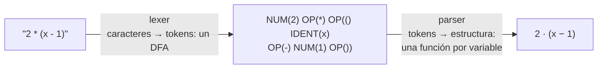
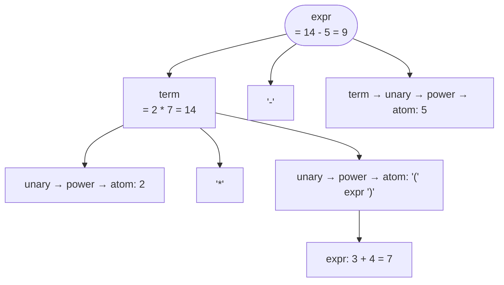
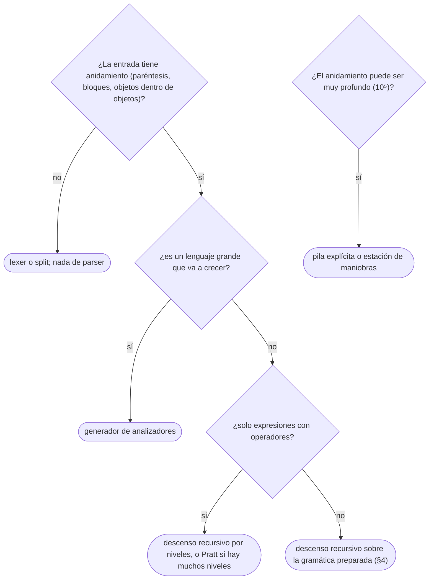

# 06 — Análisis léxico y gramáticas simples

> **Opcional.** Ningún capítulo del hilo principal depende de este. Las dos primeras fases de un compilador,
> llevadas a lo que se programa en una tarde: un analizador léxico que es un autómata finito escrito a mano, y
> un analizador de descenso recursivo que convierte una gramática sin ambigüedad en una función por variable.
> Con eso se evalúan expresiones, se leen formatos de configuración y se valida algo con la forma de JSON.
> **Sin LL(1) ni LALR(1)**, por decisión del corpus.
>
> **Niveles:** análisis léxico [B] · gramáticas para descenso recursivo [B] · descenso recursivo [B].
>
> **📚 Lectura troncal:** Aho, Lam, Sethi y Ullman, *Compiladores: principios, técnicas y herramientas*,
> 2.ª ed. (Pearson, 2008), caps. 2 y 3.
>
> **Asume leído:** [`22/01` — Lenguajes y gramáticas](01-lenguajes-y-gramaticas.md).
>
> **Vigencia:** 2026-10-04.

**Salto rápido:** [1](#1--el-problema) · [2](#2--la-teoría) · [3](#3--análisis-léxico) · [4](#4--gramáticas-para-descenso-recursivo) · [5](#5--descenso-recursivo) · [6](#6-️-la-tabla-de-costes) · [7](#7--cómo-se-elige) · [8](#8--señales-del-enunciado) · [9](#9--dónde-aparece-de-verdad) · [🧠](#-preguntas) · [🧩](#-problemas-propios)

---

## 1. 🎯 El problema

Una hoja de cálculo interna acepta fórmulas como `2 * (precio - descuento) ^ 2` y alguien las evaluaba con
una cascada de `split` y `replace`. Funciona hasta que llega `-3 ^ 2`, o `10 - 2 - 3`, o un paréntesis dentro
de otro: el resultado sale mal y nadie sabe por qué, porque el código no tiene una **gramática** detrás y
cada caso se parcheó por separado.

La solución estándar tiene dos piezas, y las dos caben en cien líneas:



El **lexer** agrupa caracteres en *tokens* (unidades léxicas) con un autómata finito ([`16/07`](../16-cadenas/07-automatas-y-expresiones-regulares.md)),
porque esa parte del lenguaje es regular. El **parser** reconoce la estructura con una gramática libre de
contexto ([`22/01`](01-lenguajes-y-gramaticas.md)), porque el anidamiento no lo es. Separarlas es lo que hace
que cada una sea simple.

> 🧠 **Modelo mental.** En una gramática bien escrita para descenso recursivo, **cada variable es una
> función, cada alternativa es un `if` sobre el token siguiente, y cada repetición es un `while`**. La
> precedencia se lee en qué función llama a cuál.

---

## 2. 📐 La teoría

**Token, lexema, patrón.** Un **token** es una categoría (número, identificador, operador); un **lexema** es
el texto concreto (`42`, `precio`, `*`); un **patrón** es la expresión regular que describe los lexemas de un
token (`[0-9]+`). El lexer devuelve pares (token, lexema), con la posición para los mensajes de error.

**Dos reglas que resuelven las ambigüedades léxicas:**

- **Coincidencia más larga** (*maximal munch*): de todos los prefijos que encajan, el más largo. `<=` es un
  token, no `<` seguido de `=`; `precio2` es un identificador, no `precio` y `2`.
- **Prioridad**: si dos patrones dan el mismo lexema más largo, gana el primero de la lista. Así `let` es
  palabra reservada y no identificador.

**Teorema (Kleene, aplicado).** Como cada patrón es regular, su unión es regular, y el lexer entero es un
único DFA que, al quedarse sin transición, devuelve el último estado final que pasó. Coste `O(n)` en el caso
habitual.

**Descenso recursivo.** Una función por variable de la gramática; cada función mira el token siguiente para
decidir qué producción usar, y llama a las funciones de los símbolos del cuerpo. Funciona sin vuelta atrás
cuando **un solo token** basta para elegir la producción, que exige dos cosas de la gramática:

```text
1. sin recursión por la izquierda      E → E + T  hace que expr() se llame a sí misma sin consumir nada
2. sin prefijos comunes ambiguos       A → a b | a c  no se decide mirando solo «a»: se factoriza
```

Las gramáticas que cumplen esto con un token de anticipación son las **LL(1)**; su teoría formal (conjuntos
FIRST y FOLLOW, tablas) queda fuera del corpus. Aquí se usan las dos reglas de arriba a ojo, que es lo que
hace todo el que escribe un parser a mano.

---

## 3. 🧱 Análisis léxico

**Qué es.** Un bucle que, en cada posición, salta los blancos y reconoce el lexema más largo que empieza ahí.
Escrito a mano, el DFA queda **implícito** en los `if`: un estado por clase de lexema.

**Por qué es correcto** (el enunciado y una frase): cada rama consume un prefijo que encaja en exactamente un
patrón y no se detiene mientras el siguiente carácter pueda prolongarlo, que es la coincidencia más larga; los
patrones de arranque disjuntos (dígito, letra, símbolo) hacen que la rama sea única.

**Cómo va**, sobre `2 * (x1 - 10)`:

```text
pos  carácter  estado            token emitido
0    2         número            NUM "2" (pos 0)        el espacio corta el número
2    *         símbolo           OP "*" (pos 2)
4    (         símbolo           OP "(" (pos 4)
5    x 1       identificador     IDENT "x1" (pos 5)     el 1 prolonga el identificador
8    -         símbolo           OP "-" (pos 8)
10   1 0       número            NUM "10" (pos 10)
12   )         símbolo           OP ")" (pos 12)
                                 END (pos 13)
```

**Cuánto.** `Θ(n)`: cada carácter se mira un número constante de veces. Las palabras reservadas se reconocen
como identificadores y se buscan después en una tabla hash, `O(1)` esperado.

**La plantilla**, un lexer para números enteros, identificadores y operadores de un carácter:

```cpp
#include <cctype>
#include <stdexcept>
#include <string>
#include <vector>

enum class Kind { Num, Ident, Op, End };
struct Token { Kind kind; std::string text; int pos; };

// Lexer escrito como DFA implícito: una rama por clase de lexema, coincidencia más larga. Θ(n).
std::vector<Token> tokenize(const std::string& s) {
    std::vector<Token> out;
    size_t i = 0;
    while (i < s.size()) {
        unsigned char c = s[i];
        if (std::isspace(c)) { i++; continue; }                        // los blancos no son tokens
        size_t start = i;
        if (std::isdigit(c)) {
            while (i < s.size() && std::isdigit((unsigned char) s[i])) i++;
            out.push_back({Kind::Num, s.substr(start, i - start), (int) start});
        } else if (std::isalpha(c) || c == '_') {
            while (i < s.size() && (std::isalnum((unsigned char) s[i]) || s[i] == '_')) i++;
            out.push_back({Kind::Ident, s.substr(start, i - start), (int) start});
        } else if (std::string("+-*/^()=").find(c) != std::string::npos) {
            i++;
            out.push_back({Kind::Op, std::string(1, (char) c), (int) start});
        } else {
            throw std::runtime_error("carácter inesperado en la posición " + std::to_string(start));
        }
    }
    out.push_back({Kind::End, "", (int) s.size()});                    // centinela: simplifica el parser
    return out;
}
```

```java
import java.util.ArrayList;
import java.util.List;

enum Kind { NUM, IDENT, OP, END }
record Token(Kind kind, String text, int pos) { }

static List<Token> tokenize(String s) {
    List<Token> out = new ArrayList<>();
    int i = 0;
    while (i < s.length()) {
        char c = s.charAt(i);
        if (Character.isWhitespace(c)) { i++; continue; }
        int start = i;
        if (c >= '0' && c <= '9') {
            while (i < s.length() && s.charAt(i) >= '0' && s.charAt(i) <= '9') i++;
            out.add(new Token(Kind.NUM, s.substring(start, i), start));
        } else if (Character.isLetter(c) || c == '_') {
            while (i < s.length() && (Character.isLetterOrDigit(s.charAt(i)) || s.charAt(i) == '_')) i++;
            out.add(new Token(Kind.IDENT, s.substring(start, i), start));
        } else if ("+-*/^()=".indexOf(c) >= 0) {
            i++;
            out.add(new Token(Kind.OP, String.valueOf(c), start));
        } else {
            throw new IllegalArgumentException("carácter inesperado en la posición " + start);
        }
    }
    out.add(new Token(Kind.END, "", s.length()));
    return out;
}
```

```python
def tokenize(s):
    """Lexer: lista de (tipo, texto, posición) con 'NUM', 'IDENT', 'OP' y un 'END' final. Θ(n)."""
    out, i = [], 0
    while i < len(s):
        c = s[i]
        if c.isspace():
            i += 1
            continue
        start = i
        if '0' <= c <= '9':
            while i < len(s) and '0' <= s[i] <= '9':
                i += 1
            out.append(('NUM', s[start:i], start))
        elif c.isalpha() or c == '_':
            while i < len(s) and (s[i].isalnum() or s[i] == '_'):
                i += 1
            out.append(('IDENT', s[start:i], start))
        elif c in '+-*/^()=':
            i += 1
            out.append(('OP', c, start))
        else:
            raise ValueError(f'carácter inesperado en la posición {start}')
    out.append(('END', '', len(s)))
    return out
```

- **El centinela `END`** evita comprobar en cada función del parser si quedan tokens.
- **Los dígitos se comparan con `'0'`–`'9'`** en Java y Python: `Character.isDigit` y `str.isdigit` aceptan
  también dígitos de otros alfabetos (`٣`), y `str.isdigit` hasta superíndices como `²`, que `int` rechaza. En
  C++, `std::isdigit` exige un valor de `unsigned char`: con un `char` negativo es comportamiento indefinido.
- **Operadores de dos caracteres** (`<=`, `==`, `->`): se mira el carácter siguiente antes de emitir, que es la
  coincidencia más larga.
- **Una expresión regular con alternativas nombradas** (`(?P<num>\d+)|(?P<id>…)` en Python) hace lo mismo en
  cinco líneas, con el motor de vuelta atrás de `16/07`: bien para patrones simples, peor para mensajes de
  error.

**Cuándo sí:** siempre que la entrada sea texto con estructura: antes de cualquier parser, para que este
trabaje con tokens y no con caracteres. **Cuándo no:** para un formato de un solo nivel (`clave=valor` por
línea), un `split` basta.

> **Veredicto:** el lexer es el DFA del lenguaje escrito como un `if` por clase de lexema, con la coincidencia
> más larga y un centinela al final. Separarlo del parser es lo que hace que los dos sean triviales.

---

## 4. 🧱 Gramáticas para descenso recursivo

**Qué es.** Reescribir una gramática para que cada función decida su producción con un token, sin cambiar el
lenguaje. Dos transformaciones bastan casi siempre:

```text
recursión por la izquierda              A → A α | β            ⇒   A → β { α }        (un bucle)
factorización por la izquierda          A → a β | a γ          ⇒   A → a ( β | γ )
```

**Por qué es correcto** (el enunciado y una frase): `A → A α | β` genera `β α α … α`, que es exactamente `β {α}`;
la factorización solo agrupa lo común. Las dos conservan el lenguaje; lo que cambia es el árbol, y por eso la
**asociatividad** se recupera en el bucle (acumulando de izquierda a derecha).

**Cómo va**, la gramática de expresiones de [`22/01`](01-lenguajes-y-gramaticas.md) con potencia y menos
unario, antes y después:

```text
antes (no apta)                         después (apta para descenso recursivo)
E → E + T | E - T | T                   expr  → term { ('+' | '-') term }
T → T * U | T / U | U                   term  → unary { ('*' | '/') unary }
U → - U | P                             unary → '-' unary | power
P → A ^ U | A                           power → atom [ '^' unary ]
A → num | ( E )                         atom  → NUM | '(' expr ')'
```

- **La precedencia** está en la cadena de llamadas: `expr` llama a `term`, que llama a `unary`: lo que está más
  abajo se agrupa antes. `^` liga más que el menos unario, así que `-3 ^ 2 = -9`.
- **La asociatividad por la izquierda** de `+` y `*` sale del bucle: `10 - 2 - 3` se evalúa `(10 - 2) - 3 = 5`.
- **La asociatividad por la derecha** de `^` sale de la recursión: `power` llama a `unary`, que puede volver a
  `power`, y `2 ^ 3 ^ 2 = 2 ^ 9 = 512`.

**Cuánto.** Las transformaciones son a mano y una vez. La gramática resultante tiene una variable por nivel de
precedencia.

**La plantilla.** No hay código: es la gramática de la derecha, que la plantilla de §5 sigue línea a línea.

**Cuándo sí:** antes de escribir cualquier parser a mano. **Cuándo no:** si la gramática es intrínsecamente
ambigua o necesita mucha anticipación (C++ es el ejemplo famoso), no hay transformación que la deje simple: se
usa un generador o un algoritmo general ([`22/02`](02-automatas-de-pila.md)).

> **Veredicto:** quitar la recursión por la izquierda y factorizar convierte la gramática del libro en una que
> se programa sin vuelta atrás. La precedencia vive en quién llama a quién; la asociatividad, en bucle o en
> recursión.

---

## 5. 🧱 Descenso recursivo

**Qué es.** Una función por variable de la gramática de §4, que consume tokens y devuelve el valor (o el nodo
del árbol). Un error es encontrarse un token que ninguna alternativa admite.

**Por qué es correcto** (el enunciado y una frase): cada función reconoce exactamente las cadenas que genera su
variable, por inducción sobre la estructura de la gramática; y como cada decisión se toma con un token, no hay
vuelta atrás ni exploración de alternativas.

**Cómo va**, `2 * (3 + 4) - 5`:



**Cuánto.** `Θ(n)` en el número de tokens: cada token se consume una vez y cada función hace trabajo constante
fuera de sus llamadas. La **profundidad de recursión** es la de anidamiento: `10⁵` paréntesis anidados
desbordan la pila de Java y el límite de Python.

**La plantilla**, un evaluador de enteros sobre los tokens de §3:

```cpp
// Descenso recursivo con evaluación; sigue la gramática de §4. Θ(número de tokens).
struct Parser {
    std::vector<Token> toks;
    size_t p = 0;
    explicit Parser(std::vector<Token> t) : toks(std::move(t)) {}

    bool accept(const char* op) {                                  // consume el operador si es el siguiente
        if (toks[p].kind == Kind::Op && toks[p].text == op) { p++; return true; }
        return false;
    }
    [[noreturn]] void fail(const std::string& what) {
        throw std::runtime_error(what + " en la posición " + std::to_string(toks[p].pos));
    }
    long long parse() {
        long long v = expr();
        if (toks[p].kind != Kind::End) fail("sobra entrada");
        return v;
    }
    long long expr() {                                             // expr → term { ('+' | '-') term }
        long long v = term();
        while (true) {
            if (accept("+")) v += term();
            else if (accept("-")) v -= term();
            else return v;
        }
    }
    long long term() {                                             // term → unary { ('*' | '/') unary }
        long long v = unary();
        while (true) {
            if (accept("*")) v *= unary();
            else if (accept("/")) {
                long long d = unary();
                if (d == 0) fail("división por cero");
                v /= d;                                            // trunca hacia cero
            } else return v;
        }
    }
    long long unary() { return accept("-") ? -unary() : power(); }
    long long power() {                                            // power → atom [ '^' unary ]
        long long base = atom();
        if (!accept("^")) return base;
        long long e = unary();                                     // recursión: asociativa por la derecha
        if (e < 0) fail("exponente negativo");
        long long r = 1;
        for (; e > 0; e >>= 1) {                                   // exponenciación rápida (10/05)
            if (e & 1) r *= base;                                  // sin control de desbordamiento
            if (e > 1) base *= base;
        }
        return r;
    }
    long long atom() {
        if (toks[p].kind == Kind::Num) return std::stoll(toks[p++].text);
        if (accept("(")) {
            long long v = expr();
            if (!accept(")")) fail("se esperaba ')'");
            return v;
        }
        fail("se esperaba un número o '('");
    }
};
```

```java
import java.util.List;

static final class Parser {
    private final List<Token> toks;
    private int p = 0;
    Parser(List<Token> toks) { this.toks = toks; }

    private boolean accept(String op) {
        Token t = toks.get(p);
        if (t.kind() == Kind.OP && t.text().equals(op)) { p++; return true; }
        return false;
    }
    private IllegalArgumentException fail(String what) {
        return new IllegalArgumentException(what + " en la posición " + toks.get(p).pos());
    }
    long parse() {
        long v = expr();
        if (toks.get(p).kind() != Kind.END) throw fail("sobra entrada");
        return v;
    }
    private long expr() {
        long v = term();
        while (true) {
            if (accept("+")) v += term();
            else if (accept("-")) v -= term();
            else return v;
        }
    }
    private long term() {
        long v = unary();
        while (true) {
            if (accept("*")) v *= unary();
            else if (accept("/")) {
                long d = unary();
                if (d == 0) throw fail("división por cero");
                v /= d;
            } else return v;
        }
    }
    private long unary() { return accept("-") ? -unary() : power(); }
    private long power() {
        long base = atom();
        if (!accept("^")) return base;
        long e = unary();
        if (e < 0) throw fail("exponente negativo");
        long r = 1;
        for (; e > 0; e >>= 1) {
            if ((e & 1) != 0) r *= base;
            if (e > 1) base *= base;
        }
        return r;
    }
    private long atom() {
        Token t = toks.get(p);
        if (t.kind() == Kind.NUM) { p++; return Long.parseLong(t.text()); }
        if (accept("(")) {
            long v = expr();
            if (!accept(")")) throw fail("se esperaba ')'");
            return v;
        }
        throw fail("se esperaba un número o '('");
    }
}
```

En Python es la misma clase, método por método; lo único que no se traduce línea a línea es la división, porque
`//` redondea hacia abajo:

```python
# Dentro de Parser.term(), en la rama de '/': truncar hacia cero como C++ y Java.
q = abs(v) // abs(d)
v = q if (v >= 0) == (d >= 0) else -q
```

- **La división** es el punto donde los tres lenguajes discrepan: C++ y Java truncan hacia cero (`-7 / 2 = -3`),
  Python con `//` redondea hacia abajo (`-7 // 2 = -4`). Por eso la versión de Python trunca a mano.
- **El desbordamiento**: en C++ el desbordamiento de `long long` con signo es comportamiento indefinido; en
  Java, `long` da la vuelta en silencio; en Python los enteros no tienen límite, y `2 ^ 1000` sale exacto.
- **Los errores** llevan la posición del token donde se detectaron: es la mitad del valor de un parser a mano
  frente a un `eval`.
- **Para construir el árbol** en lugar de evaluar, cada función devuelve un nodo (`Num`, `Bin(op, izq, der)`,
  `Neg`) en vez de un número; evaluar, imprimir o simplificar son después recorridos del árbol
  ([`07/01`](../07-arboles/01-arboles-y-recorridos.md)).
- **Variables**: `atom` acepta un `IDENT` y lo busca en un mapa; `let x = expr` es una regla más arriba, que
  mira si el primer token es la palabra `let`.

**Cuándo sí:** calculadoras, fórmulas, lenguajes de configuración, consultas pequeñas, cualquier formato con
anidamiento donde el error tenga que decir dónde está. **Cuándo no:** si el lenguaje es grande y cambia (un
lenguaje de programación entero), un generador de analizadores ahorra trabajo; si solo hay expresiones con
operadores binarios y muchos niveles, el algoritmo de Pratt o el de la estación de maniobras de Dijkstra lo
hacen con una tabla de precedencias en lugar de una función por nivel.

> **Veredicto:** el descenso recursivo es la gramática transcrita: una función por variable, un `while` por
> repetición, un `if` por alternativa. Lineal, legible y con buenos mensajes de error, siempre que la gramática
> se haya preparado (§4).

---

## 6. ⏱️ La tabla de costes

| Técnica | Tiempo | Qué acepta | Lo que la tabla no dice |
|---|---|---|---|
| `split` y `replace` | `O(n)` por pasada | Formatos sin anidamiento | Se rompe con el primer paréntesis |
| Lexer a mano + descenso recursivo | `Θ(n)` | Gramáticas sin recursión por la izquierda, decididas con un token | Profundidad de recursión = anidamiento |
| Estación de maniobras / Pratt | `Θ(n)` | Expresiones con operadores y precedencias | Iterativo (estación) o casi; menos general |
| Generador (ANTLR, Bison) | `Θ(n)` en sus clases | LL(*), LALR(1): casi todo lenguaje de programación | Fuera del corpus; añade una dependencia y un paso de generación |
| CYK / Earley | `O(n³)` | Cualquier libre de contexto | `22/02`; para cadenas cortas o gramáticas ambiguas |

---

## 7. 🧭 Cómo se elige



> **Regla de entrevista:** si te piden «evalúa esta expresión», escribe primero la gramática en tres líneas
> (`expr`, `term`, `factor`), di dónde está la precedencia, y después programa una función por línea.

---

## 8. 🔎 Señales del enunciado

| Señal | Técnica | Por qué |
|---|---|---|
| «Evalúa la expresión con `+ - * /` y paréntesis» | Lexer + descenso recursivo por niveles | Precedencia en la cadena de llamadas |
| «El menos puede ser unario», «potencia asociativa por la derecha» | Variable `unary`; recursión en `power` | La asociatividad sale de la forma de la regla |
| «Valida este formato con objetos y listas anidados» | Gramática + descenso recursivo | Libre de contexto, no regular |
| «Separa la entrada en palabras, números y símbolos» | Lexer con coincidencia más larga | Regular |
| «Anidamiento de hasta `10⁵` niveles» | Pila explícita | La recursión desborda |

---

## 9. 🔭 Dónde aparece de verdad

- **El módulo `json` de Python** es descenso recursivo sobre un escáner escrito a mano, y por eso su error dice
  la línea y la columna donde se rompió el documento.
- **Los compiladores de producción** (Clang, el de Go, el de Rust) usan descenso recursivo escrito a mano, no
  generadores, por los mensajes de error y la velocidad.
- **Las fórmulas de las hojas de cálculo**, los motores de plantillas y los lenguajes de consulta pequeños
  (filtros de búsqueda, reglas de alertas) son exactamente el evaluador de §5 con más operadores.
- **Los resaltadores de sintaxis** de los editores son solo lexers: no necesitan entender la estructura, solo
  colorear tokens, y por eso funcionan con código a medio escribir.

---

## ⚠️ Errores frecuentes

| Se dice | Lo preciso |
|---|---|
| «Un parser se escribe a base de `split` y `replace`» | Sin gramática no hay forma de saber qué casos faltan; con ella, cada caso es una regla |
| «`E → E + T` se programa tal cual» | La recursión por la izquierda hace que `expr()` se llame sin consumir nada: bucle infinito. Se reescribe como bucle |
| «Al quitar la recursión por la izquierda se pierde la asociatividad» | Se recupera acumulando en el bucle de izquierda a derecha |
| «El menos unario es igual que el binario» | Tiene otra precedencia: `-3 ^ 2 = -9` y `2 - -3 = 5` exigen una regla propia |
| «La división entera es igual en todos los lenguajes» | C++ y Java truncan hacia cero; `//` de Python redondea hacia abajo |
| «El lexer y el parser son lo mismo» | El lexer es regular (DFA); el parser, libre de contexto. Mezclarlos complica los dos |
| «Un parser recursivo aguanta cualquier entrada válida» | La profundidad de anidamiento es la de la pila: `10⁵` niveles la desbordan |

---

## 📚 Para profundizar

- **Libro** — Aho, Lam, Sethi y Ullman, *Compiladores: principios, técnicas y herramientas*, 2.ª ed. (Pearson,
  2008), cap. 2: un traductor dirigido por la sintaxis, con la gramática de expresiones, el análisis predictivo
  (descenso recursivo) y la eliminación de la recursión por la izquierda; cap. 3: análisis léxico, patrones,
  diagramas de transición y de la expresión regular al autómata. *Lectura troncal.*
- **Libro** — Hopcroft, Motwani y Ullman, *Introducción a la teoría de autómatas, lenguajes y computación*,
  3.ª ed. (Pearson, 2007), §5.3: aplicaciones de las gramáticas libres de contexto, analizadores incluidos.
- **Documentación** — Python, [`re` — Writing a Tokenizer](https://docs.python.org/3/library/re.html#writing-a-tokenizer):
  un lexer con alternativas nombradas.
- **Video** — Aiken, *Compilers* (Stanford Online): análisis léxico y descenso recursivo.

---

## 🧠 Preguntas

1. ¿Qué diferencia hay entre token, lexema y patrón? 🟢
2. ¿Qué es la coincidencia más larga y qué regla desempata cuando dos patrones dan el mismo lexema? 🟢
3. ¿Por qué el análisis léxico es regular y el sintáctico no? 🟢
4. ¿Por qué la recursión por la izquierda impide el descenso recursivo, y cómo se elimina? 🟡
5. ¿Dónde vive la precedencia de los operadores en un parser de descenso recursivo? 🟡
6. ¿Qué diferencia hay entre resolver la asociatividad con un bucle y con recursión? Da un operador de cada tipo. 🟡
7. ¿Cuánto vale `-7 / 2` en C++, Java y Python con `//`, y qué hace la plantilla de Python para dar lo mismo que las otras dos? 🟡
8. ¿Cuánto vale `-3 ^ 2` con la gramática de §4, y qué cambio de la gramática daría `9`? 🟠
9. ¿Por qué el descenso recursivo de §5 es lineal en el número de tokens? 🟠
10. ¿Qué pasa con la plantilla si la entrada tiene `10⁵` paréntesis anidados, y cómo lo resolverías? 🟠
11. Escribe la gramática de `let x = expr` y de las variables, y di qué funciones de la plantilla cambian. 🔴
12. Diseña la gramática y el parser de un JSON mínimo (objetos, listas, cadenas sin escapes, enteros, `true`, `false`, `null`). ¿Qué decide cada función con un solo token? 🔴

---

## 🧩 Problemas propios

### Calculadora con variables

**Nivel:** 🟡 · **Formato:** programa completo.

Cada línea es una asignación `let <nombre> = <expresión>` o una expresión suelta. Las expresiones tienen
enteros, nombres de variables (minúsculas, dígitos y `_`, empezando por letra), `+`, `-` (binario y unario),
`*`, `/` y paréntesis, con la precedencia habitual. `/` trunca hacia cero. Por cada expresión suelta, imprime su
valor, o `ERROR` si divide por cero o usa una variable sin asignar. Una asignación que falla no cambia nada y
no imprime.

- **Entrada.** Una línea con `n`. Después, `n` líneas.
- **Salida.** Una línea por expresión suelta.
- **Restricciones.** `1 ≤ n ≤ 1000`; cada línea de hasta 200 caracteres; todos los valores intermedios caben en
  64 bits con signo.

```text
Entrada             Salida
5                   35
let x = 7           4
x * (2 + 3)         ERROR
let y = x / -2
y - -x
10 / (x - 7)

Entrada             Salida
4                   ERROR
z + 1               3
-(-(3))             1
let z = 2
z * z - 10 / 3
```

**Pista 1:** ¿qué es lo primero que miras de una línea para saber si es una asignación, y en qué punto de la
gramática entra un nombre?

### JSON mínimo

**Nivel:** 🟠 · **Formato:** programa completo.

Una línea con un texto que debería ser un valor de un JSON simplificado: objetos `{"clave": valor, …}`, listas
`[valor, …]`, cadenas entre comillas con solo letras, dígitos y espacios (sin escapes), enteros con un `-`
opcional, y `true`, `false` y `null`. Puede haber espacios entre los elementos. Si es válido, imprime `OK`, la
profundidad máxima de anidamiento (0 para un valor suelto; cada objeto o lista suma 1) y el número total de
claves. Si no, `ERROR`.

- **Entrada.** Una línea.
- **Salida.** `OK d k` o `ERROR`.
- **Restricciones.** Hasta `10⁵` caracteres; el anidamiento puede llegar a `5·10⁴` niveles.

```text
Entrada                                    Salida
{"a": [1, 2, {"b": null}], "c": true}      OK 3 3

Entrada                                    Salida
[1, 2,]                                    ERROR

Entrada                                    Salida
"hola"                                     OK 0 0
```

**Pista 1:** con un solo token, ¿qué te dice el primer carácter de un valor sobre cuál de las siete formas es?
¿Y qué pasa con tu pila de llamadas con cincuenta mil corchetes abiertos?

---

## 🧩 Práctica externa

> 💡 **Truco.** Antes de programar, escribe la gramática en tres o cuatro líneas y pásasela a la IA para que te
> diga si tiene recursión por la izquierda o alternativas que un token no decide; el código, después y tuyo
> ([`01/06`](../01-oficio-del-competidor/06-protocolo-de-resolucion.md)).

### Núcleo

| ✔ | Problema | Plataforma | Nivel | Patrón | Pista 1 |
|---|---|---|---|---|---|
| [ ] | [Evaluate the Bracket Pairs of a String](https://leetcode.com/problems/evaluate-the-bracket-pairs-of-a-string/) | LeetCode | 🟡 | Lexer de una pasada | ¿Qué dos estados tiene el recorrido, dentro y fuera de un corchete? |
| [ ] | [Remove Comments](https://leetcode.com/problems/remove-comments/) | LeetCode | 🟡 | Lexer con estados | ¿Qué cambia cuando estás dentro de un comentario de bloque que cruza líneas? |
| [ ] | [Solve the Equation](https://leetcode.com/problems/solve-the-equation/) | LeetCode | 🟡 | Tokens y acumulación | ¿Qué dos números resumen cada lado de la ecuación? |
| [ ] | [Basic Calculator](https://leetcode.com/problems/basic-calculator/) | LeetCode | 🔴 | Descenso recursivo con unario | ¿Qué hace un `-` que aparece justo después de un `(`? |

### Ampliación

| ✔ | Problema | Plataforma | Nivel | Patrón | Pista 1 |
|---|---|---|---|---|---|
| [ ] | [Parse Lisp Expression](https://leetcode.com/problems/parse-lisp-expression/) | LeetCode | 🔴 | Descenso recursivo con ámbitos | ¿Qué estructura guarda los valores de las variables mientras estás dentro de un `let`? |
| [ ] | [Brace Expansion II](https://leetcode.com/problems/brace-expansion-ii/) | LeetCode | 🔴 | Gramática de unión y concatenación | ¿Cuál de las dos operaciones liga más fuerte, la coma o la yuxtaposición? |

---

## ✅ Criterio de dominio

- Escribir el lexer de §3 sin mirar, con la coincidencia más larga y el centinela.
- Transformar una gramática con recursión por la izquierda y explicar dónde quedan la precedencia y la
  asociatividad.
- Escribir el evaluador de §5 en el lenguaje propio en menos de veinte minutos, con mensajes de error con
  posición.
- Resolver «Calculadora con variables» y Basic Calculator sin pista 2.

---

**Anterior:** [`22/05` — NP-completitud](05-np-completitud.md) ·
**Siguiente:** [`22/07` — Respuestas](07-respuestas.md) ·
**Relacionado:** [`16/07` — Autómatas y expresiones regulares](../16-cadenas/07-automatas-y-expresiones-regulares.md);
[`10/01` — Recursión](../10-busqueda-completa-y-divide-y-venceras/01-recursion.md).
