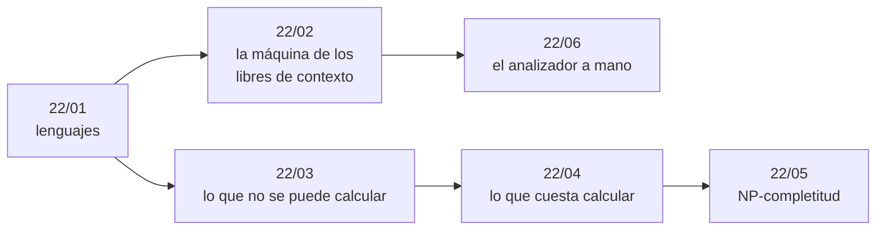

# Bloque 22 — Teoría de la computación

> **Opcional.** Ningún capítulo del hilo principal depende de este bloque, y ninguna ruta de estudio lo
> incluye. Es la teoría que hay debajo de tres frases que se dicen en las entrevistas sin saber de dónde
> salen: «eso no se valida con una expresión regular», «no se puede detectar un bucle infinito» y «es
> NP-completo». Lenguajes y gramáticas, autómatas de pila, máquinas de Turing y decidibilidad, P y NP, las
> reducciones clásicas, y el análisis léxico y el descenso recursivo con los que se programa un evaluador de
> expresiones. Las respuestas, en [`07-respuestas.md`](07-respuestas.md).
>
> **Vigencia:** 2026-10-04.

---

## 🧭 Índice

| Capítulo | Niveles | Problemas |
|---|---|---|
| [`22/01` — Lenguajes y gramáticas](01-lenguajes-y-gramaticas.md) | regulares, cierre y equivalencia [A] · gramáticas libres de contexto [A] · lema de bombeo [B] | — |
| [`22/02` — Autómatas de pila](02-automatas-de-pila.md) | autómatas de pila [B] · forma normal de Chomsky [B] · CYK [B] | 2 propios |
| [`22/03` — Máquinas de Turing y decidibilidad](03-maquinas-de-turing-y-decidibilidad.md) | máquina de Turing [A] · Church-Turing [B] · parada [A] · Rice [C] | — |
| [`22/04` — P, NP y reducciones](04-p-np-y-reducciones.md) | P y NP [A] · reducciones [B] · 2-SAT frente a 3-SAT [B] | — |
| [`22/05` — NP-completitud](05-np-completitud.md) | Cook-Levin [B] · reducciones clásicas [B] · suma de subconjuntos [B] · qué hacer con un NP-difícil [A] | — |
| [`22/06` — Análisis léxico y gramáticas simples](06-analisis-lexico-y-gramaticas-simples.md) | análisis léxico [B] · gramáticas para descenso recursivo [B] · descenso recursivo [B] | 2 propios y 6 externos |
| [`22/07` — Respuestas](07-respuestas.md) | — | Pistas 2 y 3 de los problemas |

**Sin simulación**, porque el bloque es opcional; las preguntas más difíciles de cada capítulo hacen ese
papel. **Problemas, solo donde hay algoritmo** (§7.6 de la guía del corpus): CYK en `22/02` y el analizador en
`22/06`. `22/06` mide 659 líneas: se dejó entero porque el lexer y el parser se leen juntos, y su parser en
Python se reduce a la única línea que cambia.

---

## 🧭 Orden de lectura

- **Para la frase «no se valida con una expresión regular»**: `22/01`.
- **Para escribir un evaluador de expresiones en una entrevista**: `22/06`, con `22/01` §4 antes.
- **Para «es NP-completo, ¿y ahora qué?»**: `22/04` y `22/05`; el menú de respuestas está en `22/05` §6.
- **Para «no se puede detectar un bucle infinito»**: `22/03`.

---

## 🔎 Mapa de señales del bloque

| Señal | Técnica | Capítulo |
|---|---|---|
| «Validar paréntesis anidados con una expresión regular» | Lema de bombeo: no se puede | `22/01` |
| «¿Aceptan estos dos autómatas lo mismo?» | BFS sobre el autómata producto | `22/01` |
| «Dada una gramática, ¿genera la cadena?», «¿de cuántas formas?» | CYK, también contando | `22/02` |
| «Detectar si un programa se cuelga» | Indecidible: aproximar; con memoria finita, palomar | `22/03` |
| «Demuestra que tu problema es difícil» | Certificado + reducción desde un NP-completo, en la dirección correcta | `22/04`, `22/05` |
| «Restricciones de dos opciones booleanas» frente a tres | 2-SAT lineal, 3-SAT NP-completo | `22/04` |
| «Visitar cada lugar una vez», `n ≤ 20` | Ciclo hamiltoniano por máscaras de finales | `22/05` |
| «Subconjunto que suma exactamente…» con números pequeños | DP pseudo-polinomial | `22/05` |
| «Evalúa la expresión», «valida el formato anidado» | Lexer + descenso recursivo | `22/06` |

---

## 📚 Lectura troncal del bloque

- **Hopcroft, Motwani y Ullman**, *Introducción a la teoría de autómatas, lenguajes y computación*, 3.ª ed.
  (Pearson, 2007): caps. 4–7 para `22/01` y `22/02`, caps. 8–9 para `22/03`, cap. 10 como segunda lectura de
  `22/04` y `22/05`.
- **Cormen, Leiserson, Rivest y Stein**, *Introduction to Algorithms*, 3.ª ed. (MIT Press, 2009), cap. 34, y
  **Kleinberg y Tardos**, *Algorithm Design* (Addison-Wesley, 2005), cap. 8: `22/04` y `22/05`.
- **Aho, Lam, Sethi y Ullman**, *Compiladores: principios, técnicas y herramientas*, 2.ª ed. (Pearson, 2008),
  caps. 2–3: `22/06`.
- **Brassard y Bratley**, *Fundamentos de algoritmia* (Prentice Hall, 1997), cap. 12: complejidad
  computacional, el puente con el texto base del corpus.
- **En video**, por título: Ullman, *Automata Theory*, y Aiken, *Compilers* (Stanford Online).

---

## 🧭 Qué NO está aquí

- **Los autómatas finitos y las expresiones regulares** (DFA, NFA, Thompson, subconjuntos, ReDoS): en
  [`16/07`](../16-cadenas/07-automatas-y-expresiones-regulares.md), que es su dueño; este bloque los usa.
- **2-SAT como algoritmo**, con Kosaraju y Tarjan: en [`14/05`](../14-grafos-recorridos/05-componentes-fuertes-y-2sat.md).
- **La DP de máscaras y el viajante**: en [`13/01`](../13-dp-avanzada/01-mascaras-de-bits.md); la mochila y la
  suma de subconjuntos, en [`12/03`](../12-dp-clasica/03-mochilas.md).
- **La aproximación con garantía y las heurísticas**: en [`20/05`](../20-ad-hoc-constructivos-e-interactivos/05-heuristicos-y-aproximados.md).
- **Reconocer lo NP-difícil en un enunciado**, sin pruebas: en [`10/05`](../10-busqueda-completa-y-divide-y-venceras/05-divide-y-venceras.md).
- **LL(1), LALR(1) y los generadores de analizadores**, la complejidad más allá de NP (PSPACE solo se nombra en
  `22/04`) y las máquinas de Turing a fondo: fuera del corpus, por decisión de su temario.

---

**Anterior:** [Bloque 21 — Simulacros](../21-simulacros/README.md) ·
**Siguiente:** [Bloque 23 — Cuaderno de competencia](../23-cuaderno-de-competencia/README.md) ·
**Inicio:** [README del corpus](../README.md)
