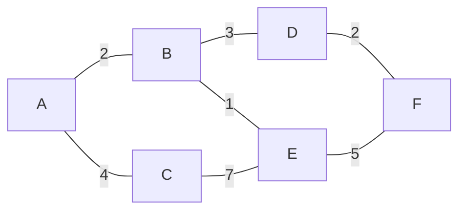
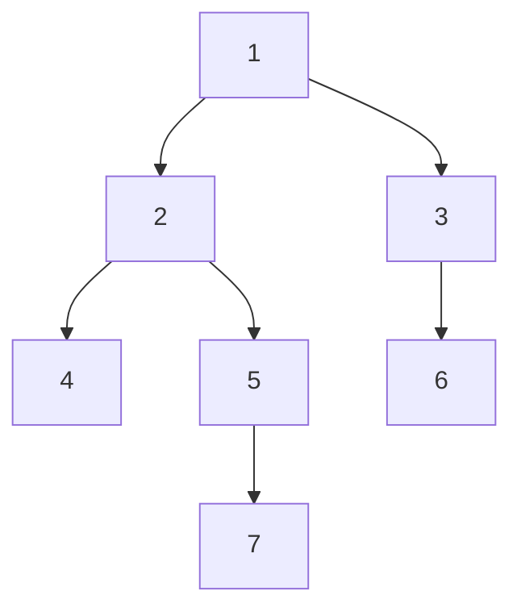

# ✍️ Guía de estilo, tono y convenciones

## Algoritmos y estructuras de datos — refrescamiento a fondo, con la programación competitiva como medio

Esta guía es la fuente de verdad editorial de `02-algoritmos-estructuras-de-datos/` y manda sobre
**los veintiún bloques del hilo principal** y los **dos opcionales**:

- **la base:** `01-oficio-del-competidor`, `02-analisis`, `03-biblioteca-estandar`;
- **las técnicas:** `04-secuencias`, `05-orden-y-busqueda`, `06-lineales-y-hashing`, `07-arboles`,
  `08-heaps-y-union-find`, `09-consultas-sobre-rangos`, `10-busqueda-completa-y-divide-y-venceras`,
  `11-voraces`, `12-dp-clasica`, `13-dp-avanzada`, `14-grafos-recorridos`,
  `15-grafos-pesos-y-flujos`;
- **las especialidades:** `16-cadenas`, `17-matematica`, `18-geometria`,
  `19-aleatorizados-y-probabilisticos`, `20-ad-hoc-constructivos-e-interactivos`;
- **el cierre:** `21-simulacros`;
- **los opcionales:** `22-teoria-de-la-computacion` y `23-cuaderno-de-competencia`.

Cualquier sesión que produzca o edite un `.md` de este corpus la sigue. Su objetivo es que todos los
documentos se lean como escritos por la misma mano y apunten al mismo lugar: **que entiendas por qué
un algoritmo es correcto y cuánto cuesta, que reconozcas cuándo un problema lo pide, y que lo
escribas sin bug contra un juez o delante de alguien que te mira teclear**.

**Linaje.** Deriva de la guía de `bases/01-bases` del repositorio de origen (la **guía madre**), y
hereda de ella el tono, la pedagogía del andamio, el patrón fijo de cada concepto, la tabla de costes
con su columna de «lo que la tabla no dice», las tres capas de respuesta, la autopsia de un bug y las
reglas de enlace. **No la enlaza ni la asume leída**, porque este corpus se publica como repositorio
independiente (§1.2): todo lo heredado está reescrito aquí. Diverge en nueve puntos, declarados donde
aparecen:

| Punto | De qué a qué |
|---|---|
| §1.1 | La madre excluía la programación competitiva; aquí es **el medio de práctica** (§1.3) |
| §4.3 | La madre no demostraba; aquí **se enuncian los teoremas y se esbozan las pruebas** |
| §4.4 | Se ancla primero en **el libro base** y después en la librería estándar |
| §4.8 | Sección nueva: **de la versión ingenua a la buena** |
| §5 | De cinco lenguajes comparados a **tres fijos (C++ · Java · Python)**, con Go y JavaScript como casos de estudio |
| §6 | Plantilla de capítulo ampliada: teoría, niveles A/B/C, señales del enunciado, problemas y criterio de dominio |
| §8.1 | De 20–30 preguntas por capítulo a **10–15**, porque el peso está en los problemas |
| §9 | Sección nueva: **los problemas**, sin solución publicada, con pistas escalonadas |
| §13 | **Rutas de estudio** como parte del producto |

Un cambio **de forma y no de fondo** se añadió en la revisión del 2026-10-05, a pedido explícito del
autor: **los diagramas de nodos y aristas van en Mermaid** (§3, «Diagramas»); las trazas, los arreglos
con índices y las tablas siguen en `text`. La madre hizo el mismo cambio ese día, así que no cuenta
como divergencia.

Si dudas entre dos formas de escribir algo, gana la que le sirva más a alguien que quiere entender de
verdad un algoritmo —su invariante, su prueba, su coste— y que mañana tiene que escribirlo en
HackerRank con el reloj corriendo.

> **Vigencia:** 2026-10-05.

**Salto rápido:** [1](#1--principio-rector) · [2](#2--tono) · [3](#3-️-idioma-y-forma-de-la-narrativa) · [4](#4--pedagogía-como-para-un-bebé) · [5](#5--código-lenguajes-y-datos) · [6](#6--plantilla-de-los-capítulos) · [7](#7--los-tipos-de-documento) · [8](#8--preguntas-y-respuestas) · [9](#9--los-problemas) · [10](#10--vocabulario-visual-reglas-y-callouts) · [11](#11--bibliografía-referencias-y-enlaces) · [12](#12--coherencia-entre-documentos) · [13](#13-️-rutas-de-estudio) · [14](#14--verificación-del-código) · [15](#15--checklist-antes-de-dar-por-cerrado-un-md)

---

## 1. 🧭 Principio rector

**Todo lo que se escribe apunta a que alguien entienda por qué un algoritmo funciona, sepa cuánto
cuesta y por qué, reconozca el problema que lo pide y lo escriba sin bug —y pueda explicarlo en voz
alta mientras lo teclea.**

No es un corpus para echar código. Un algoritmo está aprendido cuando puedes decir su invariante,
argumentar por qué es correcto, derivar su coste y nombrar el teorema o la cota que lo limita; **y
solo entonces** escribirlo de memoria. La competitiva aporta encima el reconocimiento, la plantilla y
la estimación por restricciones, pero va después de la teoría, nunca en su lugar.

```text
Un libro de algoritmos  → te enseña la técnica, su prueba y su cota.
Un juez en línea        → te dice si tu código pasa, pero no por qué.
Este repaso             → la teoría del libro —definición, teorema, corrección, coste—,
                          contrastada contra un juez y contada para la entrevista.
```

El filtro para cada párrafo es este: **¿esto ayuda a entender, probar, costear, reconocer o
escribir?** Si no, sobra. Aunque esté muy bien escrito y aunque sea cierto.

Y el corolario, repetido tantas veces como haga falta:

> Cada técnica se presenta con el teorema o la propiedad que la sostiene. Cada algoritmo se nombra
> con su coste en tiempo **y** en espacio, derivado y no recitado. Cada elección responde a «¿por qué
> esta y no la otra, y qué pierdo al elegirla?». Y cada técnica cierra con un veredicto.

### 1.1 Qué NO es este corpus

**Divergencia declarada respecto de la madre**, que excluía la programación competitiva. Aquí entra,
pero como medio (§1.3). Lo que sigue fuera:

- **No es un curso de demostraciones formales completas.** Se enuncian los teoremas y se esbozan las
  pruebas (§4.3), y se cita el capítulo del libro donde está la prueba entera.
- **No es un manual de trucos de concurso ni un camino al rating.** Macros, plantillas ilegibles y
  optimizaciones de constante para entrar justo en el límite no se enseñan como estilo; una técnica
  que solo sirve para concursar es ficha C (§6.2).
- **No es un solucionario.** Ningún problema lleva solución publicada (§9).
- **No cubre lo que no está ni en los libros de fundamentos, ni en entrevistas, ni en concursos de
  nivel regional**: estructuras sucintas, algoritmos paralelos más allá de una ficha, aproximación
  con garantías más allá de una ficha.

### 1.2 Independencia: un repositorio que se lee solo

**Este corpus se publica como repositorio independiente**, para lectores que no tienen ningún otro
curso de la serie. Aunque el repositorio público acabe siendo `repaso-entrevistas/` entero, el corpus
**se escribe igual de independiente**. De ahí cuatro reglas duras:

- **Ningún documento asume leído nada de fuera del corpus.** Lo que haga falta de otro tema se
  resume aquí en lo mínimo.
- **Ningún enlace sale del corpus**, salvo a fuentes externas de §11 y a los problemas de §9. Ni a
  otros cursos, ni a bancos de preguntas, ni a la raíz del repositorio de origen.
- **La repetición con otros cursos no se evita.** Si otro curso trata la búsqueda binaria o el
  `HashMap`, aquí se tratan enteros igual.
- **El material personal de búsqueda de empleo no existe para este corpus**: nunca se cita, ni se
  usa como ejemplo, ni se menciona un proceso de selección concreto.

### 1.3 La programación competitiva es el medio

Entra para tres cosas, y solo para esas:

- **Es el medio de práctica.** Un juez con casos ocultos y límite de tiempo no perdona un invariante
  mal puesto ni una cota mal estimada: es la forma más honesta de comprobar que la teoría se
  entendió.
- **Es el formato de la entrevista.** HackerRank, LeetCode y Codility son como se evalúa hoy a un
  candidato, y su formato tiene reglas propias que se aprenden (bloque `01`).
- **Es el caso de estudio práctico** de cada capítulo: el problema donde la técnica se aplica.

**El orden dentro de un capítulo lo refleja:** primero el problema, después la teoría, después la
técnica con su plantilla, y al final los problemas. Un capítulo que abre con una plantilla y explica
la teoría después está mal ordenado, aunque cada parte esté bien escrita.

---

## 2. 🎤 Tono

El tono es **semi formal, cálido y directo**, de colega a colega. Piensa en alguien que ya pasó por
esto —el envío que dio *Wrong Answer* en el caso 14 por un `int` que desbordó, el voraz que parecía
obvio hasta que alguien encontró el contraejemplo, el Dijkstra con un peso negativo escondido— y te
lo explica con paciencia y sin solemnidad de manual universitario.

- **Tuteo latinoamericano, siempre.** Nada de voseo, nada de «usted», nada de impersonal permanente
  que enfría el texto.
- **Semi formal.** Cercano, pero no chat. Frases completas, puntuación correcta.
- **Humor mínimo y seco.** Como mucho **un desdramatizador por documento**, y si no fluye solo, se
  borra.
- **Honesto sobre la ceremonia.** Cuando una estructura sobra, se dice. *«Un segment tree para sumas
  sin actualizaciones es ceremonia: un arreglo de prefijos lo resuelve en tres líneas»* es contenido;
  *«el segment tree es muy versátil»* es un folleto.
- **Honesto sobre las simplificaciones.** Cuando la respuesta común es una sobregeneralización —«el
  `HashMap` es O(1)», «quicksort es O(n log n)», «el voraz funciona porque es intuitivo», «Dijkstra
  encuentra el camino más corto»— **se nombra la simplificación y se da la versión precisa**. Es el
  recurso pedagógico central, y la sección `## ⚠️ Errores frecuentes` existe para esto.
- **Honesto sobre el precio.** Todo mecanismo se nombra con lo que cuesta (§4.2).
- **Sin absolutos falsos.** Nada de «siempre» ni «nunca» salvo cuando es literalmente cierto
  (*ninguna ordenación por comparación baja de Ω(n log n) comparaciones en el caso peor*).
- **Cálido sin condescendencia.** «Como para un bebé» significa cero ambigüedad, no menos
  profundidad (§4).
- **Sin relleno motivacional.** Sin «¡tú puedes!», sin «vas a ser un crack de los algoritmos».

---

## 3. 🗣️ Idioma y forma de la narrativa

- **Español latinoamericano neutro**, técnico y claro, para todo lo que no sea código.
- **Los nombres de algoritmo, estructura y término del oficio se quedan en inglés** cuando son el
  nombre real de la cosa: *quicksort*, *heap*, *trie*, *sliding window*, *two pointers*,
  *backtracking*, *memoization*, *segment tree*, *union-find*, *rolling hash*, *convex hull trick*.
  Los que tienen traducción asentada —árbol, nodo, arista, cola, pila, montículo, recorrido,
  complejidad, programación dinámica, algoritmo voraz, envolvente convexa— se usan en español. **La
  primera vez que aparece un término en inglés, se da su traducción entre paréntesis**; después ya
  no.
- **Los veredictos del juez se quedan en inglés** (*Accepted*, *Wrong Answer*, *Time Limit
  Exceeded*), con su sigla (AC, WA, TLE, MLE, RE) a partir de la segunda vez.
- **Markdown siempre.** Nada de HTML embebido. La única excepción es `<br/>` dentro de la etiqueta de
  un nodo Mermaid, que es sintaxis de Mermaid y no llega al HTML del documento.
- **Estructura visual primero, pero el porqué va en prosa.** El orden de preferencia para exponer una
  relación es diagrama (Mermaid o `text`, según la regla de abajo) → tabla → lista → párrafo; el
  porqué de una decisión y el esbozo de una prueba se escriben en prosa.
- **Nada de prosa telegrama.** Una frase aislada por sección, dos si la sección es larga.
- **Diagramas: la estructura en Mermaid, el resto en `text`.** El diagrama se usa sin timidez, y el
  formato lo decide lo que se dibuja:
  - **En ` ```mermaid `** todo lo que es **nodos y aristas**: árboles (BST, treap, trie, árbol de
    recursión, árbol de juego, árbol de derivación), grafos, flujos entre pasos, conjuntos anidados,
    **todos los árboles de decisión** de «🧭 Cómo se elige» —también los de un solo nivel— y los
    mapas de dependencias de los README de bloque.
  - **En ` ```text `** todo lo que es **posición o tiempo**: trazas de ejecución, arreglos con
    índices (el heap y el Fenwick dibujados como arreglo), la skip list por niveles, la pila de
    llamadas, rejillas, tablas de DP, Entrada/Salida, fórmulas, y las listas planas `¿…? → X` en las
    que ninguna pregunta abre ramas (§10.1). Mermaid no alinea columnas ni índices.
  - **Bloque mixto, dos bloques.** Si un dibujo ASCII traía al lado su traza, su tabla o su lista de
    aristas, el dibujo pasa a Mermaid y lo demás queda justo debajo en su propio bloque `text`, sin
    prosa entre los dos.
- **Convenciones de Mermaid**, para que todos los diagramas parezcan de la misma mano:
  - **Solo `flowchart`**: `TD` para árboles, jerarquías y decisiones encadenadas (sí/no); `LR` para
    grafos, flujos, mapas de lectura, decisiones que abren más de cuatro ramas desde un mismo nodo,
    las de un nivel con la condición escrita en la arista, y los bloques de varias preguntas sueltas,
    que en `LR` se apilan en vertical (en `TD` se vuelven tan anchas que GitHub las encoge hasta no
    leerse).
  - **Etiquetas entre comillas dobles** siempre que lleven algo distinto de letras y números:
    `A["¿Hay actualizaciones?"]`. Salto de línea con `<br/>`; comillas dentro con `#quot;`.
  - **Identificadores de nodo cortos y neutros** (`A`, `n5`, `q1`, `r2`); el texto que ve el lector
    va en la etiqueta, en español.
  - **Grafo no dirigido con `---`**, dirigido con `-->`; el peso va en la arista: `A ---|2| B`. Las
    aristas de decisión llevan su respuesta: `-->|sí|`, `-->|no|`.
  - **Cuando el lado importa, se dice.** Mermaid no garantiza que el primer hijo quede a la izquierda,
    así que en un BST, un treap o una rotación la arista se etiqueta `izq` o `der`.
  - **Árboles con hijos ordenados, sin subgrafos.** Dentro de un `subgraph` Mermaid reordena los
    hermanos; fuera de él respeta el orden de `p --> a & b & c`. Dos árboles en un mismo diagrama
    (antes y después, dos derivaciones) se separan con un nodo título `([…])` unido a cada raíz con
    `---`. Los subgrafos quedan para agrupar vértices cuyo orden no importa.
  - **Forma para resaltar**, nunca color: sin `style`, `classDef`, `linkStyle` ni `%%{init}%%`, para
    que se lea igual en el tema claro y en el oscuro. Decisión `{…}`, resultado `([…])`.
  - **Las anotaciones van dentro del nodo o de la arista**, tras un `<br/>`, no en un nodo-nota
    unido con `-.-`, que descoloca el diagrama.
  - **Pequeños**: unos quince nodos como techo; si pasa, se parte o se resume.
  - **Los datos de §5.6 se dibujan igual en todas partes**: el grafo G y el árbol T tienen la misma
    definición Mermaid en cada documento que los dibuja.
  - **Se valida antes de cerrar.** Todo `.md` con bloques Mermaid se dibuja con
    `mmdc -i archivo.md -o salida.md` en un directorio de `zz-code/` creado para la sesión; un
    diagrama que no dibuja es un error, igual que un enlace roto.
- **Trazas de ejecución.** Cuando un algoritmo tiene un invariante que se ve mejor corriéndolo, se
  traza sobre los datos de §5.6, paso a paso, en bloque `text`. La traza es también la forma más
  barata de **ver** el invariante que la prueba usa.
- **Fórmulas en texto plano o en código en línea**, no en LaTeX: `T(n) = 2T(n/2) + O(n)`,
  `Σ deg(v) = 2|E|`. Los símbolos Unicode habituales (Ω, Θ, Σ, ≤, ≥, ≠, ∈, ⌊⌋, ⌈⌉, ², ³) se usan sin
  miedo; una expresión que no se lee en una línea va en bloque `text`.
- **Tablas solo para comparar o mapear**, de tres a cinco columnas. Si una celda necesita
  explicación, no es una tabla.
- **Encabezados con emoji, con moderación.** Uno por sección `##`, **ninguno en `###`**, sin
  excepciones. El emoji es funcional:

  | Emoji | Sección |
  |---|---|
  | 🎯 | El problema |
  | 📐 | La teoría |
  | 🧱 | Una técnica, estructura o mecanismo |
  | ⏱️ | Coste y la tabla de costes |
  | ⚖️ | Comparación |
  | 🧭 | Cómo se elige |
  | 🔎 | Señales del enunciado |
  | 🔭 | Dónde aparece de verdad |
  | 🪦 | Lo que ya no se usa |
  | ⚠️ | Errores frecuentes |
  | 📚 | Para profundizar |
  | 🧠 | Preguntas |
  | 🧩 | Problemas |
  | ✅ | Criterio de dominio |

---

## 4. 🎓 Pedagogía: "como para un bebé"

> **«Como para un bebé» significa cero ambigüedad, no menos profundidad.**

No es escribir más simple: es no dejar ningún hueco donde el lector tenga que adivinar. Se explica
por qué `mid = (lo + hi) / 2` desborda, qué valor exacto tiene `lo` cuando el bucle termina, qué
devuelve la función cuando el elemento no está, y **qué propiedad hace que el bucle no pierda la
respuesta**. No se dice «la búsqueda binaria es O(log n)» y se sigue adelante.

### 4.1 La regla del andamio

Todo concepto nuevo se presenta en tres tiempos, en este orden:

1. **El problema primero.** Antes de nombrar la técnica, muestra el dolor que resuelve, con números:
   *«n = 2·10⁵ y comparas cada par: son 2·10¹⁰ operaciones. El juez te da un segundo, y en un
   segundo caben unas 10⁸.»*
2. **El mecanismo y su razón después.** El nombre, la definición mínima y **por qué funciona**
   (§4.3).
3. **El código o la traza que lo demuestra.** El fragmento más pequeño que fija el punto.

Por eso **`## 1. 🎯 El problema` es la sección de apertura obligatoria de todo capítulo**.

### 4.2 Ningún bloque de código sin desglose, y ningún mecanismo sin coste

**Primera mitad: el código.** Ningún bloque aparece sin una frase antes que diga qué demuestra y sin
viñetas después que digan qué mirar en él. Cuando una plantilla va en tres lenguajes, la frase va
**una vez antes del grupo** y las viñetas **una vez después del grupo**, señalando lo que cambia de un
lenguaje a otro (§5.7).

```java
// Búsqueda binaria: primer índice con datos[i] >= objetivo (lower bound), o n si no hay.
static int lowerBound(int[] datos, int objetivo) {
    int lo = 0, hi = datos.length;          // intervalo semiabierto [lo, hi)
    while (lo < hi) {
        int mid = lo + (hi - lo) / 2;       // así no desborda
        if (datos[mid] < objetivo) lo = mid + 1;
        else hi = mid;
    }
    return lo;
}
```

- **El invariante**: todo índice `< lo` tiene valor `< objetivo`, y todo índice `≥ hi` tiene valor
  `≥ objetivo`. Al salir, `lo == hi` y por eso `lo` es la respuesta.
- **`lo + (hi - lo) / 2`**: con `(lo + hi) / 2` la suma puede pasarse de `int`.
- **`hi` exclusivo** y por eso la condición es `<`. Mezclar el convenio inclusivo con el exclusivo es
  el origen de casi todos los *off-by-one*.

**Segunda mitad: el coste.** Toda afirmación de beneficio lleva su contrapartida, en las cuatro
monedas de la algoritmia:

```text
tiempo · espacio · legibilidad · casos borde
```

> ⚠️ **Advertencia.** La moneda que más se olvida es **casos borde**. Un algoritmo más rápido que
> falla con el arreglo vacío, con un solo elemento, con duplicados o con el máximo de las
> restricciones no es más rápido: está mal. El juez lo encuentra en el caso oculto 14.

### 4.3 La teoría: el teorema, la corrección y el coste derivado

**Divergencia declarada respecto de la madre**, que daba la intuición y no demostraba. Aquí cada
técnica se apoya en algo que se puede enunciar, y se enuncia:

- **El teorema o la propiedad, enunciado con precisión.** *«Teorema (flujo máximo y corte mínimo).
  En toda red, el valor del flujo máximo es igual a la capacidad del corte mínimo.»* En negrita la
  etiqueta, en prosa el enunciado.
- **El argumento de corrección, esbozado.** La forma depende de la técnica, y el capítulo la nombra:
  **invariante de bucle** (inicialización, mantenimiento, terminación), **inducción**, **argumento
  de intercambio** (voraces), **subestructura óptima** (DP), **potencial** (amortizado),
  **contradicción** (cotas inferiores). El esbozo cabe en uno a tres párrafos; si no cabe, se dice
  qué pasos se omiten y dónde están.
- **El coste, derivado y no recitado.** De dónde sale el `O(n log n)`: qué se repite cuántas veces,
  qué recurrencia lo describe y cómo se resuelve. Peor caso, caso promedio o amortizado, dicho cuál.
- **Dónde está la prueba entera**: libro, edición y capítulo concretos (§11.1).

**Cuánta teoría por nivel** lo fija §6.2: completa en A, enunciado y una frase en B, solo la garantía
en C.

### 4.4 Ancla en el libro base, y después en la librería estándar

**Divergencia declarada respecto de la madre**, que anclaba solo en la librería estándar. Aquí hay
dos anclas, en este orden:

1. **El libro base**, que es la fuente del concepto (§11.1). Todo capítulo abre con su **lectura
   troncal** en el encabezado (§6.1): el libro y el capítulo donde el tema se estudia entero.
2. **La librería estándar**, en el mismo párrafo en que se introduce el concepto: un heap binario es
   `std::priority_queue`, `PriorityQueue` y `heapq`; un árbol rojo-negro es `std::map` y `TreeMap`;
   la búsqueda binaria es `std::lower_bound`, `Arrays.binarySearch` y `bisect_left`. Un concepto sin
   equivalente estándar —un Fenwick, Kruskal, un suffix array— se explica igual, **pero se declara que
   no lo tiene**.

La respuesta cara de entrevista sigue siendo **«no lo implemento, uso esto»**; la segunda parte de la
respuesta cara es saber implementarlo igual, y saber por qué funciona.

### 4.5 Analogías con fecha de caducidad

Las analogías se usan **una vez, para abrir la puerta**, y se abandonan diciendo dónde se rompen. Las
más peligrosas del temario se desmontan en el mismo párrafo en que aparecen:

- **O grande no es velocidad** (es cómo crece; para n pequeño manda la constante);
- **la lista enlazada no «inserta en O(1)»** (lo hace si ya tienes el nodo);
- **el `HashMap` no es O(1)** (es O(1) esperado con buen hash, y un caso oculto adversario lo
  degrada);
- **recursión no es elegancia gratis** (cada llamada es un marco de pila, y Java y Python no eliminan
  la recursión de cola);
- **un voraz no es correcto porque parezca obvio** (es correcto si hay argumento de intercambio).

### 4.6 Densidad calibrada, con techo de longitud

- **Banda objetivo: 300 a 600 líneas por capítulo.** Es más ancha que la de la madre porque aquí hay
  teoría y plantillas en tres lenguajes. Un capítulo que pasa de 700 se parte, y la decisión se
  declara en el README del bloque. **Los capítulos de fichas C** pueden quedarse en 150–300.
- Un concepto nuevo por vez.
- Repetir lo importante está bien: el invariante, el coste amortizado, los casos borde y la lectura
  de restricciones reaparecen con otras palabras.
- Ninguna sección supera las dos pantallas sin un diagrama, una tabla, un bloque de código, una traza
  o un veredicto.
- **Todo documento de más de ~400 líneas abre con un índice de salto rápido** (§6.3).

### 4.7 Cierra los bucles

Si abres un paréntesis —*«esto se demuestra en `02/04`»*, *«el Union-Find está en `08/04`»*— tiene que
cerrarse con un enlace real. **Mientras un documento no exista, la referencia va en prosa** y se anota
en la deuda de enlaces del plan de producción; la tanda que escribe el destino la convierte en enlace.
Un enlace interno roto es peor que un enlace externo caído.

### 4.8 De la versión ingenua a la buena

**Divergencia declarada: sección nueva.** Cada técnica de nivel A lleva una subsección con este
nombre, que es a la vez **el ejemplo trabajado del capítulo** —el único sitio donde un problema se ve
resuelto (§9)— y el material de la ruta «Programar en vivo».

Existe porque en una entrevista en vivo muchas veces no se pide que el juez dé verde, sino **ver el
código y oír el razonamiento**. Lleva siempre, en este orden:

1. **El problema**, en dos líneas, con los datos de §5.6 si es posible.
2. **La versión ingenua completa y correcta**, la que se escribe en cinco minutos: una recursión, un
   doble bucle, una búsqueda exhaustiva. En un solo lenguaje (Java por defecto, porque es el de la
   entrevista).
3. **La frase que se dice en voz alta** sobre su coste y su fallo, en blockquote: *«Esto es
   exponencial porque recalcula los mismos subproblemas: `fib(n-2)` se calcula dos veces, `fib(n-3)`
   tres…»*.
4. **El camino a la buena**, en una o dos frases que nombran la técnica con precisión: *«con
   memoización cada subproblema se calcula una vez y baja a O(n)»*.
5. **La versión buena**, que es la plantilla de la técnica aplicada; si ya se mostró, se remite a
   ella y se señala solo lo que cambió.

---

## 5. 💻 Código, lenguajes y datos

### 5.1 Idioma del código

> **Regla normativa: el nombre canónico del algoritmo y de la estructura va en inglés; las
> variables y funciones del algoritmo, en inglés; los comentarios, siempre en español.**

| Elemento | Idioma | Ejemplo |
|---|---|---|
| Nombres de algoritmo y estructura | Inglés | `lowerBound`, `Fenwick`, `dijkstra`, `UnionFind` |
| Funciones y variables del algoritmo | Inglés | `lo`, `hi`, `mid`, `dist`, `parent`, `visited`, `dp` |
| API de la librería estándar | Inglés (es API real) | `std::priority_queue`, `ArrayDeque`, `heapq.heappush` |
| Nombres del enunciado de un problema propio | Español, si el problema tiene dominio | `ciudades`, `precio`, `turnos` |
| Comentarios dentro del código | Español | `// así no desborda` |
| Narrativa | Español | todo lo que está fuera de los bloques |

**Nunca `foo`, `bar`, `arr`, `tmp`, `a1`, `MyClass` ni `doSomething()`.** El arreglo de entrada se
llama por lo que contiene (`datos`, `alturas`, `precios`) o, en una plantilla genérica, `a` con su
tamaño `n`, que es la convención de la literatura y de los enunciados.

### 5.2 Los tres lenguajes: C++ · Java · Python

**Divergencia declarada respecto de la madre**, que comparaba cinco. Aquí hay tres, **siempre en este
orden**, en todas las tablas y plantillas:

| Lenguaje | Papel | Lo que enseña |
|---|---|---|
| **C++** | El de la competitiva y de la literatura del área | La STL completa (`multiset`, `lower_bound`, `next_permutation`, `bitset`), el control de la memoria y las constantes bajas |
| **Java** | El de la entrevista | Su arsenal (`TreeMap.floorKey`, `ArrayDeque`, `PriorityQueue`, `BitSet`) y sus trampas (*boxing*, `Scanner` lento, `HashMap` atacable, recursión profunda) |
| **Python** | El de la comodidad, y el de quien llega desde ciencia de datos | Qué sobrevive a un factor de 30–50 en tiempo; `heapq`, `bisect`, `collections`, `functools.cache`, el límite de recursión |

**Java no pierde peso por ir segundo**: la versión ingenua de §4.8 va en Java, y en los capítulos de
las rutas cortas (§13) la plantilla Java es la que se lee primero si el lector va a una entrevista.

**Cuánto código por nivel** (§6.2): plantilla completa en los tres lenguajes en nivel A; en C++ y Java
en nivel B, con Python solo si cabe sin forzar; ninguna, o un esbozo, en nivel C.

### 5.3 Versiones: las fija el juez

En competitiva el código tiene que compilar **en la versión que corre el juez**. Se comprobó el
3 de octubre de 2026 (P3) qué ofrecen las tres plataformas base y se fija la **intersección**:

| Plataforma | C++ | Java | Python | Fuente |
|---|---|---|---|---|
| HackerRank | G++ 14.2 con la opción «C++23». **Su opción «C++20» es G++ 8.3**, que casi no implementa C++20 | OpenJDK 21.0.4 | 3.14.2 (PyPy solo en 3.6) | Su página de entorno, `200` |
| LeetCode | Clang 19, C++23, libstdc++ 14, `-O2` y AddressSanitizer | OpenJDK 25 | 3.14 | Su artículo de ayuda; responde `403` a `curl`, comprobado por buscador |
| Codility | G++ 10.3 (C++20) o G++ 13.3 (C++23) | 21 | 3.12 | Su centro de ayuda; responde `403` a `curl`, comprobado por buscador |

**Lo que se fija:**

- **C++20** como estándar del corpus. Lo de C++23 que no está en G++ 13.3 (`std::print`, por
  ejemplo) no se usa; si un capítulo lo menciona, va en un callout 📝 «Desde C++23». En HackerRank se
  elige la opción «C++23», y `01/01` lo explica.
- **Java 21**. Lo de 22–25 va en un callout 📝 «Desde Java 22» o posterior, y solo donde cambia la
  respuesta.
- **Python 3.12** como techo del lenguaje: nada de lo que añadieron 3.13 y 3.14 se usa en una
  plantilla.
- **Go y JavaScript** (§5.4): Go 1.26 y Node 20, las versiones de HackerRank, que es la más baja de las
  plataformas que los ofrecen.

**Las herramientas locales** para la pasada de verificación (§14), comprobadas el mismo día:

| Lenguaje | Herramienta | Cómo se usa |
|---|---|---|
| C++ | GCC 16.2 de Homebrew (`g++-16`), con PBDS | `g++-16 -std=c++20 -O2 -Wall -Wextra` |
| Java | Zulu 21.0.12 en `~/.sdkman` (el `java` del `PATH` es el 17) | Se invoca por su ruta de sdkman, no por el del `PATH` |
| Python | CPython 3.13.4 | Se corre con 3.13 cuidando no usar nada posterior a 3.12; PyPy no está instalado |
| Go | 1.27.1 | `go run` |
| JavaScript | Node 24.21 | `node` |

**El Clang de Apple no sirve para las plantillas C++**: su libc++ no trae `<bits/stdc++.h>` ni PBDS.

### 5.4 Go y JavaScript: casos de estudio e implementación sugerida

Lo que enseñan Go y JavaScript es **qué pasa cuando el lenguaje no trae el arsenal o trae una
trampa**. No son lenguajes del cuerpo: entran de tres formas.

- **Un capítulo propio, `03/06`**, con lo que hay que escribir a mano en cada uno (heap, deque, mapa
  ordenado o su sustituto), su entrada y salida, y sus trampas numéricas.
- **Insertos `📝 En Go:` y `📝 En JavaScript:`** solo donde cambian la respuesta, como mucho uno por
  lenguaje y capítulo.
- **El lineamiento «Para el geek»** (§9.7): en todo ejercicio donde el razonamiento sea distinto en Go
  o en JavaScript, se sugiere implementarlo en ese lenguaje.

**Go no es «C sin el más más»**: tiene recolector, mapas nativos y *slices* que crecen solos. Lo que
enseña es la semántica de valor sin *boxing* y la ausencia de estructuras ordenadas. **JavaScript**
enseña el número que es un `double` (enteros exactos solo hasta 2⁵³; `a * b % MOD` pierde precisión sin
avisar), el `sort()` que ordena como texto y el `shift()` que cuesta O(n). C queda fuera: lo que
enseñaría ya lo muestra el C++.

### 5.5 La tabla comparativa de lenguajes

Cuando un capítulo compara cómo se comportan los lenguajes, el formato es fijo: **una fila por
lenguaje, nunca una columna por lenguaje**, en el orden de §5.2, con Go y JavaScript al final solo si
aportan. **Nunca más de tres columnas además del lenguaje.**

```markdown
| Lenguaje | Qué te da | El detalle que muerde |
|---|---|---|
| **C++** | `std::priority_queue`, max-heap por defecto | Para min-heap, `std::greater<>` en el tercer parámetro |
| **Java** | `PriorityQueue`, min-heap | Sin `decrease-key`: se reinserta y se descarta al sacar |
| **Python** | `heapq` sobre una lista | Solo min-heap: para max, se niegan las claves |
```

### 5.6 Datos de ejemplo estables

**No se inventan datos nuevos por capítulo.** Una traza se sigue mucho mejor cuando los datos son los
que el lector ya vio. Los valores de abajo se calcularon a mano el 3 de octubre de 2026 y se
comprueban en la pasada de verificación (§14).

**Arreglo de juguete**, para ordenación, búsqueda y técnicas sobre secuencias:

```text
[5, 2, 9, 1, 5, 6]        sin ordenar, con un duplicado a propósito (prueba la estabilidad)
[1, 2, 5, 5, 6, 9]        el mismo, ordenado
```

**Cadena de juguete**, para algoritmos de cadenas:

```text
texto:   "abracadabra"
patrón:  "abra"           aparece en 0 y en 7, y su prefijo "a" es también sufijo
```

**Grafo de juguete G**, no dirigido y con pesos, para recorridos, caminos mínimos y expansión mínima:



```text
aristas: A-B 2 · A-C 4 · B-D 3 · B-E 1 · C-E 7 · D-F 2 · E-F 5
Dijkstra desde A:  A 0 · B 2 · E 3 · C 4 · D 5 · F 7
árbol de expansión mínima: B-E 1 · A-B 2 · D-F 2 · B-D 3 · A-C 4  → peso 12
```

**DAG de juguete D**, las mismas aristas orientadas de la letra menor a la mayor, para orden
topológico y DP sobre DAG:

```text
A→B · A→C · B→D · B→E · C→E · D→F · E→F
Kahn eligiendo siempre la letra menor:  A, B, C, D, E, F
```

**Árbol de juguete T**, enraizado en 1, para recorridos, LCA, diámetro y DP en árboles:



```text
LCA(4, 7) = 2 · LCA(4, 6) = 1 · diámetro: 7-5-2-1-3-6, 5 aristas
```

**Red de flujo de juguete R**, para flujo máximo y corte mínimo:

```text
s→a 3 · s→b 2 · a→b 1 · a→t 2 · b→t 3
flujo máximo 5 = capacidad del corte mínimo {s} | {a, b, t}
```

**Puntos de juguete P**, para geometría:

```text
(0,0) · (4,0) · (4,3) · (0,3) · (2,1)
envolvente convexa: los cuatro primeros, en ese orden antihorario · área 12 · (2,1) es interior
```

**Cuando un capítulo necesita otros datos** —un problema de intervalos, una matriz para DP—, se
declaran en el capítulo que los introduce y se reutilizan en su bloque.

### 5.7 Cómo se escribe una plantilla

- **Una plantilla es una función o una clase pequeña, no un programa.** Lleva lo justo para
  compilar dentro de un archivo con sus `#include` e `import`, que el bloque puede omitir si son
  obvios, y **sin `...` que oculte algo necesario**. El programa completo con su `main` solo aparece
  en el bloque `01` (entrada y salida) y en `03`.
- **Sin macros ni atajos de concurso.** Nada de `#define`, `#define int long long`, `typedef` de una
  letra ni `using ll = long long` en las plantillas. `<bits/stdc++.h>` y `using namespace std` se
  explican en `01/03` como lo que usa un competidor y lo que cuestan; en las plantillas, cabeceras
  explícitas y `std::`.
- **Tipos a la vista.** `long long` en C++ y `long` en Java donde el valor puede pasar de 2³¹; el
  capítulo dice por qué.
- **Los tres bloques van seguidos**, C++ · Java · Python, con la frase antes del grupo y las viñetas
  después (§4.2). Las viñetas dicen lo que cambia entre lenguajes: el índice, el tipo, la estructura
  de la librería, la trampa.
- **Las plantillas son las mismas en todo el corpus.** Un capítulo que reutiliza la de otro la
  enlaza; no la reescribe con otros nombres.
- **Las plantillas A y B alimentan el cuaderno del bloque `23`** (§7.7), así que se escriben para
  poder copiarse solas.

---

## 6. 🧱 Plantilla de los capítulos

**Divergencia declarada respecto de la madre**: se amplía con la teoría, los niveles, las señales, los
problemas y el criterio de dominio.

### 6.1 La plantilla

1. **Título** — `# NN — Tema`, sin emoji.
2. **Blockquote de encabezado**, con estas líneas en este orden:
   - qué cubre, en una o dos líneas;
   - **Niveles:** las técnicas del capítulo con su nivel (`KMP [A] · función Z [B] · Manacher [B]`);
   - **📚 Lectura troncal:** el libro base y el capítulo donde el tema está entero;
   - **Asume leído:** con enlace, solo dentro del corpus;
   - **Ruta corta: sí**, si el capítulo está en una ruta corta (§13);
   - **Vigencia:** la fecha en que se verificaron los enlaces.
3. **Índice de salto rápido** si pasa de ~400 líneas.
4. **`## 1. 🎯 El problema`** — apertura obligatoria.
5. **`## 2. 📐 La teoría`** — obligatoria en los capítulos de técnica: las definiciones, los teoremas
   enunciados y lo que comparten las técnicas del capítulo. La prueba propia de cada técnica va en su
   sección.
6. **Una sección `## N. 🧱` por técnica**, con el formato de su nivel (§6.2).
7. **`## N. ⏱️ La tabla de costes`** — obligatoria si el capítulo presenta alternativas: tiempo,
   espacio y la columna **«lo que la tabla no dice»** (la constante, la localidad, el caso
   degenerado, lo que pasa en Python).
8. **`## N. 🧭 Cómo se elige`** — si hay alternativas: árbol de decisión en bloque `mermaid` (§3) y
   la frase que se dice en voz alta.
9. **`## N. 🔎 Señales del enunciado`** — obligatoria en los capítulos de técnica: la tabla
   «señal → técnica → por qué», con las filas que este capítulo añade al mapa del corpus.
10. **`## N. 🔭 Dónde aparece de verdad`** — recomendada: el problema real fuera de un juez (el índice
    de una base de datos, el planificador de un sistema operativo, `rsync`, `git`).
11. **`## ⚠️ Errores frecuentes`** — obligatoria: tabla «Se dice / Lo preciso», de cinco a ocho filas.
12. **`## 📚 Para profundizar`** — obligatoria (§11), máximo ocho entradas.
13. **`## 🧠 Preguntas`** — obligatoria (§8), sin respuestas.
14. **`## 🧩 Problemas propios`** — obligatoria (§9), de dos a cuatro.
15. **`## 🧩 Práctica externa`** — obligatoria (§9): núcleo, ampliación y 💀.
16. **`## ✅ Criterio de dominio`** — obligatoria: de tres a cinco cosas que tienes que poder hacer
    para pasar al capítulo siguiente, verificables (*«escribir la plantilla sin mirar en menos de
    diez minutos»*, *«enunciar el teorema y esbozar su prueba»*, *«resolver dos problemas del núcleo
    sin pista 2»*).
17. **Pie de navegación** — una línea con **Anterior**, **Siguiente** y **Relacionado**.

**Los capítulos de oficio y de lenguaje** —bloques `01` y `03`, y `20/04`— no tienen teoría
algorítmica: se saltan `📐 La teoría` y `🔎 Señales del enunciado`, y sus secciones `🧱` presentan
prácticas o herramientas con el patrón «qué es → cómo va → cuánto cuesta → cuándo sí → cuándo no →
veredicto».

### 6.2 Los tres niveles

**Divergencia declarada: los niveles son nuevos.** El nivel de una técnica lo decide **cuánto pesa en
los libros de fundamentos y cuánto sale en una entrevista**, no cuánto sale en un concurso. Lo fija la
ficha del capítulo en el `prompt-base.md`; el capítulo no lo cambia sin cambiar la ficha.

**Nivel A — de memoria.** Se escribe en 10–15 minutos sin mirar. Dentro de su sección `##`, con
etiquetas en negrita y en este orden:

```text
Qué es                       → la definición mínima
Por qué es correcto          → la propiedad o el teorema, y el esbozo de la prueba (§4.3)
Cómo va                      → el mecanismo y la traza sobre los datos de §5.6
Cuánto                       → tiempo y espacio, derivados; peor caso y caso real
La plantilla                 → C++ · Java · Python (§5.7)
De la versión ingenua a la buena → el ejemplo trabajado (§4.8)
Cuándo sí / Cuándo no        → las dos, siempre
Veredicto                    → en blockquote
```

**Nivel B — con la plantilla delante.** Se entiende y se adapta; se lleva en el cuaderno, no en la
cabeza:

```text
Qué es → Por qué es correcto (el enunciado y una frase) → Cómo va → Cuánto
→ La plantilla (C++ · Java; Python si cabe) → Cuándo sí / Cuándo no → Veredicto
```

**Nivel C — ficha.** Se reconoce y se nombra. Varias fichas pueden compartir una sección `##`, cada una
como `###` sin emoji:

```text
Qué resuelve        → en dos frases
Qué garantiza       → el teorema o la cota, sin prueba
Cuánto              → el coste
Cómo reconocerlo    → la señal del enunciado
Si no te la sabes   → qué técnica A o B resuelve una versión más débil
Dónde está entera   → libro y capítulo, o la referencia en línea
```

**«Cuánto», «Cuándo no» y «Veredicto» son obligatorios** en A y B. El veredicto va así:

```markdown
> **Veredicto:** el segment tree es la navaja suiza de las consultas sobre rangos, y por eso
> se usa de más. Si no hay actualizaciones, prefijos; si la operación es invertible, Fenwick.
```

### 6.3 Índice de salto rápido y anclas

Formato fijo, justo después del blockquote de encabezado:

```markdown
**Salto rápido:** [1](#1--el-problema) · [2](#2--la-teoría) · [3](#3--kmp) · [🧠](#-preguntas)
```

**Cómo se calcula un ancla de GitHub:** se pasa el encabezado a minúsculas, se eliminan los caracteres
que no son letra, marca, dígito decimal, espacio, guion o guion bajo —el punto de la numeración, el emoji,
los backticks, los paréntesis, los dos puntos **y los superíndices** (`10⁸`, `n²`)— y los espacios
restantes se convierten en guiones. Cada carácter borrado **deja su espacio**, y de ahí los guiones
dobles. Dos trampas: **⏱️, ⚠️ y ⚙️ llevan el selector de variación U+FE0F**, que es una marca, no se
borra y queda invisible en el ancla; y un superíndice desaparece sin dejar rastro:

| Encabezado | Ancla |
|---|---|
| `## 3. 🧱 Montículo binario` | `#3--montículo-binario` |
| `## 5. ⏱️ La tabla de costes` | `#5-️-la-tabla-de-costes` (con U+FE0F entre los guiones) |
| `## 4. 🧱 LIS en O(n²)` | `#4--lis-en-on` |
| `## 🧠 Preguntas` | `#-preguntas` |
| `## 🧩 Problemas propios` | `#-problemas-propios` |

Un encabezado que empieza por emoji genera un ancla que **empieza por guion**. Las anclas se
comprueban al escribirlas, y el verificador las comprueba al cerrar (§12.4) con la misma regla que
GitHub (corregida en TC, 2026-10-05: hasta entonces daba por buenas las anclas sin U+FE0F y con
superíndices, y había 117 enlaces rotos).

### 6.4 Excepciones declaradas a la plantilla

- **`README.md`** del corpus y de cada bloque (§7.4).
- **`NN-simulacion.md`** (§7.2) y **`NN-respuestas.md`** (§7.3).
- **El bloque `21`** de simulacros, **el `22`** opcional y **el `23`** de cuaderno (§7.5–§7.7).

---

## 7. 📐 Los tipos de documento

### 7.1 Capítulos `NN-tema.md`

El grueso del corpus. Siguen §6 sin desviaciones. Son **acumulativos en vocabulario**: cada uno
declara qué asume leído y no vuelve a explicar lo que explicó otro (§12.1), salvo los de las rutas
cortas, que se escriben autocontenidos (§13).

### 7.2 Simulación `NN-simulacion.md`

El examen del bloque. Cierra todos los bloques técnicos (`01`–`20`) y lleva:

- **Una sección de método**: cronómetro, en voz alta, tecleando de verdad, y solo después el
  solucionario.
- **Preguntas `S#` transversales**, entre 20 y 30, agrupadas en bloques temáticos que cruzan
  capítulos, con un bloque final de **«las que descolocan»**: «¿por qué no un voraz aquí?», «tu
  solución pasa el ejemplo y da WA: ¿qué miras primero?», «¿y si n fuera 10¹²?».
- **Tres problemas propios cronometrados**, que no dicen de qué capítulo son. Cada uno lleva una línea
  **`Fuerza:`** que dice qué decisión obliga a tomar, y **uno de los tres se resuelve mejor por fuerza
  bruta** porque las restricciones lo permiten y el código claro vale más. Llevan sus pistas como
  cualquier problema propio (§9.2).
- **De cuatro a seis problemas externos no vistos**, con su pista 1.
- **Las frases que hay que tener listas**: dos o tres, en blockquote.

### 7.3 Solucionario `NN-respuestas.md`

Uno por bloque. Es lo que permite estudiar sin ver la respuesta al lado de la pregunta.

- Abre con índice de salto rápido, siempre.
- Se organiza por capítulo, con un encabezado `# NN — Tema` por cada uno, y uno para la simulación.
- **Las preguntas**: el enunciado se copia **literalmente**, con el formato
  `**NN → P.** Enunciado literal.`, y la respuesta en las tres capas (§8.3).
- **Las pistas 2 y 3 de cada problema**, propio o externo, del capítulo y de la simulación (§9.2), con
  el formato `**NN → Problema: <nombre>.**` y las dos pistas etiquetadas.
- **Ninguna solución de problema.** El solucionario responde preguntas; los problemas los resuelve el
  lector.

### 7.4 Los README

- **El del corpus**: qué es, qué no es, la tesis de §1, el mapa de los 23 bloques, **las rutas** (§13),
  el lineamiento de la IA como tutor (§9.6) resumido, las versiones de §5.3 y cómo se estudia.
- **El de cada bloque**: índice, orden de lectura, mapa de señales del bloque, la lectura troncal del
  bloque y la sección **«Qué NO está aquí»** que remite a los otros bloques.

### 7.5 El bloque `21-simulacros`

Sin teoría y sin preguntas de capítulo. Un documento por simulacro, un documento de pistas
(`17-pistas.md`, con las pistas 2 y 3 de todos sus problemas) y un README que explica los cuatro
formatos y la rúbrica:

| Formato | Cuántos | Cómo |
|---|---|---|
| Empresa en HackerRank o LeetCode | 5 | 2–3 problemas, 90 minutos, puntuación parcial |
| Empresa en Codility o Coderbyte | 3 | 3 problemas cortos, 60 minutos; Codility puntúa el rendimiento |
| **En vivo** | 4 | Un problema, 45 minutos, con otra persona o grabándose |
| Concurso | 4 | Virtual de Codeforces Div. 2, AtCoder Beginner o el semanal de LeetCode, 2 horas, *upsolving* |

**La rúbrica en vivo** se califica de 0 a 2 en seis puntos: entender y preguntar antes de teclear;
versión ingenua correcta; su coste dicho en voz alta; la mejora nombrada con precisión; código
legible; prueba a mano con un caso borde. **No se califica el verde del juez.**

### 7.6 El bloque `22-teoria-de-la-computacion` (opcional)

Sigue la plantilla de §6 sin plantillas de código salvo donde haya un algoritmo (la construcción de
Thompson, la simulación de un autómata). Lleva preguntas y solucionario; los problemas son
opcionales. **Todo documento del bloque declara en la primera línea del encabezado que es
opcional**, y ningún capítulo del hilo principal depende de él.

### 7.7 El bloque `23-cuaderno-de-competencia` (opcional)

**Se genera de los capítulos**, no se escribe aparte: las plantillas A y B, sin explicación, un
documento por lenguaje (C++, Java, Python, y Go y JavaScript con las A), con un enlace a la sección de
cada capítulo de donde salen. Si una plantilla cambia en su capítulo, cambia aquí en la misma edición.

---

## 8. 🧠 Preguntas y respuestas

```text
capítulo      →  10 a 15 preguntas numeradas. Sin respuesta visible.
simulación    →  20 a 30 preguntas S# + 3 problemas propios + 4 a 6 externos.
solucionario  →  todas las respuestas, en tres capas, enunciado literal; las pistas 2 y 3.
```

### 8.1 Las preguntas de capítulo

**Divergencia declarada: de 20–30 a 10–15**, porque aquí el peso evaluador se reparte con los
problemas, que son el equivalente del laboratorio en un curso de nube.

- **Cantidad: 10 a 15**, calibrada por cuántas cosas distintas enseña el capítulo.
- **Numeración arábiga continua** dentro del capítulo.
- **Dificultad al final del enunciado**, con un solo emoji:

  | | Nivel | Qué pide |
  |---|---|---|
  | 🟢 | Definición o coste | Reproducir un concepto, un enunciado o una complejidad |
  | 🟡 | Distinción | Diferenciar dos técnicas, dos invariantes o dos garantías que se confunden |
  | 🟠 | Decisión o porqué | Elegir entre alternativas, o explicar por qué una técnica es correcta o falla |
  | 🔴 | Diseño, prueba o diagnóstico | Diseñar un algoritmo, esbozar una prueba, encontrar el contraejemplo, explicar un WA |

- **Reparto orientativo:** 25 % 🟢, 25 % 🟡, 30 % 🟠 y 20 % 🔴, con un escalón de margen. Dos capítulos
  vecinos con idéntico reparto es señal de copia.
- **Orden: de menor a mayor dificultad.** Las 🔴 van al final.
- **Directas y verificables.** Nunca «reflexiona sobre…».
- **Las 🔴 piden un artefacto**: *«escribe el invariante y demuestra que se mantiene»*, *«da el
  contraejemplo más pequeño»*, *«traza el algoritmo sobre G y di en qué paso cambia `dist[F]`»*.
- **En los capítulos de técnica, al menos una pregunta pide un argumento de corrección o el enunciado
  de un teorema**, y **al menos una compara lenguajes** donde haya plantilla.

### 8.2 La regla de sincronía

**Quien agregue, elimine o reordene una pregunta refleja el mismo cambio en el solucionario del bloque
en la misma edición**, con el enunciado copiado literalmente. Lo mismo con los problemas y sus pistas.
El verificador cuenta las dos cosas (§12.4).

### 8.3 Las tres capas de la respuesta

**Siempre las tres, siempre en este orden, siempre con su emoji.**

```text
⏱️ 30 segundos  → lo que dices primero. Una o dos frases; casi siempre empieza por el coste
                  o por el nombre del teorema.
🗣️ 2 minutos    → lo que añades cuando dicen «cuéntame más»: el mecanismo y el porqué.
🔬 El detalle   → para estudiar: la prueba esbozada, el caso degenerado, la diferencia
                  entre lenguajes, el número que solo usas si te aprietan.
```

- **La capa de 30 segundos se escribe como se diría.** Si no cabe en una respiración, está mal.
- **La de 2 minutos añade, no repite.**
- **El detalle es donde va la prueba**, cuando la pregunta la pide, y la honestidad incómoda.

---

## 9. 🧩 Los problemas

**Divergencia declarada: sección nueva.** Es el medio de práctica de §1.3.

### 9.1 Dos tipos, y ninguno con solución publicada

| Tipo | Qué es | Qué lleva |
|---|---|---|
| **Propios** | De 2 a 4 por capítulo, en todos los capítulos de los bloques `01`–`20`: originales, o adaptados de un problema con licencia libre (§9.5) | Enunciado completo, entrada y salida, restricciones, casos de ejemplo con su salida, y las tres pistas |
| **Externos** | Problemas reales de una plataforma, enlazados | Nombre, enlace, plataforma, dificultad, patrón y las tres pistas. **El enunciado no se copia** |

**Ningún problema lleva solución publicada**, ni propio ni externo. Lo único resuelto en el corpus son
los ejemplos trabajados de §4.8. La razón: el valor del problema está en resolverlo, y un solucionario
de problemas convierte el corpus en lo que no quiere ser.

**El enunciado de un problema propio** se escribe completo y sin ambigüedad: qué entra, qué sale, las
restricciones con sus cotas exactas (son la pista principal de la complejidad que cabe) y al menos dos
casos de ejemplo, uno de ellos un caso borde. Tiene dominio si ayuda a entenderlo (*turnos*,
*ciudades*, *precios*), pero nunca el de un proceso de selección real.

### 9.2 Las tres pistas

```text
Pista 1 — mínima     una pregunta que reorienta sin nombrar la técnica    → junto al problema
Pista 2 — de patrón  qué técnica es, y por qué esa                        → en el solucionario
Pista 3 — de diseño  el estado, la transición o el invariante, sin código → en el solucionario
```

- **La pista 1 nunca nombra la técnica.** *«¿Qué pasa con la suma si mueves el extremo izquierdo?»* es
  una pista 1; *«usa ventana deslizante»* es una pista 2.
- **La pista 3 nunca trae código.** Trae el estado, la recurrencia o el invariante en palabras o en
  notación.
- **No hay pista 4**: la solución la escribe el estudiante.

### 9.3 Las tablas de problemas

**Problemas propios**: cada uno en una subsección `###` sin emoji, con su nombre, su nivel de
dificultad (🟢🟡🟠🔴), el enunciado, los casos de ejemplo, la **Pista 1** y, si aplica, la línea
🔥 de §9.7.

**Práctica externa**: una tabla, en tres grupos.

```markdown
| ✔ | Problema | Plataforma | Nivel | Patrón | Pista 1 |
|---|---|---|---|---|---|
| [ ] | [Nombre exacto](URL verificada) | HackerRank | 🟡 | Ventana deslizante | ¿Qué cambia en la suma al mover el extremo izquierdo? |
```

- **Núcleo** (5–8): obligatorio; de las tres bases —HackerRank, LeetCode (solo gratis) y Codility—
  hasta donde llegue cada una.
- **Ampliación** (3–6): las bases en difícil, o la plataforma específica del capítulo (§9.4).
- **💀 Por curiosidad** (0–2): fuera del conteo; lo que no va a salir en una entrevista.
- **La escala 🟢🟡🟠🔴** se usa aquí además de en las preguntas, con el sentido de la plataforma:
  fácil, media, difícil, muy difícil. 💀 marca la fila de curiosidad.
- **La columna «Patrón» puede ocultarse** en la simulación, donde decir el patrón sería la pista 2.

### 9.4 Plataformas y cómo se verifica cada enlace

**Las tres bases**, para todo el corpus: **HackerRank, LeetCode y Codility**. Codility solo llega a lo
básico (sus *Lessons*: iteraciones, arreglos, complejidad, prefijos, ordenación, pilas, líder,
subarreglo máximo, primos, criba, Euclides, Fibonacci, búsqueda binaria, *caterpillar*, voraces, DP);
más allá no se fuerza.

**Las específicas, por capítulo**, donde las bases no llegan: **CodinGame** (juegos `10/06`,
heurísticos `20/05`), **AtCoder Heuristic Contest** (`20/05`), **SPOJ** (nivel alto en rangos, DP
avanzada, flujos, cadenas, matemática y geometría), **CSES**, **Codeforces** y **Kattis** (la escalera
verificable por máquina), **Library Checker** (para probar plantillas B y C), **Project Euler**
(matemática), y **Acepta el reto**, **omegaUp** y **Jutge** como fuente opcional en español para la
ruta «Desde cero».

**Cada enlace se verifica con el método de su plataforma**, porque varias responden `200` a cualquier
URL o `403` a todo lo que no sea un navegador:

| Método | Plataformas |
|---|---|
| API | HackerRank (REST), LeetCode (GraphQL: título, dificultad, `isPaidOnly`, `null` si no existe), Codeforces (`problemset.problems`), omegaUp, CodeChef |
| `404` real | Codility, CSES, AtCoder, Kattis, HackerEarth, Toph |
| Repositorio en GitHub | Library Checker (cada problema es una carpeta) |
| Título de la página (`200` a todo) | Acepta el reto, Jutge, eolymp, Timus, USACO |
| API interna, no oficial | CodinGame (devuelve el título o `null`) |
| Navegador, con la fecha anotada | SPOJ, Project Euler, Coderbyte, beecrowd, QOJ |

- **LeetCode: solo problemas gratis.** Uno con `isPaidOnly: true` no entra.
- **El nombre del problema se copia exacto** de la plataforma, con su capitalización.
- **Fuera, comprobado el 2026-10-03:** GeeksforGeeks e InterviewBit (enunciados ambiguos), AlgoExpert
  y AlgoMonster (de pago), Edabit (solo nivel inicial), CodeSignal (exige cuenta; se menciona en
  `01/01` como formato), Luogu, LibreOJ y Baekjoon (en chino o coreano), y vjudge, que es un
  agregador y no una fuente. **Para un bloque concreto**, sin ser de competitiva: Exercism y
  Codewars (soltura en el lenguaje, bloque `03`), Advent of Code (`20/01`) y Rosalind (`16`, 💀).
- **La verificación se hace en la pasada final** (§14); mientras se escribe, todo enlace nuevo se
  comprueba una vez con su método y se anota la fecha.

### 9.5 Problemas adaptados y licencias

Un problema propio puede **adaptarse** de uno ajeno solo si su licencia lo permite, y se cita el
origen debajo del enunciado:

```markdown
> 📚 **Adaptado de** «Nombre exacto», Kattis, licencia CC BY-SA 3.0. Cambios: restricciones y datos.
```

- **Kattis** muestra la licencia de cada problema: se adapta solo si es CC BY, CC BY-SA o dominio
  público, y un adaptado de CC BY-SA hereda la licencia, que se declara.
- **Library Checker** (Apache 2.0) y las especificaciones de **Exercism** (MIT) se pueden adaptar
  citando.
- **El resto** —HackerRank, LeetCode, Codility, Codeforces, AtCoder, CSES, SPOJ— tiene dueño: se
  enlaza y no se adapta.

### 9.6 Cómo usar una IA sin dejar de aprender

El corpus asume que el lector tiene un asistente de IA a mano y le enseña a usarlo **como tutor, no
como solucionario**. El lineamiento se escribe entero en `01/06`, se resume en el README del corpus y
se recuerda con un callout 💡 en la primera tabla de problemas de cada bloque:

1. **No le pidas que resuelva el problema.** Lo que te devuelva no lo habrás aprendido.
2. **Empieza tú, con una solución ingenua en tus palabras**: qué haría la fuerza bruta y cuánto
   cuesta.
3. **Intenta el código**, aunque sea incompleto o lento.
4. **Pide *feedback*, no código**: «¿mi invariante es correcto?», «¿qué caso borde falla?», «¿qué
   complejidad tiene esto?».
5. **Refina y repite.** Si sigues atascado, pídele **la pista siguiente**, con los mismos tres niveles
   de §9.2, no la solución.
6. **Cierra sin ella**: explica en voz alta el invariante y el coste de tu versión final, y anota qué
   pista necesitaste.

### 9.7 Para el geek: Go y JavaScript

**En todo ejercicio —propio o externo— donde el razonamiento sea distinto en Go o en JavaScript, se
sugiere implementarlo en ese lenguaje.** No hay cupo, y nunca aparece cuando solo cambia la sintaxis.

- **La condición** es que cambie el razonamiento: hay que escribir a mano lo que otro lenguaje trae (un
  heap, un deque, un mapa ordenado), el modelo numérico obliga a otra cosa (`BigInt` en JavaScript),
  cambia el coste de una operación (`shift()`, concatenar cadenas) o cambia el límite de recursión o la
  forma de leer la entrada.
- **La forma**: una línea debajo del ejercicio, fuera del conteo:

  ```markdown
  🔥 **Para el geek — en Go:** no hay mapa ordenado; necesitas un sustituto con ordenación y búsqueda binaria, o un treap.
  ```

- **En el solucionario** va solo el fragmento decisivo en ese lenguaje (la interfaz de
  `container/heap`, la multiplicación modular con `BigInt`); la implementación completa es el
  ejercicio.

---

## 10. 🧷 Vocabulario visual: reglas y callouts

### 10.1 Regla o mnemotecnia (bloque `text`)

Para una asociación que vale la pena aislar —una comparación, una ecuación corta, una lista plana de
decisión—, etiquetada antes con «Regla:», «Regla mental:» o «Regla de entrevista:». Si alguna línea
abre ramas, ya es un árbol de decisión y va en Mermaid (§3).

```text
n ≤ 20        → 2ⁿ: subconjuntos, máscara de bits
n ≤ 5 000     → n²: DP en dos dimensiones
n ≤ 2·10⁵     → n log n: ordenar, heap, binaria, segment tree
n ≤ 10⁷       → n: prefijos, ventana, dos punteros
n ~ 10¹⁸      → log n o fórmula: binaria sobre la respuesta, exponenciación rápida
```

### 10.2 Frase de respuesta correcta (blockquote)

Para la única frase que deberías decir en voz alta. Admite «Nunca respondas:», «Mejor:», «Regla
importante:». El **veredicto** de §6.2 y los **teoremas** de §4.3 son casos particulares, con sus
etiquetas `**Veredicto:**` y `**Teorema (nombre).**`.

### 10.3 Callouts admitidos

En blockquote, con la etiqueta en negrita, y solo cuando aportan. **Como mucho uno por sección `##`, y
nunca dos seguidos**:

- ⚠️ **Advertencia.** Ignorarlo produce una respuesta incorrecta o un WA.
- 🧠 **Modelo mental.** La frase que hay que llevarse.
- 💡 **Truco.** El matiz que casi nadie dice. Es también el del recordatorio de §9.6.
- 🩺 **Diagnóstico.** Qué mirarías primero cuando el juez dice WA, TLE o RE.
- ⏱️ **Coste.** La complejidad cuando no es obvia, o cuando la cota y el comportamiento real no
  coinciden. **Obligatorio la primera vez que un capítulo introduce un coste amortizado o esperado
  distinto del caso peor.**
- 📝 **Contexto.** Qué cambió en el lenguaje o la librería («Desde Java 22», «Desde C++23»), y los
  insertos «En Go:» y «En JavaScript:» de §5.4.
- 📚 **Referencia.** El enlace útil donde nace la duda; también la **lectura troncal** del encabezado y
  la cita de un problema adaptado.

**Fuera de esta lista**, solo se admiten: los emojis de encabezado de §3; la escala 🟢🟡🟠🔴 en
preguntas y problemas; 💀 en la fila de curiosidad de las tablas de problemas; 🔥 en la línea «Para el
geek» de §9.7; las tres capas ⏱️ 🗣️ 🔬 del solucionario; y ✅ ❌ como sí/no dentro de tablas y
bloques `text`. **Nada de 🚨, 💸, ⭐, 🎉 ni 🚀.**

### 10.4 Autopsia de un bug

Cuando un capítulo documenta un error de implementación frecuente que merece más que una fila de
errores frecuentes —el `mid` que desborda, el comparador que no es transitivo, el Dijkstra que no
descarta entradas viejas del heap, el `int` que desborda en el caso oculto 14—, la estructura es:

1. **El código que escribe todo el mundo**, tal cual.
2. **Por qué parece correcto**: casi siempre pasa los ejemplos del enunciado.
3. **La entrada que lo rompe**, concreta y mínima.
4. **El código correcto**, con la línea que cambió señalada.
5. **La generalización**: qué clase de error es y dónde más aparece.

---

## 11. 📚 Bibliografía, referencias y enlaces

### 11.1 El canon: los libros base

**La bibliografía es la base del corpus, no un adorno del cierre.** Estos libros mandan sobre la
teoría de cada capítulo, y **la lectura troncal de cada capítulo sale de aquí**. Ediciones, años y
editoriales se comprobaron el 2026-10-03 (P7) en catálogos de editorial, de biblioteca y de librería.

| Libro | Para qué |
|---|---|
| Brassard y Bratley, *Fundamentos de algoritmia* (Prentice Hall, 1997; ISBN 978-84-89660-00-7) | **El texto base.** Caps. 1–10 y 12: preliminares, algoritmia elemental, notación asintótica, análisis de algoritmos, estructura de datos, voraces, divide y vencerás, programación dinámica, exploración de grafos, probabilistas, complejidad computacional. El 11 (paralelos) fuera; el 13 (heurísticos y aproximados) como introducción |
| Cormen, Leiserson, Rivest y Stein, *Introduction to Algorithms*, 3.ª ed. (MIT Press, 2009) | La referencia de las pruebas: rojo-negro, amortizado, estructuras avanzadas, flujos, teoría de números, cadenas, geometría, NP. Se cita por capítulo; cuando la 4.ª (2022) renumera, se dice |
| Kleinberg y Tardos, *Algorithm Design* (Addison-Wesley, 2005) | El argumento de intercambio en voraces, los flujos y la NP-completitud mejor contados |
| Sedgewick y Wayne, *Algorithms*, 4.ª ed. (Addison-Wesley, 2011) | Grafos (cap. 4) y cadenas (cap. 5); el código está en Java |
| Goodrich, Tamassia y Goldwasser, *Data Structures and Algorithms in Java*, 6.ª ed. (Wiley, 2014) | TDA en orientación a objetos; AVL, rojo-negro, *splay*, (2,4), árbol B con implementación |
| Skiena, *The Algorithm Design Manual*, 3.ª ed. (Springer, 2020) | Parte I para elegir; el catálogo de la parte II para reconocer el problema |
| Erickson, *Algorithms* (2019, libre del autor) | Recursión, *backtracking* y DP, con un rigor muy limpio |
| Aho, Hopcroft y Ullman, *Data Structures and Algorithms* (Addison-Wesley, 1983) | Los ejercicios de los caps. 1–5, banco de problemas de análisis vigente; los caps. 9–10, como segunda perspectiva |
| Sedgewick y Flajolet, *An Introduction to the Analysis of Algorithms*, 2.ª ed. (Addison-Wesley, 2013) | Electivo: recurrencias, funciones generadoras, caso promedio |
| Knuth, *The Art of Computer Programming*, Vols. 1, 3, 4A y 4B (Addison-Wesley) | Consulta puntual, nunca lectura lineal: Vol. 1 §2.5 (*buddy system*), Vol. 2 §3.4.2 (muestreo y barajado), Vol. 3 (ordenación y búsqueda), Vol. 4A §7.2.1 (generación combinatoria), Vol. 4B §7.2.2 (*backtracking* y *Dancing Links*) |

**Por tema**, cuando el canon no llega:

| Tema | Libro |
|---|---|
| Competitiva (el medio) | Halim, Halim y Effendy, *Competitive Programming 4*, libros 1 y 2 (2020); Laaksonen, *Guide to Competitive Programming*, 3.ª ed. (Springer, 2024) |
| Estructuras en C++ | Farrier, *Data Structures and Algorithms with the C++ STL* (Packt, 2024) |
| Estructuras avanzadas y probabilísticas | La Rocca, *Advanced Algorithms and Data Structures* (Manning, 2021); Kubica, *Data Structures the Fun Way* (No Starch, 2022) |
| Datos masivos | Medjedovic, Tahirovic y Dedovic, *Algorithms and Data Structures for Massive Datasets* (Manning, 2022) |
| Aleatorizados | Mitzenmacher y Upfal, *Probability and Computing*, 2.ª ed. (Cambridge, 2017) |
| Cadenas de Markov | Blum, Hopcroft y Kannan, *Foundations of Data Science* (Cambridge, 2020) |
| A\* y búsqueda adversarial | Russell y Norvig, *Artificial Intelligence: A Modern Approach*, 4.ª ed. (Pearson, 2020) |
| Matemática discreta | Graham, Knuth y Patashnik, *Concrete Mathematics*, 2.ª ed. (Addison-Wesley, 1994) |
| Bits | Warren, *Hacker's Delight*, 2.ª ed. (Addison-Wesley, 2012) |
| Cadenas | Gusfield, *Algorithms on Strings, Trees and Sequences* (Cambridge, 1997) |
| Geometría | de Berg y otros, *Computational Geometry: Algorithms and Applications*, 3.ª ed. (Springer, 2008); O'Rourke, *Computational Geometry in C*, 2.ª ed. (Cambridge, 1998) |
| Resolución de problemas | Pólya, *Cómo plantear y resolver problemas* (Trillas); Engel, *Problem-Solving Strategies* (Springer, 1998) |
| Programar correcto | Bentley, *Programming Pearls*, 2.ª ed. (Addison-Wesley, 2000) |
| La máquina debajo | Bryant y O'Hallaron, *Computer Systems: A Programmer's Perspective*, 3.ª ed. (Pearson, 2016) |
| Estructuras avanzadas y dinámicas | Tarjan, *Data Structures and Network Algorithms* (SIAM, 1983); Navarro, *Compact Data Structures* (Cambridge, 2016) |
| Teoría de números | Crandall y Pomerance, *Prime Numbers*, 2.ª ed. (Springer, 2005) |
| Álgebra lineal | Strang, *Introduction to Linear Algebra*, 6.ª ed. (Wellesley-Cambridge, 2023) |
| Juegos combinatorios | Berlekamp, Conway y Guy, *Winning Ways*, 2.ª ed. (A K Peters, 2001) |
| Artículos originales | Fenwick, «A New Data Structure for Cumulative Frequency Tables» (1994); Driscoll y otros, «Making Data Structures Persistent» (1989); Aho y Corasick, «Efficient String Matching» (1975) |
| Autómatas (bloques `16` y `22`) | Hopcroft, Motwani y Ullman, *Introducción a la teoría de autómatas, lenguajes y computación*, 3.ª ed. (Pearson, 2007) |
| Compiladores (bloque `22`) | Aho, Lam, Sethi y Ullman, *Compiladores: principios, técnicas y herramientas*, 2.ª ed. (Pearson, 2008), caps. 2–3 |
| Python | Miller y Ranum, *Problem Solving with Algorithms and Data Structures using Python* (libre en Runestone); Ramalho, *Fluent Python*, 2.ª ed. (O'Reilly, 2022) |
| Go | Bodner, *Learning Go*, 2.ª ed. (O'Reilly, 2024): guía de modismos, no de sintaxis. La advertencia que se hereda: no escribir Java con sintaxis de Go, y usar *goroutines* y *channels* donde el problema lo pida (MapReduce en `19/06`) |
| Entrevistas | McDowell, *Cracking the Coding Interview*, 6.ª ed. (CareerCup, 2015); Aziz, Lee y Prakash, *Elements of Programming Interviews in Java* (2015) |
| Ejercicios en español | Joyanes Aguilar, *Fundamentos de programación*, 4.ª ed. (McGraw-Hill, 2008); Joyanes y Zahonero, *Estructura de datos* (solo enunciados: su código es Turbo Pascal) |

**Opcional:** Bhargava, *Grokking Algorithms*, 2.ª ed. (Manning, 2023), para un repaso ultrarrápido;
no es lectura troncal de ningún capítulo. **Fuera:** Langsam, Augenstein y Tenenbaum (C++ anterior a
la STL).

### 11.2 Orden de autoridad en `## 📚 Para profundizar`

**Máximo ocho entradas**, en este orden y marcando el tipo:

1. **Libro**, con autor, título, editorial, año y **capítulo o sección**. Sin URL. **Todo capítulo
   cita al menos uno del canon**, y la primera entrada es siempre la lectura troncal. **Excepción
   declarada:** `13/02` (*digit DP*) y `13/07` (trucos de nivel alto) no tienen tratamiento en ningún
   libro del canon. Se previó cp-algorithms como troncal, pero no tiene esas páginas (comprobado el
   2026-10-04): su lectura troncal es USACO Guide (`usaco.guide/gold/digit-dp`, `usaco.guide/adv/lagrange`,
   `usaco.guide/adv/slope-trick`), y lo dicen en el encabezado. Tampoco hay página de cp-algorithms del
   algoritmo de las flores de Edmonds, del árbol de dominadores ni del *eertree*: `15/07` y `16/08` citan el
   libro de Tarjan y los artículos originales.
2. **Documentación oficial del lenguaje**, con URL específica: `en.cppreference.com`,
   `docs.oracle.com` (siempre la API de Java 21), `docs.python.org/3/`, `go.dev`, `pkg.go.dev`,
   `developer.mozilla.org`.
3. **Referencia algorítmica establecida**, con URL por concepto: `cp-algorithms.com`,
   `algs4.cs.princeton.edu`, `usaco.guide`, MIT OpenCourseWare.
4. **Visualización interactiva**, marcada como tal: `visualgo.net`. Máximo una.
5. **Tutorial aplicado**, al final y marcado como tal.
6. **Video o curso en video**, solo por **canal o institución y título, sin URL**: MIT 6.006 y 6.046J,
   Sedgewick en Coursera (*Algorithms I* y *II*, *Analysis of Algorithms*), Roughgarden, los cursos EDU de
   Codeforces, 3Blue1Brown, StatQuest; para el bloque `22`, Ullman, *Automata Theory*, y Aiken,
   *Compilers* (Stanford).

**Los problemas de §9 no cuentan** para el máximo de ocho.

**Recursos libres comprobados** por código de estado el 2026-10-03, para citar con la URL del concepto
concreto y no con la portada: `algs4.cs.princeton.edu` (código Java de Sedgewick y Wayne; la raíz
redirige a `/home`), `aofa.cs.princeton.edu` (Sedgewick y Flajolet; ídem), `en.cppreference.com`,
`go.dev/tour`, `aima.cs.berkeley.edu` (pseudocódigo de Russell y Norvig),
`www.cs.cornell.edu/jeh/book.pdf` (Blum, Hopcroft y Kannan, PDF libre de los autores) y
`github.com/EbookFoundation/free-programming-books`. Miller y Ranum en Runestone responde `403` a
`curl`: se verifica con el navegador. Los cursos de MIT OCW, Coursera y Stanford Online responden
`200`, pero como videos se citan por título.

### 11.3 Reglas duras

- **No se inventan URLs.** Un enlace no verificado no se escribe: se cita el nombre exacto y se omite.
- **Se comprueban por código de estado, no a ojo**, y aterrizar en la portada del sitio cuenta como
  roto. Los sitios que responden `403` a cualquier verificación automática (Baeldung, LeetCode, SPOJ,
  Codility en su centro de ayuda) se citan por título, o se verifican con el navegador con la fecha
  anotada.
- **Una URL por concepto**, específica.
- **Java siempre contra la API de Java 21** (`/en/java/javase/21/docs/api/...`).

### 11.4 Enlaces internos

- **Formato:** relativo, con el código del documento en el texto visible:
  `ver [`12/03` — Mochilas](../12-dp-clasica/03-mochilas.md)`.
- **Con ancla** cuando la sección destino existe y es estable.
- **Cada capítulo enlaza al menos a los dos capítulos con los que más se toca**, y cierra con el pie de
  navegación.
- **Al renombrar un archivo o un encabezado se revisan los enlaces entrantes en la misma edición.**

### 11.5 Vigencia

Cada documento lleva `Vigencia:` en su encabezado, y el README de cada bloque la fecha de revisión
general. Lo reciente —`std::ranges`, `SequencedCollection` de Java 21, los cambios de `heapq` en
3.12— se marca con 📝.

---

## 12. 🔗 Coherencia entre documentos

### 12.1 Un concepto, un dueño

El capítulo que introduce un concepto lo explica entero; los demás lo usan y enlazan. Dueños fijos:

| Concepto | Dueño |
|---|---|
| Notación asintótica, peor caso y caso promedio | `02/01` |
| Recurrencias y teorema maestro | `02/02` |
| Análisis amortizado | `02/03` |
| Invariante de bucle, inducción, argumento de intercambio | `02/04` |
| Tipos abstractos de datos | `02/06` |
| Lectura de restricciones y la tabla `n` → complejidad | `01/02` |
| Desbordamiento y aritmética modular básica | `01/04` (la teoría de números, `17/03`) |
| *Stress test* y fuerza bruta como oráculo | `01/05` |
| El protocolo de resolución, las pistas y la IA como tutor | `01/06` |
| Programar en vivo | `01/07` |
| Recursión y pila de llamadas | `10/01` |
| Búsqueda binaria, también sobre la respuesta | `05/04` |
| Tablas hash y *anti-hash tests* | `06/03` |
| Montículo binario | `08/01` |
| Union-Find | `08/04` |
| Representación de grafos | `14/01` |
| De la recursión a la tabla (DP) | `12/01` |
| Autómatas finitos | `16/07` |

### 12.2 Terminología estable

| Se dice | No se dice |
|---|---|
| caso peor | peor caso, *worst case* |
| TDA | ADT |
| montículo (y *heap* como su nombre en inglés) | pila de prioridad |
| programación dinámica, DP | programación dinámica y «dinámica» a secas |
| algoritmo voraz | algoritmo goloso, codicioso |
| envolvente convexa | cápsula convexa, casco convexo |
| árbol de expansión mínima | árbol de cobertura mínima, árbol generador mínimo |
| juez | evaluador, corrector |

### 12.3 Reglas

- **No contradecir documentos anteriores**: se matizan, con enlace.
- **Los datos de §5.6 mandan.** Una desviación se declara donde se introduce.
- **Los bloques no se repiten entre sí**: cuando uno roza el territorio de otro, lo dice y enlaza.
- **Fuentes de verdad, en orden:** (1) esta guía y los demás documentos de `prompts/`; (2) el README
  del corpus; (3) el README del bloque; (4) los documentos ya publicados; (5) las decisiones
  explícitas de la sesión actual.

### 12.4 El verificador del corpus

`prompts/verificar-corpus.py` comprueba lo que se puede comprobar sin leer: enlaces internos y anclas,
que ningún enlace relativo salga del corpus, el conteo de preguntas y de problemas de cada capítulo
contra su solucionario, las bandas de preguntas y de longitud, los emojis de `###`, los callouts fuera
de la lista y las rutas del README. Se corre **desde la raíz del corpus** al cerrar cada tanda; separa
**errores** de **avisos** y sale con código distinto de cero si hay errores. Lo escribe la tanda P6.

---

## 13. 🛤️ Rutas de estudio

**Divergencia declarada.** El corpus es grande a propósito, y **las rutas son parte del producto**.

- **El README del corpus declara las rutas**, cada una con su lista ordenada de capítulos, su ritmo
  (a fondo, 5 horas por capítulo; repaso, 2,5) y sus horas. La lista inicial está en el
  `prompt-base.md`.
- **Formato**, para que el verificador pueda comprobarlo: una sección `### Ruta <nombre>` por ruta, con
  sus capítulos como códigos `NN/MM` en orden de lectura.
- **Una ruta temática incluye sus prerrequisitos**: si un capítulo asume leído otro, ese otro entra en
  la ruta.
- **Las rutas cortas son la excepción**: «Entrevistas», «Prueba técnica esta semana» y «Programar en
  vivo». Sus capítulos se escriben **autocontenidos**, con un párrafo de recordatorio de lo que asumen,
  y llevan **`Ruta corta: sí`** en el encabezado y en su ficha del `prompt-base.md`.
- **La geometría (bloque `18`) no entra en ninguna ruta básica**: Entrevistas, Algoritmos básicos,
  Prueba técnica esta semana, Programar en vivo y Desde cero.
- **La ruta «Programar en vivo»** lee, en los capítulos A que no están en su lista, **solo** la
  subsección «De la versión ingenua a la buena».

---

## 14. 🧪 Verificación del código

**Todas las pruebas se corren al final de la escritura**, en una pasada de verificación después del
último bloque, no tanda a tanda.

**Mientras se escribe:**

- El código se escribe **revisado pero sin ejecutar**, para compilar en las versiones de §5.3.
- **Ninguna salida se pega como real.** Si el texto muestra qué imprime algo, se marca con el
  comentario `// salida esperada, sin correr` (o `# salida esperada, sin correr`) y se anota en la deuda
  de ejecución del plan.
- **Los bloques que a propósito no compilan o fallan** —el error que el capítulo enseña— empiezan con
  `// no compila: <motivo>` o `// falla: <entrada que lo rompe>`.
- **Lo que no se ha corrido no se llama «probado».**

**En la pasada final:**

1. **Toda plantilla A y B** se compila y se corre con las herramientas de §5.3, contra un *stress
   test*: fuerza bruta como oráculo, generador aleatorio, comparación hasta encontrar la diferencia.
2. **Todo ejemplo trabajado** de §4.8 y **toda traza** sobre los datos de §5.6 se corre y se compara.
3. **Todo problema propio** se valida con una **solución de referencia que no se publica**: el
   enunciado tiene solución dentro de sus restricciones, los casos de ejemplo son correctos y las
   pistas llevan a ella.
4. **Todo enlace** se comprueba con el método de su plataforma (§9.4) y de §11.3.
5. Las salidas se confirman o se corrigen, el comentario `sin correr` se quita, y el README del corpus
   gana la fecha de la corrida y las versiones usadas. **Lo que no se pudo ejecutar se dice.**

**El corpus no entrega los arneses ni las soluciones de referencia**: viven fuera del corpus y se
descartan al terminar. **Nada se instala en la máquina sin permiso de Oskar.**

---

## 15. ✅ Checklist antes de dar por cerrado un `.md`

**Estructura**

- [ ] Sigue la plantilla de §6, o está declarado como excepción (§6.4).
- [ ] Encabezado con qué cubre, **Niveles**, **📚 Lectura troncal**, **Asume leído** (dentro del
      corpus), **Ruta corta** si aplica, y **Vigencia**.
- [ ] Índice de salto rápido si pasa de ~400 líneas, con anclas comprobadas.
- [ ] Abre con `## 1. 🎯 El problema`; en los capítulos de técnica sigue `## 2. 📐 La teoría`.
- [ ] Numeración `##` arábiga y continua; emoji de la lista de §3 en `##`, **ninguno en `###`**.
- [ ] Cierra con pie de navegación: Anterior, Siguiente y Relacionado.

**Teoría y contenido**

- [ ] Cada técnica sigue el formato de su nivel (§6.2): **A y B con «Por qué es correcto», «Cuánto»,
      «Cuándo no» y «Veredicto»**; C con su ficha completa.
- [ ] Cada teorema enunciado con precisión; cada prueba esbozada con su forma nombrada y el libro donde
      está entera (§4.3).
- [ ] Cada coste derivado, no recitado, y dicho si es peor caso, esperado o amortizado.
- [ ] Cada técnica A con «De la versión ingenua a la buena» completa (§4.8).
- [ ] Tabla de costes con «lo que la tabla no dice», si hay alternativas.
- [ ] `## 🔎 Señales del enunciado` en los capítulos de técnica.
- [ ] `## ⚠️ Errores frecuentes` con 5–8 filas «Se dice / Lo preciso».
- [ ] Datos de §5.6 respetados; ningún `foo`, `arr` ni `tmp`.
- [ ] Entre 300 y 600 líneas (fichas C: 150–300); si pasa de 700, se parte.
- [ ] Árboles, grafos, flujos y árboles de decisión en Mermaid; trazas, arreglos, tablas y listas
      planas en `text` (§3); todos los diagramas dibujados con `mmdc` sin error en esta edición.

**Código**

- [ ] Plantillas en C++ · Java · Python según el nivel (§5.2), en ese orden, con frase antes del grupo
      y viñetas después.
- [ ] Sin macros ni atajos de concurso; cabeceras explícitas; `long long`/`long` donde hace falta
      (§5.7).
- [ ] Nada posterior a C++20, Java 21 ni Python 3.12 fuera de un callout 📝 (§5.3).
- [ ] Toda salida no corrida marcada `salida esperada, sin correr` y anotada en la deuda de ejecución.

**Evaluación**

- [ ] Entre 10 y 15 preguntas, graduadas 🟢🟡🟠🔴, en orden de dificultad, sin respuesta visible.
- [ ] Al menos una pide un argumento de corrección o un teorema, y al menos una compara lenguajes.
- [ ] Reparto de dificultad distinto al del capítulo vecino.
- [ ] Entre 2 y 4 problemas propios con enunciado completo, restricciones, ejemplos y pista 1.
- [ ] Práctica externa con núcleo (5–8) de las tres bases, ampliación (3–6) y, si hay, 💀; cada
      fila con su pista 1, y la pista 1 nunca nombra la técnica.
- [ ] Línea 🔥 «Para el geek» donde Go o JavaScript cambian el razonamiento, y en ningún otro sitio.
- [ ] **Ningún problema resuelto**, salvo los ejemplos trabajados de §4.8.
- [ ] **Si tocaste una pregunta o un problema, actualizaste el solucionario en la misma edición**:
      enunciado literal, tres capas, pistas 2 y 3.
- [ ] `## ✅ Criterio de dominio` con 3–5 puntos verificables.

**Referencias y enlaces**

- [ ] `## 📚 Para profundizar` con la lectura troncal primero, máximo ocho entradas, en orden de
      autoridad (§11.2).
- [ ] Toda URL comprobada por código de estado, y todo enlace de problema con el método de su
      plataforma (§9.4); LeetCode solo gratis.
- [ ] Java contra la API de Java 21; videos por título y sin URL.
- [ ] Al menos dos enlaces internos a los capítulos vecinos, ninguno roto, ninguno fuera del corpus.

**Coherencia**

- [ ] No contradice ningún documento anterior; terminología de §12.2.
- [ ] Ningún concepto explicado fuera de su dueño (§12.1).
- [ ] Ningún bucle abierto: toda promesa de «esto se ve en X» tiene su enlace, o está en la deuda de
      enlaces del plan.
