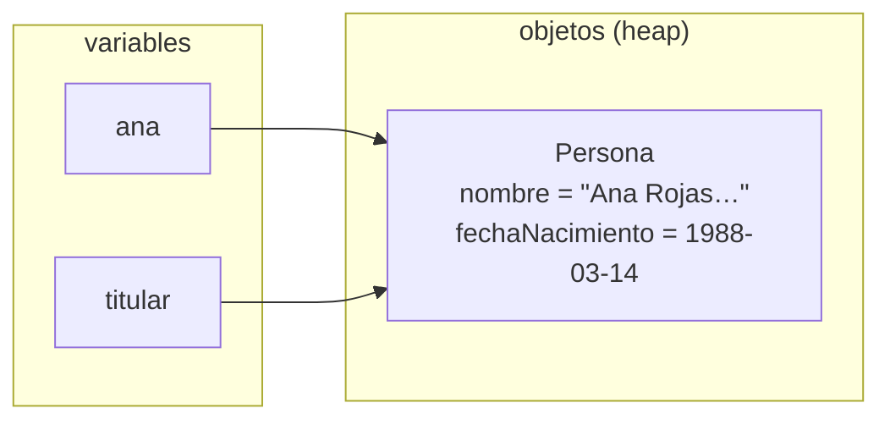
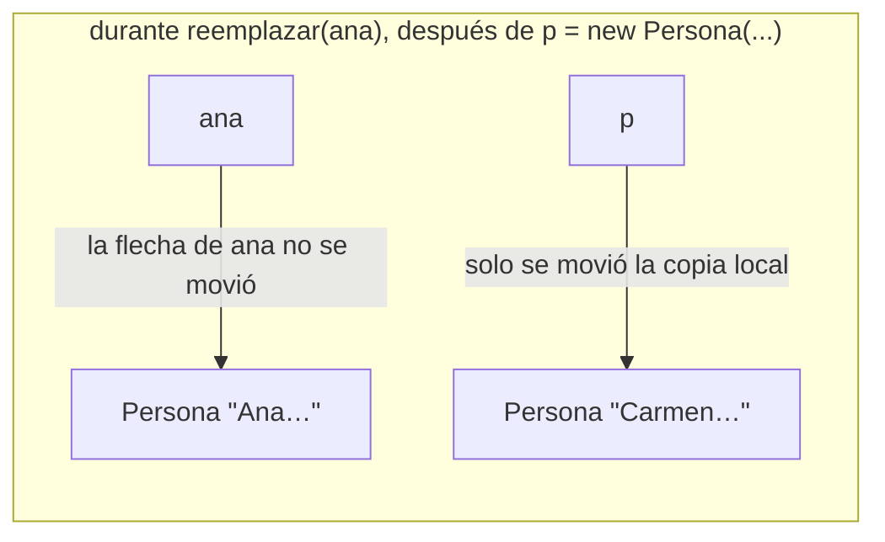
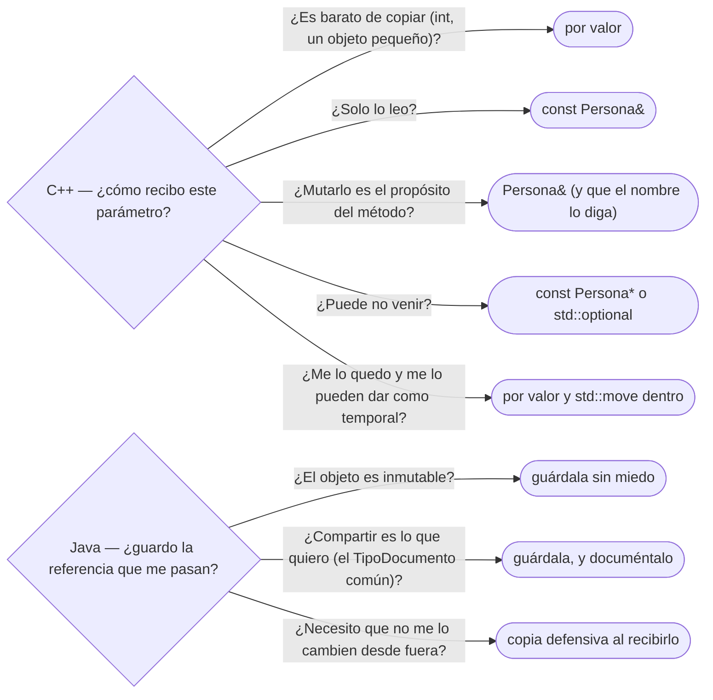

# 01 — Identidad, estado y referencias

> Los cuatro pilares de la orientación a objetos, y qué copia una asignación y qué recibe un método, en
> C++ y en Java, y cómo se dibuja. Es el primer
> capítulo del corpus: fija el diagrama de memoria que usan todos los demás y no asume leído nada.
>
> **Vigencia:** 2026-10-03.
>
> **Versiones ejecutadas:** GCC 14.4 (C++23) · JDK 21.0.12, 17.0.20 y 25.0.4 (2026-10-04).

**Salto rápido:** [1](#1--el-problema) · [2](#2--identidad-estado-y-comportamiento) · [3](#3--los-cuatro-pilares-y-lo-que-la-pregunta-esconde) · [4](#4--en-java-una-variable-de-objeto-guarda-una-referencia) · [5](#5--java-pasa-todo-por-valor-y-ese-valor-es-una-referencia) · [6](#6--en-c-el-valor-es-el-defecto) · [7](#7--el-diagrama-de-memoria-como-herramienta) · [8](#8--dos-adelantos--y-null) · [9](#9--en-los-lenguajes) · [10](#10--cómo-se-elige) · [Errores](#️-errores-frecuentes) · [Preguntas](#-preguntas)

---

## 1. 🎯 El problema

Una pantalla deja editar los datos de Ana y tiene un botón "Cancelar". Alguien escribe la versión
más natural del mundo: tomar una "copia" para el formulario, editarla y tirarla si el usuario se
arrepiente.

```java
Persona borrador = ana;                          // "copia" para el formulario
borrador.cambiarNombre("Ana María Rojas Medina");
if (!usuarioConfirma()) {
    return;                                      // se descarta el borrador... ¿o no?
}
```

- El usuario pulsa "Cancelar" y `ana.nombre()` ya vale `"Ana María Rojas Medina"`. **No hubo copia**:
  `borrador` y `ana` son dos nombres para el mismo objeto.
- La misma línea en C++, `Persona borrador = ana;`, **sí** copia, y el código funcionaría. La sintaxis
  es casi idéntica y el significado es el contrario.

Esa diferencia —qué copia una asignación y qué recibe un método— está debajo de la mitad de los bugs
de este corpus: la clave mutable de un `HashSet`, la lista interna que se escapa por un getter, el
objeto partido al pasarlo por valor. Este capítulo la deja dicha y dibujada.

---

## 2. 🧱 Identidad, estado y comportamiento

**Qué es.** Un objeto tiene tres cosas: **identidad** (cuál es, aunque haya otro idéntico),
**estado** (los valores de sus campos en este momento) y **comportamiento** (lo que sabe hacer, sus
métodos). La identidad no cambia nunca; el estado puede cambiar si el objeto es mutable.

**Cómo va.** Si creas dos `Persona` con el nombre y la fecha de nacimiento de Ana, tienes dos
objetos con el mismo estado y dos identidades distintas. En Java la identidad es la referencia; en
C++, la dirección del objeto (`&ana`).

```java
var a1 = new Persona("Ana Rojas Medina", LocalDate.of(1988, 3, 14));
var a2 = new Persona("Ana Rojas Medina", LocalDate.of(1988, 3, 14));
// a1 == a2  → false: dos objetos, aunque tengan el mismo estado
```

- `==` entre referencias pregunta por la identidad, no por el estado. Decidir cuándo dos objetos
  "son iguales" es una decisión de diseño y tiene capítulo propio:
  [`02` — Igualdad, identidad y hash](02-igualdad-identidad-y-hash.md).

**Qué cuesta separar las tres cosas.** Nada en código, y mucho en atención: cada vez que dos
variables pueden llegar al mismo objeto, el estado deja de ser local.

> 🧠 **Modelo mental.** El estado es lo que el objeto *tiene*; la identidad es *cuál es*. Dos gemelos
> con la misma ropa siguen siendo dos personas, y tu modelo tiene que poder distinguirlos o decidir a
> propósito que no le importa.

---

## 3. 🧱 Los cuatro pilares, y lo que la pregunta esconde

"¿Cuáles son los cuatro pilares de la programación orientada a objetos?" es casi siempre la primera
pregunta del tema. La respuesta que esperan es **abstracción, encapsulación, herencia y polimorfismo**.
Lo que separa una respuesta de examen de una de colega viene después: qué es cada uno en una frase
precisa, qué simplificación se suele decir de cada uno, y que la lista no es tan canónica como parece.

| Pilar | Qué es, en una frase | La simplificación que se oye | Dónde se trata entero |
|---|---|---|---|
| **Abstracción** | Quedarse con lo esencial de un concepto para el problema y esconder el resto detrás de una interfaz | "Abstracción es usar clases abstractas" | [`03/02`](../03-principios-de-diseno/02-solid-sin-catecismo.md) (interfaces de rol), [`03/04`](../03-principios-de-diseno/04-acoplamiento-cohesion-y-dependencias.md) |
| **Encapsulación** | Que el objeto proteja sus invariantes: nadie cambia su estado sin pasar por sus reglas | "Campos privados con getters y setters" | [`03/01`](../03-principios-de-diseno/01-encapsulacion-de-verdad.md) |
| **Herencia** | Definir un subtipo que cumple el contrato de su base, y que puede recibir su implementación | "Es para reutilizar código" | [`06`](06-herencia-vertical-y-horizontal.md) |
| **Polimorfismo** | Que un mismo código trabaje con tipos distintos y el comportamiento lo decida el tipo | "Polimorfismo es herencia" | [`05`](05-polimorfismo-y-despacho.md) |

Los cuatro caben en una sola clase del dominio:

```java
interface Titular { String nombre(); }                     // abstracción: lo único que Cuenta necesita saber

record Persona(String nombre) implements Titular { }       // herencia de tipo: una Persona es un Titular
record Organizacion(String nombre) implements Titular { }

final class Cuenta {
    private final Titular titular;
    private Dinero saldo;                                  // encapsulación: privado, y solo cambia con reglas

    Cuenta(Titular titular, Dinero inicial) { this.titular = titular; this.saldo = inicial; }

    void debitar(Dinero monto) {
        if (saldo.menos(monto).esNegativo()) throw new IllegalStateException("saldo insuficiente");
        saldo = saldo.menos(monto);
    }

    String encabezadoExtracto() { return titular.nombre(); }   // polimorfismo: Persona u Organizacion
}
```

- `Cuenta` no sabe si su titular es Ana o Transportes Andinos: conoce la **abstracción** `Titular`, y la
  llamada a `nombre()` se resuelve al ejecutar según el tipo real (**polimorfismo**).
- La herencia aquí es **de tipo** (`implements`), la que menos acopla. La de implementación (`extends`) es
  la que más problemas da, y la que [`06`](06-herencia-vertical-y-horizontal.md) enseña a usar con cuidado.

> 💡 **Truco.** La repregunta clásica es "¿qué diferencia hay entre abstracción y encapsulación?". La
> abstracción decide **qué se muestra** (la interfaz: `Titular.nombre()`); la encapsulación protege **lo que
> no se muestra** (el estado y sus reglas: el saldo de `Cuenta`). Se complementan, y no son lo mismo.

**La lista no es canónica.** Es una simplificación de enseñanza, y decirlo suma puntos:

- Booch, en el libro que más hizo por fijar este vocabulario, cuenta **cuatro elementos mayores** del modelo
  de objetos —**abstracción, encapsulación, modularidad y jerarquía**— y tres menores: tipificación,
  concurrencia y persistencia. Ni la herencia ni el polimorfismo figuran con ese nombre entre los mayores; la
  herencia es una forma de jerarquía.
- Alan Kay, que acuñó la expresión "programación orientada a objetos", la resumió en 2003 como mensajes,
  protección local del estado y ligadura tardía extrema. La herencia tampoco aparece.
- Go tiene abstracción, encapsulación (por paquete) y polimorfismo (interfaces implícitas) **sin herencia**.
  De los cuatro pilares, la herencia es el más prescindible.

> **Veredicto:** nombra los cuatro, da cada uno en una frase que no sea su simplificación, y cierra con el
> matiz: la herencia es el pilar del que más se puede prescindir, y la lista es didáctica, no un estándar.

---

## 4. 🧱 En Java, una variable de objeto guarda una referencia

**Qué es.** En Java toda variable de tipo clase, interfaz o arreglo guarda una **referencia**: algo
que lleva a un objeto que vive en otro sitio, o `null`. La variable *no es* el objeto.

**Cómo va.** La asignación copia la referencia, nunca el objeto. Así queda la memoria después de
`Persona titular = ana;`:



- Dos flechas, una caja: eso es el ***aliasing*** (dos nombres para el mismo objeto). Lo que se
  cambie por `titular` se ve por `ana`, porque no hay nada más que ver.
- Los tipos primitivos (`int`, `double`, `boolean`) no tienen flecha: la variable guarda el valor, y
  la asignación lo copia.

**Qué cuesta.** El *aliasing* no se ve en el sitio de la llamada: `cuenta.agregarTitular(ana)` puede
estar guardando tu `Persona` en un campo, y una mutación tuya de mañana le cambia el titular a la
cuenta. Lo pagas en **legibilidad** (para saber si un cambio es local tienes que leer quién más guarda
la referencia) y en **acoplamiento** (dos partes del código comparten estado sin decirlo).

**Cuándo sí.** Cuando compartir es justamente lo que quieres: todos los `Documento` de tipo `CC`
apuntan al mismo `TipoDocumento`, y si el formato cambia, cambia para todos.

**Cuándo no.** Cuando quieres una copia, como en el formulario de §1. Ahí hay dos salidas: copiar de
verdad (cómo se copia bien está en
[`04` — Copia, ciclo de vida y recursos](04-copia-ciclo-de-vida-y-recursos.md)), o que el objeto sea
inmutable y "editar" devuelva otro (el dueño de esa idea es
[`03` — Inmutabilidad y objetos especiales](03-inmutabilidad-y-objetos-especiales.md)).

> **Veredicto:** en Java, compartir es el defecto y copiar es una decisión. Cada vez que guardas una
> referencia que te pasaron, pregúntate si el que te la pasó la va a seguir mutando.

---

## 5. 🧱 Java pasa todo por valor, y ese valor es una referencia

**La sobregeneralización.** "Java pasa los primitivos por valor y los objetos por referencia" es la
respuesta más repetida de este tema, y está mal. **Java pasa todo por valor.** Lo que pasa es que el
valor de una variable de objeto es una referencia, y lo que se copia al llamar es esa referencia.

**Cómo va.** Dos métodos que parecen hacer lo mismo y no:

```java
static void renombrar(Persona p) {
    p.cambiarNombre("Ana María");        // muta el objeto al que apunta la copia: se ve fuera
}

static void reemplazar(Persona p) {
    p = new Persona("Carmen Díaz Ortega", LocalDate.of(1975, 11, 30));  // reasigna la copia local
}

renombrar(ana);     // ana.nombre() → "Ana María"
reemplazar(ana);    // ana sigue apuntando al mismo objeto de antes
```

- `renombrar` recibe **una copia de la flecha**. Las dos flechas llegan a la misma caja, así que
  mutar la caja se ve desde fuera.
- `reemplazar` mueve **su** flecha a otra caja. La flecha de quien llamó no se entera. Si Java pasara
  por referencia, `ana` apuntaría ahora a Carmen.



**La prueba de entrevista.** En Java no se puede escribir un `intercambiar(Persona a, Persona b)` que
deje intercambiadas las variables de quien llama. En un lenguaje con paso por referencia, sí.

**Qué cuesta.** Que el método **puede** mutar lo que recibe y la firma no lo dice: `renombrar(Persona
p)` y `imprimir(Persona p)` se declaran igual. Java no tiene `const` en los parámetros; lo único que
protege al llamador es que el objeto sea inmutable.

> **Veredicto:** di "Java pasa referencias por valor", y demuéstralo con la reasignación del
> parámetro. Es la frase que separa a quien lo entiende de quien lo recitó.

---

## 6. 🧱 En C++, el valor es el defecto

**Qué es.** En C++ una variable de tipo clase **es** el objeto. La asignación y el paso de parámetros
copian el objeto entero, salvo que pidas otra cosa con `&`, `const&` o un puntero.

**Cómo va.** El formulario de §1, en C++, funciona sin hacer nada especial:

```cpp
Persona borrador = ana;                       // copia: dos objetos con dos estados
borrador.cambiarNombre("Ana María Rojas Medina");
// ana.nombre() sigue siendo "Ana Rojas Medina"
```

Las formas de **no** copiar, cada una con su significado en la firma:

```cpp
void guardar(Persona p);                      // por valor: el método tiene su propio objeto
void imprimir(const Persona& p);              // referencia constante: lee sin copiar ni mutar
void renombrar(Persona& p, std::string n);    // referencia: muta el objeto del llamador
void tutorDe(const Persona* p);               // puntero: puede ser nullptr, y lo dice
```

- La firma documenta la intención: quien lee `const Persona&` sabe, sin abrir el método, que su objeto
  vuelve intacto. En Java esa información no existe.
- Una referencia de C++ **es un alias**, no una flecha que se pueda mover. Por eso `p = carmen;`
  dentro de `renombrar(Persona& p, …)` no "reasigna la referencia": **copia a Carmen dentro del objeto
  de quien llamó**. Es exactamente lo que en Java no se puede hacer.

**Pila contra heap, que es otra pregunta.** "En C++ los objetos van en la pila y en Java en el heap"
mezcla dos cosas. Dónde vive un objeto es su **duración de almacenamiento**: automática (pila),
dinámica (`new`, `std::make_unique`) o estática. Valor o referencia es **qué copia una asignación**.
Un `std::vector<Persona>` guarda valores, y sus elementos viven en el heap; y la JVM, con *escape
analysis* (análisis de escape), puede no crear en el heap un objeto que nunca sale del método.

**Qué cuesta.** La copia por defecto cuesta **rendimiento** cuando el objeto es grande y nadie la
pidió —una `Persona` con su vector de documentos pasada por valor en un bucle—, y cuesta un bug de
otra especie: el *slicing*, que es de [`05` §7](05-polimorfismo-y-despacho.md#7--autopsia-el-slicing). Y elegir bien entre las cuatro firmas es una decisión
más que tomar en cada parámetro. Quién es **dueño** del objeto cuando lo recibes por puntero —y quién lo
destruye— es la pregunta de la propiedad, que trata con `unique_ptr` y `shared_ptr`
[`02/04` — Agregación, composición y propiedad](../02-modelado-oo/04-agregacion-composicion-y-propiedad.md).

**Cuándo sí y cuándo no.** El valor es la opción correcta para objetos pequeños y para cuando el
método necesita su propia copia; `const&` para leer objetos que no son baratos de copiar; `&` solo
cuando mutar el argumento es el propósito del método, y se nota en el nombre.

> **Veredicto:** C++ te obliga a decidir en cada firma si copias, compartes para leer o compartes
> para mutar. Es más trabajo, y es información que Java no puede expresar.

---

## 7. 🧱 El diagrama de memoria, como herramienta

Este corpus dibuja la memoria siempre igual, y vale la pena hacerlo en la pizarra de la entrevista
cuando la pregunta es "¿qué imprime esto?":

```text
 Regla de dibujo:
 - a la izquierda, las variables: una caja por variable, con su nombre
 - a la derecha, los objetos: una caja por cada `new` (o por cada objeto de valor en C++)
 - una flecha ──▶ por referencia o puntero; una variable sin flecha guarda el valor dentro
 - `null` o `nullptr`: la caja de la variable, vacía y marcada
 - al asignar en Java, se copia la FLECHA; al asignar en C++ por valor, se copia la CAJA
```

**Qué cuesta.** Treinta segundos de pizarra. Lo que compra es no adivinar: casi todas las preguntas de
"¿qué imprime?" sobre objetos se resuelven contando cajas y flechas.

> **Veredicto:** si dudas de lo que hace un fragmento con objetos, dibuja cajas y flechas antes de
> responder. El entrevistador ve que razonas, y tú dejas de adivinar.

---

## 8. 🧱 Dos adelantos: `==` y `null`

Dos cosas que este capítulo nombra y otros explican enteras:

- **`==` en Java compara referencias.** Pregunta "¿son la misma caja?", no "¿tienen el mismo
  contenido?". Para lo segundo está `equals`, con su contrato y sus trampas, en
  [`02` — Igualdad, identidad y hash](02-igualdad-identidad-y-hash.md).
- **`null` es una variable sin flecha.** No es un objeto, no tiene tipo propio ni métodos, y
  desreferenciarla lanza `NullPointerException`. Cómo se modela la ausencia sin pagar ese precio es
  el tema de [`08` — La ausencia y el error en el modelo](08-la-ausencia-y-el-error.md).

> ⚠️ **Advertencia.** `==` entre dos `String` o dos `Integer` puede dar `true` en tus pruebas y
> `false` en producción, porque depende de si la JVM reutilizó el objeto. Compara valores con
> `equals`, siempre; el porqué está en [`03` §4](03-inmutabilidad-y-objetos-especiales.md).

---

## 9. 🧬 En los lenguajes

| Lenguaje | Qué copia la asignación de un objeto | Qué recibe un método | El detalle que muerde |
|---|---|---|---|
| **C++** | El objeto entero | Copia, salvo `&`, `const&` o puntero | `p = otra` sobre una referencia copia dentro del objeto del llamador |
| **Java** | La referencia | Una copia de la referencia | Reasignar el parámetro no cambia nada fuera; mutarlo, sí |
| **C#** | `class`: la referencia; `struct`: el valor | Igual, salvo `ref`, `out` o `in` | Un `struct` mutable dentro de una lista se copia al leerlo, y la mutación se pierde |
| **Python** | El nombre se liga al mismo objeto | El mismo objeto ("paso por asignación") | Un valor por defecto mutable (`def f(docs=[])`) se comparte entre llamadas |
| **JavaScript** | La referencia (objetos); el valor (primitivos) | Igual que Java | `const` impide reasignar la variable, no mutar el objeto |
| **Go** | El valor del `struct` entero | Una copia, salvo que pases un puntero | Un `struct` copiado comparte los arreglos de sus *slices* |

- Python, JavaScript y Java cuentan la misma historia con palabras distintas: lo que se pasa es "el
  objeto compartido", nunca la variable de quien llama.
- C++ y Go son de valor por defecto, y por eso en los dos la copia es invisible y a veces cara.

---

## 10. 🧭 Cómo se elige

En C++ la pregunta aparece en cada parámetro; en Java aparece cuando decides si guardar lo que te
pasan.



**La frase en voz alta:** *"En Java guardo la referencia si el objeto es inmutable; si no, copio al
recibir. En C++ lo digo en la firma: `const&` para leer, valor si me lo quedo."*

---

## ⚠️ Errores frecuentes

| Se dice | Lo preciso |
|---|---|
| "Java pasa los objetos por referencia" | Java pasa todo por valor; el valor de una variable de objeto es una referencia. Reasignar el parámetro no cambia nada fuera |
| "Una asignación copia el objeto" | En Java copia la referencia; en C++ por valor, sí copia el objeto |
| "Si lo paso a un método, el método no puede cambiarlo" | En Java puede mutarlo y la firma no lo dice; en C++, solo si lo recibe por `&` o puntero no constante |
| "En C++ los objetos van siempre en el heap" o "siempre en la pila" | Depende de la duración de almacenamiento, y es otra pregunta que valor o referencia |
| "Una referencia de C++ es como una referencia de Java" | La de C++ es un alias que no se puede reasignar; la de Java es una flecha que sí |
| "Los cuatro pilares son la definición de la POO" | Son una lista didáctica: Booch cuenta abstracción, encapsulación, modularidad y jerarquía, y Go es orientado a objetos sin herencia |
| "`==` compara objetos" | En Java, entre referencias, compara identidad; el contenido se compara con `equals` |
| "`final` en un parámetro impide que el método lo cambie" | Impide reasignar la variable; el objeto se sigue pudiendo mutar |

---

## 📚 Para profundizar

- **Libro** — Booch y otros, *Object-Oriented Analysis and Design with Applications*, 3.ª ed.
  (Addison-Wesley, 2007), cap. 2, "The Object Model": los cuatro elementos mayores y los tres menores del
  modelo de objetos, la fuente de §3.
- **Libro** — Stroustrup, *A Tour of C++*, 3.ª ed. (Addison-Wesley, 2022), cap. 1, "The Basics",
  §1.7, "Pointers, Arrays, and References": valor, referencia y puntero en diez páginas. **El que
  destaca** para la mitad C++ del capítulo.
- **Libro** — Meyers, *Effective Modern C++* (O'Reilly, 2014), ítem 41, "Consider pass by value for
  copyable parameters that are cheap to move and always copied": la rama "me lo quedo" del árbol de
  §10.
- [JLS 21 §8.4.1, *Formal Parameters*](https://docs.oracle.com/javase/specs/jls/se21/html/jls-8.html#jls-8.4.1):
  la frase normativa de que el valor del argumento inicializa una variable nueva.
- [JLS 21 §4.3.1, *Objects*](https://docs.oracle.com/javase/specs/jls/se21/html/jls-4.html#jls-4.3.1):
  qué es un valor de referencia y qué es `null`.
- [cppreference — *Reference declaration*](https://en.cppreference.com/cpp/language/reference): la
  referencia como alias, y por qué no se puede volver a sentar.
- [cppreference — *Storage duration*](https://en.cppreference.com/cpp/language/storage_duration):
  automática, dinámica, estática, la pregunta de §6 que no es "valor o referencia".
- [Python — *Objects, values and types*](https://docs.python.org/3/reference/datamodel.html#objects-values-and-types):
  la identidad, el tipo y el valor de un objeto, dichos por la documentación del lenguaje.

---

## 🧠 Preguntas

Sin respuestas aquí. Todas, con enunciado literal y respuesta en tres capas, en
[`10` — Respuestas](10-respuestas.md#01--identidad-estado-y-referencias).

1. ¿Qué tres cosas tiene un objeto, y cuál de ellas no cambia nunca? 🟢
2. En Java, ¿qué guarda una variable de tipo `Persona`? 🟢
3. ¿Qué es el *aliasing*? Da un ejemplo con `Persona`. 🟢
4. ¿Qué copia la asignación `Persona borrador = ana;` en Java, y qué copia en C++? 🟢
5. ¿Qué compara `==` entre dos referencias en Java? 🟢
6. ¿Qué es `null` en términos del diagrama de memoria? 🟢
7. ¿Cuáles son los cuatro pilares de la programación orientada a objetos, y qué es cada uno en una
    frase? 🟢
8. ¿Por qué es incorrecto decir que Java pasa los objetos por referencia? 🟡
9. ¿Qué diferencia hay entre mutar un parámetro y reasignarlo dentro de un método Java? 🟡
10. ¿Qué diferencia hay entre una referencia de C++ y una referencia de Java? 🟡
11. ¿Qué dice la firma `void imprimir(const Persona& p)` que una firma Java no puede decir? 🟡
12. ¿Por qué "pila o heap" y "valor o referencia" son preguntas distintas? 🟡
13. Python y Java, ¿pasan los argumentos de la misma forma? ¿En qué se parece y en qué no a C#? 🟡
14. ¿Qué diferencia hay entre abstracción y encapsulación? 🟡
15. ¿Por qué no se puede escribir en Java un `intercambiar(Persona a, Persona b)` que intercambie las
    variables de quien llama? 🟠
16. Una `Cuenta` guarda en un campo la `Persona` titular que le pasaron en el constructor. ¿Qué riesgo
    corre y cuándo no importa? 🟠
17. ¿Por qué `p = carmen;` dentro de `void f(Persona& p)` en C++ no hace lo mismo que dentro de
    `void f(Persona p)` en Java? 🟠
18. ¿Cuándo pasarías por valor un objeto en C++, aunque no sea pequeño? 🟠
19. ¿Qué protege a quien llama un método Java de que le muten el objeto, si la firma no lo dice? 🟠
20. Go copia los `struct` al asignarlos y C++ también. ¿Qué detalle de Go hace que esa copia comparta
    estado igual? 🟠
21. ¿Por qué la herencia es el pilar más prescindible de los cuatro? Da un lenguaje que lo demuestre y
    di qué usa en su lugar. 🟠
22. ¿Coincide la lista de los cuatro pilares con los elementos del modelo de objetos de Booch? ¿Qué
    gana tu respuesta si lo dices? 🟠
23. Dibuja el diagrama de memoria del formulario de §1 en Java, antes y después de
    `borrador.cambiarNombre(...)`, y arréglalo para que "Cancelar" funcione. 🔴
24. Escribe en C++ las cuatro firmas posibles de un método que recibe una `Persona`, y di qué promete
    cada una a quien llama. 🔴
25. Este código debía dejar a Luis sin tutor y no lo hace. Encuentra el error y corrígelo:
    `static void quitarTutor(Persona tutor) { tutor = null; }` llamado como
    `quitarTutor(luis.tutor());`. 🔴
26. Dibuja la memoria tras `List<Persona> a = new ArrayList<>(List.of(ana)); List<Persona> b = a;
    b.add(carmen);` y di qué tiene `a`. 🔴

---

**Anterior:** — ·
**Siguiente:** [`02` — Igualdad, identidad y hash](02-igualdad-identidad-y-hash.md) ·
**Relacionado:** [`04` — Copia, ciclo de vida y recursos](04-copia-ciclo-de-vida-y-recursos.md)
