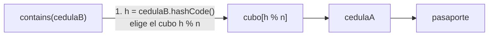
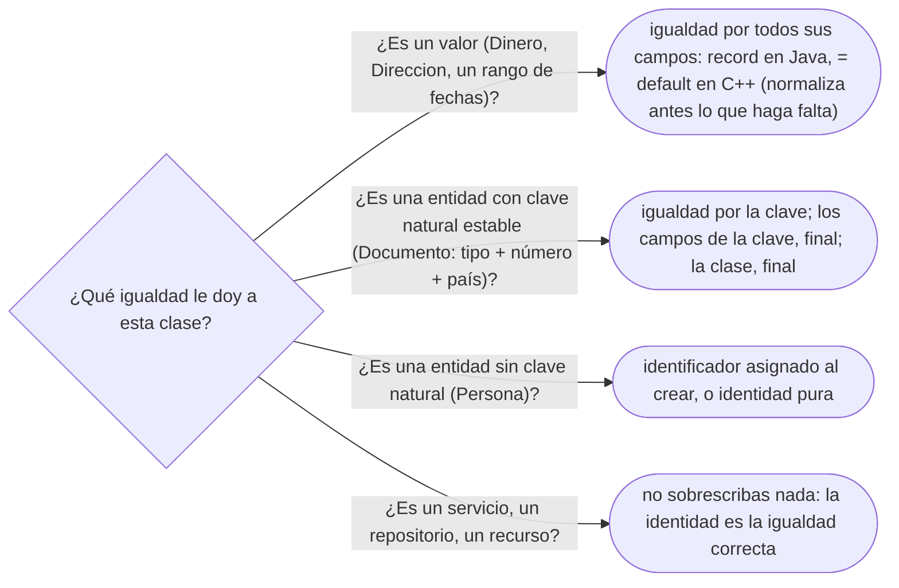

# 02 — Igualdad, identidad y hash

> Cuándo dos objetos son "el mismo", cómo se le dice eso a `HashMap` y a `std::unordered_map`, y qué
> se rompe cuando no se dice bien. Se escribe `equals`/`hashCode` (y `operator==`/`std::hash`) de
> `Documento`. Asume leído [`01` — Identidad, estado y referencias](01-identidad-estado-y-referencias.md),
> pero se lee solo: §2 recuerda lo necesario.
>
> **Vigencia:** 2026-10-03.
>
> **Versiones ejecutadas:** GCC 14.4 (C++23) · JDK 21.0.12, 17.0.20 y 25.0.4 (2026-10-04).

**Salto rápido:** [1](#1--el-problema) · [2](#2--identidad-contra-igualdad-de-valor) · [3](#3--el-contrato-de-equals) · [4](#4--el-contrato-de-hashcode-y-cómo-los-usa-hashmap) · [5](#5--escribir-la-igualdad-de-documento) · [6](#6--autopsia-la-clave-mutable) · [7](#7--equals-con-herencia) · [8](#8--compareto-coherente-con-equals-y-el-caso-bigdecimal) · [9](#9--entidades-identidad-o-clave-natural) · [10](#10--en-los-lenguajes) · [11](#11--cómo-se-elige) · [Errores](#️-errores-frecuentes) · [Preguntas](#-preguntas)

---

## 1. 🎯 El problema

El sistema importa los documentos de Ana desde dos fuentes —el registro de clientes y el de
cuentas— y quiere quedarse con los distintos. Alguien escribe lo obvio:

```java
Set<Documento> distintos = new HashSet<>();
distintos.addAll(delRegistroDeClientes);   // trae la cédula 1020304050
distintos.addAll(delRegistroDeCuentas);    // trae otra vez la cédula 1020304050
// distintos.size() → 2: la misma cédula, dos veces
```

- Son dos objetos creados por dos lecturas. Sin decirle a Java cuándo dos documentos son iguales, el
  `HashSet` usa la identidad, y dos objetos son siempre dos.
- El arreglo "obvio" —sobrescribir `equals`— **compila y sigue sin funcionar** (§4), y el arreglo
  completo esconde una tercera trampa: el documento que deja de encontrarse (§6).

---

## 2. 🧱 Identidad contra igualdad de valor

**Lo que hace falta de `01`.** En Java una variable de objeto guarda una referencia, y `==` entre
referencias pregunta si llevan al mismo objeto. En C++ una variable es el objeto, y `==` sobre
objetos no existe hasta que lo defines.

**Qué es.** La **identidad** dice "es el mismo objeto"; la **igualdad de valor** dice "representan lo
mismo". Dos lecturas de la cédula de Ana son dos objetos (identidad distinta) que representan el
mismo documento (igualdad de valor). En Java, la primera es `==`; la segunda es `equals`, y por
defecto `Object.equals` **es** `==`: hasta que la sobrescribes, no hay igualdad de valor.

**Qué cuesta.** Definir la igualdad es una decisión de diseño que se arrastra: decide qué es un
duplicado en cada `Set`, cada clave de `Map`, cada `contains` y cada `remove`. Cambiarla después
cambia el comportamiento de todas esas colecciones a la vez.

**Cuándo no.** No toda clase necesita igualdad de valor. Un servicio, un repositorio o una conexión
se comparan por identidad, y está bien no sobrescribir nada.

> **Veredicto:** sobrescribe la igualdad cuando el objeto **representa un valor** o tiene una clave
> natural; déjala por identidad cuando el objeto es una cosa con ciclo de vida propio y ninguna clave
> que la nombre.

---

## 3. 🧱 El contrato de `equals`

`Object.equals` no deja hacer cualquier cosa: su Javadoc fija un **contrato** de cinco cláusulas, y
las colecciones del JDK cuentan con que se cumple. Para referencias no nulas `x`, `y`, `z`:

| Cláusula | Qué exige | Cómo se rompe en la práctica |
|---|---|---|
| Reflexiva | `x.equals(x)` | Casi nunca; un `equals` que compara un campo `NaN` con `==` |
| Simétrica | `x.equals(y)` ⇔ `y.equals(x)` | `instanceof` entre clase y subclase (§7) |
| Transitiva | `x = y` y `y = z` ⇒ `x = z` | Igualdad "aproximada", o una subclase que ignora campos a veces |
| Consistente | Mismo resultado mientras no cambien los campos usados | Comparar contra algo externo: red, reloj, base de datos |
| Con `null` | `x.equals(null)` es `false`, sin lanzar | Hacer el *cast* antes de comprobar el tipo |

- El contrato **no** lo comprueba el compilador. Un `equals` que lo viola compila, pasa las pruebas
  del autor y falla dentro de un `HashSet` o un `TreeMap` de otro.

---

## 4. 🧱 El contrato de `hashCode`, y cómo los usa `HashMap`

**La regla.** Si `x.equals(y)`, entonces `x.hashCode() == y.hashCode()`. **Al revés no**: dos objetos
distintos pueden tener el mismo hash (una colisión), y es normal.

**Cómo va.** `HashMap` y `HashSet` usan los dos métodos en dos pasos: el hash elige el **cubo**, y
`equals` decide dentro del cubo.



```text
2. recorre SOLO ese cubo: para cada elemento e pregunta e.equals(cedulaB)
3. el resto de los cubos no se mira
```

**Por qué sobrescribir solo `equals` no basta.** Es el problema de §1 con el arreglo a medias: las
dos cédulas son `equals`, pero `Object.hashCode` es por identidad, así que caen en cubos distintos,
`equals` nunca llega a compararlas y el conjunto sigue con dos. **Sobrescribir uno solo compila y
rompe el mapa.**

> ⚠️ **Advertencia.** Un `hashCode` que devuelve siempre `42` cumple el contrato y es correcto: todo
> cae en el mismo cubo y `HashMap` degrada a una búsqueda lineal (desde Java 8, a un árbol si las
> claves son `Comparable`). Cumplir el contrato no basta; el hash tiene que repartir.

---

## 5. 🧱 Escribir la igualdad de `Documento`

**Qué campos.** La clave natural de un documento es **tipo + número + país emisor**: dos cédulas con
el mismo número de países distintos son documentos distintos. La fecha de vencimiento **no** entra:
renovar un pasaporte no lo convierte en otro documento.

```java
public final class Documento {
    private final TipoDocumento tipo;
    private final String numero;
    private final Pais emisor;
    private LocalDate vencimiento;            // mutable y fuera de la igualdad

    @Override
    public boolean equals(Object o) {
        if (this == o) return true;
        if (!(o instanceof Documento otro)) return false;   // también descarta null
        return tipo.equals(otro.tipo) && numero.equals(otro.numero) && emisor.equals(otro.emisor);
    }

    @Override
    public int hashCode() {
        return Objects.hash(tipo, numero, emisor);   // los mismos campos que equals, ni uno más
    }
}
```

- Los campos de la igualdad son `final`: es la defensa contra §6. `TipoDocumento` y `Pais` definen su
  propia igualdad (por código), o son instancias compartidas y la identidad basta.
- `instanceof` con patrón es de Java 16, así que vale en 17 y 21. Que la clase sea `final` es lo que
  hace seguro el `instanceof` (§7).

En C++ la igualdad es un operador, y el mapa hash necesita una especialización de `std::hash`:

```cpp
struct Documento {
    std::string tipo;        // código del TipoDocumento: "CC", "PAS-CO"
    std::string numero;
    std::string emisor;      // código ISO del país
    std::chrono::year_month_day vencimiento;

    bool operator==(const Documento& o) const {   // a mano: vencimiento no es identidad
        return tipo == o.tipo && numero == o.numero && emisor == o.emisor;
    }
};

namespace std {
template <> struct hash<Documento> {
    size_t operator()(const Documento& d) const noexcept {
        size_t h = hash<string>{}(d.tipo);
        h = h * 31 + hash<string>{}(d.numero);   // combinación a mano: no hay hash_combine estándar
        return h * 31 + hash<string>{}(d.emisor);
    }
};
}
```

- Desde C++20, `bool operator==(const Documento&) const = default;` compara **todos** los miembros en
  orden. Aquí incluiría `vencimiento`, y por eso se escribe a mano. Para un valor puro como `Dinero`,
  `= default` es lo correcto.
- Sin la especialización de `std::hash`, `std::unordered_set<Documento>` **no compila**. Es la
  diferencia de fondo con Java: el olvido que en Java compila y falla, en C++ no compila.

> **Veredicto:** igualdad por la clave natural, con campos inmutables, y el hash sobre exactamente los
> mismos campos. Si dudas de si un campo entra, pregúntate si cambiarlo convierte el objeto en otro.

---

## 6. 🩺 Autopsia: la clave mutable

**1. El código que escribe todo el mundo.** `Documento` con `equals`/`hashCode` sobre el número, y un
método para corregir errores de digitación:

```java
Set<Documento> vistos = new HashSet<>();
vistos.add(pasaporte);                     // número AQ482915, en el cubo de ese hash
pasaporte.corregirNumero("AQ482916");      // cambia el hash con el objeto ya dentro
vistos.contains(pasaporte);                // false
```

**2. Por qué parece correcto.** `equals` y `hashCode` están bien escritos, y las pruebas crean el
documento, lo meten y lo buscan, sin mutarlo en medio.

**3. La secuencia que lo rompe.** Meter, mutar un campo de la igualdad, buscar. `contains` calcula el
hash nuevo, va a un cubo donde el pasaporte no está y devuelve `false`. `vistos.size()` sigue siendo
1: el objeto **no se borró**, quedó en el cubo del hash viejo, donde ninguna búsqueda va a mirar. Ni
`remove` lo saca.

**4. El código correcto.** Los campos de la igualdad no cambian; corregir el número es reemplazar el
documento:

```java
public final class Documento {
    private final String numero;                          // ← antes no era final
    public Documento conNumero(String corregido) {        // ← antes: void corregirNumero(...)
        return new Documento(tipo, corregido, emisor, vencimiento);
    }
}
persona.reemplazarDocumento(pasaporte, pasaporte.conNumero("AQ482916"));
```

**5. La generalización.** Cualquier estructura que **indexa por el contenido** del objeto —`HashSet`,
claves de `HashMap`, `TreeSet` y `TreeMap` (que ordenan por él)— se corrompe en silencio si el
contenido cambia con el objeto dentro. La regla: **lo que se usa como clave es inmutable**, al menos
en los campos que deciden la igualdad o el orden.

---

## 7. 🧱 `equals` con herencia

**El problema.** Alguien extiende `Documento` (aquí sin `final`) con un `DocumentoVerificado` que
añade la fecha de verificación, y la mete en la igualdad.

- Con **`instanceof`** en los dos lados, `cedula.equals(verificada)` es `true` (el padre no mira la
  fecha) y `verificada.equals(cedula)` es `false` (la cédula no es un `DocumentoVerificado`). **Se
  rompe la simetría.**
- Con **`getClass() != o.getClass()`**, la simetría vuelve, pero un `DocumentoVerificado` ya nunca es
  igual a un `Documento` con la misma clave. Un `Set<Documento>` los trata como distintos, y se rompe
  la sustitución que promete la herencia (LSP, que es de
  [`06` — Herencia vertical y horizontal](06-herencia-vertical-y-horizontal.md#3--lsp-el-contrato-que-la-herencia-promete)).

**La conclusión de Bloch** (*Effective Java*, ítem 10): **no hay forma de extender una clase
instanciable añadiendo un campo a la igualdad sin romper el contrato**. Las salidas: hacer la clase
`final`; o **componer** en lugar de heredar —un `Verificacion` que *tiene* un `Documento`—; o usar
`record`, que es `final` y genera `equals`/`hashCode` sobre todos sus componentes.

> **Veredicto:** una clase con igualdad de valor es `final` o es un `record`. Si necesitas "un
> documento con algo más", compón.

---

## 8. 🧱 `compareTo` coherente con `equals`, y el caso `BigDecimal`

**Qué es.** Un orden es **coherente con `equals`** si `a.compareTo(b) == 0` exactamente cuando
`a.equals(b)`. `HashSet` usa `equals`; `TreeSet` usa `compareTo`. Si no coinciden, el mismo conjunto
de datos da tamaños distintos.

```java
var a = new BigDecimal("1.0");
var b = new BigDecimal("1.00");
a.equals(b);       // false: BigDecimal.equals compara valor Y escala
a.compareTo(b);    // 0: mismo valor numérico
new HashSet<>(List.of(a, b)).size();   // 2
new TreeSet<>(List.of(a, b)).size();   // 1
```

- La Javadoc de `BigDecimal` lo declara: su orden natural es incoherente con `equals`. No es un bug,
  es la especificación.
- **La consecuencia para `Dinero`.** Un `record Dinero(BigDecimal monto, Currency moneda)` genera un
  `equals` que usa `BigDecimal.equals`: 1 500 000,0 COP y 1 500 000,00 COP serían distintos. La salida
  es **normalizar la escala en el constructor** (dos decimales para COP y USD) o comparar con
  `compareTo` en un `equals` escrito a mano.

> 💡 **Truco.** Si te preguntan por `BigDecimal` en un `HashSet`, la respuesta que sube la nota es la
> de `Dinero`: "normalizo la escala al construir, y así `equals`, `hashCode` y `compareTo` coinciden".

---

## 9. 🧱 Entidades: identidad o clave natural

**Qué es.** `Documento` tiene una clave natural fiable. `Persona` no: dos personas pueden llamarse igual
y nacer el mismo día. Para una **entidad** sin clave natural hay dos opciones: igualdad por identidad
(no sobrescribir nada) o por un identificador asignado (`PersonaId`). La discusión completa —qué es una
entidad y qué un objeto de valor— es de [`02/06` — Entidades, valores y primitivos](../02-modelado-oo/06-entidades-valores-y-primitivos.md) y de [`09/01`](../09-ddd-tactico-y-otros/01-entidad-valor-y-agregado.md);
aquí basta la regla.

**Qué cuesta el identificador asignado.** Si lo asigna la base de datos al guardar, el objeto **cambia
de hash** al persistirse: el mismo problema de §6, con un ORM de por medio. [`07/03` — Comportamiento
objeto-relacional](../07-fowler-dominio-y-datos/03-comportamiento-objeto-relacional.md) cuenta qué hace JPA con eso.

**Un adelanto con dueño propio.** `Integer a = 128, b = 128; a == b` da `false`, y con `127` da `true`:
la caché de `Integer` es otra cara de comparar con `==` lo que pedía `equals`. La explica
[`03` — Inmutabilidad y objetos especiales](03-inmutabilidad-y-objetos-especiales.md).

> **Veredicto:** clave natural si existe y no cambia; identificador asignado al crear —no al
> guardar— si no existe; identidad pura si el objeto no se guarda en colecciones por contenido.

---

## 10. 🧬 En los lenguajes

| Lenguaje | Igualdad de valor | Clave de un mapa hash | El detalle que muerde |
|---|---|---|---|
| **C++** | `operator==`; `= default` desde C++20 | Especializar `std::hash<T>` | Sin `std::hash`, `unordered_map` no compila |
| **Java** | `equals` | `equals` + `hashCode` | Sobrescribir uno solo compila y rompe el mapa |
| **C#** | `Equals` + `GetHashCode`; `record` los genera | Los dos, igual que Java | `==` de una `class` es identidad salvo que lo sobrecargues; en `record`, es valor |
| **Python** | `__eq__` | `__eq__` + `__hash__` | Definir `__eq__` sin `__hash__` deja `__hash__ = None`: el objeto deja de poder ser clave |
| **JavaScript** | No existe para objetos | `Map` y `Set` comparan por identidad (*SameValueZero*) | Dos objetos con el mismo contenido son dos claves; `NaN` sí es igual a `NaN` en `Map` |
| **Go** | `==` sobre `struct` comparables | Cualquier tipo comparable | Un `struct` con un *slice* o un mapa dentro no es comparable: no puede ser clave |

- Python y C++ fallan "hacia lo seguro": olvidar el hash te impide usar el objeto como clave. Java y C#
  fallan hacia lo silencioso.
- En JavaScript la clave de valor se fabrica a mano: un `string` como `"CC|1020304050|CO"`.

---

## 11. 🧭 Cómo se elige



**La frase en voz alta:** *"`equals` y `hashCode` sobre la clave natural, los mismos campos en los dos,
y esos campos inmutables; la clase, `final` o un `record`."*

---

## ⚠️ Errores frecuentes

| Se dice | Lo preciso |
|---|---|
| "Con sobrescribir `equals` basta" | Sin `hashCode`, dos objetos iguales caen en cubos distintos y `HashMap` no los encuentra |
| "`hashCode` distinto implica objetos distintos, y al revés" | Lo primero sí (si el contrato se cumple); lo segundo no: las colisiones son normales |
| "`equals` con `instanceof` siempre está bien" | Solo si la clase es `final`; con una subclase que añade campos, rompe la simetría |
| "Dos `BigDecimal` con el mismo valor son `equals`" | `equals` compara también la escala: `1.0` y `1.00` son distintos, y `compareTo` dice 0 |
| "Si el objeto está en el `HashSet`, `contains` lo encuentra" | No si se mutó un campo de la igualdad después de meterlo |
| "Un `record` resuelve la igualdad sin pensar" | Genera `equals` sobre **todos** los componentes, con el `equals` de cada uno: `BigDecimal` y arreglos incluidos |
| "En C++ `==` compara objetos" | Solo si lo defines; `= default` compara todos los miembros, quieras o no |

---

## 📚 Para profundizar

- **Libro** — Bloch, *Effective Java*, 3.ª ed. (Addison-Wesley, 2018), ítems 10, "Obey the general
  contract when overriding equals"; 11, "Always override hashCode when you override equals", y 14,
  "Consider implementing Comparable". **El que destaca**: la prueba de que no se puede extender una
  clase añadiendo un campo de valor está en el 10, y el caso `BigDecimal`, en el 14.
- [Java 21 API — `Object.equals`](https://docs.oracle.com/en/java/javase/21/docs/api/java.base/java/lang/Object.html#equals(java.lang.Object)):
  el contrato de las cinco cláusulas y el de `hashCode`, con la letra exacta.
- [Java 21 API — `BigDecimal`](https://docs.oracle.com/en/java/javase/21/docs/api/java.base/java/math/BigDecimal.html):
  la nota de que su orden natural es incoherente con `equals`, con el ejemplo de `2.0` y `2.00`.
- [cppreference — *Default comparisons*](https://en.cppreference.com/cpp/language/default_comparisons):
  `operator==` y `operator<=>` por defecto desde C++20.
- [cppreference — `std::hash`](https://en.cppreference.com/cpp/utility/hash): qué exige una
  especialización y por qué sin ella el contenedor no compila.
- [Python — `object.__hash__`](https://docs.python.org/3/reference/datamodel.html#object.__hash__): la
  regla de que definir `__eq__` sin `__hash__` deja el objeto sin hash.
- [MDN — *Equality comparisons and sameness*](https://developer.mozilla.org/en-US/docs/Web/JavaScript/Guide/Equality_comparisons_and_sameness):
  `===`, `Object.is` y *SameValueZero*, el algoritmo de `Map` y `Set`.

---

## 🧠 Preguntas

Sin respuestas aquí. Todas, con enunciado literal y respuesta en tres capas, en
[`10` — Respuestas](10-respuestas.md#02--igualdad-identidad-y-hash).

1. ¿Qué diferencia hay entre identidad e igualdad de valor? 🟢
2. ¿Qué hace `Object.equals` si no lo sobrescribes? 🟢
3. Enumera las cinco cláusulas del contrato de `equals`. 🟢
4. ¿Qué exige el contrato de `hashCode` respecto de `equals`? 🟢
5. ¿Qué es una colisión de hash, y es un error? 🟢
6. ¿Qué campos usarías en la igualdad de `Documento`, y por qué no el vencimiento? 🟢
7. ¿En qué orden usa `HashMap` los métodos `hashCode` y `equals` al buscar una clave? 🟡
8. ¿Qué diferencia hay entre `instanceof` y `getClass()` en un `equals`? 🟡
9. ¿Qué diferencia hay entre `equals` y `compareTo` en `BigDecimal`? 🟡
10. ¿Qué genera un `record` para la igualdad, y sobre qué campos? 🟡
11. ¿Qué diferencia hay entre `bool operator==(const Documento&) const = default;` y escribirlo a
    mano? 🟡
12. Olvidar el hash en Java compila. ¿Qué pasa si lo olvidas en C++ y en Python? 🟡
13. ¿Por qué en JavaScript dos objetos con el mismo contenido son dos claves distintas de un `Map`, y
    cómo se resuelve? 🟡
14. ¿Por qué sobrescribir solo `equals` hace que un `HashSet` siga aceptando duplicados? 🟠
15. ¿Por qué un `hashCode` que devuelve siempre la misma constante es correcto, y por qué es una mala
    idea? 🟠
16. ¿Por qué no se puede extender una clase instanciable añadiendo un campo a la igualdad sin romper
    el contrato? 🟠
17. ¿Qué tamaño tienen un `HashSet` y un `TreeSet` construidos con `new BigDecimal("1.0")` y
    `new BigDecimal("1.00")`, y por qué? 🟠
18. ¿Qué problema tiene `record Dinero(BigDecimal monto, Currency moneda)` en un `HashSet`, y cómo lo
    arreglas? 🟠
19. ¿Por qué un identificador asignado por la base de datos al guardar es mala base para `hashCode`? 🟠
20. ¿Qué igualdad le darías a `Persona`, que no tiene clave natural fiable? 🟠
21. ¿Por qué la mutabilidad de un campo que no entra en `equals` no es un problema para el `HashSet`? 🟠
22. ¿Cuándo es correcto no sobrescribir `equals` en absoluto? 🟠
23. Escribe `equals` y `hashCode` de `Documento` en Java y di qué campos usas. 🔴
24. Escribe la igualdad y la especialización de `std::hash` de `Documento` en C++ para usarlo en un
    `std::unordered_set`. 🔴
25. Un pasaporte metido en un `HashSet` deja de encontrarse después de corregir su número. Explica qué
    pasó en el conjunto y corrige el diseño. 🔴
26. `DocumentoVerificado extends Documento` añade la fecha de verificación a `equals` con
    `instanceof`. Muestra con dos objetos qué cláusula se rompe y propón el diseño correcto. 🔴
27. Escribe `Dinero` en Java de modo que `equals`, `hashCode` y `compareTo` sean coherentes. 🔴
28. Revisa este `equals` y di qué cláusulas viola: `public boolean equals(Object o) { Documento d =
    (Documento) o; return numero.equals(d.numero); }`. 🔴

---

**Anterior:** [`01` — Identidad, estado y referencias](01-identidad-estado-y-referencias.md) ·
**Siguiente:** [`03` — Inmutabilidad y objetos especiales](03-inmutabilidad-y-objetos-especiales.md) ·
**Relacionado:** [`04` — Copia, ciclo de vida y recursos](04-copia-ciclo-de-vida-y-recursos.md)
