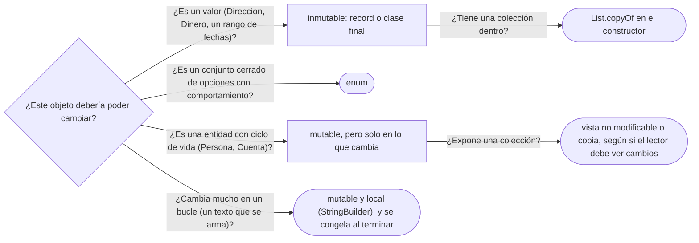

# 03 — Inmutabilidad y objetos especiales

> Por qué `String`, los enums y los records son como son, y cómo se hace inmutable una clase de
> verdad y no solo de nombre: `final`, copias defensivas, "no modificable" contra "inmutable", y
> `const` en C++. Asume leído [`01` — Identidad, estado y referencias](01-identidad-estado-y-referencias.md)
> y [`02` — Igualdad, identidad y hash](02-igualdad-identidad-y-hash.md), pero se lee solo: §1 recuerda
> lo necesario.
>
> **Vigencia:** 2026-10-03.
>
> **Versiones ejecutadas:** GCC 14.4 (C++23) · JDK 21.0.12, 17.0.20 y 25.0.4 (2026-10-04).

---

## 1. 🎯 El problema

Ana y su hijo Luis viven en la misma casa, y el sistema les asignó **la misma** `Direccion` como
domicilio. Ana se muda:

```java
Direccion casa = new Direccion("Calle 45 # 12-30", "Bogotá", colombia);
ana.agregarDireccion(TipoDireccion.DOMICILIO, casa);
luis.agregarDireccion(TipoDireccion.DOMICILIO, casa);

ana.direccion(TipoDireccion.DOMICILIO).setCalle("Carrera 7 # 80-15");   // Ana se mudó
// luis.direccion(DOMICILIO) también dice "Carrera 7 # 80-15"
```

- **Lo que hace falta recordar:** en Java una variable de objeto guarda una referencia, y dos
  referencias pueden llegar al mismo objeto (*aliasing*). Aquí `ana` y `luis` comparten la caja de la
  dirección, y el `set` de una se ve en la otra.
- El error no es compartir: compartir una dirección es barato y razonable. El error es que **lo
  compartido se pueda cambiar**. Con una `Direccion` inmutable, "mudarse" es reemplazar la dirección
  de Ana por otra, y la de Luis queda donde estaba.

---

## 2. 🧱 Qué es inmutable, y por qué compensa

**Qué es.** Un objeto es **inmutable** si su estado observable no cambia después de construirse.
Nadie, ni él mismo, puede cambiarlo; "modificarlo" es crear otro.

**Las virtudes**, que son el motivo de todo el capítulo:

- **Se comparte sin miedo**: el *aliasing* deja de ser un riesgo, y la dirección de §1 vuelve a ser
  compartible.
- **Es clave de mapa válida**: no puede pasarle lo de la clave mutable de `02`.
- **Es seguro entre hilos sin sincronizar**, si está bien construido. La publicación segura y el
  modelo de memoria son de [`10/01`](../10-concurrencia/01-inmutabilidad-y-confinamiento.md); aquí basta la consecuencia.
- **Atomicidad ante fallos**: una operación que falla a mitad no deja el objeto a medias, porque no lo
  tocaba.
- **Razonamiento local**: lo que ves al construirlo es lo que hay, siempre.

**Qué cuesta.** Un objeto nuevo por cada cambio: **memoria** y presión sobre el GC si el objeto cambia
mucho en un bucle (concatenar `String` en un bucle es el ejemplo clásico, y por eso existe
`StringBuilder`). Y **legibilidad** en los objetos grandes: un `conX` por campo, o un builder.

**La sobregeneralización.** "Lo inmutable es lento porque copia todo" es falso como regla: a cambio de
las copias al modificar, ahorras las copias defensivas al compartir, que en un sistema que comparte
mucho son más. Y no se copia "todo": un objeto inmutable nuevo puede reutilizar las partes
inmutables del viejo.

Qué separa un objeto de valor de una entidad es de
[`02/06` — Entidades, valores y primitivos](../02-modelado-oo/06-entidades-valores-y-primitivos.md), y el patrón Value Object, de [`08/05`](../08-fowler-presentacion-distribucion-y-base/05-patrones-base.md#2--value-object); aquí basta con que un valor no tiene
identidad que proteger y por eso puede no cambiar nunca.

> **Veredicto:** los objetos de valor —`Direccion`, `Dinero`, `Documento` en su clave— nacen
> inmutables. La mutabilidad se reserva para las entidades con ciclo de vida, y aun ahí, para los
> campos que de verdad cambian.

---

## 3. 🧱 `final` no hace inmutable al objeto

**La confusión.** `final` en un campo impide **reasignar el campo**; no impide **mutar el objeto** al
que apunta. `private final List<Documento> documentos` deja hacer `documentos.add(...)` todo lo que
quieras.

**La receta** (Bloch, *Effective Java*, ítem 17):

1. Sin métodos que cambien el estado.
2. La clase no se puede extender: `final`, o constructor privado con fábricas.
3. Todos los campos `private final`.
4. **Copias defensivas** de todo componente mutable: al recibirlo y al devolverlo.

```java
public final class Persona {
    private final String nombre;
    private final List<Documento> documentos;

    public Persona(String nombre, List<Documento> documentos) {
        this.nombre = nombre;
        this.documentos = List.copyOf(documentos);   // copia al recibir: el llamador no la toca
    }

    public List<Documento> documentos() {
        return documentos;                           // ya es inmutable: se devuelve sin copiar
    }
}
```

- `List.copyOf` hace las dos copias defensivas a la vez: copia al recibir, y como la copia es
  inmutable, devolverla no expone nada. Con un `ArrayList` interno habría que copiar también en el
  getter.
- `Persona` es inmutable **solo si `Documento` también lo es**. La inmutabilidad es transitiva o no
  es: una lista inmutable de objetos mutables es una lista que no cambia de tamaño.

> **Veredicto:** `final` es una condición necesaria, no suficiente. Lo que hace inmutable a una clase es
> que ningún camino —método, getter, referencia retenida por quien la construyó— llegue a cambiar su
> estado.

---

## 4. 🧱 Objetos que la JVM comparte: `String` e `Integer`

**`String` es inmutable, y por cuatro motivos.** Seguridad: una ruta, una URL o un nombre de clase
validados no pueden cambiar entre la validación y el uso. Hash cacheado: `String` calcula su hash una
vez y lo guarda, lo que la hace barata como clave. Compartible entre hilos sin sincronizar. Y el
***pool*** (la reserva de literales): los literales iguales son el mismo objeto, y `intern()` mete un
`String` en ella.

**La caché de `Integer`.** `Integer.valueOf` —que es lo que usa el *autoboxing*— reutiliza siempre los
valores de −128 a 127. Por eso:

```java
Integer a = 127, b = 127;
boolean r1 = a == b;        // true: el mismo objeto de la caché
Integer c = 128, d = 128;
boolean r2 = c == d;        // false por defecto: dos objetos distintos
boolean r3 = c.equals(d);   // true: esto es lo que querías preguntar
```

- La Javadoc de `Integer.valueOf` dice que **siempre** cachea ese rango y **puede** cachear más (la JVM
  de HotSpot lo amplía con `-XX:AutoBoxCacheMax`). El `==` que funciona en tus pruebas con números
  pequeños y falla en producción con un identificador de cuenta es este.
- Compartir las instancias **solo es posible porque son inmutables**. Es el patrón Flyweight: ver
  [`05/07` — Flyweight](../05-estructurales/07-flyweight.md).

> ⚠️ **Advertencia.** `==` sobre `String`, `Integer`, `Long` o `BigDecimal` compara identidad. Que a
> veces dé lo esperado es un accidente del *pool* o de la caché. Los valores se comparan con `equals`.

---

## 5. 🧱 Records: inmutabilidad superficial

**Qué es.** Un `record` declara un objeto de valor en una línea: campos `private final`, constructor,
accesores, `equals`, `hashCode` y `toString`, y la clase es `final`. Existe desde Java 16, así que vale
igual en 17 y en 21.

**Lo que no hace.** Un record es **superficialmente** inmutable: sus campos no se reasignan, pero si un
componente es mutable, el record lo expone tal cual.

```java
record Extracto(String cuenta, List<Movimiento> movimientos) { }

var lista = new ArrayList<Movimiento>();
var extracto = new Extracto("CTA-0001", lista);
lista.add(retiro);                        // cambia el extracto desde fuera
extracto.movimientos().add(deposito);     // y desde dentro, por el accesor
```

La salida es el **constructor compacto** con copia:

```java
record Extracto(String cuenta, List<Movimiento> movimientos) {
    Extracto {
        movimientos = List.copyOf(movimientos);   // copia inmutable: cierra las dos puertas
    }
}
```

> **Veredicto:** "un record es inmutable" es verdad solo si sus componentes lo son. Con colecciones,
> constructor compacto con `List.copyOf`, siempre.

---

## 6. 🧱 No modificable contra inmutable

**La diferencia.** `Collections.unmodifiableList(lista)` devuelve una **vista**: rechaza `add` y
`remove`, pero si `lista` cambia, la vista cambia. `List.of` y `List.copyOf` devuelven listas
**inmutables**: nadie las puede cambiar, porque no hay una lista original detrás.

```java
var interna = new ArrayList<>(List.of(cedula));
List<Documento> vista = Collections.unmodifiableList(interna);
List<Documento> copia = List.copyOf(interna);
interna.add(pasaporte);
// vista.size() → 2: la vista refleja el cambio
// copia.size() → 1: la copia no
```

**Qué cuesta cada una.** La vista es O(1) y no copia, y por eso sirve para exponer una colección que
**el dueño** sigue modificando. La copia es O(n) y desacopla del todo. `List.copyOf` sobre una lista
que ya es inmutable no copia: devuelve la misma.

**Cuándo cada una.** Vista, cuando quien la recibe debe ver los cambios futuros del dueño. Copia,
cuando debe ver una foto del momento.

> **Veredicto:** di "no modificable" para la vista e "inmutable" para la copia. Confundirlas es la
> causa de los bugs de "la lista que no se podía cambiar y cambió".

---

## 7. 🧱 Enums: objetos con identidad garantizada

**La sobregeneralización.** "Los enums son constantes numéricas" vale para C; en Java un enum es una
**clase** con un número fijo de instancias, creadas por la JVM al cargar la clase. No se pueden crear
más, ni con reflexión ni deserializando.

**Lo que se sigue de eso:**

- Se comparan con `==`, legítimamente: solo hay una instancia por constante.
- Tienen campos, constructores y métodos, y cada constante puede sobrescribir un método.
- `EnumMap` y `EnumSet` son las colecciones hechas para ellos: un arreglo y un campo de bits por
  dentro, sin hash.
- `values()` devuelve **una copia** del arreglo en cada llamada; en un bucle caliente se guarda.

```java
enum EstadoCuenta {
    ABIERTA(true), BLOQUEADA(false), CERRADA(false);

    private final boolean admiteMovimientos;

    EstadoCuenta(boolean admiteMovimientos) { this.admiteMovimientos = admiteMovimientos; }

    boolean admiteMovimientos() { return admiteMovimientos; }
}
```

- El comportamiento vive en el enum, no en un `switch` repartido por el código. Cuando además cada
  estado decide transiciones distintas, el enum empieza a ser el patrón State: ver
  [`06/06` — State](../06-comportamiento/06-state.md).
- Un enum de una sola constante es la forma recomendada de Singleton en Java, y uno de varias es un
  Multiton: ver [`04/05` — Singleton](../04-creacionales/05-singleton.md) y [`04/07` §5](../04-creacionales/07-mas-alla-del-gof.md#5--multiton).

> **Veredicto:** un conjunto **cerrado y conocido al compilar**, con comportamiento, es un enum. Si el
> conjunto cambia sin recompilar, no lo es.

---

## 8. 🧱 C++: `const`, y lo que no atraviesa

**Qué es.** En C++ la inmutabilidad se declara con `const`, en tres sitios: en el objeto
(`const Persona luis`), en el método (`std::string nombre() const`, que promete no cambiar el objeto) y
en la referencia o el puntero (`const Persona&`). El compilador lo comprueba.

**Lo que no hace.** `const` **no es transitivo a través de punteros**: un objeto `const` con un puntero
dentro tiene el puntero constante, no lo apuntado.

```cpp
struct Persona {
    std::string nombre;
    Persona* tutor;                       // puntero: const no lo atraviesa
};

void revisar(const Persona& luis) {
    // luis.nombre = "Luis R.";          // no compilaría: luis es const
    luis.tutor->nombre = "Ana R.";        // compila: el puntero es const, la tutora no
}
```

- Es la misma trampa que el record con una `List`, en otro lenguaje: la inmutabilidad de superficie.
- Y `const` se puede quitar con `const_cast`, y los miembros `mutable` se pueden cambiar dentro de un
  método `const` (para cachés). Es una promesa que el compilador ayuda a cumplir, no un muro.

> **Veredicto:** en C++, `const` en todo lo que no cambia, métodos incluidos; y para los punteros
> miembro, la pregunta de propiedad: si el objeto no es dueño de lo apuntado, que sea un puntero a
> `const`.

---

## 9. 🧱 `Pais`: ¿enum o clase?

`Pais` es inmutable y compartido por todos los documentos y direcciones. La pregunta es si es un enum.

- **Enum** si el negocio trabaja con un conjunto **cerrado** —los tres países donde opera— que solo
  cambia con una nueva versión del software. Gana `==`, `EnumMap` y el compilador avisando de los
  casos que faltan en un `switch`.
- **Clase inmutable con instancias compartidas** si el conjunto viene de fuera —los ~250 códigos ISO,
  que cambian— y se carga de una tabla. Un registro (`Paises.porCodigo("CO")`) devuelve siempre la
  misma instancia, y compartirla es seguro porque es inmutable. Es Flyweight otra vez ([`05/07`](../05-estructurales/07-flyweight.md)).

> **Veredicto:** si para añadir un país hay que recompilar y eso está bien, enum; si no, clase
> inmutable con un registro.

---

## 10. 🧬 En los lenguajes

| Lenguaje | Cómo se declara lo inmutable | ¿Profundo o superficial? | El detalle que muerde |
|---|---|---|---|
| **C++** | `const` en objeto, método y referencia | Superficial a través de punteros | `const_cast` y `mutable` lo saltan |
| **Java** | `final` + sin mutadores + copias; `record` | Superficial | `unmodifiableList` es una vista, no una copia |
| **C#** | `readonly`, propiedades `init`, `record` | Superficial | Un `record` con una `List` se compara por la referencia de la lista |
| **Python** | `tuple`, `frozenset`, `@dataclass(frozen=True)` | Superficial | `frozen` impide asignar atributos; una lista dentro sigue mutable |
| **JavaScript** | `Object.freeze` | Superficial | Congela un nivel; los objetos anidados siguen mutables |
| **TypeScript** | `readonly`, `Readonly<T>`, `as const` | Solo al compilar | Al ejecutar no queda nada: es JavaScript mutable |
| **Go** | Sin `const` para `struct`; campos sin exportar | Por convención | Un `struct` copiado comparte sus *slices* |

- Ningún lenguaje de la tabla tiene inmutabilidad **profunda** por defecto. En todos, la última copia
  defensiva la escribe alguien.

---

## 11. 🧭 Cómo se elige



**La frase en voz alta:** *"Los valores, inmutables, con las colecciones copiadas en el constructor; las
entidades, mutables solo en lo que cambia; y nunca confundo una vista no modificable con una copia."*

---

## ⚠️ Errores frecuentes

| Se dice | Lo preciso |
|---|---|
| "`final` hace inmutable al objeto" | Hace inmutable la referencia; el objeto apuntado se sigue pudiendo mutar |
| "`unmodifiableList` es inmutable" | Es una vista no modificable: cambia si cambia la lista original |
| "Un record es inmutable" | Es superficialmente inmutable; un componente `List` sigue siendo mutable |
| "Los enums son constantes numéricas" | Son clases con un número fijo de instancias, con campos y métodos |
| "Lo inmutable es lento porque copia todo" | Copia al cambiar y ahorra las copias defensivas al compartir; y reutiliza partes |
| "`Integer` se puede comparar con `==`" | Solo da `true` fiable de −128 a 127, por la caché; los valores, con `equals` |
| "Un método `const` de C++ no cambia nada" | No cambia los miembros directos; lo apuntado por un puntero miembro y los `mutable`, sí |

---

## 📚 Para profundizar

- **Libro** — Bloch, *Effective Java*, 3.ª ed. (Addison-Wesley, 2018), ítem 17, "Minimize
  mutability", y ítem 50, "Make defensive copies when needed". **El que destaca**: la receta de §3 es
  la del ítem 17.
- **Libro** — Bloch, *Effective Java*, 3.ª ed., ítems 34, "Use enums instead of int constants", y 37,
  "Use EnumMap instead of ordinal indexing".
- [Java 21 API — `Integer.valueOf(int)`](https://docs.oracle.com/en/java/javase/21/docs/api/java.base/java/lang/Integer.html#valueOf(int)):
  la caché de −128 a 127, "siempre" y "puede que más".
- [Java 21 API — *Unmodifiable Lists*](https://docs.oracle.com/en/java/javase/21/docs/api/java.base/java/util/List.html#unmodifiable):
  qué garantizan `List.of` y `List.copyOf`.
- [Java 21 API — `Collections.unmodifiableList`](https://docs.oracle.com/en/java/javase/21/docs/api/java.base/java/util/Collections.html#unmodifiableList(java.util.List)):
  la vista, con la palabra *view* en la primera frase.
- [JLS 21 §8.10, *Record Classes*](https://docs.oracle.com/javase/specs/jls/se21/html/jls-8.html#jls-8.10):
  qué genera el compilador y qué no.
- [cppreference — *cv type qualifiers*](https://en.cppreference.com/cpp/language/cv): `const`,
  `volatile` y `mutable`.

---

## 🧠 Preguntas

Sin respuestas aquí. Todas, con enunciado literal y respuesta en tres capas, en
[`10` — Respuestas](10-respuestas.md#03--inmutabilidad-y-objetos-especiales).

1. ¿Qué significa que un objeto sea inmutable? 🟢
2. Enumera tres virtudes de un objeto inmutable. 🟢
3. ¿Qué impide `final` en un campo, y qué no impide? 🟢
4. ¿Por qué `String` es inmutable? Da dos motivos. 🟢
5. ¿Qué rango de `Integer` cachea siempre `Integer.valueOf`? 🟢
6. ¿Qué genera un `record`, y desde qué versión de Java existe? 🟢
7. ¿Por qué se pueden comparar los enums con `==`? 🟢
8. ¿Qué diferencia hay entre `Collections.unmodifiableList` y `List.copyOf`? 🟡
9. ¿Qué diferencia hay entre una clase inmutable y un record? 🟡
10. ¿Qué diferencia hay entre el `const` de C++ y el `final` de Java? 🟡
11. ¿En qué se diferencian `Object.freeze` en JavaScript y `readonly` en TypeScript? 🟡
12. ¿Qué diferencia hay entre `@dataclass(frozen=True)` en Python y un `record` de Java? 🟡
13. ¿Por qué un enum no es una constante numérica, y qué permite eso? 🟡
14. ¿Por qué `Integer c = 128, d = 128; c == d` da `false` y con 127 da `true`? 🟠
15. ¿Por qué "lo inmutable es lento porque copia todo" es una sobregeneralización? 🟠
16. ¿Cuándo devolverías una vista no modificable en lugar de una copia inmutable? 🟠
17. ¿Por qué una lista inmutable de objetos mutables no es un objeto inmutable? 🟠
18. ¿Por qué `const` en C++ no protege lo apuntado por un puntero miembro, y cómo lo resuelves? 🟠
19. ¿`Pais` debería ser un enum o una clase? Defiende las dos opciones. 🟠
20. ¿Por qué compartir instancias de `Integer` o de `Pais` solo es seguro si son inmutables? 🟠
21. ¿Por qué `values()` de un enum devuelve una copia, y cuándo importa? 🟠
22. Haz inmutable de verdad la `Direccion` de §1 en Java y muestra cómo se muda Ana sin afectar a
    Luis. 🔴
23. Este record se declaró "inmutable": `record Extracto(String cuenta, List<Movimiento> movimientos)
    { }`. Muestra las dos formas de cambiarlo y corrígelo. 🔴
24. Escribe la clase `Persona` inmutable en Java con su lista de documentos, con las copias defensivas
    que hagan falta y ninguna más. 🔴
25. Escribe `EstadoCuenta` como enum con comportamiento y di qué `switch` del código elimina. 🔴
26. Revisa este fragmento de C++ y di qué promete y qué no: `void revisar(const Persona& luis) {
    luis.tutor->nombre = "Ana R."; }`. 🔴

---

**Anterior:** [`02` — Igualdad, identidad y hash](02-igualdad-identidad-y-hash.md) ·
**Siguiente:** [`04` — Copia, ciclo de vida y recursos](04-copia-ciclo-de-vida-y-recursos.md) ·
**Relacionado:** [`01` — Identidad, estado y referencias](01-identidad-estado-y-referencias.md)
