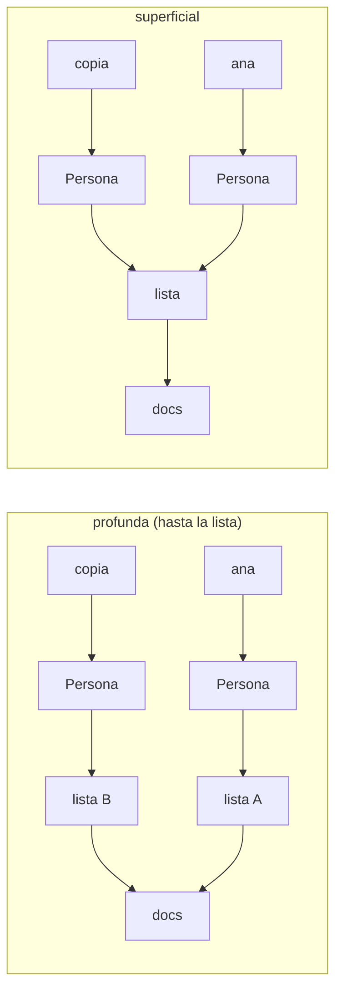
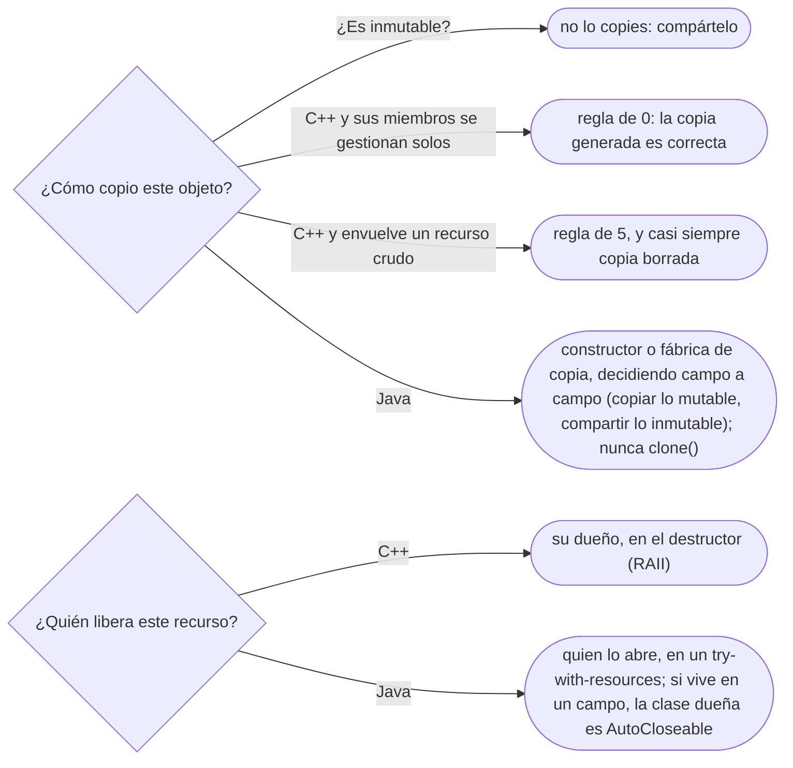

# 04 — Copia, ciclo de vida y recursos

> Cuándo una copia comparte estado, cómo se copia bien en cada lenguaje, qué no se hace en un
> constructor, y quién libera qué —memoria y recursos— y cuándo. Es el dueño de la regla de 0/3/5 y de
> la idea de RAII. Asume leído [`01` — Identidad, estado y referencias](01-identidad-estado-y-referencias.md).
>
> **Vigencia:** 2026-10-03.
>
> **Versiones ejecutadas:** GCC 14.4 (C++23) · JDK 21.0.12, 17.0.20 y 25.0.4 · .NET 10.0.12 (C# 14) (2026-10-04).

---

## 1. 🎯 El problema

El formulario de edición de `01` aprendió la lección y ahora copia a Ana antes de editarla. La copia
parece correcta, y no lo es:

```java
public Persona(Persona otra) {          // "constructor de copia"
    this.nombre = otra.nombre;
    this.documentos = otra.documentos;  // copia la referencia a la lista, no la lista
}

Persona borrador = new Persona(ana);
borrador.agregarDocumento(pasaporteNuevo);   // aparece también en ana.documentos()
```

- Hay dos `Persona`, pero **una sola lista**. El nombre se copió y la colección se compartió: es una
  copia a medias, y "Cancelar" vuelve a fallar, solo que ahora únicamente con los documentos.
- En C++ el mismo error tiene otra cara: si `Persona` guarda un puntero crudo que posee y la copia lo
  duplica, las dos copias lo liberan al destruirse, y el programa libera la misma memoria dos veces.

Copiar bien, construir bien y liberar bien son tres preguntas sobre el **ciclo de vida** de un objeto,
y en C++ y en Java tienen respuestas muy distintas.

---

## 2. 🧱 Copia superficial contra copia profunda

**Qué es.** Una **copia superficial** duplica el objeto y comparte todo lo que cuelga de él. Una
**copia profunda** duplica también lo que cuelga, hasta donde haga falta para que las dos copias no
compartan nada mutable.



- La copia profunda de la derecha copia **la lista** pero comparte los `Documento`. Si `Documento` es
  inmutable, está bien: compartir lo inmutable es gratis. "Profunda" no significa "todo": significa
  "hasta lo mutable".

**Qué cuesta.** La superficial cuesta casi nada y comparte estado sin decirlo. La profunda cuesta
**memoria y tiempo** proporcionales a lo que copia, y una decisión por cada campo: copiar, compartir o
rechazar.

> **Veredicto:** una copia correcta copia lo mutable y comparte lo inmutable. Cuantos más objetos de
> valor inmutables tenga tu modelo, más barata y más fácil es copiar.

---

## 3. 🧱 Por qué `clone()` está roto en Java

`Object.clone()` prometía copiar objetos y es, según Bloch (*Effective Java*, ítem 13), un mecanismo
que no se debe usar en clases nuevas:

- `Cloneable` es una interfaz **sin métodos**: no declara `clone()`. Lo que hace es cambiar el
  comportamiento de un método `protected` de `Object`. Implementarla no obliga a nada.
- `Object.clone()` hace una **copia superficial** sin llamar a ningún constructor: el problema de §1,
  institucionalizado, y sin pasar por las validaciones del constructor.
- Es **incompatible con los campos `final`**: para hacer profunda la copia hay que reasignar los
  campos mutables después de `super.clone()`, y un campo `final` no se puede reasignar.
- Lanza una excepción *checked*, `CloneNotSupportedException`, que casi nadie puede manejar.

Las alternativas son el **constructor de copia** y la **fábrica de copia**, que son código normal, con
constructor normal:

```java
public Persona(Persona otra) {
    this.nombre = otra.nombre;
    this.documentos = new ArrayList<>(otra.documentos);   // copia la lista; los Documento son inmutables
}

public static Persona copiaDe(Persona otra) {             // fábrica: puede devolver un subtipo o cachear
    return new Persona(otra);
}
```

> **Veredicto:** `clone()` solo para arreglos, donde funciona bien. Para tus clases, constructor o
> fábrica de copia; y si la clase es inmutable, ninguna de las dos: no hace falta copiar.

---

## 4. 🧱 C++: copia, movimiento y la regla de 0/3/5

**Qué es.** En C++ copiar un objeto llama a su **constructor de copia** (`T(const T&)`), asignarlo a
otro llama a la **asignación de copia** (`operator=(const T&)`), y desde C++11 hay además
**movimiento**: `T(T&&)` y `operator=(T&&)`, que "roban" los recursos de un objeto que ya no se va a
usar. Si no los escribes, el compilador los genera miembro a miembro.

**La regla de 0/3/5:**

```text
Regla de 0  → si tus miembros se gestionan solos (std::string, std::vector, std::unique_ptr),
              no escribas ninguna de las cinco: las generadas son correctas.
Regla de 3  → si escribes destructor, copia o asignación de copia, casi seguro necesitas los tres.
Regla de 5  → desde C++11, añade constructor y asignación de movimiento a esos tres.
```

La regla de 0 es la que se aplica casi siempre:

```cpp
class Persona {
    std::string nombre;
    std::vector<Documento> documentos;   // se copia entero: copia profunda gratis
public:
    // ninguna de las cinco: copiar una Persona copia el nombre y el vector
};
```

La de 5 aparece cuando una clase envuelve a mano un recurso que no sabe copiarse:

```cpp
class ArchivoExportacion {
    std::FILE* f;
public:
    explicit ArchivoExportacion(const char* ruta) : f(std::fopen(ruta, "w")) {
        if (!f) throw std::runtime_error("no se pudo abrir el archivo");
    }
    ~ArchivoExportacion() { if (f) std::fclose(f); }
    ArchivoExportacion(const ArchivoExportacion&) = delete;             // no se copia
    ArchivoExportacion& operator=(const ArchivoExportacion&) = delete;
    ArchivoExportacion(ArchivoExportacion&& o) noexcept : f(std::exchange(o.f, nullptr)) {}
    ArchivoExportacion& operator=(ArchivoExportacion&& o) noexcept {
        if (this != &o) { if (f) std::fclose(f); f = std::exchange(o.f, nullptr); }
        return *this;
    }
};
```

- La copia se **borra**: dos objetos cerrando el mismo `FILE*` es el doble cierre de §1. El movimiento
  traspasa el recurso y deja el origen vacío (`nullptr`), y el destructor lo comprueba.
- **Mover no es copiar más rápido.** Mover deja el origen en un estado válido pero no especificado; para
  un `int` mover es copiar, y para un `std::vector` es robar el búfer. Lo que se mueve no se vuelve a
  leer.
- **La *copy elision***: desde C++17, `return Persona{...};` construye el objeto directamente en el
  destino, sin copia ni movimiento. Con una variable local con nombre, el compilador suele omitirlos
  también, pero no está garantizado.

> **Veredicto:** apunta a la regla de 0, usando miembros que se gestionan solos. Cuando una clase
> envuelva un recurso crudo, que haga solo eso, con sus cinco miembros escritos, y que el resto del
> código la use como miembro y vuelva a la regla de 0.

---

## 5. 🩺 Autopsia: el método sobrescribible en el constructor

**1. El código que escribe todo el mundo.** `Documento` valida su número al construirse, y una
subclase afina la validación con el formato de su tipo:

```java
class Documento {
    protected final String numero;
    Documento(String numero) {
        this.numero = numero;
        validar();                              // llama a un método sobrescribible
    }
    protected void validar() { Objects.requireNonNull(numero); }
}

class DocumentoConFormato extends Documento {
    private final Pattern formato;
    DocumentoConFormato(String numero, Pattern formato) {
        super(numero);                          // validar() corre aquí...
        this.formato = formato;                 // ...antes de que formato tenga valor
    }
    @Override protected void validar() {
        if (!formato.matcher(numero).matches()) throw new IllegalArgumentException(numero);
    }
}
```

**2. Por qué parece correcto.** Cada clase, leída sola, está bien. Y `Documento` funciona perfecto
mientras nadie la extiende.

**3. La secuencia que lo rompe.** `new DocumentoConFormato("1020304050", Pattern.compile("\\d{6,10}"))`
lanza `NullPointerException`: el constructor de `Documento` llama al `validar()` de la subclase **antes**
de que el constructor de la subclase asigne `formato`. Java despacha al método sobrescrito aunque el
objeto esté a medio construir.

**4. El código correcto.** El constructor no llama a nada sobrescribible; la validación es `private`, o
`final`, o la hace una fábrica después de construir:

```java
Documento(String numero) {
    this.numero = Objects.requireNonNull(numero);   // ← validación propia, no sobrescribible
}
```

**5. La generalización.** Es un caso de **`this` que escapa** antes de terminar de construirse: igual
que llamar un método sobrescribible, registrar `this` en un listener o pasarlo a otro hilo desde el
constructor expone un objeto a medias. Bloch (ítem 19) lo prohíbe para las clases diseñadas para
heredarse. **En C++ la regla es otra**: durante el constructor de la base, el objeto *es* de la base, y
una llamada virtual va a la versión de la base, no a la de la derivada; con una función virtual pura,
el comportamiento es indefinido.

---

## 6. 🧱 Destrucción: destructores contra recolector

**En C++ la destrucción es determinista.** Un objeto automático se destruye al salir de su ámbito, en
orden inverso al de construcción; uno con dueño (`unique_ptr`), cuando el dueño muere. El destructor
corre en ese instante, y ahí se libera **todo**: memoria, archivos, conexiones.

**En Java el GC libera memoria, y nada más.** El recolector decide **cuándo** reclama un objeto
inalcanzable, y puede no hacerlo nunca si no hace falta memoria. Un `FileInputStream` olvidado sin
`close()` deja el descriptor de archivo abierto hasta que el GC pase —o para siempre—, y el sistema
operativo tiene un límite de descriptores. **El GC no cierra recursos.**

- **`finalize` está muerto.** Era el intento de dar a Java destructores, y nunca funcionó: sin garantía
  de cuándo corre, ni de que corra, con costo en el GC y con la posibilidad de "resucitar" el objeto.
  La JEP 421 lo **deprecó para eliminación** en Java 18; en Java 21 sigue activo por defecto y se puede
  apagar con `--finalization=disabled`.
- **`Cleaner`** (Java 9) es la red de seguridad que lo reemplaza: registra una acción que corre cuando
  el objeto se vuelve inalcanzable. Es una red, no el mecanismo principal: tampoco garantiza cuándo.

> **Veredicto:** en Java, todo lo que no es memoria se libera a mano, con `try-with-resources`. El GC es
> para la memoria; para el resto, tú.

---

## 7. 🧱 RAII como idea, y lo que tiene cada lenguaje

**Qué es.** ***RAII*** (*Resource Acquisition Is Initialization*: la adquisición del recurso es la
inicialización del objeto) ata la vida de un recurso a la de un objeto: el constructor lo adquiere y el
destructor lo libera. Como el destructor corre siempre al salir del ámbito —también si se lanza una
excepción—, el recurso no se puede olvidar.

**Cómo va.** En C++ es el mecanismo natural, y es lo que hacen `std::fstream`, `std::lock_guard` y
`std::unique_ptr`. Los lenguajes con GC no tienen destructores deterministas, y lo aproximan con una
construcción de **ámbito**:

```java
try (var salida = Files.newBufferedWriter(Path.of("documentos-ana.csv"))) {
    for (Documento d : ana.documentos()) {
        salida.write(d.numero());
        salida.newLine();
    }
}   // close() corre aquí, también si write lanza
```

- `try-with-resources` llama a `close()` de todo `AutoCloseable` declarado en el paréntesis, en orden
  inverso, y conserva las excepciones de `close()` como suprimidas de la principal.
- La diferencia con RAII es **quién se acuerda**: en C++ el objeto se libera solo; en Java, el que lo
  usa tiene que escribir el `try`. Un recurso guardado en un campo y usado por varios métodos no cabe en
  un `try`, y su clase dueña tiene que ser `AutoCloseable` a su vez.

**Qué cuesta.** En C++, nada en tiempo de ejecución, y una clase envoltorio por tipo de recurso. En Java,
disciplina: el compilador no avisa si olvidas el `try`; algunos analizadores estáticos e IDE sí.

> 📝 **En C#:** `using` es el `try-with-resources` de C#, sobre `IDisposable`, y C# 8 añadió la
> declaración `using var x = ...;` que libera al final del bloque que la contiene. Python tiene `with`
> y los *context managers*, y Go, `defer`. Ninguno es determinista por el objeto: los tres lo son por el
> ámbito. El RAII como patrón —con Object Pool y compañía— está en
> [`04/07` — Más allá del GoF](../04-creacionales/07-mas-alla-del-gof.md).

---

## 8. 🧬 En los lenguajes

| Lenguaje | Cómo se copia bien | Cómo se libera un recurso | El detalle que muerde |
|---|---|---|---|
| **C++** | Constructor de copia generado o escrito (regla de 0/3/5) | Destructor (RAII), determinista | Copia generada de un puntero crudo que posee: doble liberación |
| **Java** | Constructor o fábrica de copia | `try-with-resources` sobre `AutoCloseable` | `clone()` es superficial y no llama al constructor |
| **C#** | Constructor de copia; `with` en `record` | `using` sobre `IDisposable` | `with` copia superficialmente: las colecciones se comparten |
| **Python** | `copy.copy` (superficial), `copy.deepcopy` | `with` y *context managers* | `deepcopy` copia todo lo alcanzable, también lo que no debía |
| **JavaScript** | *Spread* `{...o}` (superficial), `structuredClone` | `try/finally` | `structuredClone` pierde el prototipo: la copia ya no es de tu clase |
| **Go** | Asignación del `struct`, más copiar los *slices* a mano | `defer` | La copia del `struct` comparte el arreglo de sus *slices* |

---

## 9. 🧭 Cómo se elige



**La frase en voz alta:** *"Copio lo mutable y comparto lo inmutable; en C++ apunto a la regla de 0, y
en Java los recursos se cierran con `try-with-resources`, porque el GC solo libera memoria."*

---

## ⚠️ Errores frecuentes

| Se dice | Lo preciso |
|---|---|
| "`clone()` hace copia profunda" | `Object.clone()` es superficial y no llama a ningún constructor |
| "El GC cierra los recursos" | El GC libera memoria, cuando quiere; archivos y sockets se cierran a mano |
| "En C++ siempre hay que escribir destructor" | Con la regla de 0, los miembros se liberan solos y no escribes ninguno |
| "Mover es copiar más rápido" | Mover traspasa recursos y deja el origen en estado válido no especificado; no se vuelve a leer |
| "`finalize` es el destructor de Java" | Nunca garantizó cuándo ni si corría, y está deprecado para eliminación desde Java 18 |
| "Copia profunda es copiar todo" | Es copiar hasta lo mutable; lo inmutable se comparte |
| "Llamar un método propio desde el constructor es inofensivo" | Si es sobrescribible, en Java corre la versión de la subclase sobre un objeto a medio construir |

---

## 📚 Para profundizar

- **Libro** — Bloch, *Effective Java*, 3.ª ed. (Addison-Wesley, 2018), ítems 8, "Avoid finalizers and
  cleaners"; 9, "Prefer try-with-resources to try-finally"; 13, "Override clone judiciously", y 19,
  "Design and document for inheritance or else prohibit it". **El que destaca** para la mitad Java.
- **Libro** — Stroustrup, *A Tour of C++*, 3.ª ed. (Addison-Wesley, 2022), cap. 6, "Essential
  Operations": copia, movimiento y gestión de recursos en un capítulo.
- **Libro** — Meyers, *Effective Modern C++* (O'Reilly, 2014), ítem 17, "Understand special member
  function generation": cuándo genera el compilador cada una de las cinco.
- [cppreference — *The rule of three/five/zero*](https://en.cppreference.com/cpp/language/rule_of_three).
- [cppreference — *Copy elision*](https://en.cppreference.com/cpp/language/copy_elision): qué está
  garantizado desde C++17 y qué no.
- [JEP 421 — *Deprecate Finalization for Removal*](https://openjdk.org/jeps/421): el porqué de la
  muerte de `finalize`, con la opción para apagarlo.
- [Java 21 API — `Cleaner`](https://docs.oracle.com/en/java/javase/21/docs/api/java.base/java/lang/ref/Cleaner.html):
  la red de seguridad y sus límites.

---

## 🧠 Preguntas

Sin respuestas aquí. Todas, con enunciado literal y respuesta en tres capas, en
[`10` — Respuestas](10-respuestas.md#04--copia-ciclo-de-vida-y-recursos).

1. ¿Qué diferencia hay entre copia superficial y copia profunda? 🟢
2. ¿Qué es la regla de 0 en C++? 🟢
3. ¿Qué cinco funciones miembro especiales cuenta la regla de 5? 🟢
4. ¿Qué libera el recolector de basura de Java, y qué no libera? 🟢
5. ¿Qué es RAII? 🟢
6. ¿Qué hace `try-with-resources` y sobre qué tipo de objetos funciona? 🟢
7. ¿Qué diferencia hay entre copiar y mover en C++? 🟡
8. ¿Qué diferencia hay entre un constructor de copia y una fábrica de copia en Java? 🟡
9. ¿Qué diferencia hay entre `finalize` y `Cleaner`? 🟡
10. ¿En qué se diferencia RAII de `try-with-resources`? 🟡
11. ¿Qué diferencia hay entre `copy.copy` y `copy.deepcopy` en Python, y cuál es el riesgo del
    segundo? 🟡
12. ¿Qué diferencia hay entre una llamada virtual dentro de un constructor en C++ y en Java? 🟡
13. ¿Por qué `clone()` está roto en Java? Da tres motivos. 🟠
14. ¿Por qué una copia "profunda" no necesita copiar los objetos inmutables? 🟠
15. ¿Por qué el GC no basta para cerrar un archivo, aunque el objeto se vuelva inalcanzable? 🟠
16. ¿Por qué una clase de C++ con un `std::unique_ptr` miembro no se puede copiar, y es eso un
    problema? 🟠
17. ¿Qué garantiza C++17 sobre la *copy elision*, y qué sigue sin garantizar? 🟠
18. ¿Qué es el `this` que escapa de un constructor, y qué formas toma? 🟠
19. Un recurso vive en un campo y lo usan varios métodos de una clase Java. ¿Cómo se garantiza que se
    cierre? 🟠
20. Corrige el constructor de copia de §1 para que el borrador de Ana no comparta su lista de
    documentos, y di qué decides compartir. 🔴
21. Escribe en C++ una clase que envuelva un `std::FILE*` sin fugas ni doble cierre, y di qué
    operaciones borras y por qué. 🔴
22. `new DocumentoConFormato("1020304050", formato)` lanza `NullPointerException`. Explica la
    secuencia exacta y corrige el diseño. 🔴
23. Escribe en Java la exportación de los documentos de Ana a un archivo de modo que el archivo se
    cierre aunque falle una escritura. 🔴
24. Revisa este fragmento y di qué falla: `class Persona { Documento* principal; public: ~Persona() {
    delete principal; } };` usado como `Persona copia = ana;`. 🔴

---

**Anterior:** [`03` — Inmutabilidad y objetos especiales](03-inmutabilidad-y-objetos-especiales.md) ·
**Siguiente:** [`05` — Polimorfismo y despacho](05-polimorfismo-y-despacho.md) ·
**Relacionado:** [`01` — Identidad, estado y referencias](01-identidad-estado-y-referencias.md)
