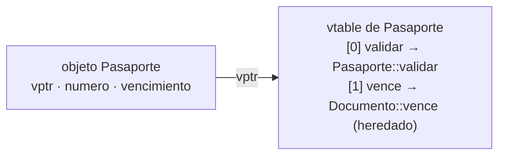
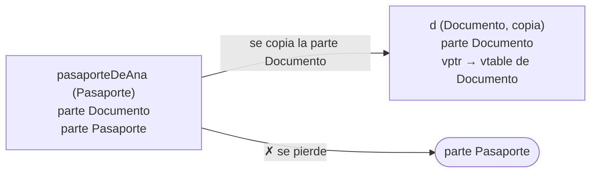
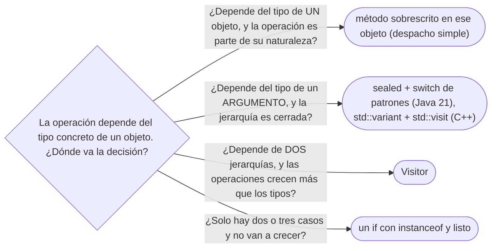

# 05 — Polimorfismo y despacho

> Qué método se llama cuando se cruzan sobrecarga y sobrescritura, cuánto cuesta una llamada virtual,
> qué le pasa a un objeto que se pasa por valor en C++, y por qué existe Visitor. Asume leído
> [`01` — Identidad, estado y referencias](01-identidad-estado-y-referencias.md), pero se lee solo: §2
> recuerda lo necesario.
>
> **Vigencia:** 2026-10-03.
>
> **Versiones ejecutadas:** GCC 14.4 (C++23) · JDK 21.0.12, 17.0.20 y 25.0.4 (2026-10-04).

---

## 1. 🎯 El problema

Un validador tiene una regla general para cualquier documento y una más estricta para los pasaportes,
que además deben estar vigentes. Para este capítulo, `Pasaporte` es una subclase de `Documento` (si
debería serlo es otra discusión, la del tipo como objeto de
[`02/06` §7](../02-modelado-oo/06-entidades-valores-y-primitivos.md#7--el-tipo-como-objeto-tipodocumento-contra-subclases)):

```java
class ValidadorDocumentos {
    void validar(Documento d) { /* número con formato correcto */ }
    void validar(Pasaporte p) { /* lo anterior, y además vigente */ }
}

for (Documento d : ana.documentos()) {   // la cédula y el pasaporte de Ana
    validador.validar(d);                // el pasaporte vencido pasa la validación
}
```

- El pasaporte **es** un `Pasaporte` al ejecutar, y aun así se llama a `validar(Documento)`. No es un
  bug de la JVM: es la regla, y casi todo el mundo la espera al revés.
- Este capítulo dice qué decide el compilador, qué decide la máquina al ejecutar, y por qué esa
  división explica la existencia de Visitor.

---

## 2. 🧱 Los cuatro polimorfismos

**Lo que hace falta de `01`.** Una variable tiene un **tipo estático** (el que se declara: `Documento
d`) y, si es una referencia o un puntero, apunta a un objeto con un **tipo dinámico** (el que se creó:
`new Pasaporte(...)`). El tipo dinámico puede ser un subtipo del estático.

**Qué es.** Polimorfismo es que un mismo código trabaje con tipos distintos. Hay cuatro formas, y
"polimorfismo es herencia" solo nombra una:

| Forma | Qué es | En C++ | En Java |
|---|---|---|---|
| **De subtipo** | Una referencia a la base acepta cualquier derivada, y el método se elige al ejecutar | `virtual` | Métodos de instancia no `final` |
| **Paramétrico** | Un código escrito una vez para cualquier tipo | Plantillas | Genéricos |
| ***Ad hoc*** (sobrecarga) | Varios métodos con el mismo nombre y distintos parámetros | Sobrecarga, operadores | Sobrecarga |
| **De coerción** | El valor se convierte al tipo que se espera | Conversiones implícitas | Ensanchamiento, *autoboxing* |

- El de subtipo es el que se resuelve **al ejecutar**. Los otros tres se resuelven **al compilar**. Esa
  frontera es el capítulo entero.

---

## 3. 🧱 Sobrecarga al compilar, sobrescritura al ejecutar

**La regla, que en Java y C++ es la misma:**

```text
Sobrecarga    → la elige el COMPILADOR, mirando el tipo ESTÁTICO de los argumentos.
Sobrescritura → la elige la MÁQUINA al ejecutar, mirando el tipo DINÁMICO del receptor
                (el objeto a la izquierda del punto). Solo del receptor.
```

**Cómo va.** En `validador.validar(d)`, el receptor es `validador` y `d` es un argumento. El
compilador ve que `d` se declaró `Documento` y fija la llamada a `validar(Documento)`, para siempre. Al
ejecutar, la JVM solo se pregunta si `validador` es de una subclase que sobrescriba `validar(Documento)`;
qué objeto hay dentro de `d` no entra en la decisión.

**La salida** es mover la decisión **al receptor**: que sea el documento el que sabe validarse.

```java
class Documento {
    void validar() { /* número con formato correcto */ }
}
class Pasaporte extends Documento {
    @Override void validar() {
        super.validar();
        if (vencido()) throw new DocumentoVencidoException(numero());
    }
}

for (Documento d : ana.documentos()) {
    d.validar();               // ahora d es el receptor: despacho por su tipo dinámico
}
```

- `@Override` hace que el compilador compruebe que de verdad sobrescribes. Sin él, un error en la
  firma crea una sobrecarga nueva en silencio.

**Qué cuesta.** Mover la lógica al objeto lo acopla a sus reglas de validación: si las reglas cambian
por cliente, por país o por canal, el documento acumula responsabilidades que no son suyas. Ahí la
salida es otra (un `switch` sobre tipos sellados o Visitor, al final del capítulo).

> **Veredicto:** si la respuesta depende del tipo de un argumento, Java no la va a elegir sola. O haces
> que ese argumento sea el receptor, o eliges tú el método con un `switch` de patrones.

---

## 4. 🧱 *Single dispatch*, y por qué existe Visitor

**Qué es.** Java y C++ hacen ***single dispatch*** (despacho simple): eligen el método al ejecutar
mirando el tipo dinámico de **un solo** objeto, el receptor. No existe el ***double dispatch***
(despacho doble), que elegiría por el tipo dinámico de dos objetos a la vez: el validador concreto
**y** el documento concreto.

**Por qué importa.** Cuando la operación depende de dos jerarquías —tres tipos de validador por tres
tipos de documento— el lenguaje no te da la combinación. Visitor es la forma de simularla con dos
despachos simples encadenados: el documento recibe al validador y le devuelve la llamada con su tipo
exacto. Es un rodeo para lo que el lenguaje no tiene, y por eso hoy compite con los tipos sellados y el
`switch` exhaustivo de Java 21 y con `std::variant` + `std::visit` en C++. Todo eso es de
[`06/07` — Visitor, y lo que lo reemplaza](../06-comportamiento/07-visitor.md).

> 🧠 **Modelo mental.** Un despacho por llamada, y solo por el receptor. Todo patrón que "elige por el
> tipo de dos cosas" está fabricando a mano un segundo despacho.

---

## 5. 🧱 La vtable: lo que cuesta una llamada virtual

**Cómo va.** Cada clase con métodos virtuales tiene una **tabla de métodos virtuales** (vtable): un
arreglo de punteros a la implementación de cada método. Cada objeto guarda un puntero oculto a la
tabla de su clase. Una llamada virtual es: leer el puntero del objeto, indexar la tabla, saltar.



```text
d->validar()  =  saltar a  (*d->vptr)[0]
```

**Qué cuesta.** Dos lecturas de memoria y un salto indirecto: poco en sí. El costo real es lo que
impide: el compilador **no puede incrustar** (*inline*) una llamada cuyo destino no conoce, y sin
incrustar no hay las optimizaciones que vienen detrás. En un bucle caliente sobre millones de
elementos, eso se nota; en un servicio que hace una consulta a la base de datos por petición, no.

- La JVM es más lista que la tabla: si en un punto de llamada solo ha visto un tipo, incrusta el método
  de ese tipo y deja una guarda por si aparece otro (*inline caching*, especulación). En Java, una
  llamada virtual con un solo tipo real suele costar lo mismo que una directa.

> 🏷️ **Precio.** En C++ el costo de `virtual` se paga también en memoria: un puntero por objeto. Un
> `Dinero` con un método virtual ocupa un puntero más por cada instancia, y por eso los objetos de
> valor pequeños de C++ casi nunca tienen métodos virtuales.

---

## 6. 🧱 C++: `virtual`, `override`, `final`, y el destructor virtual

**Qué es.** En C++ un método **no** es virtual salvo que lo digas. `virtual` lo hace polimórfico,
`override` le pide al compilador que compruebe que sobrescribes algo, y `final` impide seguir
sobrescribiéndolo.

```cpp
class Documento {
public:
    virtual ~Documento() = default;            // imprescindible si se borra por puntero a la base
    virtual void validar() const;
};

class Pasaporte final : public Documento {
public:
    void validar() const override;             // override: error si la firma no coincide
};

std::unique_ptr<Documento> d = std::make_unique<Pasaporte>();
d->validar();                                  // Pasaporte::validar, por la vtable
```

- **El destructor virtual.** Si `~Documento()` no fuera virtual, destruir el `Pasaporte` a través del
  `unique_ptr<Documento>` llamaría solo al destructor de la base: comportamiento indefinido. La regla:
  una clase pensada para usarse por puntero a la base tiene destructor virtual (o protegido y no
  virtual, si no se borra por la base).
- Sin `virtual` en `validar`, `d->validar()` llamaría a `Documento::validar` por el tipo estático. En
  Java ocurre lo contrario: todo método de instancia es virtual salvo `final`, `private` o `static`.

---

## 7. 🩺 Autopsia: el *slicing*

**1. El código que escribe todo el mundo.** Una función que archiva documentos, recibiendo por valor
como en cualquier otro tipo:

```cpp
void archivar(Documento d) {      // por valor
    d.validar();
    // ...guardarlo
}
archivar(pasaporteDeAna);         // valida como Documento: el vencimiento no se mira
```

**2. Por qué parece correcto.** Compila sin avisos, y con una cédula funciona igual que antes.

**3. La secuencia que lo rompe.** Pasar un `Pasaporte`. El parámetro es un objeto `Documento`
construido **copiando la parte `Documento`** del pasaporte: los campos de `Pasaporte` y su vptr se
quedan fuera. Dentro de `archivar`, `d` es un `Documento` de verdad, y `d.validar()` es
`Documento::validar`. Lo mismo pasa al meter derivadas en un `std::vector<Documento>`.



**4. El código correcto.** Recibir por referencia (o puntero), para que no haya copia:

```cpp
void archivar(const Documento& d) {   // ← antes: Documento d
    d.validar();                      // despacho por el tipo dinámico: Pasaporte::validar
}
std::vector<std::unique_ptr<Documento>> documentos;   // ← antes: std::vector<Documento>
```

**5. La generalización.** El polimorfismo de subtipo de C++ **solo funciona a través de referencias y
punteros**; todo lo que copia un objeto polimórfico por valor lo parte. Las defensas: clases base
abstractas (no se pueden instanciar, así que el paso por valor no compila), o borrar la copia en la
base. Java no tiene *slicing* porque nunca copia objetos al pasarlos.

---

## 8. 🧱 Ocultar no es sobrescribir

**Qué es.** Solo los métodos de instancia se sobrescriben. Un **método estático** o un **campo** con el
mismo nombre en la subclase **oculta** el de la base: se elige por el **tipo estático**, al compilar.

```java
class Documento  { String descripcion = "documento";  static String tipo() { return "genérico"; } }
class Pasaporte extends Documento { String descripcion = "pasaporte"; static String tipo() { return "PAS"; } }

Documento d = new Pasaporte();
String campo = d.descripcion;   // "documento": campo, por el tipo estático
String tipo = d.tipo();        // "genérico": estático, por el tipo estático (y el IDE avisa)
```

- Un `Pasaporte` así tiene **dos** campos `descripcion`, y cada uno se ve según desde qué tipo mires.
  "Los atributos se sobrescriben" es falso en Java y en C++.

> **Veredicto:** los campos no son polimórficos, y los métodos estáticos tampoco. Si un valor depende
> del tipo, es un método de instancia.

---

## 9. 🧬 En los lenguajes

| Lenguaje | ¿Virtual por defecto? | Sobrecarga | El detalle que muerde |
|---|---|---|---|
| **C++** | No: hace falta `virtual` | Sí, al compilar | *Slicing* al pasar por valor; destructor no virtual |
| **Java** | Sí, salvo `final`, `private`, `static` | Sí, al compilar | La sobrecarga ignora el tipo dinámico del argumento |
| **C#** | No: `virtual` en la base y `override` en la derivada | Sí, al compilar | Sin `override`, `new` oculta en silencio; con `dynamic`, la sobrecarga se resuelve al ejecutar |
| **Python** | Todo es dinámico | No real: la última definición gana | `functools.singledispatch` despacha por el tipo del primer argumento |
| **JavaScript** | Todo es dinámico, por la cadena de prototipos | No | Un método con el mismo nombre reemplaza al anterior |
| **Go** | Sin herencia: despacho por interfaz | No | Un método "redefinido" en un tipo que embebe a otro no es llamado por los métodos del embebido |

---

## 10. 🧭 Cómo se elige



> 📝 **En Java 17:** el `switch` con patrones de tipo es de Java 21 (JEP 441). En 17, la misma decisión se
> escribe con una cadena de `if (d instanceof Pasaporte p) { ... } else if ...`, que el compilador no
> comprueba exhaustiva aunque la jerarquía sea `sealed`.

**La frase en voz alta:** *"La sobrecarga la elige el compilador por el tipo estático; la sobrescritura,
la JVM por el tipo dinámico del receptor. Si necesito elegir por el tipo del argumento, lo hago
receptor o uso un `switch` de patrones."*

---

## ⚠️ Errores frecuentes

| Se dice | Lo preciso |
|---|---|
| "Polimorfismo es herencia" | Es una de cuatro formas; la paramétrica (genéricos) y la sobrecarga también lo son |
| "Java elige el método más específico al ejecutar" | Elige la sobrecarga al compilar, por el tipo estático; al ejecutar solo mira el receptor |
| "Los atributos se sobrescriben" | Se ocultan: se eligen por el tipo estático |
| "En C++ todos los métodos son virtuales" | Ninguno lo es salvo que lo declares `virtual` |
| "Una llamada virtual es lenta" | Cuesta un salto indirecto; lo caro es que impide incrustar, y la JVM suele incrustarla igual |
| "Pasar un objeto por valor en C++ conserva su tipo" | Lo parte en la clase del parámetro: *slicing* |
| "`@Override` es decorativo" | Hace que el compilador detecte una sobrecarga accidental |

---

## 📚 Para profundizar

- **Libro** — Stroustrup, *A Tour of C++*, 3.ª ed. (Addison-Wesley, 2022), cap. 5, "Classes": funciones
  virtuales, jerarquías y el porqué del destructor virtual. **El que destaca** para la mitad C++.
- **Libro** — Bloch, *Effective Java*, 3.ª ed. (Addison-Wesley, 2018), ítem 52, "Use overloading
  judiciously": la autopsia de §1 con otro ejemplo, y la regla de no sobrecargar con el mismo número
  de parámetros.
- [JLS 21 §15.12, *Method Invocation Expressions*](https://docs.oracle.com/javase/specs/jls/se21/html/jls-15.html#jls-15.12):
  la elección del método en tiempo de compilación y su invocación al ejecutar, separadas.
- [JLS 21 §8.4.8, *Inheritance, Overriding, and Hiding*](https://docs.oracle.com/javase/specs/jls/se21/html/jls-8.html#jls-8.4.8):
  sobrescribir contra ocultar.
- [cppreference — *virtual function specifier*](https://en.cppreference.com/cpp/language/virtual):
  `override`, `final` y el comportamiento durante la construcción y la destrucción.
- **Charla** — CppCon, Klaus Iglberger, *Breaking Dependencies: The Visitor Design Pattern* (2022): el
  despacho doble y sus alternativas en C++ moderno. Material suplementario.

---

## 🧠 Preguntas

Sin respuestas aquí. Todas, con enunciado literal y respuesta en tres capas, en
[`10` — Respuestas](10-respuestas.md#05--polimorfismo-y-despacho).

1. ¿Cuáles son las cuatro formas de polimorfismo? 🟢
2. ¿Qué diferencia hay entre el tipo estático y el tipo dinámico de una variable? 🟢
3. ¿Qué es una vtable? 🟢
4. ¿Qué hace la anotación `@Override`? 🟢
5. ¿Qué es el *slicing* en C++? 🟢
6. ¿Qué diferencia hay entre sobrecarga y sobrescritura? 🟡
7. ¿Quién elige la sobrecarga y quién la sobrescritura, y con qué información? 🟡
8. ¿Qué diferencia hay entre *single dispatch* y *double dispatch*? 🟡
9. ¿Qué diferencia hay entre ocultar y sobrescribir? 🟡
10. ¿Qué diferencia hay entre un método virtual en Java y uno en C++, por defecto? 🟡
11. ¿Qué hacen `override` y `final` en C++? 🟡
12. ¿En qué se diferencia `new` de `override` en un método de C#? 🟡
13. Python no tiene sobrecarga. ¿Qué pasa si defines dos métodos con el mismo nombre, y qué ofrece
    `functools.singledispatch`? 🟡
14. ¿Por qué `validador.validar(d)` llama a `validar(Documento)` aunque `d` apunte a un `Pasaporte`? 🟠
15. ¿Por qué Visitor existe en Java y en C++? 🟠
16. ¿Cuánto cuesta de verdad una llamada virtual, y cuándo importa? 🟠
17. ¿Por qué una llamada virtual en Java puede costar lo mismo que una directa? 🟠
18. ¿Qué pasa si destruyes un objeto derivado a través de un puntero a la base sin destructor
    virtual? 🟠
19. ¿Por qué Java no tiene *slicing*? 🟠
20. ¿Por qué los objetos de valor pequeños de C++ casi nunca tienen métodos virtuales? 🟠
21. ¿Cuándo usarías un `if` con `instanceof` en lugar de polimorfismo, sin que sea un error? 🟠
22. Arregla el validador de §1 de dos formas distintas y di qué cuesta cada una. 🔴
23. Encuentra el error: `void archivar(Documento d) { d.validar(); }` llamado con un pasaporte en C++.
    Explica qué se copia y corrígelo. 🔴
24. ¿Qué imprime `Documento d = new Pasaporte(); System.out.println(d.descripcion + " " + d.tipo());`
    con las clases de §8, y por qué? 🔴
25. Dibuja la vtable de `Documento` y `Pasaporte` con dos métodos virtuales, uno sobrescrito y otro no,
    y la secuencia de `d->validar()`. 🔴
26. Escribe en Java 21 un `switch` exhaustivo que valide `Cedula`, `Pasaporte` y `TarjetaIdentidad`
    de una jerarquía sellada, y su alternativa en Java 17. 🔴

---

**Anterior:** [`04` — Copia, ciclo de vida y recursos](04-copia-ciclo-de-vida-y-recursos.md) ·
**Siguiente:** [`06` — Herencia vertical y horizontal](06-herencia-vertical-y-horizontal.md) ·
**Relacionado:** [`01` — Identidad, estado y referencias](01-identidad-estado-y-referencias.md)
