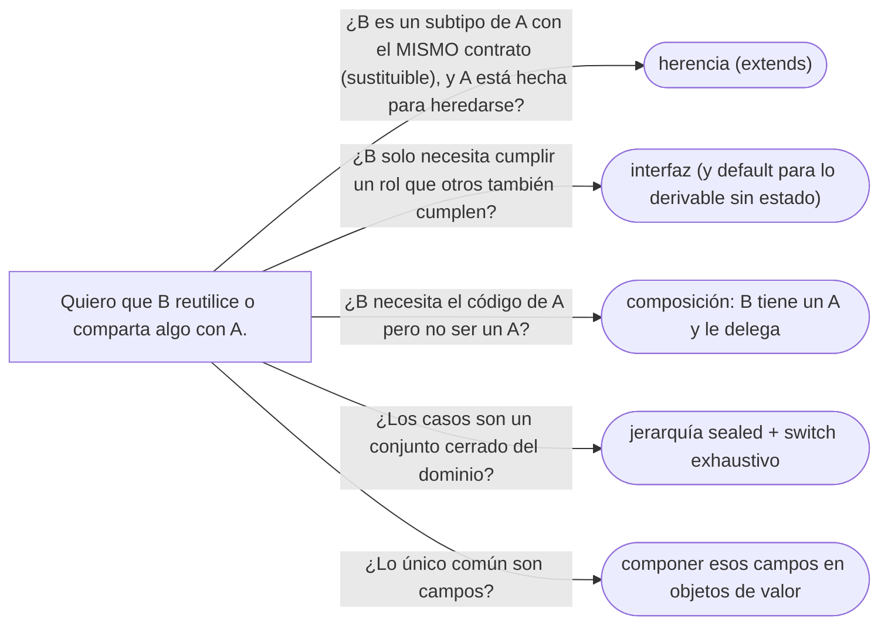

# 06 — Herencia vertical y horizontal

> Cuándo heredar, implementar, mezclar o componer; LSP con el dominio; el diamante en C++, Java y
> Python; y la composición antes que la herencia. Es el dueño de "composición antes que herencia" en
> el corpus. Asume leído [`05` — Polimorfismo y despacho](05-polimorfismo-y-despacho.md), pero se lee
> solo: §2 recuerda lo necesario.
>
> **Vigencia:** 2026-10-03.
>
> **Versiones ejecutadas:** GCC 14.4 (C++23) · JDK 21.0.12, 17.0.20 y 25.0.4 (2026-10-04).

---

## 1. 🎯 El problema

La cédula de Ana no vence. Alguien la modela como subclase de `Documento`, que tiene un vencimiento, y
resuelve el caso raro como puede:

```java
class Cedula extends Documento {
    @Override
    public LocalDate vencimiento() {
        throw new UnsupportedOperationException("la cédula no vence");
    }
}

// el reporte mensual, escrito contra Documento, meses antes de que existiera Cedula
List<Documento> porVencer = documentos.stream()
        .filter(d -> d.vencimiento().isBefore(LocalDate.now().plusMonths(3)))
        .toList();     // revienta con la cédula de Ana
```

- `Cedula` **es un** documento en el mundo real, y el compilador acepta la herencia. Aun así rompe el
  código que confiaba en el contrato de `Documento`: "todo documento tiene vencimiento".
- "Es-un" no basta para heredar. Este capítulo dice qué hace falta además, y qué otras formas de
  reutilizar hay: implementar interfaces, mezclar comportamiento y, la más subestimada, componer.

---

## 2. 🧱 Herencia vertical: implementación y la clase base frágil

**Lo que hace falta de `05`.** Una variable del tipo base puede apuntar a un objeto derivado, y los
métodos sobrescritos se eligen por el tipo dinámico.

**Qué es.** La **herencia vertical** (de implementación) hace que la clase derivada reciba los campos
y el código de la base, y pueda sobrescribirlos. Es la forma más fuerte de acoplamiento que existe
entre dos clases: la derivada depende de **cómo** está escrita la base, no solo de qué promete.

**La clase base frágil.** Un conjunto de documentos que cuenta cuántos se añadieron, heredando de
`HashSet`:

```java
class ConjuntoDocumentosContado extends HashSet<Documento> {
    private int agregados = 0;
    @Override public boolean add(Documento d) { agregados++; return super.add(d); }
    @Override public boolean addAll(Collection<? extends Documento> c) {
        agregados += c.size();
        return super.addAll(c);       // HashSet.addAll llama a add por cada elemento
    }
}
// addAll(List.of(cedula, pasaporte)) deja agregados en 4, no en 2
```

- El error depende de un **detalle de implementación** de `HashSet` (que `addAll` usa `add`) que su
  documentación no promete. Si mañana cambia, el contador cambia con él. La derivada se rompe sin que
  nadie haya tocado su código.

**Qué cuesta.** **Acoplamiento** a la implementación de la base; **legibilidad** (para entender la
derivada hay que leer la base); y fragilidad ante cambios en una clase que quizá no es tuya.

**Cuándo sí.** Cuando la base está **diseñada y documentada para heredarse**: dice qué métodos llaman a
cuáles y qué se puede sobrescribir. Y dentro de un mismo módulo, donde base y derivadas cambian juntas.

> **Veredicto:** hereda de clases diseñadas para eso, preferiblemente tuyas. Las que no lo están
> deberían ser `final` (Bloch, ítem 19).

---

## 3. 🧱 LSP: el contrato que la herencia promete

**Qué es.** El **principio de sustitución de Liskov**: si un código funciona con objetos de tipo `T`,
debe seguir funcionando con cualquier subtipo de `T`. No habla de estructura sino de **contrato**: una
derivada no puede exigir más (precondiciones más fuertes) ni prometer menos (postcondiciones más
débiles) que su base.

**El ejemplo que vas a oír** es el del cuadrado y el rectángulo: en geometría un cuadrado *es un*
rectángulo, pero si el rectángulo tiene `setAncho` y `setAlto` independientes, un cuadrado mutable no
puede cumplir el contrato. Es la misma trampa que la `Cedula` de §1: "es-un" en el mundo real, no
sustituible en el código.

**Cómo se arregla §1.** El contrato de `Documento` está mal dicho: no todo documento vence. O se dice
en el tipo, o se saca de la jerarquía:

```java
public Optional<LocalDate> vencimiento() { return Optional.ofNullable(vencimiento); }   // admite "no vence"

// o mejor: que venza o no es un dato del TipoDocumento, no una subclase
boolean vence = documento.tipo().vence();
```

- La segunda forma elimina la subclase: `CC` es un `TipoDocumento` con `vence = false`. El tipo como
  objeto, en lugar de una clase por tipo, es una decisión que discute entera
  [`02/06` §7](../02-modelado-oo/06-entidades-valores-y-primitivos.md#7--el-tipo-como-objeto-tipodocumento-contra-subclases).

LSP vuelve como la L de SOLID en [`03/02` — SOLID sin catecismo](../03-principios-de-diseno/02-solid-sin-catecismo.md), donde se lee como
contrato de pre y postcondiciones; aquí basta con su consecuencia para la herencia.

> **Veredicto:** antes de heredar, pregúntate si cada método de la base tiene sentido en la derivada
> **con el mismo contrato**. Si la respuesta es "todos menos uno, que lanza", no heredes.

---

## 4. 🧱 Herencia horizontal: interfaces, *mixins* y *traits*

**Qué es.** La **herencia horizontal** reparte comportamiento entre clases que no comparten
jerarquía: una `Persona` y una `Organizacion` pueden ser las dos `Titular` de una cuenta sin tener un
antepasado común. Las formas, de menos a más poder:

- **Interfaces**: un contrato sin estado. Desde Java 8, con **métodos `default`**: código que la clase
  recibe si no lo sobrescribe. "Las interfaces no tienen implementación" es falso desde 2014.
- ***Mixins*** (clases de mezcla): un paquete de comportamiento, a veces con estado, que se mezcla en
  una clase. C++ los hace con herencia múltiple o CRTP; Python, con herencia múltiple; Ruby, con
  módulos.
- ***Traits***: *mixins* con reglas explícitas para los conflictos. PHP resuelve el choque de dos traits
  con `insteadof`; Scala y Rust los tienen como pieza central de su modelo.

```java
interface Titular {
    String nombre();
    default String nombreParaExtracto() { return nombre().toUpperCase(); }   // código heredable
}
record Persona(String nombre) implements Titular { }          // nombre() cumple el contrato
record Organizacion(String nombre) implements Titular { }
```

**Qué cuesta.** Un `default` es herencia de implementación con menos ruido, y tiene los mismos riesgos
de fragilidad si se abusa de él. Y Java no deja que una interfaz tenga estado de instancia, así que el
`default` solo puede trabajar sobre otros métodos de la interfaz.

> **Veredicto:** interfaz para el contrato, `default` para el comportamiento que se deriva de él sin
> estado, y nada más. Un `default` que necesita un campo está pidiendo composición.

---

## 5. 🧱 El diamante en tres lenguajes

**El problema.** Si `Persona` hereda de `Titular` y de `Empleado`, y los dos heredan de una tercera
clase o declaran el mismo método, ¿cuál recibe `Persona`? (Las clases `Titular`, `Empleado` y
`ConContactos` son roles ilustrativos para este apartado; el dominio fijo no las tiene.)

**C++: herencia virtual.** Sin `virtual`, `Persona` tendría **dos** subobjetos `ConContactos`, uno por
cada camino, y `persona.contactos` sería ambiguo:

```cpp
struct ConContactos { std::vector<Contacto> contactos; };
struct Titular  : virtual ConContactos { };
struct Empleado : virtual ConContactos { };
struct Persona  : Titular, Empleado { };   // un solo ConContactos, compartido por los dos caminos
```

**Java: la regla de los `default`.** Java no tiene herencia múltiple de clases, pero dos interfaces
pueden traer el mismo `default`. La regla, en orden:

```text
1. La clase gana: un método de la clase (o de una superclase) le gana a cualquier default.
2. La interfaz más específica gana: si una interfaz extiende a la otra, gana la hija.
3. Si no, no compila: la clase tiene que sobrescribir y elegir con X.super.metodo().
```

```java
interface Titular  { default String descripcion() { return "titular"; } }
interface Empleado { default String descripcion() { return "empleado"; } }
class Persona implements Titular, Empleado {
    @Override public String descripcion() { return Titular.super.descripcion(); }   // obligatorio
}
```

**Python: la MRO C3.** Python linealiza la jerarquía en un **orden de resolución de métodos** (MRO)
con el algoritmo C3, que respeta el orden de declaración y que cada clase aparezca antes que sus
bases. `class Persona(Titular, Empleado)` busca en `Persona`, `Titular`, `Empleado`, `ConContactos`,
`object`, y `super()` sigue ese orden, no "la clase base".

> **Veredicto:** "la herencia múltiple es mala en sí" es falso: los tres lenguajes tienen una regla
> clara. Lo malo es necesitar la regla para entender tu propio modelo.

---

## 6. 🧱 Composición antes que herencia

**Qué es.** **Componer** es que un objeto *tenga* otro y le delegue trabajo, en lugar de *ser* de su
clase. El contador de §2 compuesto:

```java
class ConjuntoDocumentosContado {
    private final Set<Documento> documentos = new HashSet<>();   // tiene un Set, no es un Set
    private int agregados = 0;

    boolean agregar(Documento d) { agregados++; return documentos.add(d); }
    void agregarTodos(Collection<Documento> c) { c.forEach(this::agregar); }
    int agregados() { return agregados; }
}
```

- Ahora el contador depende solo de lo que `Set.add` **promete**, no de cómo está escrito `HashSet`.
- Y expone solo lo que tiene sentido: ya no es un `Set` con cuarenta métodos heredados, la mitad de los
  cuales (`removeIf`, `retainAll`) se saltarían el contador.

**Qué cuesta.** **Indirección**: métodos de reenvío que escribir, y un objeto más. Y se pierde la
sustitución: un `ConjuntoDocumentosContado` ya no se puede pasar donde se espera un `Set`. Si eso hace
falta, se implementa la interfaz `Set` delegando, que es el patrón Decorator (ver
[`05/02` — Decorator](../05-estructurales/02-decorator.md)).

> **Veredicto:** compón por defecto y hereda cuando la relación es de verdad de subtipo, con contrato
> sustituible, y la base está hecha para heredarse. "La herencia es para reutilizar código" es la frase
> que produce las jerarquías que nadie se atreve a tocar.

---

## 7. 🧱 Clase abstracta contra interfaz, hoy

Con `default`, `static` y métodos `private` en las interfaces, la diferencia que queda es corta:

| | Clase abstracta | Interfaz |
|---|---|---|
| Estado de instancia | Sí | No |
| Constructores | Sí | No |
| Una clase puede tener… | Una sola | Varias |
| Métodos no públicos | `protected`, de paquete | Solo `private` (de ayuda) |

**Cuándo cada una.** Interfaz para el **tipo** que otros implementan; clase abstracta para una
**implementación parcial con estado** que se comparte (un esqueleto como `AbstractList`). Las dos juntas
son el idioma del JDK: `List` define, `AbstractList` facilita, y lo hace con el patrón Template Method
(ver [`06/02` — Template Method](../06-comportamiento/02-template-method.md)).

---

## 8. 🧱 Persona y organización: ¿una superclase "parte"?

Persona y organización tienen nombre, direcciones y contactos, y las dos pueden ser titulares de una
cuenta. La tentación es una superclase `Parte` (el *Party* de los modelos de negocio).

- **A favor:** una cuenta tiene un titular de tipo `Parte` y listo; las direcciones se escriben una vez.
- **En contra:** casi todo lo demás es distinto —una persona tiene fecha de nacimiento, documentos,
  tutor; una organización tiene razón social y empleados—, y la base tiende a acumular campos
  opcionales que solo tienen sentido en una de las dos.

**La salida habitual** es componer lo común (las dos *tienen* una lista de `Direccion` y de `Contacto`,
objetos de valor reutilizables) y expresar el rol con una interfaz (`Titular`), que es lo que la cuenta
necesita de verdad.

> **Veredicto:** una superclase solo si comparten **comportamiento con contrato común**, no solo
> campos. Compartir campos se resuelve componiendo.

---

## 9. 🧱 Jerarquías selladas: abiertas contra cerradas

**Qué es.** Una clase o interfaz `sealed` (JEP 409, final en Java 17) declara la lista **cerrada** de sus
subtipos permitidos: `sealed interface EstadoDeTramite permits Pendiente, Aprobado, Rechazado`. Nadie
fuera de esa lista puede extenderla.

**Para qué.** Una jerarquía abierta deja añadir **tipos** sin tocar nada, pero cada **operación** nueva
obliga a tocar todos los tipos. Una cerrada deja añadir **operaciones** con un `switch` exhaustivo que
el compilador comprueba, y cada tipo nuevo obliga a revisar todos los `switch`. Elegir entre las dos es
el ***expression problem*** (el problema de la expresión): no hay un diseño que haga baratas las dos
cosas a la vez, y Visitor es la forma clásica de pasar de la primera a la segunda.

> **Veredicto:** cerrada (`sealed`) cuando los casos son del dominio y no van a crecer sin que lo sepas;
> abierta cuando terceros deben poder añadir tipos.

---

## 10. 🧬 En los lenguajes

| Lenguaje | Herencia de clases | Comportamiento horizontal | El detalle que muerde |
|---|---|---|---|
| **C++** | Múltiple; `virtual` para el diamante | Herencia múltiple, CRTP, *concepts* | Sin herencia virtual, dos copias de la base común |
| **Java** | Simple | Interfaces con `default` | Dos `default` iguales obligan a sobrescribir con `X.super.m()` |
| **C#** | Simple | Interfaces con implementación por defecto (C# 8) | El método por defecto solo se ve a través de la interfaz, no de la clase |
| **Python** | Múltiple, MRO C3 | *Mixins* por herencia múltiple | `super()` sigue la MRO, no la clase base: puede llamar a un "hermano" |
| **JavaScript** | Simple, por la cadena de prototipos | *Mixins* copiando métodos (`Object.assign`) | `class` es azúcar sobre prototipos; un *mixin* copiado no se actualiza |
| **Go** | No hay | *Embedding* e interfaces implícitas | El *embedding* no es herencia: el tipo embebido no ve los métodos del que lo embebe |

- En Go esto se resuelve sin herencia, con *embedding* e interfaces implícitas; el capítulo de Go,
  [`11/01`](../11-los-diferentes/01-go.md), lo cuenta entero.

---

## 11. 🧭 Cómo se elige



**La frase en voz alta:** *"Compongo por defecto. Heredo solo si el subtipo cumple el contrato de la base
—LSP— y la base está diseñada para heredarse; para roles, interfaces."*

---

## ⚠️ Errores frecuentes

| Se dice | Lo preciso |
|---|---|
| "La herencia es para reutilizar código" | Es para expresar subtipos sustituibles; para reutilizar, compón |
| "Es-un basta para heredar" | Hace falta que cumpla el contrato de la base (LSP); el cuadrado no es un rectángulo mutable |
| "Las interfaces no tienen implementación" | Desde Java 8 tienen métodos `default`, `static` y, desde Java 9, `private` |
| "La herencia múltiple es mala en sí" | C++, Python y Java (con `default`) tienen reglas claras para el diamante |
| "Lanzar `UnsupportedOperationException` resuelve el caso raro" | Rompe LSP: el código escrito contra la base revienta |
| "Heredar de `HashSet` para añadir algo es lo más simple" | Te ata a su implementación; compón o decora |
| "`super()` en Python llama a la clase base" | Llama a la siguiente clase de la MRO, que puede ser un hermano |

---

## 📚 Para profundizar

- **Libro** — Bloch, *Effective Java*, 3.ª ed. (Addison-Wesley, 2018), ítems 18, "Favor composition
  over inheritance"; 19, "Design and document for inheritance or else prohibit it", y 20, "Prefer
  interfaces to abstract classes". **El que destaca**: el ejemplo de §2 es una versión del ítem 18.
- **Libro** — Metz, *Practical Object-Oriented Design*, 2.ª ed. (Addison-Wesley, 2018), caps. 6,
  "Acquiring Behavior through Inheritance"; 7, "Sharing Role Behavior with Modules", y 8, "Combining
  Objects with Composition": las tres formas de este capítulo, en Ruby.
- [JLS 21 §9.4.1.3, *Inheriting Methods with Override-Equivalent Signatures*](https://docs.oracle.com/javase/specs/jls/se21/html/jls-9.html#jls-9.4.1.3):
  la regla del diamante de los `default`.
- [JLS 21 §8.1.1.2, *sealed, non-sealed, and final Classes*](https://docs.oracle.com/javase/specs/jls/se21/html/jls-8.html#jls-8.1.1.2).
- [cppreference — *Derived classes*](https://en.cppreference.com/cpp/language/derived_class): herencia
  múltiple y clases base virtuales.
- [Python — *The Python 2.3 Method Resolution Order*](https://docs.python.org/3/howto/mro.html): el
  algoritmo C3, explicado por la documentación oficial.

---

## 🧠 Preguntas

Sin respuestas aquí. Todas, con enunciado literal y respuesta en tres capas, en
[`10` — Respuestas](10-respuestas.md#06--herencia-vertical-y-horizontal).

1. ¿Qué es la herencia de implementación? 🟢
2. ¿Qué dice el principio de sustitución de Liskov? 🟢
3. ¿Qué es un método `default` en una interfaz de Java? 🟢
4. ¿Qué es la composición, y qué es delegar? 🟢
5. ¿Qué es el problema del diamante? 🟢
6. ¿Qué hace `sealed` en una clase o interfaz de Java, y desde qué versión es final? 🟢
7. ¿Qué diferencia hay entre herencia vertical y horizontal? 🟡
8. ¿Qué diferencia hay entre un *mixin* y un *trait*? 🟡
9. ¿Qué diferencia hay hoy entre una clase abstracta y una interfaz en Java? 🟡
10. ¿Por qué un cuadrado no es un rectángulo en código mutable? 🟡
11. ¿Cómo resuelve C++ el diamante, y qué pasa si no usas herencia virtual? 🟡
12. ¿Qué regla sigue Java cuando una clase recibe dos `default` con la misma firma? 🟡
13. ¿Qué es la MRO de Python, y por qué `super()` no siempre llama a la clase base? 🟡
14. ¿Qué es la clase base frágil? Da un ejemplo. 🟠
15. ¿Por qué "la herencia es para reutilizar código" es una mala regla? 🟠
16. ¿Qué cuesta componer en lugar de heredar? 🟠
17. ¿Cuándo es correcto heredar de una clase concreta? 🟠
18. ¿Por qué lanzar `UnsupportedOperationException` en un método sobrescrito viola LSP? 🟠
19. ¿Cuándo usarías una jerarquía `sealed` y cuándo una abierta? 🟠
20. ¿Qué es el *expression problem*, en dos frases? 🟠
21. ¿Por qué el *embedding* de Go no es herencia? 🟠
22. ¿Por qué una interfaz de Java no puede resolver todo lo que resuelve un *mixin* con estado? 🟠
23. Arregla el diseño de la `Cedula` de §1 de forma que el reporte de documentos por vencer funcione,
    y di cuál de las dos salidas prefieres. 🔴
24. `ConjuntoDocumentosContado extends HashSet<Documento>` cuenta 4 al añadir dos documentos con
    `addAll`. Explica por qué y reescríbelo con composición. 🔴
25. Escribe en Java una clase `Persona` que implemente dos interfaces con el mismo método `default`, y
    elige explícitamente uno. 🔴
26. Escribe en C++ el diamante `Titular`/`Empleado`/`ConContactos` con un solo subobjeto común, y di
    qué cambiaría sin `virtual`. 🔴
27. Decide si `Persona` y `Organizacion` deben heredar de una superclase `Parte`. Defiende tu decisión
    con un diagrama o con código. 🔴
28. Dada `class Persona(Titular, Empleado)` en Python, donde `Titular` y `Empleado` heredan de
    `ConContactos`, escribe la MRO y di a quién llama `super()` desde `Titular`. 🔴

---

**Anterior:** [`05` — Polimorfismo y despacho](05-polimorfismo-y-despacho.md) ·
**Siguiente:** [`07` — Genéricos y varianza](07-genericos-y-varianza.md) ·
**Relacionado:** [`02` — Igualdad, identidad y hash](02-igualdad-identidad-y-hash.md) (la igualdad
que la herencia rompe)
