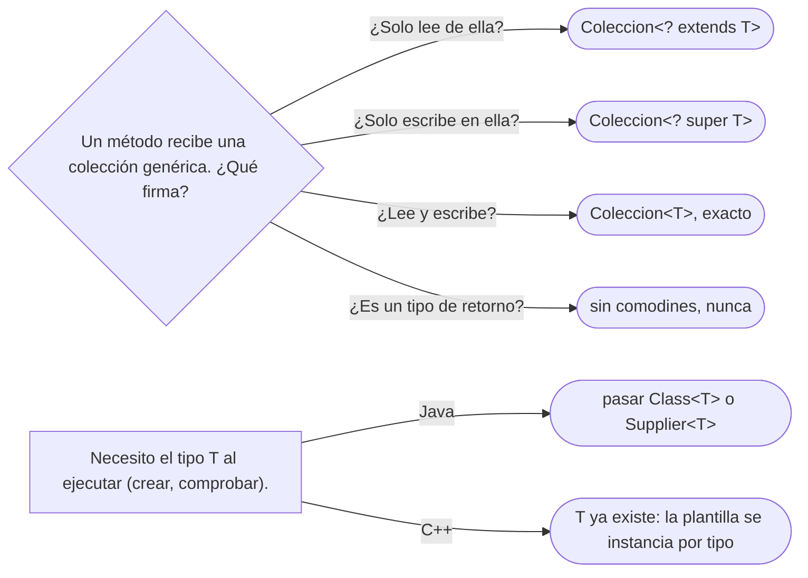

# 07 — Genéricos y varianza

> Por qué `List<Pasaporte>` no es un `List<Documento>`, cómo se escribe la firma con comodines
> correcta, qué queda de un genérico al ejecutar, y en qué se diferencian de verdad las plantillas de
> C++. Asume leído [`05` — Polimorfismo y despacho](05-polimorfismo-y-despacho.md) y
> [`06` — Herencia vertical y horizontal](06-herencia-vertical-y-horizontal.md).
>
> **Vigencia:** 2026-10-03.
>
> **Versiones ejecutadas:** GCC 14.4 (C++23) · JDK 21.0.12, 17.0.20 y 25.0.4 (2026-10-04).

---

## 1. 🎯 El problema

Como en `05`, `Pasaporte` es aquí una subclase de `Documento`. Un servicio de reportes recibe
documentos y los imprime:

```java
// no compila: List<Pasaporte> no es un List<Documento>
void imprimirTodos(List<Documento> documentos) { documentos.forEach(this::imprimir); }

List<Pasaporte> pasaportes = consultarPasaportesPorVencer();
imprimirTodos(pasaportes);     // no compila: List<Pasaporte> no es un List<Documento>
```

- Un `Pasaporte` **es** un `Documento`, y aun así una lista de pasaportes no es una lista de
  documentos. Parece una restricción caprichosa del compilador, y es lo que impide un error al
  ejecutar que los arreglos de Java sí tienen.
- Las "soluciones" que aparecen en el código real —el tipo crudo `List`, un *cast*, copiar a una lista
  nueva— van de peligrosas a innecesarias. La correcta es una palabra: `? extends`.

---

## 2. 🧱 Los arreglos son covariantes, y por eso fallan al ejecutar

**Qué es.** En Java, `Pasaporte[]` **es** un `Documento[]`: los arreglos son **covariantes** (si `A` es
subtipo de `B`, `A[]` es subtipo de `B[]`). Eso compila, y el error aparece después:

```java
Documento[] documentos = new Pasaporte[2];     // compila: covarianza de arreglos
documentos[0] = cedulaDeAna;                   // compila, y lanza ArrayStoreException al ejecutar
```

- El arreglo recuerda que es de `Pasaporte`, y la JVM comprueba **cada escritura** al ejecutar. La
  comprobación cuesta poco y el error llega tarde: en producción, no al compilar.

**Por qué es así.** Java 1.0 no tenía genéricos, y sin covarianza no se podía escribir un
`Arrays.sort(Object[])` que sirviera para todo. Es un compromiso histórico, y Bloch (ítem 28) aconseja
preferir listas por esto.

---

## 3. 🧱 Los genéricos son invariantes, y es a propósito

**Qué es.** `List<Pasaporte>` y `List<Documento>` no tienen relación de subtipo: los genéricos de Java
son **invariantes**. La razón es la misma escritura de §2:

```java
// no compila: es justo lo que la invarianza prohíbe
List<Pasaporte> pasaportes = new ArrayList<>();
List<Documento> documentos = pasaportes;   // si esto compilara...
documentos.add(cedulaDeAna);               // ...esto metería una cédula en una lista de pasaportes
Pasaporte p = pasaportes.get(0);           // ...y esto fallaría con ClassCastException
```

- Con arreglos, la JVM detecta la escritura mala al ejecutar. Con genéricos **no podría**, porque el
  tipo del elemento se borra (§5). Así que el compilador prohíbe la asignación desde el principio.

> **Veredicto:** la invarianza no es una limitación, es la garantía de que una `List<Pasaporte>` solo
> contiene pasaportes. Para relajarla con seguridad están los comodines.

---

## 4. 🧱 Comodines y PECS

**Qué es.** Un **comodín** (*wildcard*) relaja la invarianza en la firma de un método, a cambio de
restringir qué se puede hacer con el parámetro:

- `List<? extends Documento>`: una lista de **algún** subtipo de `Documento`. Se puede **leer** un
  `Documento`; no se puede **escribir** nada (salvo `null`), porque no se sabe de qué subtipo es.
- `List<? super Pasaporte>`: una lista de **algún** supertipo de `Pasaporte`. Se puede **escribir** un
  `Pasaporte`; al leer solo se sabe que es `Object`.

**La regla, PECS** (*producer extends, consumer super*, de Bloch): si el parámetro **produce** valores
que tú lees, `extends`; si **consume** valores que tú escribes, `super`. El JDK la aplica en
`Collections.copy`:

```java
public static <T> void copy(List<? super T> destino, List<? extends T> origen)   // firma del JDK

void imprimirTodos(List<? extends Documento> documentos) {   // §1 arreglado: solo lee
    documentos.forEach(this::imprimir);
}

void agregarVigentes(List<? extends Documento> origen, Collection<? super Documento> destino) {
    for (Documento d : origen) if (d.vigente()) destino.add(d);   // lee de uno, escribe en otro
}
```

- `agregarVigentes` acepta como origen una `List<Pasaporte>` y como destino un `Set<Object>`. Sin
  comodines aceptaría solo `List<Documento>` y `Collection<Documento>`.

**Qué cuesta.** **Legibilidad**: las firmas con comodines asustan y los errores del compilador sobre
ellas son difíciles de leer. La regla de Bloch para limitarlo: los comodines van en los **parámetros**
de métodos públicos, nunca en los tipos de retorno.

> **Veredicto:** pon `? extends` en lo que lees y `? super` en lo que escribes, y deja el tipo exacto
> cuando haces las dos cosas.

---

## 5. 🧱 *Type erasure*: lo que queda al ejecutar

**Qué es.** Los genéricos de Java se comprueban al compilar y **se borran** al generar el código: al
ejecutar, `List<Documento>` y `List<Pasaporte>` son la misma clase `List`, y `T` se reemplaza por su
cota (`Object` o la que se declare). Se eligió así en Java 5 para que el código nuevo y el viejo sin
genéricos funcionaran juntos.

**Lo que prohíbe:**

```java
// no compila: T se borra y no existe al ejecutar
class Repositorio<T> {
    T crear() { return new T(); }                      // no compila: T no existe al ejecutar
    boolean esDeTexto(Object o) { return o instanceof List<String>; }   // no compila
}
```

**La salida: el testigo de tipo.** Si el código necesita el tipo al ejecutar, se pasa explícitamente
un `Class<T>` (o un `Supplier<T>`):

```java
class Repositorio<T> {
    private final Class<T> tipo;
    Repositorio(Class<T> tipo) { this.tipo = tipo; }
    T buscar(String id, Map<String, Object> almacen) { return tipo.cast(almacen.get(id)); }
}
var repo = new Repositorio<>(Documento.class);
```

- Un `Supplier<T>` cumple el mismo papel cuando hay que **crear** instancias: es una fábrica pasada como
  argumento (ver [`04/01` — Factory Method y fábricas estáticas](../04-creacionales/01-factory-method.md#6--variantes)).

**Qué cuesta.** Que un mismo `List` crudo sirva para todo abre la puerta a la ***heap pollution***
(contaminación del heap): con tipos crudos o *casts* sin comprobar, una `List<Pasaporte>` puede
contener una cédula, y el error aparece lejos, en un `get`. Los avisos `unchecked` del compilador son
la alarma; no se silencian sin entenderlos (Bloch, ítem 27).

---

## 6. 🧱 Las plantillas de C++ no son genéricos

**Qué es.** Una plantilla de C++ no se borra: se **instancia**. El compilador genera una copia del
código por cada tipo con que se usa (***monomorfización***). `std::vector<Documento>` y
`std::vector<Pasaporte>` son dos clases distintas con código distinto.

**Lo que da y lo que cuesta.**

- Rendimiento: el código está especializado para cada tipo, sin *casts* ni indirección; se puede
  incrustar todo.
- Expresividad: `new T()`, `sizeof(T)` y especializaciones por tipo son posibles, porque `T` existe al
  compilar cada instancia.
- Precio: **tamaño del binario** (una copia por tipo), **tiempo de compilación**, y errores que, sin
  restricciones, aparecían en las tripas de la plantilla con mensajes de cien líneas.

**Los *concepts* (C++20)** son el contrato que faltaba: declaran qué exige la plantilla de su tipo, y el
error aparece en la llamada.

```cpp
template <typename T>
concept Validable = requires(const T& d) {
    { d.validar() } -> std::same_as<void>;
    { d.numero() } -> std::convertible_to<std::string>;
};

template <Validable T>
void validarTodos(const std::vector<T>& documentos) {
    for (const auto& d : documentos) d.validar();   // despacho estático: sin vtable
}
```

- `validarTodos` acepta un vector de cualquier tipo que cumpla `Validable`, **sin herencia**. Es
  polimorfismo paramétrico con un contrato, resuelto al compilar.
- Las plantillas de C++ **no tienen varianza**: `std::vector<Pasaporte>` y `std::vector<Documento>` no
  se relacionan de ninguna forma.

---

## 7. 🧱 Varianza en el sitio de uso o en la declaración

Java declara la varianza **donde se usa** el tipo, con comodines en cada firma. C# y Kotlin la declaran
**en el tipo**, una vez:

```text
Java (sitio de uso):     void imprimir(List<? extends Documento> docs)   ← en cada método
C#  (declaración):       interface IEnumerable<out T>                    ← una vez, en el tipo
Kotlin (declaración):    interface List<out E>
```

- En C#, `IEnumerable<Pasaporte>` **es** un `IEnumerable<Documento>`, sin comodines en ningún método,
  porque el tipo prometió que `T` solo sale (`out`). `List<T>` de C# es invariante porque `T` entra y
  sale.
- La declaración es más cómoda para quien usa el tipo; el sitio de uso es más flexible, porque deja
  usar como covariante un tipo que no lo es en todos sus métodos.

---

## 8. 🧬 En los lenguajes

| Lenguaje | Qué es un genérico | ¿Existe al ejecutar? | El detalle que muerde |
|---|---|---|---|
| **C++** | Plantilla: una instancia por tipo | Sí, cada instancia es código propio | Sin varianza; binario más grande; *concepts* para el contrato |
| **Java** | Comprobación al compilar | No: *type erasure* | Arreglos covariantes con `ArrayStoreException`; sin `new T()` |
| **C#** | Genéricos reificados | Sí: `typeof(T)` y `new T()` con restricción | Varianza solo en interfaces y delegados, con `in`/`out` |
| **TypeScript** | Tipos estructurales | No: se borran al compilar a JavaScript | Los parámetros de método son bivariantes: la varianza es poco sólida |
| **Go** | Genéricos con restricciones (desde 1.18) | En parte: se instancia por "forma" de tipo, con diccionarios | Sin varianza: `[]Pasaporte` no es `[]Documento`, ni con interfaces |

---

## 9. 🧭 Cómo se elige



**La frase en voz alta:** *"Los genéricos de Java son invariantes porque se borran; para aceptar
subtipos uso `? extends` si leo y `? super` si escribo: PECS."*

---

## ⚠️ Errores frecuentes

| Se dice | Lo preciso |
|---|---|
| "`List<Pasaporte>` es un `List<Documento>`" | Los genéricos son invariantes; lo que acepta las dos es `List<? extends Documento>` |
| "Los genéricos de Java existen al ejecutar" | Se borran: `List<Pasaporte>` y `List<Documento>` son la misma clase al ejecutar |
| "Las plantillas de C++ son genéricos como los de Java" | Se instancian por tipo, no se borran, y no tienen varianza |
| "Si los arreglos lo permiten, las listas deberían" | Los arreglos lo permiten y fallan al ejecutar con `ArrayStoreException` |
| "Un tipo crudo `List` es lo mismo que `List<Object>`" | El crudo desactiva la comprobación; `List<Object>` la mantiene |
| "En `List<? extends Documento>` se puede añadir un `Documento`" | No se puede añadir nada salvo `null` |

---

## 📚 Para profundizar

- **Libro** — Bloch, *Effective Java*, 3.ª ed. (Addison-Wesley, 2018), ítems 26, "Don't use raw types";
  28, "Prefer lists to arrays", y 31, "Use bounded wildcards to increase API flexibility". **El que
  destaca**: PECS nace en el ítem 31.
- **Libro** — Stroustrup, *A Tour of C++*, 3.ª ed. (Addison-Wesley, 2022), caps. 7, "Templates", y 8,
  "Concepts and Generic Programming".
- [The Java Tutorials — *Guidelines for Wildcard Use*](https://docs.oracle.com/javase/tutorial/java/generics/wildcardGuidelines.html):
  la regla de "dentro" y "fuera" con la que el tutorial oficial explica PECS.
- [JLS 21 §4.5.1, *Type Arguments of Parameterized Types*](https://docs.oracle.com/javase/specs/jls/se21/html/jls-4.html#jls-4.5.1):
  la contención de comodines, normativa.
- [cppreference — *Constraints and concepts*](https://en.cppreference.com/cpp/language/constraints).
- [C# — *Covariance and Contravariance*](https://learn.microsoft.com/en-us/dotnet/csharp/programming-guide/concepts/covariance-contravariance/):
  `in` y `out` en la declaración.
- [TypeScript — *Type Compatibility*](https://www.typescriptlang.org/docs/handbook/type-compatibility.html):
  la bivarianza de los parámetros, explicada por el propio manual.
- [Go — *Tutorial: Getting started with generics*](https://go.dev/doc/tutorial/generics).

---

## 🧠 Preguntas

Sin respuestas aquí. Todas, con enunciado literal y respuesta en tres capas, en
[`10` — Respuestas](10-respuestas.md#07--genéricos-y-varianza).

1. ¿Qué significa que los arreglos de Java sean covariantes? 🟢
2. ¿Qué significa que los genéricos de Java sean invariantes? 🟢
3. ¿Qué es el *type erasure*? 🟢
4. ¿Qué significa PECS? 🟢
5. ¿Qué es la monomorfización de las plantillas de C++? 🟢
6. ¿Qué diferencia hay entre `List<? extends Documento>` y `List<? super Documento>`? 🟡
7. ¿Qué diferencia hay entre un tipo crudo `List` y `List<Object>`? 🟡
8. ¿Qué diferencia hay entre varianza en el sitio de uso y en la declaración? 🟡
9. ¿Qué diferencia hay entre los genéricos de Java y los de C#? 🟡
10. ¿Qué aporta un *concept* de C++20 frente a una plantilla sin restricciones? 🟡
11. ¿Por qué `IEnumerable<Pasaporte>` es un `IEnumerable<Documento>` en C# y `List<Pasaporte>` no es
    un `List<Documento>` en Java? 🟡
12. ¿Por qué Java hizo covariantes los arreglos, y qué costó? 🟠
13. ¿Por qué los genéricos de Java no pueden ser covariantes sin perder seguridad? 🟠
14. ¿Por qué no se puede escribir `new T()` en Java, y qué se hace en su lugar? 🟠
15. ¿Qué es la *heap pollution* y cómo se produce? 🟠
16. ¿Qué cuestan las plantillas de C++ frente a los genéricos de Java? 🟠
17. ¿Por qué los comodines no deberían aparecer en un tipo de retorno? 🟠
18. ¿Por qué en Go `[]Pasaporte` no se puede pasar donde se espera `[]Documento`, aunque `Documento`
    sea una interfaz que `Pasaporte` implementa? 🟠
19. Arregla la firma de `imprimirTodos` de §1 y explica por qué tu versión es segura. 🔴
20. Escribe un método que copie los documentos vigentes de una lista de cualquier subtipo de
    `Documento` a una colección que acepte documentos, con la firma más flexible posible. 🔴
21. Este código compila y falla al ejecutar. Explica por qué y cómo lo evitarían los genéricos:
    `Documento[] docs = new Pasaporte[2]; docs[0] = cedulaDeAna;`. 🔴
22. Escribe en C++ un *concept* `Validable` y una función que valide un vector de cualquier tipo que lo
    cumpla. 🔴

---

**Anterior:** [`06` — Herencia vertical y horizontal](06-herencia-vertical-y-horizontal.md) ·
**Siguiente:** [`08` — La ausencia y el error en el modelo](08-la-ausencia-y-el-error.md) ·
**Relacionado:** [`05` — Polimorfismo y despacho](05-polimorfismo-y-despacho.md)
