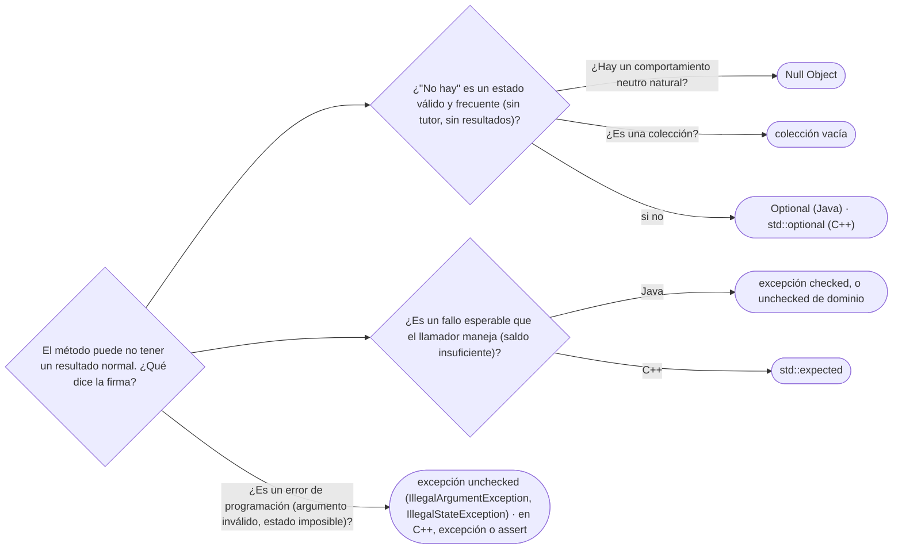

# 08 — La ausencia y el error en el modelo

> Cómo se dice en una firma "no hay" y "salió mal", y cómo se defiende la elección: `null`,
> `Optional`, Null Object, excepciones *checked* y *unchecked*, `std::optional` y `std::expected`.
> Asume leído [`01` — Identidad, estado y referencias](01-identidad-estado-y-referencias.md).
>
> **Vigencia:** 2026-10-03.
>
> **Versiones ejecutadas:** GCC 14.4 (C++23) · JDK 21.0.12, 17.0.20 y 25.0.4 (2026-10-04).

---

## 1. 🎯 El problema

Dos métodos del mismo servicio, dos silencios distintos:

```java
Persona buscarPorDocumento(String numero) { ... }    // devuelve null si no existe
Persona tutorDe(Persona menor) { ... }               // devuelve null si no tiene tutor

String nombreTutor = tutorDe(buscarPorDocumento("1098765432")).nombre();
```

- Si el número no existe, o si Luis no tiene tutor registrado, la línea lanza `NullPointerException`, y
  el mensaje no dice cuál de los dos `null` fue. **La firma mintió dos veces**: prometió una `Persona`
  y a veces no la había.
- Y "no existe esa persona" y "esta persona no tiene tutor" son cosas distintas —la primera es casi un
  error, la segunda es un estado válido— dichas con la misma palabra.

Modelar la ausencia y el error es decidir **qué promete la firma** para cada caso: un valor que puede
faltar, un fallo que el llamador debe manejar, o un error de programación que no debería pasar.

---

## 2. 🧱 `null` y lo que cuesta

**Qué es.** `null` es una referencia que no apunta a nada. En Java y en C# (por defecto), **cualquier**
variable de tipo referencia puede valerlo, y el compilador no te obliga a comprobarlo.

**Qué cuesta.** **Legibilidad**: la firma `Persona tutorDe(...)` no dice si puede devolver `null`; hay
que leer el cuerpo o la documentación. **Acoplamiento**: cada llamador repite la comprobación, o no la
repite y falla lejos. Y el error llega tarde: el `NullPointerException` salta donde se usa, no donde se
produjo. Tony Hoare, que lo introdujo en ALGOL W en 1965, lo llamó su "error de mil millones de
dólares".

> 💡 **Truco.** Desde Java 14 los mensajes de `NullPointerException` dicen qué expresión era `null`
> (*helpful NullPointerExceptions*). Ayuda a depurar; no cambia el diseño.

---

## 3. 🧱 `Optional`: para el retorno, no para todo

**Qué es.** `Optional<T>` es un contenedor que tiene un valor o está vacío. Su Javadoc dice para qué
existe: **principalmente como tipo de retorno**, donde hace falta representar "sin resultado" y `null`
probablemente causaría errores.

```java
Optional<Persona> tutorDe(Persona menor) { ... }

String nombreTutor = tutorDe(luis)
        .map(Persona::nombre)
        .orElse("sin tutor registrado");
```

- La firma ahora **dice** que el tutor puede faltar, y el compilador obliga a abrir el `Optional` para
  llegar a la `Persona`.

**Dónde no:**

- **En campos**: `Optional` no es `Serializable`, ocupa un objeto más por campo y no aporta nada dentro
  de la clase; el campo puede ser `null` y el getter devolver `Optional.ofNullable(tutor)`.
- **En parámetros**: obliga a quien llama a envolver, y aun así puede pasar `null` en lugar de un
  `Optional`. Dos métodos (con y sin el argumento) o una sobrecarga son más claros.
- **En colecciones**: una lista vacía ya significa "no hay"; `Optional<List<Documento>>` tiene dos formas
  de decir lo mismo.

**El antipatrón** es `opcional.get()` sin comprobar: es un `null` con más ceremonia. Desde Java 10,
`orElseThrow()` sin argumentos hace lo mismo con un nombre que confiesa lo que hace.

> **Veredicto:** `Optional` en el retorno de métodos que pueden no tener resultado, y abierto con
> `map`, `orElse` u `orElseThrow`. "`Optional` elimina los `NullPointerException`" es falso: elimina los
> de las firmas que lo usan bien.

---

## 4. 🧱 Null Object, como adelanto

**Qué es.** En lugar de "no hay objeto", un **objeto que no hace nada** con la misma interfaz: un
`SinTutor` cuyo `nombre()` devuelve `"sin tutor"` y cuyo `notificar()` no hace nada. El llamador no
comprueba nada, porque siempre hay un objeto.

**Cuándo sirve.** Cuando "no hay" tiene un comportamiento neutro natural (no notificar, cero, lista
vacía). **Cuándo no**: cuando el llamador **necesita saber** que no hay, porque entonces el Null Object
esconde una decisión. El patrón entero, y su pariente *Special Case* de Fowler, tienen capítulo en
[`09/03`](../09-ddd-tactico-y-otros/03-specification-null-object-y-type-object.md).

---

## 5. 🧱 Excepciones *checked* contra *unchecked*

**Qué es.** Java tiene dos clases de excepciones: las *checked* (subclases de `Exception` que no son de
`RuntimeException`), que el compilador obliga a declarar o capturar, y las *unchecked*
(`RuntimeException` y sus subclases), que no.

**El criterio clásico** (Bloch, ítem 70): *checked* para condiciones **recuperables** que el llamador
puede manejar con sentido; *unchecked* para **errores de programación** (un argumento inválido, un
estado imposible).

```java
// Recuperable: el llamador puede reintentar, avisar o elegir otra cuenta
Movimiento transferir(Cuenta origen, Cuenta destino, Dinero monto) throws SaldoInsuficienteException

// Error de programación: nadie debería transferir un monto negativo
if (monto.esNegativo()) throw new IllegalArgumentException("monto negativo: " + monto);
```

**Por qué la discusión sigue.** Las *checked* hacen visible el fallo en la firma, que es su virtud; y
también obligan a cada capa intermedia a declararlas o envolverlas, no encajan con las lambdas (las
interfaces funcionales del JDK no declaran ninguna), y en la práctica producen `catch` vacíos. Spring,
por ejemplo, traduce las `SQLException` *checked* a una jerarquía *unchecked*. Ni "fueron un error y
punto" ni "son siempre mejores": son una decisión de diseño con un precio conocido.

> **Veredicto:** *checked* solo si el llamador inmediato puede **hacer algo distinto** según el fallo;
> si lo único que puede hacer es propagarlo, *unchecked*. Y nunca excepciones para el flujo normal.

---

## 6. 🧱 La excepción como parte del contrato

Una excepción es parte de lo que promete el método, igual que el tipo de retorno: qué lanza, cuándo, y
en qué estado deja el objeto. Tres reglas que vienen de ahí:

- **Lanzar excepciones del nivel de la abstracción** (Bloch, ítem 73): `transferir` lanza
  `SaldoInsuficienteException`, no la `SQLException` de la capa de datos.
- **Atomicidad ante fallos** (ítem 76): si `transferir` falla, ninguna de las dos cuentas cambió. Validar
  todo antes de mutar nada es la forma más simple de conseguirlo.
- **Documentar lo que se lanza** (ítem 74), también las *unchecked* que el llamador puede provocar.

Cómo se escriben las precondiciones que producen esas excepciones —y la diferencia entre validar en el
borde y en el constructor— es el tema de
[`03/05` — Diseño por contrato y *fail fast*](../03-principios-de-diseno/05-diseno-por-contrato.md).

---

## 7. 🧱 C++: `std::optional`, `std::expected` y excepciones

**`std::optional<T>`** (C++17) es el `Optional` de C++, con una diferencia que importa: es un **valor**,
no un objeto en el heap. Guarda el `T` dentro, sin asignación, y se puede usar en campos y en
parámetros sin el costo de Java.

**`std::expected<T, E>`** (C++23) es un resultado que contiene **un valor o un error**, con el error
tipado. Hace explícito el fallo en la firma, como una excepción *checked*, pero como valor de retorno:

```cpp
enum class ErrorTransferencia { SaldoInsuficiente, CuentaBloqueada };

std::expected<Movimiento, ErrorTransferencia>
transferir(Cuenta& origen, Cuenta& destino, Dinero monto) {
    if (origen.estado() == EstadoCuenta::Bloqueada)
        return std::unexpected(ErrorTransferencia::CuentaBloqueada);
    if (origen.saldo() < monto)
        return std::unexpected(ErrorTransferencia::SaldoInsuficiente);
    return origen.transferirA(destino, monto);
}

auto resultado = transferir(cta0001, cta0003, Dinero::cop(250'000));
if (!resultado) { avisar(resultado.error()); }
```

- El llamador **no puede** usar el `Movimiento` sin pasar por la comprobación (`*resultado` sobre un
  error es comportamiento indefinido; `resultado.value()` lanza). El error es un tipo, no un texto.
- **Excepciones contra códigos de error** en C++: las excepciones son el mecanismo del lenguaje para
  errores que cruzan muchas capas, y los constructores no tienen otra forma de fallar. `std::expected`
  es para fallos **esperables** que el llamador inmediato maneja. Hay bases de código (embebido, juegos)
  que compilan sin excepciones, y ahí `std::expected` es la herramienta.

> 📝 **Contexto.** En Java no hay un `expected` en el JDK. La forma moderna de expresarlo es una
> interfaz sellada `Resultado` con dos `record` (`Exito`, `Fallo`) y un `switch` exhaustivo en Java 21;
> en Java 17, la misma jerarquía con `instanceof`. Es útil y no es idiomático todavía: en una entrevista
> de Java, las excepciones siguen siendo la respuesta esperada.

---

## 8. 🧱 El error como valor, en otros lenguajes

Go no tiene excepciones para el flujo normal: cada función que puede fallar devuelve el error como
último valor (`documento, err := buscar(numero)`), y el llamador lo comprueba. Es `std::expected` sin
el tipo que lo envuelve, y lo cuenta [`11/01`](../11-los-diferentes/01-go.md). Rust lo lleva al
sistema de tipos con `Result<T, E>`, y Kotlin hace los tipos anulables parte del tipo (`Persona?`).

---

## 9. 🧭 Cómo se elige



**La frase en voz alta:** *"`Optional` para retornos que pueden faltar, colecciones vacías en lugar de
`null`, excepciones para fallos, y *checked* solo si quien llama puede hacer algo distinto."*

---

## ⚠️ Errores frecuentes

| Se dice | Lo preciso |
|---|---|
| "`Optional` elimina los `NullPointerException`" | Los evita en las firmas que lo usan; `get()` sin comprobar y un `Optional` nulo los traen de vuelta |
| "`Optional` sirve para campos y parámetros" | Su Javadoc lo pensó para retornos; en campos y parámetros cuesta más de lo que aporta |
| "Las *checked exceptions* fueron un error y punto" | Son una decisión con precio: visibles en la firma, incómodas en capas y lambdas |
| "Devolver `null` es lo mismo que lanzar" | `null` es silencioso y falla lejos; la excepción falla donde está la causa |
| "Una lista vacía y `null` significan lo mismo" | La lista vacía no obliga a comprobar nada (Bloch, ítem 54) |
| "`std::optional` es como el `Optional` de Java" | Es un valor sin asignación en el heap, y se usa sin reparo en campos |
| "Las excepciones sirven para salir de un bucle" | Son para condiciones excepcionales; usarlas como flujo es lento y confunde (ítem 69) |

---

## 📚 Para profundizar

- **Libro** — Bloch, *Effective Java*, 3.ª ed. (Addison-Wesley, 2018), ítems 54, "Return empty
  collections or arrays, not nulls"; 55, "Return optionals judiciously"; 70, "Use checked exceptions for
  recoverable conditions and runtime exceptions for programming errors", y 71, "Avoid unnecessary use
  of checked exceptions". **El que destaca** para la mitad Java.
- **Libro** — Stroustrup, *A Tour of C++*, 3.ª ed. (Addison-Wesley, 2022), cap. 4, "Error Handling":
  excepciones, invariantes y alternativas, contadas por el autor del lenguaje.
- [Java 21 API — `Optional`](https://docs.oracle.com/en/java/javase/21/docs/api/java.base/java/util/Optional.html):
  la nota de que está pensado como tipo de retorno.
- [cppreference — `std::expected`](https://en.cppreference.com/cpp/utility/expected) (C++23).
- [cppreference — `std::optional`](https://en.cppreference.com/cpp/utility/optional) (C++17).
- [Go Blog — *Error handling and Go*](https://go.dev/blog/error-handling-and-go): el error como valor,
  explicado por el equipo de Go.

---

## 🧠 Preguntas

Sin respuestas aquí. Todas, con enunciado literal y respuesta en tres capas, en
[`10` — Respuestas](10-respuestas.md#08--la-ausencia-y-el-error-en-el-modelo).

1. ¿Qué es `null` y por qué Hoare lo llamó su error de mil millones de dólares? 🟢
2. ¿Para qué pensó el JDK la clase `Optional`, según su Javadoc? 🟢
3. ¿Qué es el patrón Null Object? 🟢
4. ¿Qué diferencia a una excepción *checked* de una *unchecked* en Java? 🟢
5. ¿Qué es `std::expected` y en qué versión de C++ llegó? 🟢
6. ¿Qué devolverías en lugar de `null` cuando un método no encuentra elementos de una colección? 🟢
7. ¿Qué diferencia hay entre `Optional.get()` y `Optional.orElseThrow()`? 🟡
8. ¿Qué diferencia hay entre `Optional` de Java y `std::optional` de C++? 🟡
9. ¿Qué diferencia hay entre devolver `null` y lanzar una excepción? 🟡
10. ¿En qué se diferencia el error como valor de Go de una excepción de Java? 🟡
11. ¿Qué diferencia hay entre Null Object y `Optional`? 🟡
12. ¿Por qué no se recomienda `Optional` como tipo de un campo? 🟠
13. ¿Por qué no se recomienda `Optional` como parámetro de un método? 🟠
14. ¿Cuándo usarías una excepción *checked*, según el criterio de Bloch? 🟠
15. ¿Por qué la discusión sobre las *checked exceptions* sigue abierta? 🟠
16. ¿Qué es la atomicidad ante fallos, y cómo se consigue en `transferir`? 🟠
17. ¿Cuándo un Null Object es una mala idea? 🟠
18. ¿Cuándo usarías `std::expected` en lugar de una excepción en C++? 🟠
19. Reescribe `buscarPorDocumento` y `tutorDe` de §1 para que la firma diga lo que puede faltar, y la
    línea que obtiene el nombre del tutor. 🔴
20. Decide qué debe hacer `transferir` cuando el saldo no alcanza, cuando el monto es negativo y cuando
    la cuenta está bloqueada, y escribe la firma en Java. 🔴
21. Escribe `transferir` en C++23 con `std::expected` y muestra cómo lo usa quien llama. 🔴
22. Revisa este fragmento y di qué está mal: `Optional<Persona> tutor = Optional.of(luis.tutor());
    if (tutor.isPresent()) return tutor.get().nombre(); return null;`. 🔴

---

**Anterior:** [`07` — Genéricos y varianza](07-genericos-y-varianza.md) ·
**Siguiente:** [`09` — Simulación de entrevista](09-simulacion-de-entrevista.md) ·
**Relacionado:** [`01` — Identidad, estado y referencias](01-identidad-estado-y-referencias.md)
