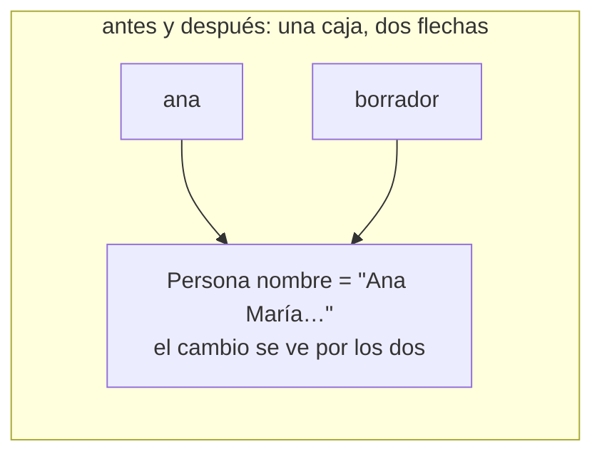
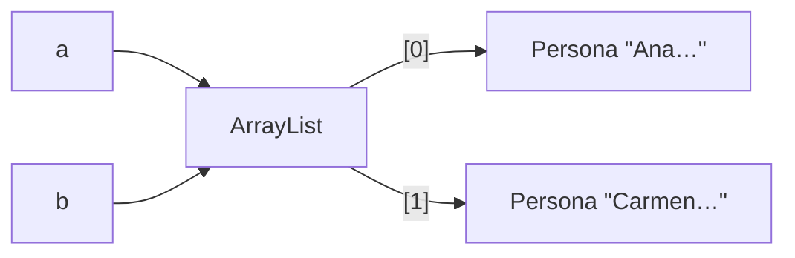
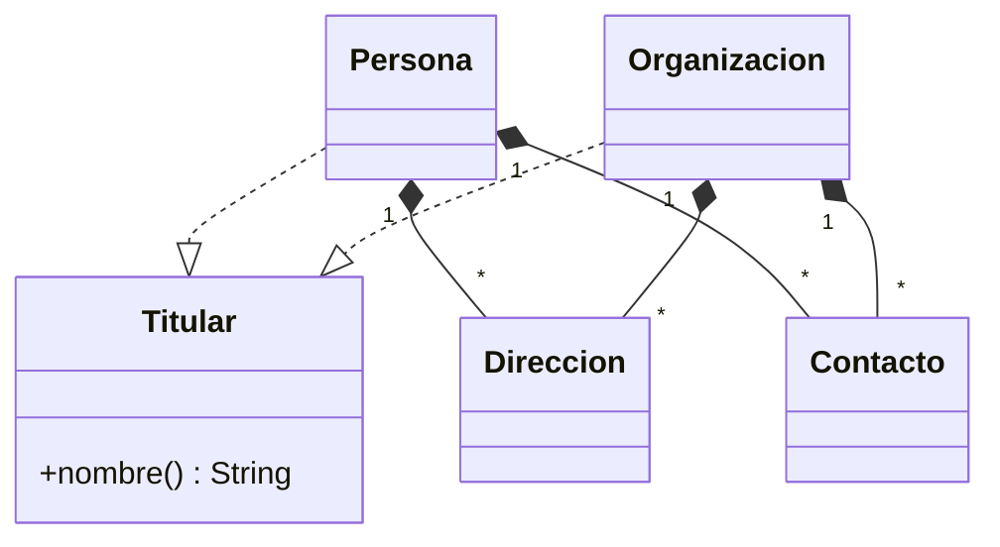
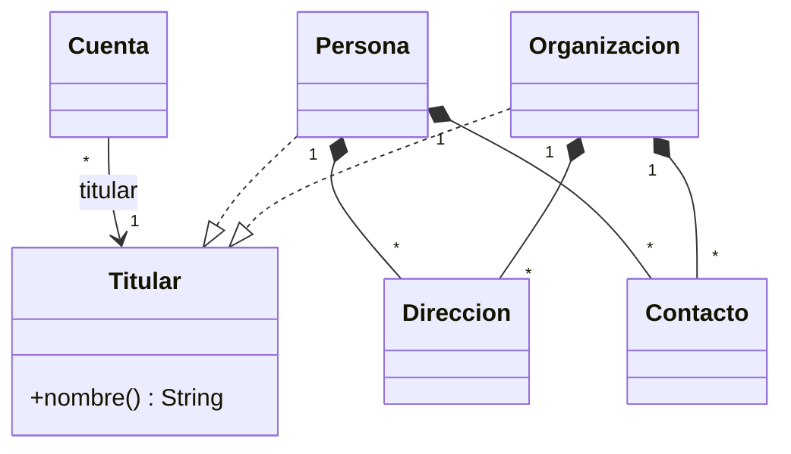

# 10 — Respuestas

> Solucionario del bloque `01-modelo-de-objetos`: Modelo de objetos. Cada respuesta en tres capas:
> **⏱️ 30 segundos** (lo que dices primero, sin que te lo pidan), **🗣️ 2 minutos** (lo que
> añades cuando dicen "cuéntame más") y **🔬 El detalle** (para estudiar, no para decir en voz
> alta). Los enunciados están copiados literalmente de su capítulo.
>
> **Vigencia:** 2026-10-03.
>
> **Versiones ejecutadas:** GCC 14.4 (C++23) · JDK 21.0.12, 17.0.20 y 25.0.4 · Spring Boot 4.1.1 (Spring Framework 7.0.9, Hibernate 7.4.5, H2 2.4.240) · Python 3.14.8 · mermaid-cli 11.17.0 (2026-10-04).

**Salto rápido:** [01](#01--identidad-estado-y-referencias) · [02](#02--igualdad-identidad-y-hash) · [03](#03--inmutabilidad-y-objetos-especiales) · [04](#04--copia-ciclo-de-vida-y-recursos) · [05](#05--polimorfismo-y-despacho) · [06](#06--herencia-vertical-y-horizontal) · [07](#07--genéricos-y-varianza) · [08](#08--la-ausencia-y-el-error-en-el-modelo) · [09](#09--simulación-de-entrevista)

---

# 01 — Identidad, estado y referencias

**01 → 1. ¿Qué tres cosas tiene un objeto, y cuál de ellas no cambia nunca? 🟢**

⏱️ Identidad, estado y comportamiento. La identidad no cambia nunca: es *cuál* objeto es.
🗣️ El estado son los valores de sus campos en este momento, y cambia si el objeto es mutable; el
comportamiento son sus métodos. Dos objetos con el mismo estado siguen siendo dos identidades: dos
`Persona` creadas con los datos de Ana no son la misma persona para el programa.
🔬 En Java la identidad es la referencia (`==`); en C++, la dirección (`&ana`). Que la identidad
importe o no en tu modelo es una decisión: en una entidad importa, en un objeto de valor como
`Dinero` deliberadamente no.

**01 → 2. En Java, ¿qué guarda una variable de tipo `Persona`? 🟢**

⏱️ Una referencia a un objeto `Persona` que vive en otro sitio, o `null`. La variable no es el
objeto.
🗣️ Por eso asignarla copia la flecha y no la caja, y por eso dos variables pueden llegar al mismo
objeto. Los primitivos son la excepción: `int`, `double` o `boolean` guardan el valor dentro.
🔬 La JLS lo llama *reference value*: un puntero a un objeto o la referencia nula (§4.3.1). Cómo se
representa en la máquina (puntero comprimido, dirección) no está especificado y no importa para
razonar.

**01 → 3. ¿Qué es el *aliasing*? Da un ejemplo con `Persona`. 🟢**

⏱️ Dos nombres para el mismo objeto: `Persona titular = ana;` deja a `titular` y `ana` apuntando a
la misma `Persona`.
🗣️ Lo que mutes por un nombre se ve por el otro, porque solo hay un objeto. `titular.cambiarNombre(...)`
cambia lo que devuelve `ana.nombre()`. El *aliasing* no es un error; el error es no saber que existe.
🔬 El caso caro no es el de dos variables locales, que se ve, sino el de un campo: una `Cuenta` que
guardó la `Persona` que le pasaste comparte estado contigo sin que el sitio de la llamada lo diga.

**01 → 4. ¿Qué copia la asignación `Persona borrador = ana;` en Java, y qué copia en C++? 🟢**

⏱️ En Java copia la referencia: un objeto, dos nombres. En C++ copia el objeto entero: dos objetos.
🗣️ Por eso el "borrador" de un formulario de edición funciona en C++ y no en Java: en Java editar
`borrador` es editar a `ana`. Es la misma línea con el significado contrario.
🔬 En C++ la copia la hace el constructor de copia, que el compilador genera si no lo escribes; si
`Persona` tiene un puntero crudo dentro, esa copia generada copia el puntero y comparte lo apuntado.
Eso es de `01/04`.

**01 → 5. ¿Qué compara `==` entre dos referencias en Java? 🟢**

⏱️ La identidad: si las dos referencias llevan al mismo objeto. No compara contenido.
🗣️ Dos `Persona` construidas con los mismos datos dan `false` con `==`. Para comparar contenido está
`equals`, que hay que sobrescribir con su contrato y junto con `hashCode`.
🔬 Con primitivos `==` compara valores; con un primitivo y su envoltorio (`int` contra `Integer`) hay
*unboxing* y compara valores, y puede lanzar `NullPointerException` si el `Integer` es `null`.

**01 → 6. ¿Qué es `null` en términos del diagrama de memoria? 🟢**

⏱️ Una variable sin flecha: la caja de la variable existe, pero no lleva a ningún objeto.
🗣️ `null` no es un objeto: no tiene tipo propio ni métodos. Por eso llamar un método sobre él lanza
`NullPointerException`: no hay caja a la que ir.
🔬 En C++ el equivalente es `nullptr`, pero solo para punteros: una referencia de C++ nunca puede ser
nula en un programa correcto, y un objeto por valor tampoco. Esa garantía en la firma es parte de por
qué C++ elige entre `const&` y puntero.

**01 → 7. ¿Cuáles son los cuatro pilares de la programación orientada a objetos, y qué es cada uno en una frase? 🟢**

⏱️ Abstracción, encapsulación, herencia y polimorfismo. Abstracción: mostrar lo esencial detrás de una
interfaz. Encapsulación: que el objeto proteja sus reglas. Herencia: un subtipo que cumple el contrato de su
base. Polimorfismo: que el mismo código trabaje con tipos distintos y decida el tipo.
🗣️ En el dominio: `Cuenta` conoce a su titular solo como `Titular` (abstracción); su saldo es privado y solo
cambia por `debitar` (encapsulación); `Persona` y `Organizacion` implementan `Titular` (herencia de tipo); y
`titular.nombre()` se resuelve al ejecutar según el tipo real (polimorfismo).
🔬 Lo que sube la nota es no detenerse en los nombres: decir la simplificación que se suele oír de cada uno
("encapsular es poner getters", "la herencia es para reutilizar", "polimorfismo es herencia") y por qué es
falsa. Cada pilar tiene su capítulo: encapsulación en `03/01`, herencia en `06`, polimorfismo en `05`.

**01 → 8. ¿Por qué es incorrecto decir que Java pasa los objetos por referencia? 🟡**

⏱️ Porque Java pasa todo por valor; lo que se copia, cuando el argumento es un objeto, es la
referencia.
🗣️ La prueba es reasignar el parámetro: `p = new Persona(...)` dentro del método no cambia a qué
apunta la variable de quien llamó. Con paso por referencia real, sí la cambiaría. Lo que confunde es
que mutar el objeto sí se ve fuera, porque las dos flechas llegan a la misma caja.
🔬 La JLS §8.4.1 dice que los valores de los argumentos inicializan variables de parámetro nuevas.
Hay quien lo llama "paso por compartición" (*call by sharing*), el término de Liskov para CLU; es la
misma idea con otro nombre.

**01 → 9. ¿Qué diferencia hay entre mutar un parámetro y reasignarlo dentro de un método Java? 🟡**

⏱️ Mutarlo cambia el objeto compartido y se ve fuera; reasignarlo mueve solo la copia local de la
referencia y fuera no se nota.
🗣️ `p.cambiarNombre("Ana María")` llega a la caja que también ve quien llamó. `p = otra` solo cambia a
dónde apunta `p` durante el método. Por eso un método no puede "cambiar el objeto que te pasaron por
otro", pero sí cambiarle el contenido.
🔬 Marcar el parámetro `final` impide la reasignación, que es inofensiva, y no impide la mutación, que
es la peligrosa. Lo único que protege contra la mutación es que el objeto sea inmutable.

**01 → 10. ¿Qué diferencia hay entre una referencia de C++ y una referencia de Java? 🟡**

⏱️ La de C++ es un alias que se ata a un objeto al nacer y no se puede volver a atar; la de Java es
una flecha que se puede mover y que puede ser `null`.
🗣️ En C++, asignar a través de una referencia (`p = carmen`) copia a Carmen dentro del objeto
referido. En Java, `p = carmen` mueve la flecha. Lo que en Java se parece a la referencia de C++ es
más bien un puntero que no admite aritmética.
🔬 Por eso C++ distingue en la firma entre `Persona&` (siempre hay objeto) y `Persona*` (puede ser
`nullptr` y se puede reapuntar). Java colapsa los dos casos en un solo tipo de variable.

**01 → 11. ¿Qué dice la firma `void imprimir(const Persona& p)` que una firma Java no puede decir? 🟡**

⏱️ Que el método no copia el objeto y que no lo va a modificar: el objeto de quien llama vuelve
intacto.
🗣️ El compilador lo comprueba: dentro de `imprimir` solo se pueden llamar métodos `const` de
`Persona`. En Java, `void imprimir(Persona p)` y `void renombrar(Persona p)` tienen la misma firma, y
saber cuál muta exige leer el cuerpo.
🔬 El `const` de C++ es superficial a través de punteros (un `const Persona&` cuyo campo es un
puntero no constante deja mutar lo apuntado) y se puede quitar con `const_cast`. Es una promesa
fuerte, no absoluta.

**01 → 12. ¿Por qué "pila o heap" y "valor o referencia" son preguntas distintas? 🟡**

⏱️ Porque la primera es dónde vive el objeto (su duración de almacenamiento) y la segunda es qué
copia una asignación. Se combinan de todas las formas.
🗣️ En C++ un `std::vector<Persona>` guarda valores y sus elementos viven en el heap; un objeto
automático vive en la pila y se puede pasar por referencia. En Java todo objeto vive conceptualmente
en el heap, pero la JVM, con *escape analysis*, puede evitar crear uno que no sale del método.
🔬 La respuesta que suena bien —"en C++ los objetos van en la pila"— es falsa en cuanto hay un `new`,
un `make_unique` o un contenedor estándar. Lo que distingue a C++ es la semántica de valor, no la
pila.

**01 → 13. Python y Java, ¿pasan los argumentos de la misma forma? ¿En qué se parece y en qué no a C#? 🟡**

⏱️ Sí: los dos pasan el objeto compartido, y reasignar el parámetro no cambia nada fuera. C# hace lo
mismo con las `class`, pero copia los `struct` y además tiene `ref`, `out` e `in`.
🗣️ Python lo llama "paso por asignación": el parámetro es un nombre nuevo ligado al mismo objeto. C#
tiene dos cosas que ninguno de los otros dos tiene: tipos de valor (`struct`) que se copian enteros, y
paso por referencia de verdad con `ref`, con el que sí se puede escribir un `intercambiar`.
🔬 La trampa propia de Python es el valor por defecto mutable: `def agregar(doc, docs=[])` evalúa la
lista una sola vez y la comparte entre todas las llamadas. La de C# es el `struct` mutable leído de
una lista: la lectura devuelve una copia y la mutación se pierde.

**01 → 14. ¿Qué diferencia hay entre abstracción y encapsulación? 🟡**

⏱️ La abstracción decide qué se muestra de un concepto (la interfaz); la encapsulación protege lo que no se
muestra (el estado y sus reglas).
🗣️ `Titular` con su `nombre()` es una abstracción: dice qué necesita saber `Cuenta` de quien la posee, sin
importar si es persona u organización. El saldo privado de `Cuenta`, que solo cambia por `debitar` con sus
comprobaciones, es encapsulación. Se puede tener una sin la otra: una interfaz bien pensada sobre una clase
con setters públicos abstrae y no encapsula.
🔬 En la práctica van juntas, y por eso se confunden: una buena abstracción hace fácil encapsular, porque la
interfaz expone operaciones (`debitar`) y no datos (`setSaldo`). Ousterhout lo cuenta como "ocultamiento de
información": lo que no aparece en la interfaz no puede filtrarse.

**01 → 15. ¿Por qué no se puede escribir en Java un `intercambiar(Persona a, Persona b)` que intercambie las variables de quien llama? 🟠**

⏱️ Porque el método recibe copias de las referencias: puede intercambiar sus copias, pero las
variables de quien llama siguen apuntando a donde apuntaban.
🗣️ Intercambiar exige reasignar las variables del llamador, y eso solo lo permite el paso por
referencia. Lo que sí puedes hacer es intercambiar el *contenido* de los dos objetos, mutándolos, que
es otra operación y casi nunca la que se quiere. Es la demostración más corta de que Java pasa por
valor.
🔬 Las salidas en Java: devolver el par (un `record Par(Persona a, Persona b)`), o envolver en un
contenedor mutable (un arreglo de dos posiciones). En C++ basta `std::swap(a, b)` con referencias, y en
C# un método con `ref`.

**01 → 16. Una `Cuenta` guarda en un campo la `Persona` titular que le pasaron en el constructor. ¿Qué riesgo corre y cuándo no importa? 🟠**

⏱️ Comparte estado con quien la creó: si ese código muta la `Persona` después, la cuenta ve el
cambio sin que nadie la haya tocado.
🗣️ Que la cuenta vea el nombre actualizado del titular puede ser justo lo que se quiere, porque la
persona es una entidad y es la misma. Lo que no se quiere es que alguien deje a la cuenta en un
estado inválido desde fuera. No importa si `Persona` es inmutable, o si la relación es de verdad una
referencia a una entidad compartida y se acepta a propósito.
🔬 Para objetos de valor mutables (una `Direccion` mutable, una `List`), la respuesta estándar es la
copia defensiva al recibir (Bloch, ítem 50). Para entidades, la respuesta suele ser guardar el
identificador o aceptar el *aliasing* y proteger los invariantes dentro de `Persona`.

**01 → 17. ¿Por qué `p = carmen;` dentro de `void f(Persona& p)` en C++ no hace lo mismo que dentro de `void f(Persona p)` en Java? 🟠**

⏱️ En C++ `p` es un alias del objeto de quien llama, así que `p = carmen` copia a Carmen dentro de ese
objeto. En Java `p` es una copia de la flecha, y `p = carmen` solo mueve esa copia.
🗣️ Resultado: en C++ la variable del llamador ahora tiene el estado de Carmen; en Java la variable
del llamador no se enteró. La sintaxis es la misma y el efecto es opuesto, como pasaba con la
asignación.
🔬 Ese `p = carmen` en C++ llama al operador de asignación de copia de `Persona`; si `Persona` lo tiene
borrado (`= delete`), la línea no compila. Una referencia de C++ no se puede reatar: no hay sintaxis
para ello.

**01 → 18. ¿Cuándo pasarías por valor un objeto en C++, aunque no sea pequeño? 🟠**

⏱️ Cuando el método se lo va a quedar de todas formas: lo recibes por valor y lo mueves con
`std::move` a su destino.
🗣️ Así quien llama decide: si te pasa un temporal, se mueve sin copiar; si te pasa una variable que
sigue usando, se copia una vez, que es la copia que de todos modos ibas a hacer. Una sola firma cubre
los dos casos, en lugar de una sobrecarga para `const&` y otra para `&&`.
🔬 Es el ítem 41 de *Effective Modern C++*, con su letra pequeña: tiene sentido si el tipo es barato
de mover y siempre se copia; si el método solo a veces se lo queda, `const&` es mejor.

**01 → 19. ¿Qué protege a quien llama un método Java de que le muten el objeto, si la firma no lo dice? 🟠**

⏱️ Que el objeto sea inmutable. Si no lo es, solo la documentación o una copia hecha por quien llama.
🗣️ Java no tiene `const` en los parámetros, y `final` en el parámetro solo impide reasignarlo. Las
opciones son pasar un objeto inmutable (un `record` con campos inmutables, un `String`), pasar una
copia, o una vista no modificable de una colección.
🔬 La vista no modificable protege de la mutación por esa vía, pero no es inmutable: si el original
cambia, la vista cambia. La diferencia entre "no modificable" e "inmutable" es de `01/03`.

**01 → 20. Go copia los `struct` al asignarlos y C++ también. ¿Qué detalle de Go hace que esa copia comparta estado igual? 🟠**

⏱️ Que un *slice* o un mapa dentro del `struct` es un descriptor que apunta a datos compartidos: la
copia del `struct` copia el descriptor, no los datos.
🗣️ Copias una `Persona` de Go con un campo `Documentos []Documento` y las dos copias ven el mismo
arreglo subyacente: modificar un elemento por una se ve por la otra. Es una copia superficial con
apariencia de copia de valor.
🔬 En C++ un `std::vector` miembro se copia entero, porque su constructor de copia es profundo; por
eso en C++ la copia de valor sí aísla, salvo que haya punteros crudos o `shared_ptr` dentro.

**01 → 21. ¿Por qué la herencia es el pilar más prescindible de los cuatro? Da un lenguaje que lo demuestre y di qué usa en su lugar. 🟠**

⏱️ Porque lo que aporta —reutilizar código y expresar subtipos— se consigue con composición y con interfaces,
sin el acoplamiento de la herencia de implementación. Go no tiene herencia y es orientado a objetos.
🗣️ Go usa interfaces implícitas para el polimorfismo (un tipo cumple una interfaz si tiene sus métodos, sin
declararlo) y *embedding* para reutilizar campos y métodos, que es composición con azúcar sintáctico. La
abstracción y la encapsulación (por paquete) siguen ahí.
🔬 Rust tampoco tiene herencia de implementación: usa *traits*. Y en Java y C++ la recomendación habitual
—"composición antes que herencia"— apunta en la misma dirección. Ver `06`.

**01 → 22. ¿Coincide la lista de los cuatro pilares con los elementos del modelo de objetos de Booch? ¿Qué gana tu respuesta si lo dices? 🟠**

⏱️ No del todo: Booch cuenta cuatro elementos mayores —abstracción, encapsulación, modularidad y jerarquía— y
tres menores: tipificación, concurrencia y persistencia. Herencia y polimorfismo no aparecen con ese nombre
entre los mayores.
🗣️ Decirlo muestra que conoces la fuente y no solo la lista de examen, y deja claro que "los cuatro pilares"
es una simplificación didáctica. La herencia, en Booch, es una forma de jerarquía; y la modularidad, que la
lista popular olvida, es la base de todo lo que se dice sobre acoplamiento y cohesión.
🔬 Alan Kay, que acuñó "programación orientada a objetos", la resumió en 2003 como mensajes, protección local
del estado y ligadura tardía extrema, sin herencia. Con dos fuentes que no coinciden con la lista, la
respuesta madura es "los cuatro pilares son una forma útil de empezar, no una definición".

**01 → 23. Dibuja el diagrama de memoria del formulario de §1 en Java, antes y después de `borrador.cambiarNombre(...)`, y arréglalo para que "Cancelar" funcione. 🔴**

⏱️ Antes y después hay una sola caja con dos flechas, `ana` y `borrador`; el cambio de nombre aparece
en esa caja. El arreglo es crear una copia de verdad para el borrador, o editar un objeto inmutable.
🗣️



```java
Persona borrador = Persona.copiaDe(ana);        // fábrica de copia: otra caja
borrador.cambiarNombre("Ana María Rojas Medina");
if (usuarioConfirma()) {
    ana.aplicarCambios(borrador);               // solo al confirmar se toca el original
}
```

🔬 La alternativa sin copias: que `Persona` del formulario sea un objeto inmutable y que `conNombre`
devuelva uno nuevo; "Cancelar" es simplemente no usarlo. El entrevistador preguntará después por la
profundidad de la copia: si `Persona` tiene una lista de documentos, `copiaDe` decide si la comparte o
la copia (`01/04`).

**01 → 24. Escribe en C++ las cuatro firmas posibles de un método que recibe una `Persona`, y di qué promete cada una a quien llama. 🔴**

⏱️ Por valor, `const&`, `&` y puntero: copia propia, lectura sin copia, mutación del original, y
"puede no venir".
🗣️

```cpp
void guardar(Persona p);                    // tengo mi copia: tu objeto no cambia
void imprimir(const Persona& p);            // leo el tuyo sin copiar: vuelve intacto
void renombrar(Persona& p, std::string n);  // modifico el tuyo: es el propósito del método
void asignarTutor(const Persona* tutor);    // puede ser nullptr: "sin tutor" es válido
```

🔬 Lo que preguntarán después: la quinta firma, `Persona&&` (me das un temporal y me lo quedo), y por
qué casi nunca se escribe a mano fuera de los constructores y asignaciones de movimiento; y por qué
para "puede no venir" un `std::optional<Persona>` o un `const Persona*` dicen cosas distintas sobre la
propiedad.

**01 → 25. Este código debía dejar a Luis sin tutor y no lo hace. Encuentra el error y corrígelo: `static void quitarTutor(Persona tutor) { tutor = null; }` llamado como `quitarTutor(luis.tutor());`. 🔴**

⏱️ El método reasigna su copia local de la referencia; el campo `tutor` de Luis sigue apuntando a
Ana. Hay que cambiar el campo, y eso solo lo puede hacer el objeto que lo tiene.
🗣️

```java
// en Persona: el dueño del campo es quien lo cambia
void quitarTutor() {
    this.tutor = null;   // aquí sí: se modifica el campo del objeto, no una copia
}

luis.quitarTutor();
```

🔬 Lo que el entrevistador preguntará después: si un menor puede quedarse sin tutor. El invariante
"un menor debe tener tutor" haría que `quitarTutor` lanzara una excepción para Luis; ese invariante
que cruza objetos es de [`03/05` — Diseño por contrato y *fail fast*](../03-principios-de-diseno/05-diseno-por-contrato.md). Y si el modelo representa "sin tutor" con `null` o con un
`Optional<Persona>` en el getter, que es de `01/08`.

**01 → 26. Dibuja la memoria tras `List<Persona> a = new ArrayList<>(List.of(ana)); List<Persona> b = a; b.add(carmen);` y di qué tiene `a`. 🔴**

⏱️ `a` y `b` apuntan a la misma lista, así que `a` tiene a Ana y a Carmen.
🗣️



La lista tampoco contiene las personas: contiene referencias a ellas. Hay *aliasing* en dos niveles:
dos variables para una lista, y la lista compartiendo objetos con quien tenga a `ana`.
🔬 Con `List<Persona> b = new ArrayList<>(a);` habría dos listas que comparten las mismas `Persona`:
una copia superficial. El `List.of(ana)` intermedio es inmutable, pero `new ArrayList<>(...)` lo
copia en una lista mutable, y por eso `add` funciona.

# 02 — Igualdad, identidad y hash

**02 → 1. ¿Qué diferencia hay entre identidad e igualdad de valor? 🟢**

⏱️ La identidad dice "es el mismo objeto"; la igualdad de valor dice "representan lo mismo". En Java,
`==` y `equals`.
🗣️ Dos lecturas de la cédula de Ana desde dos fuentes son dos objetos con identidades distintas que
representan el mismo documento. Qué cuenta como "lo mismo" lo decide quien diseña la clase, al
sobrescribir `equals`.
🔬 En C++ la identidad es la dirección (`&a == &b`) y la igualdad de valor es `operator==`, que no
existe hasta que lo defines o lo pides con `= default`.

**02 → 2. ¿Qué hace `Object.equals` si no lo sobrescribes? 🟢**

⏱️ Compara identidad: es exactamente `this == obj`.
🗣️ Por eso un `HashSet` de objetos sin `equals` sobrescrito nunca detecta duplicados por contenido:
dos objetos son siempre dos. Para servicios, repositorios o recursos es lo correcto.
🔬 `Object.hashCode` por defecto es coherente con esa igualdad: suele derivarse de la identidad del
objeto, y no cambia mientras el objeto vive aunque el GC lo mueva.

**02 → 3. Enumera las cinco cláusulas del contrato de `equals`. 🟢**

⏱️ Reflexiva, simétrica, transitiva, consistente, y `x.equals(null)` devuelve `false`.
🗣️ Reflexiva: todo objeto es igual a sí mismo. Simétrica: si `x` es igual a `y`, `y` es igual a `x`.
Transitiva: si `x = y` y `y = z`, entonces `x = z`. Consistente: el resultado no cambia mientras no
cambien los campos usados. Y con `null`, `false` sin lanzar excepción.
🔬 Las que se rompen en la práctica son la simétrica (clase y subclase con `instanceof`) y la
consistente (un `equals` que consulta algo externo, como una URL que se resuelve por red: es lo que
hace `java.net.URL.equals`, y es un ejemplo clásico de diseño equivocado en el propio JDK).

**02 → 4. ¿Qué exige el contrato de `hashCode` respecto de `equals`? 🟢**

⏱️ Que dos objetos iguales según `equals` tengan el mismo `hashCode`.
🗣️ Al revés no se exige: dos objetos distintos pueden compartir hash. Además, el hash debe ser estable
mientras no cambien los campos que usa `equals`.
🔬 La Javadoc añade que no hace falta que el hash sea el mismo entre dos ejecuciones del programa; por
eso no se debe persistir un `hashCode` ni usarlo como identificador.

**02 → 5. ¿Qué es una colisión de hash, y es un error? 🟢**

⏱️ Dos objetos distintos con el mismo hash. No es un error: es inevitable y la tabla lo resuelve.
🗣️ Hay muchos más objetos posibles que valores de `int`, así que las colisiones existen siempre.
`HashMap` las resuelve guardando varios elementos en el mismo cubo y distinguiéndolos con `equals`.
🔬 Lo que sí es un problema es un hash que colisiona *mucho*, porque convierte la búsqueda en lineal.
Desde Java 8, un cubo con muchas colisiones se convierte en árbol si las claves son `Comparable`.

**02 → 6. ¿Qué campos usarías en la igualdad de `Documento`, y por qué no el vencimiento? 🟢**

⏱️ Tipo, número y país emisor: la clave natural. El vencimiento no, porque renovar un pasaporte no lo
convierte en otro documento.
🗣️ La pregunta para cada campo es "si este campo cambia, ¿es otro objeto?". El número sí; la fecha
de vencimiento no. Además, los campos de la igualdad deben ser inmutables, y el vencimiento cambia.
🔬 El país emisor entra porque dos países pueden emitir el mismo número. Si `TipoDocumento` ya lleva
su país (`PAS-CO`), el país es redundante en la clave, pero incluirlo no hace daño y protege contra un
tipo de documento compartido entre países.

**02 → 7. ¿En qué orden usa `HashMap` los métodos `hashCode` y `equals` al buscar una clave? 🟡**

⏱️ Primero `hashCode`, para elegir el cubo; después `equals`, contra cada elemento de ese cubo.
🗣️ Los demás cubos ni se miran. Por eso, si dos objetos iguales tienen hashes distintos, `equals`
nunca llega a compararlos y el mapa no los encuentra.
🔬 La implementación compara primero el hash almacenado de cada entrada y la identidad (`==`) antes de
llamar a `equals`, como atajo. Por eso un `equals` lento se nota poco en un mapa bien repartido.

**02 → 8. ¿Qué diferencia hay entre `instanceof` y `getClass()` en un `equals`? 🟡**

⏱️ `instanceof` acepta subclases; `getClass()` exige exactamente la misma clase.
🗣️ Con `instanceof`, si una subclase añade campos a la igualdad, se rompe la simetría. Con
`getClass()`, la simetría se salva, pero una subclase nunca es igual a su clase base con los mismos
datos, y eso rompe la sustitución que promete la herencia.
🔬 Ninguna de las dos resuelve el problema de fondo, que es extender una clase con igualdad de valor.
`instanceof` es la elección correcta cuando la clase es `final`, que es lo recomendable.

**02 → 9. ¿Qué diferencia hay entre `equals` y `compareTo` en `BigDecimal`? 🟡**

⏱️ `equals` compara valor y escala; `compareTo` solo el valor numérico. `1.0` y `1.00` no son `equals`
y su `compareTo` es 0.
🗣️ Su Javadoc lo dice: el orden natural de `BigDecimal` es incoherente con `equals`. Las consecuencias
aparecen en las colecciones: `HashSet` usa `equals` y `TreeSet` usa `compareTo`.
🔬 La escala es parte de la información: `1.00` dice "precisión de centésimas". Por eso `BigDecimal`
la respeta en `equals`. Para comparar montos, `compareTo`, o normalizar la escala antes.

**02 → 10. ¿Qué genera un `record` para la igualdad, y sobre qué campos? 🟡**

⏱️ `equals` y `hashCode` sobre **todos** sus componentes, comparando cada uno con su propio `equals`.
🗣️ Es la igualdad de valor hecha bien por el compilador, y además el `record` es `final`, así que el
problema de la herencia no existe. No se puede excluir un componente: si un campo no debe entrar, no
es un `record` o se escribe `equals` a mano.
🔬 "Con su propio `equals`" significa que un componente `BigDecimal` compara escala, uno de tipo
arreglo compara identidad (los arreglos no sobrescriben `equals`), y uno `List` compara elemento a
elemento. Los `record` existen desde Java 16, así que valen igual en 17 y 21.

**02 → 11. ¿Qué diferencia hay entre `bool operator==(const Documento&) const = default;` y escribirlo a mano? 🟡**

⏱️ `= default` compara todos los miembros en orden de declaración; a mano eliges cuáles.
🗣️ Para un valor puro como `Dinero` (monto y moneda), `= default` es exactamente lo correcto. Para
`Documento`, con un vencimiento que no es parte de la identidad, `= default` lo incluiría, y dos
lecturas del mismo pasaporte con fechas distintas dejarían de ser iguales.
🔬 `= default` existe desde C++20, junto con `operator<=>`. Si declaras `<=>` por defecto, el
compilador también genera `==`. Y `!=` se reescribe a partir de `==` sin escribirlo.

**02 → 12. Olvidar el hash en Java compila. ¿Qué pasa si lo olvidas en C++ y en Python? 🟡**

⏱️ En C++ no compila: `std::unordered_set<Documento>` exige `std::hash<Documento>`. En Python, definir
`__eq__` sin `__hash__` deja el objeto sin hash, y usarlo como clave lanza `TypeError`.
🗣️ Los dos fallan hacia lo seguro: te impiden usar el objeto como clave. Java y C# fallan en silencio,
con un mapa que no encuentra lo que contiene.
🔬 En Python la regla es explícita en la documentación: una clase que sobrescribe `__eq__` y no define
`__hash__` recibe `__hash__ = None`. Un `@dataclass(frozen=True)` genera los dos.

**02 → 13. ¿Por qué en JavaScript dos objetos con el mismo contenido son dos claves distintas de un `Map`, y cómo se resuelve? 🟡**

⏱️ Porque `Map` y `Set` comparan claves por identidad (*SameValueZero*), y JavaScript no tiene un
protocolo de igualdad de valor para objetos.
🗣️ No hay un `equals` que sobrescribir. La salida habitual es fabricar una clave primitiva, como el
`string` `"CC|1020304050|CO"`, y usar el objeto como valor.
🔬 *SameValueZero* es casi `===`, salvo que `NaN` es igual a `NaN`. Hay una propuesta de tipos de
valor nativos (*records and tuples*) que lleva años sin llegar al lenguaje; no cuentes con ella.

**02 → 14. ¿Por qué sobrescribir solo `equals` hace que un `HashSet` siga aceptando duplicados? 🟠**

⏱️ Porque el `hashCode` heredado es por identidad: dos objetos iguales caen en cubos distintos y
`equals` nunca llega a compararlos.
🗣️ `HashSet.add` calcula el hash, va a ese cubo y busca con `equals` solo ahí. La segunda cédula cae
en otro cubo, no encuentra a la primera y entra. El código compila, `equals` está bien escrito, y el
conjunto tiene duplicados.
🔬 Por casualidad dos objetos pueden caer en el mismo cubo, y entonces el duplicado sí se detecta: el
bug es intermitente según el tamaño de la tabla, lo que lo hace más difícil de encontrar.

**02 → 15. ¿Por qué un `hashCode` que devuelve siempre la misma constante es correcto, y por qué es una mala idea? 🟠**

⏱️ Es correcto porque cumple el contrato: objetos iguales tienen el mismo hash. Es mala idea porque
mete todo en un cubo y la búsqueda deja de ser constante.
🗣️ Con todo en un cubo, cada búsqueda compara con `equals` contra todos los elementos: el `HashMap` se
comporta como una lista. Desde Java 8, ese cubo se convierte en árbol si las claves son `Comparable`,
y la búsqueda pasa a ser logarítmica, que sigue siendo peor.
🔬 Es la prueba de que "cumplir el contrato" y "estar bien" son cosas distintas. Un hash bueno reparte
y es barato de calcular; `Objects.hash` reparte bien, aunque crea un arreglo en cada llamada.

**02 → 16. ¿Por qué no se puede extender una clase instanciable añadiendo un campo a la igualdad sin romper el contrato? 🟠**

⏱️ Porque o se rompe la simetría (con `instanceof`) o se rompe la sustitución (con `getClass()`), y
no hay una tercera forma.
🗣️ Con `instanceof`, la clase base dice "igual" ignorando el campo nuevo y la subclase dice "distinto".
Si intentas que la subclase ignore el campo cuando compara con la base, rompes la transitividad: dos
subclases distintas serían iguales a la misma base y distintas entre sí. Con `getClass()`, una
subclase nunca es igual a la base, y un `Set` de la base deja de tratarlas como intercambiables.
🔬 Es el argumento del ítem 10 de *Effective Java*. Las salidas son componer (la subclase pasa a
*tener* un objeto de la base) o hacer `final` la clase con igualdad. Los `record` lo resuelven siendo
`final`.

**02 → 17. ¿Qué tamaño tienen un `HashSet` y un `TreeSet` construidos con `new BigDecimal("1.0")` y `new BigDecimal("1.00")`, y por qué? 🟠**

⏱️ El `HashSet` tiene 2 y el `TreeSet` tiene 1.
🗣️ `HashSet` decide duplicados con `equals`, que en `BigDecimal` compara la escala: son distintos.
`TreeSet` decide con `compareTo`, que solo mira el valor: son el mismo. El mismo par de objetos, dos
conjuntos, dos tamaños.
🔬 La interfaz `Set` define el contrato en términos de `equals`, y `TreeSet` lo incumple
deliberadamente cuando el orden es incoherente con `equals`; su Javadoc lo advierte. El mismo
problema afecta a `TreeMap` contra `HashMap`.

**02 → 18. ¿Qué problema tiene `record Dinero(BigDecimal monto, Currency moneda)` en un `HashSet`, y cómo lo arreglas? 🟠**

⏱️ El `equals` generado usa `BigDecimal.equals`, que compara escala: 1500.0 y 1500.00 en la misma
moneda serían dos `Dinero` distintos.
🗣️ El arreglo es normalizar en el constructor compacto: fijar la escala de la moneda (dos decimales
para COP y USD) con un redondeo explícito. Así dos montos iguales tienen la misma representación, y
el `equals` y el `hashCode` generados son correctos.

```java
record Dinero(BigDecimal monto, Currency moneda) {
    Dinero {
        monto = monto.setScale(moneda.getDefaultFractionDigits(), RoundingMode.HALF_EVEN);
    }
}
```

🔬 La alternativa, escribir `equals` con `compareTo` y `hashCode` con `stripTrailingZeros()`, funciona
pero es más frágil. Normalizar al construir tiene una ventaja extra: el monto con escala fija es el
que se muestra y se guarda.

**02 → 19. ¿Por qué un identificador asignado por la base de datos al guardar es mala base para `hashCode`? 🟠**

⏱️ Porque el objeto cambia de hash al guardarse: si estaba en un `HashSet` antes de persistirlo, deja
de encontrarse.
🗣️ Es la clave mutable con otra forma: el `id` pasa de `null` a un número. Y dos objetos nuevos sin
guardar tendrían el mismo `id` nulo y serían "iguales". Las salidas: asignar el identificador al crear
el objeto (un UUID o un `PersonaId` generado en el dominio), o un `hashCode` constante por clase con
`equals` por `id` no nulo, que es lo que se suele recomendar con JPA.
🔬 Con JPA el problema se agrava porque el mismo registro puede estar representado por objetos
distintos fuera de la sesión. Qué garantiza el `EntityManager` dentro de la sesión es tema de
[`07/03`](../07-fowler-dominio-y-datos/03-comportamiento-objeto-relacional.md).

**02 → 20. ¿Qué igualdad le darías a `Persona`, que no tiene clave natural fiable? 🟠**

⏱️ Un identificador asignado al crearla (`PersonaId`), o la identidad pura si no se guarda en
colecciones por contenido.
🗣️ Nombre y fecha de nacimiento no sirven: se repiten y además cambian. Un documento sí identifica a
una persona, pero una persona tiene varios y puede cambiarlos. Lo robusto es un identificador propio,
inmutable, asignado en el constructor.
🔬 Es la diferencia entre entidad y objeto de valor: la entidad tiene una identidad que sobrevive a
los cambios de su estado. Esa distinción es el tema del capítulo de entidades y valores del bloque de
modelado.

**02 → 21. ¿Por qué la mutabilidad de un campo que no entra en `equals` no es un problema para el `HashSet`? 🟠**

⏱️ Porque el `HashSet` solo depende del hash y de `equals`; si el campo no entra en ninguno, cambiarlo
no mueve el objeto de cubo ni cambia con quién es igual.
🗣️ Renovar el vencimiento de un pasaporte metido en un `HashSet` es inofensivo: su clave sigue siendo
la misma. Lo peligroso es mutar los campos de la igualdad.
🔬 Esto vale para el `HashSet`; si además el objeto está en un `TreeSet` ordenado por vencimiento,
mutar el vencimiento sí lo corrompe, porque ahí el campo decide el orden.

**02 → 22. ¿Cuándo es correcto no sobrescribir `equals` en absoluto? 🟠**

⏱️ Cuando la identidad es la igualdad correcta: servicios, repositorios, recursos, y entidades sin
clave que no se guardan en colecciones por contenido.
🗣️ Un `RepositorioPersonas` o una conexión no tienen "valor": dos instancias son dos cosas. Sobrescribir
`equals` ahí solo añade código que mantener y una igualdad que nadie sabe qué significa.
🔬 También los enums: su igualdad es la identidad por diseño, y `Enum.equals` es `final`. Si dudas,
pregúntate si tiene sentido que dos instancias distintas sean "la misma"; si la respuesta es no, deja
la identidad.

**02 → 23. Escribe `equals` y `hashCode` de `Documento` en Java y di qué campos usas. 🔴**

⏱️ Tipo, número y país emisor, finales; la clase, `final`; el hash sobre los mismos tres campos.
🗣️

```java
public final class Documento {
    private final TipoDocumento tipo;
    private final String numero;
    private final Pais emisor;
    private LocalDate vencimiento;

    @Override
    public boolean equals(Object o) {
        if (this == o) return true;
        if (!(o instanceof Documento otro)) return false;
        return tipo.equals(otro.tipo) && numero.equals(otro.numero) && emisor.equals(otro.emisor);
    }

    @Override
    public int hashCode() {
        return Objects.hash(tipo, numero, emisor);
    }
}
```

🔬 Lo que preguntarán después: por qué `instanceof` y no `getClass()` (porque es `final`); qué pasa si
`TipoDocumento` no sobrescribe `equals` (vale solo si las instancias son compartidas); y si el
constructor valida que ningún campo sea `null`, que es lo que permite no comprobarlo en `equals`.

**02 → 24. Escribe la igualdad y la especialización de `std::hash` de `Documento` en C++ para usarlo en un `std::unordered_set`. 🔴**

⏱️ Un `operator==` sobre tipo, número y emisor, y una especialización de `std::hash` que combine los
hashes de esos tres miembros.
🗣️

```cpp
struct Documento {
    std::string tipo, numero, emisor;
    std::chrono::year_month_day vencimiento;
    bool operator==(const Documento& o) const {
        return tipo == o.tipo && numero == o.numero && emisor == o.emisor;
    }
};

namespace std {
template <> struct hash<Documento> {
    size_t operator()(const Documento& d) const noexcept {
        size_t h = hash<string>{}(d.tipo);
        h = h * 31 + hash<string>{}(d.numero);
        return h * 31 + hash<string>{}(d.emisor);
    }
};
}

std::unordered_set<Documento> vistos;
```

🔬 Lo que preguntarán después: la alternativa de pasar el *hasher* como tercer argumento de plantilla
(`std::unordered_set<Documento, HashDocumento>`) sin tocar `namespace std`; por qué no hay
`hash_combine` estándar (Boost tiene uno); y por qué aquí no sirve `= default`.

**02 → 25. Un pasaporte metido en un `HashSet` deja de encontrarse después de corregir su número. Explica qué pasó en el conjunto y corrige el diseño. 🔴**

⏱️ Al corregir el número cambió el hash con el objeto dentro: el pasaporte quedó en el cubo del hash
viejo, y las búsquedas van al cubo del hash nuevo.
🗣️ `size()` sigue en 1 y ni `contains` ni `remove` lo encuentran. El diseño correcto hace inmutables
los campos de la igualdad, y corregir es reemplazar:

```java
private final String numero;
public Documento conNumero(String corregido) {
    return new Documento(tipo, corregido, emisor, vencimiento);
}
persona.reemplazarDocumento(pasaporte, pasaporte.conNumero("AQ482916"));
```

🔬 Si el diseño no se puede cambiar, el parche es sacar el objeto del conjunto **antes** de mutarlo y
volver a meterlo después. Funciona y es frágil: depende de que todo el que mute se acuerde. Lo mismo
pasa con las claves de `HashMap` y con los campos de orden en `TreeSet`.

**02 → 26. `DocumentoVerificado extends Documento` añade la fecha de verificación a `equals` con `instanceof`. Muestra con dos objetos qué cláusula se rompe y propón el diseño correcto. 🔴**

⏱️ Se rompe la simetría: `cedula.equals(verificada)` es `true` y `verificada.equals(cedula)` es
`false`. El diseño correcto compone en lugar de heredar.
🗣️ `cedula` es un `Documento` y `verificada` un `DocumentoVerificado` con la misma clave. El `equals`
de `Documento` acepta la subclase y no mira la fecha; el de la subclase rechaza a la base porque no es
un `DocumentoVerificado`.

```java
public record Verificacion(Documento documento, LocalDate fecha) { }   // tiene un Documento
```

🔬 Lo que preguntarán después: si `getClass()` lo arregla (arregla la simetría y rompe la sustitución);
y si la fecha de verificación debería estar en la igualdad (probablemente no: verificar el documento
no lo convierte en otro, y entonces basta con un campo mutable fuera de `equals`).

**02 → 27. Escribe `Dinero` en Java de modo que `equals`, `hashCode` y `compareTo` sean coherentes. 🔴**

⏱️ Un `record` que normaliza la escala en el constructor compacto y compara montos solo dentro de la
misma moneda.
🗣️

```java
public record Dinero(BigDecimal monto, Currency moneda) implements Comparable<Dinero> {
    public Dinero {
        Objects.requireNonNull(moneda);
        monto = monto.setScale(moneda.getDefaultFractionDigits(), RoundingMode.HALF_EVEN);
    }

    @Override
    public int compareTo(Dinero otro) {
        if (!moneda.equals(otro.moneda)) {
            throw new IllegalArgumentException("monedas distintas: " + moneda + " y " + otro.moneda);
        }
        return monto.compareTo(otro.monto);   // misma escala: coherente con equals
    }
}
```

🔬 Lo que preguntarán después: por qué `compareTo` lanza con monedas distintas en lugar de ordenarlas
(porque comparar 100 COP con 100 USD no tiene sentido sin tipo de cambio); si es correcto redondear al
construir (es una decisión: rechazar montos con más decimales es la alternativa estricta); y por qué
no `double` (no representa exactamente 0,10).

**02 → 28. Revisa este `equals` y di qué cláusulas viola: `public boolean equals(Object o) { Documento d = (Documento) o; return numero.equals(d.numero); }`. 🔴**

⏱️ Viola la cláusula de `null` y lanza con otros tipos; además usa solo el número, así que dos
documentos de tipos distintos con el mismo número serían iguales.
🗣️ Con `null`, el *cast* pasa y `d.numero` lanza `NullPointerException`; el contrato pide `false`. Con
un objeto de otro tipo lanza `ClassCastException`, y el contrato pide `false` para cualquier objeto no
igual. La clave incompleta no viola el contrato, pero es un error de diseño: la cédula `1020304050` y
una tarjeta de identidad con ese número serían el mismo documento.
🔬 Y falta lo que no se ve: si el `hashCode` no se sobrescribió junto con este `equals`, el mapa ya
está roto. La corrección es la de la pregunta 23: `instanceof` con patrón, los tres campos de la
clave, y `hashCode` sobre los mismos.

# 03 — Inmutabilidad y objetos especiales

**03 → 1. ¿Qué significa que un objeto sea inmutable? 🟢**

⏱️ Que su estado observable no cambia después de construirse: "modificarlo" es crear otro.
🗣️ Ni quien lo tiene ni el propio objeto pueden cambiarlo. Por eso se puede compartir sin copiar,
usar como clave de mapa y pasar entre hilos.
🔬 "Observable" importa: `String` cachea su hash en un campo que se escribe después de construirse, y
sigue siendo inmutable porque nadie puede observar la diferencia. La inmutabilidad es un contrato de
comportamiento, no una propiedad de cada campo.

**03 → 2. Enumera tres virtudes de un objeto inmutable. 🟢**

⏱️ Se comparte sin miedo, sirve como clave de mapa y es seguro entre hilos sin sincronizar.
🗣️ Y dos más: atomicidad ante fallos (una operación que falla no lo deja a medias) y razonamiento
local (lo que ves al construirlo es lo que hay siempre). La primera es la que resuelve el problema de
la dirección compartida entre Ana y Luis.
🔬 "Seguro entre hilos" exige que el objeto esté bien construido y publicado: campos `final` y que
`this` no escape del constructor. Con eso, el modelo de memoria de Java garantiza que otro hilo vea
los campos inicializados.

**03 → 3. ¿Qué impide `final` en un campo, y qué no impide? 🟢**

⏱️ Impide reasignar el campo; no impide mutar el objeto al que apunta.
🗣️ `private final List<Documento> documentos` no deja escribir `documentos = otraLista`, pero deja
`documentos.add(...)`. `final` hace inmutable la referencia, no el objeto.
🔬 Para primitivos y para tipos inmutables, `final` sí basta, porque no hay objeto mutable detrás. Y
`final` tiene además un efecto en concurrencia: garantiza la visibilidad del valor inicial a otros
hilos sin sincronización.

**03 → 4. ¿Por qué `String` es inmutable? Da dos motivos. 🟢**

⏱️ Seguridad, porque un valor validado no puede cambiar antes de usarse; y que se puede compartir y
usar como clave, con el hash calculado una sola vez.
🗣️ Una ruta de archivo, una URL o un nombre de clase pasan validaciones y luego se usan; si fueran
mutables, alguien podría cambiarlos en medio. Además, la inmutabilidad permite el *pool* de literales
y que el hash se cachee.
🔬 Y es seguro entre hilos sin sincronizar. El precio aparece al construir textos en un bucle: cada
concatenación crea un `String` nuevo, y por eso existe `StringBuilder`, que es el borrador mutable que
se congela al final con `toString()`.

**03 → 5. ¿Qué rango de `Integer` cachea siempre `Integer.valueOf`? 🟢**

⏱️ De −128 a 127, inclusive.
🗣️ El *autoboxing* usa `Integer.valueOf`, así que dentro de ese rango dos `Integer` con el mismo valor
son el mismo objeto, y fuera, por defecto, objetos distintos.
🔬 La Javadoc dice "siempre" para ese rango y "puede" para otros: en HotSpot el límite superior se
amplía con `-XX:AutoBoxCacheMax`. `Short`, `Byte`, `Long` y `Character` tienen cachés parecidas;
`Double` y `Float` no.

**03 → 6. ¿Qué genera un `record`, y desde qué versión de Java existe? 🟢**

⏱️ Campos `private final`, constructor canónico, accesores, `equals`, `hashCode` y `toString`, en una
clase `final`. Existe desde Java 16.
🗣️ Es la forma corta de declarar un objeto de valor. Vale igual en Java 17 y 21. Los accesores se
llaman como el componente (`monto()`, no `getMonto()`).
🔬 Se puede añadir un constructor compacto para validar y normalizar, métodos y campos estáticos;
no se pueden añadir campos de instancia ni heredar de otra clase (sí implementar interfaces).

**03 → 7. ¿Por qué se pueden comparar los enums con `==`? 🟢**

⏱️ Porque hay exactamente una instancia por constante, creada por la JVM, y no se pueden crear más.
🗣️ Ni con `new`, ni con reflexión, ni deserializando: la JVM y la serialización lo impiden. Así que
`==` y `equals` dan lo mismo, y `==` además es seguro con `null` y lo comprueba el compilador por
tipo.
🔬 `Enum.equals` es `final` y es `==`; `Enum.hashCode` también es `final`. Por eso no tiene sentido
sobrescribir la igualdad de un enum, y el lenguaje no deja.

**03 → 8. ¿Qué diferencia hay entre `Collections.unmodifiableList` y `List.copyOf`? 🟡**

⏱️ `unmodifiableList` es una vista que rechaza cambios pero refleja los de la lista original;
`List.copyOf` es una copia inmutable que no depende de nada.
🗣️ Si el dueño de la lista original añade un documento, la vista lo muestra y la copia no. La vista
cuesta O(1); la copia, O(n), salvo que la lista ya sea inmutable, en cuyo caso `copyOf` la devuelve tal
cual.
🔬 `List.copyOf` además rechaza `null` (lanza `NullPointerException`), cosa que `unmodifiableList` no
hace. Es un cambio de comportamiento que muerde al migrar código viejo.

**03 → 9. ¿Qué diferencia hay entre una clase inmutable y un record? 🟡**

⏱️ El record es superficialmente inmutable y lo genera el compilador; una clase inmutable de verdad
también lo es en profundidad, porque copia sus componentes mutables.
🗣️ Un record con un componente `List` expone la lista tal cual, y la pueden mutar desde fuera o por
el accesor. Para que sea inmutable de verdad hace falta el constructor compacto con `List.copyOf`. Y
el record no deja excluir campos de la igualdad ni ocultar su representación: el accesor siempre
existe.
🔬 Cuando necesitas ocultar la representación (devolver una vista distinta a la que guardas) o una
igualdad que no use todos los campos, una clase `final` escrita a mano sigue siendo la herramienta.

**03 → 10. ¿Qué diferencia hay entre el `const` de C++ y el `final` de Java? 🟡**

⏱️ `final` impide reasignar una variable; `const` impide modificar el objeto a través de esa variable,
y puede marcar métodos que prometen no cambiar el objeto.
🗣️ Con `const Persona& luis` no puedes cambiar `luis.nombre` ni llamar métodos no `const`. Con `final
Persona luis` en Java, puedes llamar a cualquier mutador; solo no puedes hacer `luis = otra`. Java no
tiene nada equivalente a los métodos `const`.
🔬 El `const` de C++ también es superficial a través de punteros y se puede quitar con `const_cast`.
Lo que lo hace valioso es que la firma lo documenta y el compilador lo comprueba en cada llamada.

**03 → 11. ¿En qué se diferencian `Object.freeze` en JavaScript y `readonly` en TypeScript? 🟡**

⏱️ `Object.freeze` actúa al ejecutar y congela un nivel del objeto; `readonly` solo existe al
compilar y desaparece en el JavaScript generado.
🗣️ Un objeto congelado rechaza asignaciones en tiempo de ejecución (en modo estricto, lanzando
`TypeError`). Un campo `readonly` de TypeScript protege del código que compila contra ese tipo, pero
otro código, o un *cast*, puede escribirlo sin problema.
🔬 Los dos son superficiales: `Object.freeze` no congela los objetos anidados, y `Readonly<T>` solo
afecta al primer nivel del tipo. Congelar en profundidad exige recorrer el objeto.

**03 → 12. ¿Qué diferencia hay entre `@dataclass(frozen=True)` en Python y un `record` de Java? 🟡**

⏱️ Se parecen mucho: los dos generan igualdad y hash por todos los campos e impiden reasignar; los dos
son superficiales. La diferencia es cómo se impide: Python lo comprueba al ejecutar.
🗣️ Asignar un atributo de un dataclass congelado lanza `FrozenInstanceError` al ejecutar; en Java,
reasignar un campo de un record no compila. Y un dataclass se puede heredar, cosa que un record no.
🔬 Python deja saltarse la protección con `object.__setattr__`, y algunos lo usan dentro de
`__post_init__` para normalizar. Es el equivalente feo del constructor compacto de Java.

**03 → 13. ¿Por qué un enum no es una constante numérica, y qué permite eso? 🟡**

⏱️ Porque en Java un enum es una clase con un número fijo de instancias. Eso permite campos,
constructores, métodos y comportamiento distinto por constante.
🗣️ `EstadoCuenta.ABIERTA` es un objeto que sabe si admite movimientos; no un `0` que alguien tiene que
interpretar con un `switch`. Permite también `EnumMap` y `EnumSet`, que son más rápidos que sus
equivalentes con hash, y que el compilador avise en un `switch` exhaustivo.
🔬 `ordinal()` existe y no se debe usar como dato: depende del orden de declaración. Bloch (ítem 35)
lo dice claro: un campo de instancia, nunca el ordinal.

**03 → 14. ¿Por qué `Integer c = 128, d = 128; c == d` da `false` y con 127 da `true`? 🟠**

⏱️ Porque el *autoboxing* usa `Integer.valueOf`, que reutiliza los objetos de −128 a 127; 128 está
fuera y se crean dos objetos, y `==` compara identidad.
🗣️ Con 127, `c` y `d` son el mismo objeto de la caché; con 128, son dos. Lo que querías preguntar era
`c.equals(d)`, que da `true` en los dos casos.
🔬 Por defecto da `false`; la Javadoc permite cachear más, y con `-XX:AutoBoxCacheMax=1000` la misma
línea daría `true`. Un código cuya corrección depende de un flag de la JVM está mal.

**03 → 15. ¿Por qué "lo inmutable es lento porque copia todo" es una sobregeneralización? 🟠**

⏱️ Porque cambia copias al modificar por copias al compartir, y no copia todo: reutiliza las partes
inmutables del objeto viejo.
🗣️ Un objeto mutable compartido obliga a copias defensivas cada vez que entra o sale de una clase; uno
inmutable no. En un sistema que lee y comparte mucho más de lo que modifica, lo inmutable copia menos.
Y un `Documento` nuevo con otro vencimiento comparte el mismo `TipoDocumento`, `Pais` y número.
🔬 Donde sí es lento es en la mutación repetida en un bucle caliente: concatenar `String`, o acumular
en una lista inmutable reconstruida. Ahí se usa un borrador mutable local (`StringBuilder`, un
`ArrayList`) y se congela al final.

**03 → 16. ¿Cuándo devolverías una vista no modificable en lugar de una copia inmutable? 🟠**

⏱️ Cuando quien la recibe debe ver los cambios futuros del dueño, o cuando copiar es caro y el
receptor la usa de inmediato.
🗣️ Una `Persona` que expone sus documentos con `Collections.unmodifiableList(documentos)` deja leer
sin copiar y protege de la escritura; si mañana se añade un documento, quien guardó la vista lo ve.
Con `List.copyOf` vería la foto del momento.
🔬 El riesgo de la vista es la concurrencia: si el dueño modifica la lista mientras otro hilo la
recorre por la vista, salta `ConcurrentModificationException` o algo peor. Para cruzar hilos, copia.

**03 → 17. ¿Por qué una lista inmutable de objetos mutables no es un objeto inmutable? 🟠**

⏱️ Porque la lista no cambia de tamaño, pero sus elementos sí pueden cambiar, y con ellos el estado
observable.
🗣️ `List.of(pasaporte)` no deja añadir ni quitar, pero `lista.get(0).setVencimiento(...)` cambia lo que
la lista "contiene". La inmutabilidad es transitiva: el objeto es inmutable solo si todo lo que
alcanza también lo es.
🔬 La salida es que los elementos también sean inmutables, o copiarlos en profundidad al construir.
Lo primero es casi siempre más barato y más claro.

**03 → 18. ¿Por qué `const` en C++ no protege lo apuntado por un puntero miembro, y cómo lo resuelves? 🟠**

⏱️ Porque `const` se aplica al miembro, que es el puntero: queda `Persona* const`, no `const Persona*`.
Lo apuntado sigue siendo mutable.
🗣️ La solución depende de la propiedad. Si el objeto no es dueño de lo apuntado y no debe cambiarlo,
el miembro se declara `const Persona*`. Si sí debe cambiarlo en métodos no `const` y no en los
`const`, se encapsula detrás de dos accesores, uno `const` que devuelve `const Persona*` y otro no.
🔬 Existe `std::experimental::propagate_const` en la TS de fundamentos de biblioteca, que propaga el
`const` al apuntado; no está en el estándar, así que en código de producción se resuelve con los
accesores.

**03 → 19. ¿`Pais` debería ser un enum o una clase? Defiende las dos opciones. 🟠**

⏱️ Enum si el negocio trabaja con un conjunto cerrado de países que solo cambia con una versión nueva;
clase inmutable con un registro si los países vienen de una fuente externa.
🗣️ El enum da `==`, `EnumMap` y `switch` exhaustivos. La clase con registro (`Paises.porCodigo("CO")`)
admite los ~250 códigos ISO cargados de una tabla, sin recompilar cuando cambian, y devuelve siempre
la misma instancia, que se puede comparar con `==` si el registro lo garantiza.
🔬 La pregunta que decide es "¿añadir un país es un cambio de código o un cambio de datos?". En un
sistema que opera en tres países, enum; en uno que valida documentos de cualquier país, clase.

**03 → 20. ¿Por qué compartir instancias de `Integer` o de `Pais` solo es seguro si son inmutables? 🟠**

⏱️ Porque todos los que reciben la instancia compartida la ven; si alguien pudiera cambiarla, el
cambio aparecería en todos.
🗣️ Si `Integer` fuera mutable y alguien cambiara el 7 de la caché a 8, todo `Integer` con valor 7 del
programa valdría 8. Con `Pais` pasaría lo mismo con su nombre. La inmutabilidad es lo que convierte el
compartir en una optimización y no en un bug.
🔬 Es el razonamiento de Flyweight: separar el estado intrínseco (inmutable, compartido) del
extrínseco (lo que cambia, fuera del objeto compartido). Ver [`05/07`](../05-estructurales/07-flyweight.md).

**03 → 21. ¿Por qué `values()` de un enum devuelve una copia, y cuándo importa? 🟠**

⏱️ Porque los arreglos de Java son mutables: si devolviera el arreglo interno, cualquiera podría
cambiar el orden o poner `null`. Importa en bucles calientes, donde cada llamada asigna un arreglo.
🗣️ Es una copia defensiva hecha por el lenguaje. En un método que se llama millones de veces y
recorre `values()`, guardar el resultado en una constante estática (`private static final
EstadoCuenta[] TODOS = values();`) o usar `EnumSet.allOf` una vez evita la asignación repetida.
🔬 Es el ejemplo más citado de por qué los arreglos son malos tipos de retorno públicos: no se pueden
hacer inmutables. Una `List` inmutable no tendría ese problema.

**03 → 22. Haz inmutable de verdad la `Direccion` de §1 en Java y muestra cómo se muda Ana sin afectar a Luis. 🔴**

⏱️ Un `record` con campos inmutables, sin `set`; mudarse es reemplazar la dirección de Ana por otra.
🗣️

```java
public record Direccion(String calle, String ciudad, Pais pais) {
    public Direccion conCalle(String nueva) {
        return new Direccion(nueva, ciudad, pais);
    }
}

Direccion casa = new Direccion("Calle 45 # 12-30", "Bogotá", colombia);
ana.agregarDireccion(TipoDireccion.DOMICILIO, casa);
luis.agregarDireccion(TipoDireccion.DOMICILIO, casa);   // compartir es seguro

ana.agregarDireccion(TipoDireccion.DOMICILIO, casa.conCalle("Carrera 7 # 80-15"));
// luis sigue en Calle 45 # 12-30
```

🔬 Lo que preguntarán después: si `agregarDireccion` reemplaza o falla cuando ya hay un domicilio (es
una asociación calificada, un `Map<TipoDireccion, Direccion>`, y `put` reemplaza); y si `Pais` es
inmutable, porque si no, `Direccion` tampoco lo es.

**03 → 23. Este record se declaró "inmutable": `record Extracto(String cuenta, List<Movimiento> movimientos) { }`. Muestra las dos formas de cambiarlo y corrígelo. 🔴**

⏱️ Desde fuera, mutando la lista que se pasó al constructor; desde dentro, por el accesor
`movimientos().add(...)`. Se corrige con un constructor compacto que copia con `List.copyOf`.
🗣️

```java
var lista = new ArrayList<Movimiento>();
var extracto = new Extracto("CTA-0001", lista);
lista.add(retiro);                         // forma 1: la referencia que conservó quien lo creó
extracto.movimientos().add(deposito);      // forma 2: el accesor devuelve la misma lista

record Extracto(String cuenta, List<Movimiento> movimientos) {
    Extracto {
        movimientos = List.copyOf(movimientos);   // corta la forma 1 y la 2
    }
}
```

🔬 Lo que preguntarán después: si `Movimiento` es inmutable (si no, sigue habiendo una tercera
puerta); y qué pasa si alguien pasa `null` en la lista (`List.copyOf` lanza, y eso es bueno: falla al
construir, no al usar).

**03 → 24. Escribe la clase `Persona` inmutable en Java con su lista de documentos, con las copias defensivas que hagan falta y ninguna más. 🔴**

⏱️ Clase `final`, campos `private final`, `List.copyOf` en el constructor, y el getter devuelve la
lista tal cual porque ya es inmutable.
🗣️

```java
public final class Persona {
    private final String nombre;
    private final LocalDate fechaNacimiento;
    private final List<Documento> documentos;

    public Persona(String nombre, LocalDate fechaNacimiento, List<Documento> documentos) {
        this.nombre = Objects.requireNonNull(nombre);
        this.fechaNacimiento = Objects.requireNonNull(fechaNacimiento);   // LocalDate ya es inmutable
        this.documentos = List.copyOf(documentos);                        // única copia necesaria
    }

    public List<Documento> documentos() { return documentos; }

    public Persona conDocumento(Documento nuevo) {
        var todos = new ArrayList<>(documentos);
        todos.add(nuevo);
        return new Persona(nombre, fechaNacimiento, todos);
    }
}
```

🔬 Lo que preguntarán después: por qué no se copia `fechaNacimiento` (`LocalDate` es inmutable; con el
viejo `java.util.Date` sí habría que copiarla); por qué es `final` la clase (una subclase podría
añadir estado mutable); y si una `Persona` debería ser inmutable siendo una entidad, que es una
decisión discutible y es justo la conversación que buscan.

**03 → 25. Escribe `EstadoCuenta` como enum con comportamiento y di qué `switch` del código elimina. 🔴**

⏱️ Un enum con un campo `admiteMovimientos` y su método; elimina el `switch (estado)` que se repetía en
cada operación que mueve dinero.
🗣️

```java
enum EstadoCuenta {
    ABIERTA(true), BLOQUEADA(false), CERRADA(false);

    private final boolean admiteMovimientos;

    EstadoCuenta(boolean admiteMovimientos) { this.admiteMovimientos = admiteMovimientos; }

    boolean admiteMovimientos() { return admiteMovimientos; }
}

// antes, en Cuenta.retirar, en Cuenta.depositar y en Transferencia:
//   switch (estado) { case ABIERTA -> ...; case BLOQUEADA, CERRADA -> throw ... }
// después:
if (!estado.admiteMovimientos()) throw new IllegalStateException("cuenta " + estado);
```

🔬 Lo que preguntarán después: qué pasa cuando cada estado no solo responde un `boolean` sino que
decide transiciones distintas (bloquear una cerrada es un error, reabrir una bloqueada exige permisos):
ahí el enum con métodos sobrescritos por constante empieza a ser el patrón State (ver [`06/06`](../06-comportamiento/06-state.md)).

**03 → 26. Revisa este fragmento de C++ y di qué promete y qué no: `void revisar(const Persona& luis) { luis.tutor->nombre = "Ana R."; }`. 🔴**

⏱️ Promete no cambiar los miembros directos de `luis`; no promete nada sobre la tutora, y el fragmento
la cambia. Compila.
🗣️ `const` convierte `luis.tutor` en un puntero constante (`Persona* const`), no en un puntero a
constante. Escribir a través de él es legal. Quien llama a `revisar` confiando en el `const` ve
cambiar a Ana.
🔬 Lo que se dice en la revisión: si `Persona` no es dueña del tutor, el miembro debería ser `const
Persona* tutor` o un accesor `const` que devuelva `const Persona&`; y el nombre `revisar` promete
lectura, así que el método está mal aunque compile.

# 04 — Copia, ciclo de vida y recursos

**04 → 1. ¿Qué diferencia hay entre copia superficial y copia profunda? 🟢**

⏱️ La superficial duplica el objeto y comparte lo que cuelga de él; la profunda duplica también lo que
cuelga, hasta que las copias no comparten nada mutable.
🗣️ Copiar una `Persona` copiando la referencia a su lista de documentos es superficial: añadir un
documento a la copia lo añade al original. Copiar la lista es profundo hasta la lista.
🔬 "Profunda" no significa "todo": los objetos inmutables se comparten sin riesgo. Una copia profunda
bien hecha copia lo mutable y comparte lo inmutable.

**04 → 2. ¿Qué es la regla de 0 en C++? 🟢**

⏱️ Si los miembros de una clase gestionan su propia memoria y recursos, no escribas ninguna de las
cinco funciones especiales: las generadas son correctas.
🗣️ Una `Persona` con un `std::string` y un `std::vector<Documento>` se copia, se mueve y se destruye
bien sin escribir nada. El trabajo de gestionar recursos se concentra en clases pequeñas
(`std::vector`, `std::unique_ptr`) y el resto las usa como miembros.
🔬 Es la regla que se aplica en el 90 % de las clases. Las otras dos (3 y 5) son para las pocas clases
que envuelven un recurso crudo, y su objetivo es que todas las demás puedan seguir la de 0.

**04 → 3. ¿Qué cinco funciones miembro especiales cuenta la regla de 5? 🟢**

⏱️ Destructor, constructor de copia, asignación de copia, constructor de movimiento y asignación de
movimiento.
🗣️ La regla dice que si escribes una de ellas porque la clase gestiona un recurso, probablemente
necesitas pensar las cinco, aunque sea para borrar algunas con `= delete`.
🔬 El constructor por defecto también es especial, pero no entra en la regla. Y declarar cualquiera de
las de copia o el destructor suprime la generación automática del movimiento: la clase "se mueve"
copiando, sin error, solo más lenta (ítem 17 de *Effective Modern C++*).

**04 → 4. ¿Qué libera el recolector de basura de Java, y qué no libera? 🟢**

⏱️ Libera memoria de objetos inalcanzables, cuando él decide. No libera archivos, sockets, conexiones
ni ningún otro recurso del sistema operativo.
🗣️ Un `FileInputStream` sin cerrar mantiene abierto su descriptor aunque el objeto ya no se use, hasta
que el GC lo reclame, y puede no reclamarlo nunca si sobra memoria. Por eso los recursos se cierran
explícitamente.
🔬 Algunas clases del JDK registran un `Cleaner` que cierra el recurso si el GC reclama el objeto, como
red de seguridad. No se cuenta con ella: puede llegar tarde o no llegar.

**04 → 5. ¿Qué es RAII? 🟢**

⏱️ Atar la vida de un recurso a la de un objeto: el constructor lo adquiere y el destructor lo libera.
🗣️ Como en C++ el destructor corre siempre al salir del ámbito, también por una excepción, el recurso
no se puede olvidar. `std::fstream`, `std::lock_guard` y `std::unique_ptr` son RAII.
🔬 El nombre (*Resource Acquisition Is Initialization*) es famoso por describir mal la mitad importante,
que es la liberación en el destructor. Lo que lo hace posible es la destrucción determinista, que los
lenguajes con GC no tienen.

**04 → 6. ¿Qué hace `try-with-resources` y sobre qué tipo de objetos funciona? 🟢**

⏱️ Llama a `close()` de los recursos declarados en su paréntesis al salir del bloque, también si hay
excepción. Funciona sobre cualquier `AutoCloseable`.
🗣️ Cierra en orden inverso al de declaración, y si `close()` lanza mientras ya había una excepción, la
segunda se guarda como suprimida dentro de la primera en lugar de taparla.
🔬 Desde Java 9 se puede poner en el paréntesis una variable `final` o efectivamente final declarada
antes. Es el ítem 9 de *Effective Java*: el `try-finally` a mano pierde excepciones y se escribe mal.

**04 → 7. ¿Qué diferencia hay entre copiar y mover en C++? 🟡**

⏱️ Copiar deja dos objetos con el mismo valor; mover traspasa los recursos del origen al destino y
deja el origen en un estado válido pero no especificado.
🗣️ Mover un `std::vector` copia tres punteros y deja el original vacío; copiarlo duplica todos los
elementos. Se mueve lo que ya no se va a usar: un temporal, o algo marcado con `std::move`.
🔬 Para tipos sin recursos (un `int`, un `struct` de enteros) mover es copiar. Y `std::move` no mueve
nada: solo convierte a referencia de *rvalue* para que se elija la sobrecarga de movimiento.

**04 → 8. ¿Qué diferencia hay entre un constructor de copia y una fábrica de copia en Java? 🟡**

⏱️ El constructor siempre crea un objeto nuevo de esa clase exacta; la fábrica es un método estático
que puede devolver un subtipo, reutilizar instancias o tener un nombre que explique la copia.
🗣️ `new Persona(ana)` y `Persona.copiaDe(ana)` hacen lo mismo en el caso simple. La fábrica gana cuando
la copia necesita decidir algo: devolver la misma instancia si es inmutable, o elegir la clase.
🔬 Las dos son código normal que pasa por el constructor, con sus validaciones, y por eso le ganan a
`clone()`. La fábrica es un caso de *static factory method*: ver
[`04/01` — Factory Method y fábricas estáticas](../04-creacionales/01-factory-method.md).

**04 → 9. ¿Qué diferencia hay entre `finalize` y `Cleaner`? 🟡**

⏱️ `finalize` era un método que el GC llamaba sobre el propio objeto, y está deprecado para eliminación;
`Cleaner` registra una acción separada que corre cuando el objeto se vuelve inalcanzable.
🗣️ `finalize` podía "resucitar" el objeto, retrasaba el GC y no garantizaba ni cuándo ni si corría.
`Cleaner`, desde Java 9, no recibe el objeto (no puede resucitarlo) y se ejecuta en su propio hilo.
🔬 Ninguno de los dos es un destructor: los dos son redes de seguridad no deterministas. La JEP 421
deprecó la finalización para eliminación en Java 18; en Java 21 sigue activa por defecto y se apaga
con `--finalization=disabled`.

**04 → 10. ¿En qué se diferencia RAII de `try-with-resources`? 🟡**

⏱️ En RAII la liberación la garantiza el objeto, sin que quien lo usa haga nada; en
`try-with-resources` la garantiza quien lo usa, si se acuerda de escribir el `try`.
🗣️ RAII funciona también cuando el recurso vive en un campo de otro objeto: se libera cuando muere su
dueño. `try-with-resources` solo funciona dentro de un ámbito léxico; para un recurso en un campo, la
clase dueña tiene que ser `AutoCloseable` y alguien tiene que cerrarla.
🔬 El compilador de Java no avisa si olvidas el `try`. Los IDE y los analizadores estáticos sí, con
reglas sobre recursos no cerrados.

**04 → 11. ¿Qué diferencia hay entre `copy.copy` y `copy.deepcopy` en Python, y cuál es el riesgo del segundo? 🟡**

⏱️ `copy.copy` es superficial; `copy.deepcopy` copia recursivamente todo lo alcanzable. El riesgo es
copiar lo que no debía copiarse.
🗣️ Un `deepcopy` de una persona copia también su tipo de documento y su país, que deberían ser
compartidos, y cualquier objeto pesado que cuelgue de ella. No decide campo a campo como una copia
escrita a mano.
🔬 Se puede controlar definiendo `__deepcopy__` en la clase. `deepcopy` maneja los ciclos con un
diccionario de objetos ya copiados, así que una relación bidireccional no lo cuelga.

**04 → 12. ¿Qué diferencia hay entre una llamada virtual dentro de un constructor en C++ y en Java? 🟡**

⏱️ En Java se despacha a la versión de la subclase, aunque la subclase no se haya construido; en C++ se
llama a la versión de la clase que se está construyendo.
🗣️ En C++, mientras corre el constructor de la base, el objeto es de la base: la vtable todavía es la
suya. En Java el objeto ya es de la subclase desde el principio, con sus campos a cero o `null`, y el
método sobrescrito los ve así.
🔬 En C++, llamar a una función virtual pura desde el constructor de la base es comportamiento
indefinido. Las dos reglas son malas noticias distintas; la conclusión común es no llamar a nada
sobrescribible desde un constructor.

**04 → 13. ¿Por qué `clone()` está roto en Java? Da tres motivos. 🟠**

⏱️ `Cloneable` no declara el método; `Object.clone()` hace una copia superficial sin pasar por ningún
constructor; y es incompatible con los campos `final` mutables.
🗣️ `Cloneable` es una interfaz sin métodos que cambia el comportamiento de un método `protected` de
`Object`: un diseño que Bloch llama atípico. La copia sin constructor se salta las validaciones. Y para
hacerla profunda hay que reasignar los campos tras `super.clone()`, lo que un `final` no deja.
🔬 Además lanza `CloneNotSupportedException`, una excepción *checked* casi imposible de manejar con
sentido. Para arreglos, `clone()` funciona bien y es la forma recomendada de copiarlos.

**04 → 14. ¿Por qué una copia "profunda" no necesita copiar los objetos inmutables? 🟠**

⏱️ Porque nadie los puede cambiar: compartirlos no crea ningún canal por el que una copia afecte a la
otra.
🗣️ El borrador de Ana necesita su propia lista de documentos, porque la lista cambia; pero si cada
`Documento` es inmutable, las dos listas pueden apuntar a los mismos documentos. Copiarlos gastaría
memoria sin ganar nada.
🔬 Es una de las ventajas prácticas de modelar con objetos de valor inmutables: la copia correcta se
vuelve barata, y la pregunta "¿copio o comparto?" solo se hace para lo mutable.

**04 → 15. ¿Por qué el GC no basta para cerrar un archivo, aunque el objeto se vuelva inalcanzable? 🟠**

⏱️ Porque el GC no tiene obligación de reclamar el objeto pronto, ni nunca: solo actúa cuando hace
falta memoria, y el archivo abierto no ocupa memoria del heap.
🗣️ Un programa puede agotar los descriptores de archivo del sistema operativo con el heap casi vacío,
y entonces el GC no tiene motivo para pasar. Los recursos escasos que no son memoria se liberan en
cuanto se dejan de usar, a mano.
🔬 Incluso cuando el GC reclama el objeto, el cierre depende de que la clase haya registrado un
`Cleaner` (o un `finalize`, en código viejo), y eso es una red de seguridad, no un contrato.

**04 → 16. ¿Por qué una clase de C++ con un `std::unique_ptr` miembro no se puede copiar, y es eso un problema? 🟠**

⏱️ Porque `unique_ptr` tiene la copia borrada: expresa propiedad exclusiva, y dos dueños del mismo
objeto la romperían. La clase hereda esa restricción.
🗣️ El compilador borra la copia generada de la clase, pero sí genera el movimiento. A menudo es lo
correcto: un objeto que es dueño exclusivo de algo no debería duplicarse sin pensarlo.
🔬 Si la copia tiene sentido, se escribe a mano: el constructor de copia crea un objeto nuevo para el
`unique_ptr` (copia profunda). Si lo apuntado es polimórfico, hace falta un método `clonar()` virtual,
y eso es el patrón Prototype: ver [`04/04` — Prototype](../04-creacionales/04-prototype.md).

**04 → 17. ¿Qué garantiza C++17 sobre la *copy elision*, y qué sigue sin garantizar? 🟠**

⏱️ Garantiza que devolver o inicializar desde un temporal (`return Persona{...};`) no copia ni mueve: el
objeto se construye en el destino. No garantiza lo mismo para una variable local con nombre.
🗣️ El caso garantizado funciona incluso si la clase no tiene constructor de copia ni de movimiento. El
de la variable con nombre (NRVO) lo hacen todos los compiladores serios en la práctica, pero la clase
tiene que ser copiable o movible porque el estándar no lo obliga.
🔬 Por eso escribir `return std::move(local);` es un error de estilo: impide la NRVO y fuerza un
movimiento que el compilador podía haber omitido.

**04 → 18. ¿Qué es el `this` que escapa de un constructor, y qué formas toma? 🟠**

⏱️ Que otro código obtenga una referencia al objeto antes de que termine de construirse, y lo vea a
medias.
🗣️ Las formas habituales: llamar un método sobrescribible (la subclase ve sus campos sin inicializar);
registrar `this` como *listener* u observador en el constructor; arrancar un hilo que usa `this`; o
guardarlo en un campo estático.
🔬 En concurrencia es peor: otro hilo puede ver los campos `final` sin su valor, porque la garantía de
visibilidad de `final` exige que `this` no escape del constructor. La salida es una fábrica estática
que construye primero y registra después.

**04 → 19. Un recurso vive en un campo y lo usan varios métodos de una clase Java. ¿Cómo se garantiza que se cierre? 🟠**

⏱️ La clase dueña implementa `AutoCloseable` y cierra el recurso en su `close()`; quien crea la clase
la usa en un `try-with-resources`.
🗣️ La responsabilidad de cerrar sube un nivel: la clase dueña pasa a ser un recurso. Si la crea un
contenedor de inyección, el contenedor la cierra al apagarse (Spring llama a `close()` de los beans
`AutoCloseable`).
🔬 Como red de seguridad, la clase puede registrar un `Cleaner` que cierre el recurso si nadie llamó a
`close()`, y avisar en el log. Es lo que hacen varias clases del JDK.

**04 → 20. Corrige el constructor de copia de §1 para que el borrador de Ana no comparta su lista de documentos, y di qué decides compartir. 🔴**

⏱️ Copiar la lista con `new ArrayList<>(otra.documentos)`, y compartir los `Documento`, que son
inmutables.
🗣️

```java
public Persona(Persona otra) {
    this.nombre = otra.nombre;                           // String: inmutable, se comparte
    this.fechaNacimiento = otra.fechaNacimiento;         // LocalDate: inmutable, se comparte
    this.documentos = new ArrayList<>(otra.documentos);  // la lista cambia: se copia
}
```

🔬 Lo que preguntarán después: qué pasa con el tutor (es una referencia a otra entidad, y se comparte:
el borrador de Luis tiene la misma tutora, no una copia de Ana); y qué pasaría si `Documento` fuera
mutable (habría que copiar cada uno, o hacerlo inmutable, que es mejor).

**04 → 21. Escribe en C++ una clase que envuelva un `std::FILE*` sin fugas ni doble cierre, y di qué operaciones borras y por qué. 🔴**

⏱️ Constructor que abre y lanza si falla, destructor que cierra, copia borrada y movimiento que
traspasa el puntero dejando el origen en `nullptr`.
🗣️

```cpp
class ArchivoExportacion {
    std::FILE* f;
public:
    explicit ArchivoExportacion(const char* ruta) : f(std::fopen(ruta, "w")) {
        if (!f) throw std::runtime_error("no se pudo abrir el archivo");
    }
    ~ArchivoExportacion() { if (f) std::fclose(f); }
    ArchivoExportacion(const ArchivoExportacion&) = delete;
    ArchivoExportacion& operator=(const ArchivoExportacion&) = delete;
    ArchivoExportacion(ArchivoExportacion&& o) noexcept : f(std::exchange(o.f, nullptr)) {}
    ArchivoExportacion& operator=(ArchivoExportacion&& o) noexcept {
        if (this != &o) { if (f) std::fclose(f); f = std::exchange(o.f, nullptr); }
        return *this;
    }
};
```

La copia se borra porque dos objetos cerrarían el mismo archivo.
🔬 Lo que preguntarán después: por qué `noexcept` en el movimiento (los contenedores estándar solo
mueven en lugar de copiar si el movimiento no lanza); y la alternativa de regla de 0, un
`std::unique_ptr<std::FILE, decltype(&std::fclose)>`, que da lo mismo sin escribir las cinco.

**04 → 22. `new DocumentoConFormato("1020304050", formato)` lanza `NullPointerException`. Explica la secuencia exacta y corrige el diseño. 🔴**

⏱️ El constructor de `Documento` llama a `validar()`, que la subclase sobrescribe y usa `formato`; ese
campo todavía es `null` porque el constructor de la subclase aún no lo asignó.
🗣️ La secuencia: `new` crea el objeto con todos los campos a `null`; el constructor de
`DocumentoConFormato` llama primero a `super(numero)`; ese constructor asigna `numero` y llama a
`validar()`; Java despacha al `validar()` de la subclase; `formato.matcher(...)` lanza. La corrección:
el constructor solo llama a lo que no se puede sobrescribir, y la validación del formato se hace en el
constructor de la subclase, después de asignar `formato`.

```java
DocumentoConFormato(String numero, Pattern formato) {
    super(numero);
    this.formato = Objects.requireNonNull(formato);
    if (!formato.matcher(numero).matches()) throw new IllegalArgumentException(numero);
}
```

🔬 Lo que preguntarán después: si no sería mejor que `TipoDocumento` llevara el formato y `Documento`
no tuviera subclases (sí, y es la discusión del tipo como objeto de [`02/06`](../02-modelado-oo/06-entidades-valores-y-primitivos.md)); y qué cambia
en Java 25 con los *flexible constructor bodies*, que permiten código antes de `super(...)` siempre que
no use `this`.

**04 → 23. Escribe en Java la exportación de los documentos de Ana a un archivo de modo que el archivo se cierre aunque falle una escritura. 🔴**

⏱️ Un `try-with-resources` sobre el `BufferedWriter`.
🗣️

```java
void exportar(Persona persona, Path destino) throws IOException {
    try (var salida = Files.newBufferedWriter(destino)) {
        for (Documento d : persona.documentos()) {
            salida.write(d.tipo().codigo() + ";" + d.numero());
            salida.newLine();
        }
    }   // close() corre aquí: también si write lanza IOException
}
```

🔬 Lo que preguntarán después: qué pasa si `close()` también lanza (la excepción de `close()` queda como
suprimida dentro de la de `write`, y se ve con `getSuppressed()`); y por qué el método declara
`IOException` en lugar de capturarla (porque quien llama sabe qué hacer si la exportación falla, y este
método no).

**04 → 24. Revisa este fragmento y di qué falla: `class Persona { Documento* principal; public: ~Persona() { delete principal; } };` usado como `Persona copia = ana;`. 🔴**

⏱️ Viola la regla de 3: escribe el destructor pero no la copia. La copia generada duplica el puntero,
y al destruirse `copia` y `ana` se libera el mismo documento dos veces.
🗣️ Además, el documento principal es un elemento de la colección de documentos de la persona (una
redundancia controlada), así que probablemente `Persona` ni siquiera debería poseerlo a través de ese
puntero: lo posee la colección. La corrección depende de eso: si lo posee, `std::unique_ptr<Documento>`
y la copia, escrita a mano o borrada; si no lo posee, un puntero que no posee y ningún `delete`.
🔬 Lo que se dice en la revisión: "¿quién es dueño de `principal`?" es la pregunta que el código no
responde, y la regla de 3 es el síntoma. El doble `delete` es comportamiento indefinido: puede no fallar
en las pruebas y corromper el heap en producción.

# 05 — Polimorfismo y despacho

**05 → 1. ¿Cuáles son las cuatro formas de polimorfismo? 🟢**

⏱️ De subtipo, paramétrico, *ad hoc* (la sobrecarga) y de coerción.
🗣️ El de subtipo es el de la herencia: una referencia a la base acepta derivadas y el método se elige
al ejecutar. El paramétrico son los genéricos y las plantillas. El *ad hoc*, varios métodos con el
mismo nombre. El de coerción, las conversiones implícitas.
🔬 Solo el de subtipo se resuelve al ejecutar; los otros tres, al compilar. Decir "polimorfismo es
herencia" deja fuera tres cuartas partes y, sobre todo, esa frontera.

**05 → 2. ¿Qué diferencia hay entre el tipo estático y el tipo dinámico de una variable? 🟢**

⏱️ El estático es el que se declara y conoce el compilador; el dinámico es el del objeto que hay de
verdad al ejecutar.
🗣️ En `Documento d = new Pasaporte(...)`, el estático es `Documento` y el dinámico `Pasaporte`. El
compilador decide con el estático (qué métodos existen, qué sobrecarga se llama); la máquina, con el
dinámico (qué implementación del método sobrescrito corre).
🔬 En C++ solo las referencias y los punteros tienen un tipo dinámico distinto del estático. Una
variable por valor es siempre de su tipo declarado, y por eso existe el *slicing*.

**05 → 3. ¿Qué es una vtable? 🟢**

⏱️ La tabla de punteros a las implementaciones de los métodos virtuales de una clase; cada objeto
guarda un puntero a la de su clase.
🗣️ Una llamada virtual lee el puntero del objeto, indexa la tabla con la posición del método y salta
a esa dirección. Una derivada que sobrescribe un método cambia esa entrada en su tabla; la que no, la
hereda.
🔬 La vtable es un detalle de implementación, no del estándar de C++, aunque todos los compiladores la
usan. La JVM tiene una estructura equivalente por clase, y además optimiza los puntos de llamada con
cachés en línea.

**05 → 4. ¿Qué hace la anotación `@Override`? 🟢**

⏱️ Le pide al compilador que compruebe que el método de verdad sobrescribe uno de una clase base o de
una interfaz.
🗣️ Si te equivocas en la firma —`validar(Documento d)` en lugar de `validar()`— sin `@Override` creas
una sobrecarga nueva sin aviso y el polimorfismo deja de funcionar. Con `@Override`, no compila.
🔬 Es el ítem 40 de *Effective Java*. El clásico es `equals(Documento o)` en lugar de `equals(Object
o)`: sobrecarga, no sobrescribe, y los `HashSet` siguen usando el de `Object`.

**05 → 5. ¿Qué es el *slicing* en C++? 🟢**

⏱️ Que al copiar un objeto derivado en una variable de la clase base por valor, solo se copia la parte
de la base: lo de la derivada se pierde.
🗣️ Pasa al recibir por valor un parámetro de la base, al asignar a una variable de la base, o al meter
derivadas en un `std::vector<Base>`. El objeto resultante es de la base de verdad, con la vtable de la
base, y las llamadas virtuales van a la base.
🔬 La defensa es no tener objetos polimórficos por valor: recibirlos por referencia o puntero, y hacer
la base abstracta para que el paso por valor no compile.

**05 → 6. ¿Qué diferencia hay entre sobrecarga y sobrescritura? 🟡**

⏱️ La sobrecarga son varios métodos con el mismo nombre y distintos parámetros en la misma clase; la
sobrescritura es un método de la derivada que reemplaza al de la base con la misma firma.
🗣️ La sobrecarga se resuelve al compilar, por el tipo estático de los argumentos. La sobrescritura, al
ejecutar, por el tipo dinámico del receptor. Son dos mecanismos que no se miran entre sí.
🔬 Cuando se cruzan —una clase sobrecarga y además sus derivadas sobrescriben una de las sobrecargas—
primero el compilador elige la firma, y después la máquina elige qué implementación de *esa* firma
corre.

**05 → 7. ¿Quién elige la sobrecarga y quién la sobrescritura, y con qué información? 🟡**

⏱️ La sobrecarga la elige el compilador con el tipo estático de los argumentos; la sobrescritura, la
máquina al ejecutar con el tipo dinámico del receptor.
🗣️ El compilador fija en el código compilado la firma exacta del método a llamar. Al ejecutar, solo
queda decidir cuál de las implementaciones de esa firma corre, mirando el objeto a la izquierda del
punto.
🔬 En Java esto está en la JLS §15.12: la búsqueda del método aplicable más específico es de tiempo de
compilación (§15.12.2) y la invocación con su búsqueda dinámica es de tiempo de ejecución (§15.12.4).

**05 → 8. ¿Qué diferencia hay entre *single dispatch* y *double dispatch*? 🟡**

⏱️ El simple elige el método al ejecutar por el tipo dinámico de un objeto, el receptor; el doble lo
elegiría por el tipo dinámico de dos objetos a la vez.
🗣️ Java y C++ solo tienen despacho simple. Si la operación depende del validador concreto y del
documento concreto, el lenguaje solo mira uno de los dos. Visitor encadena dos despachos simples para
simular el doble.
🔬 Algunos lenguajes tienen despacho múltiple nativo (Common Lisp con CLOS, Julia). En Java, el `switch`
de patrones sobre una jerarquía sellada da la segunda mitad sin Visitor.

**05 → 9. ¿Qué diferencia hay entre ocultar y sobrescribir? 🟡**

⏱️ Sobrescribir reemplaza un método de instancia y se elige por el tipo dinámico; ocultar es declarar
un campo o un método estático con el mismo nombre, y se elige por el tipo estático.
🗣️ Un `Pasaporte` con un campo `descripcion` que también existe en `Documento` tiene dos campos; quien
mira por una variable `Documento` ve el de la base. Con métodos estáticos, igual.
🔬 Ocultar casi siempre es un accidente. En C# se hace explícito con el modificador `new`, y el
compilador avisa si ocultas sin escribirlo.

**05 → 10. ¿Qué diferencia hay entre un método virtual en Java y uno en C++, por defecto? 🟡**

⏱️ En Java todo método de instancia es virtual salvo que sea `final`, `private` o `static`; en C++
ningún método es virtual salvo que lo declares `virtual`.
🗣️ Java elige la flexibilidad por defecto y la JVM recupera el rendimiento optimizando; C++ elige no
pagar por lo que no usas: sin `virtual`, no hay vtable ni puntero por objeto.
🔬 Por eso en C++ olvidar `virtual` es un bug clásico (la derivada "sobrescribe" y nadie la llama), y en
Java el bug simétrico es una clase pensada para no heredarse que no es `final` (ítem 19 de *Effective
Java*).

**05 → 11. ¿Qué hacen `override` y `final` en C++? 🟡**

⏱️ `override` hace que el compilador compruebe que el método sobrescribe uno virtual de la base;
`final` impide que se siga sobrescribiendo, o, en una clase, que se herede de ella.
🗣️ Son el equivalente de `@Override` y de `final` en Java, con una diferencia: en C++ son
especificadores del lenguaje y `override` es obligatorio en la práctica, porque sin él una firma
equivocada declara un método nuevo sin avisar.
🔬 `final` además deja al compilador **desvirtualizar**: si sabe que nadie puede sobrescribir, llama
directo e incrusta. Marcar `final` las clases hoja tiene un beneficio de rendimiento real.

**05 → 12. ¿En qué se diferencia `new` de `override` en un método de C#? 🟡**

⏱️ `override` sobrescribe un método `virtual` de la base y se despacha por el tipo dinámico; `new`
oculta el de la base y se elige por el tipo estático.
🗣️ Con `new`, un objeto `Pasaporte` visto como `Documento` ejecuta el método de `Documento`. C# exige
`virtual` en la base y `override` en la derivada para tener polimorfismo, como C++ y al revés que
Java.
🔬 Si declaras en la derivada un método con la misma firma sin `new` ni `override`, el compilador da un
aviso y lo trata como `new`. Es el mismo accidente que en Java ocurre con los campos.

**05 → 13. Python no tiene sobrecarga. ¿Qué pasa si defines dos métodos con el mismo nombre, y qué ofrece `functools.singledispatch`? 🟡**

⏱️ La segunda definición reemplaza a la primera: el nombre se vuelve a ligar. `singledispatch` crea una
función que elige la implementación por el tipo del primer argumento, al ejecutar.
🗣️ En Python todo se resuelve al ejecutar y por nombre, así que no hay sobrecarga por tipos de
parámetros. `singledispatch` (y `singledispatchmethod` para métodos) da lo que Java no tiene: despacho
por el tipo dinámico de un argumento, aunque solo de uno.
🔬 Es una forma de resolver el problema de §1 sin mover la lógica al documento. En Java, el
equivalente es el `switch` de patrones; en C++, `std::visit` sobre un `std::variant`.

**05 → 14. ¿Por qué `validador.validar(d)` llama a `validar(Documento)` aunque `d` apunte a un `Pasaporte`? 🟠**

⏱️ Porque elegir entre sobrecargas es trabajo del compilador, y el compilador solo conoce el tipo
estático de `d`, que es `Documento`.
🗣️ La llamada queda fijada a `validar(Documento)` al compilar. Al ejecutar, la JVM solo despacha por el
tipo dinámico del receptor, `validador`; el tipo dinámico del argumento no se consulta. Es la regla, y
la JLS la describe así.
🔬 Las salidas: hacer del documento el receptor (`d.validar()`), un `switch` de patrones sobre una
jerarquía sellada, o Visitor si son dos jerarquías. Y una más honesta: si solo hay dos casos, un
`instanceof`.

**05 → 15. ¿Por qué Visitor existe en Java y en C++? 🟠**

⏱️ Porque los dos lenguajes solo despachan por el tipo del receptor, y Visitor simula el despacho doble
con dos despachos simples encadenados.
🗣️ El documento recibe al visitante (`documento.aceptar(v)`, primer despacho, por el documento) y lo
llama con su tipo exacto (`v.visitar(this)`, que resuelve la sobrecarga con el tipo estático de `this`,
que ya es el concreto). Así una operación nueva es una clase nueva sin tocar la jerarquía.
🔬 Con tipos sellados y `switch` exhaustivo (Java 21) o `std::variant` y `std::visit` (C++17), el
lenguaje da lo que Visitor fingía, con el compilador comprobando que no falta ningún caso. Visitor
sigue ganando cuando la jerarquía es abierta o cuando necesitas recorrer una estructura compuesta.

**05 → 16. ¿Cuánto cuesta de verdad una llamada virtual, y cuándo importa? 🟠**

⏱️ Dos lecturas de memoria y un salto indirecto; lo caro es que impide incrustar el método. Importa en
bucles calientes de millones de iteraciones; en código de negocio, casi nunca.
🗣️ Sin incrustar, el compilador no puede optimizar a través de la llamada: no propaga constantes ni
vectoriza. Un salto indirecto mal predicho cuesta además un vaciado del *pipeline*. En un servicio
cuya petición espera a la red o a la base de datos, nada de eso se ve.
🔬 En C++ el costo incluye un puntero por objeto. En Java la JVM incrusta llamadas virtuales cuando
solo ha visto uno o dos tipos en ese punto, así que el costo aparece solo con muchos tipos
(*megamorphic call sites*).

**05 → 17. ¿Por qué una llamada virtual en Java puede costar lo mismo que una directa? 🟠**

⏱️ Porque el compilador JIT observa qué tipos llegan a cada punto de llamada y, si es uno, incrusta su
método con una guarda barata.
🗣️ Si la guarda falla porque aparece otro tipo, la JVM desoptimiza y recompila. Con uno o dos tipos
(monomórfico o bimórfico), la llamada virtual se convierte en una directa incrustada; con muchos, vuelve
a la búsqueda por tabla.
🔬 Por eso los microbenchmarks de "virtual contra directo" en Java engañan: miden el caso monomórfico.
Y por eso marcar `final` un método en Java casi no cambia el rendimiento, a diferencia de C++.

**05 → 18. ¿Qué pasa si destruyes un objeto derivado a través de un puntero a la base sin destructor virtual? 🟠**

⏱️ Comportamiento indefinido: en la práctica, se llama solo al destructor de la base y lo de la
derivada no se libera.
🗣️ `delete` sobre un `Documento*` que apunta a un `Pasaporte` llama al destructor según el tipo
estático si no es virtual. Si `Pasaporte` tenía un `std::string` o un vector, su memoria se fuga, y
el estándar no garantiza ni eso.
🔬 La regla de Herb Sutter: el destructor de una base es público y virtual, o protegido y no virtual. El
segundo caso es para bases que no se usan para borrar polimórficamente. `std::unique_ptr<Base>` tiene
el mismo problema; `std::shared_ptr` creado con `make_shared<Derivada>` no, porque guarda el borrador
del tipo real.

**05 → 19. ¿Por qué Java no tiene *slicing*? 🟠**

⏱️ Porque Java nunca copia objetos al pasarlos o asignarlos: copia referencias, y la referencia sigue
apuntando al objeto entero, con su tipo dinámico.
🗣️ El *slicing* nace de copiar un objeto derivado en el espacio de uno base. En Java no existe una
variable "de objeto por valor": toda variable de clase es una referencia. Lo más parecido es una copia
mal escrita que construye un `Documento` nuevo con los datos de un `Pasaporte`.
🔬 C# lo tiene a medias: los `struct` se copian por valor pero no admiten herencia, así que no se pueden
partir. Go, sin herencia, tampoco lo tiene.

**05 → 20. ¿Por qué los objetos de valor pequeños de C++ casi nunca tienen métodos virtuales? 🟠**

⏱️ Porque un método virtual añade un puntero a cada objeto y obliga a manejarlo por referencia para que
el polimorfismo funcione, que es lo contrario de un valor.
🗣️ Un `Dinero` de 16 bytes con un `virtual` pasa a 24, y copiarlo por valor —lo natural en un valor—
lo expone al *slicing* si alguien lo deriva. Un valor se copia, se compara y se guarda en arreglos
contiguos; nada de eso pide despacho dinámico.
🔬 Cuando un valor necesita variar de comportamiento, se usa polimorfismo estático (plantillas,
*concepts*) o `std::variant`, que no cuestan un puntero por objeto ni rompen la semántica de valor.

**05 → 21. ¿Cuándo usarías un `if` con `instanceof` en lugar de polimorfismo, sin que sea un error? 🟠**

⏱️ Cuando hay dos o tres casos que no van a crecer, la jerarquía no es tuya o la operación no es de la
naturaleza del objeto.
🗣️ Meter en `Documento` cada operación que alguien necesite (exportar a PDF, calcular comisiones) lo
llena de responsabilidades ajenas. Un `instanceof` local en el único sitio que lo necesita es más
barato que una jerarquía de métodos o un Visitor.
🔬 Con Java 21 y una jerarquía `sealed`, el `switch` de patrones es la versión que escala: el
compilador avisa cuando aparece un tipo nuevo. El `instanceof` suelto no avisa, y por eso es para casos
que de verdad no crecen.

**05 → 22. Arregla el validador de §1 de dos formas distintas y di qué cuesta cada una. 🔴**

⏱️ Moviendo la validación al documento (`d.validar()`), o eligiendo explícitamente con un `switch` de
patrones sobre una jerarquía sellada.
🗣️

```java
// Forma 1: el documento es el receptor
for (Documento d : ana.documentos()) d.validar();

// Forma 2: la decisión queda en el validador, y el compilador comprueba los casos
void validar(Documento d) {
    switch (d) {
        case Pasaporte p -> { validarFormato(p); exigirVigente(p); }
        case Documento otro -> validarFormato(otro);
    }
}
```

La primera acopla las reglas de validación al documento; la segunda las deja en el validador, y cada
tipo nuevo obliga a tocarlo, pero el compilador avisa si la jerarquía es sellada y falta un caso.
🔬 Lo que preguntarán después: por qué `case Documento otro` va al final (los patrones se evalúan en
orden y el más general taparía al específico; el compilador lo rechaza si está antes); y cómo se
escribe en Java 17, con una cadena de `if (d instanceof Pasaporte p)`.

**05 → 23. Encuentra el error: `void archivar(Documento d) { d.validar(); }` llamado con un pasaporte en C++. Explica qué se copia y corrígelo. 🔴**

⏱️ Es *slicing*: el parámetro por valor se construye copiando solo la parte `Documento` del pasaporte,
y `d.validar()` llama a `Documento::validar`.
🗣️ El objeto `d` es un `Documento` de verdad, con la vtable de `Documento`; los campos de `Pasaporte` no
llegaron. La corrección es no copiar:

```cpp
void archivar(const Documento& d) {
    d.validar();   // despacho por el tipo dinámico
}
```

🔬 Lo que preguntarán después: cómo impedir que el error vuelva (hacer `Documento` abstracta, o borrar
su constructor de copia público y ofrecer un `clonar()` virtual); y qué pasa en `std::vector<Documento>`
(lo mismo, y la salida es `std::vector<std::unique_ptr<Documento>>`).

**05 → 24. ¿Qué imprime `Documento d = new Pasaporte(); System.out.println(d.descripcion + " " + d.tipo());` con las clases de §8, y por qué? 🔴**

⏱️ `documento genérico`: el campo y el método estático se eligen por el tipo estático, `Documento`.
🗣️ `Pasaporte` tiene dos campos `descripcion`, el suyo y el heredado; por una variable `Documento` se ve
el heredado. `tipo()` es estático: se resuelve al compilar por el tipo de la variable, aunque se llame
a través de una instancia. Nada aquí es polimórfico.
🔬 Lo que preguntarán después: qué cambiaría si `descripcion()` fuera un método de instancia sobrescrito
(entonces sí, `pasaporte`); y por qué el IDE avisa al llamar un estático por una instancia (porque
sugiere un polimorfismo que no existe).

**05 → 25. Dibuja la vtable de `Documento` y `Pasaporte` con dos métodos virtuales, uno sobrescrito y otro no, y la secuencia de `d->validar()`. 🔴**

⏱️ Dos tablas de dos entradas; la de `Pasaporte` reemplaza la entrada de `validar` y hereda la de
`vence`. La llamada lee el vptr del objeto, indexa la entrada 0 y salta.
🗣️

```text
 vtable de Documento                 vtable de Pasaporte
 [0] validar → Documento::validar    [0] validar → Pasaporte::validar   (sobrescrito)
 [1] vence   → Documento::vence      [1] vence   → Documento::vence     (heredado)

 Documento* d = &pasaporte;
 d->validar():  1. leer d->vptr        → vtable de Pasaporte
                2. leer la entrada [0] → Pasaporte::validar
                3. saltar
```

🔬 Lo que preguntarán después: dónde se fija el vptr (en cada constructor, y por eso durante el
constructor de la base apunta a la tabla de la base); y qué añade la herencia múltiple (varios vptr por
objeto y ajustes del puntero `this`).

**05 → 26. Escribe en Java 21 un `switch` exhaustivo que valide `Cedula`, `Pasaporte` y `TarjetaIdentidad` de una jerarquía sellada, y su alternativa en Java 17. 🔴**

⏱️ Una interfaz `sealed` con los tres `record` permitidos y un `switch` con un `case` por tipo, sin
`default`; en Java 17, una cadena de `instanceof` con patrón.
🗣️

```java
sealed interface Doc permits Cedula, Pasaporte, TarjetaIdentidad { }
record Cedula(String numero) implements Doc { }
record Pasaporte(String numero, LocalDate vencimiento) implements Doc { }
record TarjetaIdentidad(String numero, LocalDate vencimiento) implements Doc { }

void validar(Doc d) {                       // Java 21
    switch (d) {
        case Cedula c           -> exigirFormato(c.numero(), "\\d{6,10}");
        case Pasaporte p        -> { exigirFormato(p.numero(), "[A-Z]{2}\\d{6}"); exigirVigente(p.vencimiento()); }
        case TarjetaIdentidad t -> { exigirFormato(t.numero(), "\\d{10}"); exigirVigente(t.vencimiento()); }
    }
}

void validar17(Doc d) {                     // Java 17: el compilador no comprueba que estén todos
    if (d instanceof Cedula c) exigirFormato(c.numero(), "\\d{6,10}");
    else if (d instanceof Pasaporte p) { exigirFormato(p.numero(), "[A-Z]{2}\\d{6}"); exigirVigente(p.vencimiento()); }
    else if (d instanceof TarjetaIdentidad t) { exigirFormato(t.numero(), "\\d{10}"); exigirVigente(t.vencimiento()); }
    else throw new IllegalStateException("tipo no contemplado: " + d);
}
```

🔬 Lo que preguntarán después: qué pasa al añadir un cuarto tipo (en 21 el `switch` deja de compilar,
que es justo lo que quieres; en 17 cae en el `throw` al ejecutar); y si esto no es el problema de
"una subclase por tipo de documento" que [`02/06`](../02-modelado-oo/06-entidades-valores-y-primitivos.md) desaconseja, frente a `TipoDocumento`
con el formato como dato. Lo es, y la respuesta honesta es que el formato debería ser un dato del
tipo, no un `case`.

# 06 — Herencia vertical y horizontal

**06 → 1. ¿Qué es la herencia de implementación? 🟢**

⏱️ Que una clase reciba los campos y el código de otra y pueda sobrescribirlos: `extends` en Java.
🗣️ Es la forma más fuerte de acoplamiento entre dos clases: la derivada depende de cómo está escrita
la base, no solo de lo que promete. Por eso se llama vertical: se hereda hacia abajo, con todo.
🔬 Se distingue de la herencia de tipo (implementar una interfaz), que solo hereda el contrato. Java
permite una sola herencia de implementación y muchas de tipo.

**06 → 2. ¿Qué dice el principio de sustitución de Liskov? 🟢**

⏱️ Que el código que funciona con un tipo debe seguir funcionando con cualquiera de sus subtipos.
🗣️ No es una regla sobre estructura sino sobre contrato: una derivada no puede exigir más que su base
(precondiciones más fuertes) ni prometer menos (postcondiciones más débiles), y debe mantener sus
invariantes.
🔬 Barbara Liskov lo formuló en 1987 y lo precisó con Jeannette Wing en 1994. En la práctica, la señal
más clara de que se viola es un método sobrescrito que lanza `UnsupportedOperationException` o que
hace "nada" donde la base hacía algo.

**06 → 3. ¿Qué es un método `default` en una interfaz de Java? 🟢**

⏱️ Un método con cuerpo en una interfaz, que las clases que la implementan reciben si no lo
sobrescriben. Existe desde Java 8.
🗣️ Se introdujo para poder añadir métodos a interfaces existentes (como `forEach` a `Iterable`) sin
romper a todos los que las implementan. Solo puede usar otros métodos de la interfaz, porque una
interfaz no tiene estado de instancia.
🔬 Es herencia de implementación con menos ruido. Bloch (ítem 21) avisa de que un `default` añadido a
una interfaz publicada puede romper implementaciones existentes que no esperaban ese comportamiento.

**06 → 4. ¿Qué es la composición, y qué es delegar? 🟢**

⏱️ Componer es que un objeto tenga otro como parte; delegar es que le pase trabajo a ese objeto en
lugar de hacerlo él.
🗣️ Un `ConjuntoDocumentosContado` que tiene un `Set` y le delega `add` reutiliza el código del `Set`
sin heredar de él. Depende solo de lo que el `Set` promete, no de cómo está escrito.
🔬 La delegación en sentido estricto (la de Self o de los prototipos de JavaScript) pasa también el
`this` original; en Java "delegar" suele significar solo reenviar la llamada.

**06 → 5. ¿Qué es el problema del diamante? 🟢**

⏱️ La ambigüedad que aparece cuando una clase hereda de dos clases que a su vez comparten una base, o
que declaran el mismo método: ¿cuál recibe la clase de abajo?
🗣️ En C++ se manifiesta como dos copias de la base común; en Java, como dos `default` con la misma
firma; en Python, como la pregunta de en qué orden se buscan los métodos.
🔬 Cada lenguaje tiene su regla: herencia virtual en C++, la regla de los `default` en Java, la MRO C3
en Python. El diamante no es un defecto de la herencia múltiple, es la pregunta que obliga a tener esa
regla.

**06 → 6. ¿Qué hace `sealed` en una clase o interfaz de Java, y desde qué versión es final? 🟢**

⏱️ Declara la lista cerrada de subtipos permitidos con `permits`; nadie fuera de ella puede extenderla.
Es final desde Java 17 (JEP 409).
🗣️ Cada subtipo permitido debe ser `final`, `sealed` o `non-sealed`. Junto con el `switch` de patrones
de Java 21, deja que el compilador compruebe que se trataron todos los casos.
🔬 En Java 17 ya se puede declarar la jerarquía sellada, pero el `switch` exhaustivo sobre ella llega
con la JEP 441 en Java 21; en 17 se escribe una cadena de `instanceof` que el compilador no comprueba.

**06 → 7. ¿Qué diferencia hay entre herencia vertical y horizontal? 🟡**

⏱️ La vertical recibe la implementación entera de una base dentro de una jerarquía; la horizontal
reparte comportamiento entre clases sin antepasado común: interfaces, *mixins*, *traits*.
🗣️ `Cedula extends Documento` es vertical. `Persona implements Titular` y `Organizacion implements
Titular` es horizontal: las dos comparten un rol sin ser de la misma familia.
🔬 La horizontal es la que crece en los lenguajes modernos (traits de Rust y Scala, interfaces con
`default`), porque da reutilización sin el acoplamiento de una jerarquía profunda.

**06 → 8. ¿Qué diferencia hay entre un *mixin* y un *trait*? 🟡**

⏱️ Los dos son paquetes de comportamiento que se mezclan en una clase; el *trait* añade reglas
explícitas para resolver conflictos entre dos que traen el mismo método.
🗣️ Un *mixin* clásico se aplica por herencia (múltiple en Python, por módulos en Ruby) y el conflicto
se resuelve por el orden de mezcla. Un *trait* obliga a resolverlo: PHP con `insteadof`, Rust exigiendo
desambiguar la llamada.
🔬 La terminología no es uniforme entre lenguajes: lo que Scala llama *trait* se parece mucho a un
*mixin* con linealización. Lo importante es la pregunta: qué pasa cuando dos traen lo mismo.

**06 → 9. ¿Qué diferencia hay hoy entre una clase abstracta y una interfaz en Java? 🟡**

⏱️ La clase abstracta puede tener estado de instancia y constructores, y solo se hereda una; la
interfaz no tiene estado y se implementan varias.
🗣️ Con `default`, `static` y `private` en las interfaces, el código ya no es la diferencia. La regla de
uso: interfaz para el tipo que otros implementan, clase abstracta para un esqueleto con estado
compartido, como `AbstractList` para `List`.
🔬 Las clases abstractas también pueden tener métodos `protected` y de paquete; las interfaces solo
públicos y `private`. Bloch (ítem 20) recomienda la pareja interfaz + esqueleto abstracto.

**06 → 10. ¿Por qué un cuadrado no es un rectángulo en código mutable? 🟡**

⏱️ Porque el contrato del rectángulo deja cambiar ancho y alto por separado, y un cuadrado no puede
cumplirlo sin dejar de ser cuadrado.
🗣️ Un código que hace `r.setAncho(5); r.setAlto(4);` y espera área 20 falla con un cuadrado: o el
cuadrado cambia los dos lados a la vez (y da 16) o deja de ser cuadrado. "Es-un" en geometría no
implica sustituible en el código.
🔬 Con objetos inmutables el problema desaparece: un cuadrado inmutable sí cumple el contrato de un
rectángulo inmutable. LSP depende de las operaciones del contrato, no de la clasificación del mundo.

**06 → 11. ¿Cómo resuelve C++ el diamante, y qué pasa si no usas herencia virtual? 🟡**

⏱️ Con herencia virtual: `struct Titular : virtual ConContactos`. Sin ella, la clase de abajo tiene dos
subobjetos de la base común, uno por cada camino.
🗣️ Con dos subobjetos, `persona.contactos` es ambiguo y no compila sin decir por qué camino
(`persona.Titular::contactos`), y los dos pueden tener estados distintos. Con `virtual`, hay uno solo
compartido.
🔬 El precio de la herencia virtual: la clase más derivada es la que construye la base virtual
(tiene que llamar a su constructor), el acceso pasa por un desplazamiento y el objeto es más grande.

**06 → 12. ¿Qué regla sigue Java cuando una clase recibe dos `default` con la misma firma? 🟡**

⏱️ La clase gana; si no hay método de clase, gana la interfaz más específica; si ninguna es más
específica, no compila y la clase tiene que sobrescribir.
🗣️ Al sobrescribir puede elegir una de las dos con `Titular.super.descripcion()`, combinarlas o hacer
otra cosa. "La clase gana" significa que un método heredado de una superclase le gana a cualquier
`default`.
🔬 Está en la JLS §8.4.8 y §9.4.1.3. La regla está pensada para que añadir un `default` a una interfaz
no cambie el comportamiento de una clase que ya tenía ese método.

**06 → 13. ¿Qué es la MRO de Python, y por qué `super()` no siempre llama a la clase base? 🟡**

⏱️ El orden de resolución de métodos: la lista lineal de clases en la que Python busca un atributo,
calculada con el algoritmo C3. `super()` llama a la siguiente clase de esa lista, que puede ser un
hermano.
🗣️ En `class Persona(Titular, Empleado)`, la MRO es `Persona, Titular, Empleado, ConContactos, object`.
Un `super()` dentro de `Titular` llama a `Empleado`, no a `ConContactos`, si el objeto es una
`Persona`. Es lo que permite la herencia cooperativa.
🔬 C3 garantiza que cada clase aparece antes que sus bases y que se respeta el orden de declaración; si
eso es imposible, la definición de la clase falla con `TypeError`. Se consulta con `Persona.__mro__`.

**06 → 14. ¿Qué es la clase base frágil? Da un ejemplo. 🟠**

⏱️ Que un cambio en la implementación de la base rompa a sus derivadas sin que nadie toque su código.
🗣️ Un conjunto que hereda de `HashSet` y cuenta lo que se añade sobrescribiendo `add` y `addAll`
cuenta doble, porque `addAll` de `HashSet` llama a `add`. Si mañana `addAll` dejara de hacerlo, el
contador contaría bien con `addAll` y mal en otro sitio. La derivada depende de un detalle que la base
no promete.
🔬 La forma más insidiosa es que la base añada un método nuevo en una versión futura que se salte la
lógica de la derivada (un `removeIf` que no pasa por tu `remove`). Es el ítem 18 de *Effective Java*.

**06 → 15. ¿Por qué "la herencia es para reutilizar código" es una mala regla? 🟠**

⏱️ Porque la herencia promete un subtipo sustituible, y reutilizar código no lo exige: para reutilizar
basta componer.
🗣️ Heredar para reutilizar produce derivadas que reciben métodos que no tienen sentido para ellas
(los cuarenta métodos de `HashSet`), que dependen de la implementación de la base, y que no cumplen
su contrato. El resultado son las jerarquías profundas que nadie se atreve a tocar.
🔬 La herencia sí reutiliza código, pero como efecto secundario. El criterio para usarla es la relación
de subtipo con contrato común; si solo quieres el código, compón.

**06 → 16. ¿Qué cuesta componer en lugar de heredar? 🟠**

⏱️ Métodos de reenvío que escribir, un objeto más, y que el compuesto ya no es sustituible por el tipo
del componente.
🗣️ Un `ConjuntoDocumentosContado` que tiene un `Set` no se puede pasar donde se espera un `Set`. Si
eso hace falta, se implementa la interfaz delegando cada método, que es más código: el patrón
Decorator ([`05/02`](../05-estructurales/02-decorator.md)).
🔬 Algunos lenguajes reducen el costo del reenvío: Kotlin con delegación de clase (`by`), Go con
*embedding*. En Java los IDE generan los métodos delegados.

**06 → 17. ¿Cuándo es correcto heredar de una clase concreta? 🟠**

⏱️ Cuando está diseñada y documentada para heredarse, la derivada es un subtipo sustituible y,
idealmente, base y derivada son del mismo equipo y cambian juntas.
🗣️ Una clase diseñada para heredarse documenta qué métodos llaman a cuáles (*self-use*) y cuáles se
pueden sobrescribir con seguridad. Sin esa documentación, cada sobrescritura es una apuesta sobre su
implementación.
🔬 Las que no están diseñadas para eso deberían ser `final`; es el consejo del ítem 19 de *Effective
Java*. En la práctica, heredar de una clase concreta de otra biblioteca es casi siempre un error.

**06 → 18. ¿Por qué lanzar `UnsupportedOperationException` en un método sobrescrito viola LSP? 🟠**

⏱️ Porque el código escrito contra la base confía en que el método funciona, y la derivada promete
menos: con ella, revienta.
🗣️ La `Cedula` que lanza en `vencimiento()` rompe el reporte de documentos por vencer, que se escribió
contra `Documento` sin saber que existía `Cedula`. La derivada no es sustituible, aunque compile.
🔬 El propio JDK lo hace en las colecciones inmodificables (`List.of(...).add` lanza), y por eso su
Javadoc declara esos métodos como "operaciones opcionales": el contrato de `List` admite que no estén.
Si la base no lo declara, la derivada no tiene derecho a hacerlo.

**06 → 19. ¿Cuándo usarías una jerarquía `sealed` y cuándo una abierta? 🟠**

⏱️ `sealed` cuando los casos son del dominio, los conoces todos y quieres que el compilador te avise
si una operación olvida uno; abierta cuando otros deben poder añadir tipos.
🗣️ Los estados de un trámite o los resultados de una validación son cerrados. Los tipos de exportador
o de canal de notificación que añaden otros equipos o clientes, abiertos.
🔬 Elegir es elegir qué cambio quieres barato: con sellada, añadir operaciones; con abierta, añadir
tipos. Es el *expression problem*.

**06 → 20. ¿Qué es el *expression problem*, en dos frases? 🟠**

⏱️ Que no hay un diseño que haga baratos a la vez añadir tipos nuevos y añadir operaciones nuevas sobre
ellos. La orientación a objetos abarata los tipos; los `switch` sobre tipos cerrados abaratan las
operaciones.
🗣️ Con métodos sobrescritos, un tipo nuevo es una clase y una operación nueva toca todas las clases.
Con un `switch` exhaustivo, una operación nueva es un método y un tipo nuevo toca todos los `switch`.
🔬 Visitor pasa de la primera situación a la segunda dentro de la orientación a objetos. Philip Wadler
le puso nombre en 1998; hay soluciones parciales en lenguajes con clases de tipos o multimétodos.

**06 → 21. ¿Por qué el *embedding* de Go no es herencia? 🟠**

⏱️ Porque el tipo embebido no sabe que está embebido: sus métodos nunca llaman a los del tipo que lo
contiene, y no hay sustitución de tipos.
🗣️ Go promociona los métodos del embebido al exterior, lo que parece herencia. Pero si el embebido
llama a `x.validar()` dentro de su código, llama a su propio `validar`, no al "sobrescrito" por quien lo
embebe. No hay despacho virtual entre los dos.
🔬 Es composición con azúcar sintáctico. El polimorfismo en Go viene de las interfaces implícitas, no
del *embedding*.

**06 → 22. ¿Por qué una interfaz de Java no puede resolver todo lo que resuelve un *mixin* con estado? 🟠**

⏱️ Porque una interfaz no tiene campos de instancia, y un `default` solo puede trabajar sobre otros
métodos de la interfaz.
🗣️ Un *mixin* "contable" que guarda un contador no se puede escribir como interfaz: el contador tendría
que vivir en cada clase que la implemente y exponerse por un método abstracto. A esas alturas es más
honesto componer un objeto `Contador`.
🔬 C++ (herencia múltiple o CRTP) y Python (*mixins* con estado) sí lo permiten, con el precio del
diamante. Java eligió no tener estado múltiple y, con él, sus problemas.

**06 → 23. Arregla el diseño de la `Cedula` de §1 de forma que el reporte de documentos por vencer funcione, y di cuál de las dos salidas prefieres. 🔴**

⏱️ Dos salidas: que el contrato admita "no vence" con `Optional<LocalDate> vencimiento()`, o eliminar la
subclase y que "vence" sea un dato de `TipoDocumento`. Prefiero la segunda.
🗣️

```java
// Salida 1: el contrato lo dice
Optional<LocalDate> vencimiento();
documentos.stream()
        .filter(d -> d.vencimiento().map(v -> v.isBefore(limite)).orElse(false))
        .toList();

// Salida 2: el tipo es un objeto con datos, y Cedula no existe como clase
boolean vence = documento.tipo().vence();   // CC → false; PAS-CO → true
```

La segunda reduce la jerarquía a una clase y hace que un país nuevo sea un dato, no una subclase.
🔬 Lo que preguntarán después: qué se pierde sin subclases (comportamiento distinto por tipo, que se
recupera con una estrategia de validación en `TipoDocumento`); y cuándo sí haría falta una subclase (si
un tipo tuviera estado propio, como los datos de visado de un pasaporte).

**06 → 24. `ConjuntoDocumentosContado extends HashSet<Documento>` cuenta 4 al añadir dos documentos con `addAll`. Explica por qué y reescríbelo con composición. 🔴**

⏱️ Porque `HashSet.addAll` llama a `add` por cada elemento: el `addAll` sobrescrito suma 2 y el `add`
sobrescrito suma otros 2.
🗣️

```java
class ConjuntoDocumentosContado {
    private final Set<Documento> documentos = new HashSet<>();
    private int agregados = 0;

    boolean agregar(Documento d) { agregados++; return documentos.add(d); }
    void agregarTodos(Collection<Documento> c) { c.forEach(this::agregar); }
    int agregados() { return agregados; }
    Set<Documento> documentos() { return Collections.unmodifiableSet(documentos); }
}
```

🔬 Lo que preguntarán después: si necesitas que siga siendo un `Set` (entonces implementas `Set`
delegando todo, un Decorator, o extiendes `ForwardingSet` de Guava); y si el contador debería contar
intentos o inserciones reales (ahora cuenta intentos; con `if (documentos.add(d)) agregados++` contaría
reales).

**06 → 25. Escribe en Java una clase `Persona` que implemente dos interfaces con el mismo método `default`, y elige explícitamente uno. 🔴**

⏱️ Sobrescribir el método en `Persona` y llamar al elegido con `Interfaz.super.metodo()`.
🗣️

```java
interface Titular  { default String descripcion() { return "titular"; } }
interface Empleado { default String descripcion() { return "empleado"; } }

class Persona implements Titular, Empleado {
    @Override
    public String descripcion() {
        return Titular.super.descripcion() + " y " + Empleado.super.descripcion();
    }
}
```

Sin la sobrescritura, la clase no compila.
🔬 Lo que preguntarán después: qué pasaría si `Persona` heredara `descripcion()` de una superclase (la
clase gana, sin error); y si `Empleado` extendiera `Titular` y sobrescribiera el `default` (gana
`Empleado`, la más específica, sin error).

**06 → 26. Escribe en C++ el diamante `Titular`/`Empleado`/`ConContactos` con un solo subobjeto común, y di qué cambiaría sin `virtual`. 🔴**

⏱️ Herencia virtual de `ConContactos` en `Titular` y en `Empleado`; sin `virtual`, `Persona` tendría dos
`ConContactos` y el acceso a `contactos` sería ambiguo.
🗣️

```cpp
struct ConContactos { std::vector<Contacto> contactos; };
struct Titular  : virtual ConContactos { };
struct Empleado : virtual ConContactos { };
struct Persona  : Titular, Empleado { };

Persona ana;
ana.contactos.push_back(Contacto{"ana.rojas@example.com"});   // un solo vector
```

Sin `virtual`, la última línea no compila: hay que escribir `ana.Titular::contactos`, y el
`Empleado::contactos` es otro vector distinto.
🔬 Lo que preguntarán después: quién construye la base virtual (la clase más derivada, `Persona`); y si
esto no se resolvería mejor componiendo un `std::vector<Contacto>` en `Persona` sin herencia (sí, casi
siempre).

**06 → 27. Decide si `Persona` y `Organizacion` deben heredar de una superclase `Parte`. Defiende tu decisión con un diagrama o con código. 🔴**

⏱️ No: comparten campos (nombre, direcciones, contactos) pero casi ningún comportamiento con contrato
común. Compongo lo común y expreso el rol de titular con una interfaz.
🗣️



`Titular` es una interfaz (la flecha punteada es realización); `Cuenta` depende de ella, que es lo que
necesita; `Direccion` y `Contacto` son objetos de valor que
las dos reutilizan sin heredar.
🔬 Lo que preguntarán después: cuándo sí tendría sentido `Parte` (si el negocio trata de verdad igual a
personas y organizaciones en muchas operaciones: clientes, proveedores, contrapartes; es el patrón
*Party* de los modelos de negocio); y cómo se persiste esto (es una pregunta de mapeo de herencia: ver
[`07/04`](../07-fowler-dominio-y-datos/04-estructura-objeto-relacional.md)).

**06 → 28. Dada `class Persona(Titular, Empleado)` en Python, donde `Titular` y `Empleado` heredan de `ConContactos`, escribe la MRO y di a quién llama `super()` desde `Titular`. 🔴**

⏱️ La MRO es `Persona, Titular, Empleado, ConContactos, object`. Un `super()` dentro de un método de
`Titular`, sobre una `Persona`, llama a `Empleado`.
🗣️

```python
class ConContactos:
    def describir(self): return ["contactos"]
class Titular(ConContactos):
    def describir(self): return ["titular"] + super().describir()
class Empleado(ConContactos):
    def describir(self): return ["empleado"] + super().describir()
class Persona(Titular, Empleado):
    pass

Persona.__mro__        # Persona, Titular, Empleado, ConContactos, object
Persona().describir()  # ['titular', 'empleado', 'contactos']
```

🔬 Lo que preguntarán después: por qué `ConContactos` aparece una sola vez y al final (C3 coloca cada
clase después de todas sus subclases); y qué pasa si `Titular` no llama a `super()` (la cadena se corta
y `Empleado.describir` nunca corre: la herencia cooperativa exige que todos colaboren).

# 07 — Genéricos y varianza

**07 → 1. ¿Qué significa que los arreglos de Java sean covariantes? 🟢**

⏱️ Que si `Pasaporte` es subtipo de `Documento`, `Pasaporte[]` es subtipo de `Documento[]`.
🗣️ Por eso `Documento[] docs = new Pasaporte[2]` compila. El precio es que la JVM tiene que comprobar
cada escritura al ejecutar, y meter una cédula en ese arreglo lanza `ArrayStoreException`.
🔬 La covarianza es segura para leer y no para escribir. Java la eligió para los arreglos porque, sin
genéricos, era la única forma de escribir métodos como `Arrays.sort(Object[])` para todo tipo.

**07 → 2. ¿Qué significa que los genéricos de Java sean invariantes? 🟢**

⏱️ Que `List<Pasaporte>` y `List<Documento>` no tienen ninguna relación de subtipo, aunque `Pasaporte`
sea subtipo de `Documento`.
🗣️ Una no se puede asignar a la otra en ninguna dirección. Es lo que impide meter una cédula en una
lista de pasaportes a través de una referencia de tipo `List<Documento>`.
🔬 La relación de subtipo entre genéricos solo existe a través del tipo base (`ArrayList<Pasaporte>` es
un `List<Pasaporte>`) y de los comodines (`List<Pasaporte>` es un `List<? extends Documento>`).

**07 → 3. ¿Qué es el *type erasure*? 🟢**

⏱️ Que el compilador comprueba los tipos genéricos y luego los borra: al ejecutar, `List<Documento>` y
`List<Pasaporte>` son la misma clase `List`.
🗣️ `T` se reemplaza por su cota (normalmente `Object`) y el compilador inserta los *casts* necesarios.
Por eso no se puede hacer `new T()` ni `instanceof List<String>`: esa información no existe al
ejecutar.
🔬 Se eligió en Java 5 por compatibilidad: el código nuevo con genéricos y las bibliotecas viejas sin
ellos tenían que funcionar juntos sobre la misma JVM. Algo de la información queda en los metadatos de
clase (firmas genéricas de campos y métodos), y la reflexión puede leerla.

**07 → 4. ¿Qué significa PECS? 🟢**

⏱️ *Producer extends, consumer super*: si un parámetro produce valores que tú lees, `? extends T`; si
consume valores que tú escribes, `? super T`.
🗣️ Un método que imprime documentos lee de la lista: `List<? extends Documento>`. Uno que añade
documentos a una colección escribe en ella: `Collection<? super Documento>`. `Collections.copy` usa las
dos a la vez.
🔬 Es la regla del ítem 31 de *Effective Java*. El tutorial oficial de Java la cuenta como variables
"de entrada" y "de salida".

**07 → 5. ¿Qué es la monomorfización de las plantillas de C++? 🟢**

⏱️ Que el compilador genera una copia del código de la plantilla por cada tipo con que se usa.
🗣️ `std::vector<Documento>` y `std::vector<Pasaporte>` son dos clases con su propio código máquina.
Cada instancia está especializada para su tipo, sin *casts* ni indirección.
🔬 Rust hace lo mismo con sus genéricos. Es lo opuesto al *type erasure* de Java: allí hay un solo
código para todos los tipos; aquí, uno por tipo.

**07 → 6. ¿Qué diferencia hay entre `List<? extends Documento>` y `List<? super Documento>`? 🟡**

⏱️ La primera es una lista de algún subtipo de `Documento`, de la que se puede leer `Documento` y no se
puede escribir; la segunda, de algún supertipo, en la que se puede escribir `Documento` y de la que solo
se lee `Object`.
🗣️ `extends` acepta `List<Pasaporte>` y `List<Documento>`; `super` acepta `List<Documento>` y
`List<Object>`. Cada una permite la operación segura y prohíbe la otra.
🔬 En `? extends` se puede añadir `null`, que pertenece a todo tipo, y nada más. Se puede eliminar
elementos (`remove`, `clear`), porque eliminar no exige saber el tipo.

**07 → 7. ¿Qué diferencia hay entre un tipo crudo `List` y `List<Object>`? 🟡**

⏱️ `List<Object>` es una lista genérica que admite cualquier objeto, con comprobación de tipos; el tipo
crudo `List` desactiva la comprobación genérica.
🗣️ A un `List<Object>` no se le puede asignar un `List<Pasaporte>` (invarianza). A un `List` crudo sí,
y a través de él se puede meter cualquier cosa en la lista de pasaportes: el compilador solo avisa con
`unchecked`.
🔬 Los tipos crudos existen por compatibilidad con código anterior a Java 5. Bloch (ítem 26) es tajante:
no se usan en código nuevo. Si quieres "una lista de lo que sea" sin escribir, `List<?>`.

**07 → 8. ¿Qué diferencia hay entre varianza en el sitio de uso y en la declaración? 🟡**

⏱️ En el sitio de uso (Java) se declara en cada firma con comodines; en la declaración (C#, Kotlin) se
declara una vez en el tipo, con `out` o `in`.
🗣️ `IEnumerable<out T>` de C# promete que `T` solo sale, y entonces es covariante en todas partes sin
que nadie escriba nada. En Java, cada método que quiera aceptar subtipos escribe `? extends`.
🔬 La declaración es más cómoda y obliga al diseñador del tipo a pensar la varianza; el sitio de uso es
más flexible, porque permite usar como covariante un tipo mixto (como `List`) en un método que solo lee.
Kotlin tiene las dos.

**07 → 9. ¿Qué diferencia hay entre los genéricos de Java y los de C#? 🟡**

⏱️ Los de C# son reificados: el tipo existe al ejecutar. Los de Java se borran.
🗣️ En C# se puede hacer `typeof(T)`, `new T()` (con la restricción `new()`) y distinguir `List<int>` de
`List<string>` al ejecutar; y `List<int>` guarda enteros sin *boxing*. C# además tiene varianza en la
declaración para interfaces y delegados.
🔬 El precio de reificar es que el CLR tuvo que cambiar para soportarlo y que las bibliotecas viejas sin
genéricos quedaron separadas (`System.Collections` contra `System.Collections.Generic`). Java pagó con
el *erasure* para no romper nada.

**07 → 10. ¿Qué aporta un *concept* de C++20 frente a una plantilla sin restricciones? 🟡**

⏱️ Declara qué exige la plantilla de su tipo, y el error aparece en la llamada con un mensaje legible,
no dentro de la plantilla.
🗣️ Sin *concepts*, una plantilla acepta cualquier tipo y falla al instanciarse en la línea que use algo
que el tipo no tiene, con un mensaje de cien líneas. Con `template <Validable T>`, el compilador dice
"el tipo no cumple `Validable`" en la llamada. Además permiten sobrecargar por restricciones.
🔬 Son contratos sintácticos: comprueban que las expresiones compilan, no qué hacen. La semántica (que
`validar()` de verdad valide) sigue siendo responsabilidad de quien escribe el tipo.

**07 → 11. ¿Por qué `IEnumerable<Pasaporte>` es un `IEnumerable<Documento>` en C# y `List<Pasaporte>` no es un `List<Documento>` en Java? 🟡**

⏱️ Porque `IEnumerable<out T>` declara que `T` solo sale, y leer es seguro de forma covariante; el
`List` de Java es invariante porque `T` entra y sale.
🗣️ Por un `IEnumerable` solo se lee, así que tratar uno de pasaportes como uno de documentos no permite
meter una cédula. Un `List` permite `add`, y la covarianza abriría la puerta. En C#, `List<T>` también
es invariante, por el mismo motivo.
🔬 En Java el equivalente de leer covariante es `Iterable<? extends Documento>` en la firma: la misma
seguridad, escrita en el método y no en el tipo.

**07 → 12. ¿Por qué Java hizo covariantes los arreglos, y qué costó? 🟠**

⏱️ Porque sin genéricos (antes de Java 5) era la única forma de escribir métodos que sirvieran para
arreglos de cualquier tipo, como `Arrays.sort(Object[])`. Costó la comprobación en cada escritura y
errores que llegan al ejecutar.
🗣️ El sistema de tipos acepta un programa que puede fallar con `ArrayStoreException`. La JVM protege
la integridad comprobando cada `store` en un arreglo de referencias, lo que es un costo pequeño pero
constante.
🔬 Es el motivo del ítem 28 de *Effective Java*: preferir listas, que fallan al compilar. Y explica por
qué no se pueden crear arreglos genéricos (`new T[]` o `new List<String>[10]`): no habría forma de
comprobar sus escrituras.

**07 → 13. ¿Por qué los genéricos de Java no pueden ser covariantes sin perder seguridad? 🟠**

⏱️ Porque con covarianza se podría meter una cédula en una lista de pasaportes, y por el *erasure* la
JVM no podría detectarlo al escribir.
🗣️ Los arreglos se salvan porque recuerdan su tipo de elemento y la JVM comprueba. Una `List` borrada
no sabe de qué es; el error aparecería al leer, como `ClassCastException`, lejos del sitio que lo
causó. Así que el compilador lo prohíbe desde la asignación.
🔬 Los lenguajes con genéricos covariantes y seguros lo son solo para tipos de solo lectura (C# con
`out`, Kotlin con `List<out E>`, Scala con `+A` en colecciones inmutables).

**07 → 14. ¿Por qué no se puede escribir `new T()` en Java, y qué se hace en su lugar? 🟠**

⏱️ Porque `T` no existe al ejecutar: se borra. Se pasa un testigo de tipo, `Class<T>`, o una fábrica,
`Supplier<T>`.
🗣️ `new Repositorio<>(Documento.class)` guarda el `Class<Documento>` y lo usa para crear o comprobar
(`tipo.cast(o)`). `Supplier<T>` es más limpio para crear: `new Repositorio<>(Documento::new)`, sin
reflexión.
🔬 El testigo de tipo no captura los genéricos anidados (`Class<List<Documento>>` no existe). Para eso
se usa el truco del *super type token*: una subclase anónima cuya superclase genérica se lee por
reflexión, como hacen Jackson y Spring con `TypeReference` y `ParameterizedTypeReference`.

**07 → 15. ¿Qué es la *heap pollution* y cómo se produce? 🟠**

⏱️ Que una variable de un tipo genérico apunte a un objeto que no es de ese tipo, por un tipo crudo o un
*cast* sin comprobar.
🗣️ Asignas una `List<Pasaporte>` a un `List` crudo, añades una cédula, y la lista de pasaportes queda
contaminada. El error salta al hacer `get`, como `ClassCastException`, en un sitio que no tiene nada
que ver con la causa.
🔬 También se produce con *varargs* genéricos (`List<String>...`), porque se crea un arreglo genérico
por debajo; por eso existe `@SafeVarargs`. El compilador avisa con `unchecked` en todos estos casos.

**07 → 16. ¿Qué cuestan las plantillas de C++ frente a los genéricos de Java? 🟠**

⏱️ Tamaño del binario (una copia por tipo), tiempo de compilación, y errores difíciles sin *concepts*.
A cambio, rendimiento y expresividad.
🗣️ Cada instancia es código especializado e incrustable, sin *casts*: por eso los contenedores de C++
son rápidos. Pero diez tipos son diez copias, y el código de la plantilla tiene que estar en los
encabezados, lo que alarga cada compilación.
🔬 Java paga al revés: un solo código, *casts* insertados y *boxing* de primitivos (`List<Integer>`).
El proyecto Valhalla de OpenJDK lleva años trabajando en genéricos especializados para tipos de valor.

**07 → 17. ¿Por qué los comodines no deberían aparecer en un tipo de retorno? 🟠**

⏱️ Porque obligan a quien llama a manejar el comodín, sin darle ninguna flexibilidad a cambio.
🗣️ Un método que devuelve `List<? extends Documento>` no deja al llamador añadir nada y lo obliga a
escribir comodines en sus variables. La flexibilidad de los comodines es para aceptar argumentos; al
devolver, el tipo exacto es más útil.
🔬 Es el consejo del ítem 31 de *Effective Java*: si el usuario de una clase tiene que pensar en
comodines, la API está mal. Los comodines deben ser invisibles para quien llama.

**07 → 18. ¿Por qué en Go `[]Pasaporte` no se puede pasar donde se espera `[]Documento`, aunque `Documento` sea una interfaz que `Pasaporte` implementa? 🟠**

⏱️ Porque un *slice* de interfaces y un *slice* de structs tienen distinta representación en memoria, y
Go no tiene varianza: hay que construir el `[]Documento` elemento a elemento.
🗣️ Cada elemento de un `[]Documento` es un valor de interfaz de dos palabras (tipo y puntero); cada
elemento de `[]Pasaporte` es el struct entero. No hay conversión gratuita entre los dos. Con genéricos
(`func Imprimir[T Documento](docs []T)`) se evita la copia.
🔬 Es la misma decisión que Java con los genéricos, por un motivo distinto: en Java, seguridad de tipos;
en Go, además, representación en memoria.

**07 → 19. Arregla la firma de `imprimirTodos` de §1 y explica por qué tu versión es segura. 🔴**

⏱️ `void imprimirTodos(List<? extends Documento> documentos)`. Es segura porque el método solo lee, y
el compilador le impide escribir.
🗣️

```java
void imprimirTodos(List<? extends Documento> documentos) {
    for (Documento d : documentos) imprimir(d);   // leer como Documento: siempre válido
    // documentos.add(cedula);                    // no compilaría: no se sabe de qué subtipo es
}
imprimirTodos(pasaportes);    // ahora compila
```

🔬 Lo que preguntarán después: si `Collection<? extends Documento>` o `Iterable<? extends Documento>`
sería mejor (sí, si solo recorres: pide lo mínimo); y por qué no `List<?>` (porque entonces lees
`Object` y pierdes el tipo).

**07 → 20. Escribe un método que copie los documentos vigentes de una lista de cualquier subtipo de `Documento` a una colección que acepte documentos, con la firma más flexible posible. 🔴**

⏱️ El origen con `? extends Documento` y el destino con `? super Documento`: PECS.
🗣️

```java
static void copiarVigentes(Collection<? extends Documento> origen,
                           Collection<? super Documento> destino) {
    for (Documento d : origen) {
        if (d.vigente()) destino.add(d);
    }
}
copiarVigentes(pasaportesDeAna, new HashSet<Object>());   // los dos comodines en acción
```

🔬 Lo que preguntarán después: la versión genérica `static <T extends Documento> void
copiarVigentes(Collection<? extends T> origen, Collection<? super T> destino)`, que permite copiar
pasaportes a una `List<Pasaporte>`; y por qué `Collection` y no `List` (pide lo mínimo que usas).

**07 → 21. Este código compila y falla al ejecutar. Explica por qué y cómo lo evitarían los genéricos: `Documento[] docs = new Pasaporte[2]; docs[0] = cedulaDeAna;`. 🔴**

⏱️ Los arreglos son covariantes, así que la asignación compila; el arreglo recuerda que es de
`Pasaporte` y la JVM lanza `ArrayStoreException` al escribir una cédula. Con `List`, la primera línea no
compilaría.
🗣️

```java
// no compila: las dos líneas marcadas fallan, a propósito
List<Documento> docs = new ArrayList<Pasaporte>();   // no compila: invarianza
List<? extends Documento> docs2 = new ArrayList<Pasaporte>();   // compila...
docs2.add(cedulaDeAna);                                // ...y esto no: el error, al compilar
```

🔬 Lo que preguntarán después: por qué la JVM puede comprobar el arreglo y no la lista (el arreglo
conoce su tipo de elemento al ejecutar; la lista está borrada); y si hay un caso legítimo de arreglos
covariantes (leerlos en métodos genéricos viejos, como `Arrays.toString(Object[])`).

**07 → 22. Escribe en C++ un *concept* `Validable` y una función que valide un vector de cualquier tipo que lo cumpla. 🔴**

⏱️ Un `concept` con una expresión `requires` que exija `validar()` y `numero()`, y una plantilla
restringida con él.
🗣️

```cpp
template <typename T>
concept Validable = requires(const T& d) {
    { d.validar() } -> std::same_as<void>;
    { d.numero() } -> std::convertible_to<std::string>;
};

template <Validable T>
void validarTodos(const std::vector<T>& documentos) {
    for (const auto& d : documentos) d.validar();
}
```

Cualquier tipo con esos dos métodos sirve, sin heredar de nada.
🔬 Lo que preguntarán después: qué diferencia hay con una base abstracta con `validar()` virtual
(aquí el despacho es estático, sin vtable, pero un `std::vector` solo guarda un tipo; con la base
abstracta, un `std::vector<std::unique_ptr<Documento>>` guarda tipos mezclados); y cómo se escribe sin
la sintaxis abreviada (`template <typename T> requires Validable<T>`).

# 08 — La ausencia y el error en el modelo

**08 → 1. ¿Qué es `null` y por qué Hoare lo llamó su error de mil millones de dólares? 🟢**

⏱️ Una referencia que no apunta a nada. Hoare lo introdujo en ALGOL W en 1965 y lo llamó así por el
costo acumulado de los fallos que produjo en la industria.
🗣️ El problema no es que exista la ausencia, sino que cualquier variable de referencia pueda valer
`null` sin que su tipo lo diga. La firma promete un objeto y no lo garantiza; el error salta donde se
usa, no donde se produjo.
🔬 Los lenguajes posteriores lo resuelven en el sistema de tipos: Kotlin con tipos anulables
(`Persona?`), Rust y Swift sin `null` y con `Option`, C# 8 con *nullable reference types* opcionales.

**08 → 2. ¿Para qué pensó el JDK la clase `Optional`, según su Javadoc? 🟢**

⏱️ Principalmente como tipo de retorno de métodos que pueden no tener resultado, donde `null`
probablemente causaría errores.
🗣️ La firma `Optional<Persona> tutorDe(...)` dice que el tutor puede faltar y obliga a abrir el
contenedor para llegar a la persona. No se pensó como reemplazo general de `null` en todo el código.
🔬 La Javadoc añade que una variable de tipo `Optional` nunca debería ser `null` ella misma. Y la clase
es *value-based*: no se deben usar `==` ni sincronización sobre sus instancias.

**08 → 3. ¿Qué es el patrón Null Object? 🟢**

⏱️ Un objeto con la misma interfaz que el real que representa "no hay" con un comportamiento neutro:
no hace nada, devuelve cero o vacío.
🗣️ Un `SinTutor` cuyo `notificar()` no hace nada deja que el código llame a `tutor.notificar()` sin
comprobar si hay tutor. Elimina las comprobaciones repetidas cuando la ausencia tiene un comportamiento
natural.
🔬 Fowler lo generaliza como *Special Case*: un objeto para cada caso especial (cliente desconocido,
cuenta cerrada), no solo para la ausencia.

**08 → 4. ¿Qué diferencia a una excepción *checked* de una *unchecked* en Java? 🟢**

⏱️ Las *checked* las obliga el compilador a declarar con `throws` o a capturar; las *unchecked*
(`RuntimeException` y sus subclases, y los `Error`) no.
🗣️ `IOException` es *checked*: un método que la lanza debe declararla, y quien lo llama debe tratarla o
declararla. `IllegalArgumentException` es *unchecked*: puede aparecer en cualquier sitio sin
declararse.
🔬 La diferencia es solo del compilador de Java: al ejecutar, la JVM trata igual a las dos. Por eso
otros lenguajes de la JVM, como Kotlin, ignoran la distinción.

**08 → 5. ¿Qué es `std::expected` y en qué versión de C++ llegó? 🟢**

⏱️ Un tipo que contiene un valor o un error tipado, para devolver fallos esperables como valor de
retorno. Llegó en C++23.
🗣️ `std::expected<Movimiento, ErrorTransferencia>` dice en la firma que la operación puede fallar y con
qué errores. Se construye el error con `std::unexpected(...)`, y el llamador comprueba con `if
(!resultado)` y lee `resultado.error()`.
🔬 C++23 le añadió operaciones monádicas (`and_then`, `transform`, `or_else`) para encadenar pasos que
pueden fallar sin un `if` por paso, como hace `Optional.map` en Java.

**08 → 6. ¿Qué devolverías en lugar de `null` cuando un método no encuentra elementos de una colección? 🟢**

⏱️ Una colección vacía.
🗣️ Una lista vacía se recorre, se cuenta y se filtra sin comprobar nada; un `null` obliga a cada
llamador a comprobarlo. `List.of()` o `Collections.emptyList()` no cuestan una asignación nueva.
🔬 Es el ítem 54 de *Effective Java*. Tampoco `Optional<List<...>>`: tendría dos formas de decir "no
hay", el `Optional` vacío y la lista vacía.

**08 → 7. ¿Qué diferencia hay entre `Optional.get()` y `Optional.orElseThrow()`? 🟡**

⏱️ Ninguna en comportamiento: los dos devuelven el valor o lanzan `NoSuchElementException`. La
diferencia es el nombre, que en `orElseThrow` confiesa que puede lanzar.
🗣️ `orElseThrow()` sin argumentos se añadió en Java 10 precisamente porque `get()` se usaba sin
comprobar, como si fuera seguro. Lo recomendable es no usar ninguno de los dos sin estar seguro, y
preferir `map`, `orElse` u `orElseThrow` con una excepción de dominio.
🔬 `orElseThrow(Supplier)` permite lanzar una excepción con significado:
`.orElseThrow(() -> new PersonaNoEncontradaException(numero))`.

**08 → 8. ¿Qué diferencia hay entre `Optional` de Java y `std::optional` de C++? 🟡**

⏱️ `Optional` es un objeto en el heap que envuelve una referencia; `std::optional` es un valor que
guarda el `T` dentro, sin asignación.
🗣️ Por eso en C++ se usa sin reparo en campos y parámetros, y en Java se desaconseja: allí añade un
objeto por campo y no aporta. `std::optional` también puede guardar tipos por valor, y su "vacío" no
tiene costo de memoria aparte del indicador.
🔬 En C++23, `std::optional` no admite referencias (`std::optional<T&>` no compila): para "una
referencia que puede faltar" se usa `T*` o `std::reference_wrapper`. En Java, `Optional` siempre
contiene una referencia.

**08 → 9. ¿Qué diferencia hay entre devolver `null` y lanzar una excepción? 🟡**

⏱️ `null` es silencioso y falla lejos, cuando alguien lo usa; la excepción falla donde está la causa y
dice qué pasó.
🗣️ `buscarPorDocumento` que devuelve `null` traslada el problema a quien llama, que puede olvidarlo; si
lanza `PersonaNoEncontradaException`, el fallo es inmediato y con nombre. La elección depende de si "no
existe" es normal (entonces `Optional`) o un error (entonces excepción).
🔬 Una tercera opción es tener dos métodos: `buscar` que devuelve `Optional` y `obtener` que lanza, para
que cada llamador elija según su caso. Spring Data lo hace con `findById` y `getReferenceById`.

**08 → 10. ¿En qué se diferencia el error como valor de Go de una excepción de Java? 🟡**

⏱️ En Go el error es un valor de retorno más que el llamador comprueba a mano; en Java la excepción
interrumpe el flujo y sube por la pila hasta quien la capture.
🗣️ `doc, err := buscar(numero)` obliga a decidir en cada llamada qué hacer con `err`, lo que hace el
manejo explícito y local. Una excepción puede atravesar diez capas sin que ninguna la mencione. Go
tiene `panic`, pero se reserva para errores de programación.
🔬 El precio de Go es la repetición de `if err != nil { return err }`; el de Java, que el flujo de error
sea invisible. `std::expected` de C++ y `Result` de Rust están en medio: valor de retorno, pero tipado y
con operaciones para encadenar.

**08 → 11. ¿Qué diferencia hay entre Null Object y `Optional`? 🟡**

⏱️ Null Object esconde la ausencia detrás de un objeto con comportamiento neutro; `Optional` la hace
visible y obliga al llamador a decidir.
🗣️ Con Null Object, `tutor.notificar()` funciona siempre y no hace nada si no hay tutor. Con `Optional`,
`tutorDe(luis).ifPresent(Persona::notificar)` dice explícitamente qué pasa en cada caso.
🔬 La regla: Null Object cuando el llamador no necesita saber; `Optional` cuando sí. Mostrar
"sin tutor registrado" en una pantalla es lo segundo.

**08 → 12. ¿Por qué no se recomienda `Optional` como tipo de un campo? 🟠**

⏱️ Porque añade un objeto por campo, no es `Serializable` y no aporta nada dentro de la clase, que ya
sabe que el campo puede faltar.
🗣️ El patrón recomendado es campo anulable y getter que devuelve `Optional.ofNullable(tutor)`. Así la
API pública dice la verdad y la representación interna es barata. Además, los marcos de persistencia y
serialización suelen manejar mal un campo `Optional`.
🔬 No es una regla absoluta: hay equipos que los usan en campos por consistencia. Es la Javadoc la que
dice que se pensó para retornos, y el argumento de la serialización es real.

**08 → 13. ¿Por qué no se recomienda `Optional` como parámetro de un método? 🟠**

⏱️ Porque obliga a quien llama a envolver el argumento, y aun así puede pasar `null` en lugar de un
`Optional`.
🗣️ Un método `registrar(Persona p, Optional<Persona> tutor)` se llama con `Optional.empty()` u
`Optional.of(ana)`, lo que es ruido; y el método todavía tiene que defenderse de un `null`. Dos métodos
o una sobrecarga (`registrar(p)` y `registrar(p, tutor)`) dicen lo mismo sin ruido.
🔬 Con muchos parámetros opcionales, la respuesta no es `Optional` sino un objeto parámetro o un
Builder.

**08 → 14. ¿Cuándo usarías una excepción *checked*, según el criterio de Bloch? 🟠**

⏱️ Para condiciones recuperables, cuando el llamador puede hacer algo distinto según el fallo.
🗣️ `SaldoInsuficienteException` en `transferir` puede ser *checked* si el llamador inmediato va a
ofrecer otra cuenta o pedir confirmación. Si lo único que puede hacer es propagarla hasta un manejador
genérico, *unchecked*.
🔬 Bloch añade (ítem 71) que una *checked* se justifica solo si el llamador no puede evitar la condición
comprobando antes y si puede actuar al recibirla. Si el `catch` típico sería `throw new
RuntimeException(e)`, la excepción no debió ser *checked*.

**08 → 15. ¿Por qué la discusión sobre las *checked exceptions* sigue abierta? 🟠**

⏱️ Porque su virtud (el fallo visible en la firma) tiene un costo real: obligan a cada capa a
declararlas o envolverlas, no encajan con las lambdas y producen `catch` vacíos.
🗣️ Las interfaces funcionales del JDK (`Function`, `Supplier`) no declaran excepciones, así que un
método que lanza una *checked* no cabe en un `stream`. Los marcos como Spring traducen las *checked* de
JDBC a una jerarquía *unchecked*. Y otros lenguajes de la JVM (Kotlin, Scala) decidieron no tenerlas.
🔬 La tendencia moderna en otros lenguajes es expresar el fallo en el tipo de retorno (`Result`,
`std::expected`), que conserva la visibilidad sin la propagación obligatoria por capas.

**08 → 16. ¿Qué es la atomicidad ante fallos, y cómo se consigue en `transferir`? 🟠**

⏱️ Que si una operación falla, el objeto quede como estaba antes de llamarla. En `transferir`, validando
todo antes de mutar nada.
🗣️ Primero se comprueba estado de las cuentas, monto y saldo; solo si todo está bien se debita y se
acredita. Si el débito se hiciera antes de comprobar la cuenta destino, un fallo dejaría el dinero
desaparecido.
🔬 Las otras formas: trabajar sobre una copia y reemplazar al final, o deshacer en el `catch`. Los
objetos inmutables la tienen gratis. Y cuando hay persistencia de por medio, la atomicidad la da la
transacción, no el objeto.

**08 → 17. ¿Cuándo un Null Object es una mala idea? 🟠**

⏱️ Cuando el llamador necesita saber que no hay objeto, porque el Null Object se lo esconde.
🗣️ Si "sin tutor" debe mostrarse, bloquear una operación o disparar un aviso, un `SinTutor` que no hace
nada oculta una decisión de negocio. También es mala idea si no hay un comportamiento neutro natural:
un `SinTutor` que devuelve una fecha de nacimiento inventada miente.
🔬 Otro riesgo: que la comprobación vuelva disfrazada (`if (tutor instanceof SinTutor)`), que es peor
que un `Optional`.

**08 → 18. ¿Cuándo usarías `std::expected` en lugar de una excepción en C++? 🟠**

⏱️ Para fallos esperables que el llamador inmediato maneja, como saldo insuficiente, y en bases de código
que compilan sin excepciones.
🗣️ Las excepciones son buenas para errores que cruzan muchas capas y para fallar en constructores, que
no tienen valor de retorno. `std::expected` es mejor cuando el fallo es parte normal del flujo, porque
lo hace visible en la firma y no tiene el costo de lanzar.
🔬 Lanzar en C++ es caro (desenrollado de la pila, tablas de excepciones); no lanzar es casi gratis. Por
eso en rutas calientes donde el fallo es frecuente, `std::expected` gana también en rendimiento.

**08 → 19. Reescribe `buscarPorDocumento` y `tutorDe` de §1 para que la firma diga lo que puede faltar, y la línea que obtiene el nombre del tutor. 🔴**

⏱️ Las dos devuelven `Optional<Persona>`, y la línea se encadena con `flatMap` y `map`.
🗣️

```java
Optional<Persona> buscarPorDocumento(String numero) { ... }
Optional<Persona> tutorDe(Persona menor) { ... }

String nombreTutor = buscarPorDocumento("1098765432")
        .flatMap(this::tutorDe)                      // flatMap: tutorDe ya devuelve Optional
        .map(Persona::nombre)
        .orElse("sin tutor registrado");
```

🔬 Lo que preguntarán después: si "no existe ese documento" debería ser un `Optional` vacío o una
excepción (depende de quién lo pide: en una búsqueda, vacío; si el número viene de un registro que debe
existir, excepción); y por qué `flatMap` y no `map` (con `map` quedaría un `Optional<Optional<Persona>>`).

**08 → 20. Decide qué debe hacer `transferir` cuando el saldo no alcanza, cuando el monto es negativo y cuando la cuenta está bloqueada, y escribe la firma en Java. 🔴**

⏱️ Monto negativo es un error de programación: `IllegalArgumentException`. Saldo insuficiente y cuenta
bloqueada son fallos de negocio esperables: excepciones de dominio, *checked* si el llamador inmediato
las maneja.
🗣️

```java
Movimiento transferir(Cuenta origen, Cuenta destino, Dinero monto)
        throws SaldoInsuficienteException, CuentaNoOperativaException {
    if (monto.esNegativo() || monto.esCero())
        throw new IllegalArgumentException("monto inválido: " + monto);   // nadie debería pedirlo
    if (!origen.estado().admiteMovimientos() || !destino.estado().admiteMovimientos())
        throw new CuentaNoOperativaException(origen, destino);
    if (origen.saldo().compareTo(monto) < 0)
        throw new SaldoInsuficienteException(origen, monto);
    return origen.transferirA(destino, monto);                            // solo aquí se muta
}
```

🔬 Lo que preguntarán después: si las dos de negocio deberían ser *unchecked* (si el llamador es un
controlador que solo las traduce a un código HTTP, sí); y la atomicidad (todas las comprobaciones van
antes de mutar).

**08 → 21. Escribe `transferir` en C++23 con `std::expected` y muestra cómo lo usa quien llama. 🔴**

⏱️ Devuelve `std::expected<Movimiento, ErrorTransferencia>`; cada fallo con `std::unexpected`, y quien
llama comprueba antes de usar el valor.
🗣️

```cpp
enum class ErrorTransferencia { SaldoInsuficiente, CuentaBloqueada };

std::expected<Movimiento, ErrorTransferencia>
transferir(Cuenta& origen, Cuenta& destino, Dinero monto) {
    if (origen.estado() == EstadoCuenta::Bloqueada)
        return std::unexpected(ErrorTransferencia::CuentaBloqueada);
    if (origen.saldo() < monto)
        return std::unexpected(ErrorTransferencia::SaldoInsuficiente);
    return origen.transferirA(destino, monto);
}

auto r = transferir(cta0001, cta0003, Dinero::cop(250'000));
if (r) {
    registrar(*r);
} else if (r.error() == ErrorTransferencia::SaldoInsuficiente) {
    ofrecerOtraCuenta();
}
```

🔬 Lo que preguntarán después: qué hacer con el monto negativo (no es un fallo esperable: `assert` o
excepción, no un tercer valor del `enum`); y cómo encadenar pasos con `and_then` en lugar de un `if` por
paso.

**08 → 22. Revisa este fragmento y di qué está mal: `Optional<Persona> tutor = Optional.of(luis.tutor()); if (tutor.isPresent()) return tutor.get().nombre(); return null;`. 🔴**

⏱️ Tres cosas: `Optional.of` lanza si `luis.tutor()` es `null`, que es justo el caso que quería cubrir;
`isPresent` + `get` es un `if (x != null)` con ceremonia; y devuelve `null`, que es lo que `Optional`
quería evitar.
🗣️ La versión correcta, si el getter sigue devolviendo `null`:

```java
return Optional.ofNullable(luis.tutor())
        .map(Persona::nombre);          // el método devuelve Optional<String>, no null
```

Y mejor aún, que el getter `tutor()` devuelva `Optional<Persona>` y esta línea sea
`luis.tutor().map(Persona::nombre)`.
🔬 Lo que se dice en la revisión: el error de `Optional.of` contra `ofNullable` es el más grave, porque
convierte el caso normal ("Luis no tiene tutor") en un `NullPointerException` dentro de una línea que
parecía defensiva.

# 09 — Simulación de entrevista

Las `S#` que ya son preguntas de capítulo remiten a su respuesta; las demás, en tres capas. Los
ejercicios, desarrollados al final.

**09 → S1. "Java pasa los objetos por referencia." Corrige la frase y demuéstralo con dos líneas. 🟡**

Ver `01 → 8` y `01 → 15`.

**09 → S2. ¿Qué compara `==` en Java entre dos `String`, y por qué a veces da `true` con dos literales? 🟡**

⏱️ Compara identidad. Da `true` con dos literales iguales porque los literales se guardan una sola vez
en el *pool* de `String` y los dos son el mismo objeto.
🗣️ Un `String` construido en tiempo de ejecución (leído de un archivo, concatenado con una variable)
es otro objeto aunque tenga el mismo contenido, y `==` da `false`. Por eso los valores se comparan con
`equals`, y que `==` funcione con literales es un accidente que esconde el error.
🔬 Las constantes de compilación concatenadas (`"CC" + "-CO"`) también van al *pool*, y `intern()`
mete un `String` en él. Nada de eso es una razón para usar `==`.

**09 → S3. Escribe el contrato de `hashCode` en una frase y di qué se rompe si lo incumples. 🟢**

Ver `02 → 4` y `02 → 14`.

**09 → S4. ¿Por qué un `HashSet` puede "perder" un objeto que sigue dentro? 🟠**

Ver `02 → 25`.

**09 → S5. Te piden igualdad para `Persona`. ¿Qué preguntas haces antes de escribir una línea? 🟠**

⏱️ Si `Persona` es una entidad o un valor, si tiene clave natural estable, y si va a vivir en
colecciones por contenido o persistida con un identificador.
🗣️ Una persona es una entidad: su igualdad no es la de sus campos, porque cambia de nombre y de
dirección y sigue siendo la misma. Nombre y fecha de nacimiento se repiten. Así que pregunto si hay un
identificador asignado al crearla (`PersonaId`), y si no, si basta la identidad. Y si la va a gestionar
un ORM, cuándo se asigna el identificador.
🔬 La respuesta que delata poca experiencia es "genero `equals` con todos los campos": mete en la
igualdad campos mutables y convierte a la persona en un valor. Ver `02 → 19` y `02 → 20`.

**09 → S6. ¿Qué pasa con `equals` cuando una subclase añade un campo a la igualdad? 🟠**

Ver `02 → 16` y `02 → 26`.

**09 → S7. ¿Qué tienen en común la clave mutable de un `HashSet` y un `TreeSet` ordenado por un campo que cambia? 🟠**

⏱️ Las dos estructuras indexan por el contenido del objeto, y si ese contenido cambia con el objeto
dentro, el objeto queda en un lugar donde ninguna búsqueda lo va a encontrar.
🗣️ En el `HashSet` queda en el cubo de su hash viejo; en el `TreeSet`, en una posición del árbol que ya
no corresponde a su orden. En los dos, `contains` y `remove` fallan y el conjunto sigue contándolo. Es
el mismo error con dos estructuras.
🔬 La regla común: lo que una estructura usa para colocar un objeto —hash, orden— debe ser inmutable
mientras el objeto está dentro. Con un `TreeMap`, igual para las claves.

**09 → S8. ¿Qué hace falta para que una clase sea inmutable en Java, además de `final` en los campos? 🟡**

⏱️ Que no tenga mutadores, que no se pueda extender, y copias defensivas de todo componente mutable al
recibirlo y al devolverlo.
🗣️ `final` impide reasignar el campo, no mutar lo que apunta. Si un campo es una `List`, se copia con
`List.copyOf` en el constructor; si es un objeto mutable, se copia al entrar y al salir. Y la clase
`final`, para que una subclase no añada estado mutable.
🔬 Y que sus componentes sean inmutables a su vez: la inmutabilidad es transitiva. Ver `03 → 3` y
`03 → 24`.

**09 → S9. "Mi record es inmutable." ¿Qué preguntas antes de creerlo? 🟡**

Ver `03 → 9` y `03 → 23`.

**09 → S10. ¿Por qué `Integer` de 127 se compara bien con `==` y 128 no? 🟡**

Ver `03 → 14`.

**09 → S11. ¿Qué diferencia hay entre `unmodifiableList` y `List.copyOf`, y cuándo eliges cada una? 🟡**

Ver `03 → 8` y `03 → 16`.

**09 → S12. ¿Por qué `clone()` está desaconsejado y qué usas en su lugar? 🟡**

Ver `04 → 13` y `04 → 8`.

**09 → S13. ¿Qué es la regla de 0 en C++, y por qué es la que se aplica casi siempre? 🟡**

Ver `04 → 2`.

**09 → S14. ¿Por qué el GC no cierra archivos, y qué haces tú? 🟢**

Ver `04 → 15` y `04 → 23`.

**09 → S15. ¿Qué pasa si llamas a un método sobrescribible desde un constructor, en Java y en C++? 🟠**

Ver `04 → 12` y `04 → 22`.

**09 → S16. ¿Quién elige la sobrecarga y quién la sobrescritura? 🟢**

Ver `05 → 7`.

**09 → S17. Explica el *slicing* a alguien que solo programa en Java. 🟡**

⏱️ En C++ una variable de clase es el objeto, no una referencia. Si copias un `Pasaporte` en una
variable `Documento`, se copia solo la parte `Documento`, y lo que queda es un `Documento` de verdad.
🗣️ En Java eso no puede pasar, porque asignar o pasar un objeto copia la referencia, y la referencia
sigue llevando al pasaporte entero. En C++, pasar por valor es como si Java construyera un `new
Documento(pasaporte)` en cada llamada: los campos de `Pasaporte` y su comportamiento se pierden.
🔬 La equivalencia que ayuda: el `Documento d` de C++ por valor es como una copia hecha con el
constructor de copia de `Documento`; el `const Documento& d` es como el parámetro de Java. Ver `05 → 5`.

**09 → S18. ¿Por qué existe Visitor, en una frase? 🟡**

Ver `05 → 15`.

**09 → S19. ¿Por qué "la herencia es para reutilizar código" es una mala regla, y cuál la reemplaza? 🟠**

Ver `06 → 15`.

**09 → S20. Explica LSP con un ejemplo del dominio, sin cuadrados ni rectángulos. 🟠**

⏱️ Si `Cedula` hereda de `Documento` y lanza en `vencimiento()` porque no vence, cualquier código que
recorra documentos pidiendo su vencimiento revienta con la cédula: no es sustituible.
🗣️ LSP pide que un subtipo cumpla el contrato de su base: que no exija más ni prometa menos. "Todo
documento tiene vencimiento" era el contrato, y la cédula no puede cumplirlo. O se cambia el contrato
(`Optional<LocalDate>`), o la cédula no es una subclase (y "vence" es un dato de `TipoDocumento`).
🔬 La pista para detectarlo en una revisión: un método sobrescrito que lanza
`UnsupportedOperationException` o que no hace nada donde la base hacía algo. Ver `06 → 18` y `06 → 23`.

**09 → S21. ¿Cómo resuelven el diamante C++, Java y Python? 🟠**

Ver `06 → 11`, `06 → 12` y `06 → 13`.

**09 → S22. ¿Cuánto cuesta una llamada virtual, en C++ y en Java? 🟠**

Ver `05 → 16` y `05 → 17`.

**09 → S23. ¿Cuándo prefieres una jerarquía `sealed` a una abierta? 🟠**

Ver `06 → 19`.

**09 → S24. ¿Por qué `List<Pasaporte>` no es un `List<Documento>`, si los arreglos sí lo permiten? 🟡**

Ver `07 → 13` y `07 → 21`.

**09 → S25. Explica PECS con un método del dominio. 🟡**

Ver `07 → 4` y `07 → 20`.

**09 → S26. ¿Qué diferencia de fondo hay entre los genéricos de Java y las plantillas de C++? 🟠**

Ver `07 → 5` y `07 → 16`.

**09 → S27. ¿Dónde usas `Optional` y dónde no? 🟡**

⏱️ En el retorno de métodos que pueden no tener resultado. No en campos, ni en parámetros, ni para
envolver colecciones.
🗣️ En campos añade un objeto y no es serializable; en parámetros obliga a envolver y aun admite `null`;
con colecciones, la colección vacía ya dice "no hay". Y abierto con `map`, `orElse` u `orElseThrow`, no
con `get()` sin comprobar.
🔬 Ver `08 → 2`, `08 → 12` y `08 → 13`.

**09 → S28. ¿*Checked* o *unchecked* para "saldo insuficiente"? Defiende las dos. 🟠**

⏱️ *Checked* si el llamador inmediato puede hacer algo distinto (ofrecer otra cuenta, pedir
confirmación); *unchecked* si lo único que va a hacer es propagarla hasta un manejador genérico.
🗣️ A favor de *checked*: la firma de `transferir` avisa de un fallo de negocio esperable, y el
compilador obliga a pensarlo. A favor de *unchecked*: si `transferir` se llama desde un controlador que
solo traduce el error a una respuesta HTTP, la *checked* obliga a declararla en cada capa intermedia
sin que ninguna la maneje.
🔬 Lo que no es defendible: una excepción genérica (`RuntimeException("saldo")`) o un `boolean` de
retorno que nadie comprueba. Ver `08 → 14`, `08 → 15` y `08 → 20`.

**09 → S29. ¿Qué aporta `std::expected` que no aporta una excepción? 🟠**

⏱️ Que el fallo es parte del tipo de retorno: visible en la firma y obligatorio de comprobar antes de
usar el valor, sin el costo de lanzar.
🗣️ Una excepción puede atravesar capas sin que ninguna la mencione; `std::expected` obliga al llamador
inmediato a decidir. Y lanzar en C++ es caro, mientras que devolver un `expected` cuesta lo mismo que
devolver un valor.
🔬 Lo que la excepción sigue aportando: fallar en un constructor, y propagar errores de muchas capas
sin código en cada una. Ver `08 → 18` y `08 → 21`.

**09 → S30. "En mi equipo todas las clases tienen getters y setters para todos los campos, y `equals` generado con todos los campos." ¿Qué le dices? 🔴**

⏱️ Que eso convierte cada clase en una bolsa de datos mutable cuya igualdad cambia cada vez que alguien
llama a un setter: las claves de mapa se pierden y nadie protege los invariantes.
🗣️ Haría tres preguntas por clase: si es un valor (entonces inmutable, `record`, sin setters), si es una
entidad (entonces igualdad por identificador, no por todos los campos, y setters solo para lo que de
verdad cambia, con nombre de dominio), y qué invariantes tiene (que no se pueden proteger si cualquier
campo se cambia desde fuera).
🔬 Sin atacar al equipo: es el estilo que promueven algunos generadores de código y marcos. El
argumento que convence es el bug concreto, el `HashSet` que pierde un objeto. Que los getters y setters
no encapsulan es el tema de [`03/01` — Encapsulación de verdad](../03-principios-de-diseno/01-encapsulacion-de-verdad.md).

**09 → S31. El entrevistador insiste en que Java pasa los objetos por referencia porque "si muto el parámetro, se ve fuera". ¿Cómo lo manejas sin entrar en una discusión? 🔴**

⏱️ Le doy la razón en lo que observa y le propongo la prueba que distingue: "Mutar se ve fuera, sí. La
prueba de paso por referencia es reasignar el parámetro, y eso no se ve fuera."
🗣️ Escribo las dos líneas (`p = new Persona(...)` dentro del método, y la variable de fuera sin cambiar)
y digo la frase precisa: "Java pasa referencias por valor". Si insiste, no hace falta ganar: el
objetivo es mostrar que sabes razonar con el modelo de memoria, no tener la última palabra.
🔬 A veces es una pregunta a propósito para ver cómo manejas el desacuerdo. La respuesta que puntúa es
la que separa lo que ambos ven (la mutación compartida) de la definición técnica, con una prueba, y
sin tono de corrección.

**09 → S32. "¿Para qué sirve saber cómo es una vtable si nunca la vas a ver?" Responde. 🔴**

⏱️ Para saber qué cuesta lo que escribes y para entender por qué el lenguaje se comporta como se
comporta: el destructor virtual, el *slicing*, por qué Visitor existe.
🗣️ La vtable explica que una llamada virtual impide incrustar, que un objeto con métodos virtuales
ocupa un puntero más, y que durante el constructor de la base las llamadas van a la base. Son
decisiones de diseño que tomas a diario aunque no veas la tabla.
🔬 Y en Java explica por qué el JIT puede hacer gratis una llamada virtual monomórfica: el modelo mental
te dice dónde mirar cuando un perfilador muestra algo raro.

**09 → S33. Te piden hacer inmutable una `Persona` que es una entidad con ciclo de vida. ¿Lo haces? 🔴**

⏱️ Depende de cómo se usa. Si se carga, se lee y se reemplaza entera, sí; si cambia por partes con
reglas (agregar documento, cambiar tutor), prefiero una entidad mutable que proteja sus invariantes, con
sus objetos de valor inmutables dentro.
🗣️ Una `Persona` inmutable obliga a reconstruirla en cada cambio y a reemplazarla en todo lo que la
referencia, lo que es caro si muchas cosas la apuntan. Una mutable con métodos de dominio
(`agregarDocumento`) y sin setters genéricos da lo mejor de los dos: cambia, pero solo por caminos que
mantienen sus reglas.
🔬 En arquitecturas con eventos o estado inmutable (estilo funcional, *event sourcing*), las entidades
inmutables son la norma y el costo se acepta. La respuesta que puntúa es mostrar el precio de las dos
opciones, no elegir por principio.

**09 → S34. "¿Por qué no usar `Optional` en todas partes y acabar con los `null`?" 🔴**

⏱️ Porque `Optional` no se pensó para eso: en campos y parámetros cuesta más de lo que aporta, y no
elimina los `null`, porque una variable `Optional` también puede ser `null`.
🗣️ En el retorno es una mejora clara: la firma dice que puede faltar. En campos añade objetos y rompe la
serialización; en parámetros añade ruido. Para acabar con los `null` de verdad hacen falta otras
herramientas: anotaciones de nulabilidad con un analizador, o un lenguaje con tipos anulables.
🔬 Las anotaciones `@Nullable`/`@NonNull` con un verificador estático dan en Java algo parecido a los
tipos anulables de Kotlin. Ver `08 → 12` y `08 → 13`.

**09 → S35. Un compañero propone que `Pasaporte`, `Cedula` y `TarjetaIdentidad` sean subclases de `Documento`. ¿Qué preguntas haces antes de aprobarlo? 🔴**

⏱️ ¿Qué comportamiento o estado distinto tiene cada tipo? ¿Cuántos tipos va a haber, y quién los añade?
¿Cada país nuevo es una subclase?
🗣️ Si lo único que cambia es el formato del número y si vence, eso son **datos** de un `TipoDocumento`,
y un tipo nuevo es una fila, no una clase. Si un tipo tiene estado propio (los visados de un pasaporte),
puede justificar una subclase. Y si la herencia es para que un `switch` "decida", pregunto si la
jerarquía va a ser `sealed`.
🔬 Es la decisión del tipo como objeto, que [`02/06`](../02-modelado-oo/06-entidades-valores-y-primitivos.md) discute, y que tiene nombre de patrón: Type Object, en [`09/03`](../09-ddd-tactico-y-otros/03-specification-null-object-y-type-object.md).

**09 → S36. "Las *checked exceptions* fueron un error de Java." ¿Estás de acuerdo? 🔴**

⏱️ En parte. La idea —hacer visible el fallo en la firma— es buena; la ejecución tiene costos que
Java no resolvió: la propagación por capas, las lambdas, y los `catch` vacíos.
🗣️ Las uso con criterio: para fallos recuperables que el llamador inmediato puede manejar. Para el
resto, *unchecked*. La tendencia de otros lenguajes es poner el fallo en el tipo de retorno (`Result`,
`std::expected`), que conserva la visibilidad sin la propagación obligatoria.
🔬 Decir "fueron un error y punto" o "son siempre mejores" son las dos respuestas que no puntúan. Ver
`08 → 15`.

**09 → S37. Nombras los cuatro pilares de la POO y el entrevistador repregunta: "¿y cuál quitarías?". 🔴**

⏱️ La herencia, la de implementación: lo que aporta se consigue con composición e interfaces, y es la que
más acopla. Go es orientado a objetos sin ella.
🗣️ Lo que no quitaría es la encapsulación: sin objetos que protejan sus reglas, los otros tres pilares
ordenan código que igual se puede usar mal. La abstracción y el polimorfismo los conservaría con interfaces;
la herencia de tipo (`implements`) también, porque es la forma de tener polimorfismo en Java.
🔬 Es una pregunta para ver si entiendes los pilares como herramientas con precio y no como dogma. Ver
`01 → 21` y `01 → 22`.

**09 → E1. `Documento` como clave de mapa.**

**Enunciado.** Escribir `Documento` para que funcione como clave de un `Map<Documento, Persona>`, en Java y en C++,
y decidir qué pasa al renovar un pasaporte o corregir un número.

**El primer diseño que sale.** Una clase con getters y setters para todo y `equals`/`hashCode`
generados con todos los campos, vencimiento incluido. Funciona hasta que se renueva un pasaporte: la
clave cambia de hash con el objeto dentro del mapa y deja de encontrarse.

**El bueno.** La igualdad es la clave natural (tipo, número, país emisor), esos campos son `final`, la
clase es `final`, y el vencimiento queda fuera de la igualdad:

```java
public final class Documento {
    private final TipoDocumento tipo;
    private final String numero;
    private final Pais emisor;
    private final LocalDate vencimiento;

    public Documento renovado(LocalDate nuevoVencimiento) {      // misma clave: sigue siendo igual
        return new Documento(tipo, numero, emisor, nuevoVencimiento);
    }
    public Documento conNumero(String corregido) {               // otra clave: es otro documento
        return new Documento(tipo, corregido, emisor, vencimiento);
    }
    @Override public boolean equals(Object o) {
        return o instanceof Documento d
                && tipo.equals(d.tipo) && numero.equals(d.numero) && emisor.equals(d.emisor);
    }
    @Override public int hashCode() { return Objects.hash(tipo, numero, emisor); }
}
```

Corregir un número es reemplazar la entrada del mapa (`remove` con el viejo, `put` con el nuevo). En
C++, `operator==` escrito a mano sobre los tres campos (no `= default`, que incluiría el vencimiento) y
una especialización de `std::hash<Documento>`, como en `02 → 24`.

**Lo que cuesta.** Un objeto nuevo por cada renovación o corrección, y que el código que guardaba el
documento viejo tenga que actualizarse. A cambio, el mapa no se corrompe nunca.

**Lo que preguntará después.** Por qué no es un `record` (podría serlo si el vencimiento no estuviera:
un `record` mete todos los componentes en la igualdad); si `TipoDocumento` y `Pais` tienen su propia
igualdad; y qué pasa con dos documentos de la misma persona en el mapa (son claves distintas, y está
bien).

**09 → E2. El *pull request* con dos bugs.**

**Enunciado.** Revisar un `Documento` Java con `corregirNumero` y un `archivar` C++ que recibe por valor; nombrar y
priorizar los defectos.

**El primer diseño que sale.** Ver solo el `equals` con `instanceof` y comentar estilo.

**El bueno.** Tres defectos, por gravedad:

1. **La clave mutable** (Java): `corregirNumero` cambia el campo que usa `hashCode` con el documento
   dentro de `verificados`. El pasaporte queda en el cubo viejo: `contains` y `remove` fallan, y el
   conjunto lo sigue contando. Corrección: `numero` `final` y `conNumero` que devuelve otro documento.
2. **El *slicing*** (C++): `archivar` recibe `Documento` por valor, así que un pasaporte se parte, y
   `d.validar()` llama a `Documento::validar`; además `std::vector<Documento>` vuelve a partir al
   guardar. Corrección: `const Documento&` en el parámetro y `std::vector<std::unique_ptr<Documento>>`
   (o una referencia que no posee, según quién sea el dueño).
3. **La igualdad incompleta y la clase abierta** (Java): `equals` solo usa el número, así que una cédula
   y una tarjeta de identidad con el mismo número serían iguales; y la clase no es `final`, así que el
   `instanceof` invita al `equals` asimétrico.

**Lo que cuesta.** El arreglo de la clave mutable cambia la API (`corregirNumero` desaparece) y todos
sus llamadores. Vale la pena: el bug es silencioso.

**Lo que preguntará después.** Cuál bloquea el *merge* (los dos primeros; el tercero también si los
documentos de distinto tipo pueden compartir número, que en el dominio pueden); y cómo lo habrías
detectado con un test (meter, mutar, buscar).

**09 → E3. Persona y organización.**

**Enunciado.** Decidir si `Persona` y `Organizacion`, titulares posibles de una `Cuenta`, heredan de una
`abstract class Parte`, con diagrama y precio.

**El primer diseño que sale.** `abstract class Parte` con nombre, direcciones y contactos, y `Persona` y
`Organizacion` heredando de ella.

**El bueno.** Una interfaz de rol `Titular`, que es lo que `Cuenta` necesita, y composición de lo
común con objetos de valor:



**Lo que cuesta.** Las listas de direcciones y contactos se declaran dos veces (dos campos, no dos
clases), y el código que quiera tratar igual a personas y organizaciones más allá de "titular" necesita
otra interfaz. Lo que se gana: ninguna de las dos arrastra campos opcionales de la otra, y la
jerarquía no fija una clasificación que el negocio puede cambiar.

**Lo que preguntará después.** Cuándo cambiarías de opinión (si el negocio trata igual a las dos en
muchas operaciones —clientes, proveedores, contrapartes—, el patrón *Party* con superclase se justifica);
y cómo se persiste `Cuenta → Titular` (una FK a dos tablas posibles es un problema de mapeo: ver
[`07/04` §4](../07-fowler-dominio-y-datos/04-estructura-objeto-relacional.md#4--association-table-mapping-dependent-mapping-y-el-titular-polimórfico)).

**09 → E4. Validación por tipo de documento.**

**Enunciado.** Refactorizar un `switch` por código de tipo de documento que crece con cada país.

**El primer diseño que sale.** Una subclase por tipo de documento con `validar()` sobrescrito: elimina
el `switch` y añade cuatro clases, y cada país nuevo sigue siendo código nuevo.

**El bueno.** El formato y si vence son **datos** de `TipoDocumento`; la validación es una sola:

```java
public final class TipoDocumento {
    private final String codigo;
    private final Pais pais;
    private final Pattern formato;
    private final boolean vence;

    public boolean admite(Documento d, LocalDate hoy) {
        return formato.matcher(d.numero()).matches()
                && (!vence || !d.vencimiento().isBefore(hoy));
    }
}

boolean esValido(Documento d) { return d.tipo().admite(d, LocalDate.now()); }
```

Un país nuevo es una fila en la tabla de tipos de documento, no un `case` ni una clase.

**Lo que cuesta.** Si un tipo necesita una regla que no cabe en "formato y vencimiento" (un dígito de
control con algoritmo propio), hace falta un punto de extensión: una estrategia de validación en
`TipoDocumento`, que es el patrón Strategy (ver [`06/01`](../06-comportamiento/01-strategy.md)). Hasta que aparezca ese caso, los
datos bastan.

**Lo que preguntará después.** Por qué `LocalDate hoy` es un parámetro (para poder probarlo sin depender
del reloj); y si esto no es el patrón Type Object (lo es, y tiene capítulo en
[`09/03`](../09-ddd-tactico-y-otros/03-specification-null-object-y-type-object.md)).

**09 → E5. El extracto de la cuenta.**

**Enunciado.** Diseñar el tipo del extracto mensual de una cuenta, que nadie modifica después de crearlo.

**El primer diseño que sale.** Una clase `ExtractoBuilder` con un `ExtractoFactory`, una interfaz
`Extracto` y su implementación, "por si mañana hay otro tipo de extracto".

**El bueno.** Un `record`, con la lista copiada en el constructor compacto. Nada más.

```java
public record Extracto(String cuenta, String titular, Dinero saldoInicial, Dinero saldoFinal,
                       List<Movimiento> movimientos) {
    public Extracto {
        movimientos = List.copyOf(movimientos);
    }
}
```

Es un valor que se crea una vez, se muestra y se exporta: inmutable, con igualdad de valor y
`toString` gratis. No hay ninguna tensión que un patrón tenga que resolver.

**Lo que cuesta.** Nada que no se pague igual con la versión ceremoniosa. Si mañana aparece otro tipo de
extracto, se refactoriza mañana, con el caso real delante.

**Lo que preguntará después.** Si `Movimiento` es inmutable (debe serlo, o el extracto no lo es); si
el constructor debería validar que `saldoFinal` cuadra con los movimientos (es un invariante, y validarlo
al construir es lo correcto); y por qué no un Builder (cinco parámetros obligatorios y ninguno
opcional no lo justifican).
