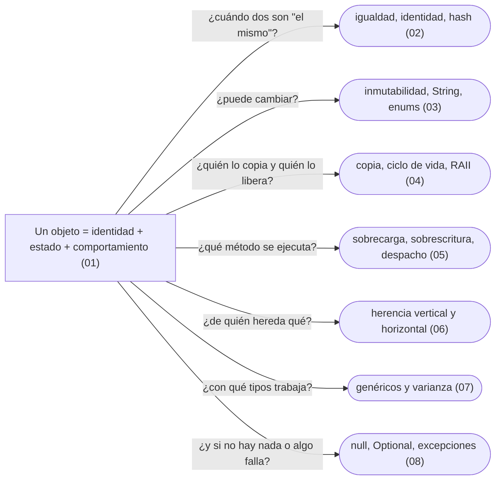

# 01 — Modelo de objetos

> Qué hace el lenguaje con los objetos —en memoria, al compararlos, al copiarlos, al heredarlos y al destruirlos— y el vocabulario que usa todo el corpus. Es la base que se aprende a los golpes: el `HashSet` que "pierde" un documento, el *slicing*, el `Optional` en un campo.
>
> **Vigencia:** 2026-10-03.

---

## 1. 🗺️ Índice

| | Documento | Tipo |
|---|---|---|
| [`01`](01-identidad-estado-y-referencias.md) | Identidad, estado y referencias | Capítulo |
| [`02`](02-igualdad-identidad-y-hash.md) | Igualdad, identidad y hash | Capítulo |
| [`03`](03-inmutabilidad-y-objetos-especiales.md) | Inmutabilidad y objetos especiales | Capítulo |
| [`04`](04-copia-ciclo-de-vida-y-recursos.md) | Copia, ciclo de vida y recursos | Capítulo |
| [`05`](05-polimorfismo-y-despacho.md) | Polimorfismo y despacho | Capítulo |
| [`06`](06-herencia-vertical-y-horizontal.md) | Herencia vertical y horizontal | Capítulo |
| [`07`](07-genericos-y-varianza.md) | Genéricos y varianza | Capítulo |
| [`08`](08-la-ausencia-y-el-error.md) | La ausencia y el error en el modelo | Capítulo |
| [`09`](09-simulacion-de-entrevista.md) | Simulación de entrevista | Simulación |
| [`10`](10-respuestas.md) | Respuestas | Solucionario |

**Orden de lectura.** En orden numérico: cada capítulo usa el vocabulario de los anteriores. Si solo tienes una tarde, `02`, `03`, `05` y `06`. Al terminar los capítulos, la simulación con cronómetro, y solo después el solucionario.

---

## 2. 🧠 Mapa mental

---

## 3. 🚫 Qué NO está aquí

Los patrones (bloques `04`–`10`), el modelado de asociaciones (`02`) y los principios de diseño (`03`).

---

**Versiones ejecutadas:** GCC 14.4 (C++23) · JDK 21.0.12, 17.0.20 y 25.0.4 · .NET 10.0.12 (C# 14) · Spring Boot 4.1.1 (Spring Framework 7.0.9, Hibernate 7.4.5, H2 2.4.240) · Python 3.14.8 · mermaid-cli 11.17.0 (2026-10-04).

---

**Corpus:** [README](../README.md) ·
**Siguiente:** [`02` — Modelado OO](../02-modelado-oo/README.md)
