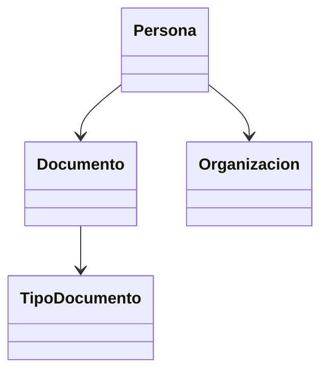
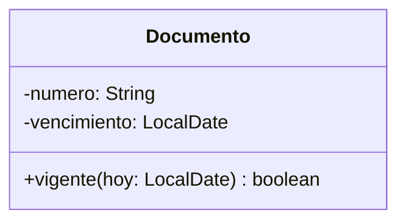
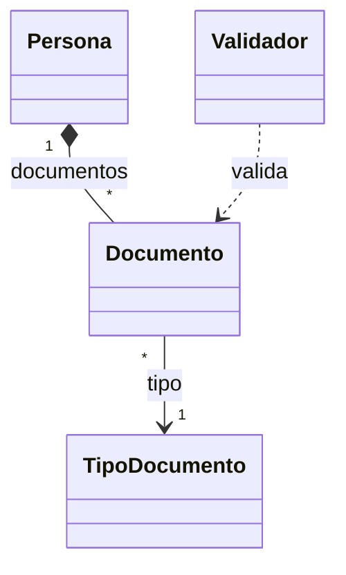
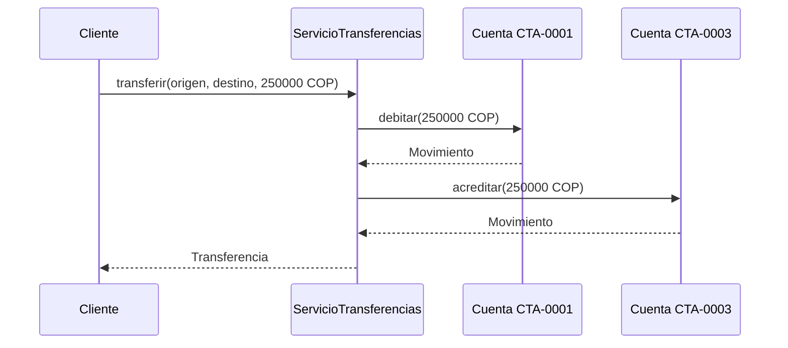
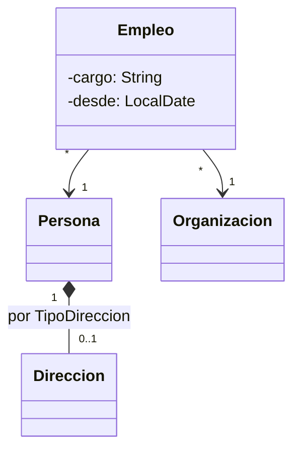
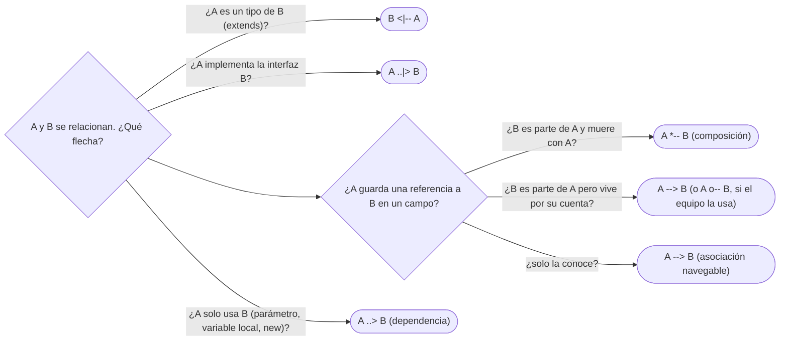

# 01 — UML lo justo, en Mermaid

> Leer y dibujar un diagrama de clases informal y uno de secuencia, y decir qué significa cada flecha.
> Es el dueño de la notación del corpus: los demás capítulos la usan sin volver a explicarla. No asume
> leído nada; quien venga del bloque de modelo de objetos reconocerá el dominio de
> [`01/01`](../01-modelo-de-objetos/01-identidad-estado-y-referencias.md).
>
> **Vigencia:** 2026-10-03.
>
> **Versiones ejecutadas:** mermaid-cli 11.17.0 (2026-10-04).

---

## 1. 🎯 El problema

En una entrevista te piden "modela personas con sus documentos". Dibujas esto en la pizarra:



Y empiezan las preguntas: ¿una persona tiene uno o varios documentos? ¿El documento sabe de quién es?
¿Si se borra la persona, se borran sus documentos? ¿La flecha hacia `Organizacion` es "trabaja en",
"es dueña de" o "depende de"? Las tres flechas son iguales y significan tres cosas distintas, y el
diagrama no responde ninguna de las preguntas que importaban.

El UML existe para que esas preguntas se respondan **en el dibujo**: con la flecha correcta, la
multiplicidad en cada punta y nada más que lo que hace falta para la pregunta. No hace falta saber
todo el UML; hace falta saber esto.

---

## 2. 🧱 Para qué sirve el UML, y para qué no

**Qué es.** El UML es una notación estándar para dibujar software. Fowler distingue tres usos: como
**boceto** (para pensar y discutir), como **plano** (especificación detallada para que otro programe)
y como **lenguaje de programación** (generar código desde el modelo). Este corpus solo usa el primero.

**Para qué sirve como boceto.** Para pensar un modelo antes de escribirlo, para discutirlo en una
revisión, y para responder en una entrevista "dibújame cómo lo harías". En los tres casos el dibujo es
desechable: vale lo que vale la conversación que provoca.

**Qué cuesta.** Un diagrama que no se mantiene **miente**: el código cambia y el dibujo no. Por eso los
diagramas que sobreviven son pocos, pequeños y de las partes estables del modelo. Escribirlos en
Mermaid, dentro del `.md` y versionados con el código, reduce ese costo: un *diff* del diagrama se
revisa como un *diff* de código.

**Cuándo no.** UML formal —OCL, perfiles, diagramas de componentes y despliegue— queda fuera: es otra
disciplina, y en una entrevista de diseño de objetos nadie lo pide.

> **Veredicto:** dibuja para responder una pregunta concreta, con la notación justa para que el
> dibujo no sea ambiguo, y tíralo cuando la pregunta esté respondida.

---

## 3. 🧱 La clase: nombre, atributos y operaciones

Una clase en Mermaid lleva su nombre y, **solo si la pregunta lo necesita**, atributos y operaciones,
con la visibilidad delante (`+` público, `-` privado, `#` protegido):



- Los atributos que son **otra clase del modelo** no se escriben como atributo: se dibujan como
  asociación (§4). `Documento` tiene un `TipoDocumento`, pero eso es una flecha, no una línea dentro de
  la caja.
- Getters, setters, `equals` y constructores no se dibujan nunca: son ruido para cualquier pregunta de
  diseño.

---

## 4. 🧱 Las seis relaciones

Toda flecha de un diagrama de clases es una de estas seis, y cada una tiene su notación:

| Relación | Mermaid | Qué dice | Cómo suele verse en el código |
|---|---|---|---|
| **Dependencia** | `A ..> B` | A **usa** B, sin guardarlo | Un parámetro, una variable local, un `new` |
| **Asociación** | `A --> B` (navegable) · `A -- B` | A **guarda** una referencia a B | Un campo de tipo `B` o una colección de `B` |
| **Agregación** | `A o-- B` | Asociación todo-parte, sin propiedad del ciclo de vida | Un campo que apunta a algo que vive por su cuenta |
| **Composición** | `A *-- B` | Todo-parte, **con** propiedad: B muere con A | Un campo que nadie más tiene |
| **Generalización** | `Base <\|-- Derivada` | Derivada **es un** Base (herencia) | `extends` |
| **Realización** | `Clase ..\|> Interfaz` | Clase **implementa** Interfaz | `implements` |

El modelo de §1, dicho bien:



- La **composición** dice que los documentos son de una sola persona y no existen sin ella. La
  **asociación navegable** dice que el documento conoce su tipo y el tipo no conoce sus documentos. La
  **dependencia** dice que `Validador` recibe documentos para validarlos pero no los guarda.

> ⚠️ **Advertencia.** La diferencia entre asociación y dependencia es **guardar o no guardar**. Un
> servicio que recibe un `Documento` como parámetro depende de él; uno que lo tiene en un campo está
> asociado. Dibujar todo con `-->` borra la información que más importa al revisar acoplamiento.

---

## 5. 🧱 Multiplicidad y navegabilidad

**Multiplicidad**: cuántos objetos hay en cada punta, escrita junto a la clase de esa punta.

```text
"1"      exactamente uno            "0..1"   uno o ninguno
"*"      cualquier número (0..*)    "1..*"   al menos uno
```

`Persona "1" *-- "*" Documento` se lee en las dos direcciones: **una persona tiene cualquier número de
documentos**, y **cada documento es de exactamente una persona**. La multiplicidad que importa para el
código es la del extremo al que se llega: el `"*"` junto a `Documento` dice que en `Persona` habrá una
colección.

**Navegabilidad**: la punta de flecha dice **quién puede llegar a quién**, es decir, qué clase guarda
la referencia. `Documento --> TipoDocumento`: desde un documento llegas a su tipo; desde un tipo no
llegas a sus documentos. Una línea sin punta (`--`) deja la navegabilidad sin decidir, que en un boceto
temprano es legítimo.

**La sobregeneralización.** "La flecha dice quién depende de quién" mezcla dos relaciones. En una
asociación, la flecha dice **quién guarda la referencia**; en una dependencia (`..>`), quién usa a
quién sin guardarlo. Y ninguna de las dos dice quién crea a quién, quién llama primero ni hacia dónde
va la clave foránea en la base de datos, que suele ir al revés que la navegación.

> **Veredicto:** pon multiplicidad en las dos puntas de toda asociación y decide la navegabilidad a
> propósito. Sin multiplicidad, el diagrama no dice si hay un atributo o una colección.

---

## 6. 🧱 Agregación contra composición

Las dos son "todo-parte"; la diferencia es el **ciclo de vida**:

- **Composición** (`*--`): la parte pertenece a un solo todo y muere con él. Los documentos de una
  persona.
- **Agregación** (`o--`): la parte puede existir sin el todo y puede estar en varios. Los empleados de
  una organización, que siguen existiendo si la organización desaparece.

"Agregación y composición son lo mismo" es falso; pero también es cierto que la agregación es la
relación más ambigua del UML, y Fowler recomienda no usarla: casi siempre una asociación simple dice lo
mismo con menos discusión. La composición sí importa, porque dice quién es el dueño, y en C++ eso es una
decisión de tipos. Qué significa en código cada una, con `unique_ptr`, `shared_ptr` y referencias, lo
cuenta [`04` — Agregación, composición y propiedad](04-agregacion-composicion-y-propiedad.md).

---

## 7. 🧱 El diagrama de secuencia mínimo

**Para qué.** Para los diseños cuyo sentido está en el **orden de las llamadas**, no en la estructura:
quién llama a quién, en qué orden, y qué vuelve. Una transferencia de `CTA-0001` a `CTA-0003`:



- `->>` es una llamada; `-->>`, su respuesta. Cada participante es un **objeto** (por eso pueden
  aparecer dos de la misma clase), y el tiempo corre hacia abajo.
- Lo que el diagrama deja ver de un vistazo: el servicio coordina y las cuentas no se conocen entre sí.
  Si la cuenta origen llamara a la destino, se vería aquí antes que en el código.

**Cuándo no.** Para un flujo lineal de dos llamadas, la prosa basta. El diagrama de secuencia rinde
cuando hay tres o más participantes o cuando el orden es la pregunta.

---

## 8. 🧱 Lo que Mermaid no dibuja

Tres cosas del UML que Mermaid no tiene. **Es una limitación de la herramienta, no del concepto**, y
cada una se aproxima así:

| Concepto UML | Qué dice | Cómo se aproxima en Mermaid |
|---|---|---|
| **Extremo no navegable** (la `x` en una punta) | "Desde aquí **no** se llega allí", explícitamente | Asociación con punta solo en el otro lado, y la frase en el texto |
| **Asociación calificada** | Una persona tiene, **por cada `TipoDireccion`**, una dirección | Una etiqueta en la asociación (`: direcciones por tipo`) y la multiplicidad `"0..1"` |
| **Clase de asociación** | `Empleo` es la asociación entre `Persona` y `Organizacion`, con atributos propios | Una clase normal con dos asociaciones; es además cómo se programa ([`02` §7](02-de-la-asociacion-al-codigo.md#7--la-clase-de-asociación-que-se-vuelve-objeto-empleo)) |



- La etiqueta `por TipoDireccion` y la multiplicidad `0..1` dicen lo que en UML diría el calificador:
  "para cada tipo, como mucho una". En código será un `Map<TipoDireccion, Direccion>`.

---

## 9. 🧱 Cuánto detalle: un diagrama por pregunta

**La regla.** Un diagrama responde **una** pregunta y tiene **doce clases como mucho**. "Un diagrama de
clases muestra todas las clases" es la idea que produce el póster de cuarenta cajas que nadie lee. Si
la pregunta es "¿cómo se relacionan personas y documentos?", `Cuenta` no aparece. Si es "¿qué
dependencias tiene el validador?", los atributos no aparecen.

**Qué cuesta el exceso.** Cada caja que no responde a la pregunta le roba atención a las que sí. Y un
diagrama grande es el que antes queda desactualizado.

> **Veredicto:** antes de dibujar, escribe la pregunta. Lo que no ayuda a responderla no va en el
> diagrama.

---

## 10. 🧭 Cómo se elige la flecha



Y en toda asociación: multiplicidad en las dos puntas.

**La frase en voz alta:** *"La punta de flecha es navegabilidad: quién guarda la referencia. Si solo la
usa, es una dependencia punteada. Y pongo multiplicidad en las dos puntas, porque decide si hay un campo
o una colección."*

---

## ⚠️ Errores frecuentes

| Se dice | Lo preciso |
|---|---|
| "La flecha de una asociación dice quién depende de quién" | Dice quién guarda la referencia (navegabilidad); el uso sin guardar es una dependencia, `..>` |
| "Agregación y composición son lo mismo" | La composición implica propiedad del ciclo de vida; la agregación no, y es tan ambigua que conviene evitarla |
| "Un diagrama de clases muestra todas las clases" | Muestra las que responden una pregunta; doce como mucho |
| "La multiplicidad es opcional" | Sin ella no se sabe si el código lleva un campo o una colección |
| "La flecha va en la dirección de la clave foránea" | La navegación de objetos suele ir al revés que la FK |
| "UML es un lenguaje para generar código" | Ese uso existe y es marginal; en el día a día y en la entrevista, es un boceto |
| "Si Mermaid no lo dibuja, no existe" | Es una limitación de la herramienta; se aproxima y se dice en el texto |

---

## 📚 Para profundizar

- **Libro** — Fowler, *UML Distilled*, 3.ª ed. (Addison-Wesley, 2003), cap. 3, "Class Diagrams: The
  Essentials", y cap. 5, "Class Diagrams: Advanced Concepts" (agregación y composición, asociación
  calificada, clase de asociación). **El que destaca**: es exactamente "el UML justo".
- **Libro** — Fowler, *UML Distilled*, 3.ª ed., cap. 4, "Sequence Diagrams".
- [Mermaid — *Class diagrams*](https://mermaid.js.org/syntax/classDiagram.html): la sintaxis de
  relaciones, multiplicidad y visibilidad.
- [Mermaid — *Sequence diagrams*](https://mermaid.js.org/syntax/sequenceDiagram.html).
- [OMG — *About the Unified Modeling Language 2.5.1*](https://www.omg.org/spec/UML/2.5.1/About-UML): la
  especificación oficial, para cuando haga falta la letra exacta.

---

## 🧠 Preguntas

Sin respuestas aquí. Todas, con enunciado literal y respuesta en tres capas, en
[`09` — Respuestas](09-respuestas.md#01--uml-lo-justo-en-mermaid).

1. ¿Cuáles son los tres usos del UML según Fowler, y cuál usa este corpus? 🟢
2. ¿Cuáles son las seis relaciones de un diagrama de clases? 🟢
3. ¿Cómo se escribe en Mermaid una composición, una dependencia y una realización? 🟢
4. ¿Qué significa la multiplicidad `0..1`, y qué `1..*`? 🟢
5. ¿Qué es la navegabilidad de una asociación? 🟢
6. ¿Qué significan `+`, `-` y `#` delante de un atributo? 🟢
7. ¿Para qué sirve un diagrama de secuencia? 🟢
8. ¿Qué tres conceptos del UML no dibuja Mermaid? 🟢
9. ¿Qué diferencia hay entre una asociación y una dependencia? 🟡
10. ¿Qué diferencia hay entre agregación y composición? 🟡
11. ¿Qué diferencia hay entre generalización y realización? 🟡
12. ¿Qué diferencia hay entre `A --> B` y `A -- B`? 🟡
13. ¿En qué se traduce `Persona "1" *-- "*" Documento` en Java y en C++? 🟡
14. ¿Qué atributo genera `Documento "*" --> "1" TipoDocumento` en Java, y qué tipo de puntero o
    referencia elegirías en C++? 🟡
15. ¿Por qué Fowler recomienda no usar la agregación? 🟠
16. ¿Por qué la flecha de navegación suele ir al revés que la clave foránea? 🟠
17. ¿Por qué no se dibujan getters, setters ni constructores? 🟠
18. ¿Cuándo un diagrama de secuencia aporta más que uno de clases? 🟠
19. ¿Por qué un diagrama de clases con todas las clases del sistema es un mal diagrama? 🟠
20. Dibuja en Mermaid personas, documentos, tipos de documento y países, con multiplicidad y
    navegabilidad justificadas. 🔴
21. Dibuja el diagrama de secuencia de una transferencia de 250 000 COP de `CTA-0001` a `CTA-0003`
    con validación previa del estado de las dos cuentas. 🔴
22. Corrige el diagrama de §1 para que responda las cuatro preguntas que hizo el entrevistador. 🔴

---

**Anterior:** — ·
**Siguiente:** [`02` — De la asociación al código](02-de-la-asociacion-al-codigo.md) ·
**Relacionado:** [`03` — Navegabilidad y coherencia](03-navegabilidad-y-coherencia.md)
