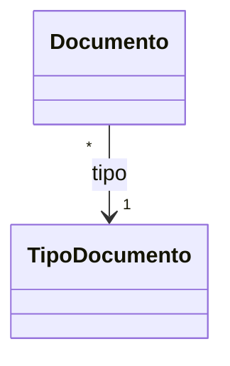
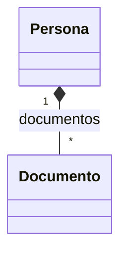
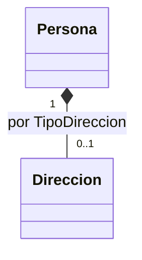
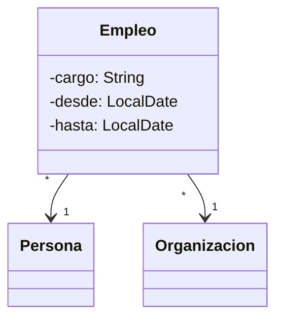
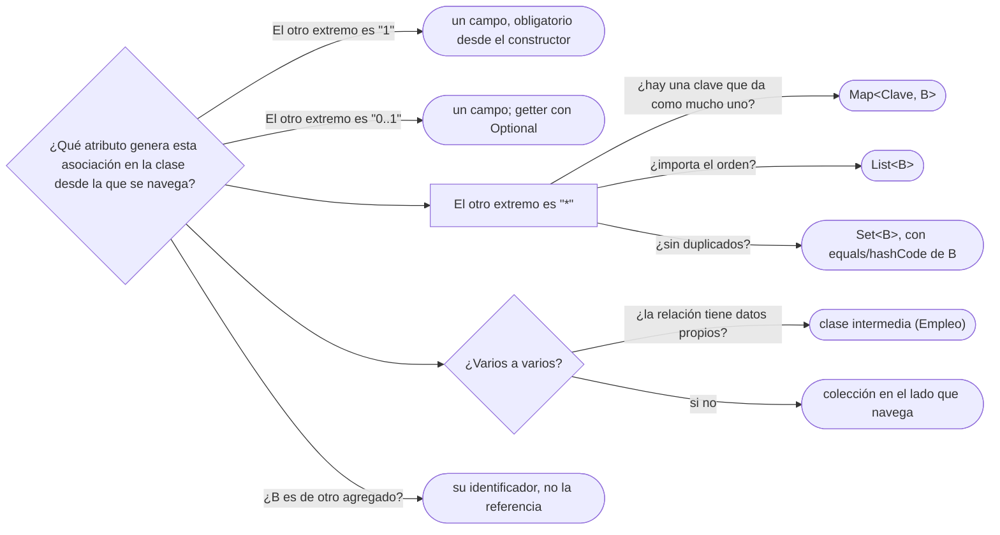

# 02 — De la asociación al código

> Convertir cada relación del modelo en el atributo correcto sin dudar: atributo, colección, `List`,
> `Set` o `Map`, clase intermedia o clase de asociación. Asume leído
> [`01` — UML lo justo, en Mermaid](01-uml-lo-justo-en-mermaid.md), pero se lee solo: §2 recuerda la
> notación.
>
> **Vigencia:** 2026-10-03.
>
> **Versiones ejecutadas:** GCC 14.4 (C++23) · JDK 21.0.12, 17.0.20 y 25.0.4 · mermaid-cli 11.17.0 (2026-10-04).

---

## 1. 🎯 El problema

Una revisión de código encuentra esta `Persona`. Compila, pasa las pruebas y está mal en tres sitios:

```java
public class Persona {
    private String nombre;
    private List<Direccion> direcciones = new ArrayList<>();   // y la regla es una por tipo
    private List<Long> idsDocumentos = new ArrayList<>();      // ids en lugar de documentos
    private Organizacion organizacion;                          // ¿y el cargo? ¿y desde cuándo?
}
```

- La regla de negocio dice "**una** dirección de domicilio y **una** laboral", y una `List` admite tres
  domicilios. La estructura no expresa la regla, así que alguien tiene que comprobarla a mano en cada
  sitio que añade direcciones.
- `idsDocumentos` obliga a ir a buscar cada documento cada vez que se usa, y nada impide guardar el id
  de un documento que no existe.
- La relación con la organización tiene datos propios —cargo, fecha de inicio—, y no hay dónde
  ponerlos. Ana trabaja en Transportes Andinos como *Jefa de sistemas* desde el 2019-02-01: esa frase
  no cabe en un campo `organizacion`.

Cada uno es la traducción equivocada de una relación del modelo. Este capítulo da la traducción
correcta para cada forma.

---

## 2. 🧱 La tabla: de la relación al atributo

**Lo que hace falta de `01`.** Una asociación navegable `A "1" --> "*" B` dice que A guarda
referencias a B, y la multiplicidad del extremo de B (`"*"`) dice cuántas. La composición (`*--`) dice
además que B es de A y muere con A.

| Relación en el modelo | Atributo en A | Java | C++ |
|---|---|---|---|
| Uno a uno, obligatorio (`"1"`) | Un campo | `private final B b;` | Miembro por valor, o puntero que no posee si B es compartido |
| Uno a uno, opcional (`"0..1"`) | Un campo que puede faltar | Campo anulable con getter `Optional<B>` | `std::optional<B>` o `B*` |
| Uno a varios (`"*"`) | Una colección | `List<B>` o `Set<B>` | `std::vector<B>` o `std::set<B>` |
| Uno a varios, ordenada | Una colección con orden | `List<B>` | `std::vector<B>` |
| Uno a varios, sin duplicados | Un conjunto | `Set<B>` (exige `equals`/`hashCode`) | `std::set<B>` o `std::unordered_set<B>` |
| Calificada (por una clave) | Un mapa | `Map<K, B>` | `std::map<K, B>` |
| Varios a varios | Colección en un lado o en los dos, o una clase intermedia | §6 | §6 |

- La columna C++ adelanta la pregunta de la **propiedad**: por valor si A es dueña de B, puntero o
  referencia que no posee si B vive en otro sitio. La responde entera
  [`04` — Agregación, composición y propiedad](04-agregacion-composicion-y-propiedad.md).

---

## 3. 🧱 Uno a uno: un campo



```java
public final class Documento {
    private final TipoDocumento tipo;   // "1": obligatorio, asignado en el constructor
    private final String numero;
    public Documento(TipoDocumento tipo, String numero) {
        this.tipo = Objects.requireNonNull(tipo);
        this.numero = Objects.requireNonNull(numero);
    }
}
```

```cpp
class Documento {
    const TipoDocumento* tipo;   // no posee: los tipos viven en un registro compartido
    std::string numero;
public:
    Documento(const TipoDocumento& t, std::string n) : tipo(&t), numero(std::move(n)) {}
};
```

- El `"1"` se traduce en **obligatorio desde el constructor**: no hay un `Documento` sin tipo ni un
  instante en que lo esté. En Java, `requireNonNull`; en C++, recibir una referencia, que no puede ser
  nula, y guardar su dirección.
- El `"*"` del lado del documento no genera nada en `TipoDocumento`: la navegación va en un solo
  sentido.

---

## 4. 🧱 Uno a varios: una colección, y cuál



**La sobregeneralización.** "Uno a varios se modela con una lista en el lado de 'varios'" confunde el
modelo de objetos con la tabla relacional, donde la clave foránea va en el lado "varios". En objetos, la
colección va en el lado **desde el que se navega**: si se pregunta "¿qué documentos tiene Ana?", la
colección está en `Persona`.

**`List` o `Set`.** "`List` sirve para todo" es la costumbre; la pregunta correcta es qué promete la
relación:

- **¿Importa el orden?** (los movimientos de una cuenta, en orden de fecha) → `List`.
- **¿Hay duplicados posibles?** No: Ana no tiene dos veces la misma cédula. → `Set`, y entonces
  `Documento` necesita `equals` y `hashCode` correctos sobre su clave natural, o el conjunto no detecta
  nada.

```java
public final class Persona {
    private final Set<Documento> documentos = new LinkedHashSet<>();   // sin duplicados, en orden de alta

    public void agregarDocumento(Documento d) {
        if (!documentos.add(d)) throw new IllegalArgumentException("documento repetido: " + d);
    }
    public Set<Documento> documentos() { return Collections.unmodifiableSet(documentos); }
}
```

```cpp
class Persona {
    std::vector<Documento> documentos;   // composición: la persona es dueña de sus documentos
public:
    void agregarDocumento(Documento d);  // comprueba duplicados con operator== antes de insertar
    std::span<const Documento> verDocumentos() const { return documentos; }
};
```

- `LinkedHashSet` da las dos cosas: sin duplicados y orden de inserción estable para mostrar.
- El getter no devuelve la colección interna: ese principio, y por qué "devolver la lista es
  encapsular" es falso, es de `04`.

---

## 5. 🧱 Calificada: un mapa



La regla "una dirección por tipo" es una **asociación calificada**: el calificador (`TipoDireccion`)
más la persona determinan como mucho una dirección. Se traduce a un `Map`, y la regla queda en la
estructura:

```java
private final Map<TipoDireccion, Direccion> direcciones = new EnumMap<>(TipoDireccion.class);

public void establecerDireccion(TipoDireccion tipo, Direccion d) {
    direcciones.put(tipo, d);          // reemplaza: no puede haber dos domicilios
}
public Optional<Direccion> direccion(TipoDireccion tipo) {
    return Optional.ofNullable(direcciones.get(tipo));
}
```

```cpp
std::map<TipoDireccion, Direccion> direcciones;   // TipoDireccion es un enum class
```

- `EnumMap` es el mapa hecho para claves enum: un arreglo por dentro, sin hash. El `"0..1"` del
  diagrama se ve en el getter, que devuelve `Optional`.

---

## 6. 🧱 Varios a varios: dos colecciones, o una clase en medio

Una persona puede ser titular de varias cuentas y una cuenta puede tener varios titulares. "Una relación
varios a varios necesita siempre una clase intermedia" es falso en objetos: la necesita la base de datos
(la tabla intermedia), no el modelo.

- **Colección en un lado** si solo se navega en un sentido: `Cuenta` con su `Set<Persona> titulares`.
- **Colección en los dos lados** solo si los dos sentidos tienen casos de uso, y entonces hay que
  mantener las dos puntas coherentes, que es el tema de
  [`03` — Navegabilidad y coherencia](03-navegabilidad-y-coherencia.md).
- **Clase intermedia** cuando **la relación tiene datos propios**: desde cuándo es titular, con qué
  porcentaje, con qué permisos. Entonces la relación ya no es una línea: es un objeto.

> **Veredicto:** dos colecciones si la relación no tiene datos; una clase intermedia en cuanto la
> relación tenga un solo atributo propio.

---

## 7. 🧱 La clase de asociación que se vuelve objeto: `Empleo`

"Ana trabaja en Transportes Andinos como *Jefa de sistemas* desde el 2019-02-01." El cargo y la fecha no
son de Ana ni de la organización: son **de la relación**. En UML eso es una clase de asociación; en
código, una clase con una referencia a cada lado:



```java
public final class Empleo {
    private final Persona persona;
    private final Organizacion organizacion;
    private final String cargo;
    private final LocalDate desde;
    private LocalDate hasta;                        // null mientras siga vigente

    public void terminar(LocalDate fecha) { this.hasta = fecha; }
    public boolean vigente() { return hasta == null; }
}
```

- `Empleo` tiene **ciclo de vida propio**: empieza, termina, puede haber dos empleos de Ana en la misma
  organización en épocas distintas. Por eso no es un `Map<Organizacion, String>` en `Persona`: ese mapa
  no admitiría el segundo empleo ni la fecha de fin.
- En C++, las dos referencias son punteros que no poseen: ni el empleo es dueño de la persona ni al
  revés.

---

## 8. 🧱 Opcionalidad sin `null` en la firma

El `"0..1"` (el tutor de una persona, la fecha de fin de un empleo) se guarda como un campo que puede
faltar, pero **no se expone** como `null`: el getter devuelve `Optional` en Java y `std::optional` o un
puntero en C++. Por qué `Optional` va en el retorno y no en el campo lo explica el capítulo de la
ausencia y el error,
[`01/08`](../01-modelo-de-objetos/08-la-ausencia-y-el-error.md).

---

## 9. 🩺 El error típico, en tres formas

Las tres traducciones equivocadas del §1, con su diagnóstico:

| Síntoma en el código | Qué relación era | La traducción correcta |
|---|---|---|
| `List<Direccion>` con una regla "una por tipo" comprobada a mano | Calificada | `Map<TipoDireccion, Direccion>` |
| `List<TipoDocumento> tipos` en `Documento` | Uno a uno | Un campo `TipoDocumento tipo` |
| `List<Long> idsDocumentos` en `Persona` | Uno a varios, dentro del mismo agregado | `Set<Documento>` con referencias |
| Campo `organizacion` sin dónde poner el cargo | Clase de asociación | `Empleo` |

**Cuándo sí son ids.** Guardar el identificador en lugar de la referencia es correcto **entre
agregados**: una `Cuenta` guarda el id de su titular, no la `Persona` entera, para no cargar ni
bloquear a la persona cada vez que se usa la cuenta. Esa regla es de [`09/01` §5](../09-ddd-tactico-y-otros/01-entidad-valor-y-agregado.md#5--referencias-entre-agregados-por-identificador); dentro de
un mismo agregado, referencias.

---

## 10. 🧭 Cómo se elige



**La frase en voz alta:** *"La multiplicidad del otro extremo me dice campo o colección; la
calificación, `Map`; el orden, `List`; la unicidad, `Set`. Y si la relación tiene datos, es una clase."*

---

## ⚠️ Errores frecuentes

| Se dice | Lo preciso |
|---|---|
| "Uno a varios se modela con una lista en el lado de 'varios'" | En objetos, la colección va en el lado desde el que se navega; la FK es otra cosa |
| "Una relación varios a varios necesita siempre una clase intermedia" | La necesita la base de datos; en objetos, solo si la relación tiene datos propios |
| "`List` sirve para todo" | `List` promete orden y admite duplicados; `Set` y `Map` expresan reglas que `List` deja al azar |
| "Guardar ids es más desacoplado" | Dentro de un agregado obliga a buscar y no garantiza nada; entre agregados, sí es lo correcto |
| "Un `Set` evita duplicados" | Solo si `equals` y `hashCode` del elemento están bien escritos |
| "La relación con datos se resuelve con más campos en una de las dos clases" | Los datos de la relación son de la relación: una clase de asociación |

---

## 📚 Para profundizar

- **Libro** — Fowler, *UML Distilled*, 3.ª ed. (Addison-Wesley, 2003), cap. 3, "Class Diagrams: The
  Essentials", sección "Programming Interpretation of Properties"; y cap. 5, "Qualified Associations" y
  "Association Class". **El que destaca**: es la traducción del modelo al código, en pocas páginas.
- **Libro** — Larman, *Applying UML and Patterns*, 3.ª ed. (Prentice Hall, 2004), cap. 9, "Domain
  Models": asociaciones, atributos y multiplicidad desde el análisis.
- [Java 21 API — `EnumMap`](https://docs.oracle.com/en/java/javase/21/docs/api/java.base/java/util/EnumMap.html):
  el mapa para claves enum.
- [Java 21 API — `LinkedHashSet`](https://docs.oracle.com/en/java/javase/21/docs/api/java.base/java/util/LinkedHashSet.html):
  conjunto con orden de inserción.
- [cppreference — `std::map`](https://en.cppreference.com/cpp/container/map).

---

## 🧠 Preguntas

Sin respuestas aquí. Todas, con enunciado literal y respuesta en tres capas, en
[`09` — Respuestas](09-respuestas.md#02--de-la-asociación-al-código).

1. ¿Qué atributo genera una asociación cuyo otro extremo tiene multiplicidad `"1"`? 🟢
2. ¿Y una cuyo otro extremo tiene multiplicidad `"*"`? 🟢
3. ¿Qué es una asociación calificada, y a qué estructura se traduce? 🟢
4. ¿Qué es una clase de asociación? 🟢
5. ¿Qué colección expresa "ordenada" y cuál "sin duplicados"? 🟢
6. ¿Cómo se expone en Java una asociación `"0..1"`? 🟢
7. ¿Qué diferencia hay entre guardar la referencia a un documento y guardar su id? 🟡
8. ¿Qué diferencia hay entre un `Set<Documento>` y una `List<Documento>` para los documentos de una
    persona? 🟡
9. ¿Qué diferencia hay entre `EnumMap` y `HashMap` para un `Map<TipoDireccion, Direccion>`? 🟡
10. ¿Qué diferencia hay entre la colección de una relación uno a varios en el modelo de objetos y la
    clave foránea en la base de datos? 🟡
11. ¿Cómo traduces `Documento "*" --> "1" TipoDocumento` en Java y en C++, y por qué distinto? 🟡
12. ¿Qué tipo usarías en C++ para la colección de documentos de una persona, y qué cambia si hay
    subclases de documento? 🟡
13. ¿Por qué `List` no es la colección por defecto para cualquier relación uno a varios? 🟠
14. ¿Por qué un `Set<Documento>` puede aceptar duplicados aunque el código parezca correcto? 🟠
15. ¿Cuándo una relación varios a varios necesita una clase intermedia en el modelo de objetos? 🟠
16. ¿Por qué `Empleo` no puede ser un `Map<Organizacion, String>` dentro de `Persona`? 🟠
17. ¿Cuándo es correcto guardar el id de otro objeto en lugar de la referencia? 🟠
18. ¿Por qué una asociación `"1"` debe asignarse en el constructor? 🟠
19. ¿Qué gana el código cuando la regla "una dirección por tipo" pasa de una comprobación a la
    estructura? 🟠
20. ¿Por qué el getter de una colección no debería devolver la colección interna? 🟠
21. Corrige la `Persona` de §1 en Java: direcciones, documentos y organización. 🔴
22. Escribe `Empleo` en Java con sus dos referencias, cargo, fechas y el método para terminarlo. 🔴
23. Dibuja en Mermaid la relación entre `Cuenta` y sus titulares si una cuenta puede tener varios
    titulares con un porcentaje de participación cada uno. 🔴
24. Escribe en C++ la `Persona` con su mapa de direcciones por tipo y su colección de documentos, y di
    qué posee. 🔴
25. Revisa este campo y di qué relación esconde y cómo lo corregirías:
    `private Map<String, String> datosLaborales; // "empresa" → nombre, "cargo" → cargo`. 🔴
26. Revisa este modelo y di qué está mal: `Documento` con `private List<TipoDocumento> tipos` y
    `private List<Persona> titulares`. 🔴

---

**Anterior:** [`01` — UML lo justo, en Mermaid](01-uml-lo-justo-en-mermaid.md) ·
**Siguiente:** [`03` — Navegabilidad y coherencia](03-navegabilidad-y-coherencia.md) ·
**Relacionado:** [`04` — Agregación, composición y propiedad](04-agregacion-composicion-y-propiedad.md)
