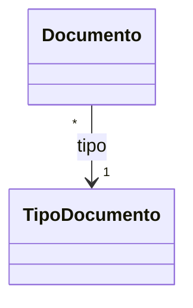
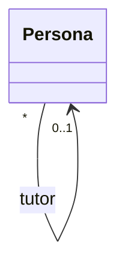
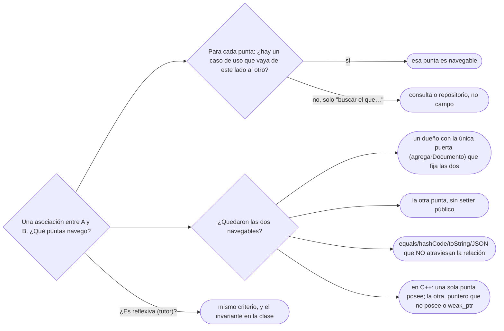

# 03 — Navegabilidad y coherencia

> Decidir qué puntas de una relación son navegables y, si son las dos, mantenerlas coherentes; la
> asociación reflexiva del tutor; y la autopsia de los ciclos que explotan en `toString`, `equals` y
> JSON. Asume leído [`02` — De la asociación al código](02-de-la-asociacion-al-codigo.md).
>
> **Vigencia:** 2026-10-04.
>
> **Versiones ejecutadas:** GCC 14.4 (C++23) · JDK 21.0.12, 17.0.20 y 25.0.4 · mermaid-cli 11.17.0 · Lombok 1.18.48 · Jackson 2.22.3 y 3.1.5 (2026-10-04).

---

## 1. 🎯 El problema

Alguien quiere poder ir del documento a su dueño, añade el campo y deja que Lombok escriba el resto:

```java
@Data
public class Persona {
    private String nombre;
    private List<Documento> documentos = new ArrayList<>();
}

@Data
public class Documento {
    private String numero;
    private Persona persona;          // la vuelta: del documento a su dueño
}

log.info("registrada: {}", ana);      // StackOverflowError
```

- `Persona.toString()` imprime sus documentos; cada `Documento.toString()` imprime su persona; esa
  persona imprime sus documentos… La pila se acaba. Con `hashCode` pasa lo mismo, y al serializar a
  JSON, igual.
- Y aunque nadie imprima nada, nada garantiza que `ana.getDocumentos()` contenga un documento cuyo
  `getPersona()` sea Ana: las dos puntas se pueden desincronizar.

"Si están relacionados, cada uno debe conocer al otro" parece inofensivo y cuesta dos tipos de bug.
Este capítulo da el criterio para no pagarlos sin necesidad, y la forma de pagarlos bien cuando sí.

---

## 2. 🧱 La pregunta que decide la navegabilidad

**La pregunta.** Para cada punta de una asociación: **¿qué caso de uso necesita ir de este objeto a
aquel?** Si ninguno, la punta no es navegable.

| Caso de uso | Navegación que pide |
|---|---|
| "Muestra los documentos de Ana" | `Persona` → `Documento` |
| "Valida este documento contra el formato de su tipo" | `Documento` → `TipoDocumento` |
| "¿De quién es la cédula 1020304050?" | Una **consulta** al repositorio, no un campo |
| "Lista los documentos de tipo `CC`" | Una consulta, no una colección en `TipoDocumento` |

- Muchas "vueltas" que se añaden por si acaso responden en realidad a una **búsqueda**: encontrar un
  objeto que todavía no tienes. Eso lo hace un repositorio o una consulta, no un campo.

**Qué cuesta cada punta navegable.** Un campo, una dependencia de compilación, y —si la otra punta
también navega— la obligación de mantener las dos de acuerdo. En las cuatro monedas: **acoplamiento**
(cada clase conoce a la otra), **legibilidad** (hay que leer dos clases para entender un cambio) y
**rendimiento** (un ORM carga lo que es navegable).

> **Veredicto:** una punta es navegable si un caso de uso la recorre. "Por si acaso" no es un caso de
> uso.

---

## 3. 🧱 `Documento` → `TipoDocumento`, sin vuelta

`TipoDocumento` es compartido por miles de documentos. Una colección de documentos dentro de cada tipo
sería enorme, cambiaría con cada alta y no la recorre ningún caso de uso: "los documentos de tipo `CC`"
es una consulta. La navegación va en un solo sentido, y eso tiene dos ventajas además del ahorro:

- `TipoDocumento` no depende de `Documento`: se puede compilar, probar y cargar solo.
- El tipo es casi inmutable y compartible; si tuviera la colección, sería el objeto más mutable del
  sistema.



> 🧠 **Modelo mental.** La navegación va de lo que cambia a lo que no cambia, y de lo particular a lo
> general: el documento conoce su tipo, el tipo no conoce sus documentos.

---

## 4. 🧱 Si son las dos, una sola puerta

**Cuándo sí.** Algunas bidireccionales se justifican: si hay un caso de uso que parte del documento y
necesita su titular sin consultar (validar que el titular de un documento de menor tiene tutor, por
ejemplo), y otro que parte de la persona y recorre sus documentos.

**El costo.** Las dos puntas son **redundantes**: dicen lo mismo dos veces. Es la forma más común de
redundancia en un modelo de objetos, y [`05` — Redundancia controlada](05-redundancia-controlada.md)
generaliza la regla que sigue. Si alguien añade el
documento a la lista y olvida fijar su persona, el modelo queda incoherente sin que nada falle.

**La salida: un único dueño de la relación**, con una única puerta de entrada que fija las dos puntas:

```java
public final class Persona {
    private final Set<Documento> documentos = new LinkedHashSet<>();

    public void agregarDocumento(Documento d) {
        if (d.titular() != null && d.titular() != this)
            throw new IllegalArgumentException("el documento ya tiene titular");
        documentos.add(d);
        d.asignarTitular(this);              // la vuelta la fija el mismo método
    }

    public Set<Documento> documentos() { return Collections.unmodifiableSet(documentos); }
}

public final class Documento {
    private Persona titular;

    void asignarTitular(Persona p) { this.titular = p; }   // de paquete: solo Persona la llama
    public Persona titular() { return titular; }
}
```

- La puerta es **`agregarDocumento`**; `asignarTitular` tiene visibilidad de paquete para que nadie de
  fuera pueda fijar una punta sin la otra. Y el getter de la colección no la expone mutable.
- El método que **olvida** la vuelta es el que escribe todo el mundo la primera vez:
  `documentos.add(d)` y nada más. Compila, y deja documentos sin titular.

> **Veredicto:** si la relación es bidireccional, una de las dos clases es la dueña y tiene el único
> método que la modifica. La otra punta se fija desde ahí y no se expone para escritura.

---

## 5. 🧱 La asociación reflexiva: el tutor



Una persona puede tener una tutora, que es otra `Persona`: Luis, nacido el 2013-09-02, tiene a Ana. La
asociación es **reflexiva** (de una clase consigo misma) y navegable en un sentido: del menor a su
tutor. ¿Necesita Ana la lista de sus tutelados? Solo si un caso de uso la recorre ("notificar a los
menores a cargo de Ana"); si no, es una consulta.

**El invariante que cruza objetos.** "Un menor de edad debe tener tutor" no lo puede comprobar un solo
campo: depende de la fecha de nacimiento de Luis, de la fecha de hoy y de otro objeto. Se protege en el
único sitio que ve todo eso, la propia `Persona`, en su constructor y en `quitarTutor`. Cómo se escribe
un invariante así, como contrato, es de
[`03/05` — Diseño por contrato y *fail fast*](../03-principios-de-diseno/05-diseno-por-contrato.md).

---

## 6. 🩺 Autopsia: los ciclos

**1. El código que escribe todo el mundo.** El de §1: `@Data` en las dos clases de una bidireccional.
`@Data` genera, entre otras cosas, `toString`, `equals` y `hashCode` **con todos los campos** no
estáticos, y uno de esos campos es la otra punta.

**2. Por qué parece correcto.** Mientras ninguna de las dos colecciones tiene elementos, todo funciona:
las pruebas que crean una persona sin documentos pasan. Y `@Data` es lo que recomiendan muchos
tutoriales para "ahorrar código".

**3. La secuencia que lo rompe.** Ana con su cédula, y cualquiera de estas líneas:

```text
log.info("{}", ana)        → Persona.toString → documentos.toString → Documento.toString
                           → persona.toString → documentos.toString → …  StackOverflowError
ana.hashCode()             → hash de documentos → hash del documento → hash de persona → …
objectMapper.writeValueAsString(ana)   → mismo recorrido en Jackson, hasta su límite de profundidad
documentos.add(cedula) en un HashSet   → llama a hashCode: el ciclo, otra vez
```

Jackson ya no llega a desbordar la pila: corta el recorrido cuando pasa su profundidad máxima de escritura (1000 niveles en
Jackson 2.22, 500 en Jackson 3.1, comprobado) y lanza una excepción que nombra la cadena de referencias. El ciclo es el
mismo; cambia solo quién lo detiene.

**4. El código correcto.** Las dos salidas, de mejor a peor:

```java
// a) quitar la vuelta si ningún caso de uso la recorre: el ciclo deja de existir
public final class Documento { private String numero; /* sin campo persona */ }

// b) si la vuelta es necesaria: la igualdad, el toString y el JSON no la atraviesan
@ToString.Exclude @EqualsAndHashCode.Exclude
private Persona titular;              // ← excluida de los métodos generados
```

Para JSON, la vuelta se marca con `@JsonBackReference` (y la ida con `@JsonManagedReference`), o con
`@JsonIgnore`; mejor aún, no se serializan entidades sino objetos de transferencia sin ciclos.

**5. La generalización.** Todo recorrido **genérico** del grafo de objetos —`toString`, `equals`,
`hashCode`, serialización, copia profunda, comparación en pruebas— se cuelga en un ciclo si no sabe
detenerse. "El error del ciclo en el JSON es culpa de Jackson" es falso: Jackson recorre lo que tú hiciste
navegable. Y `equals`/`hashCode` de una entidad nunca deberían recorrer sus asociaciones: van por su
clave (ver [`01/02`](../01-modelo-de-objetos/02-igualdad-identidad-y-hash.md)).

---

## 7. 🧱 C++: ciclos de `shared_ptr`, y `weak_ptr`

En C++ el ciclo tiene otra consecuencia: **una fuga de memoria**. Si `Persona` guarda sus documentos en
`std::shared_ptr` y cada `Documento` guarda a su persona también en `shared_ptr`, los contadores de
referencias nunca llegan a cero:

```cpp
struct Documento;
struct Persona {
    std::vector<std::shared_ptr<Documento>> documentos;
};
struct Documento {
    std::shared_ptr<Persona> titular;     // ciclo: Persona ↔ Documento se mantienen vivos
};
```

- Cuando la última variable externa suelta a Ana, Ana sigue viva porque su documento la apunta, y el
  documento sigue vivo porque Ana lo apunta. Ninguno se destruye nunca.

La salida es que la vuelta **no posea**: `std::weak_ptr<Persona>` (no cuenta para el contador y hay que
convertirlo con `lock()` antes de usarlo), o mejor, un puntero crudo que no posee si la persona siempre
vive más que sus documentos, que es lo que dice la composición:

```cpp
struct Persona {
    std::vector<std::unique_ptr<Documento>> documentos;   // posee
};
struct Documento {
    Persona* titular;                                      // no posee: la persona vive más
};
```

> **Veredicto:** en una bidireccional de C++, a lo sumo una punta posee. Si la relación es de
> composición, la vuelta es un puntero que no posee; `weak_ptr` es para cuando la vida de los dos lados
> es de verdad incierta.

---

## 8. 🧭 Cómo se elige



Cómo mapea un ORM las dos puntas a una sola clave foránea está en
[`07/04` §3](../07-fowler-dominio-y-datos/04-estructura-objeto-relacional.md#3--foreign-key-mapping), y por qué entre
agregados se navega por identificador, de [`09/01` §5](../09-ddd-tactico-y-otros/01-entidad-valor-y-agregado.md#5--referencias-entre-agregados-por-identificador).

**La frase en voz alta:** *"Navego en un sentido salvo que dos casos de uso pidan los dos. Si es
bidireccional, una clase es la dueña y tiene la única puerta; y ni `equals` ni `toString` ni el JSON
atraviesan la relación."*

---

## ⚠️ Errores frecuentes

| Se dice | Lo preciso |
|---|---|
| "Si están relacionados, cada uno debe conocer al otro" | Cada punta navegable se justifica con un caso de uso; si no, es una consulta |
| "La bidireccional es más flexible y no cuesta nada" | Cuesta mantener las dos puntas coherentes, y abre ciclos en todo recorrido genérico |
| "El error del ciclo en el JSON es culpa de Jackson" | Jackson recorre lo navegable; el ciclo es del modelo |
| "`@Data` ahorra código sin riesgo" | Genera `equals`, `hashCode` y `toString` con todos los campos, la otra punta incluida |
| "Con `shared_ptr` en las dos puntas no hay fugas" | El ciclo impide que los contadores lleguen a cero: es la fuga clásica |
| "El setter de la vuelta tiene que ser público para que el ORM funcione" | Puede ser de paquete o protegido; lo que no puede es ser la puerta de entrada |

---

## 📚 Para profundizar

- **Libro** — Fowler, *UML Distilled*, 3.ª ed. (Addison-Wesley, 2003), cap. 3, sección "Bidirectional
  Associations": la redundancia de las dos puntas y por qué conviene evitarla. **El que destaca.**
- **Libro** — Bloch, *Effective Java*, 3.ª ed. (Addison-Wesley, 2018), ítem 12, "Always override
  toString", con la advertencia de qué incluir en él.
- [Lombok — `@Data`](https://projectlombok.org/features/Data): qué anotaciones agrupa.
- [Lombok — `@EqualsAndHashCode`](https://projectlombok.org/features/EqualsAndHashCode): "por defecto
  usa todos los campos no estáticos y no transitorios", y cómo excluir.
- [C++ Core Guidelines — R.24, *Use `std::weak_ptr` to break cycles of `shared_ptr`s*](https://isocpp.github.io/CppCoreGuidelines/CppCoreGuidelines#r24-use-stdweak_ptr-to-break-cycles-of-shared_ptrs).
- [cppreference — `std::weak_ptr`](https://en.cppreference.com/cpp/memory/weak_ptr).

---

## 🧠 Preguntas

Sin respuestas aquí. Todas, con enunciado literal y respuesta en tres capas, en
[`09` — Respuestas](09-respuestas.md#03--navegabilidad-y-coherencia).

1. ¿Qué pregunta decide si una punta de una asociación es navegable? 🟢
2. ¿Qué es una asociación reflexiva? Da el ejemplo del dominio. 🟢
3. ¿Qué genera `@Data` de Lombok? 🟢
4. ¿Qué es `std::weak_ptr`? 🟢
5. ¿Qué significa que las dos puntas de una bidireccional sean redundantes? 🟢
6. ¿Qué diferencia hay entre navegar una asociación y hacer una consulta? 🟡
7. ¿Qué diferencia hay entre `@JsonManagedReference`/`@JsonBackReference` y `@JsonIgnore`? 🟡
8. ¿Qué diferencia hay entre un ciclo de referencias en Java y uno de `shared_ptr` en C++? 🟡
9. ¿Qué diferencia hay entre `weak_ptr` y un puntero crudo que no posee para la vuelta de una
    composición? 🟡
10. ¿Por qué `Documento` navega a `TipoDocumento` y no al revés? 🟡
11. ¿Qué diferencia hay entre el método que fija las dos puntas y el que olvida la vuelta? 🟡
12. ¿Qué cuesta una punta navegable, en las cuatro monedas? 🟠
13. ¿Por qué una bidireccional necesita un único dueño? 🟠
14. ¿Por qué el método que fija la vuelta en `Documento` no debería ser público? 🟠
15. ¿Por qué `equals` y `hashCode` de una entidad no deberían recorrer sus asociaciones? 🟠
16. ¿Por qué "el error del ciclo en el JSON es culpa de Jackson" es una respuesta equivocada? 🟠
17. ¿Dónde se protege el invariante "un menor debe tener tutor", y por qué ahí? 🟠
18. ¿Cuándo está justificada una bidireccional entre `Persona` y `Documento`? 🟠
19. ¿Por qué en C++ a lo sumo una punta de una bidireccional debería poseer? 🟠
20. Escribe en Java `agregarDocumento` de modo que las dos puntas queden siempre coherentes. 🔴
21. Explica paso a paso por qué `log.info("{}", ana)` lanza `StackOverflowError` con el modelo de §1,
    y da dos arreglos. 🔴
22. Escribe en C++ la relación `Persona`–`Documento` bidireccional sin fugas, y di quién posee a
    quién. 🔴
23. Decide la navegabilidad de `Persona`–`Empleo`–`Organizacion` para estos casos de uso: "¿dónde
    trabaja Ana?" y "lista los empleados vigentes de Transportes Andinos". 🔴
24. Revisa este código y di qué está mal: `public void setPersona(Persona p) { this.persona = p; }` en
    `Documento`, usado desde el controlador como `doc.setPersona(ana); ana.getDocumentos().add(doc);`. 🔴

---

**Anterior:** [`02` — De la asociación al código](02-de-la-asociacion-al-codigo.md) ·
**Siguiente:** [`04` — Agregación, composición y propiedad](04-agregacion-composicion-y-propiedad.md) ·
**Relacionado:** [`01` — UML lo justo, en Mermaid](01-uml-lo-justo-en-mermaid.md)
