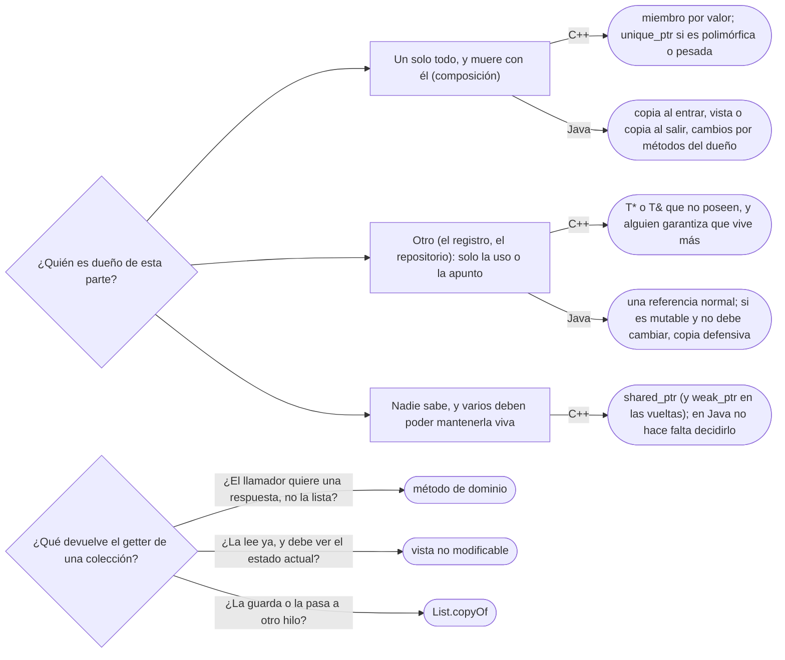

# 04 — Agregación, composición y propiedad

> Quién es dueño del ciclo de vida de cada objeto, y cómo se dice en C++ (con tipos) y en Java (con
> disciplina): miembros por valor, `unique_ptr`, punteros que no poseen, `shared_ptr` y su costo, y la
> colección que no se expone. Asume leído [`02` — De la asociación al código](02-de-la-asociacion-al-codigo.md)
> y [`01/04` — Copia, ciclo de vida y recursos](../01-modelo-de-objetos/04-copia-ciclo-de-vida-y-recursos.md).
>
> **Vigencia:** 2026-10-03.
>
> **Versiones ejecutadas:** GCC 14.4 (C++23) · JDK 21.0.12, 17.0.20 y 25.0.4 (2026-10-04).

---

## 1. 🎯 El problema

Dos fallos de propiedad, uno por lenguaje. En Java, la persona "es dueña" de sus documentos, pero
cualquiera puede vaciárselos:

```java
public List<Documento> getDocumentos() { return documentos; }    // la lista interna, tal cual

ana.getDocumentos().clear();                     // Ana se queda sin documentos, sin pasar por Ana
ana.getDocumentos().add(documentoDeCarmen);      // y con uno ajeno
```

En C++, nadie sabe quién borra el documento:

```cpp
class Persona {
    std::vector<Documento*> documentos;          // ¿Persona los posee? ¿Los comparte?
public:
    void agregar(Documento* d) { documentos.push_back(d); }
};
// si Persona hace delete en su destructor y quien llamó también: doble liberación
// si ninguno lo hace: fuga
```

- En los dos casos el modelo decía "composición" —los documentos son de la persona y mueren con
  ella— y el código no lo dice. En Java, porque la referencia se escapa; en C++, porque `Documento*` no
  expresa propiedad.
- "En Java no hay composición porque hay GC" es la frase que esconde el primer error. El GC decide
  cuándo se libera la memoria; quién **controla** la parte es una decisión de diseño, en cualquier
  lenguaje.

---

## 2. 🧱 Agregación y composición son propiedad, no "todo-parte"

**Qué es.** La diferencia útil entre agregación y composición no es si algo "es parte de" otra cosa,
sino **quién es dueño de su ciclo de vida**:

- **Composición**: la parte tiene **un solo dueño**, nace o se incorpora a él, y muere con él. Nadie
  más guarda referencias de escritura a la parte. Los documentos de Ana.
- **Agregación** (o asociación simple): la parte vive por su cuenta y puede estar en varios todos. El
  `TipoDocumento` de los documentos, compartido por miles.

**Qué cuesta la composición.** Restricción: la parte no se puede compartir, y para que otro la use
hay que darle una copia, una vista o un acceso controlado. A cambio, el dueño controla todos los
cambios de la parte y puede proteger sus invariantes.

> **Veredicto:** pregúntate "¿quién destruye esto, y quién más puede cambiarlo?". Si la respuesta es
> "solo su dueño", es composición, y el código tiene que hacerlo imposible de otra forma.

---

## 3. 🧱 C++: la propiedad está en los tipos

En C++ la composición no es una idea: es **qué tipo** tiene el miembro. Cuatro formas, de más a menos
fuerte:

| Forma | Qué dice | Ejemplo del dominio | Costo |
|---|---|---|---|
| **Miembro por valor** (`Documento d;`) | Posee, y la parte vive dentro del objeto | El `std::vector<Documento>` de `Persona` | Ninguno; copiar al dueño copia la parte |
| **`std::unique_ptr<T>`** | Posee en exclusiva, la parte vive en el heap | Documentos polimórficos de `Persona` | Una asignación; el dueño deja de ser copiable |
| **`T*` o `T&` crudos** | **No** posee: solo apunta | El `const TipoDocumento*` de `Documento` | Ninguno; quien apunta no sabe si sigue vivo |
| **`std::shared_ptr<T>`** | Propiedad compartida: el último que suelta, libera | Algo de vida de verdad incierta | Contador atómico, bloque de control, riesgo de ciclos |

```cpp
class Persona {
    std::string nombre;
    std::vector<Documento> documentos;              // composición: por valor
    const Persona* tutor = nullptr;                 // asociación: apunta, no posee
public:
    void asignarTutor(const Persona& t) { tutor = &t; }
};

class Documento {
    const TipoDocumento* tipo;                       // compartido: los posee un registro
    std::string numero;
};
```

- La regla de las *C++ Core Guidelines* (R.3): **un puntero crudo no posee**. Si un `T*` posee, el
  código está mintiendo, y la corrección es convertirlo en `unique_ptr`.
- `Persona` no es dueña de su tutora: Ana existe por su cuenta. Por eso el campo es un puntero que no
  posee, y alguien más (el repositorio, el contexto de la aplicación) garantiza que Ana vive más que el
  objeto que la apunta.

**La sobregeneralización.** "`shared_ptr` es el puntero seguro por defecto" confunde seguro con
cómodo. `shared_ptr` dice "no sé quién es el dueño", y casi siempre sí se sabe. Cuesta un contador que
se incrementa atómicamente en cada copia, un bloque de control y la posibilidad de ciclos que no se
liberan nunca. La guía R.21: preferir `unique_ptr` salvo que haga falta compartir de verdad.

> **Veredicto:** en C++, el tipo del miembro es la respuesta a "¿quién destruye esto?". Por valor si
> se puede, `unique_ptr` si hace falta el heap, puntero crudo para lo que no se posee, y `shared_ptr`
> solo cuando la propiedad es compartida de verdad.

---

## 4. 🧱 La propiedad en la firma

La misma información aparece en los parámetros y en los retornos. Una función dice con sus tipos si
**usa**, **toma** o **entrega** la propiedad:

```cpp
void imprimir(const Documento& d);                         // usa: no toca la propiedad
void archivar(std::unique_ptr<Documento> d);               // toma: a partir de aquí, es suyo
std::unique_ptr<Documento> emitir(const TipoDocumento& t); // entrega: el llamador es el dueño
void registrar(std::shared_ptr<Cuenta> c);                 // comparte: va a retener la cuenta
```

- Para **usar**, referencia o puntero crudo; nunca un *smart pointer* "por si acaso". Pasar un
  `shared_ptr` por valor a una función que solo lee cuesta dos operaciones atómicas por nada (R.30).
- Pasar un `unique_ptr` por valor obliga al llamador a escribir `std::move(d)`: la transferencia de
  propiedad queda visible en el sitio de la llamada.

> 💡 **Truco.** En una revisión de C++, la pregunta "¿quién es dueño de esto?" se responde leyendo las
> firmas. Si no se puede, el diseño tiene un problema antes que el código.

---

## 5. 🧱 Java: la composición es no dejar escapar la referencia

**Qué es.** Java no tiene tipos para la propiedad: todas las referencias son iguales y el GC libera la
memoria. La composición se expresa como **disciplina**: el dueño es el único que guarda referencias a la
parte, y nadie de fuera puede modificarla sin pasar por él.

**Cómo va.** Tres reglas:

1. **La parte nace dentro o se copia al entrar.** El constructor no guarda la lista que le pasan: la
   copia.
2. **La parte no sale para escritura.** Los getters devuelven copias, vistas no modificables u objetos
   inmutables.
3. **Los cambios pasan por el dueño**, con métodos de dominio que protegen los invariantes.

```java
public final class Persona {
    private final List<Documento> documentos;

    public Persona(String nombre, List<Documento> iniciales) {
        this.documentos = new ArrayList<>(iniciales);         // regla 1: copia al entrar
    }
    public List<Documento> documentos() {
        return Collections.unmodifiableList(documentos);      // regla 2: vista de solo lectura
    }
    public void agregarDocumento(Documento d) {               // regla 3: la única puerta
        if (documentos.contains(d)) throw new IllegalArgumentException("repetido: " + d);
        documentos.add(d);
    }
}
```

- Con `Documento` inmutable, devolver los documentos no expone nada: lo único mutable es la lista, y
  la lista no sale.

> **Veredicto:** "en Java no hay composición porque hay GC" confunde liberar memoria con controlar el
> objeto. La composición en Java es encapsulación: la referencia a la parte no se escapa.

---

## 6. 🧱 No exponer la colección interna: tres formas

"Devolver la lista es encapsular" es falso: un campo privado cuya referencia se devuelve es un campo
público con más pasos. Hay tres formas correctas, con precios distintos:

| Forma | Qué ve quien la recibe | Costo | Cuándo |
|---|---|---|---|
| `Collections.unmodifiableList(documentos)` | Una vista: los cambios futuros del dueño, sin poder escribir | O(1), sin copia | Lectura inmediata; el lector debe ver el estado actual |
| `List.copyOf(documentos)` | Una foto inmutable del momento | O(n), una copia | El lector la guarda, o la usa en otro hilo |
| Métodos de dominio (`tieneDocumentoVigente(tipo)`, `cantidadDeDocumentos()`) | Solo la respuesta que necesita | Ninguno | Casi siempre: es lo que el lector quería saber |

- La tercera es la mejor cuando se puede: el llamador no quería la lista, quería una respuesta. Es el
  principio *tell, don't ask* de
  [`03/01` — Encapsulación de verdad](../03-principios-de-diseno/01-encapsulacion-de-verdad.md).
- `stream()` en lugar de la lista (`Stream<Documento> documentos()`) es una cuarta forma: no deja
  escribir y no copia, pero solo se recorre una vez.

---

## 7. 🧭 Cómo se elige



**La frase en voz alta:** *"Composición es propiedad del ciclo de vida. En C++ la digo con el tipo del
miembro —valor o `unique_ptr`— y en Java no dejando escapar la referencia: copia al entrar, vista o
copia al salir."*

---

## ⚠️ Errores frecuentes

| Se dice | Lo preciso |
|---|---|
| "En Java no hay composición porque hay GC" | El GC libera memoria; la composición es controlar quién cambia la parte, y se hace no dejando escapar la referencia |
| "Devolver la lista es encapsular" | Devolver la referencia interna deja modificarla desde fuera; se devuelve una vista, una copia o una respuesta |
| "`shared_ptr` es el puntero seguro por defecto" | Dice "no sé quién es el dueño", cuesta contadores atómicos y abre ciclos; el defecto es `unique_ptr` |
| "Composición es una relación todo-parte" | Es propiedad del ciclo de vida; todo-parte sin propiedad es agregación |
| "Un `T*` en C++ puede poseer si se documenta" | Por convención (R.3) no posee; si posee, es un `unique_ptr` |
| "`unmodifiableList` protege la lista" | Protege de la escritura por esa vía; si el dueño la cambia, la vista cambia |

---

## 📚 Para profundizar

- **Libro** — Meyers, *Effective Modern C++* (O'Reilly, 2014), ítems 18, "Use std::unique_ptr for
  exclusive-ownership resource management"; 19, "Use std::shared_ptr for shared-ownership resource
  management", y 20, "Use std::weak_ptr for std::shared_ptr-like pointers that can dangle". **El que
  destaca** para la mitad C++.
- **Libro** — Stroustrup, *A Tour of C++*, 3.ª ed. (Addison-Wesley, 2022), cap. 15, "Pointers and
  Containers": `unique_ptr`, `shared_ptr` y cuándo cada uno.
- **Libro** — Fowler, *UML Distilled*, 3.ª ed. (Addison-Wesley, 2003), cap. 5, sección "Aggregation and
  Composition".
- [C++ Core Guidelines — R: *Resource management*](https://isocpp.github.io/CppCoreGuidelines/CppCoreGuidelines#r-resource-management):
  las reglas de propiedad, de R.1 a R.37.
- [C++ Core Guidelines — R.21, *Prefer `unique_ptr` over `shared_ptr` unless you need to share ownership*](https://isocpp.github.io/CppCoreGuidelines/CppCoreGuidelines#r21-prefer-unique_ptr-over-shared_ptr-unless-you-need-to-share-ownership).
- [cppreference — `std::unique_ptr`](https://en.cppreference.com/cpp/memory/unique_ptr).
- [Java 21 API — `Collections.unmodifiableList`](https://docs.oracle.com/en/java/javase/21/docs/api/java.base/java/util/Collections.html#unmodifiableList(java.util.List)).

---

## 🧠 Preguntas

Sin respuestas aquí. Todas, con enunciado literal y respuesta en tres capas, en
[`09` — Respuestas](09-respuestas.md#04--agregación-composición-y-propiedad).

1. ¿Qué diferencia de fondo hay entre agregación y composición? 🟢
2. ¿Qué expresa un `std::unique_ptr` como miembro? 🟢
3. ¿Qué dice la regla R.3 de las *C++ Core Guidelines* sobre los punteros crudos? 🟢
4. ¿Cuáles son las tres reglas de la composición en Java? 🟢
5. ¿Qué tres formas hay de no exponer una colección interna? 🟢
6. ¿Qué diferencia hay entre un miembro por valor y un `unique_ptr` en C++? 🟡
7. ¿Qué diferencia hay entre `unique_ptr` y `shared_ptr`, y qué cuesta el segundo? 🟡
8. ¿Qué diferencia hay entre una vista no modificable y una copia inmutable de una colección? 🟡
9. ¿Cómo se expresa la composición en C++ y cómo en Java? 🟡
10. ¿Qué dicen las firmas `void f(const Documento&)`, `void f(std::unique_ptr<Documento>)` y
    `std::unique_ptr<Documento> f()` sobre la propiedad? 🟡
11. ¿Por qué el `tutor` de una `Persona` en C++ es un puntero que no posee y no un `unique_ptr`? 🟡
12. ¿Por qué "en Java no hay composición porque hay GC" es falso? 🟠
13. ¿Por qué "devolver la lista es encapsular" es falso? 🟠
14. ¿Por qué `shared_ptr` no debería ser el puntero por defecto? 🟠
15. ¿Por qué pasar un `shared_ptr` por valor a una función que solo lee es un error? 🟠
16. ¿Cuándo es mejor un método de dominio que devolver la colección? 🟠
17. ¿Quién garantiza en C++ que lo apuntado por un puntero que no posee siga vivo? 🟠
18. ¿Por qué una `Persona` con un `std::vector<std::unique_ptr<Documento>>` deja de ser copiable, y qué
    haces si necesitas copiarla? 🟠
19. Corrige el getter de documentos de §1 en Java de dos formas, y di cuándo usarías cada una. 🔴
20. Corrige la `Persona` de C++ de §1 para que la propiedad de los documentos sea explícita, y escribe
    el método que añade uno. 🔴
21. Escribe en C++ las firmas de una función que emite un documento nuevo, una que lo archiva
    quedándoselo, y una que solo lo valida. 🔴
22. Revisa este fragmento y di qué está mal: `std::shared_ptr<Persona> buscar(std::shared_ptr<Repositorio>
    repo, std::shared_ptr<std::string> numero);`. 🔴

---

**Anterior:** [`03` — Navegabilidad y coherencia](03-navegabilidad-y-coherencia.md) ·
**Siguiente:** [`05` — Redundancia controlada](05-redundancia-controlada.md) ·
**Relacionado:** [`01/04` — Copia, ciclo de vida y recursos](../01-modelo-de-objetos/04-copia-ciclo-de-vida-y-recursos.md)
