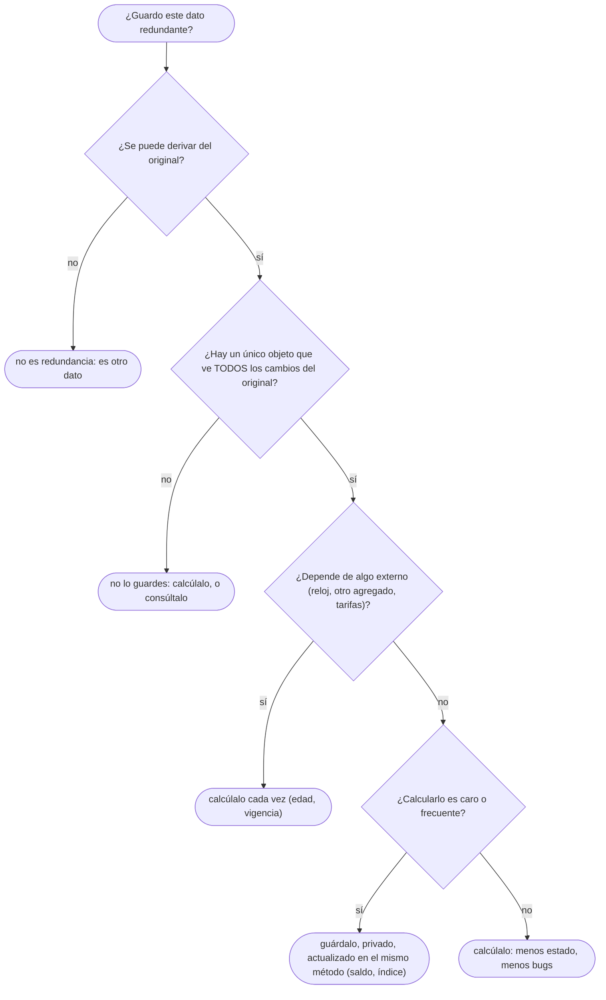

# 05 — Redundancia controlada

> Defender una redundancia en el modelo de objetos y decir qué la mantiene coherente: navegación en
> los dos sentidos, atributos derivados cacheados, el documento principal y los índices en memoria. La
> tesis del capítulo: **la redundancia no es un defecto si un único dueño mantiene el invariante**.
> Asume leído [`03` — Navegabilidad y coherencia](03-navegabilidad-y-coherencia.md).
>
> **Vigencia:** 2026-10-03.
>
> **Versiones ejecutadas:** JDK 21.0.12, 17.0.20 y 25.0.4 (2026-10-04).

---

## 1. 🎯 El problema

La pantalla de clientes muestra en cada fila el "documento principal" de la persona: el que eligió para
identificarse. Ana eligió su pasaporte. El primer diseño lo busca cada vez:

```java
Documento principal = ana.documentos().stream()
        .filter(d -> d.esPrincipal())                // un flag en cada documento
        .findFirst().orElseThrow();
```

- Funciona hasta que dos documentos tienen el flag (alguien marcó el nuevo y no desmarcó el viejo), y
  la pantalla muestra uno al azar.

El segundo diseño guarda una referencia aparte, y se rompe por el otro lado:

```java
public class Persona {
    private final Set<Documento> documentos = new LinkedHashSet<>();
    public Documento documentoPrincipal;                       // público, escrito desde cualquier sitio
    public Set<Documento> documentos() { return documentos; }  // la colección interna, tal cual
}

ana.documentos().remove(pasaporte);               // el pasaporte se dio de baja...
Documento p = ana.documentoPrincipal;             // ...y sigue siendo el principal
```

Los dos diseños guardan **la misma información en dos sitios** —"cuál es el principal" está en el flag
o en la referencia, y "qué documentos tiene" en la colección— y ninguno dice quién mantiene las dos de
acuerdo. La respuesta de manual es "eso es redundancia, elimínala". La respuesta de este capítulo es
otra: **la redundancia está bien; lo que falta es un dueño**.

---

## 2. 🧱 La tesis: en objetos, la redundancia no es un defecto

**De dónde viene la regla contraria.** En un esquema relacional normalizado, la redundancia es un
defecto: el mismo dato en dos filas puede divergir, y la base de datos no sabe cuál manda. La
normalización existe para eliminar esas anomalías de actualización.

**Por qué en objetos es distinto.** El modelo de objetos no optimiza el almacenamiento: optimiza la
**navegación y el comportamiento**. Y tiene algo que la tabla no tiene: **métodos que encapsulan las
escrituras**. Si el único camino para cambiar los documentos de Ana pasa por `Persona`, `Persona` puede
mantener coherente cualquier redundancia que decida guardar, porque ve todos los cambios.

| | Esquema relacional | Modelo de objetos |
|---|---|---|
| Qué optimiza | No repetir datos | Llegar rápido a lo que el caso de uso necesita |
| Quién escribe | Cualquier sentencia con permisos | Solo los métodos del dueño |
| La redundancia es… | Un riesgo que la normalización elimina | Una decisión que un dueño mantiene |

**Lo que no es.** Esto **no** es "desnormalizar". Desnormalizar una base de datos copia datos entre
tablas por rendimiento y acepta el riesgo de que diverjan, con *triggers* o procesos que los sincronizan
a posteriori. La redundancia controlada en objetos vive **dentro de un mismo dueño** y se mantiene en la
misma operación que cambia el dato original, sin ventana de incoherencia.

Qué pasa con estas redundancias al guardar en una base de datos —que normalmente no las guarda, o las
recalcula— es de [`07` — Objetos frente a tablas](07-objetos-frente-a-tablas.md); y la frontera dentro de
la cual un dueño puede garantizarlas tiene nombre: el agregado, de [`09/01`](../09-ddd-tactico-y-otros/01-entidad-valor-y-agregado.md).

> **Veredicto:** "la redundancia siempre es mala" es una regla de diseño de tablas aplicada fuera de
> sitio. En objetos, una redundancia es aceptable si un único objeto la escribe y la mantiene en la
> misma operación.

---

## 3. 🧱 Las cuatro formas

| Forma | Ejemplo del dominio | Qué se duplica | Quién la mantiene |
|---|---|---|---|
| **Navegación en los dos sentidos** | `Persona` ↔ `Documento` | "Este documento es de Ana", dos veces | `Persona.agregarDocumento` (ver `03`) |
| **Atributo derivado cacheado** | El saldo de una `Cuenta` | La suma de sus movimientos | `Cuenta.registrar(Movimiento)` |
| **Referencia a un elemento de la colección** | El documento principal de Ana | Un elemento que ya está en `documentos` | `Persona`, en cada alta y baja |
| **Índice en memoria** | Un `Map<String, Documento>` por número | Los mismos documentos, organizados de otra forma | El objeto que tiene la colección y el mapa |

- En las cuatro, el dato redundante **se puede reconstruir** a partir del original: es una copia
  derivada, no información nueva. Eso es lo que permite tener un dueño que la calcule.

---

## 4. 🧱 La regla: un único dueño mantiene el invariante

**El invariante del documento principal:** "el principal, si existe, es uno de los documentos de la
persona". Lo mantiene `Persona`, que es la única que escribe las dos cosas:

```java
public final class Persona {
    private final Set<Documento> documentos = new LinkedHashSet<>();
    private Documento principal;                                  // redundante, y privado

    public void marcarPrincipal(Documento d) {
        if (!documentos.contains(d)) throw new IllegalArgumentException("no es de esta persona: " + d);
        this.principal = d;
    }

    public void quitarDocumento(Documento d) {
        documentos.remove(d);
        if (d.equals(principal)) principal = null;                // la baja mantiene el invariante
    }

    public Optional<Documento> documentoPrincipal() { return Optional.ofNullable(principal); }
}
```

- La redundancia es **privada**: nadie de fuera puede escribir `principal` sin pasar por las reglas.
- **Cada operación que toca el dato original actualiza la copia en el mismo método.** `quitarDocumento`
  no puede olvidar el principal porque está escrito ahí, una sola vez.
- El flag `esPrincipal` del primer diseño era la misma redundancia repartida en N objetos: para cambiar
  el principal había que tocar dos documentos, y ninguno de los dos veía al otro.

> **Veredicto:** una redundancia por dueño, privada, y actualizada en el mismo método que cambia el
> dato del que deriva.

---

## 5. 🧱 Atributos derivados: cachear o calcular

**Qué es.** Un **atributo derivado** se calcula a partir de otros (en UML se marca con `/`: `/edad`,
`/saldo`). La pregunta es si se calcula cada vez o se guarda.

**El saldo de la cuenta, cacheado.** El saldo de `CTA-0001` es la suma de sus movimientos. Recalcularlo
en cada consulta recorre años de movimientos; guardarlo y actualizarlo en cada movimiento es O(1):

```java
public final class Cuenta {
    private final List<Movimiento> movimientos = new ArrayList<>();
    private Dinero saldo;                                         // derivado y cacheado

    public void registrar(Movimiento m) {
        Dinero nuevo = saldo.mas(m.importe());
        if (nuevo.esNegativo()) throw new SaldoInsuficienteException(this, m.importe());
        movimientos.add(m);
        saldo = nuevo;                                            // en la misma operación
    }
}
```

**La edad de Ana, calculada.** `/edad` también es derivada, pero **no** se cachea: depende de la fecha de
hoy, que cambia sin que la persona cambie. Un campo `edad` sería correcto el día que se guardó y falso un
año después, y ningún método de `Persona` se enteraría.

**La regla:** se cachea lo que **solo cambia cuando cambia el objeto** (y el objeto ve el cambio); se
calcula lo que depende de algo externo —el reloj, otro agregado, una tarifa—.

> 💡 **Truco.** "Los datos derivados se calculan siempre al vuelo" es la versión ingenua; "nunca se
> cachea nada que dependa del reloj" es la versión que sube la nota, porque es la que sale en producción
> con un `edad` que nunca cumplió años.

---

## 6. 🧱 Índices en memoria

Un objeto que contiene muchos elementos y los busca por una clave puede guardar **la misma colección dos
veces**: una lista para recorrer en orden y un mapa para buscar.

```java
public final class RegistroDocumentos {
    private final List<Documento> enOrden = new ArrayList<>();
    private final Map<String, Documento> porNumero = new HashMap<>();   // índice redundante

    public void registrar(Documento d) {
        if (porNumero.putIfAbsent(d.numero(), d) != null)
            throw new IllegalArgumentException("número repetido: " + d.numero());
        enOrden.add(d);                                                  // las dos, juntas
    }
    public Optional<Documento> buscar(String numero) { return Optional.ofNullable(porNumero.get(numero)); }
}
```

- El costo es memoria (una entrada de mapa por documento) y la obligación de que **toda** alta y baja
  toque las dos estructuras. Por eso las dos son privadas y hay un método por operación.
- `LinkedHashMap` haría las dos cosas en una sola estructura; el ejemplo muestra el caso general, que
  aparece en cuanto se necesitan dos órdenes distintos.

---

## 7. 🩺 Cuándo la redundancia se vuelve un bug

Tres causas, y las tres son la misma: **se rompió la regla del dueño único**.

| Causa | Cómo se ve | Corrección |
|---|---|---|
| **Dos dueños** | El flag `esPrincipal` en cada documento: dos objetos escriben el mismo hecho | Un solo dueño: `Persona` guarda la referencia |
| **Actualización fuera de la raíz** | `ana.getDocumentos().remove(d)` desde un controlador: la colección cambia y `principal` no | La colección no se expone mutable; los cambios pasan por `Persona` |
| **Caché sin invalidación** | Un `edad` guardado, o un saldo que se actualiza en `registrar` pero no en `anular` | Cachear solo lo que el dueño ve cambiar, y actualizarlo en **todas** las operaciones |

- La tercera es la más difícil de ver en una revisión: el código que añade movimientos actualiza el
  saldo, y el que los anula, escrito meses después por otra persona, no. Por eso conviene que el saldo se
  escriba en **un solo método privado** al que llaman todas las operaciones.

---

## 8. 🧭 Cómo se elige



**La frase en voz alta:** *"Acepto la redundancia si un único dueño la mantiene en la misma operación que
cambia el dato original. No es desnormalizar: no hay ventana en la que las dos copias digan cosas
distintas."*

---

## ⚠️ Errores frecuentes

| Se dice | Lo preciso |
|---|---|
| "La redundancia siempre es mala" | En tablas es un riesgo que se normaliza; en objetos, con un único dueño, es una decisión legítima |
| "Los datos derivados se calculan siempre al vuelo" | Se cachea lo que solo cambia con el objeto; se calcula lo que depende del reloj o de fuera |
| "Normalizar el modelo de objetos es buena práctica" | El modelo optimiza navegación y comportamiento, no almacenamiento |
| "Redundancia controlada es lo mismo que desnormalizar" | Desnormalizar sincroniza a posteriori; la controlada se mantiene en la misma operación, dentro de un dueño |
| "Un flag `esPrincipal` en cada elemento es más simple" | Reparte un mismo hecho en N objetos que no se ven entre sí |
| "Un campo `edad` ahorra cálculos" | Es correcto el día que se guarda y falso un año después |

---

## 📚 Para profundizar

- **Libro** — Fowler, *UML Distilled*, 3.ª ed. (Addison-Wesley, 2003), cap. 5, sección "Derived
  Properties": qué significa la `/` y la distinción entre calcular y guardar.
- **Libro** — Evans, *Domain-Driven Design* (Addison-Wesley, 2003), cap. 6, "The Life Cycle of a Domain
  Object", sección "Aggregates": el objeto raíz como único guardián de los invariantes de lo que
  contiene. **El que destaca**: es la regla del dueño único con otro nombre.
- [Java 21 API — `LinkedHashMap`](https://docs.oracle.com/en/java/javase/21/docs/api/java.base/java/util/LinkedHashMap.html):
  índice y orden en una sola estructura.

---

## 🧠 Preguntas

Sin respuestas aquí. Todas, con enunciado literal y respuesta en tres capas, en
[`09` — Respuestas](09-respuestas.md#05--redundancia-controlada).

1. ¿Qué es la redundancia controlada en un modelo de objetos? 🟢
2. ¿Cuáles son las cuatro formas de redundancia del capítulo? 🟢
3. ¿Qué es un atributo derivado, y cómo se marca en UML? 🟢
4. ¿Cuál es la regla que hace aceptable una redundancia? 🟢
5. ¿Qué diferencia hay entre redundancia controlada y desnormalizar? 🟡
6. ¿Qué diferencia hay entre la redundancia en un esquema relacional y en un modelo de objetos? 🟡
7. ¿Qué diferencia hay entre guardar el documento principal como referencia y como flag en cada
    documento? 🟡
8. ¿Por qué el saldo de una cuenta se puede cachear y la edad de una persona no? 🟡
9. ¿Qué diferencia hay entre un índice en memoria y una consulta? 🟡
10. ¿Cambia algo la redundancia controlada entre Java y C++? 🟡
11. ¿Por qué la redundancia es aceptable en objetos y un riesgo en tablas? 🟠
12. ¿Por qué el dato redundante tiene que ser privado? 🟠
13. ¿Qué tres causas convierten una redundancia en un bug? 🟠
14. ¿Por qué la invalidación de una caché es la causa más difícil de ver en una revisión? 🟠
15. ¿Cuándo no deberías guardar un dato derivado aunque calcularlo sea caro? 🟠
16. ¿Qué pasa con la redundancia controlada si la colección se expone mutable? 🟠
17. ¿Cómo mantienes coherente un índice `Map<String, Documento>` junto a una lista de documentos en C++
    y en Java, y qué cambia? 🟠
18. Escribe `marcarPrincipal` y `quitarDocumento` en `Persona` de modo que el principal sea siempre uno
    de sus documentos. 🔴
19. Escribe `Cuenta` con el saldo cacheado, `registrar` y `anular`, de modo que el saldo no pueda
    divergir de los movimientos. 🔴
20. Revisa este diseño y di qué está mal: `class Persona { int edad; void cumplirAnios() { edad++; } }`
    con un proceso nocturno que llama a `cumplirAnios`. 🔴
21. Decide si guardar en `Persona` un campo `cantidadDocumentosVigentes`. Defiende la decisión. 🔴
22. Un compañero dice en una revisión: "esto es redundante, el principal se puede calcular, bórralo".
    Responde con el criterio del capítulo. 🔴

---

**Anterior:** [`04` — Agregación, composición y propiedad](04-agregacion-composicion-y-propiedad.md) ·
**Siguiente:** [`06` — Entidades, valores y primitivos](06-entidades-valores-y-primitivos.md) ·
**Relacionado:** [`03` — Navegabilidad y coherencia](03-navegabilidad-y-coherencia.md)
