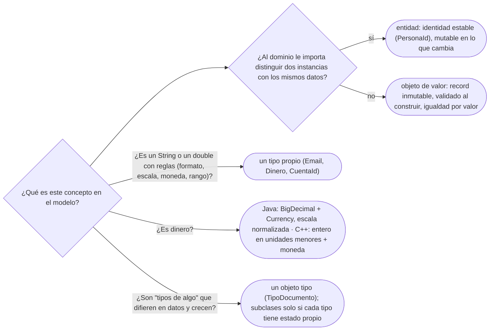

# 06 — Entidades, valores y primitivos

> Distinguir una entidad de un objeto de valor, sacar del código los primitivos que esconden
> conceptos —el dinero en `double`, el email en `String`—, tipar los identificadores, y decidir entre
> `TipoDocumento` como objeto y una subclase por tipo. Es el dueño del objeto de valor como concepto.
> Asume leído [`01/02` — Igualdad, identidad y hash](../01-modelo-de-objetos/02-igualdad-identidad-y-hash.md)
> y [`01/03` — Inmutabilidad y objetos especiales](../01-modelo-de-objetos/03-inmutabilidad-y-objetos-especiales.md).
>
> **Vigencia:** 2026-10-03.
>
> **Versiones ejecutadas:** GCC 14.4 (C++23) · JDK 21.0.12, 17.0.20 y 25.0.4 (2026-10-04).

---

## 1. 🎯 El problema

La firma de un servicio de transferencias, tal como aparece en muchos sistemas:

```java
void transferir(String origen, String destino, double monto, String moneda);   // la firma del servicio

transferir("CTA-0003", "CTA-0001", 250000.0, "COP");    // origen y destino al revés: compila
double total = 0.1 + 0.2;                                // 0.30000000000000004
```

- Cuatro parámetros, tres de tipo `String`: el compilador no puede distinguir una cuenta de una moneda,
  y los argumentos al revés pasan sin aviso. La transferencia de Ana a Luis acaba siendo de Luis a Ana.
- El monto en `double` no representa exactamente `0.1`, y una suma de céntimos acaba con errores de
  redondeo que en un extracto bancario son inaceptables.
- Y la moneda es un `String` que acepta `"cop"`, `"COL"` o `"pesos"`.

Cada `String` y cada `double` de esa firma **esconde un concepto** del dominio —cuenta, dinero,
moneda— que tiene reglas propias. Este capítulo los saca a la luz, y antes distingue las dos clases de
objetos que tiene un modelo: los que tienen identidad y los que no.

---

## 2. 🧱 Entidad contra objeto de valor

**Qué es.** Una **entidad** es un objeto que importa por **quién es**: tiene una identidad que se
mantiene aunque cambie todo su estado. Ana sigue siendo Ana si cambia de nombre, de dirección y de
documentos. Un **objeto de valor** importa por **lo que vale**: dos con el mismo contenido son
intercambiables. Dos billetes de 50 000 COP, dos direcciones iguales, dos `Dinero` de 250 000,00 COP.

| | Entidad | Objeto de valor |
|---|---|---|
| Igualdad | Por identidad o identificador | Por todos sus campos |
| Ciclo de vida | Nace, cambia, se da de baja | Se crea, se usa, se reemplaza |
| Mutabilidad | Mutable en lo que cambia | Inmutable |
| Ejemplos del dominio | `Persona`, `Cuenta`, `Empleo` | `Dinero`, `Direccion`, `Contacto`, un rango de fechas |

**Cómo se decide.** No depende de la clase sino del **contexto**: una `Direccion` es un valor para un
sistema de clientes (la de Ana es igual a cualquier otra con la misma calle), y sería una entidad para el
catastro, que sigue a cada predio en el tiempo. La pregunta es: ¿al dominio le importa distinguir dos
instancias iguales?

> **Veredicto:** por defecto, valor. Una clase es entidad solo si el dominio sigue su identidad a lo
> largo del tiempo.

---

## 3. 🧱 El objeto de valor como concepto

**Qué es.** Un objeto de valor es pequeño, **inmutable**, con **igualdad por valor**, y **se valida al
construirse**: un `Dinero` con moneda nula o un `Email` sin arroba no llegan a existir. Para cambiarlo,
se crea otro. Las piezas ya están en el bloque de modelo de objetos: la igualdad de `01/02` y la
inmutabilidad de `01/03`. El patrón *Value Object* con nombre propio, y su versión de Fowler, *Money*,
tienen capítulo en [`08/05` — Patrones base](../08-fowler-presentacion-distribucion-y-base/05-patrones-base.md); aquí es la idea.

```java
public record Email(String valor) {
    public Email {
        if (valor == null || !valor.matches("[^@\\s]+@[^@\\s]+\\.[^@\\s]+"))
            throw new IllegalArgumentException("email inválido: " + valor);
        valor = valor.toLowerCase(Locale.ROOT);                  // normalizado: igualdad fiable
    }
}
```

**La sobregeneralización.** "Un objeto de valor es un DTO" mezcla dos cosas que se parecen por fuera. Un
DTO (*Data Transfer Object*) es una bolsa de datos para cruzar una frontera —una petición HTTP, una
respuesta—, sin reglas ni comportamiento. Un objeto de valor es un concepto del dominio con sus
invariantes y sus operaciones: `Dinero.mas`, `Direccion.conCalle`. Un DTO puede tener un campo `String
email` sin validar; un objeto de valor `Email` no puede ser inválido.

**Qué cuesta.** Una clase más por concepto, y conversiones en los bordes (de `String` a `Email` al leer
la petición, y al revés al responder). Lo que compra es que la validación ocurre una vez y el resto del
código ya no tiene que dudar.

---

## 4. 🧱 La obsesión por los primitivos

**Qué es.** La ***primitive obsession*** (obsesión por los primitivos) es representar conceptos del
dominio con tipos primitivos o `String`: `String email`, `double monto`, `String numeroDocumento`,
`String codigoCuenta`. Es el *code smell* que más abunda en sistemas de negocio, y tiene nombre en el
catálogo de *Refactoring*.

**Qué cuesta.** En las cuatro monedas:

- **Legibilidad**: la firma `transferir(String, String, double, String)` no dice qué es cada cosa.
- **Acoplamiento**: las reglas del concepto (formato del email, escala del dinero) se repiten en cada
  sitio que lo usa, o no se aplican en ninguno.
- **Corrección**: el compilador no distingue una cuenta de una moneda, y los argumentos cambiados
  compilan.
- **Rendimiento**: casi ninguno. Un `record` de un campo cuesta un objeto; en Java, el JIT elimina muchos
  por *escape analysis*, y en C++ un `struct` de un campo no cuesta nada.

**La salida** es la refactorización *Replace Primitive with Object*: un tipo por concepto, que se valida
al crearse. Se hace por partes, empezando por el concepto que más reglas tiene.

> **Veredicto:** si un `String` o un `double` tiene reglas —formato, escala, rango, moneda—, es un
> concepto y merece un tipo.

---

## 5. 🧱 `Dinero`: por qué no `double`

**Por qué no `double`.** `double` es un número en coma flotante **binaria**: no puede representar
exactamente `0.1`, ni la mayoría de las fracciones decimales. Las sumas acumulan errores, y comparar con
`==` falla. "`double` sirve para dinero si redondeo" es falso: el redondeo al final no recupera lo que se
perdió en cada operación intermedia, y no hay un sitio único donde redondear.

**En Java: `BigDecimal` más moneda.**

```java
public record Dinero(BigDecimal monto, Currency moneda) {
    public Dinero {
        Objects.requireNonNull(moneda);
        monto = monto.setScale(moneda.getDefaultFractionDigits(), RoundingMode.HALF_EVEN);
    }
    public Dinero mas(Dinero otro) {
        if (!moneda.equals(otro.moneda)) throw new IllegalArgumentException("monedas distintas");
        return new Dinero(monto.add(otro.monto), moneda);
    }
}

var transferencia = new Dinero(new BigDecimal("250000.00"), Currency.getInstance("COP"));
```

- `new BigDecimal("0.1")` con un `String`, **nunca** `new BigDecimal(0.1)`: el constructor con `double`
  hereda el error binario del `double` (`0.1000000000000000055511151231257827…`).
- La escala se normaliza en el constructor para que la igualdad del `record` sea fiable, como en `01/02`.
- `Currency` es la clase del JDK con los códigos ISO 4217: `COP` y `USD` existen, y `"pesos"` no.

**En C++: unidades menores en un entero.** C++ no tiene un `BigDecimal` estándar, y la forma habitual es
guardar el monto en la unidad menor de la moneda (centavos) en un entero de 64 bits:

```cpp
enum class Moneda { COP, USD };

class Dinero {
    std::int64_t centavos;      // exacto: 250 000,00 COP son 25 000 000 centavos
    Moneda moneda;
public:
    Dinero(std::int64_t c, Moneda m) : centavos(c), moneda(m) {}
    Dinero operator+(const Dinero& o) const {
        if (moneda != o.moneda) throw std::invalid_argument("monedas distintas");
        return {centavos + o.centavos, moneda};
    }
    bool operator==(const Dinero&) const = default;   // valor puro: todos los campos
};
```

- Con enteros las sumas son exactas; las divisiones (repartir una comisión en tres) obligan a decidir
  qué pasa con el céntimo que sobra, y esa decisión es del dominio. Fowler la resuelve con
  `allocate` en su patrón *Money*.

---

## 6. 🧱 Identificadores tipados

**Qué es.** Un identificador como `Long` o `String` se confunde con cualquier otro: un id de cuenta se
puede pasar donde se espera un id de persona. Un **identificador tipado** es un objeto de valor de un
solo campo:

```java
public record PersonaId(UUID valor) { }
public record CuentaId(String valor) {
    public CuentaId { if (!valor.matches("CTA-\\d{4}")) throw new IllegalArgumentException(valor); }
}

void transferir(CuentaId origen, CuentaId destino, Dinero monto);   // ya no se pueden mezclar
```

```cpp
struct CuentaId {
    std::string valor;
    bool operator==(const CuentaId&) const = default;
};
void transferir(const CuentaId& origen, const CuentaId& destino, const Dinero& monto);
```

- Origen y destino siguen siendo del mismo tipo, así que intercambiarlos aún compila. Lo que el tipo
  elimina es mezclar conceptos distintos (una cuenta con una persona); para el orden, nombres claros o un
  objeto `Transferencia`.

---

## 7. 🧱 El tipo como objeto: `TipoDocumento` contra subclases

**El problema.** Cédula, tarjeta de identidad y pasaporte se validan distinto y unos vencen y otros no.
La reacción de manual es una subclase por tipo: `Cedula extends Documento`, `Pasaporte extends
Documento`. Funciona con tres tipos y se rompe con el país número veinte.

**La alternativa: el tipo es un objeto.** `TipoDocumento` es una clase cuyas **instancias son tipos**:
`CC`, `TI`, `PAS-CO` y `PAS-MX` son cuatro objetos, cada uno con su código, su país, su formato y si
vence. Un tipo nuevo es un dato —una fila en una tabla—, no una clase nueva.

```java
public final class TipoDocumento {
    private final String codigo;        // "PAS-CO"
    private final Pais pais;
    private final Pattern formato;      // [A-Z]{2}\d{6}
    private final boolean vence;

    public boolean admite(String numero) { return formato.matcher(numero).matches(); }
}
```

| | Una subclase por tipo | `TipoDocumento` como objeto |
|---|---|---|
| Tipo nuevo | Una clase nueva, compilar y desplegar | Un dato nuevo |
| Comportamiento distinto por tipo | Natural: se sobrescribe | Solo el que se puede expresar como datos, o con una estrategia por tipo |
| Estado propio por tipo (los visados de un pasaporte) | Natural | Incómodo |

**Cuándo cada uno.** "Cada tipo de documento merece su subclase" es falso como regla: las subclases ganan
cuando cada tipo tiene **estado o comportamiento propio** que no cabe en datos; el tipo como objeto gana
cuando los tipos **difieren solo en datos** y crecen sin aviso. Este patrón tiene nombre, Type Object, y
capítulo propio en [`09/03`](../09-ddd-tactico-y-otros/03-specification-null-object-y-type-object.md).

> **Veredicto:** si la diferencia entre tipos cabe en una fila, es un objeto tipo; si necesita campos o
> métodos distintos, es una subclase.

---

## 8. 🧭 Cómo se elige



**La frase en voz alta:** *"Por defecto, objetos de valor inmutables; entidad solo si el dominio sigue su
identidad. Y cada `String` o `double` con reglas es un concepto que merece su tipo, empezando por el
dinero."*

---

## ⚠️ Errores frecuentes

| Se dice | Lo preciso |
|---|---|
| "Un objeto de valor es un DTO" | El DTO transporta datos sin reglas; el objeto de valor es un concepto del dominio, validado e inmutable |
| "`double` sirve para dinero si redondeo" | No representa exactamente las fracciones decimales y el error se acumula en cada operación |
| "Cada tipo de documento merece su subclase" | Si los tipos difieren solo en datos, un objeto tipo escala mejor: un tipo nuevo es una fila |
| "`new BigDecimal(0.1)` es exacto" | Hereda el error del `double`; se construye con `"0.1"` o con `BigDecimal.valueOf` |
| "Entidad o valor depende de la clase" | Depende del contexto: la misma `Direccion` es valor para un sistema y entidad para otro |
| "Tipar los identificadores es ceremonia" | Evita mezclar ids de conceptos distintos, que el compilador no puede detectar con `Long` |
| "Un `String` validado una vez ya es seguro" | Solo si nadie puede construir otro sin validar; por eso la validación va en el constructor del tipo |

---

## 📚 Para profundizar

- **Libro** — Evans, *Domain-Driven Design* (Addison-Wesley, 2003), cap. 5, "A Model Expressed in
  Software", secciones "Entities" y "Value Objects". **El que destaca**: la distinción nace ahí.
- **Libro** — Bloch, *Effective Java*, 3.ª ed. (Addison-Wesley, 2018), ítems 60, "Avoid float and double
  if exact answers are required", y 62, "Avoid strings where other types are more appropriate".
- **Libro** — Fowler, *Refactoring*, 2.ª ed. (Addison-Wesley, 2018), *Replace Primitive with Object*.
- [martinfowler.com — *Value Object*](https://martinfowler.com/bliki/ValueObject.html).
- [martinfowler.com — *Money*](https://martinfowler.com/eaaCatalog/money.html), del catálogo de *PoEAA*.
- [refactoring.com — *Replace Primitive with Object*](https://refactoring.com/catalog/replacePrimitiveWithObject.html).
- [Java 21 API — `Currency`](https://docs.oracle.com/en/java/javase/21/docs/api/java.base/java/util/Currency.html).
- [Java 21 API — `BigDecimal`](https://docs.oracle.com/en/java/javase/21/docs/api/java.base/java/math/BigDecimal.html):
  la nota sobre el constructor con `double` y su resultado impredecible.

---

## 🧠 Preguntas

Sin respuestas aquí. Todas, con enunciado literal y respuesta en tres capas, en
[`09` — Respuestas](09-respuestas.md#06--entidades-valores-y-primitivos).

1. ¿Qué es una entidad? 🟢
2. ¿Qué es un objeto de valor? 🟢
3. ¿Qué es la obsesión por los primitivos? 🟢
4. ¿Por qué no se usa `double` para dinero? 🟢
5. ¿Qué es un identificador tipado? 🟢
6. ¿Qué es un objeto tipo, como `TipoDocumento`? 🟢
7. ¿Qué diferencia hay entre un objeto de valor y un DTO? 🟡
8. ¿Qué diferencia hay entre la igualdad de una entidad y la de un objeto de valor? 🟡
9. ¿Qué diferencia hay entre `new BigDecimal(0.1)` y `new BigDecimal("0.1")`? 🟡
10. ¿Cómo representas dinero en Java y cómo en C++, y por qué distinto? 🟡
11. ¿Qué diferencia hay entre una subclase por tipo de documento y `TipoDocumento` como objeto? 🟡
12. ¿Cómo se escribe un identificador tipado en Java y en C++, y cuánto cuesta en cada uno? 🟡
13. ¿Por qué una misma clase puede ser entidad en un sistema y valor en otro? 🟠
14. ¿Por qué un objeto de valor se valida en el constructor? 🟠
15. ¿Qué cuesta la obsesión por los primitivos, en las cuatro monedas? 🟠
16. ¿Por qué redondear al final no arregla el dinero en `double`? 🟠
17. ¿Qué no resuelve un identificador tipado, y cómo lo resuelves? 🟠
18. ¿Cuándo una subclase por tipo es mejor que un objeto tipo? 🟠
19. ¿Por qué se normaliza la escala del monto en el constructor de `Dinero`? 🟠
20. Refactoriza la firma de §1 para que no se puedan mezclar cuentas, montos ni monedas. 🔴
21. Escribe `Email` como objeto de valor en Java, validado y normalizado. 🔴
22. Escribe `Dinero` en C++ con unidades menores, suma y comparación, y di qué decisión obliga a tomar
    la división. 🔴
23. Decide si `Contacto` (email o teléfono de Ana) es entidad o valor, y escríbelo. 🔴
24. Revisa este modelo y di qué está mal: `class Cuenta { String id; String titularId; double saldo;
    String moneda; }`. 🔴

---

**Anterior:** [`05` — Redundancia controlada](05-redundancia-controlada.md) ·
**Siguiente:** [`07` — Objetos frente a tablas](07-objetos-frente-a-tablas.md) ·
**Relacionado:** [`01/02` — Igualdad, identidad y hash](../01-modelo-de-objetos/02-igualdad-identidad-y-hash.md)
