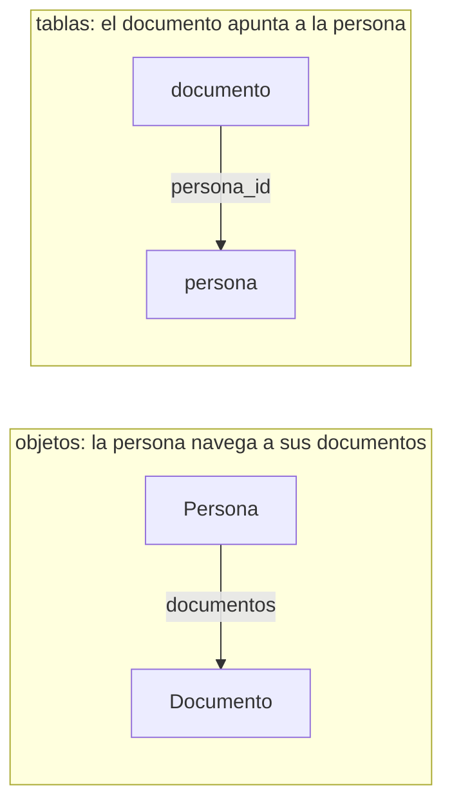
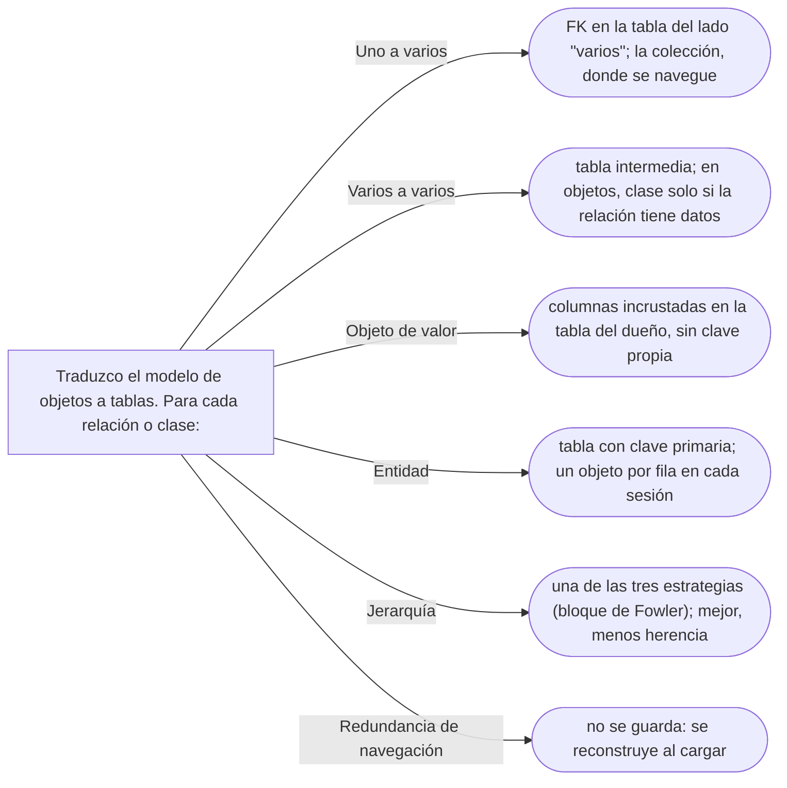

# 07 — Objetos frente a tablas

> Por qué el modelo de objetos y el relacional no coinciden, y en qué cinco puntos chocan: la dirección
> de la referencia, los varios a varios, la herencia, la identidad y la granularidad. Sin hablar de un
> ORM concreto. Asume leído [`02` — De la asociación al código](02-de-la-asociacion-al-codigo.md) y
> [`05` — Redundancia controlada](05-redundancia-controlada.md).
>
> **Vigencia:** 2026-10-03.
>
> **Versiones ejecutadas:** JDK 21.0.12, 17.0.20 y 25.0.4 · PostgreSQL 18.6 (2026-10-04).

---

## 1. 🎯 El problema

Un equipo diseña primero las tablas y después escribe una clase por tabla, campo por columna:

```sql
CREATE TABLE persona   (id BIGINT PRIMARY KEY, nombre VARCHAR(120), fecha_nacimiento DATE);
CREATE TABLE documento (id BIGINT PRIMARY KEY, persona_id BIGINT REFERENCES persona(id),
                        tipo_codigo VARCHAR(10), numero VARCHAR(20));
```

```java
public class Documento {
    private Long id;
    private Long personaId;          // la columna, tal cual
    private String tipoCodigo;       // un String donde había un TipoDocumento
    private String numero;
}
public class Persona {
    private Long id;
    private String nombre;
    private LocalDate fechaNacimiento;
    // sin documentos: la tabla persona no tiene columna de documentos
}
```

- `Persona` no tiene documentos, porque su tabla no los tiene; `Documento` conoce a su persona por un
  `Long`, porque la clave foránea está en su tabla. El modelo de objetos quedó **al revés** de como se
  navega: para mostrar los documentos de Ana hay que hacer una consulta, y el código de negocio no puede
  preguntarle nada a una `Persona`.
- "Una clase es una tabla" produce esto: un modelo anémico ([`12/03` §3](../12-antipatrones/03-antipatrones-de-diseno-oo.md#3-️-anemic-domain-model)) que copia el esquema. Este capítulo dice
  dónde y por qué los dos modelos son distintos, para poder traducir entre ellos sin que uno se coma al
  otro.

---

## 2. 🧱 Los dos modelos optimizan cosas distintas

El modelo relacional guarda **hechos** en filas, sin repetir, y los cruza con consultas declarativas. El
de objetos guarda **comportamiento y navegación**: grafos de objetos que se recorren siguiendo
referencias. La distancia entre los dos tiene nombre, *object-relational impedance mismatch* (desajuste
de impedancia objeto-relacional), y aparece en cinco puntos:

| Punto | En objetos | En tablas |
|---|---|---|
| **Referencia** | Va del que navega al navegado (`Persona` → `Documento`) | La FK va del lado "varios" al "uno" (`documento.persona_id`) |
| **Varios a varios** | Una colección en uno o en los dos lados | Una tabla intermedia, siempre |
| **Herencia** | Natural | No existe |
| **Identidad** | La referencia (`==`) | La clave primaria |
| **Granularidad** | Muchos objetos pequeños (`Dinero`, `Direccion`) | Pocas tablas anchas |

> **Veredicto:** "una clase es una tabla" funciona para tablas de catálogo sin comportamiento; para el
> modelo de negocio, cada uno de los cinco puntos necesita una decisión.

---

## 3. 🧱 La FK contra la navegación

**Qué pasa.** La base de datos no puede guardar una colección en una columna, así que la relación uno a
varios se guarda en el lado "varios": `documento.persona_id`. En objetos, la colección va en el lado
desde el que se navega, que casi siempre es el "uno": `persona.documentos()`.



**La sobregeneralización.** "Si la FK está en `documento`, `Documento` debe conocer a `Persona`" toma una
restricción del almacenamiento como regla del modelo. El modelo de objetos decide la navegabilidad por
los casos de uso (ver [`03` — Navegabilidad y coherencia](03-navegabilidad-y-coherencia.md)); la
traducción a la FK es trabajo de la capa de persistencia, que al guardar a Ana escribe `persona_id` en
cada fila de sus documentos **sin que `Documento` tenga ese campo**:

```java
// Persistencia escrita a mano: la FK sale del contexto, no del objeto
for (Documento d : persona.documentos()) {
    insertarDocumento.setLong(1, persona.id().valor());    // persona_id viene de la persona
    insertarDocumento.setString(2, d.tipo().codigo());
    insertarDocumento.setString(3, d.numero());
    insertarDocumento.addBatch();
}
```

> **Veredicto:** la FK dice dónde se guarda la relación; la navegabilidad, por dónde se recorre. Son dos
> decisiones, y la segunda no se deriva de la primera.

---

## 4. 🧱 Varios a varios: tabla intermedia contra colecciones

Una persona puede ser titular de varias cuentas y una cuenta tener varios titulares. En tablas, siempre
una tabla intermedia; en objetos, una colección en el lado que navega, o una clase intermedia solo si la
relación tiene datos propios (ver [`02` §6](02-de-la-asociacion-al-codigo.md#6--varios-a-varios-dos-colecciones-o-una-clase-en-medio)):

```sql
CREATE TABLE titularidad (cuenta_id VARCHAR(8) REFERENCES cuenta(id),
                          persona_id BIGINT REFERENCES persona(id),
                          PRIMARY KEY (cuenta_id, persona_id));
```

- Que la base tenga una tabla `titularidad` **no** obliga a tener una clase `Titularidad`. Si la relación
  no tiene más datos que las dos claves, en objetos es un `Set<PersonaId>` en `Cuenta`. Si tiene
  porcentaje o fecha, la clase aparece en los dos modelos.

---

## 5. 🧱 La herencia que la tabla no tiene

Si el modelo tiene una jerarquía —documentos con subclases, por ejemplo—, el esquema relacional no tiene
nada equivalente, y hay tres formas clásicas de aplanarla: **una tabla para toda la jerarquía** con una
columna discriminadora, **una tabla por clase** unidas por la clave, o **una tabla por clase concreta**.
Cada una paga en algo distinto —columnas nulas, *joins*, consultas polimórficas—, y la tabla de decisión
entre las tres está en [`07/04` §7](../07-fowler-dominio-y-datos/04-estructura-objeto-relacional.md#7--los-tres-mapeos-de-herencia).

Lo que importa aquí es la consecuencia para el modelo: **cuanto menos herencia de datos tenga el modelo,
menos hay que aplanar**. Es otra razón para el objeto tipo de [`06` §7](06-entidades-valores-y-primitivos.md#7--el-tipo-como-objeto-tipodocumento-contra-subclases):
`TipoDocumento` como objeto es una tabla de tipos y una FK; una jerarquía de cuatro subclases son tres
decisiones de mapeo.

---

## 6. 🧱 Identidad: clave primaria contra referencia

**Qué pasa.** En la base, la identidad de Ana es su clave primaria: una fila, una persona. En memoria, la
identidad es la referencia, y **nada impide cargar la misma fila dos veces** en dos objetos distintos:

```java
Persona a = repositorio.cargar(new PersonaId(1L));
Persona b = repositorio.cargar(new PersonaId(1L));
boolean misma = (a == b);            // false: dos objetos para una fila
a.cambiarNombre("Ana María Rojas Medina");
// b sigue con el nombre viejo; al guardar los dos, gana el último
```

- Dos copias en memoria de la misma fila divergen, y al guardarlas una pisa a la otra. La salida es que
  la capa de persistencia garantice **un objeto por fila** dentro de una sesión: el patrón *Identity
  Map*, de [`07/03` — Comportamiento objeto-relacional](../07-fowler-dominio-y-datos/03-comportamiento-objeto-relacional.md#3--identity-map).
- Y el `equals` de una entidad no puede ser `==` si se carga más de una vez: va por el identificador, con
  la trampa del id asignado al guardar que cuenta [`01/02` §9](../01-modelo-de-objetos/02-igualdad-identidad-y-hash.md#9--entidades-identidad-o-clave-natural).

---

## 7. 🧱 Granularidad: el objeto de valor que no es tabla

Un modelo de objetos bueno tiene muchos objetos pequeños: `Dinero`, `Direccion`, `Email`, `CuentaId`. Un
esquema bueno no tiene una tabla por cada uno: el `Dinero` del saldo son **dos columnas** de la tabla
`cuenta`, no una fila de una tabla `dinero` con su propia clave.

```sql
CREATE TABLE cuenta (id VARCHAR(8) PRIMARY KEY,
                     saldo_monto NUMERIC(19, 2) NOT NULL,     -- Dinero.monto
                     saldo_moneda CHAR(3) NOT NULL,           -- Dinero.moneda
                     estado VARCHAR(10) NOT NULL);
```

- El objeto de valor se **incrusta** en las columnas de su dueño: es el patrón *Embedded Value* de Fowler.
  Darle tabla propia sería darle identidad, y un valor no la tiene.
- `NUMERIC(19, 2)`, no `DOUBLE`: el problema del dinero en coma flotante existe también en la base.

---

## 8. 🧱 La redundancia que la base prohíbe y el modelo admite

Las redundancias controladas de [`05`](05-redundancia-controlada.md) no siempre se guardan:

| Redundancia en el modelo | En la base |
|---|---|
| La vuelta `Documento` → `Persona` | No existe aparte: es la misma FK `persona_id` |
| El índice `Map<String, Documento>` | No se guarda: lo da un índice de la base sobre `numero` |
| El documento principal | Una columna `documento_principal_id` en `persona`, con su FK |
| El saldo cacheado | Se guarda (columna `saldo_monto`) y se protege con la transacción que inserta el movimiento |

- Las dos primeras son redundancias **de navegación**: el modelo las reconstruye al cargar. Las dos
  últimas son **de información**, y la base las guarda con sus propias garantías (FK, transacción).

---

## 9. 🧭 Cómo se elige



**La frase en voz alta:** *"El modelo de objetos se decide por los casos de uso y el esquema por los
hechos; la FK no dicta la navegabilidad, y un objeto de valor son columnas, no una tabla."*

---

## ⚠️ Errores frecuentes

| Se dice | Lo preciso |
|---|---|
| "Una clase es una tabla" | Los objetos de valor son columnas; la herencia no tiene tabla; la navegación no sigue a la FK |
| "Si la FK está en `documento`, `Documento` debe conocer a `Persona`" | La FK es una restricción del almacenamiento; la navegabilidad la deciden los casos de uso |
| "Cada objeto de valor necesita su tabla" | Darle tabla es darle identidad; se incrusta en su dueño |
| "Una tabla intermedia implica una clase intermedia" | Solo si la relación tiene datos propios |
| "Si cargo la misma fila dos veces, tengo el mismo objeto" | Tienes dos, salvo que la persistencia mantenga un mapa de identidad |
| "El modelo de objetos se diseña a partir del esquema" | Se diseña por los casos de uso; el esquema se diseña por los hechos, y se traduce entre ellos |

---

## 📚 Para profundizar

- **Libro** — Fowler, *Patterns of Enterprise Application Architecture* (Addison-Wesley, 2002), cap. 3,
  "Mapping to Relational Databases": los mismos desajustes, con los patrones que los resuelven. **El que
  destaca.**
- **Libro** — Evans, *Domain-Driven Design* (Addison-Wesley, 2003), cap. 5, "A Model Expressed in
  Software", sección "Associations": por qué un modelo útil restringe las asociaciones a las que el
  dominio necesita.
- [martinfowler.com — *Foreign Key Mapping*](https://martinfowler.com/eaaCatalog/foreignKeyMapping.html).
- [martinfowler.com — *Association Table Mapping*](https://martinfowler.com/eaaCatalog/associationTableMapping.html).
- [martinfowler.com — *Embedded Value*](https://martinfowler.com/eaaCatalog/embeddedValue.html).
- [martinfowler.com — *Identity Field*](https://martinfowler.com/eaaCatalog/identityField.html).
- [martinfowler.com — *OrmHate*](https://martinfowler.com/bliki/OrmHate.html): por qué el desajuste es
  difícil y no culpa de los ORM.

---

## 🧠 Preguntas

Sin respuestas aquí. Todas, con enunciado literal y respuesta en tres capas, en
[`09` — Respuestas](09-respuestas.md#07--objetos-frente-a-tablas).

1. ¿Qué es el desajuste de impedancia objeto-relacional? 🟢
2. ¿En qué cinco puntos chocan el modelo de objetos y el relacional? 🟢
3. ¿En qué tabla va la clave foránea de una relación uno a varios? 🟢
4. ¿Qué es el patrón *Embedded Value*? 🟢
5. ¿Qué es un *Identity Map*, en una frase? 🟢
6. ¿Qué diferencia hay entre la dirección de la FK y la de la navegación? 🟡
7. ¿Qué diferencia hay entre una tabla intermedia y una clase intermedia? 🟡
8. ¿Qué diferencia hay entre la identidad de una fila y la de un objeto? 🟡
9. ¿Qué diferencia hay entre una redundancia de navegación y una de información al persistir? 🟡
10. ¿Cómo guardarías un `Dinero` en una tabla, y por qué no en una tabla propia? 🟡
11. ¿Por qué `NUMERIC(19, 2)` y no `DOUBLE` para un monto, y qué tiene que ver con `BigDecimal` en Java
    y con los enteros en unidades menores de C++? 🟡
12. ¿Por qué "una clase es una tabla" produce un modelo anémico? 🟠
13. ¿Por qué `Documento` no necesita un campo `persona` aunque su tabla tenga `persona_id`? 🟠
14. ¿Qué pasa si cargas dos veces la misma fila en dos objetos y modificas los dos? 🟠
15. ¿Por qué un modelo con menos herencia es más fácil de persistir? 🟠
16. ¿Qué redundancias del modelo no se guardan en la base, y cómo se reconstruyen? 🟠
17. ¿Cambia el desajuste objeto-relacional entre Java y C++, y por qué el ecosistema ORM de C++ es
    marginal? 🟠
18. Escribe el SQL mínimo para personas, documentos y tipos de documento, y el modelo Java
    correspondiente, y señala dónde no coinciden. 🔴
19. Diseña las tablas de `Cuenta` con su saldo en `Dinero` y sus titulares (varios por cuenta), y di qué
    clases tiene el modelo de objetos. 🔴
20. Revisa este modelo y di qué está mal: `class Documento { Long id; Long personaId; String tipoCodigo;
    String numero; }`, con `Persona` sin colección de documentos. 🔴

---

**Anterior:** [`06` — Entidades, valores y primitivos](06-entidades-valores-y-primitivos.md) ·
**Siguiente:** [`08` — Simulación de entrevista](08-simulacion-de-entrevista.md) ·
**Relacionado:** [`05` — Redundancia controlada](05-redundancia-controlada.md)
