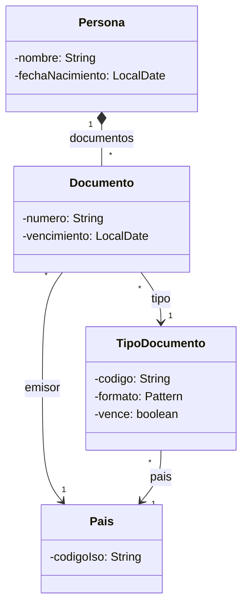
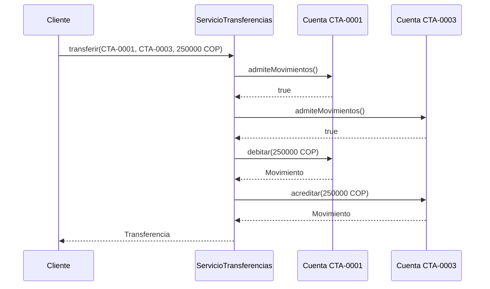
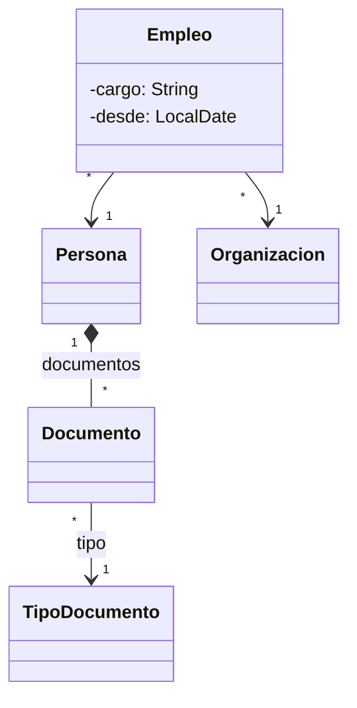
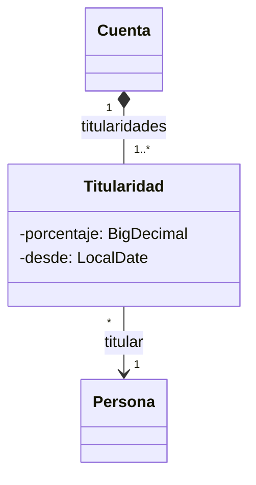
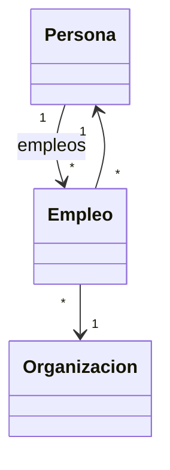
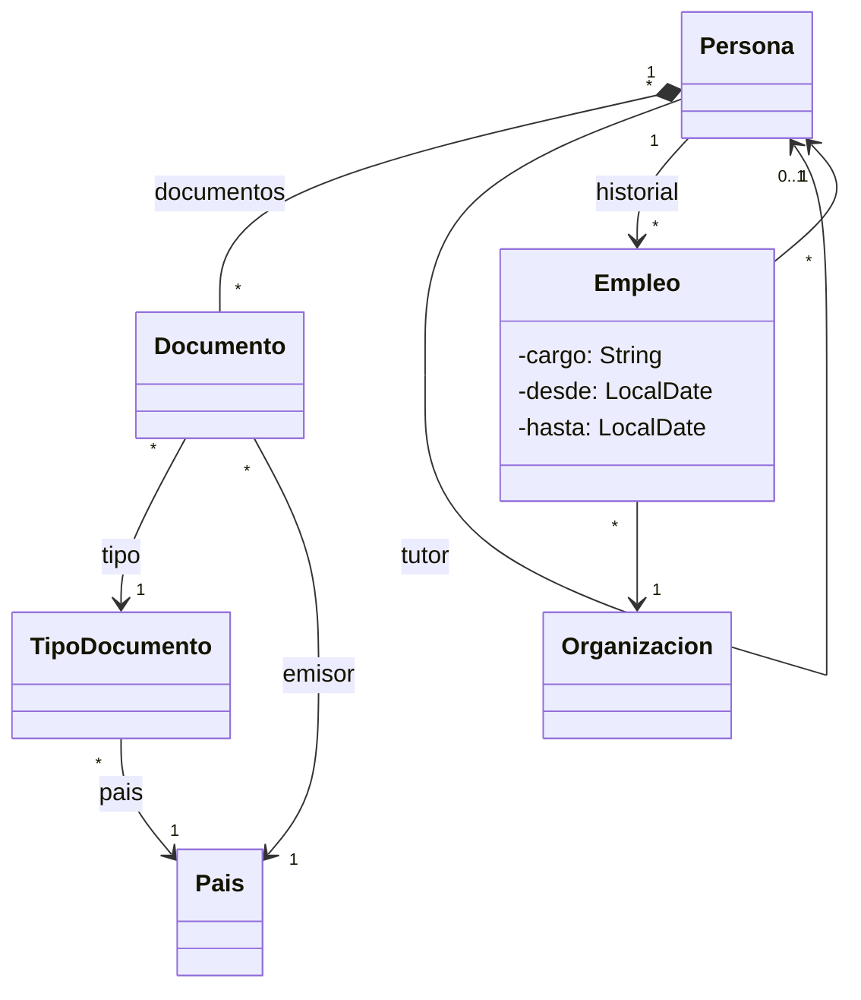
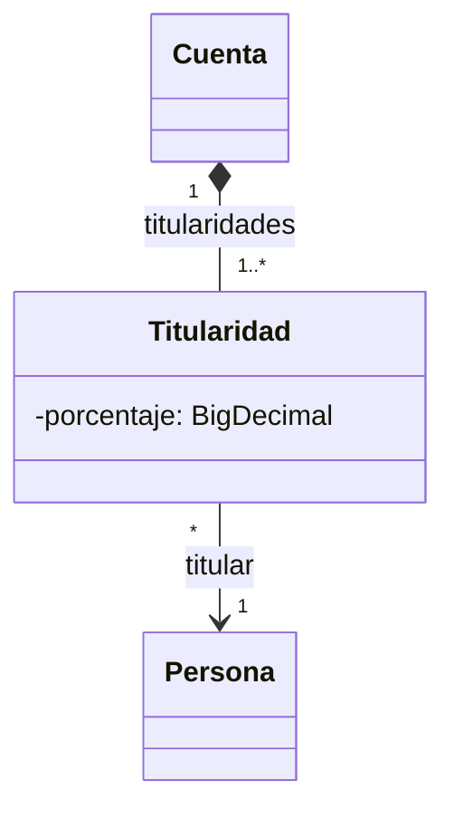

# 09 — Respuestas

> Solucionario del bloque `02-modelado-oo`: Modelado OO. Cada respuesta en tres capas:
> **⏱️ 30 segundos** (lo que dices primero, sin que te lo pidan), **🗣️ 2 minutos** (lo que
> añades cuando dicen "cuéntame más") y **🔬 El detalle** (para estudiar, no para decir en voz
> alta). Los enunciados están copiados literalmente de su capítulo.
>
> **Vigencia:** 2026-10-04.
>
> **Versiones ejecutadas:** GCC 14.4 (C++23) · JDK 21.0.12, 17.0.20 y 25.0.4 · Spring Boot 4.1.1 (Spring Framework 7.0.9, Hibernate 7.4.5, H2 2.4.240) · mermaid-cli 11.17.0 · PostgreSQL 18.6 (2026-10-04).

**Salto rápido:** [01](#01--uml-lo-justo-en-mermaid) · [02](#02--de-la-asociación-al-código) · [03](#03--navegabilidad-y-coherencia) · [04](#04--agregación-composición-y-propiedad) · [05](#05--redundancia-controlada) · [06](#06--entidades-valores-y-primitivos) · [07](#07--objetos-frente-a-tablas) · [08](#08--simulación-de-entrevista)

---

# 01 — UML lo justo, en Mermaid

**01 → 1. ¿Cuáles son los tres usos del UML según Fowler, y cuál usa este corpus? 🟢**

⏱️ Como boceto, como plano y como lenguaje de programación. Este corpus usa solo el boceto: para
pensar y discutir.
🗣️ El boceto es un dibujo desechable para una conversación; el plano es una especificación completa
para que otro implemente; el lenguaje de programación genera código desde el modelo. En una entrevista
y en una revisión de diseño, lo que se pide es el boceto.
🔬 Fowler lo plantea en el capítulo 1 de *UML Distilled*, y reconoce que el uso como plano y como
lenguaje de programación (la *Model Driven Architecture*) nunca llegó a ser la corriente principal.

**01 → 2. ¿Cuáles son las seis relaciones de un diagrama de clases? 🟢**

⏱️ Dependencia, asociación, agregación, composición, generalización y realización.
🗣️ La dependencia es "usa"; la asociación, "guarda una referencia"; agregación y composición son
asociaciones todo-parte, sin y con propiedad del ciclo de vida; la generalización es herencia; la
realización, implementar una interfaz.
🔬 En Mermaid: `..>`, `-->` (o `--`), `o--`, `*--`, `<|--` y `..|>`. El UML tiene más relaciones
(*include*, *extend* en casos de uso, dependencias estereotipadas), que no hacen falta para modelar
objetos.

**01 → 3. ¿Cómo se escribe en Mermaid una composición, una dependencia y una realización? 🟢**

⏱️ `Persona *-- Documento`, `Validador ..> Documento` y `Persona ..|> Titular`.
🗣️ El rombo relleno (`*`) va del lado del todo; la flecha punteada abierta (`..>`) apunta a lo que se
usa; la flecha punteada con triángulo (`..|>`) apunta a la interfaz. La multiplicidad va entre comillas
junto a cada clase: `Persona "1" *-- "*" Documento`.
🔬 Mermaid acepta las relaciones escritas en las dos direcciones (`Documento --* Persona`), pero este
corpus las escribe siempre con el rombo o el triángulo en el lado de la izquierda, como en la tabla de
la guía, para que todos los diagramas se lean igual.

**01 → 4. ¿Qué significa la multiplicidad `0..1`, y qué `1..*`? 🟢**

⏱️ `0..1`: uno o ninguno. `1..*`: al menos uno.
🗣️ `Persona "*" --> "0..1" Persona : tutor` dice que una persona tiene como mucho un tutor; `1..*` en
una relación diría que no puede haber cero. La multiplicidad del extremo al que se llega decide el
código: `0..1` es un campo que puede faltar; `*` o `1..*`, una colección.
🔬 `1..*` es un invariante: una colección que nunca puede quedar vacía. El código tiene que protegerlo
(no dejar quitar el último elemento), y eso no lo hace ningún tipo de colección por sí solo.

**01 → 5. ¿Qué es la navegabilidad de una asociación? 🟢**

⏱️ Desde qué clase se puede llegar a cuál: qué clase guarda la referencia. Se dibuja con la punta de
flecha.
🗣️ `Documento --> TipoDocumento` dice que el documento tiene un campo con su tipo, y que desde el tipo
no se llega a los documentos. Una asociación sin punta deja la decisión abierta; una con punta en las
dos direcciones es bidireccional, y obliga a mantener las dos puntas coherentes.
🔬 Decidir la navegabilidad es decidir los campos y, con ellos, el acoplamiento: cada punta navegable es
una dependencia de compilación. Cómo se decide es el tema de `03`.

**01 → 6. ¿Qué significan `+`, `-` y `#` delante de un atributo? 🟢**

⏱️ Público, privado y protegido.
🗣️ El UML tiene además `~` para visibilidad de paquete. En un boceto se pone la visibilidad solo
cuando la pregunta es sobre encapsulación; si no, sobra.
🔬 Mermaid admite además `$` para miembros estáticos y `*` para abstractos al final del nombre del
método. Este corpus no los usa salvo que la pregunta lo pida.

**01 → 7. ¿Para qué sirve un diagrama de secuencia? 🟢**

⏱️ Para mostrar el orden de las llamadas entre objetos: quién llama a quién, en qué orden y qué vuelve.
🗣️ Es el diagrama de los diseños cuyo sentido está en el orden: una transferencia, un Observer, una
cadena de validadores. Deja ver de un vistazo quién coordina y quién no se conoce.
🔬 Cada participante es un objeto, no una clase: pueden aparecer dos cuentas distintas. Por eso un
diagrama de secuencia no reemplaza al de clases; muestra un escenario, no la estructura.

**01 → 8. ¿Qué tres conceptos del UML no dibuja Mermaid? 🟢**

⏱️ El extremo explícitamente no navegable, la asociación calificada y la clase de asociación con su
notación propia.
🗣️ Se aproximan: el extremo no navegable, con una punta solo en el otro lado y una frase; la
calificada, con una etiqueta y la multiplicidad `0..1`; la clase de asociación, con una clase normal y
dos asociaciones.
🔬 Es una limitación de la herramienta, no del concepto, y conviene decirlo así. La clase de asociación
aproximada con una clase intermedia es además como se programa.

**01 → 9. ¿Qué diferencia hay entre una asociación y una dependencia? 🟡**

⏱️ Guardar o no guardar: en una asociación, A tiene un campo con B; en una dependencia, A usa B (un
parámetro, una variable local, un `new`) sin guardarlo.
🗣️ `Validador ..> Documento` dice que el validador recibe documentos y no se los queda.
`Documento --> TipoDocumento` dice que el documento tiene su tipo para siempre. Las dos son
dependencias de compilación, pero la asociación es más fuerte: liga el ciclo de vida y el estado.
🔬 Dibujar todo como asociación borra la información que más interesa al revisar acoplamiento: qué
clases retienen a qué otras.

**01 → 10. ¿Qué diferencia hay entre agregación y composición? 🟡**

⏱️ La composición implica propiedad: la parte pertenece a un solo todo y muere con él. La agregación es
todo-parte sin propiedad: la parte vive por su cuenta y puede estar en varios.
🗣️ Los documentos de una persona son composición; los empleados de una organización, en el mejor caso,
agregación. En código, la composición es una referencia que no se comparte; en C++, un miembro por valor
o un `unique_ptr`.
🔬 La agregación es tan ambigua que Fowler aconseja ignorarla; la composición sí aporta, porque dice
quién es el dueño. Ver `04`.

**01 → 11. ¿Qué diferencia hay entre generalización y realización? 🟡**

⏱️ La generalización es herencia entre clases (`extends`); la realización es una clase que implementa
una interfaz (`implements`).
🗣️ Las dos se dibujan con triángulo vacío apuntando al tipo general; la generalización con línea
continua (`<|--`) y la realización con línea punteada (`..|>`). La primera hereda implementación; la
segunda solo contrato.
🔬 Con métodos `default` en Java la frontera se difumina, pero el diagrama sigue distinguiendo lo que
importa: con generalización la derivada recibe estado; con realización, no.

**01 → 12. ¿Qué diferencia hay entre `A --> B` y `A -- B`? 🟡**

⏱️ `A --> B` dice que A navega hasta B: A guarda la referencia. `A -- B` dice que están asociadas sin
decidir la navegabilidad.
🗣️ En un boceto temprano, `--` es legítimo: todavía no sabes qué casos de uso necesitan ir de dónde a
dónde. Cuando el modelo baja al código, cada asociación tiene que tener su navegabilidad decidida.
🔬 En el UML formal, una línea sin flechas puede leerse como bidireccional o como no especificada,
según la convención del equipo. Este corpus la lee siempre como "no decidida".

**01 → 13. ¿En qué se traduce `Persona "1" *-- "*" Documento` en Java y en C++? 🟡**

⏱️ En Java, una colección privada de `Documento` en `Persona` que no se expone mutable; en C++, un
`std::vector<Documento>` por valor (o de `std::unique_ptr` si hay polimorfismo) dentro de `Persona`.
🗣️ La composición dice que la persona es dueña de sus documentos. En C++ eso es literal: el vector
destruye los documentos con la persona. En Java es una disciplina: no dejar escapar la colección ni los
documentos para que nadie más los retenga.
🔬 El `"*"` del lado de `Documento` pide la colección; el `"1"` del lado de `Persona` dice que un
documento es de una sola persona, que es lo que hace posible la composición. Ver `02` y `04`.

**01 → 14. ¿Qué atributo genera `Documento "*" --> "1" TipoDocumento` en Java, y qué tipo de puntero o referencia elegirías en C++? 🟡**

⏱️ En Java, un campo `private final TipoDocumento tipo`. En C++, un puntero que no posee (`const
TipoDocumento*`) o una referencia, porque el documento no es dueño de su tipo.
🗣️ El `"1"` dice que el campo es obligatorio: en Java, no nulo y asignado en el constructor; en C++, una
referencia o un puntero que nunca es `nullptr`. Los tipos de documento viven en un registro compartido
que los posee.
🔬 Una referencia como miembro en C++ impide la asignación de copia de `Documento`, porque una
referencia no se puede reatar; por eso suele preferirse un puntero no nulo por convención, o
`std::reference_wrapper`. Ver `04`.

**01 → 15. ¿Por qué Fowler recomienda no usar la agregación? 🟠**

⏱️ Porque su significado es tan vago que cada persona la interpreta distinto, y no dice nada que una
asociación simple no diga.
🗣️ La especificación UML la deja casi sin semántica. En la práctica provoca discusiones sobre si algo
es "parte de" otra cosa que no cambian ni una línea de código. La composición sí tiene consecuencias
(propiedad, ciclo de vida), y por eso merece su rombo.
🔬 En *UML Distilled*, cap. 5, Fowler recoge la frase de Jim Rumbaugh: un "placebo de modelado". Si el equipo la usa con un sentido
acordado, vale; si no, una asociación navegable es más honesta.

**01 → 16. ¿Por qué la flecha de navegación suele ir al revés que la clave foránea? 🟠**

⏱️ Porque la FK se pone en la tabla del lado "varios" y apunta al "uno" (`documento.persona_id`),
mientras que la navegación útil suele ir del "uno" a los "varios" (`persona.documentos()`).
🗣️ La base de datos no puede guardar una colección en una columna, así que el lado "varios" lleva la
referencia. El modelo de objetos sí puede guardar una colección, y la navegación la decide el caso de
uso: casi siempre se pregunta "¿qué documentos tiene Ana?", no "¿de quién es este documento?".
🔬 Confundir las dos direcciones es la raíz de que `Documento` termine con un campo `persona` que nadie
usa y que obliga a mantener una bidireccional. Es el tema de `07` del bloque.

**01 → 17. ¿Por qué no se dibujan getters, setters ni constructores? 🟠**

⏱️ Porque no responden ninguna pregunta de diseño y ocupan el espacio de las que sí.
🗣️ Que `Documento` tenga `getNumero()` no dice nada; que tenga `vigente(hoy)` sí dice dónde vive una
regla de negocio. Un diagrama con todos los métodos triviales esconde los dos o tres que importan.
🔬 Si hay que mostrar que una clase es inmutable o que no expone algo, se dice con una nota o en el
texto, no listando lo que no tiene.

**01 → 18. ¿Cuándo un diagrama de secuencia aporta más que uno de clases? 🟠**

⏱️ Cuando la pregunta es sobre el orden o la responsabilidad de coordinar: quién llama a quién y en qué
secuencia.
🗣️ Un diagrama de clases de la transferencia muestra que el servicio conoce dos cuentas; el de
secuencia muestra que debita antes de acreditar, que valida antes de mover dinero y que las cuentas no
se hablan entre sí. Para revisar atomicidad o acoplamiento temporal, es el diagrama que hace falta.
🔬 Los patrones cuyo sentido es el orden (Observer, Chain of Responsibility, Proxy, Unit of Work,
Template Method) se explican en el corpus con diagrama de secuencia por esto.

**01 → 19. ¿Por qué un diagrama de clases con todas las clases del sistema es un mal diagrama? 🟠**

⏱️ Porque no responde ninguna pregunta: todo compite por la atención y lo importante no se ve.
🗣️ Un diagrama es una herramienta para una conversación concreta. Con cuarenta cajas, nadie sabe dónde
mirar, y es el primero que queda desactualizado, porque cualquier cambio lo invalida.
🔬 La guía del corpus fija doce clases como techo. Para una vista general del sistema, un diagrama de
paquetes o de módulos dice más con menos cajas.

**01 → 20. Dibuja en Mermaid personas, documentos, tipos de documento y países, con multiplicidad y navegabilidad justificadas. 🔴**

⏱️ Composición de `Persona` a `Documento`, y asociaciones navegables de `Documento` a `TipoDocumento`
y a `Pais`, y de `TipoDocumento` a `Pais`.
🗣️



Composición porque los documentos son de una persona y no existen sin ella; navegable desde el
documento hacia su tipo y su país porque los casos de uso validan un documento con su tipo, y nunca
piden "todos los documentos de tipo `CC`" a partir del objeto tipo (eso es una consulta).
🔬 Lo que preguntarán después: si `Documento` debería navegar a `Persona` (solo si un caso de uso parte
de un documento y necesita su titular; si no, una consulta basta); y por qué `TipoDocumento` no tiene
colección de documentos (sería una bidireccional enorme sin ningún caso de uso que la recorra).

**01 → 21. Dibuja el diagrama de secuencia de una transferencia de 250 000 COP de `CTA-0001` a `CTA-0003` con validación previa del estado de las dos cuentas. 🔴**

⏱️ El servicio consulta el estado de las dos cuentas, y solo si las dos admiten movimientos debita la
origen y acredita la destino.
🗣️



🔬 Lo que preguntarán después: qué pasa si `acreditar` falla después de `debitar` (hace falta una
transacción o deshacer el débito: atomicidad); y si la cuenta `CTA-0003` de Luis, administrada por su
tutora, necesita un paso de autorización (sería otro participante, y aquí se vería dónde va).

**01 → 22. Corrige el diagrama de §1 para que responda las cuatro preguntas que hizo el entrevistador. 🔴**

⏱️ Multiplicidad en todas las puntas, composición para los documentos, y `Empleo` como clase entre
`Persona` y `Organizacion` en lugar de una flecha sin nombre.
🗣️



Responde: una persona tiene varios documentos (`"*"`); el documento no sabe de quién es (sin flecha
hacia `Persona`); si se borra la persona se borran sus documentos (composición); y la relación con la
organización es un empleo con cargo y fecha, no una flecha ambigua.
🔬 Lo que preguntarán después: si `Persona` debería navegar a sus empleos (depende del caso de uso:
"¿dónde trabaja Ana?" lo pediría); y si `Empleo` es entidad o valor (tiene ciclo de vida propio: se
termina, se cambia de cargo).

# 02 — De la asociación al código

**02 → 1. ¿Qué atributo genera una asociación cuyo otro extremo tiene multiplicidad `"1"`? 🟢**

⏱️ Un campo de ese tipo, obligatorio: asignado en el constructor y nunca nulo.
🗣️ `Documento "*" --> "1" TipoDocumento` genera `private final TipoDocumento tipo` en `Documento`, con
`requireNonNull` en el constructor. El `"1"` es una promesa: no existe un documento sin tipo, ni
siquiera un instante.
🔬 En C++, una referencia (que no puede ser nula) o un puntero no nulo por convención; si `Documento` es
dueño de lo apuntado, un miembro por valor.

**02 → 2. ¿Y una cuyo otro extremo tiene multiplicidad `"*"`? 🟢**

⏱️ Una colección: `List`, `Set` o `Map`, según la relación sea ordenada, sin duplicados o calificada.
🗣️ `Persona "1" *-- "*" Documento` genera en `Persona` una colección de documentos. Cuál depende de lo
que promete la relación, no de la costumbre.
🔬 Si el extremo fuera `"1..*"`, la colección tendría además un invariante (nunca vacía) que ningún
tipo de colección protege solo: lo protege el objeto dueño, no dejando quitar el último elemento.

**02 → 3. ¿Qué es una asociación calificada, y a qué estructura se traduce? 🟢**

⏱️ Una asociación en la que una clave (el calificador) más el objeto de origen determinan como mucho un
objeto destino. Se traduce a un `Map`.
🗣️ "Una dirección por tipo de dirección": `TipoDireccion` es el calificador, y la traducción es
`Map<TipoDireccion, Direccion>`. La regla "no hay dos domicilios" queda en la estructura: un `put`
reemplaza.
🔬 Mermaid no tiene notación para el calificador; se aproxima con una etiqueta y la multiplicidad
`0..1`. Ver `01 → 8`.

**02 → 4. ¿Qué es una clase de asociación? 🟢**

⏱️ Una asociación que tiene atributos propios, y que por eso se convierte en una clase: `Empleo` entre
`Persona` y `Organizacion`, con cargo y fechas.
🗣️ El cargo y la fecha de inicio no son de la persona ni de la organización, son de la relación. En
código, una clase con una referencia a cada lado y sus propios campos.
🔬 En UML tiene una notación específica (una clase colgada de la línea de la asociación) que Mermaid no
dibuja; se modela como clase intermedia, que es además como se programa.

**02 → 5. ¿Qué colección expresa "ordenada" y cuál "sin duplicados"? 🟢**

⏱️ `List` para ordenada; `Set` para sin duplicados.
🗣️ Si se necesitan las dos cosas —sin duplicados y con un orden estable—, `LinkedHashSet` (orden de
inserción) o `TreeSet` (orden natural o de un `Comparator`).
🔬 `TreeSet` usa `compareTo` para decidir duplicados, no `equals`; si el orden es incoherente con
`equals`, dos elementos distintos pueden colapsar en uno. Ver `01/02`.

**02 → 6. ¿Cómo se expone en Java una asociación `"0..1"`? 🟢**

⏱️ Con un campo que puede ser `null` por dentro y un getter que devuelve `Optional`.
🗣️ `Optional<Persona> tutor()` dice en la firma que el tutor puede faltar. El campo no es `Optional`
porque ahí no aporta y cuesta un objeto más.
🔬 Es el uso que la Javadoc de `Optional` recomienda: como tipo de retorno. Ver `01/08`.

**02 → 7. ¿Qué diferencia hay entre guardar la referencia a un documento y guardar su id? 🟡**

⏱️ La referencia da el objeto directamente y garantiza que existe; el id obliga a buscarlo cada vez y
no garantiza nada.
🗣️ Con la referencia, `persona.documentos()` está listo para usar. Con `List<Long> idsDocumentos`, cada
uso es una búsqueda, y nada impide guardar el id de un documento borrado. A cambio, el id no ata los
ciclos de vida: cargar la persona no obliga a cargar los documentos.
🔬 Por eso la regla depende de la frontera: dentro de un agregado, referencias; entre agregados, ids.
Es una regla del DDD táctico: [`09/01` §5](../09-ddd-tactico-y-otros/01-entidad-valor-y-agregado.md#5--referencias-entre-agregados-por-identificador).

**02 → 8. ¿Qué diferencia hay entre un `Set<Documento>` y una `List<Documento>` para los documentos de una persona? 🟡**

⏱️ El `Set` impide tener dos veces el mismo documento; la `List` lo permite y además promete un orden.
🗣️ Ana no tiene dos veces la misma cédula, así que la relación es sin duplicados y el `Set` la expresa.
La `List` dejaría la regla a una comprobación manual en cada sitio que añada documentos.
🔬 El `Set` solo funciona si `Documento` tiene `equals` y `hashCode` sobre su clave natural; con la
igualdad por defecto, dos lecturas de la misma cédula son dos elementos.

**02 → 9. ¿Qué diferencia hay entre `EnumMap` y `HashMap` para un `Map<TipoDireccion, Direccion>`? 🟡**

⏱️ `EnumMap` es un arreglo indexado por el ordinal del enum: sin hash, más compacto y más rápido, y
recorre en el orden de las constantes.
🗣️ Para claves enum es la implementación recomendada. `HashMap` funciona igual, pero calcula hashes y
crea entradas que `EnumMap` no necesita.
🔬 `EnumMap` no admite claves `null` y necesita la clase del enum en el constructor
(`new EnumMap<>(TipoDireccion.class)`). Es el ítem 37 de *Effective Java*.

**02 → 10. ¿Qué diferencia hay entre la colección de una relación uno a varios en el modelo de objetos y la clave foránea en la base de datos? 🟡**

⏱️ La colección va en el lado desde el que se navega, normalmente el "uno"; la FK va siempre en el lado
"varios", porque una columna no guarda colecciones.
🗣️ `Persona` tiene `Set<Documento>`; la tabla `documento` tiene `persona_id`. Las dos expresan la misma
relación en direcciones opuestas. Confundirlas lleva a meter un campo `persona` en `Documento` que nadie
navega.
🔬 Un ORM hace de puente: con JPA, `@OneToMany` en `Persona` puede mapearse a la FK de `documento` sin que
`Documento` tenga el campo. Ver [`07/04` §3](../07-fowler-dominio-y-datos/04-estructura-objeto-relacional.md#3--foreign-key-mapping).

**02 → 11. ¿Cómo traduces `Documento "*" --> "1" TipoDocumento` en Java y en C++, y por qué distinto? 🟡**

⏱️ En Java, `private final TipoDocumento tipo`; en C++, `const TipoDocumento* tipo`, un puntero que no
posee. La diferencia es que en C++ hay que decir explícitamente que el documento no es dueño del tipo.
🗣️ En Java todas las referencias son iguales y el GC resuelve la vida del tipo. En C++, un miembro por
valor sería una copia del tipo dentro de cada documento (y dueña de ella), lo que rompe que el tipo sea
compartido. El puntero que no posee dice "lo usa, no lo tiene".
🔬 Una referencia como miembro (`const TipoDocumento&`) también expresa "no posee y nunca es nulo", pero
impide la asignación de copia de `Documento`. Por eso se suele preferir el puntero.

**02 → 12. ¿Qué tipo usarías en C++ para la colección de documentos de una persona, y qué cambia si hay subclases de documento? 🟡**

⏱️ `std::vector<Documento>` por valor, porque la persona es dueña de sus documentos. Con subclases,
`std::vector<std::unique_ptr<Documento>>`, para no partir los objetos.
🗣️ Por valor, el vector posee y destruye los documentos con la persona, sin punteros. Si `Documento` es
polimórfico, guardar por valor provocaría *slicing*; el `unique_ptr` conserva el tipo dinámico y la
propiedad exclusiva.
🔬 Con `unique_ptr`, `Persona` deja de ser copiable por defecto; si hace falta copiarla, la copia se
escribe con un `clonar()` virtual. Ver `01/04` y `01/05`.

**02 → 13. ¿Por qué `List` no es la colección por defecto para cualquier relación uno a varios? 🟠**

⏱️ Porque `List` promete orden y admite duplicados, y muchas relaciones no tienen ni lo uno ni lo otro:
elegirla por costumbre deja reglas sin expresar.
🗣️ Si la relación es "sin duplicados", un `Set` lo garantiza; si es "una por clave", un `Map`. Con
`List`, esas reglas pasan a comprobaciones manuales, y el día que alguien añade sin comprobar, el
modelo queda inválido.
🔬 Además `List.contains` es lineal; si la relación se consulta por pertenencia, el `Set` es también la
estructura rápida.

**02 → 14. ¿Por qué un `Set<Documento>` puede aceptar duplicados aunque el código parezca correcto? 🟠**

⏱️ Porque `Documento` no sobrescribe `equals` y `hashCode`, o los sobrescribe mal, y el conjunto usa la
identidad.
🗣️ Dos objetos con la misma cédula, leídos de dos fuentes, son dos elementos si la igualdad es la de
`Object`. Y si solo se sobrescribió `equals`, caen en cubos distintos y tampoco se detectan.
🔬 La otra forma: un campo de la igualdad que se mutó con el documento dentro. Ver `01/02`.

**02 → 15. ¿Cuándo una relación varios a varios necesita una clase intermedia en el modelo de objetos? 🟠**

⏱️ Cuando la relación tiene datos propios: desde cuándo, con qué porcentaje, con qué rol.
🗣️ Personas titulares de cuentas sin más datos: una colección en el lado que navega basta. Si cada
titular tiene un porcentaje de participación, ese dato no es ni de la persona ni de la cuenta: hace
falta `Titularidad` con las dos referencias.
🔬 La base de datos necesita siempre la tabla intermedia; el modelo de objetos solo cuando la relación
tiene atributos. Un ORM mapea las dos situaciones.

**02 → 16. ¿Por qué `Empleo` no puede ser un `Map<Organizacion, String>` dentro de `Persona`? 🟠**

⏱️ Porque el mapa solo admite un empleo por organización y no tiene dónde guardar las fechas ni el fin.
🗣️ Ana puede trabajar dos veces en Transportes Andinos en épocas distintas, y cada empleo tiene inicio,
fin y cargo. El mapa colapsa todo eso en un `String`. `Empleo` tiene ciclo de vida propio: empieza,
termina, se consulta como historial.
🔬 Además el mapa pone la relación solo en `Persona`; si la organización necesita sus empleados, habría
que duplicarla. Con `Empleo` como objeto, las dos navegaciones parten del mismo dato.

**02 → 17. ¿Cuándo es correcto guardar el id de otro objeto en lugar de la referencia? 🟠**

⏱️ Cuando el otro objeto pertenece a otro agregado, o a otro sistema: entonces el id desacopla los ciclos
de vida y las transacciones.
🗣️ Una `Cuenta` que guarda el id de su titular no obliga a cargar ni a bloquear a la persona para operar
la cuenta, y los dos pueden cambiar en transacciones distintas. Dentro de `Persona`, en cambio, sus
documentos son parte de ella y van por referencia.
🔬 El id tipado (`PersonaId` en lugar de `Long`) evita mezclar ids de cosas distintas. Es la regla de
"referencias entre agregados por identificador" del DDD táctico ([`09/01` §5](../09-ddd-tactico-y-otros/01-entidad-valor-y-agregado.md#5--referencias-entre-agregados-por-identificador)).

**02 → 18. ¿Por qué una asociación `"1"` debe asignarse en el constructor? 🟠**

⏱️ Porque `"1"` significa "siempre hay uno": si se asigna después, existe un intervalo en el que el
objeto viola su propio modelo.
🗣️ Un `Documento` sin tipo que espera a un `setTipo()` puede escaparse a medio construir y romper a
cualquiera que lo use. Recibirlo en el constructor y validarlo hace que la regla se cumpla desde el
primer instante, y permite el campo `final`.
🔬 Los marcos que necesitan un constructor vacío (algunos ORMs, serializadores) chocan con esto; se
resuelve con constructores protegidos para el marco y públicos completos para el resto.

**02 → 19. ¿Qué gana el código cuando la regla "una dirección por tipo" pasa de una comprobación a la estructura? 🟠**

⏱️ Que la regla ya no se puede olvidar: el `Map` no admite dos domicilios, y nadie tiene que acordarse de
comprobarlo.
🗣️ Con una `List`, cada método que añade direcciones tiene que recorrerla y comprobar; el primero que no
lo haga rompe el modelo. Con el `Map`, `put` reemplaza y la regla vive en un solo sitio: el tipo de la
colección.
🔬 Es la idea general de "hacer los estados inválidos irrepresentables": cuanto más dice la estructura,
menos tienen que decir las validaciones.

**02 → 20. ¿Por qué el getter de una colección no debería devolver la colección interna? 🟠**

⏱️ Porque quien la recibe puede modificarla sin pasar por los métodos del dueño, y se salta todas sus
reglas.
🗣️ Si `documentos()` devuelve el `Set` interno, cualquiera puede añadir un documento sin la
comprobación de duplicados o quitar el último. Se devuelve una vista no modificable o una copia, y los
cambios pasan por `agregarDocumento`.
🔬 Es el corazón de la composición en Java: la propiedad se expresa no dejando escapar la referencia. Ver
`04`.

**02 → 21. Corrige la `Persona` de §1 en Java: direcciones, documentos y organización. 🔴**

⏱️ `Map<TipoDireccion, Direccion>` para las direcciones, `Set<Documento>` con referencias para los
documentos, y la organización fuera de `Persona`, en `Empleo`.
🗣️

```java
public final class Persona {
    private final String nombre;
    private final Map<TipoDireccion, Direccion> direcciones = new EnumMap<>(TipoDireccion.class);
    private final Set<Documento> documentos = new LinkedHashSet<>();

    public void establecerDireccion(TipoDireccion tipo, Direccion d) { direcciones.put(tipo, d); }
    public void agregarDocumento(Documento d) {
        if (!documentos.add(d)) throw new IllegalArgumentException("documento repetido: " + d);
    }
    public Set<Documento> documentos() { return Collections.unmodifiableSet(documentos); }
}

public final class Empleo {
    private final Persona persona;
    private final Organizacion organizacion;
    private final String cargo;
    private final LocalDate desde;
    private LocalDate hasta;
}
```

🔬 Lo que preguntarán después: si `Persona` debería tener la lista de sus empleos (si un caso de uso lo
pide, sí, y entonces hay una bidireccional que mantener: ver `03`); y por qué `LinkedHashSet` y no
`HashSet` (orden estable para mostrar).

**02 → 22. Escribe `Empleo` en Java con sus dos referencias, cargo, fechas y el método para terminarlo. 🔴**

⏱️ Dos referencias finales, cargo y fecha de inicio finales, fecha de fin mutable, y `terminar` que
valida la fecha.
🗣️

```java
public final class Empleo {
    private final Persona persona;
    private final Organizacion organizacion;
    private final String cargo;
    private final LocalDate desde;
    private LocalDate hasta;

    public Empleo(Persona persona, Organizacion organizacion, String cargo, LocalDate desde) {
        this.persona = Objects.requireNonNull(persona);
        this.organizacion = Objects.requireNonNull(organizacion);
        this.cargo = Objects.requireNonNull(cargo);
        this.desde = Objects.requireNonNull(desde);
    }

    public void terminar(LocalDate fecha) {
        if (hasta != null) throw new IllegalStateException("el empleo ya terminó");
        if (fecha.isBefore(desde)) throw new IllegalArgumentException("fin anterior al inicio");
        this.hasta = fecha;
    }

    public boolean vigente() { return hasta == null; }
    public Optional<LocalDate> hasta() { return Optional.ofNullable(hasta); }
}
```

🔬 Lo que preguntarán después: si cambiar de cargo modifica este `Empleo` o crea otro (si el historial de
cargos importa, otro; el cargo es `final` por eso); y cuál es la igualdad de `Empleo` (es una entidad:
por identificador, no por sus campos).

**02 → 23. Dibuja en Mermaid la relación entre `Cuenta` y sus titulares si una cuenta puede tener varios titulares con un porcentaje de participación cada uno. 🔴**

⏱️ Una clase intermedia `Titularidad` con el porcentaje y una referencia a la cuenta y a la persona.
🗣️



La cuenta es dueña de sus titularidades (composición) y debe tener al menos una (`1..*`); cada
titularidad apunta a una persona.
🔬 Lo que preguntarán después: dónde se valida que los porcentajes sumen 100 (en `Cuenta`, que es la
dueña de la colección y la única que ve todas); y si `Persona` navega a sus titularidades (solo si hay un
caso de uso; si no, una consulta).

**02 → 24. Escribe en C++ la `Persona` con su mapa de direcciones por tipo y su colección de documentos, y di qué posee. 🔴**

⏱️ Un `std::map<TipoDireccion, Direccion>` y un `std::vector<Documento>`, los dos por valor: la persona
posee sus direcciones y sus documentos.
🗣️

```cpp
enum class TipoDireccion { Domicilio, Laboral };

class Persona {
    std::string nombre;
    std::map<TipoDireccion, Direccion> direcciones;   // posee: copia propia de cada dirección
    std::vector<Documento> documentos;                // posee: se destruyen con la persona
public:
    void establecerDireccion(TipoDireccion t, Direccion d) { direcciones.insert_or_assign(t, std::move(d)); }
    void agregarDocumento(Documento d);
};
```

Cada `Documento` dentro del vector apunta a su `TipoDocumento` con un puntero que no posee.
🔬 Lo que preguntarán después: qué pasa al copiar una `Persona` (se copian el mapa y el vector enteros:
copia profunda, por la regla de 0); y qué cambia si `Documento` tiene subclases (`unique_ptr`, y la copia
deja de ser gratis).

**02 → 25. Revisa este campo y di qué relación esconde y cómo lo corregirías: `private Map<String, String> datosLaborales; // "empresa" → nombre, "cargo" → cargo`. 🔴**

⏱️ Esconde una clase de asociación, `Empleo`, metida en un mapa de cadenas: es obsesión por los
primitivos aplicada a una relación.
🗣️ La organización es un nombre en lugar de una referencia, el cargo es un valor suelto, no hay fechas,
y solo cabe un empleo. Se corrige con `Empleo` como clase con referencias a `Persona` y `Organizacion`,
cargo y fechas.
🔬 Lo que se dice en la revisión: un `Map<String, String>` con claves fijas es una clase que no se
atrevió a nacer. Cada clave conocida es un campo, y el compilador deja de poder ayudar con errores de
escritura en las claves.

**02 → 26. Revisa este modelo y di qué está mal: `Documento` con `private List<TipoDocumento> tipos` y `private List<Persona> titulares`. 🔴**

⏱️ `tipos` es una colección donde la relación es uno a uno: un documento tiene exactamente un tipo. Y
`titulares` es una colección donde la relación es "de una sola persona", y además una navegación hacia
atrás que probablemente nadie necesita.
🗣️ La corrección: `private final TipoDocumento tipo` asignado en el constructor, y quitar `titulares`:
la persona tiene sus documentos (composición), y un documento no tiene varios titulares. Si un caso de
uso parte de un documento y necesita su titular, se decide una bidireccional con su mantenimiento, o
se consulta.
🔬 Lo que se dice en la revisión: la multiplicidad del modelo es `"1"` en los dos casos, y el código
dice `"*"`. Cada colección de más es un estado inválido representable: un documento sin tipo, con dos
tipos o con dos dueños.

# 03 — Navegabilidad y coherencia

**03 → 1. ¿Qué pregunta decide si una punta de una asociación es navegable? 🟢**

⏱️ "¿Qué caso de uso necesita ir de este objeto a aquel?" Si ninguno, esa punta no es navegable.
🗣️ "Muestra los documentos de Ana" pide `Persona → Documento`; "valida este documento contra su tipo"
pide `Documento → TipoDocumento`. "¿De quién es esta cédula?" no pide un campo: pide una consulta,
porque parte de algo que todavía no tienes.
🔬 La pregunta sirve también para quitar navegaciones: cada punta que nadie recorre es acoplamiento sin
beneficio, y en un ORM, datos que se cargan sin uso.

**03 → 2. ¿Qué es una asociación reflexiva? Da el ejemplo del dominio. 🟢**

⏱️ Una asociación de una clase consigo misma: `Persona` con su `tutor`, que es otra `Persona`.
🗣️ Luis tiene como tutora a Ana; las dos son `Persona`. Se modela como un campo del mismo tipo,
navegable del menor hacia el tutor, con multiplicidad `0..1`.
🔬 Las reflexivas son las que más fácil forman ciclos (A tutor de B, B tutor de A) y jerarquías
(organigramas). Validar que no haya ciclos es un invariante que ninguna estructura de datos da gratis.

**03 → 3. ¿Qué genera `@Data` de Lombok? 🟢**

⏱️ Getters para todos los campos, setters para los no finales, `toString`, `equals`, `hashCode` y un
constructor para los campos obligatorios.
🗣️ Es la suma de `@Getter`, `@Setter`, `@ToString`, `@EqualsAndHashCode` y `@RequiredArgsConstructor`.
`toString`, `equals` y `hashCode` usan por defecto todos los campos no estáticos, la otra punta de una
bidireccional incluida.
🔬 Por eso `@Data` es razonable en un objeto de transferencia plano y peligroso en una entidad: le da
setters a todo, igualdad por todos los campos mutables, y ciclos en cuanto hay una relación de vuelta.

**03 → 4. ¿Qué es `std::weak_ptr`? 🟢**

⏱️ Un puntero que observa un objeto gestionado por `shared_ptr` sin contar para su contador de
referencias, es decir, sin mantenerlo vivo.
🗣️ Para usarlo hay que convertirlo con `lock()`, que devuelve un `shared_ptr` vacío si el objeto ya se
destruyó. Sirve para romper ciclos de `shared_ptr` y para cachés que no deben retener lo que guardan.
🔬 Tiene un costo: el bloque de control del `shared_ptr` sobrevive mientras haya `weak_ptr`, y `lock()`
es una operación atómica. No es gratis como un puntero crudo.

**03 → 5. ¿Qué significa que las dos puntas de una bidireccional sean redundantes? 🟢**

⏱️ Que dicen lo mismo dos veces: "Ana tiene esta cédula" y "esta cédula es de Ana" son el mismo hecho
guardado en dos sitios.
🗣️ Toda redundancia puede desincronizarse: si una punta se actualiza y la otra no, el modelo dice dos
cosas distintas. Por eso una bidireccional necesita un único dueño que mantenga las dos.
🔬 Es la redundancia más común de un modelo de objetos, y se acepta por el mismo motivo que cualquier
redundancia controlada: un único dueño mantiene el invariante.

**03 → 6. ¿Qué diferencia hay entre navegar una asociación y hacer una consulta? 🟡**

⏱️ Navegar es seguir una referencia que el objeto ya tiene; consultar es buscar objetos que todavía no
tienes, normalmente en un repositorio.
🗣️ `ana.documentos()` navega. "¿De quién es la cédula 1020304050?" consulta: parte de un dato, no de un
objeto. Muchas puntas de vuelta se añaden para responder consultas, y cuestan más que la consulta.
🔬 La consulta además escala: "todos los documentos de tipo `CC`" como colección en `TipoDocumento`
cargaría millones de objetos; como consulta, devuelve los que pidas, paginados.

**03 → 7. ¿Qué diferencia hay entre `@JsonManagedReference`/`@JsonBackReference` y `@JsonIgnore`? 🟡**

⏱️ El par marca las dos puntas de una relación para que Jackson serialice la ida y omita la vuelta, y
la reconstruya al deserializar; `@JsonIgnore` simplemente omite el campo, en los dos sentidos.
🗣️ Con el par, el JSON de Ana lleva sus documentos sin la vuelta, y al leerlo Jackson vuelve a fijar el
titular de cada documento. Con `@JsonIgnore` en la vuelta, se escribe igual pero al leer nadie la
fija.
🔬 Las dos son parches sobre un problema de diseño: serializar entidades con relaciones. La salida
limpia es serializar objetos de transferencia sin ciclos, armados para cada respuesta.

**03 → 8. ¿Qué diferencia hay entre un ciclo de referencias en Java y uno de `shared_ptr` en C++? 🟡**

⏱️ En Java el GC recoge los ciclos sin problema; el daño aparece en los recorridos genéricos
(`toString`, `hashCode`, JSON). En C++ con `shared_ptr` el ciclo es una fuga: los contadores nunca
llegan a cero.
🗣️ El recolector de Java parte de las raíces y recoge todo lo inalcanzable, ciclos incluidos. El conteo
de referencias de `shared_ptr` no ve los ciclos: cada objeto del ciclo tiene al menos una referencia,
la del otro.
🔬 Python usa conteo de referencias más un recolector de ciclos aparte, precisamente por esto. Swift y
Objective-C tienen el mismo problema que C++, y lo resuelven con referencias `weak`.

**03 → 9. ¿Qué diferencia hay entre `weak_ptr` y un puntero crudo que no posee para la vuelta de una composición? 🟡**

⏱️ El `weak_ptr` sabe si el objeto murió; el puntero crudo no, y por eso solo vale si la vida del objeto
apuntado está garantizada.
🗣️ En una composición, la persona vive más que sus documentos: mientras exista un documento, existe su
persona. Ahí el puntero crudo que no posee es correcto y gratis. El `weak_ptr` es para cuando no hay esa
garantía, y obliga a usar `shared_ptr` en la ida.
🔬 Las *C++ Core Guidelines* dicen que un puntero crudo `T*` no posee (R.3). El `weak_ptr` cuesta un
bloque de control y operaciones atómicas en cada `lock()`.

**03 → 10. ¿Por qué `Documento` navega a `TipoDocumento` y no al revés? 🟡**

⏱️ Porque los casos de uso validan un documento con su tipo, y ninguno recorre "todos los documentos de
un tipo" desde el objeto tipo: eso es una consulta.
🗣️ La colección inversa sería enorme, cambiaría con cada alta y haría depender a `TipoDocumento` de
`Documento`. Sin ella, el tipo es casi inmutable, compartible y se prueba solo.
🔬 Regla general: la navegación va de lo particular a lo general y de lo que cambia a lo que no cambia.

**03 → 11. ¿Qué diferencia hay entre el método que fija las dos puntas y el que olvida la vuelta? 🟡**

⏱️ El correcto añade el documento a la colección y además le asigna su titular; el que olvida solo
añade a la colección, y deja documentos sin titular.
🗣️ El que olvida compila y pasa las pruebas que solo miran la colección. El fallo aparece después,
cuando algo parte del documento y encuentra `titular() == null`.
🔬 El método correcto además comprueba que el documento no tenga ya otro titular. Y la segunda forma de
olvidar es exponer la colección mutable: `ana.getDocumentos().add(doc)` se salta la puerta.

**03 → 12. ¿Qué cuesta una punta navegable, en las cuatro monedas? 🟠**

⏱️ Acoplamiento (una clase conoce a la otra), legibilidad (hay que leer las dos para entender un
cambio), rendimiento (un ORM carga lo navegable) e indirección si además hay que mantener la otra punta.
🗣️ Cada punta es un campo, una dependencia de compilación y, si la otra punta también navega, una
redundancia que mantener. Y abre un camino para todo recorrido genérico: `toString`, serialización,
copia.
🔬 La más olvidada es la de rendimiento con ORM: una colección navegable mal mapeada provoca el problema
de las N+1 consultas o carga de más.

**03 → 13. ¿Por qué una bidireccional necesita un único dueño? 🟠**

⏱️ Porque las dos puntas son el mismo hecho guardado dos veces, y si dos sitios pueden escribirlo, tarde
o temprano dirán cosas distintas.
🗣️ El dueño tiene el único método que modifica la relación y fija las dos puntas a la vez. La otra clase
no expone un setter público para su punta. Así hay un solo camino de escritura y la coherencia es
responsabilidad de una sola clase.
🔬 JPA tiene el mismo concepto con otro nombre: el lado propietario (*owning side*) de una relación es el
que determina la clave foránea; el otro (`mappedBy`) se ignora al escribir.

**03 → 14. ¿Por qué el método que fija la vuelta en `Documento` no debería ser público? 🟠**

⏱️ Porque entonces cualquiera puede fijar una punta sin la otra, y la puerta única deja de ser única.
🗣️ Si `asignarTitular` es público, un controlador puede llamarlo sin añadir el documento a la persona, o
asignar un titular distinto del que lo contiene. Con visibilidad de paquete, solo `Persona` (en el mismo
paquete) puede llamarlo.
🔬 Java no tiene `friend` como C++; la visibilidad de paquete es la herramienta. Con módulos (JPMS), el
paquete además puede quedar sin exportar.

**03 → 15. ¿Por qué `equals` y `hashCode` de una entidad no deberían recorrer sus asociaciones? 🟠**

⏱️ Porque recorrerlas lleva a ciclos si la relación es bidireccional, y porque la identidad de una
entidad no depende de con quién está relacionada.
🗣️ Ana sigue siendo Ana aunque se le añada un documento. Si su `hashCode` dependiera de sus documentos,
cambiaría con cada alta y la perderías en cualquier `HashSet`. La igualdad de una entidad va por su
identificador o su clave natural.
🔬 Es la clave mutable de `01/02` con otra causa: aquí el campo que cambia es una colección asociada.

**03 → 16. ¿Por qué "el error del ciclo en el JSON es culpa de Jackson" es una respuesta equivocada? 🟠**

⏱️ Porque Jackson solo recorre lo que el modelo hace navegable: el ciclo es del diseño, no del
serializador.
🗣️ El mismo ciclo rompe `toString`, `hashCode` y cualquier copia profunda. Echarle la culpa a Jackson
lleva a parchear con anotaciones en lugar de preguntar si la vuelta hacía falta o si se debía
serializar una entidad.
🔬 Jackson tiene detección de identidad (`@JsonIdentityInfo`) que serializa los ciclos con referencias
por id; funciona, y produce un JSON que casi ningún cliente quiere consumir.

**03 → 17. ¿Dónde se protege el invariante "un menor debe tener tutor", y por qué ahí? 🟠**

⏱️ En `Persona`: en su constructor y en los métodos que cambian el tutor, porque es la única clase que ve
la fecha de nacimiento y el tutor a la vez.
🗣️ Ningún campo por sí solo lo puede expresar: depende de la edad, de la fecha de hoy y de la presencia
de otro objeto. Si se valida en un controlador, otro camino de escritura se lo salta; si se valida en
la clase que tiene los datos, no hay forma de esquivarlo.
🔬 Tiene un matiz: la edad cambia con el tiempo. Un adulto sin tutor era válido; un menor sin tutor deja
de serlo el día que se registra. Es un invariante que depende del reloj, y conviene pasar la fecha como
parámetro para poder probarlo.

**03 → 18. ¿Cuándo está justificada una bidireccional entre `Persona` y `Documento`? 🟠**

⏱️ Cuando hay casos de uso en los dos sentidos que se recorren a menudo y en memoria: mostrar los
documentos de una persona, y desde un documento llegar a su titular sin consultar.
🗣️ Por ejemplo, validar un documento de menor exige saber si su titular tiene tutor; si esa validación
recibe solo el documento y ocurre en un bucle sobre miles, una consulta por documento sería cara. Si
ocurre de vez en cuando, la consulta basta.
🔬 Con un ORM, la vuelta suele ser útil para el mapeo (el lado propietario de la FK está en
`documento`), y a veces se añade por eso. Es una razón técnica legítima, pero se paga igual.

**03 → 19. ¿Por qué en C++ a lo sumo una punta de una bidireccional debería poseer? 🟠**

⏱️ Porque si las dos poseen, cada una mantiene viva a la otra: con `shared_ptr` es una fuga; con
`unique_ptr` en las dos ni siquiera se puede construir el grafo con sentido.
🗣️ La propiedad responde "¿quién destruye a quién?", y en una relación esa respuesta es una sola. En una
composición, el todo posee a las partes y las partes apuntan al todo sin poseerlo.
🔬 Si la vida de los dos lados es incierta (cachés, grafos con ciclos genuinos), `shared_ptr` en un
sentido y `weak_ptr` en el otro, o una arena que posee a todos.

**03 → 20. Escribe en Java `agregarDocumento` de modo que las dos puntas queden siempre coherentes. 🔴**

⏱️ Un método en `Persona` que comprueba el titular previo, añade a la colección y fija la vuelta, con el
setter de la vuelta de paquete y la colección expuesta solo para lectura.
🗣️

```java
public final class Persona {
    private final Set<Documento> documentos = new LinkedHashSet<>();

    public void agregarDocumento(Documento d) {
        if (d.titular() != null && d.titular() != this)
            throw new IllegalArgumentException("el documento ya tiene titular");
        if (documentos.add(d)) d.asignarTitular(this);
    }

    public void quitarDocumento(Documento d) {
        if (documentos.remove(d)) d.asignarTitular(null);
    }

    public Set<Documento> documentos() { return Collections.unmodifiableSet(documentos); }
}

public final class Documento {
    private Persona titular;
    void asignarTitular(Persona p) { this.titular = p; }    // de paquete
    public Persona titular() { return titular; }
}
```

🔬 Lo que preguntarán después: por qué `!= this` y no `!equals` (comparar identidad de la entidad en
memoria es lo correcto aquí); qué pasa con un documento sin titular después de `quitarDocumento` (si la
relación es de composición, quizá no debería poder existir: entonces `quitarDocumento` lo da de baja);
y si no sería más simple quitar la vuelta (casi siempre, sí).

**03 → 21. Explica paso a paso por qué `log.info("{}", ana)` lanza `StackOverflowError` con el modelo de §1, y da dos arreglos. 🔴**

⏱️ `toString` de Ana imprime su lista de documentos, el de cada documento imprime su persona, esa
persona imprime sus documentos, y la recursión no termina. Arreglos: quitar la vuelta, o excluirla de
`toString`, `equals` y `hashCode`.
🗣️ La secuencia: `ana.toString()` → `documentos.toString()` → `cedula.toString()` → `persona.toString()`
(que es Ana) → `documentos.toString()` → … Cada vuelta añade marcos a la pila hasta agotarla. Los
arreglos:

```java
// 1. Sin vuelta: Documento no tiene campo persona. El ciclo no existe.
// 2. Con vuelta, excluida de los métodos generados:
@ToString.Exclude @EqualsAndHashCode.Exclude
private Persona titular;
```

🔬 Lo que preguntarán después: por qué el problema no salía en las pruebas (personas sin documentos); y
por qué `@EqualsAndHashCode` también hay que tocarlo (el mismo ciclo, y además una igualdad de entidad
que no debería depender de las relaciones).

**03 → 22. Escribe en C++ la relación `Persona`–`Documento` bidireccional sin fugas, y di quién posee a quién. 🔴**

⏱️ La persona posee sus documentos con `unique_ptr`; cada documento apunta a su persona con un puntero
crudo que no posee.
🗣️

```cpp
struct Persona;

struct Documento {
    std::string numero;
    Persona* titular = nullptr;                          // no posee: la persona vive más
};

struct Persona {
    std::string nombre;
    std::vector<std::unique_ptr<Documento>> documentos;   // posee

    Documento& agregarDocumento(std::string numero) {
        auto d = std::make_unique<Documento>(Documento{std::move(numero), this});
        documentos.push_back(std::move(d));
        return *documentos.back();
    }
};
```

🔬 Lo que preguntarán después: qué pasa si se mueve la `Persona` (el puntero `this` guardado en cada
documento queda apuntando al objeto viejo: hay que actualizar los punteros o hacer `Persona` no movible);
y por qué no `shared_ptr` en las dos puntas (el ciclo, la fuga).

**03 → 23. Decide la navegabilidad de `Persona`–`Empleo`–`Organizacion` para estos casos de uso: "¿dónde trabaja Ana?" y "lista los empleados vigentes de Transportes Andinos". 🔴**

⏱️ `Empleo` navega a `Persona` y a `Organizacion` siempre; para los dos casos de uso hay dos opciones:
colecciones de empleos en `Persona` y en `Organizacion`, o consultas. Para la organización, consulta.
🗣️



"¿Dónde trabaja Ana?" recorre pocos empleos: la colección en `Persona` es razonable. "Los empleados
vigentes de Transportes Andinos" pueden ser miles y se filtran: es una consulta al repositorio de
empleos, no una colección en `Organizacion`.
🔬 Lo que preguntarán después: quién es el dueño de la bidireccional `Persona`–`Empleo` (quien crea el
empleo; probablemente un método `contratar` en un servicio o en `Organizacion` que fija las dos puntas);
y si la colección de `Persona` debería incluir empleos terminados (es su historial: sí, con `vigente()`
para filtrar).

**03 → 24. Revisa este código y di qué está mal: `public void setPersona(Persona p) { this.persona = p; }` en `Documento`, usado desde el controlador como `doc.setPersona(ana); ana.getDocumentos().add(doc);`. 🔴**

⏱️ La coherencia de la bidireccional depende de que el controlador escriba las dos líneas en orden, y
nada lo obliga: el setter es público y la colección se expone mutable.
🗣️ Cualquier otro camino puede llamar solo a una de las dos líneas y dejar el modelo incoherente. La
corrección: un único método `ana.agregarDocumento(doc)` que haga las dos cosas, el setter de la vuelta
con visibilidad de paquete, y `getDocumentos()` que devuelva una vista no modificable.
🔬 Lo que se dice en la revisión: la lógica de la relación vive en el controlador, que es el sitio
equivocado (el modelo anémico); y si `Documento` necesita de verdad conocer a su persona, o si la vuelta
se añadió por comodidad.

# 04 — Agregación, composición y propiedad

**04 → 1. ¿Qué diferencia de fondo hay entre agregación y composición? 🟢**

⏱️ La propiedad del ciclo de vida: en la composición la parte tiene un solo dueño y muere con él; en la
agregación vive por su cuenta y puede estar en varios.
🗣️ Los documentos de Ana son composición: son suyos y desaparecen con ella. El `TipoDocumento` que
comparten miles de documentos no es parte de ninguno. "Todo-parte" no basta para distinguirlas: la
pregunta es quién destruye la parte y quién más puede cambiarla.
🔬 En UML la composición se dibuja con rombo relleno (`*--`) y la agregación con rombo vacío (`o--`);
la agregación es tan ambigua que conviene usar una asociación simple en su lugar.

**04 → 2. ¿Qué expresa un `std::unique_ptr` como miembro? 🟢**

⏱️ Propiedad exclusiva de un objeto en el heap: el dueño lo destruye cuando él muere, y nadie más lo
posee.
🗣️ Se usa cuando la parte no puede ir por valor: es polimórfica (un `Documento` que puede ser de una
subclase), es muy grande, o su vida debe poder transferirse. Copiar el dueño no compila sin escribir la
copia; moverlo traspasa la parte.
🔬 Tiene el mismo tamaño que un puntero crudo con el borrador por defecto, y no cuesta nada en tiempo de
ejecución frente a un `new`/`delete` bien escrito.

**04 → 3. ¿Qué dice la regla R.3 de las *C++ Core Guidelines* sobre los punteros crudos? 🟢**

⏱️ Que un puntero crudo (`T*`) no posee: apunta a algo cuya vida gestiona otro.
🗣️ Es una convención que hace legible el código: si ves `Documento*`, sabes que no tienes que borrarlo.
Si un puntero crudo posee, el código miente, y la corrección es convertirlo en `unique_ptr`. R.4 dice lo
mismo de las referencias.
🔬 Para el código heredado donde un `T*` sí posee, las guías proponen `gsl::owner<T*>` como marca para
las herramientas de análisis, mientras se migra.

**04 → 4. ¿Cuáles son las tres reglas de la composición en Java? 🟢**

⏱️ La parte nace dentro o se copia al entrar; no sale para escritura; y los cambios pasan por métodos del
dueño.
🗣️ El constructor no guarda la lista que recibe, la copia; el getter devuelve una vista no modificable,
una copia o un objeto inmutable; y añadir o quitar documentos se hace con `agregarDocumento`, que
protege los invariantes.
🔬 Si la parte es inmutable (un `Documento` inmutable), la segunda regla se cumple sola para ella: lo
único que hay que proteger es la colección.

**04 → 5. ¿Qué tres formas hay de no exponer una colección interna? 🟢**

⏱️ Devolver una vista no modificable, devolver una copia inmutable, o no devolverla y ofrecer métodos de
dominio que respondan lo que el llamador quería saber.
🗣️ La vista es O(1) y refleja los cambios futuros; la copia es O(n) y es una foto del momento; los
métodos de dominio (`tieneDocumentoVigente(tipo)`) no exponen nada.
🔬 Una cuarta forma es devolver un `Stream`, que no deja escribir ni copia, pero se consume una sola vez y
no deja preguntar el tamaño sin recorrer.

**04 → 6. ¿Qué diferencia hay entre un miembro por valor y un `unique_ptr` en C++? 🟡**

⏱️ Los dos poseen; el miembro por valor vive dentro del objeto, el `unique_ptr` vive en el heap y el
objeto guarda solo el puntero.
🗣️ Por valor no hay asignación, la memoria es contigua y la copia del dueño copia la parte. El
`unique_ptr` hace falta para partes polimórficas (no se pueden guardar por valor sin *slicing*), para
partes opcionales grandes, o para tipos incompletos en la cabecera (el idioma *pimpl*).
🔬 Con `unique_ptr`, la clase dueña deja de ser copiable por defecto. Por valor, sigue siéndolo, y la
regla de 0 basta.

**04 → 7. ¿Qué diferencia hay entre `unique_ptr` y `shared_ptr`, y qué cuesta el segundo? 🟡**

⏱️ `unique_ptr` es propiedad exclusiva; `shared_ptr`, compartida: el objeto vive mientras quede algún
`shared_ptr` apuntándolo. El segundo cuesta un contador atómico, un bloque de control y el riesgo de
ciclos.
🗣️ Cada copia de un `shared_ptr` incrementa el contador con una operación atómica, y cada destrucción lo
decrementa; el bloque de control es una asignación más (salvo con `make_shared`). Y un ciclo de
`shared_ptr` no se libera nunca.
🔬 Además `shared_ptr` difumina la pregunta de quién es el dueño, que casi siempre tiene respuesta. Las
guías (R.21) dicen preferir `unique_ptr` salvo que haga falta compartir de verdad.

**04 → 8. ¿Qué diferencia hay entre una vista no modificable y una copia inmutable de una colección? 🟡**

⏱️ La vista refleja los cambios del original y no deja escribir; la copia no cambia nunca, porque no hay
original detrás.
🗣️ `Collections.unmodifiableList(documentos)` es O(1) y el lector ve el estado actual cada vez que la
mira. `List.copyOf(documentos)` es O(n) y el lector tiene una foto. Se elige según si el lector debe
ver cambios futuros.
🔬 Ver `01/03`. La vista tiene el riesgo de la concurrencia: si el dueño cambia la lista mientras otro la
recorre, salta `ConcurrentModificationException`.

**04 → 9. ¿Cómo se expresa la composición en C++ y cómo en Java? 🟡**

⏱️ En C++, con el tipo del miembro: por valor o `unique_ptr`. En Java, con disciplina: la referencia a la
parte no se escapa del dueño.
🗣️ En C++ el compilador ayuda: un miembro por valor no se puede compartir, y un `unique_ptr` no se puede
copiar. En Java todas las referencias son iguales; la composición la garantiza el diseño de la clase:
copias al entrar, vistas al salir y métodos de dominio.
🔬 La diferencia de fondo: en C++ la composición también decide cuándo se libera la memoria; en Java la
decide el GC, y la composición decide solo quién controla la parte.

**04 → 10. ¿Qué dicen las firmas `void f(const Documento&)`, `void f(std::unique_ptr<Documento>)` y `std::unique_ptr<Documento> f()` sobre la propiedad? 🟡**

⏱️ La primera usa el documento sin tocar la propiedad; la segunda la toma; la tercera la entrega al
llamador.
🗣️ Con `unique_ptr` por valor como parámetro, el llamador tiene que escribir `f(std::move(d))`: la
transferencia es visible en el sitio de la llamada. Y una función que devuelve `unique_ptr` deja claro
que el que llama es el nuevo dueño.
🔬 Son las reglas R.30 a R.33 y F.7 de las *C++ Core Guidelines*: los *smart pointers* en las firmas
solo cuando la función hace algo con la propiedad.

**04 → 11. ¿Por qué el `tutor` de una `Persona` en C++ es un puntero que no posee y no un `unique_ptr`? 🟡**

⏱️ Porque Luis no es dueño de Ana: Ana existe por su cuenta, y destruir a Luis no debe destruir a su
tutora.
🗣️ Con `unique_ptr`, Luis poseería a Ana, y si Ana fuera tutora de dos menores, no podría estar en dos
`unique_ptr`. La relación es una asociación, no una composición, y en C++ eso es un puntero crudo (o
una referencia) que no posee.
🔬 Alguien tiene que garantizar que Ana vive más que Luis: el repositorio o el contexto que posee a todas
las personas. Si esa garantía no existe, `weak_ptr` sobre un `shared_ptr` del repositorio.

**04 → 12. ¿Por qué "en Java no hay composición porque hay GC" es falso? 🟠**

⏱️ Porque el GC solo decide cuándo se libera la memoria; la composición es quién controla la parte y
quién puede cambiarla, y eso es diseño.
🗣️ Si `Persona` devuelve su lista interna, cualquiera la vacía: el GC no lo impide. La composición en
Java se expresa no dejando escapar la referencia, y es lo que permite que la persona proteja sus
invariantes.
🔬 En Java la diferencia entre composición y agregación no cambia la memoria pero sí el diseño: con
composición, el dueño es la única puerta; con agregación, la parte tiene su propia vida y sus propios
invariantes.

**04 → 13. ¿Por qué "devolver la lista es encapsular" es falso? 🟠**

⏱️ Porque quien recibe la referencia interna puede modificarla sin pasar por el dueño: es un campo
público con un getter delante.
🗣️ `ana.getDocumentos().clear()` deja a Ana sin documentos sin que `Persona` se entere ni pueda
impedirlo. Encapsular es que los cambios pasen por el objeto que protege las reglas.
🔬 Tampoco basta con que la clase devuelva una lista que "no se modifica por convención": la convención no
protege nada. Ver [`03/01` — Encapsulación de verdad](../03-principios-de-diseno/01-encapsulacion-de-verdad.md).

**04 → 14. ¿Por qué `shared_ptr` no debería ser el puntero por defecto? 🟠**

⏱️ Porque dice "no sé quién es el dueño" cuando casi siempre se sabe, y cobra por ello contadores
atómicos, un bloque de control y el riesgo de ciclos.
🗣️ Usarlo "por seguridad" en todas partes convierte cada relación en propiedad compartida: nadie sabe
cuándo muere nada, los ciclos fugan, y cada copia del puntero hace una operación atómica.
`unique_ptr` da la misma seguridad contra fugas sin esos costos.
🔬 Cuando de verdad se comparte (un objeto en una caché y en uso a la vez, una vida que depende de varios
hilos), `shared_ptr` es la herramienta correcta, con `weak_ptr` para las referencias que no deben
retener.

**04 → 15. ¿Por qué pasar un `shared_ptr` por valor a una función que solo lee es un error? 🟠**

⏱️ Porque copia el `shared_ptr`: dos operaciones atómicas (incremento y decremento) para nada, y además
la firma dice que la función va a compartir la propiedad cuando no lo hace.
🗣️ Una función que solo lee debe recibir `const Documento&` o `const Documento*`. Quien la llama
desreferencia su `shared_ptr` (`f(*doc)`), y la función queda usable también con objetos que no viven
en un `shared_ptr`.
🔬 Es la regla R.30: tomar *smart pointers* como parámetro solo para expresar semántica de vida. Pasar
`const std::shared_ptr<T>&` evita la copia pero sigue atando la función a `shared_ptr` sin motivo.

**04 → 16. ¿Cuándo es mejor un método de dominio que devolver la colección? 🟠**

⏱️ Cuando el llamador no quería la colección sino una respuesta: si Ana tiene un pasaporte vigente,
cuántos documentos tiene.
🗣️ Devolver la lista obliga al llamador a recorrerla y a saber cómo se interpreta; si la regla cambia,
cambian todos los llamadores. Con `tieneDocumentoVigente(tipo)`, la regla vive en `Persona` y la lista
no sale.
🔬 Es el principio *tell, don't ask* de [`03/01` — Encapsulación de verdad](../03-principios-de-diseno/01-encapsulacion-de-verdad.md). Su límite: una
pantalla que lista los documentos necesita la lista, y ahí una vista de solo lectura es lo correcto.

**04 → 17. ¿Quién garantiza en C++ que lo apuntado por un puntero que no posee siga vivo? 🟠**

⏱️ El diseño, no el lenguaje: algún dueño identificable tiene que vivir más que todos los que apuntan.
🗣️ En la composición `Persona`–`Documento`, la persona vive más que el puntero de vuelta de cada
documento, porque los posee. Para el tutor, el repositorio que posee a todas las personas. Si nadie puede
garantizarlo, el puntero que no posee es un puntero colgante esperando a ocurrir.
🔬 Las herramientas ayudan a encontrar los fallos (sanitizadores de direcciones, el perfil de *lifetime*
de las guías), pero no lo garantizan. Cuando la garantía no existe, `weak_ptr`.

**04 → 18. ¿Por qué una `Persona` con un `std::vector<std::unique_ptr<Documento>>` deja de ser copiable, y qué haces si necesitas copiarla? 🟠**

⏱️ Porque `unique_ptr` no se copia, y el vector y la clase heredan esa restricción. Si hace falta copiar,
se escribe el constructor de copia clonando cada documento.
🗣️ El compilador borra la copia generada de `Persona` (sí genera el movimiento). Para copiar, cada
documento se duplica con un método virtual `clonar()` que devuelve `std::unique_ptr<Documento>`, porque
el tipo dinámico puede ser una subclase.
🔬 Eso es el patrón Prototype: ver [`04/04` — Prototype](../04-creacionales/04-prototype.md). La alternativa sin clonar es
`std::vector<Documento>` por valor si no hay polimorfismo, que vuelve a la regla de 0.

**04 → 19. Corrige el getter de documentos de §1 en Java de dos formas, y di cuándo usarías cada una. 🔴**

⏱️ Una vista no modificable, cuando el llamador lee de inmediato y debe ver el estado actual; una copia
inmutable, cuando el llamador la guarda o la pasa a otro hilo.
🗣️

```java
public List<Documento> documentos() {
    return Collections.unmodifiableList(documentos);   // vista: O(1), ve cambios futuros
}

public List<Documento> documentosAlMomento() {
    return List.copyOf(documentos);                    // foto: O(n), aislada
}
```

Y la tercera, cuando el llamador quería una respuesta: `public boolean tieneDocumentoVigente(String
codigoTipo)`.
🔬 Lo que preguntarán después: si `Documento` es mutable, qué protege la vista (la lista, no los
documentos); y por qué no devolver un `ArrayList` nuevo (funciona, pero el llamador cree que puede
modificarlo y sus cambios se pierden en silencio; la copia inmutable lo dice).

**04 → 20. Corrige la `Persona` de C++ de §1 para que la propiedad de los documentos sea explícita, y escribe el método que añade uno. 🔴**

⏱️ `std::vector<Documento>` por valor si no hay subclases, o `std::vector<std::unique_ptr<Documento>>`
si las hay; y un método que recibe la propiedad.
🗣️

```cpp
class Persona {
    std::vector<std::unique_ptr<Documento>> documentos;    // posee, en exclusiva
public:
    void agregarDocumento(std::unique_ptr<Documento> d) {  // toma la propiedad
        documentos.push_back(std::move(d));
    }
    const Documento& documento(std::size_t i) const { return *documentos.at(i); }   // presta, no cede
};

persona.agregarDocumento(std::make_unique<Documento>(cedula));   // quien llama ya no lo tiene
```

🔬 Lo que preguntarán después: qué devuelve el acceso de lectura (referencia constante: presta sin ceder
la propiedad); y si hay que comprobar duplicados antes de insertar (sí, con la igualdad de `Documento`,
como en Java).

**04 → 21. Escribe en C++ las firmas de una función que emite un documento nuevo, una que lo archiva quedándoselo, y una que solo lo valida. 🔴**

⏱️ Emitir devuelve `std::unique_ptr<Documento>`; archivar recibe `std::unique_ptr<Documento>` por valor;
validar recibe `const Documento&`.
🗣️

```cpp
std::unique_ptr<Documento> emitir(const TipoDocumento& tipo, std::string numero);   // entrega
void archivar(std::unique_ptr<Documento> documento);                                // toma
bool validar(const Documento& documento);                                           // usa

auto pasaporte = emitir(pasCo, "AQ482915");
if (validar(*pasaporte)) archivar(std::move(pasaporte));   // después de esto, pasaporte está vacío
```

🔬 Lo que preguntarán después: si `emitir` podría devolver `Documento` por valor (sí, si no es
polimórfico: con la *copy elision* garantizada no hay copia, y es más simple); y qué significa el
`std::move` en la llamada (la cesión visible: después, `pasaporte` es `nullptr`).

**04 → 22. Revisa este fragmento y di qué está mal: `std::shared_ptr<Persona> buscar(std::shared_ptr<Repositorio> repo, std::shared_ptr<std::string> numero);`. 🔴**

⏱️ `shared_ptr` en todo sin motivo: el repositorio y el número solo se usan, así que deberían ser
`const Repositorio&` y `std::string_view`; y el retorno dice "propiedad compartida" cuando lo que se
quiere decir es "puede no estar".
🗣️ Una versión correcta:

```cpp
const Persona* buscar(const Repositorio& repo, std::string_view numero);   // nullptr si no está
// o, si la persona se devuelve por valor y puede no existir:
std::optional<Persona> buscar(const Repositorio& repo, std::string_view numero);
```

🔬 Lo que se dice en la revisión: cada `shared_ptr` copiado son dos operaciones atómicas; un
`shared_ptr<std::string>` para un parámetro de lectura es una asignación en el heap para un texto; y la
firma no responde quién es el dueño de la `Persona`, que es lo primero que hay que saber.

# 05 — Redundancia controlada

**05 → 1. ¿Qué es la redundancia controlada en un modelo de objetos? 🟢**

⏱️ Guardar a propósito un dato que se podría derivar de otro, con un único objeto que mantiene las dos
copias de acuerdo en la misma operación.
🗣️ El documento principal de Ana, el saldo de una cuenta o un índice por número son copias de algo que
ya está en el modelo. Se guardan porque el caso de uso los necesita rápido, y son correctas mientras un
dueño las actualice cada vez que cambia el original.
🔬 La palabra clave es "controlada": la misma redundancia sin dueño —un flag en cada documento, un campo
público— es un bug esperando a ocurrir.

**05 → 2. ¿Cuáles son las cuatro formas de redundancia del capítulo? 🟢**

⏱️ La navegación en los dos sentidos, el atributo derivado cacheado, la referencia a un elemento de una
colección y el índice en memoria.
🗣️ En el dominio: `Persona` ↔ `Documento`; el saldo de `Cuenta`; el documento principal de Ana; un
`Map<String, Documento>` por número junto a la lista. En las cuatro, la copia se puede reconstruir a
partir del original.
🔬 Que se pueda reconstruir es lo que la distingue de un dato nuevo: si la copia diverge, siempre se sabe
cuál manda.

**05 → 3. ¿Qué es un atributo derivado, y cómo se marca en UML? 🟢**

⏱️ Un atributo que se calcula a partir de otros; en UML se marca con una barra delante: `/edad`,
`/saldo`.
🗣️ La barra dice que el valor no es información nueva. Si se guarda o se calcula cada vez es una
decisión de implementación que el diagrama no fija.
🔬 *UML Distilled* lo trata en el capítulo 5, "Derived Properties", y recomienda leerlo como una
restricción entre valores, no como una instrucción de cómo almacenarlo.

**05 → 4. ¿Cuál es la regla que hace aceptable una redundancia? 🟢**

⏱️ Un único dueño la mantiene, y la actualiza en la misma operación que cambia el dato del que deriva.
🗣️ El dato redundante es privado de ese dueño, y todas las escrituras del original pasan por él. Así no
existe ningún instante en que las dos copias digan cosas distintas.
🔬 Es la misma regla que protege cualquier invariante: si dos objetos pueden escribir el mismo hecho, el
invariante depende de que los dos se acuerden.

**05 → 5. ¿Qué diferencia hay entre redundancia controlada y desnormalizar? 🟡**

⏱️ Desnormalizar copia datos entre tablas y los sincroniza después, aceptando ventanas de incoherencia; la
redundancia controlada vive dentro de un objeto y se mantiene en la misma operación.
🗣️ Una tabla desnormalizada se actualiza con *triggers*, procesos o la propia aplicación, y durante un
rato puede divergir. En el modelo de objetos, el dueño actualiza las dos copias dentro del mismo método,
así que nadie ve el estado intermedio.
🔬 Por eso decirlas como sinónimos en una entrevista suena a no haber entendido ninguna de las dos. La
desnormalización es una decisión de almacenamiento; la redundancia controlada, de diseño de objetos.

**05 → 6. ¿Qué diferencia hay entre la redundancia en un esquema relacional y en un modelo de objetos? 🟡**

⏱️ En el esquema, cualquier sentencia puede escribir cualquier fila y nada sabe que dos datos son el
mismo: la redundancia es un riesgo. En objetos, las escrituras pasan por métodos de un dueño que puede
mantenerla.
🗣️ El esquema optimiza no repetir datos; el modelo de objetos optimiza la navegación y el
comportamiento. La normalización resuelve un problema que en objetos se resuelve con encapsulación.
🔬 El matiz: el modelo de objetos se persiste en tablas, y ahí la redundancia normalmente no se guarda,
o se recalcula al cargar. Ver `07`.

**05 → 7. ¿Qué diferencia hay entre guardar el documento principal como referencia y como flag en cada documento? 🟡**

⏱️ La referencia la mantiene un solo objeto, `Persona`; el flag reparte el mismo hecho en todos los
documentos, que no se ven entre sí.
🗣️ Con flags, cambiar el principal exige tocar dos documentos, y si alguien marca uno sin desmarcar el
otro, hay dos principales. Con la referencia en `Persona`, cambiar el principal es una asignación, y el
invariante "el principal es uno de los documentos" se comprueba en un solo sitio.
🔬 El flag tiene una ventaja real: sobrevive a una persistencia ingenua sin columnas extra. Es la razón por
la que aparece, y no compensa.

**05 → 8. ¿Por qué el saldo de una cuenta se puede cachear y la edad de una persona no? 🟡**

⏱️ El saldo solo cambia cuando cambia la cuenta, y la cuenta ve cada cambio; la edad cambia con el reloj,
sin que la persona cambie ni se entere.
🗣️ `registrar(Movimiento)` actualiza el saldo en la misma operación. Ningún método de `Persona` se ejecuta
el día del cumpleaños de Ana, así que un campo `edad` se queda viejo. Se calcula cada vez a partir de la
fecha de nacimiento y la de hoy.
🔬 La regla general: se cachea lo que depende solo del estado del objeto; se calcula lo que depende de
algo externo —el reloj, otro agregado, una tarifa que cambia—.

**05 → 9. ¿Qué diferencia hay entre un índice en memoria y una consulta? 🟡**

⏱️ El índice es una estructura que el objeto mantiene junto a su colección para buscar en O(1); la consulta
recorre o pregunta a otro (un repositorio, la base de datos) cada vez.
🗣️ El índice cuesta memoria y la obligación de actualizarlo en cada alta y baja; la consulta cuesta
tiempo en cada búsqueda. Si el objeto busca por clave a menudo y tiene todos los elementos en memoria,
el índice gana.
🔬 Si los elementos no están todos en memoria (miles de documentos en la base de datos), el índice en
memoria no tiene sentido: el índice lo pone la base de datos.

**05 → 10. ¿Cambia algo la redundancia controlada entre Java y C++? 🟡**

⏱️ La regla es la misma; cambia cómo se guarda la referencia redundante. En C++ el documento principal es
un puntero que no posee a un elemento del vector, y ese puntero se invalida si el vector se realoja.
🗣️ En Java la referencia sigue siendo válida mientras el documento exista. En C++, un `Documento*` a un
elemento de `std::vector<Documento>` queda colgando en cuanto el vector crece y mueve sus elementos. Las
salidas: guardar un índice o una clave, o guardar los documentos en `unique_ptr` para que no se muevan.
🔬 Es un caso concreto de la invalidación de iteradores y punteros de los contenedores de la STL, y la
razón por la que la redundancia en C++ obliga a pensar también en la memoria.

**05 → 11. ¿Por qué la redundancia es aceptable en objetos y un riesgo en tablas? 🟠**

⏱️ Porque en objetos las escrituras pasan por métodos de un dueño que puede mantener las dos copias, y en
tablas no hay nada que obligue a escribir las dos.
🗣️ En una tabla, un `UPDATE` que cambia un dato no sabe que hay otro que deriva de él. En un objeto,
`registrar(Movimiento)` sí lo sabe, porque está escrito ahí. La encapsulación es lo que vuelve segura la
redundancia.
🔬 Por eso la redundancia controlada se rompe exactamente cuando se rompe la encapsulación: una colección
expuesta mutable, un campo público.

**05 → 12. ¿Por qué el dato redundante tiene que ser privado? 🟠**

⏱️ Porque si alguien de fuera puede escribirlo, deja de haber un único dueño y el invariante depende de
que ese alguien se acuerde.
🗣️ `public Documento documentoPrincipal` deja que un controlador asigne como principal un documento que
no es de Ana. Privado, solo `marcarPrincipal` lo cambia, y comprueba que el documento sea de la persona.
🔬 Exponerlo para lectura está bien, preferiblemente como `Optional`; lo que no se expone es la
escritura.

**05 → 13. ¿Qué tres causas convierten una redundancia en un bug? 🟠**

⏱️ Dos dueños que escriben el mismo hecho; una actualización del original que no pasa por el dueño; y una
caché que no se invalida en todas las operaciones.
🗣️ El flag `esPrincipal` en cada documento es la primera; `ana.getDocumentos().remove(d)` desde fuera, la
segunda; un saldo que se actualiza al registrar pero no al anular, la tercera.
🔬 Las tres son la misma causa: se rompió la regla del dueño único. Encontrarlas en una revisión es
preguntar, para cada dato redundante, "¿quién más puede escribir el original?".

**05 → 14. ¿Por qué la invalidación de una caché es la causa más difícil de ver en una revisión? 🟠**

⏱️ Porque el código que olvida actualizarla no toca la caché: es una operación nueva, escrita después, que
cambia el original sin saber que había una copia.
🗣️ Quien escribe `anular(Movimiento)` meses después piensa en los movimientos, no en el saldo. En el
*diff* no aparece ninguna línea sobre el saldo, y por eso nadie lo ve. La defensa es que la copia se
escriba en un único método privado al que llamen todas las operaciones.
🔬 Y un test que compruebe el invariante después de cada operación ("el saldo es la suma de los
movimientos") lo detecta aunque la revisión no lo vea.

**05 → 15. ¿Cuándo no deberías guardar un dato derivado aunque calcularlo sea caro? 🟠**

⏱️ Cuando ningún objeto ve todos los cambios del original, o cuando depende de algo externo como el
reloj.
🗣️ Si el total de transferencias de Ana en el mes depende de varias cuentas, ninguna cuenta ve todos los
cambios; guardarlo en `Persona` obliga a sincronizar entre agregados. Ahí se calcula o se consulta, y si
es caro, se cachea fuera del modelo, con su política de invalidación explícita.
🔬 La caché fuera del modelo (en un servicio, con expiración) acepta divergir un tiempo, que es lo que la
redundancia controlada no acepta. Son dos herramientas distintas.

**05 → 16. ¿Qué pasa con la redundancia controlada si la colección se expone mutable? 🟠**

⏱️ Deja de estar controlada: cualquiera puede cambiar la colección sin pasar por el dueño, y la copia
redundante queda vieja.
🗣️ Si `documentos()` devuelve el `Set` interno, `ana.documentos().remove(pasaporte)` deja el principal
apuntando a un documento que ya no es de Ana. Por eso la redundancia y la colección expuesta mutable no
pueden convivir.
🔬 Es la razón por la que este capítulo y el de propiedad (`04`) dicen lo mismo desde dos lados: sin
encapsulación de la colección, no hay invariante posible.

**05 → 17. ¿Cómo mantienes coherente un índice `Map<String, Documento>` junto a una lista de documentos en C++ y en Java, y qué cambia? 🟠**

⏱️ En los dos, las dos estructuras son privadas y cada alta y baja toca las dos en el mismo método. En C++
cambia qué guarda el mapa: no puede guardar punteros a elementos de un `std::vector` que se realoja.
🗣️ En Java el mapa guarda referencias a los mismos objetos que la lista. En C++, si la lista es
`std::vector<Documento>`, el mapa no puede apuntar a sus elementos; las salidas son guardar los
documentos en `unique_ptr` (el mapa guarda punteros que no poseen, estables), guardar índices, o usar
un contenedor con referencias estables como `std::list` o `std::map`.
🔬 En C++ además hay que cuidar el orden de las operaciones ante una excepción: si la inserción en el
mapa falla después de añadir al vector, hay que deshacer la primera para no dejar las estructuras
desparejas.

**05 → 18. Escribe `marcarPrincipal` y `quitarDocumento` en `Persona` de modo que el principal sea siempre uno de sus documentos. 🔴**

⏱️ `marcarPrincipal` rechaza un documento que no está en la colección; `quitarDocumento` anula el
principal si es el que se quita.
🗣️

```java
public final class Persona {
    private final Set<Documento> documentos = new LinkedHashSet<>();
    private Documento principal;

    public void marcarPrincipal(Documento d) {
        if (!documentos.contains(d)) throw new IllegalArgumentException("no es de esta persona: " + d);
        this.principal = d;
    }

    public void quitarDocumento(Documento d) {
        if (documentos.remove(d) && d.equals(principal)) principal = null;
    }

    public Optional<Documento> documentoPrincipal() { return Optional.ofNullable(principal); }
    public Set<Documento> documentos() { return Collections.unmodifiableSet(documentos); }
}
```

🔬 Lo que preguntarán después: si al quitar el principal debería elegirse otro automáticamente (es una
regla de negocio: preguntar, no inventar); y por qué el getter de la colección es no modificable (si no,
`remove` desde fuera se salta `quitarDocumento`).

**05 → 19. Escribe `Cuenta` con el saldo cacheado, `registrar` y `anular`, de modo que el saldo no pueda divergir de los movimientos. 🔴**

⏱️ Las dos operaciones pasan por un único método privado que añade o quita el movimiento y recalcula el
saldo con él.
🗣️

```java
public final class Cuenta {
    private final List<Movimiento> movimientos = new ArrayList<>();
    private Dinero saldo;

    public void registrar(Movimiento m) { aplicar(m, m.importe()); }

    public void anular(Movimiento m) {
        if (!movimientos.contains(m)) throw new IllegalArgumentException("no es de esta cuenta");
        aplicar(m.contrapartida(), m.importe().negado());
    }

    private void aplicar(Movimiento m, Dinero delta) {          // el único sitio que toca el saldo
        Dinero nuevo = saldo.mas(delta);
        if (nuevo.esNegativo()) throw new SaldoInsuficienteException(this, delta);
        movimientos.add(m);
        saldo = nuevo;
    }
}
```

La anulación no borra el movimiento: añade su contrapartida, que es como funciona un libro contable, y
el saldo sigue siendo la suma de todos los movimientos.
🔬 Lo que preguntarán después: si el saldo debería poder recalcularse para verificar (un método
`verificarSaldo()` que sume y compare es una buena prueba del invariante); y qué pasa con dos hilos
registrando a la vez (el método no es seguro entre hilos; es tema de [`10/02`](../10-concurrencia/02-esperar-y-coordinar.md)).

**05 → 20. Revisa este diseño y di qué está mal: `class Persona { int edad; void cumplirAnios() { edad++; } }` con un proceso nocturno que llama a `cumplirAnios`. 🔴**

⏱️ Cachea un dato que depende del reloj y confía en un proceso externo para mantenerlo: si el proceso
falla una noche, o corre dos veces, la edad queda mal para siempre.
🗣️ La corrección es no guardar la edad: guardar la fecha de nacimiento y calcular la edad cuando se
pide, pasando la fecha de referencia.

```java
public int edad(LocalDate hoy) { return Period.between(fechaNacimiento, hoy).getYears(); }
```

🔬 Lo que se dice en la revisión: el diseño tiene dos dueños del mismo hecho (la persona y el proceso
nocturno), y uno de ellos no está en el modelo. Pasar `hoy` como parámetro además deja probar el método
sin manipular el reloj.

**05 → 21. Decide si guardar en `Persona` un campo `cantidadDocumentosVigentes`. Defiende la decisión. 🔴**

⏱️ No lo guardaría: "vigente" depende del reloj, porque un documento deja de estar vigente sin que
cambie nada en la persona. Lo calculo cuando se pide.
🗣️ Con pocos documentos por persona, calcularlo es recorrer dos o tres elementos: no hay costo que
justificar la copia. Y aunque fuera caro, el contador quedaría mal el día que vence el pasaporte de Ana,
porque ningún método de `Persona` se ejecuta ese día.

```java
public long cantidadDocumentosVigentes(LocalDate hoy) {
    return documentos.stream().filter(d -> d.vigente(hoy)).count();
}
```

🔬 Lo que preguntarán después: si cambiaría de opinión con millones de documentos por persona (entonces
no estarían en memoria, y la pregunta es una consulta con índice en la base de datos); y si
`cantidadDocumentos` sin "vigentes" sí se podría cachear (sí: solo cambia con altas y bajas, que
`Persona` ve, pero calcularlo es tan barato que tampoco lo haría).

**05 → 22. Un compañero dice en una revisión: "esto es redundante, el principal se puede calcular, bórralo". Responde con el criterio del capítulo. 🔴**

⏱️ "Es redundante, sí, y está controlada: la escribe solo `Persona`, en los mismos métodos que cambian los
documentos. Calcularlo no se puede, porque el principal es una elección del usuario, no una regla."
🗣️ La pregunta que decide no es si hay redundancia, sino si hay un único dueño que la mantiene. Si la hay,
la redundancia se defiende por lo que aporta. Y en este caso ni siquiera es un dato derivado: "cuál es
el principal" no se puede calcular a partir de la colección; solo la referencia a un elemento repite
algo que la colección ya tiene.
🔬 Lo que convence en la revisión es mostrar el invariante y el test que lo comprueba. Si el compañero
tiene razón en algún caso —el dato sí se calcula y nadie lo mantiene—, se borra sin discutir.

# 06 — Entidades, valores y primitivos

**06 → 1. ¿Qué es una entidad? 🟢**

⏱️ Un objeto que importa por quién es: tiene una identidad que se mantiene aunque cambie todo su estado.
🗣️ Ana sigue siendo Ana si cambia de nombre, de dirección y de documentos. Su igualdad va por un
identificador o por la identidad del objeto, nunca por todos sus campos, y tiene un ciclo de vida: nace,
cambia, se da de baja.
🔬 Evans la llama también *reference object*. Que algo sea entidad depende del dominio, no de la clase:
la pregunta es si el sistema sigue a esa instancia a lo largo del tiempo.

**06 → 2. ¿Qué es un objeto de valor? 🟢**

⏱️ Un objeto que importa por lo que vale: dos con el mismo contenido son intercambiables. Es inmutable,
tiene igualdad por valor y se valida al construirse.
🗣️ `Dinero`, `Direccion`, `Email`. Para cambiarlo se crea otro; no tiene identidad que seguir. Puede tener
comportamiento (`Dinero.mas`) y reglas (`Email` no puede ser inválido).
🔬 En Java se escribe naturalmente como `record`, con las salvedades de `01/03` (componentes mutables) y
de `01/02` (igualdad de `BigDecimal`).

**06 → 3. ¿Qué es la obsesión por los primitivos? 🟢**

⏱️ Representar conceptos del dominio con tipos primitivos o `String`: el email en `String`, el dinero en
`double`, el número de cuenta en `String`.
🗣️ Es un *code smell* del catálogo de *Refactoring*. El síntoma: las reglas del concepto (formato,
escala, moneda) se repiten donde se usa, o no se aplican, y las firmas con varios `String` no dejan al
compilador distinguir nada.
🔬 La salida es *Replace Primitive with Object*: un tipo por concepto. Se aplica por partes, empezando
por el concepto con más reglas, que casi siempre es el dinero.

**06 → 4. ¿Por qué no se usa `double` para dinero? 🟢**

⏱️ Porque es coma flotante binaria y no representa exactamente fracciones decimales como `0.1`: las
operaciones acumulan errores de redondeo.
🗣️ `0.1 + 0.2` da `0.30000000000000004`. En un extracto bancario, los céntimos que se pierden o
aparecen son inaceptables, y comparar montos con `==` falla. En Java se usa `BigDecimal`; en C++, un
entero en unidades menores.
🔬 Es el ítem 60 de *Effective Java*. `float` es peor aún: siete dígitos significativos no alcanzan ni
para un saldo de varios millones de pesos con centavos.

**06 → 5. ¿Qué es un identificador tipado? 🟢**

⏱️ Un objeto de valor de un solo campo que envuelve un identificador: `PersonaId`, `CuentaId`.
🗣️ Con `Long` o `String`, un id de cuenta se puede pasar donde se espera uno de persona y compila. Con
tipos distintos, el compilador lo impide. Además el tipo puede validar el formato (`CTA-\d{4}`).
🔬 En Java es un `record` de un campo; en C++, un `struct` de un campo, que no cuesta nada en tiempo de
ejecución.

**06 → 6. ¿Qué es un objeto tipo, como `TipoDocumento`? 🟢**

⏱️ Una clase cuyas instancias representan tipos: `CC`, `TI`, `PAS-CO` y `PAS-MX` son objetos de
`TipoDocumento`, con sus datos (formato, país, si vence).
🗣️ En lugar de una subclase por tipo de documento, cada documento apunta a su objeto tipo. Un tipo nuevo
es un dato, no una clase nueva.
🔬 El patrón se llama Type Object y tiene capítulo en [`09/03`](../09-ddd-tactico-y-otros/03-specification-null-object-y-type-object.md). Es la
alternativa clásica a las jerarquías que crecen con los datos del negocio.

**06 → 7. ¿Qué diferencia hay entre un objeto de valor y un DTO? 🟡**

⏱️ El DTO es una bolsa de datos para cruzar una frontera, sin reglas; el objeto de valor es un concepto
del dominio con invariantes y comportamiento.
🗣️ Un DTO de una petición puede tener `String email` sin validar; el objeto de valor `Email` no puede
existir inválido. El DTO es mutable a menudo y no tiene métodos de negocio; el objeto de valor es
inmutable y tiene operaciones (`Dinero.mas`).
🔬 La confusión viene de que en Java los dos se escriben a veces como `record`. Lo que los distingue es el
papel, no la sintaxis: el DTO vive en el borde, el objeto de valor en el modelo.

**06 → 8. ¿Qué diferencia hay entre la igualdad de una entidad y la de un objeto de valor? 🟡**

⏱️ La entidad se compara por identidad o identificador; el objeto de valor, por todos sus campos.
🗣️ Dos `Persona` con el mismo nombre y fecha no son la misma persona; dos `Dinero` de 250 000,00 COP sí son
el mismo valor. Por eso un `record` es perfecto para un valor y peligroso para una entidad: compara
todos los campos, y los de una entidad cambian.
🔬 Ver `01/02` para los detalles del contrato y la trampa del identificador asignado al guardar.

**06 → 9. ¿Qué diferencia hay entre `new BigDecimal(0.1)` y `new BigDecimal("0.1")`? 🟡**

⏱️ El primero recibe un `double` y hereda su error binario: vale `0.1000000000000000055511…`. El segundo
recibe el texto y vale exactamente `0.1`.
🗣️ La Javadoc del constructor con `double` dice que sus resultados "pueden ser algo impredecibles". Para
convertir un `double` que ya existe, `BigDecimal.valueOf(0.1)` usa su representación de texto y da
`0.1`.
🔬 La mejor opción es no tener nunca un `double` con dinero: leer los montos como texto o como enteros de
unidades menores desde el borde.

**06 → 10. ¿Cómo representas dinero en Java y cómo en C++, y por qué distinto? 🟡**

⏱️ En Java, `BigDecimal` más `Currency`, con la escala normalizada. En C++, un entero de 64 bits en
unidades menores (centavos) más la moneda, porque C++ no tiene un decimal arbitrario en la biblioteca
estándar.
🗣️ `BigDecimal` da precisión arbitraria y controla el redondeo; cuesta un objeto y operaciones más
lentas. El entero en C++ es exacto y rapidísimo para sumas, y obliga a decidir a mano qué pasa en las
divisiones.
🔬 Los enteros de unidades menores también se usan en Java en sistemas de alto volumen (pagos), con
`long`. El límite es el rango: un `long` en centavos cubre de sobra cualquier saldo real.

**06 → 11. ¿Qué diferencia hay entre una subclase por tipo de documento y `TipoDocumento` como objeto? 🟡**

⏱️ Con subclases, un tipo nuevo es una clase nueva y cada tipo puede tener estado y comportamiento
propios; con el objeto tipo, un tipo nuevo es un dato, y los tipos difieren solo en lo que cabe en
datos.
🗣️ Con veinte países y sus documentos, las subclases son veinte clases que solo cambian un formato y un
`boolean`. El objeto tipo los reduce a veinte filas. Si un tipo necesita un campo propio (los visados del
pasaporte), la subclase lo expresa natural; el objeto tipo, no.
🔬 Se pueden combinar: un objeto tipo con una estrategia de validación para los casos que no caben en un
formato. Ver Type Object en [`09/03`](../09-ddd-tactico-y-otros/03-specification-null-object-y-type-object.md).

**06 → 12. ¿Cómo se escribe un identificador tipado en Java y en C++, y cuánto cuesta en cada uno? 🟡**

⏱️ En Java, `record CuentaId(String valor)`; en C++, `struct CuentaId { std::string valor; }`. En C++ no
cuesta nada; en Java, un objeto por id, que el JIT a veces elimina.
🗣️ En C++ el `struct` de un campo tiene el mismo tamaño y la misma representación que el campo, y el
compilador lo optimiza igual. En Java es una referencia más a un objeto más, con su cabecera; en
colecciones grandes de ids se nota.
🔬 Java no tiene todavía tipos de valor sin identidad (el proyecto Valhalla trabaja en ello); cuando
lleguen, un `record` de un campo podrá costar lo mismo que el campo.

**06 → 13. ¿Por qué una misma clase puede ser entidad en un sistema y valor en otro? 🟠**

⏱️ Porque ser entidad depende de si el dominio sigue la identidad de esa cosa en el tiempo, no de sus
datos.
🗣️ Para un sistema de clientes, la dirección de Ana es un valor: si se muda, se reemplaza, y dos
direcciones iguales son la misma. Para el catastro, un predio con su dirección es una entidad: tiene
historia, dueños, avalúos, y dos predios con datos iguales siguen siendo dos.
🔬 Es el motivo por el que la pregunta de entrevista "¿`Direccion` es entidad o valor?" no tiene respuesta
sin contexto, y la respuesta que puntúa empieza por "depende de qué haga el sistema con ella".

**06 → 14. ¿Por qué un objeto de valor se valida en el constructor? 🟠**

⏱️ Porque así no puede existir inválido, y todo el código que lo recibe puede confiar en él sin volver a
validar.
🗣️ Si `Email` se valida en el constructor, cualquier método que recibe un `Email` sabe que es válido. Si
se validara en un método `validar()` aparte, habría instantes —y caminos— en los que un `Email` inválido
circula.
🔬 Es *fail fast* aplicado a los tipos: el error aparece donde se creó el dato malo, no donde se usó. El
diseño por contrato de [`03/05` — Diseño por contrato y *fail fast*](../03-principios-de-diseno/05-diseno-por-contrato.md) lo generaliza.

**06 → 15. ¿Qué cuesta la obsesión por los primitivos, en las cuatro monedas? 🟠**

⏱️ Legibilidad (firmas que no dicen qué es cada cosa), acoplamiento (reglas repetidas en cada uso),
corrección (argumentos mezclados que compilan) y, en rendimiento, casi nada a favor de los primitivos.
🗣️ La firma `transferir(String, String, double, String)` es el resumen: no se lee, no se valida en un
sitio, y los argumentos al revés pasan. Los tipos cuestan una clase por concepto y conversiones en los
bordes.
🔬 La moneda que se suele dar como argumento a favor de los primitivos —rendimiento— es la más débil: en
C++ los tipos de un campo no cuestan nada, y en Java el costo es pequeño frente a lo que evita.

**06 → 16. ¿Por qué redondear al final no arregla el dinero en `double`? 🟠**

⏱️ Porque el error se acumula en cada operación intermedia, y al final ya no se sabe cuál era el valor
exacto que había que redondear.
🗣️ Sumar mil movimientos en `double` puede dar un total que difiere en varios céntimos del correcto, y
redondear ese total a dos decimales no recupera los céntimos perdidos. Además no hay un "final" único:
cada cálculo intermedio que se muestra o se guarda es un final.
🔬 Hay casos peores: dos montos que deberían ser iguales y difieren en el último bit, y una comparación con
`==` que dice que no. Con `BigDecimal` o enteros, la igualdad es exacta.

**06 → 17. ¿Qué no resuelve un identificador tipado, y cómo lo resuelves? 🟠**

⏱️ No impide intercambiar dos argumentos del mismo tipo, como origen y destino de una transferencia.
🗣️ `transferir(CuentaId origen, CuentaId destino, Dinero monto)` sigue compilando con las cuentas al revés.
Se resuelve con nombres claros en la llamada, un objeto que agrupe (`new Transferencia(origen, destino,
monto)` con un builder o métodos nombrados), o tipos distintos para los roles si el riesgo lo justifica.
🔬 Algunos lenguajes tienen argumentos con nombre (Kotlin, Python, C#), que resuelven esto en la llamada.
Java y C++ no, y por eso el patrón Builder aparece tanto en ellos (ver [`04/03` — Builder](../04-creacionales/03-builder.md)).

**06 → 18. ¿Cuándo una subclase por tipo es mejor que un objeto tipo? 🟠**

⏱️ Cuando cada tipo tiene estado o comportamiento propio que no cabe en datos, y el conjunto de tipos es
pequeño y estable.
🗣️ Si el pasaporte tiene visados y la cédula no, la subclase `Pasaporte` con su lista de visados es más
natural que un campo opcional en todos los documentos. Si los tipos solo difieren en formato y
vencimiento, el objeto tipo gana.
🔬 Una pista: si el código de las subclases es casi idéntico y solo cambian constantes, eran datos. Si
cada subclase tiene métodos que las otras no tienen, son tipos de verdad.

**06 → 19. ¿Por qué se normaliza la escala del monto en el constructor de `Dinero`? 🟠**

⏱️ Para que dos montos iguales tengan la misma representación, y así la igualdad del `record`, que usa
`BigDecimal.equals`, sea fiable.
🗣️ Sin normalizar, `250000.0` y `250000.00` COP serían dos `Dinero` distintos en un `HashSet`, porque
`BigDecimal.equals` compara la escala. Fijarla a los decimales de la moneda (`getDefaultFractionDigits`)
lo evita y además define cómo se muestra.
🔬 Ver `01/02` §8. La decisión de redondear o rechazar los montos con más decimales es del dominio: un
banco suele rechazarlos; una calculadora de intereses, redondearlos con `HALF_EVEN`.

**06 → 20. Refactoriza la firma de §1 para que no se puedan mezclar cuentas, montos ni monedas. 🔴**

⏱️ `CuentaId` para las cuentas, `Dinero` (monto más moneda) para el monto, y la moneda dentro del dinero.
🗣️

```java
public record CuentaId(String valor) {
    public CuentaId { if (!valor.matches("CTA-\\d{4}")) throw new IllegalArgumentException(valor); }
}

void transferir(CuentaId origen, CuentaId destino, Dinero monto);

transferir(new CuentaId("CTA-0001"), new CuentaId("CTA-0003"),
           new Dinero(new BigDecimal("250000.00"), Currency.getInstance("COP")));
```

🔬 Lo que preguntarán después: cómo evitar el intercambio de origen y destino (no se evita con tipos
iguales: nombres, un objeto `Transferencia` o un builder); y dónde se convierte el `String` de la
petición HTTP a `CuentaId` (en el borde, en el controlador o su mapeador, una sola vez).

**06 → 21. Escribe `Email` como objeto de valor en Java, validado y normalizado. 🔴**

⏱️ Un `record` con un constructor compacto que valida el formato y pasa a minúsculas.
🗣️

```java
public record Email(String valor) {
    private static final Pattern FORMATO = Pattern.compile("[^@\\s]+@[^@\\s]+\\.[^@\\s]+");

    public Email {
        if (valor == null || !FORMATO.matcher(valor).matches())
            throw new IllegalArgumentException("email inválido: " + valor);
        valor = valor.toLowerCase(Locale.ROOT);
    }

    public String dominio() { return valor.substring(valor.indexOf('@') + 1); }
}

var contacto = new Email("Ana.Rojas@Example.com");   // queda "ana.rojas@example.com"
```

🔬 Lo que preguntarán después: si pasar a minúsculas toda la dirección es correcto (la parte local es
técnicamente sensible a mayúsculas según el estándar, pero casi ningún proveedor la trata así: es una
decisión de negocio); y por qué el `Pattern` es una constante (compilar la expresión en cada
construcción es caro).

**06 → 22. Escribe `Dinero` en C++ con unidades menores, suma y comparación, y di qué decisión obliga a tomar la división. 🔴**

⏱️ Un entero de 64 bits con los centavos, la moneda, una suma que exige la misma moneda y la comparación por
defecto. La división obliga a decidir qué pasa con el centavo que no se reparte.
🗣️

```cpp
enum class Moneda { COP, USD };

class Dinero {
    std::int64_t centavos;
    Moneda moneda;
public:
    Dinero(std::int64_t c, Moneda m) : centavos(c), moneda(m) {}
    Dinero operator+(const Dinero& o) const {
        if (moneda != o.moneda) throw std::invalid_argument("monedas distintas");
        return {centavos + o.centavos, moneda};
    }
    bool operator==(const Dinero&) const = default;

    std::vector<Dinero> repartir(int partes) const {      // 100 centavos en 3: 34, 33, 33
        std::vector<Dinero> r(partes, Dinero{centavos / partes, moneda});
        for (std::int64_t i = 0; i < centavos % partes; ++i) r[i].centavos += 1;
        return r;
    }
};
```

🔬 Lo que preguntarán después: por qué no `operator<` (comparar monedas distintas no tiene sentido sin
tipo de cambio, igual que en Java); qué pasa con el desbordamiento (con 64 bits, imposible con saldos
reales); y de dónde sale `repartir` (es el `allocate` del patrón *Money* de Fowler).

**06 → 23. Decide si `Contacto` (email o teléfono de Ana) es entidad o valor, y escríbelo. 🔴**

⏱️ Valor: dos contactos con el mismo email son el mismo contacto, y "cambiar el email" es reemplazarlo.
Lo escribo como una interfaz sellada con dos `record`.
🗣️

```java
public sealed interface Contacto permits ContactoEmail, ContactoTelefono { }
public record ContactoEmail(Email email) implements Contacto { }
public record ContactoTelefono(String numeroE164) implements Contacto {
    public ContactoTelefono {
        if (!numeroE164.matches("\\+\\d{8,15}")) throw new IllegalArgumentException(numeroE164);
    }
}

var telefono = new ContactoTelefono("+573015550101");
```

🔬 Lo que preguntarán después: si cambiaría de opinión si el sistema verificara cada contacto con un
código y guardara la fecha de verificación (entonces el contacto tiene historia y ciclo de vida: empieza a
ser entidad); y por qué el teléfono va en formato internacional E.164 (normalizado: la igualdad funciona).

**06 → 24. Revisa este modelo y di qué está mal: `class Cuenta { String id; String titularId; double saldo; String moneda; }`. 🔴**

⏱️ Obsesión por los primitivos en los cuatro campos: el saldo en `double`, la moneda suelta en `String`
separada del monto, y los dos ids como `String` intercambiables.
🗣️ La corrección: `CuentaId id`, `PersonaId titular`, y `Dinero saldo` con el monto y la moneda juntos. Así
el saldo es exacto, no puede tener una moneda inválida ni desligada, y el compilador distingue la cuenta
del titular.

```java
public final class Cuenta {
    private final CuentaId id;
    private final PersonaId titular;
    private Dinero saldo;
    private EstadoCuenta estado;
}
```

🔬 Lo que se dice en la revisión: además faltan los movimientos y el estado; un saldo sin movimientos es un
número sin historia, y sin estado la cuenta no puede bloquearse. Y el `titularId` como id (no como
referencia) es correcto si `Persona` es otro agregado.

# 07 — Objetos frente a tablas

**07 → 1. ¿Qué es el desajuste de impedancia objeto-relacional? 🟢**

⏱️ La distancia entre el modelo de objetos, que guarda comportamiento y navegación en grafos, y el
relacional, que guarda hechos en filas y los cruza con consultas.
🗣️ Los dos representan la misma información con reglas distintas, y traducir entre ellos exige decisiones
en cada punto donde no coinciden: la dirección de las referencias, los varios a varios, la herencia, la
identidad y la granularidad.
🔬 El nombre viene de la electrónica (dos circuitos con impedancias distintas pierden energía al
conectarse). Los ORM existen para reducir ese desajuste, no para eliminarlo.

**07 → 2. ¿En qué cinco puntos chocan el modelo de objetos y el relacional? 🟢**

⏱️ La dirección de la referencia, los varios a varios, la herencia, la identidad y la granularidad.
🗣️ En objetos la referencia va del que navega; en tablas la FK va del lado "varios". Los varios a varios
son colecciones en objetos y tabla intermedia en la base. La herencia no existe en tablas. La identidad
es la referencia en memoria y la clave primaria en la base. Y los objetos son muchos y pequeños, las
tablas pocas y anchas.
🔬 *PoEAA*, capítulo 3, organiza los patrones de mapeo alrededor de estos mismos problemas.

**07 → 3. ¿En qué tabla va la clave foránea de una relación uno a varios? 🟢**

⏱️ En la tabla del lado "varios": `documento.persona_id`.
🗣️ Una fila no puede guardar una colección en una columna, así que cada documento guarda a qué persona
pertenece. Es la dirección contraria a la navegación habitual del modelo de objetos, que va de la
persona a sus documentos.
🔬 Las bases de datos con tipos de arreglo o JSON permiten guardar la colección en el "uno", pero se
pierde la integridad referencial y la indexación; para relaciones de negocio, la FK en el "varios" sigue
siendo lo normal.

**07 → 4. ¿Qué es el patrón *Embedded Value*? 🟢**

⏱️ Guardar un objeto de valor como columnas dentro de la tabla de su dueño, sin tabla ni clave propias.
🗣️ El `Dinero` del saldo de una cuenta son dos columnas de `cuenta`, `saldo_monto` y `saldo_moneda`. Al
cargar la cuenta, la persistencia construye el `Dinero` a partir de esas dos columnas.
🔬 En JPA se expresa con `@Embeddable` y `@Embedded`. Es la traducción natural de un objeto de valor, porque
darle tabla propia sería darle una identidad que no tiene.

**07 → 5. ¿Qué es un *Identity Map*, en una frase? 🟢**

⏱️ Un mapa que la capa de persistencia mantiene por sesión para garantizar que cada fila se carga en un
solo objeto en memoria.
🗣️ Si se pide dos veces la persona con id 1, la segunda vez se devuelve el mismo objeto del mapa, sin ir a
la base. Así no hay dos copias que diverjan y `==` funciona dentro de la sesión.
🔬 El `EntityManager` de JPA es un *Identity Map* (su contexto de persistencia). El patrón completo, con
*Unit of Work*, está en [`07/03`](../07-fowler-dominio-y-datos/03-comportamiento-objeto-relacional.md).

**07 → 6. ¿Qué diferencia hay entre la dirección de la FK y la de la navegación? 🟡**

⏱️ La FK dice dónde se guarda la relación y la impone el almacenamiento; la navegación dice por dónde se
recorre y la deciden los casos de uso.
🗣️ `documento.persona_id` va del documento a la persona; `persona.documentos()` va al revés. Ninguna se
deriva de la otra: la persistencia traduce, escribiendo la FK a partir de la persona que contiene el
documento.
🔬 Confundirlas lleva a meter en el modelo campos que solo existen por la tabla, como un `personaId` en
`Documento` que nadie navega.

**07 → 7. ¿Qué diferencia hay entre una tabla intermedia y una clase intermedia? 🟡**

⏱️ La tabla intermedia la necesita siempre la base para un varios a varios; la clase intermedia solo la
necesita el modelo si la relación tiene datos propios.
🗣️ `titularidad (cuenta_id, persona_id)` sin más columnas es, en objetos, un `Set<PersonaId>` en `Cuenta`.
Si la tabla tiene `porcentaje` y `desde`, la clase `Titularidad` aparece también en el modelo.
🔬 Cuando una relación empieza sin datos y luego los gana, el cambio en la base es añadir columnas; en el
modelo es convertir una colección en una clase. Por eso conviene preguntar pronto si la relación tendrá
historia.

**07 → 8. ¿Qué diferencia hay entre la identidad de una fila y la de un objeto? 🟡**

⏱️ La fila se identifica por su clave primaria y es única en la base; el objeto se identifica por su
referencia, y la misma fila puede cargarse en varios objetos.
🗣️ Sin un mapa de identidad, dos `cargar(1L)` devuelven dos objetos distintos para Ana; modificar los dos
y guardarlos hace que el último pise al primero. Y `a == b` da `false` aunque sea la misma persona.
🔬 Por eso la igualdad de una entidad persistida va por su identificador, y por eso conviene asignarlo al
crear el objeto, no al guardarlo. Ver `01/02` §9.

**07 → 9. ¿Qué diferencia hay entre una redundancia de navegación y una de información al persistir? 🟡**

⏱️ La de navegación no se guarda: se reconstruye al cargar a partir de los mismos datos. La de información
sí se guarda, con las garantías de la base.
🗣️ La vuelta `Documento → Persona` es la misma FK `persona_id`; el índice por número lo da un índice de la
base. El documento principal y el saldo son datos que no se pueden reconstruir gratis (el principal ni
siquiera se puede derivar), y van en columnas.
🔬 El saldo es el caso límite: se podría recalcular sumando movimientos, pero se guarda por rendimiento y
se protege con la misma transacción que inserta cada movimiento.

**07 → 10. ¿Cómo guardarías un `Dinero` en una tabla, y por qué no en una tabla propia? 🟡**

⏱️ Como dos columnas incrustadas en la tabla del dueño, monto y moneda. No en una tabla propia, porque un
valor no tiene identidad y una tabla le daría una clave.
🗣️ Una tabla `dinero` con id obligaría a un *join* para leer cualquier saldo, y permitiría que dos cuentas
compartieran la misma fila de dinero, que no tiene sentido. Embebido, el `Dinero` vive y muere con su
cuenta.
🔬 Excepción: una colección de objetos de valor (el historial de direcciones de una persona) sí necesita
tabla propia, porque varias filas no caben en columnas; esa tabla tiene la FK al dueño pero los valores
siguen sin identidad propia de negocio.

**07 → 11. ¿Por qué `NUMERIC(19, 2)` y no `DOUBLE` para un monto, y qué tiene que ver con `BigDecimal` en Java y con los enteros en unidades menores de C++? 🟡**

⏱️ Porque `DOUBLE` en la base es la misma coma flotante binaria que en Java, con los mismos errores;
`NUMERIC` es decimal exacto, como `BigDecimal`. En C++, el equivalente exacto es un entero de centavos,
que en la base sería `BIGINT`.
🗣️ El problema del dinero en coma flotante no desaparece al guardarlo: se mueve. `NUMERIC(19, 2)` se lee
naturalmente en un `BigDecimal` con escala 2, y el modelo y la base hablan el mismo idioma. Si el modelo
C++ usa enteros de unidades menores, la columna `BIGINT` evita cualquier conversión.
🔬 Lo importante es que modelo y columna tengan la misma precisión; un `BigDecimal` con escala 4 guardado
en `NUMERIC(19, 2)` se redondea en silencio al guardar.

**07 → 12. ¿Por qué "una clase es una tabla" produce un modelo anémico? 🟠**

⏱️ Porque copia la forma del almacenamiento, que solo tiene datos, y deja las clases sin comportamiento ni
navegación útil: la lógica termina en servicios que hacen consultas.
🗣️ Si `Persona` no tiene documentos porque su tabla no los tiene, la regla "un menor debe tener un
documento vigente" no puede vivir en `Persona`; vive en un servicio que consulta dos tablas. El modelo se
convierte en un reflejo del esquema con getters y setters.
🔬 El modelo anémico tiene su capítulo en [`12/03` §3](../12-antipatrones/03-antipatrones-de-diseno-oo.md#3-️-anemic-domain-model). Su causa más frecuente es exactamente
esta: diseñar el esquema primero y generar las clases desde él.

**07 → 13. ¿Por qué `Documento` no necesita un campo `persona` aunque su tabla tenga `persona_id`? 🟠**

⏱️ Porque la FK la puede escribir la persistencia a partir de la persona que contiene al documento; el
documento solo necesita el campo si algún caso de uso navega del documento a su persona.
🗣️ Al guardar a Ana, la capa de persistencia recorre sus documentos y escribe en cada fila el id de Ana. El
objeto `Documento` no tiene por qué saberlo. La navegabilidad la deciden los casos de uso, no las
columnas.
🔬 Con JPA esto es una relación `@OneToMany` unidireccional con `@JoinColumn` en `Persona`. Funciona, y a
veces genera más sentencias que la bidireccional; es un costo técnico que se acepta o no según el caso.

**07 → 14. ¿Qué pasa si cargas dos veces la misma fila en dos objetos y modificas los dos? 🟠**

⏱️ Las dos copias divergen, y al guardarlas la última pisa a la primera: se pierde una de las dos
modificaciones.
🗣️ Es la actualización perdida, dentro de un mismo proceso. La salida dentro de una sesión es el *Identity
Map*: un objeto por fila. Entre sesiones o procesos distintos, hace falta control de concurrencia, como el
bloqueo optimista con una columna de versión.
🔬 El bloqueo optimista y la concurrencia entre peticiones son temas de
[`08/03` — Concurrencia offline](../08-fowler-presentacion-distribucion-y-base/03-concurrencia-offline.md). Aquí basta con ver que la identidad en memoria no es la de la base.

**07 → 15. ¿Por qué un modelo con menos herencia es más fácil de persistir? 🟠**

⏱️ Porque la base no tiene herencia, y cada jerarquía obliga a elegir una forma de aplanarla, con columnas
nulas, *joins* o consultas polimórficas caras.
🗣️ Cuatro subclases de documento son tres decisiones de mapeo y sus consecuencias en cada consulta. Con
`TipoDocumento` como objeto, es una tabla de tipos y una FK, sin decisiones. Lo que el modelo resuelve
con datos, la base lo guarda sin esfuerzo.
🔬 No es una razón para evitar toda herencia, sino para no usarla donde los tipos solo difieren en datos.
La comparación de las tres estrategias está en [`07/04` §7](../07-fowler-dominio-y-datos/04-estructura-objeto-relacional.md#7--los-tres-mapeos-de-herencia).

**07 → 16. ¿Qué redundancias del modelo no se guardan en la base, y cómo se reconstruyen? 🟠**

⏱️ Las de navegación: la vuelta de una bidireccional y los índices en memoria. Se reconstruyen al cargar a
partir de la FK y de los propios datos.
🗣️ Al cargar a Ana con sus documentos, la persistencia fija la vuelta de cada documento hacia Ana (la misma
FK). Un índice por número se reconstruye recorriendo la colección cargada, o no se reconstruye y se deja
a un índice de la base.
🔬 Reconstruir cuesta tiempo al cargar; por eso a veces se cargan perezosamente (*lazy loading*), con sus
propios problemas: ver [`07/03` §4](../07-fowler-dominio-y-datos/03-comportamiento-objeto-relacional.md#4--lazy-load).

**07 → 17. ¿Cambia el desajuste objeto-relacional entre Java y C++, y por qué el ecosistema ORM de C++ es marginal? 🟠**

⏱️ El desajuste es el mismo, porque es entre modelos, no entre lenguajes. Lo que cambia es la herramienta:
Java tiene reflexión y anotaciones que permiten a un ORM mapear objetos sin código; C++ no tenía reflexión
y el mapeo se escribe a mano o con generadores.
🗣️ Por eso en C++ la persistencia suele ser explícita: un *Data Mapper* escrito a mano o consultas directas.
Además, en C++ el modelo tiene que decidir la propiedad de cada objeto cargado, lo que un ORM tendría que
resolver por ti y no puede sin saber tu intención.
🔬 Existen ORM en C++ (ODB, sqlpp11 como DSL de consultas), basados en generación de código o plantillas.
La reflexión estática se votó para C++26 (P2996, en la reunión de Sofía de junio de 2025) y puede
cambiar esto, pero no está en el C++23 de este corpus.

**07 → 18. Escribe el SQL mínimo para personas, documentos y tipos de documento, y el modelo Java correspondiente, y señala dónde no coinciden. 🔴**

⏱️ Tres tablas con las FK en `documento`; en Java, `Persona` con su colección de documentos y `Documento`
con su `TipoDocumento`, sin `personaId`.
🗣️

```sql
CREATE TABLE tipo_documento (codigo VARCHAR(10) PRIMARY KEY, pais CHAR(2) NOT NULL,
                             formato VARCHAR(60) NOT NULL, vence BOOLEAN NOT NULL);
CREATE TABLE persona (id BIGINT PRIMARY KEY, nombre VARCHAR(120) NOT NULL,
                      fecha_nacimiento DATE NOT NULL);
CREATE TABLE documento (persona_id BIGINT NOT NULL REFERENCES persona(id),
                        tipo_codigo VARCHAR(10) NOT NULL REFERENCES tipo_documento(codigo),
                        numero VARCHAR(20) NOT NULL, vencimiento DATE,
                        PRIMARY KEY (tipo_codigo, numero));
```

```java
public final class Persona {
    private final PersonaId id;
    private final String nombre;
    private final LocalDate fechaNacimiento;
    private final Set<Documento> documentos = new LinkedHashSet<>();   // no hay columna: es la FK de documento
}
public final class Documento {
    private final TipoDocumento tipo;          // un objeto, no un String tipo_codigo
    private final String numero;
    private final LocalDate vencimiento;       // sin personaId
}
```

No coinciden en: la colección de `Persona` (en la base es la FK de `documento`), el tipo como objeto (en
la base es una FK de texto) y la ausencia de `personaId` en `Documento`.
🔬 Lo que preguntarán después: por qué la clave primaria de `documento` es tipo más número (es la clave
natural de `01/02`; el país va en el tipo); y quién convierte `tipo_codigo` en el objeto `TipoDocumento`
(la persistencia, con un registro de tipos cargado una vez).

**07 → 19. Diseña las tablas de `Cuenta` con su saldo en `Dinero` y sus titulares (varios por cuenta), y di qué clases tiene el modelo de objetos. 🔴**

⏱️ Una tabla `cuenta` con el saldo incrustado en dos columnas y una tabla intermedia `titularidad`; en
objetos, `Cuenta` con un `Dinero` y un `Set<PersonaId>`.
🗣️

```sql
CREATE TABLE cuenta (id VARCHAR(8) PRIMARY KEY, saldo_monto NUMERIC(19, 2) NOT NULL,
                     saldo_moneda CHAR(3) NOT NULL, estado VARCHAR(10) NOT NULL);
CREATE TABLE titularidad (cuenta_id VARCHAR(8) NOT NULL REFERENCES cuenta(id),
                          persona_id BIGINT NOT NULL REFERENCES persona(id),
                          PRIMARY KEY (cuenta_id, persona_id));
```

```java
public final class Cuenta {
    private final CuentaId id;
    private Dinero saldo;                         // dos columnas: Embedded Value
    private EstadoCuenta estado;
    private final Set<PersonaId> titulares;       // la tabla titularidad, sin clase intermedia
}
```

🔬 Lo que preguntarán después: por qué `PersonaId` y no `Persona` (los titulares son otro agregado:
referencia por identificador); y qué cambiaría si cada titular tuviera un porcentaje (una clase
`Titularidad` en el modelo y una columna `porcentaje` en la tabla).

**07 → 20. Revisa este modelo y di qué está mal: `class Documento { Long id; Long personaId; String tipoCodigo; String numero; }`, con `Persona` sin colección de documentos. 🔴**

⏱️ Es el esquema copiado en clases: la navegación quedó al revés, el tipo es un `String` en lugar de un
objeto, y `Persona` no puede responder nada sobre sus documentos.
🗣️ La corrección: `Persona` con su colección de documentos (la navegación que piden los casos de uso),
`Documento` con su `TipoDocumento` como objeto y sin `personaId`, y la traducción a FK en la capa de
persistencia. El `id` técnico de `Documento` puede sobrar si la clave natural (tipo y número) identifica
el documento.
🔬 Lo que se dice en la revisión: este modelo empuja toda la lógica de negocio a servicios con consultas,
porque los objetos no tienen relaciones que recorrer. Es el modelo anémico, y su origen está en diseñar
desde el esquema.

# 08 — Simulación de entrevista

Las `S#` que ya son preguntas de capítulo remiten a su respuesta; las demás, en tres capas. Los
ejercicios, desarrollados al final.

**08 → S1. ¿Qué dice la punta de flecha de una asociación, y qué no dice? 🟢**

Ver `01 → 5` y `01 → 9`.

**08 → S2. ¿Cuándo dibujas una dependencia en lugar de una asociación? 🟡**

Ver `01 → 9`.

**08 → S3. Te piden dibujar todo el sistema en un diagrama. ¿Qué respondes? 🟡**

Ver `01 → 19`.

**08 → S4. ¿Qué atributo genera cada multiplicidad del otro extremo: `"1"`, `"0..1"`, `"*"`? 🟢**

Ver `02 → 1`, `02 → 2` y `02 → 6`.

**08 → S5. ¿`List`, `Set` o `Map` para los documentos de una persona? Justifica. 🟡**

Ver `02 → 8` y `02 → 13`.

**08 → S6. ¿Cuándo una relación es una clase? 🟡**

Ver `02 → 4` y `02 → 15`.

**08 → S7. ¿Qué no dibuja Mermaid, y cómo lo aproximas? 🟡**

Ver `01 → 8`.

**08 → S8. ¿Qué pregunta haces antes de hacer navegable una punta? 🟢**

Ver `03 → 1`.

**08 → S9. ¿Qué hace falta para que una bidireccional no se desincronice? 🟡**

Ver `03 → 13` y `03 → 20`.

**08 → S10. ¿Por qué `@Data` en una entidad con relaciones es peligroso? 🟠**

Ver `03 → 3` y `03 → 21`.

**08 → S11. ¿Quién es dueño de los documentos de Ana, y cómo se expresa en C++ y en Java? 🟡**

Ver `04 → 9` y `04 → 20`.

**08 → S12. ¿Por qué `shared_ptr` no es el puntero por defecto? 🟠**

Ver `04 → 14`.

**08 → S13. ¿Cuáles son las tres formas de no exponer una colección, y cuándo cada una? 🟡**

Ver `04 → 5` y `04 → 19`.

**08 → S14. ¿Qué es una asociación reflexiva, y qué invariante trae la del tutor? 🟡**

Ver `03 → 2` y `03 → 17`.

**08 → S15. "La redundancia siempre es mala." Responde. 🟠**

Ver `05 → 11` y `05 → 22`.

**08 → S16. ¿Qué cachearías y qué calcularías: el saldo, la edad, la cantidad de documentos vigentes? 🟠**

Ver `05 → 8` y `05 → 21`.

**08 → S17. ¿Entidad o valor: `Persona`, `Dinero`, `Direccion`, `Empleo`? 🟡**

⏱️ `Persona` y `Empleo` son entidades; `Dinero` es un valor; `Direccion` es un valor en este dominio, y
podría no serlo en otro.
🗣️ Ana sigue siendo Ana aunque cambie todo; un empleo tiene inicio, fin y su propia historia, y dos
empleos con los mismos datos en épocas distintas son dos. Dos `Dinero` iguales son intercambiables. La
dirección de un cliente se reemplaza cuando se muda: valor.
🔬 La respuesta que puntúa justifica `Direccion` con el contexto (ver `06 → 13`) y no la da por sentada.

**08 → S18. ¿Por qué no `double` para dinero, y qué usas en Java y en C++? 🟡**

Ver `06 → 4` y `06 → 10`.

**08 → S19. ¿Qué es la obsesión por los primitivos y cuál es la primera que atacarías en un sistema bancario? 🟠**

⏱️ Representar conceptos con primitivos o `String`. La primera: el dinero en `double` con la moneda
suelta, porque es la que produce errores de cálculo, no solo de legibilidad.
🗣️ Un `Dinero` con `BigDecimal` y `Currency` elimina los errores de redondeo y las sumas de monedas
distintas en un solo paso. Después, los identificadores de cuenta y de persona, que se confunden en las
firmas.
🔬 El orden importa porque la refactorización es incremental: se empieza por el concepto con más reglas y
más riesgo, y se avanza a medida que se toca el código. Ver `06 → 15`.

**08 → S20. ¿Subclases por tipo de documento o un `TipoDocumento`? 🟠**

Ver `06 → 11` y `06 → 18`.

**08 → S21. ¿Por qué la navegación suele ir al revés que la FK? 🟡**

Ver `01 → 16` y `07 → 6`.

**08 → S22. ¿Dónde va un objeto de valor en el esquema relacional? 🟡**

Ver `07 → 4` y `07 → 10`.

**08 → S23. ¿Qué pasa si cargas dos veces la misma fila? 🟠**

Ver `07 → 14`.

**08 → S24. El entrevistador dice: "en mi equipo todas las relaciones son bidireccionales, así nunca falta una navegación". ¿Qué le respondes? 🔴**

⏱️ Que cada punta de más es una redundancia que alguien tiene que mantener, y un camino para los ciclos en
`toString`, `hashCode` y JSON; prefiero navegar donde un caso de uso lo pide y consultar el resto.
🗣️ Sin discutir la decisión del equipo, preguntaría cómo mantienen las dos puntas: si hay un dueño con la
única puerta, el costo está controlado; si cada sitio fija las dos a mano, es una fuente de bugs. Y
mostraría el costo concreto: el `StackOverflowError` de `@Data`, el ORM que carga colecciones que nadie
recorre.
🔬 Lo que sube la nota es reconocer el beneficio real (comodidad, consultas más simples en el ORM) y
proponer la regla intermedia: bidireccional solo con dueño y con exclusión de los recorridos genéricos.

**08 → S25. "Diseñamos primero las tablas y generamos las clases." ¿Qué riesgo ves y qué propones? 🔴**

⏱️ El riesgo es un modelo anémico que copia el esquema: navegación al revés, primitivos donde había
conceptos y la lógica en servicios. Propongo diseñar el modelo por los casos de uso y traducirlo al
esquema.
🗣️ Las tablas optimizan no repetir hechos; las clases, comportamiento y navegación. Generadas desde el
esquema, `Persona` no tiene documentos y `Documento` tiene un `Long personaId`. Si el esquema ya existe y
no se puede cambiar, el modelo se escribe igual y se traduce con un mapeador.
🔬 Generar desde el esquema tiene sentido para tablas de catálogo o de reporte sin comportamiento. Ver
`07 → 12`.

**08 → S26. "¿Para qué dibujar, si el código es la verdad?" 🔴**

⏱️ El código es la verdad de lo que hay; el dibujo sirve para decidir lo que va a haber, antes de
escribirlo, y para discutirlo en diez minutos en lugar de en una tarde de lectura.
🗣️ En una entrevista, el diagrama muestra cómo piensas el modelo antes de que haya código. En un equipo,
sirve para revisar una decisión de diseño antes de implementarla, y se tira después. Lo que no se hace es
mantener diagramas grandes que nadie actualiza.
🔬 Mermaid dentro del repositorio reduce el costo de mantener los pocos diagramas que valen la pena: se
revisan en el mismo *diff* que el código.

**08 → S27. Te piden modelar algo y no sabes si una relación es uno a varios o varios a varios. ¿Qué haces en la entrevista? 🔴**

⏱️ Lo pregunto, con un ejemplo concreto: "¿una cuenta puede tener más de un titular?". Si no hay respuesta,
elijo, lo digo en voz alta y explico qué cambiaría con la otra opción.
🗣️ La multiplicidad es una regla de negocio, no una decisión técnica: inventarla es el error. Preguntar
muestra que sabes que importa. Y decir "si fuera varios a varios, esta colección pasa a ser una clase
intermedia o una colección en los dos lados" muestra que sabes el costo de cambiar de opinión.
🔬 Un truco: modelar con la opción más general (varios a varios) solo si el costo es bajo; si obliga a una
clase intermedia que no hace falta, empezar por la simple y decir dónde se ampliaría.

**08 → S28. "Los objetos de valor son una moda de DDD; con un `String` basta." Responde. 🔴**

⏱️ Los objetos de valor son anteriores a DDD y resuelven bugs concretos: el dinero en `double`, los ids
cruzados, el email sin validar. Un `String` basta hasta que tiene reglas.
🗣️ Un `Email` validado al construirse elimina la validación repetida en diez sitios; un `CuentaId` impide
pasar un id de persona donde va uno de cuenta; un `Dinero` elimina los errores de redondeo. Cada uno es una
clase de pocas líneas.
🔬 Concedería que no todo `String` merece un tipo: un nombre de pila sin reglas puede quedarse como
`String`. El criterio es si tiene reglas que hoy se repiten o se olvidan. Ver `06 → 15`.

**08 → S29. Un compañero quiere guardar el saldo de la cuenta y otro dice que es redundante. ¿Cómo lo resuelves? 🔴**

⏱️ Los dos tienen razón en algo: es redundante, y guardarlo es correcto si la cuenta es la única que lo
escribe y lo actualiza en la misma operación que registra cada movimiento.
🗣️ El criterio: ¿se puede derivar? Sí. ¿Hay un único dueño que ve todos los cambios? Sí, la cuenta.
¿Depende de algo externo? No. ¿Calcularlo es caro? Con años de movimientos, sí. Entonces se guarda,
privado, con un único método que lo actualiza, y un test del invariante.
🔬 En la base, el saldo se guarda en la misma transacción que el movimiento. Ver `05 → 19`.

**08 → S30. "¿Por qué no usar siempre ids entre objetos, y así nunca hay problemas de ciclos?" 🔴**

⏱️ Porque dentro de un agregado los ids obligan a buscar cada vez y no garantizan nada: se pierde la
navegación, la validación y el comportamiento. Los ids son la regla entre agregados, no dentro.
🗣️ `Persona` con `List<Long> idsDocumentos` no puede responder "¿tienes un pasaporte vigente?" sin un
repositorio. Y nada impide guardar un id que no existe. Entre agregados distintos, en cambio, el id
desacopla ciclos de vida y transacciones, y es lo correcto.
🔬 Los ciclos se evitan mejor no haciendo navegables las puntas que nadie recorre. Ver `02 → 7` y
`02 → 17`.

**08 → E1. Personas, documentos y empleos.**

**Enunciado.** Modelar en Mermaid personas, documentos, tipos, países, tutor y empleos, con multiplicidad y
navegabilidad justificadas por cuatro casos de uso.

**El primer diseño que sale.** Todas las relaciones bidireccionales, sin multiplicidad, y `Persona`
asociada directamente a `Organizacion` con un campo `cargo` en `Persona`.

**El bueno.**



Cada punta, con su caso de uso: `Persona → Documento` para mostrar sus documentos; `Documento →
TipoDocumento` para validar; `Persona → Empleo` para el historial laboral (pocos por persona); `Empleo →
Organizacion` para mostrar dónde. "Los empleados vigentes de una organización" **no** es una colección en
`Organizacion`: pueden ser miles y se filtran por vigencia, así que es una consulta.

**Lo que cuesta.** La bidireccional `Persona`–`Empleo` necesita un dueño que fije las dos puntas al crear un
empleo. Y la consulta de empleados vigentes necesita un repositorio de empleos.

**Lo que preguntará después.** Quién crea el `Empleo` (un método `contratar` que fija las dos puntas); si
`Empleo` es entidad (sí: tiene ciclo de vida); y cómo se persiste el historial (una tabla `empleo` con FK a
persona y organización).

**08 → E2. El modelo con dos errores.**

**Enunciado.** Revisar un `Documento` con `List<TipoDocumento>` y `setPersona` público, y una `Persona` que
expone su lista; el controlador fija las dos puntas a mano.

**El primer diseño que sale.** Señalar solo que falta `final` en algún campo o que los nombres están en
inglés y español mezclados.

**El bueno.** Tres defectos, por gravedad:

1. **La bidireccional sin dueño**: la coherencia depende de que el controlador escriba dos líneas en
   orden; `setPersona` es público y la colección se expone mutable. Cualquier otro camino deja el modelo
   incoherente.
2. **La colección donde la relación es uno a uno**: un documento tiene exactamente un tipo; `List<TipoDocumento>`
   admite ninguno o varios.
3. **La colección expuesta**: `getDocumentos()` devuelve la lista interna, así que cualquiera añade o
   quita documentos sin reglas.

```java
public final class Documento {
    private final TipoDocumento tipo;
    private final String numero;
    private Persona titular;
    void asignarTitular(Persona p) { this.titular = p; }          // de paquete
}

public final class Persona {
    private final Set<Documento> documentos = new LinkedHashSet<>();
    public void agregarDocumento(Documento d) {
        if (documentos.add(d)) d.asignarTitular(this);              // la única puerta
    }
    public Set<Documento> documentos() { return Collections.unmodifiableSet(documentos); }
}

ana.agregarDocumento(doc);                                         // el controlador, una línea
```

**Lo que cuesta.** Cambiar la API: el controlador y cualquier otro llamador de `setPersona` y de
`getDocumentos().add` se reescriben.

**Lo que preguntará después.** Si la vuelta `titular` hace falta (si ningún caso de uso parte del documento,
se quita, y desaparecen el problema y el riesgo de ciclos); y qué pasa con `@Data` si lo había (excluir la
vuelta de `toString`, `equals` y `hashCode`).

**08 → E3. El documento principal.**

**Enunciado.** Decidir si guardar el documento principal de cada persona, elegido por ella, y cómo
mantenerlo coherente.

**El primer diseño que sale.** Un flag `esPrincipal` en cada documento, o un campo público
`documentoPrincipal` en `Persona`.

**El bueno.** Una referencia privada en `Persona`, mantenida por los mismos métodos que cambian la
colección. No es un dato derivado (es una elección del usuario), así que no se puede calcular: la
pregunta no es si guardarlo, sino quién lo mantiene.

```java
public final class Persona {
    private final Set<Documento> documentos = new LinkedHashSet<>();
    private Documento principal;

    public void marcarPrincipal(Documento d) {
        if (!documentos.contains(d)) throw new IllegalArgumentException("no es de esta persona");
        principal = d;
    }
    public void quitarDocumento(Documento d) {
        if (documentos.remove(d) && d.equals(principal)) principal = null;
    }
    public Optional<Documento> documentoPrincipal() { return Optional.ofNullable(principal); }
}
```

En la base, una columna `documento_principal_id` en `persona` con FK a `documento`.

**Lo que cuesta.** Un campo y una línea en cada operación que quita documentos. Y una regla de negocio por
decidir: qué pasa al quitar el principal (quedarse sin principal, o elegir otro).

**Lo que preguntará después.** Por qué no el flag (dos objetos escribiendo el mismo hecho); y cómo se
prueba (después de cada operación, el principal está vacío o es uno de los documentos).

**08 → E4. La cuenta con titulares.**

**Enunciado.** Una cuenta con uno o varios titulares, cada uno con un porcentaje; los porcentajes suman 100.
Modelo, tablas y dónde se valida la suma.

**El primer diseño que sale.** `Cuenta` con `List<Persona> titulares` y `Persona` con `List<Cuenta>
cuentas`, sin sitio para el porcentaje.

**El bueno.** Una clase `Titularidad` (la relación tiene datos), compuesta en `Cuenta`, que valida la suma
porque es la única que ve todas las titularidades:



```sql
CREATE TABLE titularidad (cuenta_id VARCHAR(8) NOT NULL REFERENCES cuenta(id),
                          persona_id BIGINT NOT NULL REFERENCES persona(id),
                          porcentaje NUMERIC(5, 2) NOT NULL,
                          PRIMARY KEY (cuenta_id, persona_id));
```

```java
public void asignarTitulares(List<Titularidad> nuevas) {
    BigDecimal suma = nuevas.stream().map(Titularidad::porcentaje).reduce(BigDecimal.ZERO, BigDecimal::add);
    if (suma.compareTo(new BigDecimal("100")) != 0) throw new IllegalArgumentException("suman " + suma);
    titularidades.clear();
    titularidades.addAll(nuevas);
}
```

**Lo que cuesta.** Los titulares se cambian todos a la vez (no uno por uno, porque en medio la suma no da
100). Y la base no puede validar la suma con una restricción simple: la regla vive en el modelo.

**Lo que preguntará después.** Por qué `compareTo` y no `equals` para el 100 (la escala: `100.00` y `100`);
si `Titularidad` debería guardar `Persona` o `PersonaId` (la persona es otro agregado: mejor el id); y cómo
se evita que dos peticiones cambien los titulares a la vez (concurrencia: ver [`08/03`](../08-fowler-presentacion-distribucion-y-base/03-concurrencia-offline.md)).

**08 → E5. El teléfono de contacto.**

**Enunciado.** El mismo teléfono aparece guardado en tres formatos distintos. Diseñar la solución.

**El primer diseño que sale.** Un `TelefonoFormatterFactory` con una estrategia de formato por país y un
servicio de normalización inyectado.

**El bueno.** Un objeto de valor `Telefono` que normaliza al formato internacional E.164 en su constructor.
Nada más.

```java
public record Telefono(String e164) {
    public Telefono {
        String digitos = e164.replaceAll("[^\\d+]", "");
        if (!digitos.startsWith("+")) digitos = "+57" + digitos;          // regla del negocio: Colombia por defecto
        if (!digitos.matches("\\+\\d{8,15}")) throw new IllegalArgumentException(e164);
        e164 = digitos;
    }
}

new Telefono("(301) 555-0101");   // queda "+573015550101"
```

Los tres formatos del enunciado se convierten en el mismo valor, la igualdad del `record` funciona y la
base guarda una sola forma.

**Lo que cuesta.** Una migración de los datos existentes, y decidir el país por defecto, que es del negocio.

**Lo que preguntará después.** Si haría falta una biblioteca de números telefónicos (para validar de verdad
por país, sí; para normalizar el caso del enunciado, no); y dónde se convierte el texto de la pantalla en
`Telefono` (en el borde, una vez).
