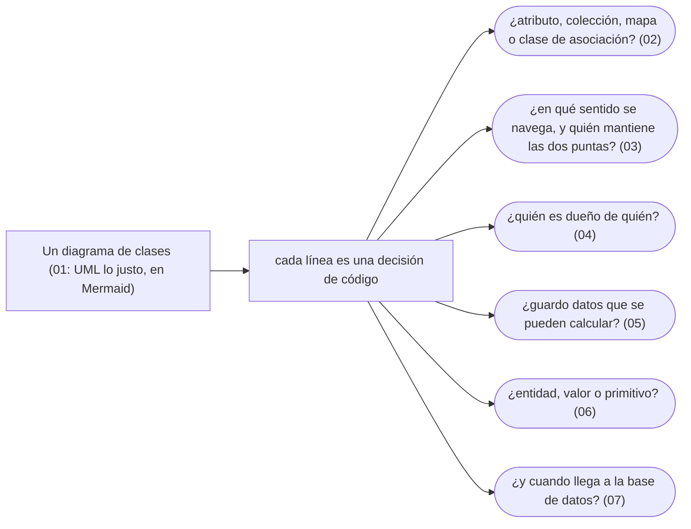

# 02 — Modelado OO

> Cómo se pasa de un diagrama a clases que se pueden defender: asociaciones, navegabilidad, propiedad, redundancia, entidades y valores, y la frontera con las tablas. El dominio del corpus —personas, documentos, `TipoDocumento`— nace aquí.
>
> **Vigencia:** 2026-10-03.

---

## 1. 🗺️ Índice

| | Documento | Tipo |
|---|---|---|
| [`01`](01-uml-lo-justo-en-mermaid.md) | UML lo justo, en Mermaid | Capítulo |
| [`02`](02-de-la-asociacion-al-codigo.md) | De la asociación al código | Capítulo |
| [`03`](03-navegabilidad-y-coherencia.md) | Navegabilidad y coherencia | Capítulo |
| [`04`](04-agregacion-composicion-y-propiedad.md) | Agregación, composición y propiedad | Capítulo |
| [`05`](05-redundancia-controlada.md) | Redundancia controlada | Capítulo |
| [`06`](06-entidades-valores-y-primitivos.md) | Entidades, valores y primitivos | Capítulo |
| [`07`](07-objetos-frente-a-tablas.md) | Objetos frente a tablas | Capítulo |
| [`08`](08-simulacion-de-entrevista.md) | Simulación de entrevista | Simulación |
| [`09`](09-respuestas.md) | Respuestas | Solucionario |

**Orden de lectura.** En orden numérico. `01` fija la notación Mermaid que usa todo el corpus; `06` es el dueño del objeto de valor como concepto. Al terminar los capítulos, la simulación con cronómetro, y solo después el solucionario.

---

## 2. 🧠 Mapa mental

---

## 3. 🚫 Qué NO está aquí

El UML formal (OCL, perfiles, componentes y despliegue); los patrones de persistencia completos están en `07`.

---

**Versiones ejecutadas:** mermaid-cli 11.17.0 · GCC 14.4 (C++23) · JDK 21.0.12, 17.0.20 y 25.0.4 · Spring Boot 4.1.1 (Spring Framework 7.0.9, Hibernate 7.4.5, H2 2.4.240) (2026-10-04).

---

**Anterior:** [`01` — Modelo de objetos](../01-modelo-de-objetos/README.md) ·
**Corpus:** [README](../README.md) ·
**Siguiente:** [`03` — Principios de diseño](../03-principios-de-diseno/README.md)
