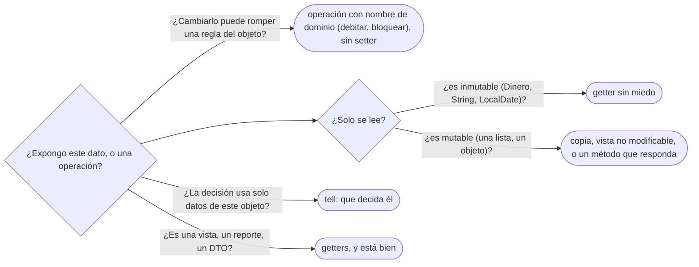

# 01 — Encapsulación de verdad

> La diferencia entre esconder campos y proteger invariantes; *tell, don't ask*; la Ley de Demeter
> leída con criterio; y el modelo anémico frente al rico. Asume leído
> [`02/04` — Agregación, composición y propiedad](../02-modelado-oo/04-agregacion-composicion-y-propiedad.md).
>
> **Vigencia:** 2026-10-03.
>
> **Versiones ejecutadas:** JDK 21.0.12, 17.0.20 y 25.0.4 (2026-10-04).

---

## 1. 🎯 El problema

`Cuenta` tiene sus campos privados, con un getter y un setter para cada uno. Un servicio hace la
transferencia:

```java
public class ServicioTransferencias {
    public void transferir(Cuenta origen, Cuenta destino, Dinero monto) {
        if (origen.getEstado() != EstadoCuenta.ABIERTA) throw new IllegalStateException("cuenta no operativa");
        if (origen.getSaldo().compareTo(monto) < 0) throw new SaldoInsuficienteException(origen, monto);
        origen.setSaldo(origen.getSaldo().menos(monto));
        destino.setSaldo(destino.getSaldo().mas(monto));
    }
}
```

- Seis meses después, otro equipo escribe `ServicioPagos`, que también descuenta saldo. Copia el
  `setSaldo` y olvida comprobar el estado: una cuenta bloqueada empieza a pagar.
- Los campos son privados, y aun así cualquier clase puede dejar la cuenta en un estado que el negocio
  prohíbe. Las reglas de la cuenta no viven en la cuenta: viven repartidas en quien la usa, y cada uno
  las repite o las olvida.

"Con campos privados y getters ya encapsulé" es la creencia que produce este código. Encapsular no es
esconder campos: es que **nadie pueda romper las reglas del objeto sin pasar por el objeto**.

---

## 2. 🧱 Encapsular es proteger invariantes

**Qué es.** Un **invariante** es una regla que el objeto cumple siempre, desde que termina su
constructor: "el saldo de una cuenta nunca es negativo", "una cuenta bloqueada no admite movimientos",
"el documento principal es uno de los documentos de la persona". **Encapsular** es organizar la clase
de modo que **ningún camino** desde fuera pueda dejar de cumplirlos.

**Por qué los getters y setters no encapsulan.** Un campo privado con `getX` y `setX` públicos es un
campo público con más pasos: cualquiera lee cualquier cosa y escribe cualquier valor. El `private` solo
cambia la sintaxis del acceso.

```java
public class Cuenta {                              // el campo es privado; la regla, de nadie
    private Dinero saldo;
    public Dinero getSaldo() { return saldo; }
    public void setSaldo(Dinero s) { this.saldo = s; }   // acepta un saldo negativo
}
```

**Qué cuesta encapsular de verdad.** Pensar qué **operaciones** tiene el objeto, en lugar de qué
**datos**: `debitar`, `acreditar`, `bloquear`, con nombres del dominio. Y en las cuatro monedas, sobre
todo legibilidad para quien está acostumbrado a los setters: el primer día cuesta encontrar "dónde se
cambia el saldo". El segundo día, que haya un solo sitio es lo que lo hace fácil.

> **Veredicto:** un objeto está encapsulado si sus invariantes no dependen de que sus usuarios se
> porten bien. Si hay un setter que puede romper una regla, no lo está, por privados que sean los
> campos.

---

## 3. 🧱 Dónde se protege cada invariante

```java
public final class Cuenta {
    private final CuentaId id;
    private Dinero saldo;
    private EstadoCuenta estado = EstadoCuenta.ABIERTA;

    public void debitar(Dinero monto) {
        exigirOperativa();
        Dinero nuevo = saldo.menos(monto);
        if (nuevo.esNegativo()) throw new SaldoInsuficienteException(id, monto);
        saldo = nuevo;                                   // solo se escribe aquí y en acreditar
    }

    public void acreditar(Dinero monto) {
        exigirOperativa();
        saldo = saldo.mas(monto);
    }

    public void bloquear() { estado = EstadoCuenta.BLOQUEADA; }

    public Dinero saldo() { return saldo; }              // leer sí: Dinero es inmutable

    private void exigirOperativa() {
        if (!estado.admiteMovimientos()) throw new IllegalStateException("cuenta " + estado);
    }
}
```

- **Las reglas viven en los métodos que cambian el estado**, y cada método las comprueba antes de
  mutar. `ServicioPagos` ya no puede olvidarse de comprobar el estado: no hay forma de cambiar el saldo
  sin pasar por `debitar`.
- **Leer está bien** cuando lo que se devuelve es inmutable (`Dinero`) o una copia. Lo que no se
  expone es la **escritura** sin reglas.
- En C++ la misma idea: miembros `private`, métodos con nombre de dominio, y los de lectura marcados
  `const`; devolver `const Dinero&` es seguro si `Dinero` no tiene mutadores.

---

## 4. 🧱 *Tell, don't ask*

**Qué es.** *Tell, don't ask* (dile, no le preguntes): en lugar de **pedirle datos** a un objeto para
decidir fuera, **dile qué hacer** y que decida él con sus datos.

```java
// ask: el servicio pregunta y decide
if (origen.getEstado() == EstadoCuenta.ABIERTA && origen.getSaldo().compareTo(monto) >= 0) {
    origen.setSaldo(origen.getSaldo().menos(monto));
}

// tell: el servicio pide, la cuenta decide con sus reglas
origen.debitar(monto);
```

**Qué cuesta.** La clase crece en métodos de dominio, y hay que resistir la tentación de meter en ella
decisiones que **no son suyas**: si la regla depende de datos de otro objeto (la política de comisiones
del banco, el límite diario del cliente), preguntarle a la cuenta por su saldo es correcto, y quien
decide es otro.

**Cuándo no.** En las pantallas y los reportes, preguntar es lo normal: una vista necesita los datos para
mostrarlos, y forzar un "dile a la cuenta que se pinte" mezcla la presentación con el dominio.

> **Veredicto:** si para cambiar el estado de un objeto lees sus campos y decides fuera, la decisión
> está en el sitio equivocado. Para mostrar, pregunta sin culpa.

---

## 5. 🧱 La Ley de Demeter, leída con criterio

**Qué es.** La **Ley de Demeter** (o "principio del menor conocimiento") dice que un método solo debería
hablar con sus "vecinos inmediatos": sus campos, sus parámetros, los objetos que crea, y él mismo. No
con los objetos que esos vecinos le devuelven.

```java
// viola Demeter: el servicio recorre la estructura interna de cuatro objetos
String pais = persona.tutor().documentoPrincipal().tipo().pais().nombre();
```

- El servicio ahora depende de que una persona tenga tutor, de que el tutor tenga documento principal,
  de que el documento tenga tipo y el tipo tenga país. Cualquier cambio en esa cadena lo rompe, y la
  pregunta que hacía ("¿de qué país es el documento del tutor?") quizá debía responderla `Persona`.

**La sobregeneralización.** "Demeter prohíbe encadenar llamadas" (o "un punto por línea") es falso. Lo
que limita es **navegar por la estructura interna de objetos ajenos**. Estas cadenas no la violan:

```java
documentos.stream().filter(Documento::vigente).map(Documento::numero).toList();  // transforma datos
Persona.builder().nombre("Ana Rojas Medina").fechaNacimiento(nacimiento).build(); // interfaz fluida
```

- En las dos, cada llamada devuelve el **mismo tipo de cosa** con la que se está trabajando (un
  `Stream`, un builder), no un objeto interno de otro. No hay ninguna estructura ajena expuesta.

**Qué cuesta cumplirla a ciegas.** Métodos de reenvío por todas partes (`persona.paisDelDocumentoDelTutor()`)
que inflan las clases. La lectura razonable: si una cadena atraviesa **objetos del dominio** para tomar
una decisión, la decisión está en el sitio equivocado; si recorre datos para mostrarlos o transformarlos,
está bien.

> **Veredicto:** Demeter es una señal, no una regla de sintaxis. La pregunta es si estás navegando la
> estructura interna de otro para decidir algo que él debería decidir.

---

## 6. 🧱 Modelo anémico contra modelo rico

**Qué es.** Un **modelo anémico** tiene clases de dominio con datos y getters/setters, y toda la lógica
en servicios: el `Cuenta` de §1. Un **modelo rico** pone la lógica que protege los invariantes dentro de
las clases que tienen los datos: el `Cuenta` de §3.

**La sobregeneralización.** "El modelo anémico es más simple" es verdad el primer mes, mientras hay un
solo servicio que usa la cuenta. Con diez servicios, cada regla está repetida (o falta) en varios sitios,
y el costo de un cambio de regla es buscarlas todas.

| | Anémico | Rico |
|---|---|---|
| Dónde vive la regla "no debitar una cuenta bloqueada" | En cada servicio que debita | En `Cuenta.debitar` |
| Qué pasa si un servicio nuevo olvida la regla | El modelo queda inválido | No puede olvidarla |
| Cómo se prueba la regla | Con cada servicio | Con la clase, sin infraestructura |
| Cuándo encaja | CRUD sin reglas; lecturas | Dominios con invariantes |

- Para un CRUD sin reglas —un catálogo de países—, el anémico es correcto: no hay invariantes que
  proteger. El antipatrón completo, con su salida, es de [`12/03` §3](../12-antipatrones/03-antipatrones-de-diseno-oo.md#3-️-anemic-domain-model).

---

## 7. 🧭 Cómo se elige



**La frase en voz alta:** *"Encapsular es proteger invariantes, no esconder campos. Las reglas van en los
métodos que cambian el estado, y desde fuera se le dice al objeto qué hacer, no se le pregunta para
decidir por él."*

---

## ⚠️ Errores frecuentes

| Se dice | Lo preciso |
|---|---|
| "Con campos privados y getters ya encapsulé" | Con setters públicos, cualquiera rompe las reglas: es un campo público con más pasos |
| "Demeter prohíbe encadenar llamadas" | Limita navegar la estructura interna de objetos ajenos; un `stream` o un builder no la violan |
| "El modelo anémico es más simple" | Lo es con un solo servicio; con varios, cada regla se repite o se olvida |
| "Tell, don't ask significa no tener getters" | Leer está bien; lo que no se hace es decidir fuera con datos que el objeto podía usar él |
| "Encapsular es para ocultar la implementación" | También, pero lo que más protege son las reglas de negocio |
| "Toda la lógica debe ir en el objeto" | La que usa solo sus datos y protege sus invariantes; la que necesita datos de otros, en quien los tiene todos |

---

## 📚 Para profundizar

- **Libro** — Ousterhout, *A Philosophy of Software Design*, 2.ª ed. (Yaknyam Press, 2021), cap. 5,
  "Information Hiding (and Leakage)": por qué esconder campos no basta si la información se filtra por
  la interfaz. **El que destaca.**
- **Libro** — Bloch, *Effective Java*, 3.ª ed. (Addison-Wesley, 2018), ítems 15, "Minimize the
  accessibility of classes and members", y 16, "In public classes, use accessor methods, not public
  fields".
- **Libro** — Metz, *Practical Object-Oriented Design*, 2.ª ed. (Addison-Wesley, 2018), cap. 4,
  "Creating Flexible Interfaces": la Ley de Demeter con la lectura razonable de este capítulo.
- [martinfowler.com — *TellDontAsk*](https://martinfowler.com/bliki/TellDontAsk.html): con su
  advertencia de no llevarlo al extremo.
- [martinfowler.com — *AnemicDomainModel*](https://martinfowler.com/bliki/AnemicDomainModel.html).

---

## 🧠 Preguntas

Sin respuestas aquí. Todas, con enunciado literal y respuesta en tres capas, en
[`07` — Respuestas](07-respuestas.md#01--encapsulación-de-verdad).

1. ¿Qué es un invariante de clase? Da uno de `Cuenta`. 🟢
2. ¿Qué significa encapsular, según este capítulo? 🟢
3. ¿Qué dice *tell, don't ask*? 🟢
4. ¿Qué dice la Ley de Demeter? 🟢
5. ¿Qué es un modelo anémico? 🟢
6. ¿Qué diferencia hay entre esconder campos y proteger invariantes? 🟡
7. ¿Qué diferencia hay entre un setter y un método de dominio como `debitar`? 🟡
8. ¿Qué diferencia hay entre una cadena que viola Demeter y una interfaz fluida? 🟡
9. ¿Qué diferencia hay entre un modelo anémico y uno rico? 🟡
10. ¿Cómo se expresa en C++ que un método no cambia el objeto, y qué equivalente tiene en Java? 🟡
11. ¿Qué devuelve un getter seguro en Java y en C++ cuando el campo es mutable? 🟡
12. ¿Por qué un getter de un campo inmutable no rompe la encapsulación? 🟠
13. ¿Cuándo es correcto preguntarle datos a un objeto en lugar de decirle qué hacer? 🟠
14. ¿Por qué "un punto por línea" es una mala lectura de Demeter? 🟠
15. ¿Qué cuesta cumplir Demeter a ciegas? 🟠
16. ¿Cuándo es correcto un modelo anémico? 🟠
17. ¿Qué lógica no debería ir dentro de `Cuenta` aunque use su saldo? 🟠
18. ¿Por qué el modelo anémico es más caro de probar? 🟠
19. Reescribe la `Cuenta` y el servicio de §1 para que ningún servicio pueda debitar una cuenta bloqueada. 🔴
20. Arregla esta línea respetando Demeter, y di dónde pones la decisión:
    `String pais = persona.tutor().documentoPrincipal().tipo().pais().nombre();`. 🔴
21. Revisa esta clase y di qué está mal: `class Persona { private List<Documento> documentos; public
    List<Documento> getDocumentos() { return documentos; } public void setDocumentos(List<Documento> d)
    { documentos = d; } }`. 🔴
22. Escribe en C++ la clase `Cuenta` encapsulada, con `debitar`, `acreditar` y un acceso de lectura al
    saldo. 🔴

---

**Anterior:** — ·
**Siguiente:** [`02` — SOLID sin catecismo](02-solid-sin-catecismo.md) ·
**Relacionado:** [`04` — Acoplamiento, cohesión y dependencias](04-acoplamiento-cohesion-y-dependencias.md)
