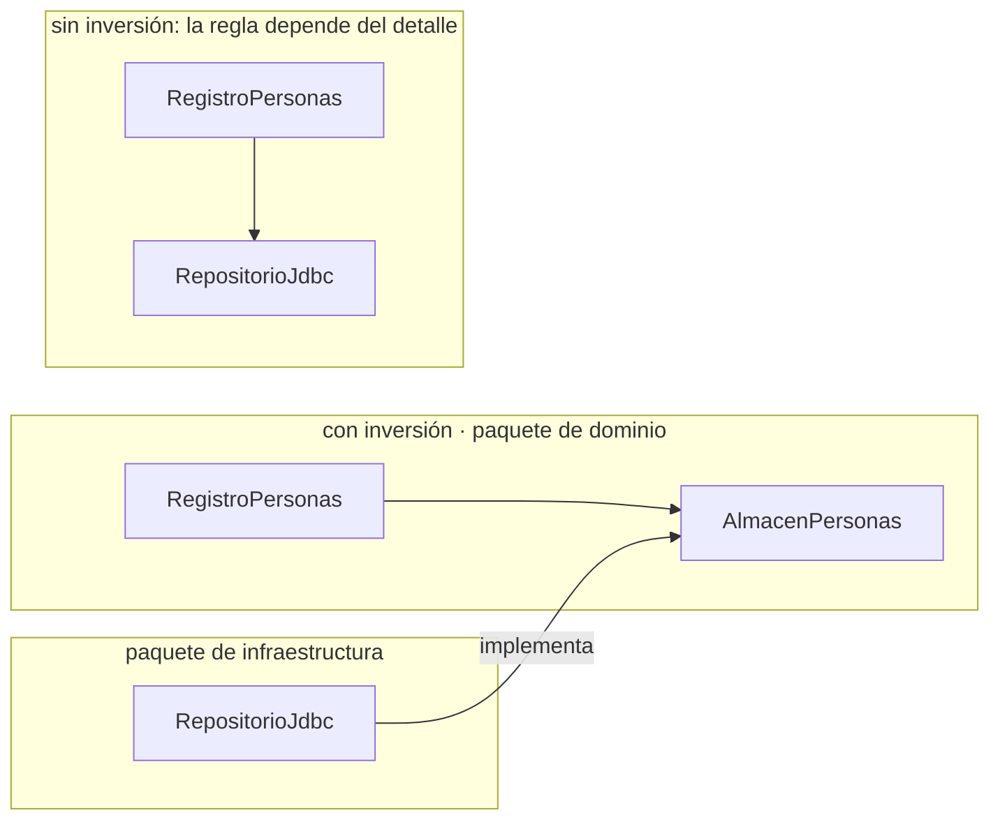
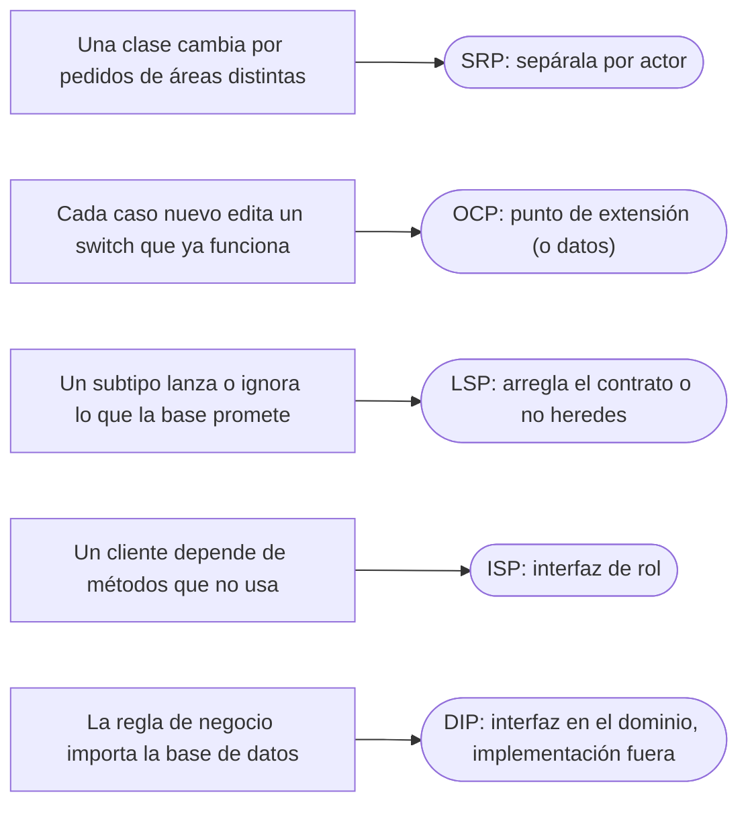

# 02 — SOLID sin catecismo

> Los cinco principios con el código que los viola y el que los cumple, en el dominio, y la lectura
> equivocada de cada uno; y cuándo aplicar SOLID es ceremonia. Asume leído
> [`01` — Encapsulación de verdad](01-encapsulacion-de-verdad.md), pero se lee solo: §1 recuerda lo
> necesario.
>
> **Vigencia:** 2026-10-03.
>
> **Versiones ejecutadas:** GCC 14.4 (C++23) · JDK 21.0.12, 17.0.20 y 25.0.4 · Spring Boot 4.1.1 (Spring Framework 7.0.9, Hibernate 7.4.5, H2 2.4.240) (2026-10-04).

---

## 1. 🎯 El problema

En la entrevista recitas SOLID sin un error. El entrevistador te enseña esta clase y pregunta: "¿qué
principio viola primero, y qué harías?".

```java
public class ServicioPersonas {
    public void registrar(Persona p) {
        if (p.nombre().isBlank()) throw new IllegalArgumentException("nombre vacío");
        for (Documento d : p.documentos()) {
            switch (d.tipo().codigo()) {                          // validación por tipo
                case "CC" -> { if (!d.numero().matches("\\d{6,10}")) throw new IllegalArgumentException(); }
                case "PAS-CO" -> { if (!d.numero().matches("[A-Z]{2}\\d{6}")) throw new IllegalArgumentException(); }
                default -> throw new IllegalArgumentException(d.tipo().codigo());
            }
        }
        new JdbcTemplate(fuenteDeDatos()).update("INSERT INTO persona ...", p.nombre());   // persistencia
        new ClienteSmtp("smtp.example.com").enviar(p.email(), "Bienvenida");             // notificación
    }
}
```

Y después te enseña la versión "SOLID" que escribió otro compañero: siete interfaces con una sola
implementación cada una, una fábrica para cada interfaz, y la misma lógica repartida en doce archivos.

- La primera clase viola casi todo, y la respuesta que puntúa no es enumerarlo: es decir **cuál duele
  primero y por qué**. La segunda cumple todo de nombre y es más cara de cambiar que la primera.
- **Lo que hace falta recordar:** encapsular es proteger las reglas del objeto; una clase con una
  responsabilidad tiene un solo motivo de cambio. Lo demás, este capítulo.

---

## 2. 🧱 SRP: un actor, no un método

**Qué es.** El ***Single Responsibility Principle*** dice que un módulo debe tener **un solo motivo de
cambio**. Robert C. Martin lo precisa: un motivo de cambio es **un actor**, un grupo de personas que
pide cambios. "Este principio es sobre personas", escribe.

**La lectura equivocada.** "SRP es una clase por método" convierte cada clase en una función con
ceremonia. Una `Cuenta` con `debitar`, `acreditar` y `bloquear` tiene un solo actor —las reglas de
negocio de cuentas— aunque tenga muchos métodos.

**Cómo se ve la violación.** `ServicioPersonas` cambia cuando el área de cumplimiento cambia las reglas de
documentos, cuando el equipo de base de datos cambia el esquema, y cuando marketing cambia el correo de
bienvenida. Tres actores, una clase: un cambio de uno puede romper lo de otro, y los tres editan el
mismo archivo.

```java
public class RegistroPersonas {                     // un actor: el proceso de alta
    private final ValidadorDocumentos validador;    // actor: cumplimiento
    private final RepositorioPersonas repositorio;  // actor: persistencia
    private final Notificador notificador;          // actor: comunicación

    public void registrar(Persona p) {
        validador.validar(p);
        repositorio.guardar(p);
        notificador.bienvenida(p);
    }
}
```

**Qué cuesta.** Tres clases y tres dependencias que inyectar. Lo que compra: cada actor cambia su
archivo sin tocar los otros, y cada parte se prueba sola.

> **Veredicto:** di "un motivo de cambio, es decir, un actor". Una clase con veinte métodos puede
> cumplirlo; una con dos, violarlo.

---

## 3. 🧱 OCP: puntos de extensión donde se espera el cambio

**Qué es.** El ***Open/Closed Principle*** dice que un módulo debe estar **abierto a la extensión y
cerrado a la modificación**: un comportamiento nuevo se añade escribiendo código nuevo, no editando el
que funciona.

**La lectura equivocada.** "OCP prohíbe modificar código" es imposible y no es lo que dice. Lo que
pide es que **en los ejes de cambio previsibles** haya un punto de extensión. El `switch` por tipo de
documento de §1 es el eje: cada país nuevo obliga a editar `registrar`.

**Cómo se cumple aquí.** Dos formas, y la mejor no es la que parece:

```java
// a) Polimorfismo: una estrategia de validación por tipo (un tipo nuevo = una clase nueva)
interface ReglaDocumento { boolean admite(String numero); }

// b) Datos: el formato es un dato de TipoDocumento (un tipo nuevo = una fila nueva)
boolean valido = documento.tipo().formato().matcher(documento.numero()).matches();
```

- La segunda cumple OCP **mejor** que la primera: abrir a la extensión no significa "añadir una
  clase", sino "añadir sin editar". Si los tipos difieren solo en datos, los datos son el punto de
  extensión.

**Qué cuesta.** Un punto de extensión es **indirección**: el lector ya no ve en un `switch` qué pasa con
cada tipo. Puesto donde no hay cambio previsible, es puro costo.

> **Veredicto:** pon un punto de extensión donde el cambio ya ocurrió o es seguro que ocurrirá. Al
> primer cambio, edita; al segundo, extrae el punto de extensión.

---

## 4. 🧱 LSP: el subtipo cumple el contrato

**Qué es.** El ***Liskov Substitution Principle*** dice que el código escrito contra un tipo debe
funcionar con cualquiera de sus subtipos. La lectura precisa es **contractual**: un subtipo no puede
exigir más (precondiciones más fuertes) ni prometer menos (postcondiciones más débiles) que su base, y
debe mantener sus invariantes.

**El ejemplo del dominio.** Una `Cedula extends Documento` que lanza en `vencimiento()` porque la cédula
no vence rompe todo código que recorra documentos pidiendo su vencimiento. El análisis completo —el
cuadrado y el rectángulo, y las dos salidas— está en
[`01/06` §3](../01-modelo-de-objetos/06-herencia-vertical-y-horizontal.md#3--lsp-el-contrato-que-la-herencia-promete).

**La lectura equivocada.** "LSP es sobre herencia de clases" se queda corto: vale para toda
implementación de una interfaz. Un `RepositorioCuentas` en memoria que no lanza la excepción de
"cuenta no encontrada" que lanza el de base de datos viola LSP aunque no herede de nadie, y los tests
escritos contra el falso pasan con un comportamiento que producción no tiene.

---

## 5. 🧱 ISP: interfaces de rol

**Qué es.** El ***Interface Segregation Principle*** dice que ningún cliente debería depender de métodos
que no usa. La forma práctica son las **interfaces de rol**: pequeñas, nombradas por lo que el cliente
necesita, no por la clase que las implementa.

```java
// gorda: el validador depende de quince métodos para usar uno
interface RepositorioPersonas {
    Optional<Persona> buscarPorDocumento(String numero);
    void guardar(Persona p);
    void borrar(PersonaId id);
    List<Persona> listarPorOrganizacion(Organizacion o);
    // ...y once más
}

// de rol: cada cliente pide lo que usa
interface BuscadorPorDocumento { Optional<Persona> buscarPorDocumento(String numero); }
interface AlmacenPersonas      { void guardar(Persona p); }
```

```cpp
class BuscadorPorDocumento {                    // en C++, una clase abstracta pura por rol
public:
    virtual ~BuscadorPorDocumento() = default;
    virtual std::optional<Persona> buscarPorDocumento(std::string_view numero) const = 0;
};
```

- La misma clase de persistencia implementa los dos roles; el validador depende solo de
  `BuscadorPorDocumento`, y un cambio en `listarPorOrganizacion` no le afecta ni lo obliga a recompilar.
  Para probarlo, un falso de un método, no de quince.

**Qué cuesta.** Más interfaces que nombrar y encontrar. Con una interfaz por método, el sistema se
vuelve un laberinto: el rol es "lo que un cliente concreto necesita", no "un método".

---

## 6. 🧱 DIP: la dependencia apunta a la política

**Qué es.** El ***Dependency Inversion Principle*** dice que los módulos de alto nivel (la política: las
reglas de negocio) no deben depender de los de bajo nivel (los detalles: la base de datos, el SMTP);
**los dos dependen de abstracciones**, y la abstracción **pertenece al de alto nivel**.



- La "inversión" está en la flecha de la derecha: el detalle (JDBC) depende de una interfaz que define
  el dominio, y no al revés. El dominio compila y se prueba sin saber que existe una base de datos.

**La lectura equivocada.** "DIP es poner una interfaz a todo" confunde la herramienta con la dirección.
Una interfaz `CalculadoraEdad` con una sola implementación que nunca cambiará no invierte nada: es
indirección. Y una interfaz definida **en el paquete de infraestructura** que el dominio importa tampoco
invierte nada: la flecha sigue apuntando al detalle.

**En C++**, la misma idea con una clase abstracta inyectada por constructor, o sin herencia con una
plantilla restringida por un *concept*, que resuelve la dependencia al compilar:

```cpp
template <typename A>
concept AlmacenDePersonas = requires(A a, const Persona& p) { a.guardar(p); };

template <AlmacenDePersonas Almacen>
class RegistroPersonas {
    Almacen& almacen;                         // no posee: el almacén vive más
public:
    explicit RegistroPersonas(Almacen& a) : almacen(a) {}
    void registrar(const Persona& p) { almacen.guardar(p); }
};
```

> **Veredicto:** DIP es sobre la **dirección** de la dependencia: hacia la política. La interfaz se
> justifica cuando separa la regla de un detalle que cambia o que estorba en las pruebas.

---

## 7. 🧱 Cuándo SOLID es ceremonia

"SOLID siempre mejora el diseño" es la última lectura equivocada. Cada principio cobra en
**indirección**: más clases, más interfaces, más saltos para seguir una llamada. Se paga solo donde hay
un cambio que abaratar:

- **Código que no cambia** (un conversor de fechas estable) no necesita puntos de extensión.
- **Una implementación que no tiene alternativa realista ni estorba en las pruebas** no necesita
  interfaz.
- **Un sistema pequeño o de vida corta** paga la indirección y nunca cobra el beneficio.

La versión "SOLID" de §1 con siete interfaces es esto: cumple los principios de nombre y multiplica el
costo de leer, sin ningún eje de cambio que lo justifique. La salida intermedia —tres colaboradores por
actor, interfaz solo para el almacén y el notificador, que sí tocan infraestructura— es la que se defiende.

> 💡 **Truco.** Ante "¿qué principio viola primero?", la respuesta que sube la nota nombra el **dolor**:
> "SRP, porque tres equipos editan esta clase por motivos distintos; lo demás se arregla al separarla".

---

## 8. 🧭 Cómo se elige



Cada flecha va de la señal en el código al principio que la explica. Y antes de aplicar cualquiera: ¿hay un
cambio real que abaratar? Si no, es ceremonia.

Las señales de la izquierda tienen nombre de *code smell* —*Divergent Change* para la primera, *Shotgun
Surgery* para su reverso, *Repeated Switches* para la segunda— y su catálogo está en [`12/02`](../12-antipatrones/02-code-smells-entre-clases.md) y
[`12/01`](../12-antipatrones/01-code-smells-dentro-de-una-clase.md).

**La frase en voz alta:** *"Cada principio de SOLID responde a un dolor concreto. Los aplico donde está
ese dolor, y digo lo que cuestan: cada uno añade indirección."*

---

## ⚠️ Errores frecuentes

| Se dice | Lo preciso |
|---|---|
| "SRP es una clase por método" | Es un motivo de cambio, es decir, un actor; una clase puede tener muchos métodos |
| "OCP prohíbe modificar código" | Pide puntos de extensión en los ejes de cambio previsibles; el resto se modifica sin culpa |
| "DIP es poner una interfaz a todo" | Es dirigir la dependencia hacia la política; la interfaz pertenece al dominio |
| "SOLID siempre mejora el diseño" | Cada principio cobra en indirección; sin cambio que abaratar, es ceremonia |
| "LSP es solo sobre herencia de clases" | Vale para toda implementación de una interfaz, falsos de pruebas incluidos |
| "ISP es una interfaz por método" | Es una interfaz por rol de cliente |
| "OCP se cumple con polimorfismo" | También con datos: un tipo de documento nuevo como fila nueva cumple OCP mejor |

---

## 📚 Para profundizar

- **Libro** — Martin, *Clean Architecture* (Prentice Hall, 2017), caps. 7 a 11, uno por principio: el
  SRP como "un actor" está en el cap. 7. **El que destaca**, por ser la formulación del propio autor.
- **Libro** — Metz, *Practical Object-Oriented Design*, 2.ª ed. (Addison-Wesley, 2018), cap. 2,
  "Designing Classes with a Single Responsibility", y cap. 3, "Managing Dependencies": los mismos
  principios sin la palabra SOLID, con su costo.
- **Libro** — Ousterhout, *A Philosophy of Software Design*, 2.ª ed. (Yaknyam Press, 2021), cap. 4,
  "Modules Should Be Deep": el contrapeso a dividir demasiado.
- [Robert C. Martin — *The Single Responsibility Principle*](https://blog.cleancoder.com/uncle-bob/2014/05/08/SingleReponsibilityPrinciple.html):
  "este principio es sobre personas", en el blog del autor.
- **Video** — YouTube, ArjanCodes: diseño y SOLID en Python, con ejemplos de cuándo sobra. Material
  suplementario.

---

## 🧠 Preguntas

Sin respuestas aquí. Todas, con enunciado literal y respuesta en tres capas, en
[`07` — Respuestas](07-respuestas.md#02--solid-sin-catecismo).

1. ¿Qué dice el SRP, en la formulación de Robert C. Martin? 🟢
2. ¿Qué dice el OCP? 🟢
3. ¿Qué dice el LSP? 🟢
4. ¿Qué dice el ISP? 🟢
5. ¿Qué dice el DIP? 🟢
6. ¿Qué es una interfaz de rol? 🟢
7. ¿Qué es un actor, en el sentido del SRP? 🟢
8. ¿Qué diferencia hay entre "un motivo de cambio" y "una clase por método"? 🟡
9. ¿Qué diferencia hay entre cumplir OCP con polimorfismo y con datos? 🟡
10. ¿Qué diferencia hay entre DIP e inyección de dependencias? 🟡
11. ¿Qué diferencia hay entre una interfaz gorda y varias de rol? 🟡
12. ¿Qué diferencia hay entre una interfaz definida en el dominio y una definida en la infraestructura,
    para DIP? 🟡
13. ¿Cómo se aplica DIP en C++ sin herencia, y qué cambia respecto de Java? 🟡
14. ¿Cómo se escribe una interfaz de rol en C++, y qué cuesta frente a la de Java? 🟡
15. ¿Por qué "OCP prohíbe modificar código" es una lectura imposible? 🟠
16. ¿Por qué un falso de pruebas puede violar LSP? 🟠
17. ¿Cuándo una interfaz con una sola implementación está justificada? 🟠
18. ¿Cuándo aplicar SOLID es ceremonia? Da tres casos. 🟠
19. ¿Qué principio viola primero `ServicioPersonas` de §1, y por qué ese? 🟠
20. ¿Por qué una clase con veinte métodos puede cumplir el SRP? 🟠
21. ¿Qué cuesta cada principio de SOLID, en las cuatro monedas? 🟠
22. ¿Cuándo extraerías un punto de extensión: al primer cambio o al segundo? 🟠
23. Divide `ServicioPersonas` de §1 por actores y escribe la clase que coordina. 🔴
24. Reescribe la validación por tipo de §1 para que un país nuevo no edite código, y di por qué tu
    solución cumple OCP. 🔴
25. Dibuja en Mermaid la dependencia entre `RegistroPersonas`, `AlmacenPersonas` y `RepositorioJdbc` con
    la inversión, y di en qué paquete va cada uno. 🔴
26. Separa en interfaces de rol un `RepositorioPersonas` de quince métodos usado por un validador y un
    proceso de alta. 🔴
27. Revisa este diseño y di qué está mal: `interface CalculadoraEdad { int edad(Persona p); }` con una
    única `CalculadoraEdadImpl`, una `CalculadoraEdadFactory` y un test con un falso de
    `CalculadoraEdad`. 🔴
28. Un `RepositorioCuentasEnMemoria` para pruebas devuelve `null` donde el real lanza
    `CuentaNoEncontradaException`. Di qué principio viola, qué consecuencia tiene y cómo lo corriges. 🔴

---

**Anterior:** [`01` — Encapsulación de verdad](01-encapsulacion-de-verdad.md) ·
**Siguiente:** [`03` — GRASP](03-grasp.md) ·
**Relacionado:** [`04` — Acoplamiento, cohesión y dependencias](04-acoplamiento-cohesion-y-dependencias.md)
