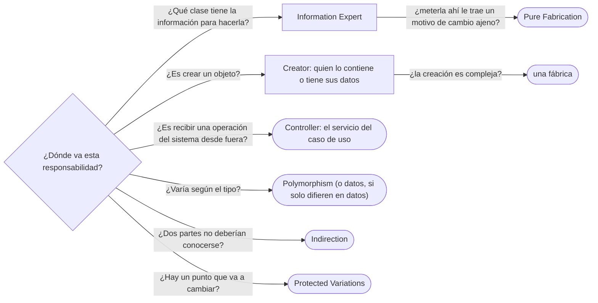

# 03 — GRASP

> Los nueve principios de Larman para responder "¿dónde pondrías esta lógica?", con el dominio, y su
> traducción al vocabulario de hoy. Profundidad de nivel B: lo justo para usarlos en una conversación
> de diseño. Asume leído [`02` — SOLID sin catecismo](02-solid-sin-catecismo.md).
>
> **Vigencia:** 2026-10-03.
>
> **Versiones ejecutadas:** JDK 21.0.12, 17.0.20 y 25.0.4 (2026-10-04).

---

## 1. 🎯 El problema

En una entrevista de diseño: "Un menor de edad debe tener tutor. ¿Dónde pondrías esa validación?". Tres
respuestas habituales:

```text
"En el controlador REST, antes de llamar al servicio."         → se la salta quien no pase por REST
"En un ServicioValidaciones con todas las reglas del sistema." → una clase que conoce todo
"En una anotación @MenorConTutor sobre el DTO."                 → la regla vive en el borde, no en el modelo
```

Ninguna es absurda, y ninguna sabe decir **por qué**. GRASP es un vocabulario para responder a esa
pregunta con criterio: quién tiene la información, quién crea a quién, quién coordina, y qué se gana o
se pierde en cada elección. "GRASP es teoría de universidad sin uso" es la idea que impide aprovecharlo:
es la pregunta que se hace en cada revisión de código, con nombre.

---

## 2. 🧱 Qué es GRASP

**Qué es.** ***GRASP*** (*General Responsibility Assignment Software Patterns*) son nueve principios que
Craig Larman reunió en *Applying UML and Patterns* para **asignar responsabilidades** a clases. No son
patrones de código como los del GoF: son criterios para decidir **quién hace qué**.

```text
Information Expert   Creator          Controller
Low Coupling         High Cohesion    Polymorphism
Pure Fabrication     Indirection      Protected Variations
```

- Low Coupling y High Cohesion no asignan nada: **evalúan** las asignaciones de los otros siete. Se usan como árbitros cuando dos principios proponen sitios
  distintos.

---

## 3. 🧱 Information Expert

**Problema.** ¿Quién debe calcular algo o decidir algo? **Mecanismo:** la clase que **tiene la
información** necesaria. Es el principio que más se usa y el que fundamenta *tell, don't ask*.

```java
// ¿Quién sabe si Luis es menor? Quien tiene su fecha de nacimiento.
public boolean esMenor(LocalDate hoy) { return Period.between(fechaNacimiento, hoy).getYears() < 18; }

// ¿Quién valida que un menor tenga tutor? Quien tiene la fecha y el tutor: Persona.
public void quitarTutor(LocalDate hoy) {
    if (esMenor(hoy)) throw new IllegalStateException("un menor debe tener tutor");
    tutor = null;
}
```

**Cuándo no.** Cuando seguirlo mete en la clase responsabilidades ajenas: `Persona` tiene sus datos, pero
**guardarse** en la base de datos o **imprimirse** en un PDF no le corresponde, aunque tenga la
información. Ahí High Cohesion gana, y aparece una Pure Fabrication.

> **Veredicto:** la lógica va donde están los datos, salvo que eso traiga a la clase un motivo de cambio
> ajeno.

---

## 4. 🧱 Creator

**Problema.** ¿Quién crea un objeto nuevo? **Mecanismo:** la clase que lo **contiene o agrega**, lo
**usa de cerca**, o **tiene los datos para inicializarlo**.

```java
// Organizacion crea el Empleo: tiene los datos de la relación y lo registra
public Empleo contratar(Persona p, String cargo, LocalDate desde) {
    Empleo e = new Empleo(p, this, cargo, desde);
    empleos.add(e);
    return e;
}
```

**Cuándo no.** Cuando la creación es compleja —decidir la clase concreta, ensamblar muchas partes, cargar
de una fuente—, se saca a una fábrica. Los patrones creacionales del GoF son esa salida: ver
[`04/01` — Factory Method y fábricas estáticas](../04-creacionales/01-factory-method.md).

---

## 5. 🧱 Controller

**Problema.** ¿Qué objeto recibe una operación del sistema que llega desde fuera (una petición, un
mensaje)? **Mecanismo:** un objeto que **representa el caso de uso** (`RegistroPersonas`,
`ServicioTransferencias`) o el sistema entero, y que **coordina** sin hacer el trabajo de dominio.

```java
public final class ServicioTransferencias {           // el Controller de GRASP
    public void transferir(CuentaId origen, CuentaId destino, Dinero monto) {
        Cuenta o = cuentas.obtener(origen);
        Cuenta d = cuentas.obtener(destino);
        o.debitar(monto);                              // la regla la decide la cuenta (Expert)
        d.acreditar(monto);
    }
}
```

**La confusión.** "El Controller de GRASP es el controller de MVC" es falso. El de MVC es un objeto de la
**capa de presentación**, que traduce HTTP; el de GRASP es el primer objeto **fuera** de la presentación
que recibe la operación. En una aplicación Spring, el `@RestController` es presentación y llama al
Controller de GRASP, que hoy se llama **servicio de aplicación**.

**Cuándo no.** Un Controller que hace las reglas él mismo se infla (Larman lo llama *bloated
controller*) y produce el modelo anémico de [`01`](01-encapsulacion-de-verdad.md). Cuándo un servicio que
hace todo es legítimo —el *Transaction Script*— y cuándo no, es de
[`07/01` — Organizar la lógica de dominio](../07-fowler-dominio-y-datos/01-logica-de-dominio.md).

---

## 6. 🧱 Low Coupling y High Cohesion

**Qué son.** Los dos árbitros. **Bajo acoplamiento**: asignar la responsabilidad de modo que las clases
dependan poco unas de otras. **Alta cohesión**: que cada clase tenga responsabilidades relacionadas
entre sí y no demasiadas.

**Cómo se usan.** Cuando Expert dice "pon el guardado en `Persona`, que tiene los datos", la cohesión
dice que no: `Persona` pasaría a depender de JDBC y tendría dos motivos de cambio. Cuando Creator dice
"que lo cree quien lo contiene" y eso acopla a una clase con diez dependencias, el acoplamiento dice
que no. Cómo se mide uno y otro a ojo, y qué tipos de acoplamiento hay, es de
[`04` — Acoplamiento, cohesión y dependencias](04-acoplamiento-cohesion-y-dependencias.md).

---

## 7. 🧱 Polymorphism

**Problema.** ¿Cómo se maneja un comportamiento que varía según el tipo, sin `if` ni `switch` por tipo?
**Mecanismo:** asignar la responsabilidad a los tipos que varían, con una operación polimórfica. Es lo
que cuenta [`01/05`](../01-modelo-de-objetos/05-polimorfismo-y-despacho.md) desde el lenguaje; GRASP lo
cuenta como decisión de diseño.

**Cuándo sí y cuándo no.** Cuando los tipos difieren en **comportamiento**. Cuando difieren solo en
**datos**, como los tipos de documento, el polimorfismo crea clases donde bastaba una tabla
(ver [`02/06` §7](../02-modelado-oo/06-entidades-valores-y-primitivos.md#7--el-tipo-como-objeto-tipodocumento-contra-subclases)).

---

## 8. 🧱 Pure Fabrication e Indirection

**Pure Fabrication.** Cuando ninguna clase del dominio es buena candidata para una responsabilidad sin
perder cohesión, se **inventa una clase que no representa nada del dominio**. Un `RepositorioPersonas`,
un `Notificador`, un `ExportadorCsv` no son conceptos del negocio: son fabricaciones que existen para
que `Persona` no tenga que guardarse, notificar ni exportarse.

**Indirection.** Para evitar que dos elementos se acoplen directamente, se pone un **intermediario**: el
almacén entre el registro y JDBC, un adaptador entre el dominio y la API de un proveedor. Casi todos los
patrones estructurales del GoF son formas de indirección: ver [`05/01` — Adapter](../05-estructurales/01-adapter.md) y
[`05/04` — Facade](../05-estructurales/04-facade.md).

**Qué cuestan.** Clases que no están en el vocabulario del negocio, y saltos de más para seguir una
llamada. Bien usadas, mantienen limpio el modelo; usadas por reflejo, producen la arquitectura de diez
capas para una consulta.

---

## 9. 🧱 Protected Variations

**Problema.** ¿Cómo se diseña para que la variación de un elemento no afecte a los demás? **Mecanismo:**
identificar los **puntos de variación o inestabilidad previsibles** y rodearlos de una **interfaz
estable**. El proveedor de correo puede cambiar: `Notificador` lo protege. El formato de un país puede
cambiar: `TipoDocumento` lo protege como dato.

- Es el principio más general de los nueve, y Larman lo presenta como la raíz de muchos otros: OCP, el
  ocultamiento de información, la indirección. Comparte con OCP el riesgo: proteger variaciones que
  nunca ocurren es indirección pagada por adelantado.

---

## 10. ⚖️ GRASP en el vocabulario de hoy

Cada principio sigue vivo con otro nombre:

| GRASP | Cómo se llama o se ve hoy | Ejemplo del dominio |
|---|---|---|
| Information Expert | *Tell, don't ask*; modelo rico | `Cuenta.debitar`, `Persona.esMenor` |
| Creator | Fábricas, métodos de creación en el agregado | `Organizacion.contratar` |
| Controller | Servicio de aplicación, caso de uso | `ServicioTransferencias` |
| Low Coupling / High Cohesion | SRP, métricas de acoplamiento | La separación por actor de `02` |
| Polymorphism | [Strategy](../06-comportamiento/01-strategy.md), [State](../06-comportamiento/06-state.md); *sealed* + `switch` | Validación por tipo con comportamiento propio |
| Pure Fabrication | Repository, servicios técnicos | `RepositorioPersonas`, `Notificador` |
| Indirection | Adapter, Facade, Mediator | El almacén entre la regla y JDBC |
| Protected Variations | OCP; puertos y adaptadores | `Notificador` frente al proveedor de correo |

> 💡 **Truco.** En una entrevista, nombrar el principio de GRASP **y** su equivalente moderno ("esto es
> Pure Fabrication: lo que hoy llamamos un Repository") muestra que entiendes de dónde vienen los
> patrones que usas, no solo cómo se escriben.

---

## 11. 🧭 Cómo se elige



Y para elegir entre dos candidatos: el que deje menos acoplamiento y más cohesión.

**La frase en voz alta:** *"La validación del tutor va en `Persona`, que tiene la fecha de nacimiento y el
tutor: Information Expert. El servicio de aplicación coordina —el Controller de GRASP—, y la persistencia
es una Pure Fabrication, el repositorio."*

---

## ⚠️ Errores frecuentes

| Se dice | Lo preciso |
|---|---|
| "GRASP es teoría de universidad sin uso" | Es el vocabulario de "¿dónde va esto?", que se pregunta en cada revisión |
| "El Controller de GRASP es el controller de MVC" | Es el primer objeto fuera de la presentación: el servicio de aplicación |
| "Information Expert dice que todo vaya donde están los datos" | Salvo que traiga un motivo de cambio ajeno; ahí gana la cohesión |
| "Pure Fabrication es una mala práctica porque no es del dominio" | Es la forma de mantener el dominio cohesivo: los repositorios lo son |
| "GRASP compite con SOLID" | Son la misma familia de ideas con otro vocabulario; Protected Variations contiene a OCP |
| "Polymorphism siempre es mejor que un `switch`" | Si los tipos solo difieren en datos, ni lo uno ni lo otro: una tabla |

---

## 📚 Para profundizar

- **Libro** — Larman, *Applying UML and Patterns*, 3.ª ed. (Prentice Hall, 2004), cap. 17, "GRASP:
  Designing Objects with Responsibilities" (Creator, Information Expert, Low Coupling, Controller, High
  Cohesion), y cap. 25, "GRASP: More Objects with Responsibilities" (Polymorphism, Pure Fabrication,
  Indirection, Protected Variations). **El que destaca**: es la fuente.
- **Libro** — Evans, *Domain-Driven Design* (Addison-Wesley, 2003), cap. 5, "A Model Expressed in
  Software", sección "Services": la Pure Fabrication con el nombre que usa el DDD.
- **Curso** — Coursera, Universidad de Alberta: *Object-Oriented Design*, de la especialización *Software
  Design and Architecture*. Material suplementario.

---

## 🧠 Preguntas

Sin respuestas aquí. Todas, con enunciado literal y respuesta en tres capas, en
[`07` — Respuestas](07-respuestas.md#03--grasp).

1. ¿Qué significa GRASP y quién lo formuló? 🟢
2. Enumera los nueve principios de GRASP. 🟢
3. ¿Qué dice Information Expert? 🟢
4. ¿Qué dice Creator? 🟢
5. ¿Qué es una Pure Fabrication? Da un ejemplo del dominio. 🟢
6. ¿Qué dice Protected Variations? 🟢
7. ¿Qué diferencia hay entre el Controller de GRASP y el controller de MVC? 🟡
8. ¿Qué diferencia hay entre los principios que asignan y los que evalúan? 🟡
9. ¿Qué diferencia hay entre Indirection y Pure Fabrication? 🟡
10. ¿Qué diferencia hay entre Protected Variations y OCP? 🟡
11. ¿En qué se parece Polymorphism de GRASP al despacho dinámico de Java y de C++, y en qué se
    diferencia? 🟡
12. Un repositorio es una Pure Fabrication en Java y en C++. ¿Qué decide de más el de C++ sobre los
    objetos que devuelve? 🟡
13. ¿Cuándo Information Expert da una mala respuesta? 🟠
14. ¿Qué es un *bloated controller*, y qué antipatrón produce? 🟠
15. ¿Cuándo Creator debe ceder su lugar a una fábrica? 🟠
16. ¿Por qué Low Coupling y High Cohesion pueden tirar en direcciones distintas? 🟠
17. ¿Cuándo proteger una variación es un error? 🟠
18. Decide con GRASP dónde va la validación "un menor debe tener tutor", y justifícalo nombrando los
    principios. 🔴
19. Decide con GRASP quién crea un `Empleo` y quién lo guarda, y escribe el método de creación. 🔴
20. Traduce al vocabulario de GRASP este diseño: `TransferenciaController` (REST) → `ServicioTransferencias`
    → `Cuenta.debitar` y `RepositorioCuentas`. 🔴

---

**Anterior:** [`02` — SOLID sin catecismo](02-solid-sin-catecismo.md) ·
**Siguiente:** [`04` — Acoplamiento, cohesión y dependencias](04-acoplamiento-cohesion-y-dependencias.md) ·
**Relacionado:** [`01` — Encapsulación de verdad](01-encapsulacion-de-verdad.md)
