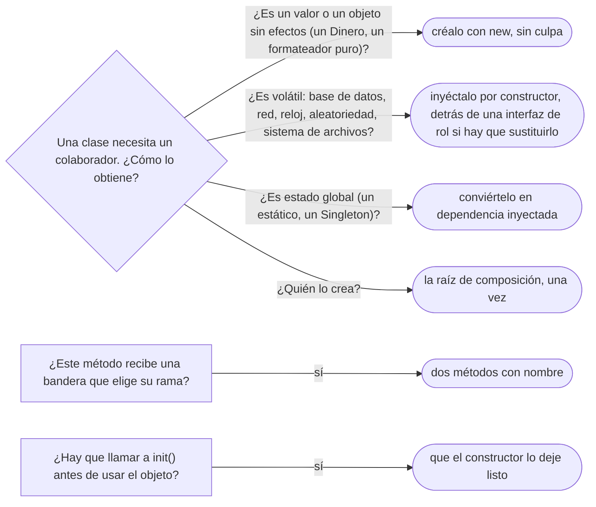

# 04 — Acoplamiento, cohesión y dependencias

> Medir a ojo el acoplamiento y la cohesión, dirigir las dependencias hacia lo estable, e inyectarlas
> sin contenedor desde una raíz de composición. Es el dueño de la inyección de dependencias como idea;
> el contenedor es de [`04/06`](../04-creacionales/06-inyeccion-de-dependencias-e-ioc.md). Asume leído
> [`02` — SOLID sin catecismo](02-solid-sin-catecismo.md).
>
> **Vigencia:** 2026-10-03.
>
> **Versiones ejecutadas:** GCC 14.4 (C++23) · JDK 21.0.12, 17.0.20 y 25.0.4 (2026-10-04).

---

## 1. 🎯 El problema

`ServicioTransferencias`, tal como se escribe cuando nadie pregunta por las dependencias:

```java
public class ServicioTransferencias {
    public void transferir(String origen, String destino, Dinero monto, boolean esReverso) {
        var repo = new RepositorioCuentasJdbc(new FuenteDatos("jdbc:postgresql://db/banco"));
        Cuenta o = repo.obtener(origen);
        Cuenta d = repo.obtener(destino);
        if (!esReverso && LocalTime.now().isAfter(LocalTime.of(22, 0)))
            throw new IllegalStateException("fuera de horario");
        o.debitar(monto);
        d.acreditar(monto);
        Auditoria.registrar("transferencia " + origen + " → " + destino);   // estático global
    }
}
```

- Para probar una transferencia hace falta una base de datos real, un reloj que marque menos de las 22:00
  y una auditoría global que no se puede sustituir. Ningún test unitario es posible.
- El parámetro `esReverso` hace que quien llama decida qué rama del método se ejecuta; la hora sale de un
  reloj que nadie controla; y la conexión a la base está escrita dentro de la regla de negocio.

Cada línea es una forma distinta de **acoplamiento**. Este capítulo les pone nombre, da la forma de
medirlas a ojo y la técnica que las saca de la clase: la inyección de dependencias, que **no** es Spring.

---

## 2. 🧱 El acoplamiento y sus formas

**Qué es.** El **acoplamiento** es cuánto tiene que saber un módulo de otro para funcionar, y por tanto
cuánto lo afecta que el otro cambie. No es binario: hay formas peores y mejores, de la más fuerte a la
más débil.

| Forma | Qué es | En el dominio |
|---|---|---|
| **De contenido** | Un módulo toca el interior de otro (sus campos, por reflexión o porque son públicos) | Un servicio que hace `cuenta.saldo = …` |
| **Común** | Varios módulos comparten estado global | `Auditoria.registrar(...)` estático; un `static Map` de configuración |
| **De control** | Uno le pasa a otro una bandera que decide qué hace | `transferir(..., boolean esReverso)` |
| **De sello** | Se pasa una estructura entera para usar una parte | Pasar `Persona` a un método que solo usa su fecha de nacimiento |
| **De datos** | Se pasan solo los datos que hacen falta | `esMenor(LocalDate nacimiento, LocalDate hoy)` |
| **Temporal** | Dos operaciones deben ocurrir en un orden que nada obliga | `cuenta.cargar()` antes de `cuenta.debitar()`, o `init()` antes de usar |

- El de control se arregla con dos métodos con nombre (`transferir`, `revertir`); el común, inyectando lo
  que era global; el temporal, haciendo imposible el orden equivocado (el constructor deja el objeto
  listo).

**La sobregeneralización.** "Bajo acoplamiento es cero dependencias" es imposible y no es deseable: un
sistema sin dependencias no hace nada. El objetivo es que las dependencias sean **pocas, explícitas,
estrechas y hacia lo estable**.

---

## 3. 🧱 La cohesión

**Qué es.** La **cohesión** es cuánto tienen que ver entre sí las responsabilidades de un módulo. Alta:
todo lo que hay en `Cuenta` es sobre las reglas de una cuenta. Baja: un `Utilidades` con un formateador de
fechas, un validador de email y un cálculo de comisiones.

**Cómo se mide a ojo.** Tres preguntas:

```text
¿Se puede describir la clase en una frase sin "y"?                 → si no, baja cohesión
¿Los métodos usan los mismos campos?                               → si cada uno usa campos distintos, son varias clases
¿Cambia todo junto cuando cambia el negocio?                       → si cambia por partes, cada parte es un módulo
```

**Qué cuesta la baja cohesión.** Clases que cambian por muchos motivos (el SRP violado), que cuesta
entender, y que arrastran dependencias que la mayoría de sus usuarios no necesita. La alta cohesión y el
bajo acoplamiento suelen ir juntos: separar lo que no tiene que ver reduce lo que cada parte necesita
conocer.

---

## 4. 🧱 Depender de lo estable

**La regla.** Las dependencias deben apuntar **hacia lo que cambia menos**. La regla de negocio de la
cuenta cambia poco; el driver de la base de datos, el proveedor de correo y el formato de la API cambian
más. Si la regla depende del driver, cada cambio del driver la toca.

**Las métricas de Martin**, en breve. Para un módulo:

```text
Ca (acoplamiento aferente)  = cuántos módulos dependen de él       (entrantes)
Ce (acoplamiento eferente)  = de cuántos módulos depende él        (salientes)
I  (inestabilidad)          = Ce / (Ca + Ce)       0 = estable, 1 = inestable
Regla: un módulo debe depender de módulos más estables que él (I menor).
```

- El paquete del dominio, del que dependen todos y que no depende de nadie, tiene `I` cercano a 0. La
  infraestructura, que depende de todo y de la que no depende nadie, cercano a 1. La inversión de
  dependencias de [`02` §6](02-solid-sin-catecismo.md#6--dip-la-dependencia-apunta-a-la-política) es la
  forma de que la flecha vaya de infraestructura a dominio, que es la dirección estable.

---

## 5. 🧱 Inyección de dependencias, sin contenedor

**Qué es.** La **inyección de dependencias** es que un objeto **reciba** sus colaboradores desde fuera en
lugar de **crearlos o buscarlos** él. La forma preferida es por **constructor**: las dependencias quedan
declaradas en la firma, son obligatorias y pueden ser `final`.

```java
public final class ServicioTransferencias {
    private final RepositorioCuentas cuentas;
    private final Clock reloj;
    private final Auditoria auditoria;

    public ServicioTransferencias(RepositorioCuentas cuentas, Clock reloj, Auditoria auditoria) {
        this.cuentas = cuentas;
        this.reloj = reloj;
        this.auditoria = auditoria;
    }

    public void transferir(CuentaId origen, CuentaId destino, Dinero monto) {
        if (LocalTime.now(reloj).isAfter(LocalTime.of(22, 0))) throw new FueraDeHorarioException();
        cuentas.obtener(origen).debitar(monto);
        cuentas.obtener(destino).acreditar(monto);
        auditoria.registrar(origen, destino, monto);
    }

    public void revertir(Transferencia t) { /* la otra rama, con su propio nombre */ }
}
```

- Las tres dependencias son ahora visibles, sustituibles en una prueba (`Clock.fixed(...)`, un
  repositorio en memoria, una auditoría falsa) y la bandera `esReverso` se convirtió en un método.

**La raíz de composición.** Alguien tiene que crear los objetos y conectarlos. Ese alguien es **un solo
sitio**, lo más cerca posible del punto de entrada de la aplicación: la ***Composition Root***.

```java
public static void main(String[] args) {
    var fuente = new FuenteDatos(System.getenv("URL_BD"));
    var servicio = new ServicioTransferencias(
            new RepositorioCuentasJdbc(fuente),
            Clock.systemDefaultZone(),
            new AuditoriaEnBaseDeDatos(fuente));
    new ServidorHttp(servicio).arrancar();
}
```

```cpp
int main() {
    FuenteDatos fuente{std::getenv("URL_BD")};
    RepositorioCuentasPg cuentas{fuente};
    AuditoriaEnBaseDeDatos auditoria{fuente};
    ServicioTransferencias servicio{cuentas, auditoria};   // recibe referencias: no posee
    ServidorHttp{servicio}.arrancar();
}
```

- En C++ la raíz de composición decide además la **propiedad**: aquí todos viven en la pila de `main` y el
  servicio recibe referencias que no poseen, porque `main` vive más que todos ellos.

**La sobregeneralización.** "Inyección de dependencias es Spring" confunde la idea con una herramienta. Lo
anterior es inyección completa, sin ningún marco: se llama a veces ***Pure DI***. Un contenedor
automatiza la raíz de composición cuando el grafo de objetos es grande, y tiene su capítulo en
[`04/06` — Contenedores de inyección e IoC](../04-creacionales/06-inyeccion-de-dependencias-e-ioc.md), con su contraste, el
*Service Locator*.

> **Veredicto:** inyecta por constructor y ensambla en un solo sitio. Un contenedor es una comodidad para
> grafos grandes, no la definición de la técnica.

---

## 6. 🧱 Interfaces de rol, y el mito de "más interfaces"

"Más interfaces, menos acoplamiento" es falso en dos sentidos:

- **Una interfaz no reduce el acoplamiento si copia la clase.** Un `IRepositorioCuentas` con los mismos
  veinte métodos que su única implementación acopla igual: el cliente sigue dependiendo de veinte
  operaciones. Lo que reduce el acoplamiento es la **interfaz de rol**, estrecha, con lo que el cliente usa
  (ver [`02` §5](02-solid-sin-catecismo.md#5--isp-interfaces-de-rol)).
- **Una interfaz añade indirección.** Cada una es un tipo más, un salto más al navegar el código, y un
  sitio más donde ensamblar. Se justifica cuando separa la regla de un detalle **volátil** (base de
  datos, red, reloj) o cuando hay de verdad varias implementaciones.

> **Veredicto:** el acoplamiento se mide por cuánto sabe un módulo de otro, no por cuántas interfaces hay
> entre ellos. Una interfaz estrecha hacia un detalle volátil lo baja; una por clase, no.

---

## 7. 🧭 Cómo se elige



**La frase en voz alta:** *"Inyecto por constructor lo que es volátil —base de datos, reloj, red— y ensamblo
en una raíz de composición. Eso es inyección de dependencias; Spring solo automatiza la raíz."*

---

## ⚠️ Errores frecuentes

| Se dice | Lo preciso |
|---|---|
| "Inyección de dependencias es Spring" | Es recibir los colaboradores desde fuera; se hace en `main` sin ningún marco |
| "Bajo acoplamiento es cero dependencias" | Es tener pocas, explícitas, estrechas y hacia lo estable |
| "Más interfaces, menos acoplamiento" | Una interfaz que copia la clase acopla igual; reduce el acoplamiento la interfaz de rol |
| "Un `boolean` en la firma es inofensivo" | Es acoplamiento de control: quien llama decide la rama; dos métodos con nombre |
| "Hay que inyectarlo todo" | Los valores y los objetos puros se crean con `new`; se inyecta lo volátil |
| "`LocalDate.now()` es una llamada inocente" | Es una dependencia oculta del reloj, y hace imposible probar las reglas de horario |
| "Un método `init()` es buena práctica" | Es acoplamiento temporal: el constructor debería dejar el objeto listo |

---

## 📚 Para profundizar

- **Libro** — Seemann y van Deursen, *Dependency Injection Principles, Practices, and Patterns* (Manning,
  2019), cap. 4, "DI patterns" (Composition Root y Constructor Injection), y cap. 5, "DI anti-patterns"
  (Control Freak, Service Locator, Ambient Context). **El que destaca**: los ejemplos son en C# y la idea
  es idéntica en Java y C++.
- **Libro** — Martin, *Clean Architecture* (Prentice Hall, 2017), cap. 14, "Component Coupling": las
  métricas de estabilidad y la regla de depender de lo estable.
- **Libro** — Ousterhout, *A Philosophy of Software Design*, 2.ª ed. (Yaknyam Press, 2021), cap. 4,
  "Modules Should Be Deep": interfaces estrechas sobre implementaciones ricas.
- [martinfowler.com — *Inversion of Control Containers and the Dependency Injection pattern*](https://martinfowler.com/articles/injection.html):
  el artículo que dio nombre a la inyección de dependencias, con su comparación con Service Locator.
- [Java 21 API — `Clock`](https://docs.oracle.com/en/java/javase/21/docs/api/java.base/java/time/Clock.html):
  el reloj como dependencia inyectable, y `Clock.fixed` para las pruebas.

---

## 🧠 Preguntas

Sin respuestas aquí. Todas, con enunciado literal y respuesta en tres capas, en
[`07` — Respuestas](07-respuestas.md#04--acoplamiento-cohesión-y-dependencias).

1. ¿Qué es el acoplamiento? 🟢
2. ¿Qué es la cohesión? 🟢
3. ¿Qué es la inyección de dependencias? 🟢
4. ¿Qué es una raíz de composición? 🟢
5. ¿Qué mide la inestabilidad `I` de Martin, y cómo se calcula? 🟢
6. ¿Qué diferencia hay entre acoplamiento de control y acoplamiento de datos? 🟡
7. ¿Qué diferencia hay entre acoplamiento común y acoplamiento temporal? 🟡
8. ¿Qué diferencia hay entre inyección de dependencias e inversión de dependencias? 🟡
9. ¿Qué diferencia hay entre inyectar por constructor y por setter? 🟡
10. ¿Cómo se hace inyección de dependencias en C++ sin contenedor, y qué decide la raíz de composición
    que en Java no decide? 🟡
11. ¿Cómo se inyecta el reloj en Java y en C++ para poder probar una regla de horario? 🟡
12. ¿Por qué "bajo acoplamiento es cero dependencias" es falso? 🟠
13. ¿Por qué "más interfaces, menos acoplamiento" es falso? 🟠
14. ¿Qué se inyecta y qué se crea con `new`? 🟠
15. ¿Por qué un estático global como `Auditoria.registrar` es acoplamiento, y cómo se corrige? 🟠
16. ¿Por qué las dependencias deben apuntar hacia lo estable? 🟠
17. ¿Cómo mides a ojo la cohesión de una clase? 🟠
18. ¿Qué gana un sistema con una sola raíz de composición frente a crear dependencias por todas
    partes? 🟠
19. Reescribe `ServicioTransferencias` de §1 sin acoplamiento de control, común ni al reloj, y escribe
    su raíz de composición. 🔴
20. Identifica las formas de acoplamiento en este método y corrígelas:
    `void exportar(Persona p, boolean comoCsv) { Config.ruta(); ... p.getDocumentos() ... }`. 🔴
21. Escribe un test de la regla "no se transfiere después de las 22:00" con el servicio corregido. 🔴
22. Calcula la inestabilidad de los paquetes `dominio` (del que dependen `aplicacion` e `infraestructura`,
    y que no depende de nadie) e `infraestructura` (que depende de `dominio` y del que nadie depende),
    y di si las dependencias van bien. 🔴

---

**Anterior:** [`03` — GRASP](03-grasp.md) ·
**Siguiente:** [`05` — Diseño por contrato y *fail fast*](05-diseno-por-contrato.md) ·
**Relacionado:** [`02` — SOLID sin catecismo](02-solid-sin-catecismo.md)
