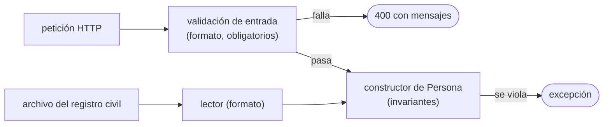
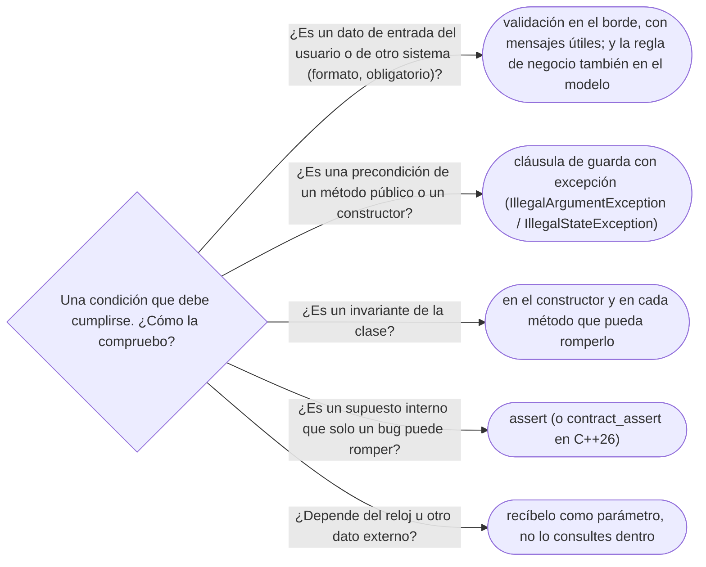

# 05 — Diseño por contrato y *fail fast*

> Precondiciones, postcondiciones e invariantes; el invariante del menor con tutor; cláusulas de guarda y
> `Objects.requireNonNull`; `assert` contra excepción; validar en el borde y en el constructor; y los
> contratos de C++26. Asume leído [`01` — Encapsulación de verdad](01-encapsulacion-de-verdad.md).
>
> **Vigencia:** 2026-10-03.
>
> **Versiones ejecutadas:** GCC 14.4 (C++23) · JDK 21.0.12, 17.0.20 y 25.0.4 (2026-10-04).

---

## 1. 🎯 El problema

La regla "un menor de edad debe tener tutor" está bien validada... en el controlador web:

```java
@PostMapping("/personas")
public ResponseEntity<Void> registrar(@RequestBody PersonaDto dto) {
    if (dto.edad() < 18 && dto.tutorId() == null) return ResponseEntity.badRequest().build();
    servicio.registrar(dto.aPersona());
    return ResponseEntity.ok().build();
}
```

- Un mes después llega la importación masiva de un archivo del registro civil, que llama a
  `servicio.registrar` directamente. Luis Rojas Paz, nacido el 2013-09-02, entra al sistema sin tutora.
  Nada falla en ese momento.
- Semanas después, un proceso que notifica a los tutores lanza `NullPointerException` al llegar a Luis, en
  una clase que no tiene nada que ver con el registro. El error salta lejos de su causa, y nadie sabe ya
  cómo entró ese dato.

"Validar es trabajo del controlador web" es la idea que produce esto. Las reglas del dominio son un
**contrato** de las clases del dominio, y se hacen cumplir **donde nacen los objetos**, fallando en el
acto. Ese es el tema del capítulo.

---

## 2. 🧱 El contrato: pre, post e invariante

**Qué es.** Bertrand Meyer propuso ver cada método como un **contrato** entre quien llama y quien es
llamado, con tres partes:

| Parte | Qué dice | Quién la garantiza | Ejemplo en `Cuenta.debitar(monto)` |
|---|---|---|---|
| **Precondición** | Lo que debe ser cierto antes de llamar | Quien llama | `monto` positivo; cuenta operativa |
| **Postcondición** | Lo que el método garantiza al terminar | El método | El saldo bajó exactamente `monto` |
| **Invariante de clase** | Lo que es cierto siempre entre llamadas | La clase entera | El saldo nunca es negativo |

**Por qué importa.** El contrato reparte las **obligaciones**: si la precondición se cumple, el método
debe cumplir la postcondición; si no se cumple, el método no está obligado a nada, y lo correcto es
**decirlo de inmediato**. Sin contrato explícito, cada método valida todo "por si acaso" o no valida nada.

**Cómo se ve en Java**, que no tiene contratos en el lenguaje: la precondición pública se comprueba al
entrar y lanza; la postcondición y el invariante se garantizan con el diseño y se documentan.

```java
/** @throws IllegalArgumentException si el monto no es positivo
 *  @throws IllegalStateException si la cuenta no admite movimientos */
public void debitar(Dinero monto) {
    if (!monto.esPositivo()) throw new IllegalArgumentException("monto no positivo: " + monto);  // pre
    if (!estado.admiteMovimientos()) throw new IllegalStateException("cuenta " + estado);       // pre
    Dinero nuevo = saldo.menos(monto);
    if (nuevo.esNegativo()) throw new SaldoInsuficienteException(id, monto);                    // invariante
    saldo = nuevo;                                                                              // post: bajó monto
}
```

Qué clase de excepción comunica cada violación —*checked* o *unchecked*, y por qué— es de
[`01/08` §5](../01-modelo-de-objetos/08-la-ausencia-y-el-error.md#5--excepciones-checked-contra-unchecked).

> **Veredicto:** cada método público tiene un contrato aunque no lo escribas. Escribirlo —en la firma, en
> la Javadoc y en las comprobaciones de entrada— es lo que deja saber de quién es la culpa cuando algo
> falla.

---

## 3. 🧱 El invariante del menor con tutor

"Un menor debe tener tutor" —la asociación reflexiva de
[`02/03` §5](../02-modelado-oo/03-navegabilidad-y-coherencia.md#5--la-asociación-reflexiva-el-tutor)— es un
invariante de `Persona` que **cruza objetos**: depende de la fecha de
nacimiento, de la fecha de hoy y de la presencia de otra persona. Se protege en todos los caminos que
podrían romperlo: el constructor y los métodos que cambian el tutor.

```java
public final class Persona {
    private final LocalDate fechaNacimiento;
    private Persona tutor;

    public Persona(String nombre, LocalDate fechaNacimiento, Persona tutor, LocalDate hoy) {
        this.fechaNacimiento = Objects.requireNonNull(fechaNacimiento, "fechaNacimiento");
        if (esMenor(hoy) && tutor == null) throw new IllegalArgumentException("un menor debe tener tutor");
        this.tutor = tutor;
    }

    public void quitarTutor(LocalDate hoy) {
        if (esMenor(hoy)) throw new IllegalStateException("un menor debe tener tutor");
        this.tutor = null;
    }

    public boolean esMenor(LocalDate hoy) { return Period.between(fechaNacimiento, hoy).getYears() < 18; }
}
```

- Ahora la importación masiva **no puede** crear a Luis sin tutora: el constructor lo rechaza, en la línea
  que lee su registro, con un mensaje que dice qué regla se violó.
- El invariante depende del reloj, así que `hoy` es un parámetro: el constructor no llama a
  `LocalDate.now()`, y la regla se prueba con fechas concretas.
- Cuando Luis cumpla 18, el invariante deja de exigir tutor sin que nadie haga nada: una regla bien
  escrita sobre datos bien elegidos.

---

## 4. 🧱 *Fail fast*: cláusulas de guarda y `requireNonNull`

**Qué es.** *Fail fast* (fallar pronto) es detectar un estado inválido **en cuanto aparece** y detenerse,
en lugar de seguir con un valor malo que fallará más tarde y más lejos. Su herramienta básica es la
**cláusula de guarda**: comprobar al principio del método y salir.

```java
public Transferencia(Cuenta origen, Cuenta destino, Dinero monto) {
    this.origen = Objects.requireNonNull(origen, "origen");          // NPE aquí, con nombre
    this.destino = Objects.requireNonNull(destino, "destino");
    this.monto = Objects.requireNonNull(monto, "monto");
    if (origen.equals(destino)) throw new IllegalArgumentException("origen y destino iguales");
}
```

- `Objects.requireNonNull` convierte un `null` silencioso en un `NullPointerException` **en el
  constructor**, con el nombre del parámetro, en lugar de uno sin contexto en otro método días después.
- **Qué cuesta.** Líneas de comprobación al principio de los métodos públicos, y excepciones que hay que
  decidir. Lo que compra es que el error salta donde está la causa, que es la mitad del tiempo de
  depuración.

> **Veredicto:** comprueba las precondiciones de los métodos públicos y los constructores al entrar. El
> peor bug es el que se queda dormido en un objeto inválido.

---

## 5. 🧱 `assert` contra excepción

**La confusión.** "`assert` sirve para validar entradas" es el error. En Java, `assert` está
**desactivado por defecto**: solo se evalúa si la JVM arranca con `-ea`. En producción, normalmente, no
hace nada. Un `assert` que valida un argumento de un método público es una validación que desaparece.

| Herramienta | Para qué | Cuándo se evalúa |
|---|---|---|
| **Excepción** (`IllegalArgumentException`, `IllegalStateException`) | Precondiciones de métodos públicos: lo que un llamador externo puede violar | Siempre |
| **`assert`** (Java), `assert` (C++, `<cassert>`) | Supuestos internos que solo un error de programación puede romper: postcondiciones, invariantes en métodos privados | Java: con `-ea`; C++: si no se define `NDEBUG` |

```java
private Dinero sumarMovimientos() {
    Dinero total = movimientos.stream().map(Movimiento::importe).reduce(Dinero.cero(moneda), Dinero::mas);
    assert total.equals(saldo) : "saldo desincronizado";   // supuesto interno: solo falla si hay un bug
    return total;
}
```

> **Veredicto:** excepción para lo que otro puede hacer mal; `assert` para lo que solo tú puedes haber
> hecho mal. Y nunca un `assert` con efectos secundarios: desaparece con él.

---

## 6. 🧱 Validar en el borde y en el constructor

Hay **dos validaciones distintas**, y las dos hacen falta:

- **En el borde** (el controlador, el lector del archivo): la validación **de entrada**. Que el campo
  `fechaNacimiento` sea una fecha, que el JSON tenga los campos obligatorios. Su objetivo es devolver un
  **mensaje útil al usuario** (un 400 con la lista de errores), y depende del canal.
- **En el modelo** (constructores y métodos de dominio): los **invariantes del negocio**. Que un menor
  tenga tutor, que el saldo no sea negativo. Su objetivo es que **ningún camino** cree un objeto inválido,
  y no depende del canal.



- Repetir en el borde una regla del dominio para dar un mensaje mejor es legítimo; **quitarla del modelo**
  porque "ya se valida en el controlador" es el error de §1.

---

## 7. 🧱 C++: `assert`, excepciones y los contratos de C++26

En C++23 las herramientas son las mismas que en Java: excepciones para las precondiciones públicas
(`std::invalid_argument`, `std::logic_error`) y `assert` de `<cassert>` para los supuestos internos, que
desaparece al compilar con `NDEBUG`.

**Los contratos llegan al lenguaje en C++26** (propuesta P2900, en el borrador de C++26). Las
precondiciones y postcondiciones pasan a ser parte de la **declaración** de la función, visibles para quien
la llama y para las herramientas:

```cpp
// no compila: requiere C++26 (P2900); el corpus usa C++23
Dinero debitar(Cuenta& c, Dinero monto)
    pre(monto > Dinero::cero(monto.moneda()))
    pre(c.admiteMovimientos())
    post(r: r == monto);

void transferir(Cuenta& o, Cuenta& d, Dinero monto) {
    contract_assert(&o != &d);
    debitar(o, monto);
    d.acreditar(monto);
}
```

- Lo que hace el programa cuando un contrato se viola —ignorarlo, avisar o terminar— **no** lo decide el
  código: es la *semántica de evaluación* (`ignore`, `observe`, `enforce`, `quick-enforce`) que elige la
  implementación según cómo se compile. Por eso los contratos de C++26, como `assert`, son para errores de
  programación, no para validar entradas de usuario.

---

## 8. 🧭 Cómo se elige



**La frase en voz alta:** *"Las reglas del dominio se hacen cumplir en el constructor y en los métodos del
dominio, fallando en el acto; el borde valida formato para dar buenos mensajes. `assert` es para mis
errores, no para los datos de otros."*

---

## ⚠️ Errores frecuentes

| Se dice | Lo preciso |
|---|---|
| "Validar es trabajo del controlador web" | El borde valida formato; los invariantes se protegen en el modelo, para todos los canales |
| "`assert` sirve para validar entradas" | En Java está desactivado por defecto; es para supuestos internos, no para datos ajenos |
| "Validar en el constructor y en el borde es duplicar" | Son dos validaciones distintas: mensajes al usuario y garantías del modelo |
| "Un `NullPointerException` es un error de quien lo lanza" | Suele ser de quien dejó entrar el `null`; `requireNonNull` lo detecta en la entrada |
| "El método debe tolerar cualquier entrada" | El contrato dice qué acepta; fuera de eso, falla pronto y con un mensaje claro |
| "Los contratos de C++26 validan entradas en producción" | Su semántica de evaluación la elige la implementación; son para errores de programación |

---

## 📚 Para profundizar

- **Libro** — Meyer, *Object-Oriented Software Construction*, 2.ª ed. (Prentice Hall, 1997), cap. 11,
  "Design by Contract: building reliable software", y cap. 12, "When the contract is broken: exception
  handling". **El que destaca**: es la fuente, y el autor lo publica entero en PDF en
  [bertrandmeyer.com/OOSC2](https://bertrandmeyer.com/OOSC2/).
- **Libro** — Bloch, *Effective Java*, 3.ª ed. (Addison-Wesley, 2018), ítem 49, "Check parameters for
  validity", e ítem 76, "Strive for failure atomicity".
- **Libro** — Stroustrup, *A Tour of C++*, 3.ª ed. (Addison-Wesley, 2022), cap. 4, "Error Handling":
  invariantes, excepciones y aserciones.
- [JLS 21 §14.10, *The assert Statement*](https://docs.oracle.com/javase/specs/jls/se21/html/jls-14.html#jls-14.10):
  que las aserciones se pueden desactivar, y qué no hacer con ellas.
- [Java 21 API — `Objects`](https://docs.oracle.com/en/java/javase/21/docs/api/java.base/java/util/Objects.html):
  `requireNonNull` y sus variantes.
- [cppreference — *Contract assertions* (C++26)](https://en.cppreference.com/cpp/language/contracts):
  `pre`, `post`, `contract_assert` y las semánticas de evaluación.
- [P2900R14 — *Contracts for C++*](https://www.open-std.org/jtc1/sc22/wg21/docs/papers/2025/p2900r14.pdf):
  la propuesta.

---

## 🧠 Preguntas

Sin respuestas aquí. Todas, con enunciado literal y respuesta en tres capas, en
[`07` — Respuestas](07-respuestas.md#05--diseño-por-contrato-y-fail-fast).

1. ¿Qué son la precondición, la postcondición y el invariante de clase? 🟢
2. ¿Quién propuso el diseño por contrato? 🟢
3. ¿Qué es *fail fast*? 🟢
4. ¿Qué hace `Objects.requireNonNull`? 🟢
5. ¿Qué es una cláusula de guarda? 🟢
6. ¿Qué diferencia hay entre `assert` y una excepción como herramienta de validación? 🟡
7. ¿Qué diferencia hay entre validar en el borde y validar en el modelo? 🟡
8. ¿Qué diferencia hay entre una precondición y un invariante? 🟡
9. ¿En qué se diferencia el `assert` de Java del de C++? 🟡
10. ¿Qué aportan los contratos de C++26 que no aportan `assert` ni las excepciones de C++23 y de Java? 🟡
11. ¿Por qué `assert` no sirve para validar argumentos de un método público en Java? 🟠
12. ¿Por qué validar solo en el controlador web es un error, aunque la validación esté bien escrita? 🟠
13. ¿Por qué el invariante "un menor debe tener tutor" recibe la fecha de hoy como parámetro? 🟠
14. ¿Qué gana *fail fast* frente a tolerar entradas inválidas? 🟠
15. ¿Por qué un `assert` nunca debe tener efectos secundarios? 🟠
16. ¿Por qué los contratos de C++26 no sirven para validar entradas de usuario? 🟠
17. Escribe el constructor de `Persona` que hace imposible registrar a Luis sin tutora. 🔴
18. Escribe `Cuenta.debitar` con su contrato: precondiciones comprobadas, invariante protegido y la
    postcondición documentada. 🔴
19. Revisa este código y di qué está mal: `public void transferir(Cuenta o, Cuenta d, Dinero m) {
    assert m.esPositivo(); assert o != d; o.debitar(m); d.acreditar(m); }`. 🔴
20. Diseña la validación del registro de personas para dos canales —un API REST y una importación de
    archivos— sin duplicar las reglas del dominio. 🔴

---

**Anterior:** [`04` — Acoplamiento, cohesión y dependencias](04-acoplamiento-cohesion-y-dependencias.md) ·
**Siguiente:** [`06` — Simulación de entrevista](06-simulacion-de-entrevista.md) ·
**Relacionado:** [`01` — Encapsulación de verdad](01-encapsulacion-de-verdad.md)
