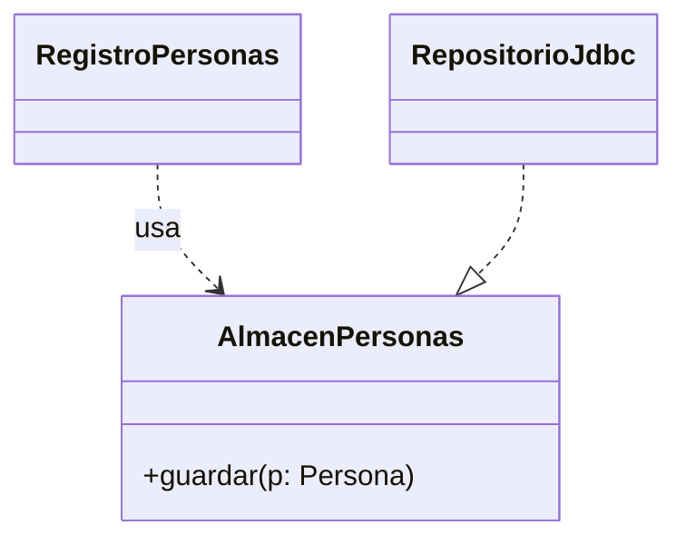
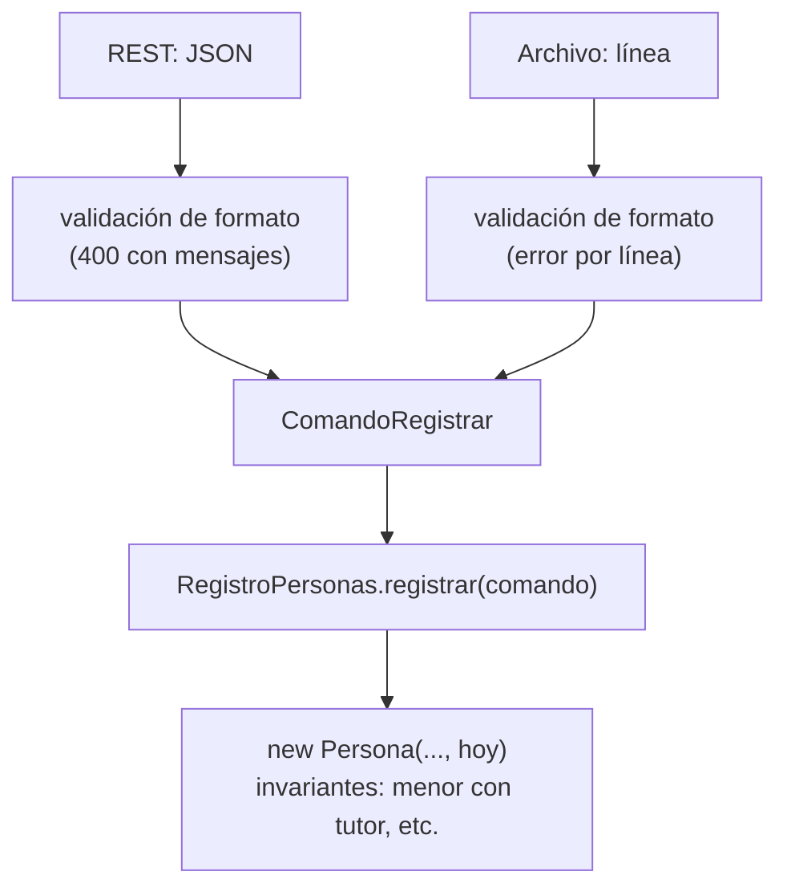

# 07 — Respuestas

> Solucionario del bloque `03-principios-de-diseno`: Principios de diseño. Cada respuesta en tres capas:
> **⏱️ 30 segundos** (lo que dices primero, sin que te lo pidan), **🗣️ 2 minutos** (lo que
> añades cuando dicen "cuéntame más") y **🔬 El detalle** (para estudiar, no para decir en voz
> alta). Los enunciados están copiados literalmente de su capítulo.
>
> **Vigencia:** 2026-10-03.
>
> **Versiones ejecutadas:** GCC 14.4 (C++23) · JDK 21.0.12, 17.0.20 y 25.0.4 · mermaid-cli 11.17.0 (2026-10-04).

**Salto rápido:** [01](#01--encapsulación-de-verdad) · [02](#02--solid-sin-catecismo) · [03](#03--grasp) · [04](#04--acoplamiento-cohesión-y-dependencias) · [05](#05--diseño-por-contrato-y-fail-fast) · [06](#06--simulación-de-entrevista)

---

# 01 — Encapsulación de verdad

**01 → 1. ¿Qué es un invariante de clase? Da uno de `Cuenta`. 🟢**

⏱️ Una regla que el objeto cumple siempre, desde que termina su constructor. En `Cuenta`: el saldo nunca
es negativo, y una cuenta bloqueada no admite movimientos.
🗣️ "Siempre" significa entre llamadas a sus métodos públicos: dentro de un método, el objeto puede estar
a medias un instante, pero al salir el invariante vuelve a cumplirse. Por eso los invariantes se protegen
en los métodos que cambian el estado.
🔬 Meyer los formaliza en el diseño por contrato junto con precondiciones y postcondiciones; es el tema de
`05` de este bloque.

**01 → 2. ¿Qué significa encapsular, según este capítulo? 🟢**

⏱️ Organizar la clase para que ningún camino desde fuera pueda romper sus invariantes sin pasar por ella.
🗣️ No es esconder campos: un campo privado con setter público se puede poner a cualquier valor. Es exponer
operaciones con nombre de dominio (`debitar`, `bloquear`) que comprueban las reglas antes de cambiar el
estado.
🔬 Ocultar la implementación es la otra mitad (poder cambiar la representación sin tocar a los usuarios),
pero la que evita bugs de negocio es la protección de invariantes.

**01 → 3. ¿Qué dice *tell, don't ask*? 🟢**

⏱️ Que en lugar de pedirle datos a un objeto para decidir fuera, se le diga qué hacer y que decida él con
sus datos.
🗣️ `origen.debitar(monto)` en lugar de leer el estado y el saldo y llamar a `setSaldo`. La regla vive en
un solo sitio, la cuenta, y ningún llamador puede olvidarla.
🔬 Fowler advierte en su bliki de no llevarlo al extremo: preguntar sigue siendo correcto para mostrar
datos y cuando la decisión necesita información de varios objetos.

**01 → 4. ¿Qué dice la Ley de Demeter? 🟢**

⏱️ Que un método solo debería hablar con sus vecinos inmediatos: sus campos, sus parámetros, los objetos
que crea y él mismo; no con los objetos que esos vecinos le devuelven.
🗣️ `persona.tutor().documentoPrincipal().tipo().pais()` habla con cuatro objetos ajenos y depende de su
estructura interna. Si cualquiera cambia, el que llama se rompe.
🔬 Viene de un proyecto de la Northeastern University de 1987 (el proyecto Demeter). También se la conoce
como "principio del menor conocimiento".

**01 → 5. ¿Qué es un modelo anémico? 🟢**

⏱️ Un modelo de dominio cuyas clases tienen datos y getters/setters pero ningún comportamiento: toda la
lógica vive en servicios.
🗣️ Parece orientado a objetos (hay clases `Cuenta`, `Persona`) y en realidad es programación procedural
sobre estructuras de datos. Las reglas se repiten en cada servicio que toca los datos, o se olvidan.
🔬 Fowler lo describió como antipatrón en 2003. Su causa más común es generar las clases desde el esquema
de la base de datos o desde los DTO de una API. El antipatrón completo es de [`12/03` §3](../12-antipatrones/03-antipatrones-de-diseno-oo.md#3-️-anemic-domain-model).

**01 → 6. ¿Qué diferencia hay entre esconder campos y proteger invariantes? 🟡**

⏱️ Esconder campos cambia cómo se accede a los datos; proteger invariantes impide dejar el objeto en un
estado que viola sus reglas.
🗣️ `private Dinero saldo` con `setSaldo` público esconde el campo y no protege nada: cualquiera pone un
saldo negativo. `debitar` comprueba la regla antes de cambiar el saldo, y no hay otro camino.
🔬 Por eso la pregunta en una revisión no es "¿los campos son privados?" sino "¿hay algún método público
que pueda dejar el objeto inválido?".

**01 → 7. ¿Qué diferencia hay entre un setter y un método de dominio como `debitar`? 🟡**

⏱️ El setter asigna el valor que le den; el método de dominio expresa una operación del negocio y comprueba
sus reglas antes de cambiar el estado.
🗣️ `setSaldo(x)` no sabe por qué cambia el saldo, así que no puede validar nada útil. `debitar(monto)` sabe
que es un débito: comprueba el estado de la cuenta y que el saldo alcance. Además el nombre documenta la
intención en cada llamada.
🔬 Un setter con validación (`setSaldo` que rechaza negativos) mejora algo, pero sigue sin saber si el
cambio viene de un débito, una corrección o un error, y no puede aplicar reglas que dependen de eso.

**01 → 8. ¿Qué diferencia hay entre una cadena que viola Demeter y una interfaz fluida? 🟡**

⏱️ La que viola Demeter navega por objetos internos de otros; la interfaz fluida devuelve siempre el mismo
tipo de cosa con la que se trabaja, sin exponer ninguna estructura ajena.
🗣️ `persona.tutor().documentoPrincipal().tipo()` atraviesa tres objetos del dominio. Un `stream` con
`filter` y `map`, o un builder con varios `.nombre(...)`, encadenan llamadas sobre el mismo objeto o el
mismo tipo, y no dependen de la forma de nadie.
🔬 La prueba rápida: si cambiar la estructura interna de un objeto del dominio rompe la cadena, es Demeter;
si la cadena solo depende de una API estable (`Stream`), no lo es.

**01 → 9. ¿Qué diferencia hay entre un modelo anémico y uno rico? 🟡**

⏱️ En el anémico la lógica vive en servicios y las clases solo tienen datos; en el rico, la lógica que
protege los invariantes vive en las clases que tienen los datos.
🗣️ Con el anémico, "no debitar una cuenta bloqueada" está en cada servicio que debita; con el rico, en
`Cuenta.debitar`. El rico se prueba sin infraestructura y no se puede usar mal; el anémico es más fácil de
generar y de serializar.
🔬 Los servicios siguen existiendo en un modelo rico: coordinan varios objetos (la transferencia entre dos
cuentas) sin contener sus reglas internas.

**01 → 10. ¿Cómo se expresa en C++ que un método no cambia el objeto, y qué equivalente tiene en Java? 🟡**

⏱️ En C++ con `const` después de la firma (`Dinero saldo() const`), que el compilador comprueba. Java no
tiene equivalente: la única forma de garantizarlo es que el objeto sea inmutable.
🗣️ Un método `const` no puede modificar miembros ni llamar a métodos no `const`, y es el único que se
puede llamar sobre un objeto `const` o a través de una referencia `const`. En Java, un método "de
lectura" puede mutar el objeto y la firma no lo dice.
🔬 El `const` de C++ es superficial a través de punteros y se salta con `mutable` y `const_cast`. Ver
`01/03`.

**01 → 11. ¿Qué devuelve un getter seguro en Java y en C++ cuando el campo es mutable? 🟡**

⏱️ En Java, una copia o una vista no modificable; en C++, una referencia `const` o una copia.
🗣️ En Java, `Collections.unmodifiableList(documentos)` o `List.copyOf(documentos)`; devolver la lista
interna deja modificarla. En C++, `const std::vector<Documento>&` deja leer sin copiar y el compilador
impide modificarla a través de esa referencia.
🔬 La referencia `const` de C++ tiene un riesgo que la vista de Java no tiene: si el objeto dueño muere,
la referencia queda colgando. Devolver por valor evita eso a costa de una copia.

**01 → 12. ¿Por qué un getter de un campo inmutable no rompe la encapsulación? 🟠**

⏱️ Porque quien lo recibe no puede cambiar nada a través de él: el objeto sigue siendo el único que puede
cambiar su estado.
🗣️ `saldo()` devuelve un `Dinero` inmutable: el llamador puede leerlo, compararlo y usarlo, pero no
cambiar el saldo de la cuenta. Lo que rompe la encapsulación es exponer la escritura sin reglas, no la
lectura.
🔬 Un matiz: exponer un getter también acopla a los llamadores a la existencia de ese dato. Si mañana el
saldo se calcula distinto, el getter sigue sirviendo; si se elimina el concepto, no. Es el costo normal de
una interfaz pública.

**01 → 13. ¿Cuándo es correcto preguntarle datos a un objeto en lugar de decirle qué hacer? 🟠**

⏱️ Cuando la decisión necesita datos de varios objetos, o cuando lo que se hace es mostrar o transformar
datos, no cambiar el estado.
🗣️ Una pantalla que muestra el saldo pregunta. Una regla de comisiones que depende del saldo, del tipo de
cliente y de la tarifa del día no debería vivir en `Cuenta`: el que tiene todos los datos decide, y le
pregunta a la cuenta su saldo.
🔬 La señal de que se está preguntando mal: leer datos de un objeto y, a continuación, cambiar el estado de
ese mismo objeto según lo leído. Eso es una decisión que el objeto debía tomar.

**01 → 14. ¿Por qué "un punto por línea" es una mala lectura de Demeter? 🟠**

⏱️ Porque Demeter limita el conocimiento de estructuras ajenas, no la sintaxis: partir una cadena en cuatro
líneas con variables intermedias mantiene exactamente la misma dependencia.
🗣️ `var t = persona.tutor(); var d = t.documentoPrincipal(); ...` tiene un punto por línea y sigue
navegando por la estructura de cuatro objetos. Y a la inversa, `stream().filter().map()` tiene muchos
puntos y no viola nada.
🔬 La mala lectura además produce métodos de reenvío inútiles para "cumplir la regla", que inflan las
clases sin reducir el acoplamiento real.

**01 → 15. ¿Qué cuesta cumplir Demeter a ciegas? 🟠**

⏱️ Métodos de reenvío en todas partes, que inflan las clases con operaciones que no son suyas.
🗣️ `persona.paisDelDocumentoPrincipalDelTutor()` es un método que no tiene nada que ver con la
responsabilidad de `Persona` y existe solo para no encadenar. Diez de esos y `Persona` es una fachada de
medio modelo.
🔬 La salida razonable es preguntar por qué alguien necesita ese dato. Si es para decidir algo, la decisión
quizá pertenece a otro objeto. Si es para mostrarlo, un objeto de lectura armado para esa pantalla es
mejor que reenvíos.

**01 → 16. ¿Cuándo es correcto un modelo anémico? 🟠**

⏱️ Cuando no hay invariantes que proteger: CRUD puro, catálogos, modelos de lectura para pantallas y
reportes, DTO.
🗣️ Un catálogo de países con código y nombre no tiene reglas: getters y setters, o un `record`, y listo.
Forzar ahí un modelo rico es ceremonia. El problema del anémico aparece cuando el dominio sí tiene reglas
y se las deja fuera.
🔬 Muchas arquitecturas separan a propósito el modelo de escritura (rico) del de lectura (anémico, armado
para las consultas). Las dos decisiones conviven.

**01 → 17. ¿Qué lógica no debería ir dentro de `Cuenta` aunque use su saldo? 🟠**

⏱️ La que necesita datos o reglas que no son de la cuenta: comisiones que dependen de una tarifa, límites
del cliente, conversiones de moneda, la coordinación de una transferencia entre dos cuentas.
🗣️ Si `Cuenta` calculara comisiones, dependería de la política comercial del banco, que cambia por motivos
ajenos a la cuenta. La transferencia toca dos cuentas, y ninguna de las dos es dueña de la operación:
la coordina un servicio, que le dice a cada cuenta `debitar` o `acreditar`.
🔬 Es el SRP (`02`): una clase con un solo motivo de cambio. Y GRASP (`03`) da el criterio con nombre:
Information Expert para lo que usa solo sus datos; Pure Fabrication para lo que no encaja en ninguna
clase del dominio.

**01 → 18. ¿Por qué el modelo anémico es más caro de probar? 🟠**

⏱️ Porque las reglas viven en servicios que suelen depender de repositorios y otros servicios, y para
probar una regla hay que montar toda esa infraestructura o simularla.
🗣️ Probar "no se debita una cuenta bloqueada" en un modelo rico es crear una `Cuenta`, bloquearla y llamar
a `debitar`. En el anémico es crear el servicio con sus dependencias simuladas, preparar el repositorio y
comprobar que no se llamó a `setSaldo`. Y hay que repetirlo por cada servicio que debita.
🔬 Además, los tests del anémico prueban la regla en un servicio, no en todos: el que olvidó la regla no
tiene test que lo detecte.

**01 → 19. Reescribe la `Cuenta` y el servicio de §1 para que ningún servicio pueda debitar una cuenta bloqueada. 🔴**

⏱️ `Cuenta` sin setters, con `debitar` y `acreditar` que comprueban el estado y el saldo; el servicio solo
coordina.
🗣️

```java
public final class Cuenta {
    private Dinero saldo;
    private EstadoCuenta estado = EstadoCuenta.ABIERTA;

    public void debitar(Dinero monto) {
        exigirOperativa();
        Dinero nuevo = saldo.menos(monto);
        if (nuevo.esNegativo()) throw new SaldoInsuficienteException(monto);
        saldo = nuevo;
    }
    public void acreditar(Dinero monto) { exigirOperativa(); saldo = saldo.mas(monto); }
    public Dinero saldo() { return saldo; }
    private void exigirOperativa() {
        if (!estado.admiteMovimientos()) throw new IllegalStateException("cuenta " + estado);
    }
}

public class ServicioTransferencias {
    public void transferir(Cuenta origen, Cuenta destino, Dinero monto) {
        origen.debitar(monto);
        destino.acreditar(monto);
    }
}
```

🔬 Lo que preguntarán después: qué pasa si `acreditar` falla después de `debitar` (comprobar que las dos
cuentas están operativas antes de mover nada, y la transacción para la persistencia); y cómo se prueba
`ServicioPagos` ahora (no necesita probar la regla del estado: la garantiza `Cuenta`).

**01 → 20. Arregla esta línea respetando Demeter, y di dónde pones la decisión: `String pais = persona.tutor().documentoPrincipal().tipo().pais().nombre();`. 🔴**

⏱️ Primero pregunto para qué se quiere el país. Si es para decidir algo sobre la persona, la decisión va en
`Persona`; si es para mostrarlo, va en un objeto de lectura armado para esa pantalla.
🗣️ Si la regla es "un menor con tutor extranjero necesita autorización", la decisión pertenece a
`Persona`, que conoce a su tutor:

```java
// en Persona
public boolean tutorConDocumentoExtranjero(Pais local) {
    return tutor != null && tutor.documentoPrincipal()
            .map(d -> !d.tipo().pais().equals(local)).orElse(false);
}
```

La cadena no desaparece del todo, pero vive en la clase que conoce la estructura y expone una pregunta del
dominio.
🔬 Lo que preguntarán después: si `tutor.documentoPrincipal().map(...)` no sigue violando Demeter (dentro de
`Persona`, el tutor es otra `Persona` y el documento es suyo; es la frontera razonable); y la alternativa de
un método `paisDocumentoPrincipal()` en `Persona` que encapsule la parte del documento.

**01 → 21. Revisa esta clase y di qué está mal: `class Persona { private List<Documento> documentos; public List<Documento> getDocumentos() { return documentos; } public void setDocumentos(List<Documento> d) { documentos = d; } }`. 🔴**

⏱️ No hay encapsulación: el getter devuelve la lista interna y el setter guarda la que le pasan, así que
cualquiera puede cambiar los documentos sin pasar por `Persona`, y el que llamó al setter conserva una
referencia a la lista interna.
🗣️ La corrección: sin setter; los documentos se reciben en el constructor con copia, se añaden con
`agregarDocumento` (que comprueba duplicados y fija lo que haga falta), y el getter devuelve una vista no
modificable.

```java
public final class Persona {
    private final List<Documento> documentos;
    public Persona(List<Documento> iniciales) { this.documentos = new ArrayList<>(iniciales); }
    public void agregarDocumento(Documento d) {
        if (documentos.contains(d)) throw new IllegalArgumentException("repetido: " + d);
        documentos.add(d);
    }
    public List<Documento> documentos() { return Collections.unmodifiableList(documentos); }
}
```

🔬 Lo que se dice en la revisión: el problema no son los nombres `get` y `set`, sino que la escritura no
pasa por ninguna regla. Y si `Persona` tiene un documento principal, el setter también lo dejaría colgando.

**01 → 22. Escribe en C++ la clase `Cuenta` encapsulada, con `debitar`, `acreditar` y un acceso de lectura al saldo. 🔴**

⏱️ Miembros privados, métodos públicos con las reglas, y el acceso de lectura `const` devolviendo una
referencia constante.
🗣️

```cpp
class Cuenta {
    Dinero saldo;
    EstadoCuenta estado = EstadoCuenta::Abierta;

    void exigirOperativa() const {
        if (estado != EstadoCuenta::Abierta) throw std::logic_error("cuenta no operativa");
    }
public:
    explicit Cuenta(Dinero inicial) : saldo(inicial) {}

    void debitar(const Dinero& monto) {
        exigirOperativa();
        if (saldo < monto) throw std::runtime_error("saldo insuficiente");
        saldo = saldo - monto;
    }
    void acreditar(const Dinero& monto) { exigirOperativa(); saldo = saldo + monto; }
    const Dinero& verSaldo() const { return saldo; }   // lectura: const, sin copia
    void bloquear() { estado = EstadoCuenta::Bloqueada; }
};
```

🔬 Lo que preguntarán después: si devolver `const Dinero&` es seguro (sí, mientras la cuenta viva y `Dinero`
no tenga mutadores; devolver por valor es más seguro y casi igual de barato para un objeto pequeño); y
qué `Dinero` asume el código (uno con `operator<`, `operator-` y `operator+` que exigen la misma moneda).

# 02 — SOLID sin catecismo

**02 → 1. ¿Qué dice el SRP, en la formulación de Robert C. Martin? 🟢**

⏱️ Que un módulo debe tener un solo motivo de cambio, y que un motivo de cambio es un actor: un grupo de
personas que pide cambios.
🗣️ La primera versión, "un solo motivo de cambio", dejaba abierto qué es un motivo. Martin la precisó:
"este principio es sobre personas". Si el área de cumplimiento y el equipo de base de datos piden
cambios a la misma clase, la clase tiene dos responsabilidades.
🔬 En *Clean Architecture* (cap. 7) la formula como "un módulo debe ser responsable ante uno, y solo uno,
de sus actores". La versión del blog de 2014 es la misma idea con el ejemplo de los directivos que piden
cambios distintos.

**02 → 2. ¿Qué dice el OCP? 🟢**

⏱️ Que un módulo debe estar abierto a la extensión y cerrado a la modificación: un comportamiento nuevo se
añade escribiendo código nuevo, no editando el que funciona.
🗣️ En la práctica: en los ejes donde el cambio es previsible, hay un punto de extensión (una interfaz, una
estrategia, un dato) y añadir un caso no toca el código existente.
🔬 Lo formuló Bertrand Meyer en 1988 pensando en herencia; la lectura moderna, de Martin, lo hace con
polimorfismo y abstracciones. Las dos dicen lo mismo con herramientas distintas.

**02 → 3. ¿Qué dice el LSP? 🟢**

⏱️ Que el código escrito contra un tipo debe funcionar con cualquiera de sus subtipos.
🗣️ En términos de contrato: un subtipo no puede exigir más que su base ni prometer menos, y debe mantener
sus invariantes. Una `Cedula` que lanza en `vencimiento()` lo viola.
🔬 Ver `01/06` §3 para el análisis completo y el ejemplo del cuadrado y el rectángulo.

**02 → 4. ¿Qué dice el ISP? 🟢**

⏱️ Que ningún cliente debería depender de métodos que no usa.
🗣️ La forma práctica son las interfaces de rol: pequeñas y nombradas por lo que un cliente necesita. El
validador depende de `BuscadorPorDocumento`, no del repositorio entero con quince métodos.
🔬 El beneficio no es solo estético: en lenguajes compilados como C++, depender de una interfaz gorda
obliga a recompilar cuando cambia un método que no usas.

**02 → 5. ¿Qué dice el DIP? 🟢**

⏱️ Que los módulos de alto nivel no deben depender de los de bajo nivel: los dos dependen de abstracciones,
y la abstracción pertenece al de alto nivel.
🗣️ La regla de negocio de alta de personas no importa `RepositorioJdbc`: depende de una interfaz
`AlmacenPersonas` que vive en el paquete del dominio, y `RepositorioJdbc` la implementa desde fuera.
🔬 La palabra "inversión" se refiere a que la dependencia de código apunta al revés que el flujo de
control: en ejecución, la regla llama a JDBC; en el código, JDBC depende de la regla.

**02 → 6. ¿Qué es una interfaz de rol? 🟢**

⏱️ Una interfaz pequeña definida por lo que un cliente concreto necesita, no por la clase que la
implementa.
🗣️ `BuscadorPorDocumento` y `AlmacenPersonas` son dos roles que puede implementar la misma clase de
persistencia. Cada cliente depende solo del rol que usa.
🔬 Fowler la contrapone a la *header interface*, que copia todos los métodos públicos de una clase. La de
rol es la que cumple ISP.

**02 → 7. ¿Qué es un actor, en el sentido del SRP? 🟢**

⏱️ Un grupo de personas (un área, un rol del negocio) que pide cambios por los mismos motivos.
🗣️ Cumplimiento pide cambios en las reglas de documentos; el equipo de datos, en la persistencia;
marketing, en los correos. Son tres actores. Una clase que responde a los tres tiene tres motivos de
cambio.
🔬 La idea de fondo es la de Parnas (1972): agrupar lo que cambia junto y separar lo que cambia por motivos
distintos. El actor es una forma concreta de identificar "motivos distintos".

**02 → 8. ¿Qué diferencia hay entre "un motivo de cambio" y "una clase por método"? 🟡**

⏱️ Un motivo de cambio agrupa todos los métodos que cambian por el mismo actor; "una clase por método"
fragmenta sin criterio y no es lo que dice el SRP.
🗣️ `Cuenta` con `debitar`, `acreditar` y `bloquear` responde a un solo actor, las reglas de cuentas, y
cumple el SRP. Partirla en tres clases dispersaría una misma responsabilidad y obligaría a coordinarlas.
🔬 La fragmentación excesiva tiene su propio costo, que Ousterhout llama "módulos superficiales": muchas
interfaces que hacen poco cada una y que el lector tiene que recorrer todas.

**02 → 9. ¿Qué diferencia hay entre cumplir OCP con polimorfismo y con datos? 🟡**

⏱️ Con polimorfismo, un caso nuevo es una clase nueva; con datos, un caso nuevo es un registro nuevo. Las
dos evitan editar el código existente.
🗣️ Si los tipos de documento difieren solo en formato y vencimiento, una tabla de tipos cumple OCP mejor:
un país nuevo no requiere compilar ni desplegar. Si cada tipo tiene comportamiento propio, una
estrategia por tipo es el punto de extensión.
🔬 Elegir datos cuando alcanza es la forma más barata de extensión que existe, y la que más se olvida en
una entrevista donde se espera oír "Strategy".

**02 → 10. ¿Qué diferencia hay entre DIP e inyección de dependencias? 🟡**

⏱️ DIP es un principio sobre la dirección de las dependencias; la inyección de dependencias es una técnica
para entregarle a un objeto sus colaboradores desde fuera.
🗣️ Se pueden tener por separado: inyectar un `RepositorioJdbc` concreto por constructor es inyección sin
inversión; una regla que depende de una interfaz del dominio pero que la busca con un `new` interno tiene
la inversión a medias. Juntas, la regla depende de su interfaz y alguien le entrega la implementación.
🔬 La inyección como idea, sin contenedor, es el tema de `04`; el contenedor es de
[`04/06`](../04-creacionales/06-inyeccion-de-dependencias-e-ioc.md).

**02 → 11. ¿Qué diferencia hay entre una interfaz gorda y varias de rol? 🟡**

⏱️ La gorda obliga a cada cliente a depender de todos sus métodos; las de rol, solo de los que usa.
🗣️ Con la gorda, un cambio en un método que el validador no usa puede obligarlo a recompilar o a
actualizar sus falsos de prueba, que implementan quince métodos para usar uno. Con roles, el falso del
validador es una lambda.
🔬 El costo de los roles es que hay más tipos que nombrar. Una interfaz por método es el extremo
equivocado.

**02 → 12. ¿Qué diferencia hay entre una interfaz definida en el dominio y una definida en la infraestructura, para DIP? 🟡**

⏱️ Definida en el dominio, invierte la dependencia: la infraestructura depende del dominio. Definida en la
infraestructura, no invierte nada: el dominio sigue importando un paquete de infraestructura.
🗣️ Si `AlmacenPersonas` vive junto a `RepositorioJdbc`, el dominio tiene que importar el paquete de
persistencia para usarla, y la flecha sigue apuntando al detalle. El principio dice que la abstracción
pertenece al que la usa.
🔬 Es la base de las arquitecturas de puertos y adaptadores: los puertos los define el núcleo. Esas
arquitecturas quedan fuera de este corpus, pero su raíz es este principio.

**02 → 13. ¿Cómo se aplica DIP en C++ sin herencia, y qué cambia respecto de Java? 🟡**

⏱️ Con una plantilla restringida por un *concept*: la regla de negocio exige "algo que sepa guardar
personas" y recibe el tipo concreto como parámetro de plantilla. La dependencia se resuelve al compilar.
🗣️ En Java la inversión necesita una interfaz y despacho dinámico. En C++ se puede hacer igual (clase
abstracta inyectada) o estáticamente: sin vtable, con posibilidad de incrustar, y con el contrato
expresado en el *concept*.
🔬 El precio del estático: la implementación tiene que conocerse al compilar el código que la usa, el
código de la plantilla vive en las cabeceras, y no se puede cambiar de implementación en ejecución.

**02 → 14. ¿Cómo se escribe una interfaz de rol en C++, y qué cuesta frente a la de Java? 🟡**

⏱️ Como una clase abstracta pura con destructor virtual y métodos virtuales puros. Cuesta un puntero a la
vtable por objeto y despacho dinámico, igual que en Java, más la disciplina del destructor virtual.
🗣️ Una clase puede implementar varios roles heredando de varias clases abstractas, que en C++ no plantea
el problema del diamante si los roles no tienen estado. La alternativa sin costo en ejecución es el
*concept*.
🔬 Herencia múltiple de varias interfaces añade un vptr por base en la mayoría de compiladores, así que un
objeto con tres roles lleva tres punteros ocultos.

**02 → 15. ¿Por qué "OCP prohíbe modificar código" es una lectura imposible? 🟠**

⏱️ Porque todo código se modifica: corregir un bug, cambiar una regla, mejorar el rendimiento. OCP habla de
los ejes de cambio previsibles, no de congelar el código.
🗣️ Lo que pide es que añadir un caso dentro de un eje previsible (un tipo de documento, un canal de
notificación) no obligue a editar lo que ya funciona. Fuera de esos ejes, modificar es lo normal.
🔬 Y nadie prevé todos los ejes. La regla práctica: al primer cambio en un sitio, se edita; si vuelve a
cambiar por el mismo motivo, se extrae el punto de extensión.

**02 → 16. ¿Por qué un falso de pruebas puede violar LSP? 🟠**

⏱️ Porque es un subtipo de la interfaz que finge, y si no cumple su contrato —las mismas excepciones, los
mismos casos borde—, los tests pasan con un comportamiento que producción no tiene.
🗣️ Un repositorio en memoria que devuelve `null` donde el real lanza `CuentaNoEncontradaException` hace
que el código bajo prueba nunca ejercite su manejo de esa excepción. El test es verde y el código es
incorrecto.
🔬 La salida son tests de contrato: el mismo conjunto de pruebas se corre contra el falso y contra la
implementación real, y los dos tienen que pasarlo.

**02 → 17. ¿Cuándo una interfaz con una sola implementación está justificada? 🟠**

⏱️ Cuando separa la regla de negocio de un detalle que estorba en las pruebas o que cambia (base de datos,
correo, reloj), o cuando define un límite entre módulos que evolucionan por separado.
🗣️ `AlmacenPersonas` con una sola implementación JDBC se justifica: el dominio se prueba sin base de datos
y no importa infraestructura. `CalculadoraEdad` con una sola implementación pura y estable no: se prueba
igual sin interfaz.
🔬 La pregunta: ¿qué cambio se abarata con la interfaz? Si la respuesta es "ninguno, por si acaso", es
indirección pagada por adelantado.

**02 → 18. ¿Cuándo aplicar SOLID es ceremonia? Da tres casos. 🟠**

⏱️ Código que no cambia, una implementación sin alternativa realista que no estorba en las pruebas, y
sistemas pequeños o de vida corta.
🗣️ Un conversor de fechas estable con interfaz, fábrica y estrategia es puro costo. Una interfaz para un
cálculo puro "por si algún día". Un script de migración de un solo uso partido en cinco clases. En los
tres se paga indirección y nunca se cobra.
🔬 Decirlo en una entrevista suma: muestra que sabes qué cuestan los principios, no solo qué dicen.

**02 → 19. ¿Qué principio viola primero `ServicioPersonas` de §1, y por qué ese? 🟠**

⏱️ El SRP: tres actores —cumplimiento, datos y comunicación— editan la misma clase por motivos distintos.
Arreglar eso arrastra la solución de los demás.
🗣️ Al separar por actor, la validación por tipo queda en su propia clase (donde se ve el problema de OCP),
y la persistencia y el correo pasan a ser dependencias inyectadas (donde se aplica DIP). Empezar por OCP o
DIP sin separar las responsabilidades movería el problema de sitio.
🔬 La respuesta que puntúa nombra el dolor (tres equipos tocando el mismo archivo, tests que necesitan
base de datos y SMTP) antes que la sigla.

**02 → 20. ¿Por qué una clase con veinte métodos puede cumplir el SRP? 🟠**

⏱️ Porque el SRP cuenta motivos de cambio, no métodos: si los veinte responden al mismo actor, hay una
sola responsabilidad.
🗣️ Una `Cuenta` con operaciones de débito, crédito, bloqueo, consulta de movimientos y cálculos de saldo
cambia solo cuando cambian las reglas de cuentas. Puede ser grande y cohesiva.
🔬 Ser grande sí puede ser un problema por otros motivos (legibilidad, *Large Class* en el catálogo de
*smells*), pero no es una violación del SRP por sí misma.

**02 → 21. ¿Qué cuesta cada principio de SOLID, en las cuatro monedas? 🟠**

⏱️ Casi todos cobran en indirección: más clases, interfaces y saltos para seguir una llamada; y en
legibilidad para quien llega y tiene que reconstruir el flujo.
🗣️ SRP: más clases que coordinar. OCP: un punto de extensión que oculta los casos. ISP: más tipos que
nombrar. DIP: una interfaz y un sitio donde se ensambla todo. LSP es el único que no añade nada: restringe
cómo heredar. En rendimiento, el despacho dinámico de las interfaces, casi siempre despreciable.
🔬 El acoplamiento es lo que bajan; la indirección, lo que suben. El diseño bueno los equilibra en los
puntos donde hay cambio real.

**02 → 22. ¿Cuándo extraerías un punto de extensión: al primer cambio o al segundo? 🟠**

⏱️ En general, al segundo: el primer cambio se hace editando; si el mismo sitio vuelve a cambiar por el
mismo motivo, el eje ya es real y el punto de extensión se paga solo.
🗣️ Extraer antes es adivinar el eje de cambio, y si se adivina mal se paga la indirección en el sitio
equivocado. La excepción: cuando el eje es seguro desde el principio (un sistema que va a soportar varios
países desde el primer día).
🔬 Es la regla de tres de Fowler y Don Roberts aplicada a la extensión: a la tercera vez que haces algo
parecido, refactorizas.

**02 → 23. Divide `ServicioPersonas` de §1 por actores y escribe la clase que coordina. 🔴**

⏱️ Tres colaboradores —validador de documentos, almacén de personas y notificador— y un `RegistroPersonas`
que los coordina, recibidos por constructor.
🗣️

```java
public interface AlmacenPersonas { void guardar(Persona p); }          // en el paquete del dominio
public interface Notificador { void bienvenida(Persona p); }

public final class RegistroPersonas {
    private final ValidadorDocumentos validador;
    private final AlmacenPersonas almacen;
    private final Notificador notificador;

    public RegistroPersonas(ValidadorDocumentos v, AlmacenPersonas a, Notificador n) {
        this.validador = v; this.almacen = a; this.notificador = n;
    }

    public void registrar(Persona p) {
        validador.validar(p);
        almacen.guardar(p);
        notificador.bienvenida(p);
    }
}
```

🔬 Lo que preguntarán después: por qué `ValidadorDocumentos` no tiene interfaz (no toca infraestructura y se
prueba tal cual); qué pasa si el correo falla después de guardar (la notificación debería ir después de
confirmar la transacción, o por un evento); y dónde se ensamblan las tres piezas (en la raíz de
composición, ver `04`).

**02 → 24. Reescribe la validación por tipo de §1 para que un país nuevo no edite código, y di por qué tu solución cumple OCP. 🔴**

⏱️ El formato es un dato de `TipoDocumento`, y la validación es una sola línea que lo usa. Un país nuevo es
una fila nueva en la tabla de tipos: se extiende sin modificar código.
🗣️

```java
public final class ValidadorDocumentos {
    public void validar(Persona p) {
        for (Documento d : p.documentos()) {
            if (!d.tipo().admite(d.numero()))
                throw new IllegalArgumentException("número inválido para " + d.tipo().codigo());
        }
    }
}
// en TipoDocumento
public boolean admite(String numero) { return formato.matcher(numero).matches(); }
```

🔬 Lo que preguntarán después: qué pasa con un tipo cuya regla no cabe en una expresión regular (un dígito de
control con algoritmo propio): entonces `TipoDocumento` gana una estrategia de validación opcional, y ahí
sí aparece el polimorfismo; y dónde se cargan los tipos (un registro leído de la base al arrancar).

**02 → 25. Dibuja en Mermaid la dependencia entre `RegistroPersonas`, `AlmacenPersonas` y `RepositorioJdbc` con la inversión, y di en qué paquete va cada uno. 🔴**

⏱️ `RegistroPersonas` depende de `AlmacenPersonas`; `RepositorioJdbc` la realiza. Las dos primeras en el
paquete del dominio; la tercera en el de infraestructura.
🗣️



`AlmacenPersonas` es una interfaz del dominio (se dice en el texto: el corpus no usa anotaciones
`<<interface>>`). La flecha de realización va de infraestructura a dominio: esa es la inversión.
🔬 Lo que preguntarán después: si `RegistroPersonas` guarda el almacén en un campo (sí, inyectado por
constructor: entonces es una asociación `-->`, y la dependencia punteada sería para un uso sin guardar);
y cómo se comprueba que el dominio no importa infraestructura (con una prueba de arquitectura o con
módulos que no exportan el paquete).

**02 → 26. Separa en interfaces de rol un `RepositorioPersonas` de quince métodos usado por un validador y un proceso de alta. 🔴**

⏱️ Una interfaz por rol de cliente: lo que usa el validador y lo que usa el alta. La misma clase de
persistencia implementa las dos.
🗣️

```java
public interface BuscadorPorDocumento { Optional<Persona> buscarPorDocumento(String numero); }
public interface AlmacenPersonas      { void guardar(Persona p); }

public class RepositorioPersonasJdbc implements BuscadorPorDocumento, AlmacenPersonas /*, …otros roles */ {
    @Override public Optional<Persona> buscarPorDocumento(String numero) { return consultar(numero); }
    @Override public void guardar(Persona p) { insertarOActualizar(p); }
    private Optional<Persona> consultar(String numero) { return Optional.empty(); }   // SQL real aquí
    private void insertarOActualizar(Persona p) { }                                     // SQL real aquí
}

public final class ValidadorUnicidad {
    private final BuscadorPorDocumento buscador;     // un método, no quince
    public ValidadorUnicidad(BuscadorPorDocumento b) { this.buscador = b; }
}
```

🔬 Lo que preguntarán después: si la interfaz gorda tiene que desaparecer (no necesariamente: puede seguir
existiendo como la suma de los roles para quien de verdad los usa todos); y cómo se prueba ahora el
validador (con una lambda: `numero -> Optional.empty()`).

**02 → 27. Revisa este diseño y di qué está mal: `interface CalculadoraEdad { int edad(Persona p); }` con una única `CalculadoraEdadImpl`, una `CalculadoraEdadFactory` y un test con un falso de `CalculadoraEdad`. 🔴**

⏱️ Es SOLID como ceremonia: tres tipos para un cálculo puro y estable que se prueba directamente, sin
ningún eje de cambio que justifique la interfaz ni la fábrica.
🗣️ El test con un falso ni siquiera prueba el cálculo: prueba a quien lo usa contra una edad inventada. Lo
correcto es un método en `Persona`, `edad(LocalDate hoy)`, probado con fechas concretas.

```java
public int edad(LocalDate hoy) { return Period.between(fechaNacimiento, hoy).getYears(); }
```

🔬 Lo que se dice en la revisión: la dependencia que sí estorba en las pruebas no es la calculadora sino el
reloj, y se resuelve pasando `hoy` (o un `Clock`) como parámetro. Esa es la inversión útil aquí.

**02 → 28. Un `RepositorioCuentasEnMemoria` para pruebas devuelve `null` donde el real lanza `CuentaNoEncontradaException`. Di qué principio viola, qué consecuencia tiene y cómo lo corriges. 🔴**

⏱️ Viola LSP: no cumple el contrato de la interfaz que implementa. La consecuencia es que los tests nunca
ejercitan el manejo de la excepción, y el código que la maneja mal pasa en verde.
🗣️ La corrección es que el falso lance la misma excepción, y, para que no vuelva a pasar, un test de
contrato que se corre contra las dos implementaciones:

```java
abstract class ContratoRepositorioCuentas {
    abstract RepositorioCuentas repositorio();

    @Test void lanzaSiNoExiste() {
        assertThrows(CuentaNoEncontradaException.class,
                     () -> repositorio().obtener(new CuentaId("CTA-9999")));
    }
}
class RepositorioCuentasEnMemoriaTest extends ContratoRepositorioCuentas { /* devuelve el falso */ }
class RepositorioCuentasJdbcTest extends ContratoRepositorioCuentas { /* devuelve el real */ }
```

🔬 Lo que preguntarán después: si el contrato debería estar en la firma (un método `buscar` que devuelve
`Optional` y otro `obtener` que lanza hace el contrato explícito y el falso más difícil de equivocar); y
por qué esto es LSP aunque no haya herencia de clases (vale para cualquier implementación de un tipo).

# 03 — GRASP

**03 → 1. ¿Qué significa GRASP y quién lo formuló? 🟢**

⏱️ *General Responsibility Assignment Software Patterns*: nueve principios para asignar
responsabilidades a clases. Los reunió Craig Larman en *Applying UML and Patterns*.
🗣️ No son patrones de código como los del GoF, con una estructura de clases: son criterios para responder
"¿quién hace esto?" en una conversación de diseño.
🔬 Larman los presenta en dos capítulos de la 3.ª edición (17 y 25), dentro de un proceso iterativo de
análisis y diseño; se pueden usar sin ese proceso.

**03 → 2. Enumera los nueve principios de GRASP. 🟢**

⏱️ Information Expert, Creator, Controller, Low Coupling, High Cohesion, Polymorphism, Pure Fabrication,
Indirection y Protected Variations.
🗣️ Siete asignan responsabilidades; Low Coupling y High Cohesion evalúan las asignaciones y deciden entre
candidatos.
🔬 Una forma de recordarlos: tres para "¿quién?" (Expert, Creator, Controller), dos árbitros (Coupling,
Cohesion) y cuatro para la variación (Polymorphism, Pure Fabrication, Indirection, Protected
Variations).

**03 → 3. ¿Qué dice Information Expert? 🟢**

⏱️ Que una responsabilidad se asigna a la clase que tiene la información necesaria para cumplirla.
🗣️ `Persona` sabe si es menor porque tiene su fecha de nacimiento; `Cuenta` decide si se puede debitar
porque tiene su saldo y su estado. Es el fundamento de *tell, don't ask* y del modelo rico.
🔬 Es el principio que más se usa y el que más necesita a los árbitros: seguido a ciegas, mete en las
clases del dominio la persistencia y la presentación.

**03 → 4. ¿Qué dice Creator? 🟢**

⏱️ Que crea un objeto la clase que lo contiene o agrega, lo usa de cerca, o tiene los datos para
inicializarlo.
🗣️ `Organizacion.contratar` crea el `Empleo` porque tiene los datos de la relación y lo registra; `Persona`
puede crear sus documentos si los contiene. Así la creación queda junto a quien la necesita y no se
acopla nadie más.
🔬 Cuando la creación es compleja (elegir clase concreta, ensamblar muchas partes) Creator cede a una
fábrica: los patrones creacionales del GoF (ver [`04/01`](../04-creacionales/01-factory-method.md)).

**03 → 5. ¿Qué es una Pure Fabrication? Da un ejemplo del dominio. 🟢**

⏱️ Una clase inventada que no representa nada del dominio, creada para que una responsabilidad no rompa
la cohesión de las clases del dominio. Ejemplo: `RepositorioPersonas`.
🗣️ `Persona` tiene la información para guardarse (Expert), pero guardarse la acoplaría a la base de datos
y le daría un motivo de cambio ajeno. Se fabrica un repositorio que se encarga de eso. `Notificador` y
`ExportadorCsv` son otras.
🔬 El DDD llama "servicios" a parte de lo que Larman llama Pure Fabrication: operaciones que no son de
ninguna entidad.

**03 → 6. ¿Qué dice Protected Variations? 🟢**

⏱️ Que se identifiquen los puntos de variación o inestabilidad previsibles y se rodeen de una interfaz
estable, para que su cambio no afecte al resto.
🗣️ El proveedor de correo puede cambiar: `Notificador` lo aísla. El formato de un país puede cambiar:
`TipoDocumento` lo aísla como dato. El resto del sistema no se entera.
🔬 Larman lo presenta como el principio más general, del que derivan OCP, el ocultamiento de información y
la indirección.

**03 → 7. ¿Qué diferencia hay entre el Controller de GRASP y el controller de MVC? 🟡**

⏱️ El de MVC es de la capa de presentación y traduce la interfaz (HTTP, una pantalla); el de GRASP es el
primer objeto fuera de la presentación que recibe la operación del sistema y coordina el caso de uso.
🗣️ En Spring, el `@RestController` es el controller de MVC: lee la petición, la convierte y llama a
`ServicioTransferencias`, que es el Controller de GRASP, lo que hoy se llama servicio de aplicación.
🔬 Mezclarlos es el origen de los controladores REST con reglas de negocio: la regla queda atada a HTTP y
otros canales (un mensaje, un proceso por lotes) tienen que duplicarla.

**03 → 8. ¿Qué diferencia hay entre los principios que asignan y los que evalúan? 🟡**

⏱️ Los que asignan proponen dónde va una responsabilidad; Low Coupling y High Cohesion no proponen nada:
miden si una asignación es buena.
🗣️ Cuando Expert y Creator proponen sitios distintos, o cuando seguir uno mete un motivo de cambio ajeno,
los evaluadores deciden: gana la asignación que deja menos acoplamiento y más cohesión.
🔬 Por eso no tiene sentido decir "aquí aplico Low Coupling" como si fuera una solución: es el criterio
con el que se elige entre soluciones.

**03 → 9. ¿Qué diferencia hay entre Indirection y Pure Fabrication? 🟡**

⏱️ Indirection es poner un intermediario entre dos elementos para que no se acoplen; Pure Fabrication es
inventar una clase fuera del dominio para alojar una responsabilidad. Muchas veces la misma clase es las
dos cosas.
🗣️ El almacén entre `RegistroPersonas` y JDBC es indirección (desacopla la regla del detalle) y es
fabricación (no es un concepto del negocio). Un adaptador entre el dominio y la API de un proveedor es
indirección; si representa algo del dominio, no es fabricación.
🔬 La diferencia es el motivo: Indirection responde a "estos dos no deberían conocerse"; Pure Fabrication,
a "esta responsabilidad no cabe en ninguna clase del dominio".

**03 → 10. ¿Qué diferencia hay entre Protected Variations y OCP? 🟡**

⏱️ Protected Variations es más general: proteger cualquier punto de variación con una interfaz estable.
OCP es una forma concreta: añadir comportamiento sin modificar lo que funciona.
🗣️ Ocultar la representación interna de una clase es Protected Variations y no es exactamente OCP. Un punto
de extensión para un tipo nuevo es las dos cosas. Larman presenta OCP como un caso de Protected
Variations.
🔬 Los dos comparten el riesgo: proteger una variación que nunca ocurre es indirección pagada por
adelantado.

**03 → 11. ¿En qué se parece Polymorphism de GRASP al despacho dinámico de Java y de C++, y en qué se diferencia? 🟡**

⏱️ Polymorphism de GRASP es la decisión de diseño ("asigna el comportamiento variable a los tipos que
varían"); el despacho dinámico es el mecanismo del lenguaje que la hace posible.
🗣️ En Java el mecanismo está siempre activo; en C++ hay que pedirlo con `virtual`, o usar polimorfismo
estático con plantillas o `std::variant`. GRASP no se compromete con ninguna forma: pide que la variación
viva en los tipos y no en `if` repartidos.
🔬 Ver `01/05` para el mecanismo. El criterio de GRASP cambia cuando los tipos solo difieren en datos: ahí
no hace falta polimorfismo sino un objeto tipo.

**03 → 12. Un repositorio es una Pure Fabrication en Java y en C++. ¿Qué decide de más el de C++ sobre los objetos que devuelve? 🟡**

⏱️ La propiedad: si devuelve los objetos por valor (una copia que es del llamador), como `unique_ptr` (los
cede), o como referencia o puntero que no posee (los sigue teniendo él).
🗣️ En Java, `Optional<Persona> buscar(...)` devuelve una referencia y el GC resuelve la vida. En C++ la firma
dice quién destruye la persona: `std::optional<Persona>` (copia del llamador), `std::unique_ptr<Persona>`
(cedida) o `const Persona*` (prestada, y el repositorio tiene que vivir más).
🔬 Esa decisión condiciona también el Identity Map: si el repositorio garantiza un objeto por fila, tiene que
devolver referencias a objetos que él posee. Ver `02/04`.

**03 → 13. ¿Cuándo Information Expert da una mala respuesta? 🟠**

⏱️ Cuando seguirlo mete en una clase una responsabilidad que le trae un motivo de cambio ajeno:
persistirse, mostrarse, notificarse.
🗣️ `Persona` tiene todos los datos para guardarse en la base y para imprimirse en un PDF, pero eso la
acoplaría a JDBC y a una biblioteca de PDF, y la haría cambiar cuando cambien. La cohesión pide sacar esas
responsabilidades a fabricaciones.
🔬 También falla cuando la información está repartida en varios objetos: el experto es entonces quien los
tiene a todos, a menudo un servicio de aplicación.

**03 → 14. ¿Qué es un *bloated controller*, y qué antipatrón produce? 🟠**

⏱️ Un Controller que no solo coordina sino que hace el trabajo de dominio él mismo; produce un modelo
anémico, con toda la lógica en los servicios.
🗣️ `ServicioTransferencias` que comprueba el estado, calcula el saldo y lo asigna con setters es un
*bloated controller*: la cuenta no tiene comportamiento y cada servicio repite sus reglas.
🔬 Larman da dos señales: un solo Controller que recibe todas las operaciones del sistema, y uno que hace
el trabajo en lugar de delegarlo. La salida es devolver las reglas a los expertos.

**03 → 15. ¿Cuándo Creator debe ceder su lugar a una fábrica? 🟠**

⏱️ Cuando crear el objeto exige decisiones o pasos que no tienen que ver con la clase que lo contiene:
elegir la clase concreta, ensamblar muchas partes, leer de una fuente externa.
🗣️ `Persona` puede crear un `Documento` simple. Si crear un documento exige validar contra un registro
externo, consultar el tipo en la base y elegir entre variantes, esa lógica en `Persona` la llena de
dependencias: mejor una fábrica que la encapsule.
🔬 Las fábricas son el tema del bloque de creacionales: [`04/01`](../04-creacionales/01-factory-method.md) (Factory Method),
[`04/02`](../04-creacionales/02-abstract-factory.md) (Abstract Factory) y [`04/03`](../04-creacionales/03-builder.md) (Builder).

**03 → 16. ¿Por qué Low Coupling y High Cohesion pueden tirar en direcciones distintas? 🟠**

⏱️ Porque para subir la cohesión se separan responsabilidades en clases distintas, y separar crea
dependencias entre ellas; y para bajar el acoplamiento se juntan cosas, lo que baja la cohesión.
🗣️ Un `ServicioPersonas` que lo hace todo tiene acoplamiento interno cero y cohesión baja. Partirlo en tres
colaboradores sube la cohesión y crea tres dependencias. El equilibrio está en separar por motivos de
cambio, no por métodos.
🔬 Ousterhout lo cuenta como el riesgo de los "módulos superficiales": demasiadas piezas pequeñas
aumentan la complejidad total aunque cada una sea simple.

**03 → 17. ¿Cuándo proteger una variación es un error? 🟠**

⏱️ Cuando la variación no es previsible ni probable: se paga la indirección y nunca se cobra.
🗣️ Una interfaz `ProveedorDeFechas` para un cálculo que siempre usará la fecha del sistema, o una
abstracción para "cambiar de base de datos algún día" en un sistema que no lo hará, añaden clases y saltos
sin beneficio.
🔬 Larman distingue puntos de variación (que ya existen) de puntos de evolución (especulativos), y aconseja
cuidado con los segundos. Es la misma advertencia que OCP.

**03 → 18. Decide con GRASP dónde va la validación "un menor debe tener tutor", y justifícalo nombrando los principios. 🔴**

⏱️ En `Persona`: tiene la fecha de nacimiento y el tutor (Information Expert), y la regla es suya, así que no
baja su cohesión (High Cohesion). El servicio de aplicación coordina sin validar (Controller).
🗣️

```java
public final class Persona {
    private final LocalDate fechaNacimiento;
    private Persona tutor;

    public boolean esMenor(LocalDate hoy) { return Period.between(fechaNacimiento, hoy).getYears() < 18; }

    public void asignarTutor(Persona nuevo) { this.tutor = Objects.requireNonNull(nuevo); }

    public void quitarTutor(LocalDate hoy) {
        if (esMenor(hoy)) throw new IllegalStateException("un menor debe tener tutor");
        tutor = null;
    }
}
```

Y el constructor de un menor exige el tutor desde el principio, para que el invariante se cumpla siempre.
🔬 Lo que preguntarán después: qué pasa cuando Luis cumple 18 (el invariante deja de aplicarse y no hay que
hacer nada); si `hoy` como parámetro no es raro (es lo que deja probarlo sin reloj); y por qué no en el
controlador REST (otro canal se lo saltaría).

**03 → 19. Decide con GRASP quién crea un `Empleo` y quién lo guarda, y escribe el método de creación. 🔴**

⏱️ Lo crea `Organizacion`, que tiene los datos de la relación y la registra (Creator); lo guarda un
repositorio, una Pure Fabrication, para no acoplar el dominio a la persistencia.
🗣️

```java
public final class Organizacion {
    private final List<Empleo> empleos = new ArrayList<>();

    public Empleo contratar(Persona persona, String cargo, LocalDate desde) {
        Empleo e = new Empleo(persona, this, cargo, desde);
        empleos.add(e);
        return e;
    }
}

public final class ServicioContratacion {                    // Controller: coordina
    public void contratar(OrganizacionId org, PersonaId persona, String cargo, LocalDate desde) {
        Organizacion o = organizaciones.obtener(org);
        Persona p = personas.obtener(persona);
        empleos.guardar(o.contratar(p, cargo, desde));         // Pure Fabrication: el repositorio
    }
}
```

🔬 Lo que preguntarán después: si `Organizacion` debería tener todos sus empleos en memoria (con miles, no:
la colección se reemplaza por una consulta, y la creación pasa a una fábrica o al servicio); y si `Persona`
debería enterarse del empleo nuevo (si navega a sus empleos, sí, y `contratar` fija las dos puntas).

**03 → 20. Traduce al vocabulario de GRASP este diseño: `TransferenciaController` (REST) → `ServicioTransferencias` → `Cuenta.debitar` y `RepositorioCuentas`. 🔴**

⏱️ `TransferenciaController` es presentación, fuera de GRASP; `ServicioTransferencias` es el Controller;
`Cuenta.debitar` es Information Expert; `RepositorioCuentas` es Pure Fabrication y una Indirection entre el
dominio y la base de datos.
🗣️ Si el repositorio es una interfaz definida en el dominio e implementada fuera, además es Protected
Variations: la base de datos puede cambiar sin tocar el servicio. Y la división entre servicio y cuenta es
Low Coupling y High Cohesion en acción: el servicio coordina, la cuenta decide.
🔬 Lo que preguntarán después: dónde va la regla "el límite diario de transferencias del cliente" (no en
`Cuenta`, que no tiene esa información: en un objeto que conozca al cliente y sus movimientos del día, o en
el servicio con un colaborador de límites); y qué pasa si alguien mueve la regla del saldo al servicio (el
*bloated controller*).

# 04 — Acoplamiento, cohesión y dependencias

**04 → 1. ¿Qué es el acoplamiento? 🟢**

⏱️ Cuánto tiene que saber un módulo de otro para funcionar, y por tanto cuánto lo afecta que el otro
cambie.
🗣️ No es binario: va desde tocar el interior de otro (contenido) hasta pasarle solo los datos que necesita
(datos). Cuanto más sabe un módulo de otro, más cambios del otro lo obligan a cambiar.
🔬 La clasificación clásica viene del diseño estructurado de los años setenta (Constantine y Yourdon); la
orientación a objetos la heredó y añadió formas propias, como el acoplamiento por herencia.

**04 → 2. ¿Qué es la cohesión? 🟢**

⏱️ Cuánto tienen que ver entre sí las responsabilidades de un módulo.
🗣️ `Cuenta`, con todo sobre las reglas de una cuenta, tiene alta cohesión. Un `Utilidades` con formateo de
fechas, validación de emails y cálculo de comisiones tiene la más baja, la coincidental: están juntas por
casualidad.
🔬 La escala clásica va de coincidental (la peor) a funcional (la mejor), pasando por lógica, temporal,
procedural, comunicacional y secuencial. Para una entrevista basta saber las dos puntas y medirla a ojo.

**04 → 3. ¿Qué es la inyección de dependencias? 🟢**

⏱️ Que un objeto reciba sus colaboradores desde fuera en lugar de crearlos o buscarlos él.
🗣️ La forma preferida es por constructor: las dependencias quedan en la firma, son obligatorias y pueden ser
`final`. Así se ven, se sustituyen en las pruebas y se ensamblan en un solo sitio.
🔬 El nombre lo popularizó Fowler en 2004 para distinguir esta forma de "inversión de control" de otras,
como el Service Locator.

**04 → 4. ¿Qué es una raíz de composición? 🟢**

⏱️ El único sitio, cerca del punto de entrada de la aplicación, donde se crean los objetos y se conectan
sus dependencias.
🗣️ En un programa simple es `main`; en una aplicación con contenedor, la configuración del contenedor.
Fuera de ese sitio, nadie crea dependencias volátiles: solo las recibe.
🔬 Seemann y van Deursen la llaman *Composition Root* y es el primer patrón de su catálogo. En C++ es además
donde se decide quién posee qué.

**04 → 5. ¿Qué mide la inestabilidad `I` de Martin, y cómo se calcula? 🟢**

⏱️ Mide cuánto depende un módulo de otros frente a cuánto dependen de él: `I = Ce / (Ca + Ce)`, de 0
(estable) a 1 (inestable).
🗣️ `Ce` son las dependencias salientes y `Ca` las entrantes. Un módulo del que depende todo y que no
depende de nada tiene `I = 0`: cambiarlo es caro y por eso debe cambiar poco. La regla: depender de módulos
más estables que uno mismo.
🔬 Martin la usa con otra métrica, la abstracción, para decir que los módulos estables deberían ser
abstractos. Está en *Clean Architecture*, cap. 14.

**04 → 6. ¿Qué diferencia hay entre acoplamiento de control y acoplamiento de datos? 🟡**

⏱️ En el de control, quien llama pasa una bandera que decide qué rama ejecuta el otro; en el de datos, solo
pasa los datos que el otro necesita.
🗣️ `transferir(..., boolean esReverso)` obliga a quien llama a conocer la lógica interna del método. Dos
métodos con nombre (`transferir` y `revertir`) convierten el control en dos operaciones claras.
🔬 Un `enum` como parámetro que decide ramas es la misma forma con mejor nombre. A veces es aceptable (una
opción de formato), pero si cada valor dispara un comportamiento distinto, son métodos distintos o una
estrategia.

**04 → 7. ¿Qué diferencia hay entre acoplamiento común y acoplamiento temporal? 🟡**

⏱️ El común es compartir estado global entre módulos; el temporal es que dos operaciones deban ocurrir en
un orden que nada obliga.
🗣️ `Auditoria.registrar` estático o un `static Map` de configuración son comunes: cualquiera puede cambiar
ese estado y afectar a todos. Llamar a `init()` antes de usar un objeto es temporal: si alguien lo
olvida, falla en tiempo de ejecución.
🔬 Los dos se esconden bien: el común porque no aparece en ninguna firma, el temporal porque el código
compila igual en cualquier orden. Los Singleton son la fuente más común del primero.

**04 → 8. ¿Qué diferencia hay entre inyección de dependencias e inversión de dependencias? 🟡**

⏱️ La inyección es cómo un objeto recibe sus colaboradores; la inversión es hacia dónde apunta la
dependencia: a una abstracción del dominio, no a un detalle.
🗣️ Inyectar un `RepositorioCuentasJdbc` concreto es inyección sin inversión. Depender de una interfaz del
dominio pero crear su implementación con `new` dentro es inversión sin inyección. Lo habitual es usar las
dos juntas.
🔬 Ver `02 → 10`. La confusión viene de que las dos se abrevian DI en inglés.

**04 → 9. ¿Qué diferencia hay entre inyectar por constructor y por setter? 🟡**

⏱️ Por constructor, la dependencia es obligatoria, está desde el principio y puede ser `final`; por setter,
es opcional y puede cambiar o faltar.
🗣️ El constructor hace imposible un objeto sin sus dependencias, así que no hay acoplamiento temporal. El
setter deja una ventana en que el objeto existe incompleto. Se usa setter solo para dependencias de verdad
opcionales, con un valor por defecto.
🔬 Seemann la llama *Property Injection* y advierte que se abusa de ella. Los contenedores que inyectan en
campos privados con reflexión tienen el mismo problema y además ocultan la dependencia de la firma.

**04 → 10. ¿Cómo se hace inyección de dependencias en C++ sin contenedor, y qué decide la raíz de composición que en Java no decide? 🟡**

⏱️ Igual: por constructor, desde `main`. La raíz de composición de C++ decide además la propiedad: quién
posee cada objeto y quién solo lo usa.
🗣️ Si `main` crea el repositorio en la pila y pasa una referencia al servicio, el servicio no posee y
`main` garantiza que el repositorio vive más. Si el servicio debe poseerlo, recibe un `std::unique_ptr`.
En Java el GC hace innecesaria esa decisión.
🔬 Con plantillas y *concepts*, la inyección puede ser estática (la dependencia es un parámetro de
plantilla), sin vtable. Es una opción que Java no tiene.

**04 → 11. ¿Cómo se inyecta el reloj en Java y en C++ para poder probar una regla de horario? 🟡**

⏱️ En Java, con `java.time.Clock` por constructor y `Clock.fixed(...)` en las pruebas. En C++, con una
interfaz o un *callable* que devuelva la hora, inyectado igual.
🗣️ `LocalTime.now(reloj)` usa el reloj inyectado. En producción se pasa `Clock.systemDefaultZone()`; en el
test, un reloj fijo a las 22:30 para probar el rechazo. En C++ no hay un `Clock` inyectable estándar: se
inyecta una función (`std::function<std::chrono::system_clock::time_point()>`) o una clase propia.
🔬 La alternativa sin inyección es pasar la hora como parámetro del método (`transferir(..., hoy)`), que
para reglas puntuales es todavía más simple.

**04 → 12. ¿Por qué "bajo acoplamiento es cero dependencias" es falso? 🟠**

⏱️ Porque un sistema sin dependencias no hace nada: los objetos colaboran. El objetivo es que las
dependencias sean pocas, explícitas, estrechas y hacia lo estable.
🗣️ `ServicioTransferencias` necesita las cuentas, el reloj y la auditoría. Lo que se puede elegir es que las
reciba por constructor (explícitas), a través de interfaces de rol (estrechas), y que apunten a
abstracciones del dominio (estables).
🔬 Llevar "cero dependencias" al extremo produce clases que hacen todo ellas solas, con cohesión bajísima:
el problema contrario.

**04 → 13. ¿Por qué "más interfaces, menos acoplamiento" es falso? 🟠**

⏱️ Porque una interfaz que copia todos los métodos de su única clase acopla igual, y añade indirección.
🗣️ El acoplamiento se mide por cuánto sabe el cliente del otro módulo. Si depende de veinte operaciones a
través de una interfaz, sabe lo mismo que si dependiera de la clase. Lo que baja el acoplamiento es una
interfaz estrecha, de rol, hacia algo volátil.
🔬 El síntoma típico: cada clase `X` con su `IX`, una implementación cada una, y ningún test que use un
falso. Es ceremonia, no desacoplamiento.

**04 → 14. ¿Qué se inyecta y qué se crea con `new`? 🟠**

⏱️ Se inyecta lo volátil: base de datos, red, reloj, aleatoriedad, sistema de archivos, y lo que tenga
varias implementaciones. Se crea con `new` lo estable: valores, objetos puros, colecciones.
🗣️ `new Dinero(...)`, `new ArrayList<>()` o `new Movimiento(...)` dentro de un método están bien: no hay
nada que sustituir en una prueba. `new RepositorioCuentasJdbc(...)` dentro de una regla de negocio no.
🔬 Seemann distingue dependencias estables y volátiles con el mismo criterio. Crear con `new` lo volátil es
el antipatrón que él llama *Control Freak*.

**04 → 15. ¿Por qué un estático global como `Auditoria.registrar` es acoplamiento, y cómo se corrige? 🟠**

⏱️ Porque es una dependencia oculta y compartida: no aparece en la firma, no se puede sustituir en una
prueba, y cualquier cambio de su estado afecta a todos. Se corrige inyectándola.
🗣️ Una interfaz `Auditoria` recibida por constructor convierte la dependencia oculta en explícita. En las
pruebas se pasa una que guarda los registros en memoria y se comprueba qué se auditó.
🔬 Cuando hay demasiadas llamadas estáticas para cambiarlas de una vez, se puede envolver el estático en un
objeto inyectable y migrar los llamadores poco a poco. Es la técnica habitual para
romper dependencias en código heredado.

**04 → 16. ¿Por qué las dependencias deben apuntar hacia lo estable? 🟠**

⏱️ Porque un módulo se ve afectado por los cambios de aquello de lo que depende; si depende de algo que
cambia mucho, cambia mucho él también.
🗣️ La regla de negocio de la cuenta cambia poco; el driver de la base, más. Si la regla depende del driver,
cada actualización del driver la toca. Con la dependencia invertida, el driver depende de la regla, y la
regla queda protegida.
🔬 Es el *Stable Dependencies Principle* de Martin, el mismo argumento que la inversión de dependencias a
escala de componentes.

**04 → 17. ¿Cómo mides a ojo la cohesión de una clase? 🟠**

⏱️ Con tres preguntas: si se puede describir en una frase sin "y", si sus métodos usan los mismos campos, y
si cambia toda junta cuando cambia el negocio.
🗣️ Si los métodos se reparten en grupos que usan campos distintos, son varias clases dentro de una. Si la
descripción necesita "y además", tiene varias responsabilidades. Si un cambio de reglas toca una mitad y un
cambio de formato la otra, son dos módulos.
🔬 Hay métricas formales (LCOM, *lack of cohesion of methods*) que cuentan pares de métodos que no comparten
campos. Sirven en un análisis estático; para una revisión, las tres preguntas bastan.

**04 → 18. ¿Qué gana un sistema con una sola raíz de composición frente a crear dependencias por todas partes? 🟠**

⏱️ Que el resto del código no sabe qué implementaciones existen, y cambiar una (de JDBC a otra cosa, de un
reloj real a uno fijo) se hace en un solo sitio.
🗣️ Con dependencias creadas por todas partes, cambiar la base de datos es buscar cada `new
RepositorioCuentasJdbc`. Con una raíz, es una línea. Además el grafo de objetos completo se lee en un
sitio, y en C++ las vidas de los objetos quedan claras.
🔬 El precio es que la raíz crece con el sistema: es la razón de existir de los contenedores. Seemann la
llama "explosión aparente de dependencias" y explica por qué no es un problema real.

**04 → 19. Reescribe `ServicioTransferencias` de §1 sin acoplamiento de control, común ni al reloj, y escribe su raíz de composición. 🔴**

⏱️ Repositorio, reloj y auditoría por constructor; la bandera reemplazada por dos métodos; y un `main` que
ensambla.
🗣️

```java
public final class ServicioTransferencias {
    private final RepositorioCuentas cuentas;
    private final Clock reloj;
    private final Auditoria auditoria;

    public ServicioTransferencias(RepositorioCuentas cuentas, Clock reloj, Auditoria auditoria) {
        this.cuentas = cuentas; this.reloj = reloj; this.auditoria = auditoria;
    }

    public void transferir(CuentaId origen, CuentaId destino, Dinero monto) {
        if (LocalTime.now(reloj).isAfter(LocalTime.of(22, 0))) throw new FueraDeHorarioException();
        mover(origen, destino, monto);
    }

    public void revertir(CuentaId origen, CuentaId destino, Dinero monto) {
        mover(destino, origen, monto);                     // sin restricción de horario
    }

    private void mover(CuentaId de, CuentaId a, Dinero monto) {
        cuentas.obtener(de).debitar(monto);
        cuentas.obtener(a).acreditar(monto);
        auditoria.registrar(de, a, monto);
    }
}

public static void main(String[] args) {
    var fuente = new FuenteDatos(System.getenv("URL_BD"));
    var servicio = new ServicioTransferencias(new RepositorioCuentasJdbc(fuente),
            Clock.systemDefaultZone(), new AuditoriaEnBaseDeDatos(fuente));
    new ServidorHttp(servicio).arrancar();
}
```

🔬 Lo que preguntarán después: si el horario debería ser una dependencia (si cambia por banco o por país,
sí: un objeto `PoliticaHorario` inyectado); y quién gestiona la transacción que envuelve `mover` (la capa
de aplicación o el contenedor; no la cuenta).

**04 → 20. Identifica las formas de acoplamiento en este método y corrígelas: `void exportar(Persona p, boolean comoCsv) { Config.ruta(); ... p.getDocumentos() ... }`. 🔴**

⏱️ Tres: control (la bandera `comoCsv`), común (`Config.ruta()` estático) y de sello si solo usa los
documentos y recibe la persona entera.
🗣️ La corrección: un exportador por formato (o una estrategia de formato inyectada), la ruta o el destino
recibidos por constructor, y el método recibe lo que necesita.

```java
public interface FormatoExportacion { String formatear(List<Documento> documentos); }

public final class ExportadorDocumentos {
    private final FormatoExportacion formato;
    private final Path destino;
    public ExportadorDocumentos(FormatoExportacion formato, Path destino) {
        this.formato = formato; this.destino = destino;
    }
    public void exportar(List<Documento> documentos) throws IOException {
        Files.writeString(destino, formato.formatear(documentos));
    }
}
```

🔬 Lo que preguntarán después: si pasar la persona entera es siempre malo (no: si el exportador necesita
nombre y documentos, recibir la persona es más claro que tres parámetros; el sello se paga cuando se usa una
parte mínima); y si `FormatoExportacion` no es ceremonia con dos formatos (con dos que ya existen, la
estrategia se justifica; con uno, no).

**04 → 21. Escribe un test de la regla "no se transfiere después de las 22:00" con el servicio corregido. 🔴**

⏱️ Un reloj fijo a las 22:30, un repositorio en memoria y una auditoría falsa; se comprueba que lanza y que
las cuentas no cambiaron.
🗣️

```java
@Test
void rechazaTransferenciasDespuesDeLas22() {
    var reloj = Clock.fixed(Instant.parse("2026-10-03T22:30:00Z"), ZoneOffset.UTC);
    var cuentas = new RepositorioCuentasEnMemoria(cta0001ConSaldo("1500000.00"), cta0003ConSaldo("0.00"));
    var servicio = new ServicioTransferencias(cuentas, reloj, new AuditoriaEnMemoria());

    assertThrows(FueraDeHorarioException.class,
            () -> servicio.transferir(new CuentaId("CTA-0001"), new CuentaId("CTA-0003"), cop("250000.00")));
    assertEquals(cop("1500000.00"), cuentas.obtener(new CuentaId("CTA-0001")).saldo());
}
```

🔬 Lo que preguntarán después: por qué la zona horaria está explícita (la regla de las 22:00 es en hora de
Colombia, no en UTC: el reloj debería estar en `America/Bogota` y el test también); y si
`RepositorioCuentasEnMemoria` cumple el contrato del real (ver `02 → 28`).

**04 → 22. Calcula la inestabilidad de los paquetes `dominio` (del que dependen `aplicacion` e `infraestructura`, y que no depende de nadie) e `infraestructura` (que depende de `dominio` y del que nadie depende), y di si las dependencias van bien. 🔴**

⏱️ `dominio`: `Ca = 2`, `Ce = 0`, `I = 0`, máximamente estable. `infraestructura`: `Ca = 0`, `Ce = 1`,
`I = 1`, máximamente inestable. Las dependencias van bien: de lo inestable a lo estable.
🗣️

```text
dominio          Ca = 2 (aplicacion, infraestructura)   Ce = 0   I = 0 / (2 + 0) = 0
infraestructura  Ca = 0                                 Ce = 1   I = 1 / (0 + 1) = 1
infraestructura (I = 1) ──▶ dominio (I = 0)                      correcto: hacia lo estable
```

🔬 Lo que preguntarán después: dónde queda `aplicacion` (depende de `dominio` y la usa la infraestructura que
la expone, como el controlador web: algo intermedio); y qué pasaría si `dominio` importara una clase de
`infraestructura` (aparecería un ciclo y `dominio` dejaría de ser estable: la inversión con una interfaz del
dominio lo evita).

# 05 — Diseño por contrato y *fail fast*

**05 → 1. ¿Qué son la precondición, la postcondición y el invariante de clase? 🟢**

⏱️ La precondición es lo que debe ser cierto antes de llamar a un método; la postcondición, lo que el
método garantiza al terminar; el invariante, lo que la clase cumple siempre entre llamadas.
🗣️ En `Cuenta.debitar(monto)`: precondición, monto positivo y cuenta operativa; postcondición, el saldo bajó
exactamente `monto`; invariante, el saldo nunca es negativo. La precondición la garantiza quien llama; la
postcondición, el método; el invariante, la clase entera.
🔬 El invariante puede romperse un instante dentro de un método, mientras se actualiza el estado, pero tiene
que volver a cumplirse antes de salir. Por eso conviene validar todo antes de mutar nada.

**05 → 2. ¿Quién propuso el diseño por contrato? 🟢**

⏱️ Bertrand Meyer, con el lenguaje Eiffel, a mediados de los ochenta, y lo desarrolló en *Object-Oriented
Software Construction*.
🗣️ En Eiffel los contratos son parte del lenguaje (`require`, `ensure`, `invariant`) y se comprueban al
ejecutar. En Java y C++23 se emulan con comprobaciones y documentación; C++26 los incorpora.
🔬 "Design by Contract" es una marca registrada de la empresa de Meyer; por eso a veces se lee "programación
por contrato" o "contratos" a secas.

**05 → 3. ¿Qué es *fail fast*? 🟢**

⏱️ Detectar un estado inválido en cuanto aparece y detenerse, en lugar de seguir con un valor malo que
fallará más tarde y más lejos.
🗣️ Un `null` que entra en un constructor y explota días después en otro proceso es lo contrario. Con
*fail fast*, el constructor lo rechaza en la línea que lo recibe, y el error dice qué regla se violó.
🔬 No significa tumbar el sistema: significa que la operación concreta falla en su origen. El sistema puede
capturar el error, registrarlo y seguir con la siguiente.

**05 → 4. ¿Qué hace `Objects.requireNonNull`? 🟢**

⏱️ Comprueba que el argumento no sea `null` y, si lo es, lanza `NullPointerException` en ese punto, con un
mensaje opcional; si no, lo devuelve.
🗣️ Al devolver el argumento, se usa en la misma asignación: `this.origen = Objects.requireNonNull(origen,
"origen")`. Así el `null` se detecta en el constructor, con el nombre del parámetro, en lugar de en otro
método días después.
🔬 Tiene variantes: `requireNonNullElse` (valor por defecto) y una con `Supplier<String>` para construir el
mensaje solo si falla. Lanzar `NullPointerException` y no `IllegalArgumentException` para `null` es la
convención del JDK.

**05 → 5. ¿Qué es una cláusula de guarda? 🟢**

⏱️ Una comprobación al principio de un método que sale (lanzando o retornando) si una condición no se
cumple, antes de hacer nada.
🗣️ Deja el cuerpo del método libre de `if` anidados: primero se descartan los casos inválidos, después se
escribe el caso normal sin sangrías. Es la forma natural de comprobar precondiciones.
🔬 En el catálogo de *Refactoring* hay una refactorización con ese nombre: *Replace Nested Conditional with
Guard Clauses*.

**05 → 6. ¿Qué diferencia hay entre `assert` y una excepción como herramienta de validación? 🟡**

⏱️ La excepción se comprueba siempre y es para lo que un llamador externo puede hacer mal; `assert` se puede
desactivar y es para supuestos internos que solo un error de programación rompe.
🗣️ Un argumento inválido en un método público es una violación de precondición por parte de otro: excepción.
Una suma interna que no cuadra con el saldo cacheado solo puede deberse a un bug propio: `assert`.
🔬 En Java `assert` está desactivado por defecto; en C++ desaparece con `NDEBUG`. Validar entradas con
`assert` es validar solo en desarrollo.

**05 → 7. ¿Qué diferencia hay entre validar en el borde y validar en el modelo? 🟡**

⏱️ El borde valida el formato de la entrada para dar mensajes útiles al usuario; el modelo valida los
invariantes del negocio para que ningún camino cree un objeto inválido.
🗣️ El controlador comprueba que la fecha sea una fecha y devuelve un 400 con la lista de errores. El
constructor de `Persona` comprueba que un menor tenga tutor y lanza si no, venga de REST, de un archivo o
de una prueba.
🔬 Repetir una regla de negocio en el borde para dar un mensaje mejor es legítimo; quitarla del modelo porque
"ya se valida en el borde" es el error.

**05 → 8. ¿Qué diferencia hay entre una precondición y un invariante? 🟡**

⏱️ La precondición es de un método y la garantiza quien llama; el invariante es de la clase y lo garantiza
la clase, siempre.
🗣️ "El monto es positivo" es precondición de `debitar`. "El saldo nunca es negativo" es invariante de
`Cuenta`, y lo deben respetar `debitar`, `acreditar` y cualquier otro método.
🔬 En la herencia se comportan distinto: una subclase puede debilitar las precondiciones y fortalecer las
postcondiciones, pero debe mantener los invariantes de la base. Es LSP dicho en términos de contrato.

**05 → 9. ¿En qué se diferencia el `assert` de Java del de C++? 🟡**

⏱️ El de Java es una sentencia del lenguaje que se activa al ejecutar con `-ea`; el de C++ es una macro de
`<cassert>` que se elimina al compilar con `NDEBUG`.
🗣️ En Java la decisión es de quien ejecuta el programa: el mismo binario puede correr con o sin aserciones.
En C++ es de quien compila: en una compilación de producción con `NDEBUG`, las aserciones no existen en el
binario. Los dos fallan terminando (`AssertionError` en Java, `abort` en C++).
🔬 El de Java admite un mensaje (`assert cond : mensaje`); el de C++ imprime la expresión, el archivo y la
línea. En los dos, una expresión con efectos secundarios cambia el comportamiento según estén activos.

**05 → 10. ¿Qué aportan los contratos de C++26 que no aportan `assert` ni las excepciones de C++23 y de Java? 🟡**

⏱️ Que las precondiciones y postcondiciones forman parte de la declaración de la función, visibles para quien
llama y para las herramientas, en lugar de estar escondidas en el cuerpo.
🗣️ Con `pre(c.admiteMovimientos())` en la declaración, el contrato se lee sin abrir la implementación, y un
analizador puede comprobarlo en el sitio de la llamada. Además el comportamiento ante una violación
(ignorar, avisar, terminar) se elige al compilar, sin tocar el código.
🔬 En Java, lo más parecido es la Javadoc con `@throws` y las anotaciones de nulabilidad con un analizador:
documentación y herramientas, no lenguaje.

**05 → 11. ¿Por qué `assert` no sirve para validar argumentos de un método público en Java? 🟠**

⏱️ Porque está desactivado por defecto: en producción, normalmente, la comprobación no se ejecuta, y el
argumento inválido pasa.
🗣️ Además lanza `AssertionError`, que es un `Error`, no una excepción que el llamador espere manejar. La
JLS recomienda expresamente no usar aserciones para comprobar argumentos de métodos públicos.
🔬 Y hay un riesgo extra: si la expresión del `assert` tiene efectos secundarios, el programa se comporta
distinto con y sin `-ea`.

**05 → 12. ¿Por qué validar solo en el controlador web es un error, aunque la validación esté bien escrita? 🟠**

⏱️ Porque cualquier otro camino de entrada —una importación, un mensaje, otro servicio, una prueba— se la
salta, y el modelo acepta objetos inválidos.
🗣️ Es lo que pasa con Luis en §1: la regla del tutor estaba en el controlador, y la importación masiva lo creó
sin tutora. El error apareció semanas después, lejos de su causa.
🔬 Las anotaciones de validación sobre los DTO (`@NotNull`, `@Valid`) son útiles en el borde por la misma
razón: dan buenos mensajes. No reemplazan los invariantes del modelo.

**05 → 13. ¿Por qué el invariante "un menor debe tener tutor" recibe la fecha de hoy como parámetro? 🟠**

⏱️ Porque depende del reloj, y consultarlo dentro (`LocalDate.now()`) hace la regla imposible de probar y
sujeta al momento en que se ejecuta.
🗣️ Con `hoy` como parámetro, el test pasa una fecha concreta y comprueba el caso de los 17 años y el de los
18 sin esperar un cumpleaños. Y quien llama decide qué "hoy" usar: la fecha del sistema, la de un
registro, la de una simulación.
🔬 Alternativa equivalente: inyectar un `Clock`. Para una regla puntual, el parámetro es más simple; para un
servicio con muchas reglas de tiempo, el `Clock` inyectado.

**05 → 14. ¿Qué gana *fail fast* frente a tolerar entradas inválidas? 🟠**

⏱️ Que el error aparece donde está la causa, con un mensaje que la nombra, en lugar de lejos y con un síntoma
que no la explica.
🗣️ Tolerar un `null` o un saldo negativo deja un objeto inválido circulando, que corrompe datos y falla en
otro proceso. Depurarlo es reconstruir cómo entró. Con *fail fast*, la traza apunta a la línea que
recibió el dato malo.
🔬 El costo es que las operaciones fallan más, y antes: hay que decidir qué hacer con esos fallos (rechazar
el registro, informar al usuario). Ese costo existía igual, solo que más tarde y más caro.

**05 → 15. ¿Por qué un `assert` nunca debe tener efectos secundarios? 🟠**

⏱️ Porque el `assert` puede no ejecutarse, y con él desaparecería el efecto: el programa haría cosas
distintas con aserciones activas o no.
🗣️ `assert cuentas.remove(id) != null;` borra la cuenta solo cuando las aserciones están activas. En
producción, sin `-ea`, la cuenta no se borra, y el error es casi imposible de reproducir en desarrollo.
🔬 En C++ pasa igual con `NDEBUG`. La regla vale también para los contratos de C++26: una expresión de
contrato con efectos es un error, porque puede no evaluarse.

**05 → 16. ¿Por qué los contratos de C++26 no sirven para validar entradas de usuario? 🟠**

⏱️ Porque qué pasa cuando se violan —ignorarlos, avisar o terminar— lo elige la implementación según cómo se
compile, no el código. Una entrada de usuario inválida necesita un manejo que el código controle.
🗣️ Si el contrato se compila con la semántica `ignore`, la validación desaparece. Y con `enforce`, un dato
malo de un usuario terminaría el programa. Para entradas se usan comprobaciones normales con excepciones o
resultados (`std::expected`).
🔬 Los contratos expresan errores de programación: que el llamador no cumplió la precondición. Que el
usuario escriba una fecha mal no es un error de programación.

**05 → 17. Escribe el constructor de `Persona` que hace imposible registrar a Luis sin tutora. 🔴**

⏱️ Un constructor que recibe la fecha de referencia, comprueba los obligatorios con `requireNonNull` y lanza si
la persona es menor y no hay tutor.
🗣️

```java
public final class Persona {
    private final String nombre;
    private final LocalDate fechaNacimiento;
    private Persona tutor;

    public Persona(String nombre, LocalDate fechaNacimiento, Persona tutor, LocalDate hoy) {
        this.nombre = Objects.requireNonNull(nombre, "nombre");
        this.fechaNacimiento = Objects.requireNonNull(fechaNacimiento, "fechaNacimiento");
        if (fechaNacimiento.isAfter(hoy)) throw new IllegalArgumentException("nacimiento en el futuro");
        if (esMenor(hoy) && tutor == null) throw new IllegalArgumentException("un menor debe tener tutor");
        this.tutor = tutor;
    }

    public boolean esMenor(LocalDate hoy) { return Period.between(fechaNacimiento, hoy).getYears() < 18; }
}
```

🔬 Lo que preguntarán después: si el tutor debe ser mayor de edad (otra regla del invariante: sí, y se comprueba
aquí con `tutor.esMenor(hoy)`); y si el constructor no tiene demasiados parámetros (con más, una fábrica
`Persona.menor(nombre, nacimiento, tutor, hoy)` y otra `Persona.adulta(...)` dejan la intención más
clara).

**05 → 18. Escribe `Cuenta.debitar` con su contrato: precondiciones comprobadas, invariante protegido y la postcondición documentada. 🔴**

⏱️ Precondiciones con cláusulas de guarda al entrar, el invariante comprobado antes de mutar, y la postcondición
en la Javadoc, con un `assert` interno si se quiere.
🗣️

```java
/**
 * Debita {@code monto} de la cuenta.
 * Pre: monto positivo y cuenta operativa. Post: el saldo baja exactamente {@code monto}.
 * @throws IllegalArgumentException si el monto no es positivo
 * @throws IllegalStateException si la cuenta no admite movimientos
 * @throws SaldoInsuficienteException si el débito dejaría el saldo negativo
 */
public void debitar(Dinero monto) {
    if (!monto.esPositivo()) throw new IllegalArgumentException("monto no positivo: " + monto);
    if (!estado.admiteMovimientos()) throw new IllegalStateException("cuenta " + estado);
    Dinero anterior = saldo;
    Dinero nuevo = saldo.menos(monto);
    if (nuevo.esNegativo()) throw new SaldoInsuficienteException(id, monto);
    saldo = nuevo;
    assert saldo.equals(anterior.menos(monto)) : "postcondición de debitar";
}
```

🔬 Lo que preguntarán después: si el `assert` final aporta algo (en un método tan corto, casi nada; en uno con
varias ramas, documenta y vigila); y por qué todas las comprobaciones van antes de mutar (atomicidad ante
fallos: si algo falla, la cuenta no cambió).

**05 → 19. Revisa este código y di qué está mal: `public void transferir(Cuenta o, Cuenta d, Dinero m) { assert m.esPositivo(); assert o != d; o.debitar(m); d.acreditar(m); }`. 🔴**

⏱️ Valida precondiciones de un método público con `assert`, que en producción está desactivado: un monto
negativo o una transferencia a la misma cuenta pasan sin control.
🗣️ La corrección son cláusulas de guarda con excepciones:

```java
public void transferir(Cuenta o, Cuenta d, Dinero m) {
    Objects.requireNonNull(o, "origen"); Objects.requireNonNull(d, "destino");
    if (!m.esPositivo()) throw new IllegalArgumentException("monto no positivo: " + m);
    if (o.equals(d)) throw new IllegalArgumentException("origen y destino iguales");
    o.debitar(m);
    d.acreditar(m);
}
```

🔬 Lo que se dice en la revisión: además, `o != d` compara identidad; dos objetos de la misma cuenta cargados
dos veces pasarían. La comparación correcta es por identificador (`equals`). Y si `d.acreditar` falla
después de `o.debitar`, el dinero desaparece: hace falta comprobar el estado de las dos antes, y una
transacción.

**05 → 20. Diseña la validación del registro de personas para dos canales —un API REST y una importación de archivos— sin duplicar las reglas del dominio. 🔴**

⏱️ Cada canal valida su formato y traduce a un comando común; un único servicio de aplicación construye la
`Persona`, cuyo constructor hace cumplir los invariantes. Las reglas del dominio viven solo en el modelo.
🗣️



Cada canal convierte la excepción del dominio a su formato: un 422 en REST, una línea de error en el
informe de la importación.
🔬 Lo que preguntarán después: si conviene comprobar en el borde la regla del tutor para dar un mensaje mejor
(se puede, pero el modelo la sigue comprobando: es la garantía); y cómo se informan varios errores a la vez
(la validación de formato acumula; el invariante del dominio falla en el primero, lo que suele bastar).

# 06 — Simulación de entrevista

Las `S#` que ya son preguntas de capítulo remiten a su respuesta; las demás, en tres capas. Los
ejercicios, desarrollados al final.

**06 → S1. ¿Por qué getters y setters no son encapsulación? 🟢**

Ver `01 → 6` y `01 → 7`.

**06 → S2. Da un ejemplo de *tell, don't ask* con `Cuenta`. 🟡**

Ver `01 → 3` y `01 → 19`.

**06 → S3. ¿Viola Demeter un `stream().filter().map()`? ¿Y un builder? 🟡**

Ver `01 → 8` y `01 → 14`.

**06 → S4. ¿Dónde protegerías el invariante "el saldo nunca es negativo", y por qué no en el servicio? 🟡**

Ver `01 → 1`, `01 → 18` y `05 → 18`.

**06 → S5. ¿`assert` o excepción para validar el monto de una transferencia? 🟡**

Ver `05 → 6` y `05 → 19`.

**06 → S6. ¿Qué diferencia hay entre la validación del borde y la del modelo? 🟡**

Ver `05 → 7` y `05 → 20`.

**06 → S7. ¿Por qué un invariante que depende del reloj recibe la fecha como parámetro? 🟠**

Ver `05 → 13`.

**06 → S8. Define el SRP sin decir "una sola cosa". 🟢**

Ver `02 → 1` y `02 → 7`.

**06 → S9. ¿Qué cumple OCP mejor: una estrategia por tipo de documento o una tabla de tipos? 🟠**

Ver `02 → 9` y `02 → 24`.

**06 → S10. ¿Por qué un falso de pruebas puede violar LSP? 🟠**

Ver `02 → 16` y `02 → 28`.

**06 → S11. ¿Qué es una interfaz de rol, y qué problema de ISP resuelve? 🟡**

Ver `02 → 6` y `02 → 11`.

**06 → S12. ¿Hacia dónde apunta la dependencia en DIP, y dónde vive la interfaz? 🟡**

Ver `02 → 5` y `02 → 12`.

**06 → S13. ¿Cuándo aplicar SOLID es ceremonia? 🟠**

Ver `02 → 18`.

**06 → S14. ¿Qué es el Controller de GRASP, y por qué no es el `@RestController`? 🟡**

Ver `03 → 7`.

**06 → S15. ¿Qué es una Pure Fabrication? Da dos del dominio. 🟢**

Ver `03 → 5`.

**06 → S16. ¿Cuándo Information Expert da una mala respuesta? 🟠**

Ver `03 → 13`.

**06 → S17. Nombra cuatro formas de acoplamiento con un ejemplo de cada una. 🟡**

⏱️ De contenido, común, de control y temporal: un servicio que asigna el saldo de una cuenta por fuera, un
`Auditoria.registrar` estático, un `transferir(..., boolean esReverso)` y un `init()` que hay que llamar
antes de usar el objeto.
🗣️ De contenido es tocar el interior de otro; común, compartir estado global; de control, que el llamador
elija la rama con una bandera; temporal, que dos operaciones deban ocurrir en un orden que nada obliga.
Las salidas: métodos de dominio, inyectar lo global, dos métodos con nombre y un constructor que deje el
objeto listo.
🔬 Las dos más débiles, de sello y de datos, son aceptables: pasar lo que hace falta. Ver `04 → 6` y
`04 → 7`.

**06 → S18. ¿Qué es inyectar dependencias, y por qué no es Spring? 🟡**

Ver `04 → 3` y `04 → 19`.

**06 → S19. ¿Qué se inyecta y qué se crea con `new`? 🟠**

Ver `04 → 14`.

**06 → S20. ¿Por qué "más interfaces, menos acoplamiento" es falso? 🟠**

Ver `04 → 13`.

**06 → S21. ¿Qué es una raíz de composición, y qué decide además en C++? 🟡**

Ver `04 → 4` y `04 → 10`.

**06 → S22. Java no tiene `const` en los métodos. ¿Qué haces para que un método de lectura no pueda mutar el objeto? 🟠**

⏱️ Lo que se puede garantizar es que el objeto sea inmutable, o que lo que devuelve lo sea. Para un objeto
mutable, la garantía es solo de diseño: métodos de lectura que no tocan el estado, y nada que exponga la
escritura.
🗣️ En C++ el `const` del método lo comprueba el compilador. En Java, un `saldo()` que devuelve un `Dinero`
inmutable no puede filtrar escrituras; uno que devuelve una lista interna sí. Por eso en Java se diseñan los
valores inmutables y los getters devuelven copias o vistas.
🔬 Las herramientas de análisis (o anotaciones de pureza en algunos marcos) dan algo parecido sin soporte del
lenguaje. Ver `01 → 10` y `01/03`.

**06 → S23. ¿Cómo se aplica DIP en C++ sin herencia? 🟠**

Ver `02 → 13`.

**06 → S24. ¿Qué aportan los contratos de C++26, y por qué no sirven para validar entradas? 🟠**

Ver `05 → 10` y `05 → 16`.

**06 → S25. "En mi equipo seguimos SOLID al pie de la letra: cada clase tiene su interfaz." ¿Qué le dices? 🔴**

⏱️ Que una interfaz por clase no es lo que pide SOLID: DIP pide que la dependencia apunte a la política, e ISP
que las interfaces sean de rol. Una interfaz que copia su única clase añade indirección sin bajar el
acoplamiento.
🗣️ Preguntaría qué cambio abarata cada interfaz. Las que separan la regla de la base de datos, del reloj o del
correo se pagan solas: permiten probar sin infraestructura. Las de una calculadora pura con una sola
implementación, no. Propondría quitar las segundas y estrechar las primeras a roles.
🔬 Sin tono de corrección: muchas veces la práctica nace de un marco que la exigía (proxies que necesitaban
interfaces) y sobrevivió al motivo. Ver `02 → 18` y `04 → 13`.

**06 → S26. "¿Para qué sirve GRASP si ya sé SOLID?" 🔴**

⏱️ SOLID dice cómo deben ser las clases y sus dependencias; GRASP responde la pregunta previa: a qué clase
le toca cada responsabilidad. Son complementarios.
🗣️ Ante "¿dónde va la validación del tutor?", SOLID no responde directamente; Information Expert sí: en la
clase que tiene la fecha y el tutor. Y Controller y Pure Fabrication dan nombre a los servicios de
aplicación y a los repositorios, que SOLID no nombra.
🔬 Además, varios principios se solapan: Protected Variations contiene a OCP, y Low Coupling y High Cohesion
son el criterio detrás del SRP. Saber los dos vocabularios deja hablar con equipos que usan cualquiera.

**06 → S27. El entrevistador defiende el modelo anémico: "es más simple y los servicios son más fáciles de entender". ¿Cómo respondes sin entrar en guerra? 🔴**

⏱️ Le doy la razón en su terreno —para CRUD sin reglas, el anémico es lo correcto— y muestro el costo en el
otro: con reglas de negocio y varios servicios, cada regla se repite o se olvida.
🗣️ Usaría el ejemplo concreto: la regla "no debitar una cuenta bloqueada" en tres servicios, y el cuarto que la
olvida. Con un modelo rico, la regla está en `Cuenta.debitar` y no se puede olvidar. Y los servicios siguen
existiendo, más cortos: coordinan.
🔬 Lo que puntúa es mostrar criterio, no ganar: "depende de cuántas reglas tenga el dominio y cuántos caminos
las usen". Ver `01 → 16`.

**06 → S28. "¿No es más rápido validar todo en el controlador y dejar el modelo limpio?" 🔴**

⏱️ Es más rápido el primer día. El costo llega con el segundo canal de entrada: la importación, el mensaje o la
prueba que no pasa por el controlador y crea objetos inválidos.
🗣️ "Modelo limpio" no debería significar "sin reglas": las reglas del dominio son lo que el modelo tiene que
proteger. El controlador valida formato para dar buenos mensajes; el modelo, los invariantes, para todos.
🔬 El ejemplo de Luis registrado sin tutora por la importación es el argumento que convence. Ver `05 → 12`.

**06 → S29. Te piden que identifiques "todos los principios violados" en una clase de 300 líneas. ¿Cómo estructuras la respuesta? 🔴**

⏱️ No enumero siglas: empiezo por el dolor más caro, digo qué principio lo explica y qué arreglo arrastra a
los demás. Después, los menores, y lo que dejaría como está.
🗣️ Un orden útil: responsabilidades mezcladas (SRP), dependencias ocultas que impiden probar (DIP e
inyección), estado global y banderas (acoplamiento), reglas fuera del objeto (encapsulación), y por último
los puntos de extensión que faltan (OCP), solo si hay un eje de cambio real.
🔬 Decir qué no cambiaría —"este `switch` de tres casos estables lo dejo"— suma tanto como lo que sí: muestra
que sabes el precio de cada arreglo.

**06 → S30. "¿Usarías un contenedor de inyección en un proyecto de tres clases?" 🔴**

⏱️ No: inyectaría por constructor y ensamblaría en `main`. El contenedor automatiza una raíz de composición
grande, y con tres clases la raíz son tres líneas.
🗣️ La inyección de dependencias es la técnica; el contenedor, una herramienta para grafos grandes, con su
costo: configuración, magia de arranque y errores que aparecen al ejecutar. Si el proyecto crece, la raíz
manual se migra a un contenedor sin tocar las clases, precisamente porque ya reciben sus dependencias.
🔬 Excepción razonable: si el proyecto ya vive dentro de un marco que trae el contenedor (Spring Boot), usarlo
no cuesta nada extra. El contenedor, con su precio, en [`04/06`](../04-creacionales/06-inyeccion-de-dependencias-e-ioc.md).

**06 → S31. "Demeter es una regla de estilo; nadie la cumple." ¿Estás de acuerdo? 🔴**

⏱️ En parte: leída como "un punto por línea" es una regla de estilo, y mala. Leída como "no navegues la
estructura interna de otros para decidir algo que ellos deberían decidir", es una señal de diseño útil.
🗣️ Una cadena `persona.tutor().documentoPrincipal().tipo().pais()` en un servicio que decide algo es una
dependencia frágil de cuatro estructuras; un `stream` encadenado no. La regla vale como pregunta en una
revisión, no como contador de puntos.
🔬 Ver `01 → 14` y `01 → 15`.

**06 → S32. Te preguntan qué principio de diseño es el más importante. ¿Qué respondes? 🔴**

⏱️ Que no hay uno, pero si tengo que elegir, la encapsulación entendida como protección de invariantes: casi
todos los demás principios son formas de conseguirla o de no romperla.
🗣️ El SRP agrupa lo que cambia junto para que las reglas tengan un dueño; DIP protege las reglas de los
detalles; Information Expert pone la lógica donde están los datos que protege. Sin un objeto que cuide sus
reglas, los demás principios ordenan código que igual se puede usar mal.
🔬 Una respuesta igual de válida es "gestionar las dependencias", con el mismo argumento desde el otro lado. Lo
que no puntúa es recitar una sigla sin decir por qué.

**06 → E1. `ServicioPersonas` que lo viola todo.**

**Enunciado.** Refactorizar un `procesar(Persona, int accion)` que registra, exporta y borra según un número,
con caché estática, JDBC y SMTP creados dentro, y decir qué principio se viola primero.

**El primer diseño que sale.** Recitar las cinco siglas y proponer una interfaz por cada cosa.

**El bueno.** El primero es el SRP: tres operaciones de tres actores (alta, exportación y baja) metidas en un
método con una bandera, que además es acoplamiento de control. Al separar por operación y por actor salen
solos los demás arreglos: dependencias inyectadas, el invariante en `Persona`, la caché global fuera.

```java
public final class RegistroPersonas {
    private final AlmacenPersonas almacen;
    private final Notificador notificador;
    private final Clock reloj;

    public RegistroPersonas(AlmacenPersonas almacen, Notificador notificador, Clock reloj) {
        this.almacen = almacen; this.notificador = notificador; this.reloj = reloj;
    }

    public void registrar(DatosPersona datos) {
        Persona p = new Persona(datos.nombre(), datos.nacimiento(), datos.tutor(), LocalDate.now(reloj));  // invariante
        almacen.guardar(p);
        notificador.bienvenida(p);
    }
}

public final class ExportadorPersonas { /* exportar(Persona, Path), con su formato */ }
public final class BajaPersonas { /* borrar(PersonaId), con el almacén */ }
```

La caché estática desaparece: si hace falta, es un detalle del almacén, no estado global del servicio.

**Lo que cuesta.** Tres clases donde había una, y una raíz de composición que las ensambla. Lo que se gana: cada
operación se prueba sola, el invariante del tutor vale para todos los caminos, y cambiar el correo no toca el
alta.

**Lo que preguntará después.** Por qué la caché por nombre era un bug además de un estático (dos personas con
el mismo nombre se pisan: la clave debía ser el identificador); y qué pasa si el correo falla después de
guardar (notificar después de confirmar la transacción, o con un evento).

**06 → E2. La validación del tutor.**

**Enunciado.** Decidir con GRASP dónde va la validación "un menor debe tener tutor" en un sistema con API REST e
importación de archivos, quién coordina y quién guarda.

**El primer diseño que sale.** La validación en el controlador REST, copiada en el lector de archivos.

**El bueno.** La validación en `Persona` (Information Expert: tiene la fecha y el tutor; High Cohesion: es su
regla); un servicio de aplicación que coordina (Controller); un almacén que guarda (Pure Fabrication); y los
dos canales traducen su entrada a un mismo comando.

```text
Persona(nombre, nacimiento, tutor, hoy)          → la invariante, en el constructor   (Information Expert, High Cohesion)
RegistroPersonas.registrar(ComandoRegistrar)     → coordina el caso de uso            (Controller)
AlmacenPersonas.guardar(Persona)                 → guarda                             (Pure Fabrication)
```

**Lo que cuesta.** Que cada canal traduzca la excepción del dominio a su formato (un 422 en REST, una línea en el
informe de la importación). Es poco frente a duplicar la regla.

**Lo que preguntará después.** Si el controlador puede comprobar la regla antes para dar un mensaje mejor (sí,
sin quitarla del modelo); y dónde va "el tutor debe ser mayor de edad" (también en `Persona`: es parte del
mismo invariante).

**06 → E3. La encapsulación de `Cuenta`.**

**Enunciado.** Revisar una `Cuenta` con getters y setters para saldo, estado y movimientos.

**El primer diseño que sale.** Pedir que se use Lombok para quitar los getters y setters escritos a mano.

**El bueno.** Los defectos, por gravedad:

1. `setSaldo` público: cualquiera deja el saldo negativo o lo cambia sin movimiento. El invariante no tiene
   dueño.
2. `getMovimientos` devuelve la lista interna: se pueden añadir movimientos que no cambian el saldo, y el
   saldo cacheado deja de cuadrar.
3. `setEstado(String)`: un estado que acepta cualquier texto, y cambiable sin reglas.
4. `BigDecimal` sin moneda en lugar de `Dinero`: obsesión por los primitivos.

```java
public final class Cuenta {
    private Dinero saldo;
    private EstadoCuenta estado = EstadoCuenta.ABIERTA;
    private final List<Movimiento> movimientos = new ArrayList<>();

    public void registrar(Movimiento m) {
        if (!estado.admiteMovimientos()) throw new IllegalStateException("cuenta " + estado);
        Dinero nuevo = saldo.mas(m.importe());
        if (nuevo.esNegativo()) throw new SaldoInsuficienteException(m.importe());
        movimientos.add(m);
        saldo = nuevo;
    }
    public void bloquear() { estado = EstadoCuenta.BLOQUEADA; }
    public Dinero saldo() { return saldo; }
    public List<Movimiento> movimientos() { return Collections.unmodifiableList(movimientos); }
}
```

**Lo que cuesta.** Reescribir los llamadores de `setSaldo` y `setEstado`, que eran el lugar donde vivían las
reglas. Es el trabajo de mover las reglas a su dueño.

**Lo que preguntará después.** Por qué `bloquear` no comprueba nada (bloquear una cuenta cerrada sí debería
fallar: es una regla de transiciones, y cuando hay varias, el enum empieza a ser el patrón State,
[`06/06`](../06-comportamiento/06-state.md)); y si
`saldo()` rompe la encapsulación (no: `Dinero` es inmutable).

**06 → E4. Las dependencias del servicio.**

**Enunciado.** Sacar de `ServicioTransferencias` el repositorio creado con `new`, el reloj, la auditoría estática y
la bandera `esReverso`, con raíz de composición y test.

**El primer diseño que sale.** Anotar el servicio con `@Service` y los campos con `@Autowired`, y dejar
`LocalTime.now()` y el estático.

**El bueno.** Dependencias por constructor (repositorio, `Clock`, `Auditoria`), la bandera convertida en dos
métodos, una raíz de composición en `main`, y un test con reloj fijo. El código completo está en `04 → 19` y
el test en `04 → 21`.

**Lo que cuesta.** Una raíz de composición que mantener, y tres parámetros en el constructor. Lo que se gana es
poder probar la regla de horario en milisegundos, sin base de datos ni esperar a las 22:00.

**Lo que preguntará después.** Si `@Autowired` en campos es inyección de dependencias (técnicamente sí, pero
oculta las dependencias de la firma y obliga al contenedor para probar: por constructor es mejor); y en qué
zona horaria se evalúa "las 22:00" (en la del banco, y el `Clock` debe tenerla).

**06 → E5. Edad para mostrar en pantalla.**

**Enunciado.** Mostrar la edad de cada persona en una pantalla; un compañero propone interfaz, implementación,
fábrica y servicio inyectado.

**El primer diseño que sale.** El del compañero: `CalculadoraEdad`, `CalculadoraEdadImpl`,
`CalculadoraEdadFactory` y `ServicioEdades`.

**El bueno.** Un método en `Persona`, que tiene la fecha de nacimiento (Information Expert), con la fecha de
referencia como parámetro. Nada más.

```java
public int edad(LocalDate hoy) { return Period.between(fechaNacimiento, hoy).getYears(); }
```

La pantalla llama a `persona.edad(LocalDate.now(reloj))`. Se prueba con fechas concretas, sin falsos.

**Lo que cuesta.** Nada: es menos código que la alternativa y se prueba igual o mejor.

**Lo que preguntará después.** Por qué no se cachea la edad (depende del reloj; ver `02/05`); y qué pasaría si
el cálculo de edad tuviera reglas legales distintas por país (entonces sí habría un eje de variación, y una
estrategia por país tendría sentido; hoy no lo hay).
