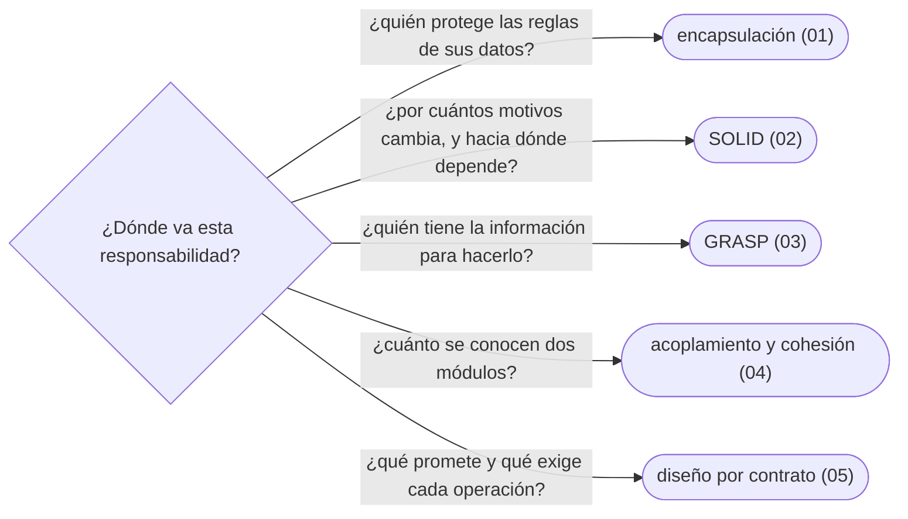

# 03 — Principios de diseño

> Los principios que se nombran en toda revisión de código, dichos con su matiz: encapsulación de verdad, SOLID sin catecismo, GRASP, acoplamiento y cohesión, y diseño por contrato.
>
> **Vigencia:** 2026-10-03.

---

## 1. 🗺️ Índice

| | Documento | Tipo |
|---|---|---|
| [`01`](01-encapsulacion-de-verdad.md) | Encapsulación de verdad | Capítulo |
| [`02`](02-solid-sin-catecismo.md) | SOLID sin catecismo | Capítulo |
| [`03`](03-grasp.md) | GRASP | Capítulo |
| [`04`](04-acoplamiento-cohesion-y-dependencias.md) | Acoplamiento, cohesión y dependencias | Capítulo |
| [`05`](05-diseno-por-contrato.md) | Diseño por contrato y *fail fast* | Capítulo |
| [`06`](06-simulacion-de-entrevista.md) | Simulación de entrevista | Simulación |
| [`07`](07-respuestas.md) | Respuestas | Solucionario |

**Orden de lectura.** En orden numérico. `02` (SOLID) es el que más se pregunta; `04` es el dueño de la inyección de dependencias como idea. Al terminar los capítulos, la simulación con cronómetro, y solo después el solucionario.

---

## 2. 🧠 Mapa mental

---

## 3. 🚫 Qué NO está aquí

Los patrones concretos que aplican estos principios (bloques `04`–`06`) y los antipatrones que los violan (`12`).

---

**Versiones ejecutadas:** JDK 21.0.12, 17.0.20 y 25.0.4 · GCC 14.4 (C++23) · Spring Boot 4.1.1 (Spring Framework 7.0.9, Hibernate 7.4.5, H2 2.4.240) · mermaid-cli 11.17.0 (2026-10-04).

---

**Anterior:** [`02` — Modelado OO](../02-modelado-oo/README.md) ·
**Corpus:** [README](../README.md) ·
**Siguiente:** [`04` — Patrones creacionales](../04-creacionales/README.md)
