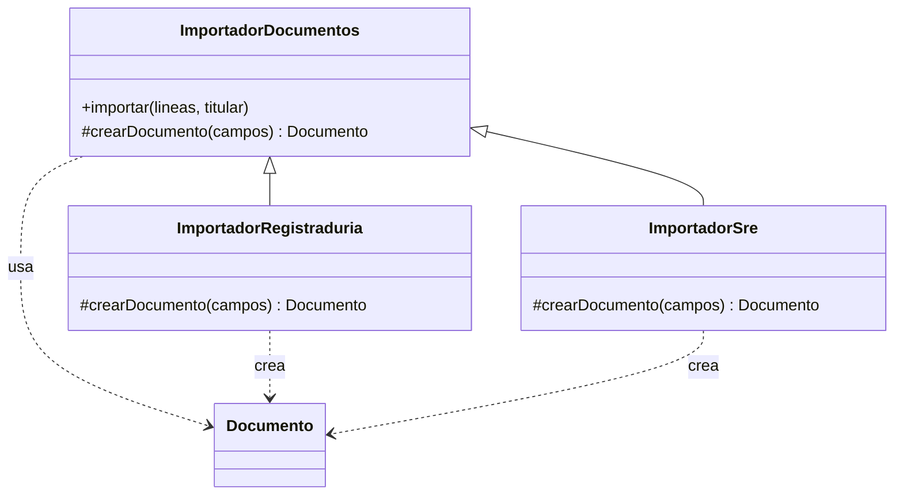
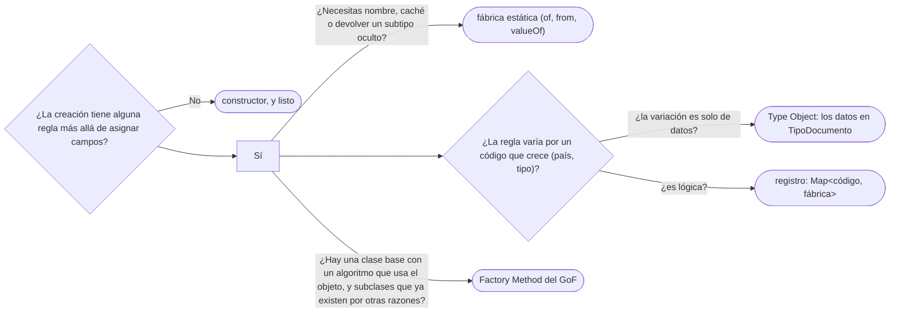

# 01 — Factory Method y fábricas estáticas

> Distinguir el Factory Method del GoF —un gancho que una subclase sobrescribe para decidir qué se
> crea— de la fábrica estática de Bloch —un método con nombre en lugar de un constructor—, y elegir
> entre ellos, el registro de fábricas por código y el `new` de toda la vida. **Nivel: A.** Asume leído
> [`03/03` — GRASP](../03-principios-de-diseno/03-grasp.md#4--creator) (Creator) y
> [`02/06` — Entidades, valores y primitivos](../02-modelado-oo/06-entidades-valores-y-primitivos.md#7--el-tipo-como-objeto-tipodocumento-contra-subclases)
> (`TipoDocumento` como objeto).
>
> **Vigencia:** 2026-10-03.
>
> **Versiones ejecutadas:** GCC 14.4 (C++23) · JDK 21.0.12, 17.0.20 y 25.0.4 · .NET 10.0.12 (C# 14) · mermaid-cli 11.17.0 (2026-10-04).

---

## 1. 🎯 El problema

La importación nocturna recibe líneas con un código de tipo y crea los documentos. Cada tipo calcula su
vencimiento a su manera, y el método que los crea es así:

```java
public Documento crear(String codigo, String numero, LocalDate emision, Persona titular) {
    switch (codigo) {
        case "CC":     return new Documento(tipos.get("CC"), numero, emision, null);   // no vence
        case "TI":     return new Documento(tipos.get("TI"), numero, emision,
                                            titular.fechaNacimiento().plusYears(18));
        case "PAS-CO": return new Documento(tipos.get("PAS-CO"), numero.toUpperCase(), emision,
                                            emision.plusYears(10).minusDays(1));
        default:       throw new IllegalArgumentException("tipo desconocido: " + codigo);
    }
}
```

- Cada país nuevo es un `case` más en un método que ya conoce todos los tipos. `PAS-MX` no está, y
  añadirlo obliga a tocar —y volver a probar— el código de los otros tres.
- Y hay otro igual en la pantalla de alta y otro en la API: tres `switch` que tienen que cambiar juntos.

La regla de cada tipo no cabe en un dato de `TipoDocumento` (un `boolean vence` no dice "a los 18 años
del titular"), así que la creación tiene lógica que **varía por tipo**. Este capítulo da las tres formas de
sacarla de ahí —el gancho del GoF, la fábrica estática y el registro— y dice cuándo ninguna hace falta.

---

## 2. 📐 La estructura

**La intención, en una frase del GoF:** definir una interfaz para crear un objeto, pero dejar que las
subclases decidan qué clase instanciar. La clase base **usa** un objeto que **no sabe crear**, y delega la
creación en un método que la subclase sobrescribe: ese método es el *Factory Method*.



- **Creator** (`ImportadorDocumentos`): tiene el algoritmo —leer, crear, asociar al titular— y declara el
  gancho `crearDocumento`, abstracto o con una versión por defecto. Aquí es abstracto.
- **Concrete Creator** (`ImportadorRegistraduria` para Colombia, `ImportadorSre` para México): sobrescribe
  el gancho, porque cada fuente trae columnas distintas y reglas de vencimiento distintas.
- **Product** (`Documento`): lo que se crea. En el GoF suele ser una jerarquía; aquí es una sola clase,
  y lo que varía es **cómo** se construye. La esencia del patrón es el gancho, no la jerarquía de productos.

> 🧠 **Modelo mental.** Factory Method es herencia aplicada a la creación: el padre escribe el
> algoritmo, el hijo decide el objeto. Si no hay un algoritmo en el padre que use lo creado, no hay
> Factory Method del GoF, aunque haya un método que cree cosas.

---

## 3. 🏛️ Cómo nació

En C++98 el GoF escribe el gancho como función virtual que devuelve un puntero crudo:

```cpp
class ImportadorDocumentos {
public:
    virtual ~ImportadorDocumentos() {}
    void importar(const std::vector<std::string>& lineas, Persona& titular) {
        for (std::size_t i = 0; i < lineas.size(); ++i) {
            Documento* d = crearDocumento(lineas[i]);   // el Factory Method
            titular.agregarDocumento(d);                // ¿quién borra d? el tipo no lo dice
        }
    }
protected:
    virtual Documento* crearDocumento(const std::string& linea) = 0;
};

class ImportadorRegistraduria : public ImportadorDocumentos {
protected:
    Documento* crearDocumento(const std::string& linea) {
        return new Documento(Tipos::cc(), linea.substr(3), Paises::colombia());
    }
};
```

- El patrón en sí está completo: `importar` no nombra ninguna clase concreta y la subclase decide.
- Lo que el tiempo dejó mal parado es **la propiedad**: `Documento*` no dice si `Persona` lo posee, y un
  `delete` olvidado o doble es cuestión de convención. Eso es lo primero que cambia en C++ moderno.

---

## 4. 💻 C++ moderno

El mismo gancho, con la propiedad en el tipo de retorno:

```cpp
class ImportadorDocumentos {
public:
    virtual ~ImportadorDocumentos() = default;
    void importar(std::span<const std::string> lineas, Persona& titular) {
        for (const auto& linea : lineas)
            titular.agregarDocumento(crearDocumento(linea));   // la persona recibe la propiedad
    }
protected:
    virtual std::unique_ptr<Documento> crearDocumento(const std::string& linea) = 0;
};

class ImportadorRegistraduria final : public ImportadorDocumentos {
protected:
    std::unique_ptr<Documento> crearDocumento(const std::string& linea) override {
        return std::make_unique<Documento>(Tipos::cc(), linea.substr(3), Paises::colombia());
    }
};
```

- `std::unique_ptr<Documento>` dice en la firma que quien llama se queda con el objeto, y
  `std::make_unique` evita el `new` desnudo. `override` y `final` hacen que el compilador compruebe lo que
  en C++98 era fe.
- Si `Documento` no es polimórfico —y aquí no lo es—, devolverlo **por valor** es mejor todavía: sin heap
  y sin puntero. `unique_ptr` hace falta cuando el producto sí es una jerarquía.

**El registro de fábricas.** Cuando lo que varía es una regla por código, una subclase por código es
mucha ceremonia. Un mapa de funciones hace lo mismo con datos:

```cpp
using namespace std::chrono;
using FabricaDocumento = std::function<Documento(const Solicitud&)>;

year_month_day venceALosDiezAnios(year_month_day emision) {
    return year_month_day{sys_days{emision + years{10}} - days{1}};   // el día anterior al aniversario
}

std::unordered_map<std::string, FabricaDocumento> fabricas{
    {"CC",     [](const Solicitud& s) { return Documento{Tipos::cc(), s.numero, s.emision}; }},
    {"TI",     [](const Solicitud& s) { return Documento{Tipos::ti(), s.numero, s.emision,
                                                         s.titular.fechaNacimiento() + years{18}}; }},
    {"PAS-CO", [](const Solicitud& s) { return Documento{Tipos::pasaporteCo(), s.numero, s.emision,
                                                         venceALosDiezAnios(s.emision)}; }},
};

Documento crear(const Solicitud& s) { return fabricas.at(s.codigoTipo)(s); }   // at lanza si no existe
```

- Añadir `PAS-MX` es **una entrada más**, sin tocar las otras. `std::function` borra el tipo de cada
  lambda (*type erasure*, ocultar el tipo concreto detrás de una interfaz común) y lo paga con una
  llamada indirecta y, si la lambda captura mucho, una asignación.
- Las fechas son `year_month_day`, que suma años de calendario directamente; restar días exige pasar
  por `sys_days`, y por eso la regla del pasaporte vive en una función con nombre.

---

## 5. 💻 Java

**La fábrica estática** es lo que más se escribe en Java, y **no es el Factory Method del GoF**: es un
método `static` con nombre que reemplaza al constructor. Bloch la recomienda en el ítem 1 de *Effective
Java* por cuatro ventajas, todas visibles en el dominio:

```java
public final class TipoDocumento {
    private static final Map<String, TipoDocumento> PORCODIGO = cargarCatalogo();

    private TipoDocumento(String codigo, Pais pais, Pattern formato, boolean vence) { /* ... */ }

    public static TipoDocumento deCodigo(String codigo) {          // 1. tiene nombre
        TipoDocumento t = PORCODIGO.get(codigo);                   // 2. no crea: devuelve el compartido
        if (t == null) throw new IllegalArgumentException("tipo desconocido: " + codigo);
        return t;
    }
}

List<Documento> vacia = List.of();         // 3. devuelve un subtipo oculto: la clase concreta no es pública
```

- **Nombre:** `deCodigo("CC")` dice más que `new TipoDocumento("CC")`, y dos fábricas pueden tener la
  misma firma con nombres distintos, cosa que dos constructores no pueden.
- **No obliga a crear:** devuelve la instancia compartida, como `Integer.valueOf` con su caché de −128 a
  127 (ver [`01/03` §4](../01-modelo-de-objetos/03-inmutabilidad-y-objetos-especiales.md#4--objetos-que-la-jvm-comparte-string-e-integer)).
- **Puede devolver un subtipo**, incluso uno privado: `List.of()` devuelve clases internas del JDK que
  pueden cambiar entre versiones sin romper a nadie.
- **La clase devuelta puede variar según el argumento**: `EnumSet.noneOf` elige entre dos
  implementaciones según cuántos valores tenga el `enum`.

El precio también es de Bloch: una clase con solo constructores privados **no se puede extender**, y las
fábricas no se distinguen de otros métodos estáticos en la documentación. Por eso los nombres siguen
convenciones: `of`, `from`, `valueOf`, `getInstance`, `newInstance`, `getType`, `newType`.

**El registro**, en Java, es un `Map` de interfaces funcionales:

```java
@FunctionalInterface
interface FabricaDocumento { Documento crear(Solicitud s); }

private final Map<String, FabricaDocumento> fabricas = Map.of(
    "CC",     s -> new Documento(TipoDocumento.deCodigo("CC"), s.numero(), s.emision(), null),
    "TI",     s -> new Documento(TipoDocumento.deCodigo("TI"), s.numero(), s.emision(),
                                 s.titular().fechaNacimiento().plusYears(18)),
    "PAS-CO", s -> new Documento(TipoDocumento.deCodigo("PAS-CO"), s.numero().toUpperCase(),
                                 s.emision(), s.emision().plusYears(10).minusDays(1)));

public Documento crear(Solicitud s) {
    FabricaDocumento f = fabricas.get(s.codigoTipo());
    if (f == null) throw new IllegalArgumentException("tipo desconocido: " + s.codigoTipo());
    return f.crear(s);
}
```

- El `switch` de §1 se volvió una tabla. Las tres pantallas que creaban documentos llaman a `crear`, y la
  regla de cada tipo vive en una sola línea.
- `Map.of` es inmutable y no admite claves repetidas: un código duplicado falla al arrancar, no en
  producción a las tres de la mañana.
- Un código mal escrito al registrarlo (`"PAS-C0"`, con cero) no lo ve el compilador: aparece cuando
  llega la primera solicitud de pasaporte. El registro cambia una comprobación del compilador por una de
  ejecución, y un test que recorra los códigos del catálogo la recupera. Es su precio principal.

---

## 6. 🔀 Variantes

- **Factory Method parametrizado.** El GoF lo nombra: el gancho recibe un parámetro que elige el
  producto (`crearDocumento(codigo)`). Dentro suele haber un `switch`, y una subclase lo sobrescribe para
  añadir códigos llamando a `super` para el resto. Es el diseño de §1 con un nivel más de herencia.
- **El gancho como parámetro.** En lugar de subclasificar `ImportadorDocumentos`, se le pasa la fábrica
  por constructor (`new ImportadorDocumentos(fabricaColombia)`). El patrón se disuelve en composición, y
  lo que queda es una estrategia de creación: casi siempre es lo que se escribe hoy.
- **`Supplier<T>` como fábrica.** Un `Supplier<Documento>` o un `Function<Solicitud, Documento>` es una
  fábrica de una sola operación; por eso los genéricos piden un `Supplier` cuando necesitan crear `T`
  (ver [`01/07` §5](../01-modelo-de-objetos/07-genericos-y-varianza.md#5--type-erasure-lo-que-queda-al-ejecutar)).
- **`ServiceLoader`.** El registro que se llena solo: cada módulo declara sus implementaciones y el JDK
  las descubre en el *classpath*. Sirve cuando las fábricas vienen de librerías que el núcleo no conoce.

> 📝 **En C#:** las fábricas estáticas son iguales, y los genéricos reificados añaden una forma que Java
> no tiene: la restricción `where T : new()` permite escribir `new T()` dentro de un genérico, porque el
> tipo existe al ejecutar. En Java, con el borrado de tipos, hace falta pasar un `Supplier<T>`.

---

## 7. ⚖️ Con qué se confunde

| Se confunde con | La diferencia, en una frase |
|---|---|
| **Fábrica estática** (Bloch) | Es un método `static` que reemplaza al constructor; el Factory Method es un método de instancia que una subclase sobrescribe |
| **Abstract Factory** | Abstract Factory es un **objeto** que crea una **familia** de productos relacionados; Factory Method es **un método** que crea uno (ver [`02` — Abstract Factory](02-abstract-factory.md)) |
| **Builder** | El Builder arma **un** objeto complejo en varios pasos; la fábrica lo entrega de una vez (ver [`03` — Builder](03-builder.md)) |
| **Template Method** | Factory Method **es** un Template Method cuyo paso variable es crear un objeto; el GoF lo dice así (ver [`06/02`](../06-comportamiento/02-template-method.md)) |
| **Contenedor de inyección** | El contenedor decide qué implementación se crea **desde fuera** de la clase; el Factory Method, desde una subclase (ver [`06`](06-inyeccion-de-dependencias-e-ioc.md)) |

---

## 8. 🔭 Dónde aparece de verdad

- **El Factory Method del GoF en el JDK:** `Iterable.iterator()`. `AbstractCollection` escribe
  `contains`, `remove` y `toString` usando un iterador que **no sabe crear**, y cada colección
  (`ArrayList`, `HashSet`) sobrescribe `iterator()` para devolver el suyo. Es exactamente la estructura
  de §2.
- **Fábricas estáticas:** `List.of`, `Map.of`, `Optional.of`, `Integer.valueOf`, `Charset.forName`,
  `LocalDate.of`, `Path.of`. Son la mayoría de lo que la gente llama "factory" en Java.
- **En C++:** `std::make_unique` y `std::make_shared` son funciones fábrica (no del GoF): existen para que
  la asignación y la toma de propiedad ocurran juntas.
- **En Spring:** `FactoryBean<T>` es un objeto cuyo `getObject()` crea el bean real; y un método `@Bean`
  es una fábrica que el contenedor llama. El contenedor tiene su capítulo:
  [`06` — Contenedores de inyección e IoC](06-inyeccion-de-dependencias-e-ioc.md).

---

## 9. 🏷️ Lo que cuesta, y cuándo no

**El precio**, en las cuatro monedas:

- **Indirección:** el Factory Method del GoF pide **una subclase de Creator por variante**, aunque lo
  único que cambie sea una línea; leer qué se crea obliga a saltar a la subclase. El registro cambia esas
  clases por una tabla, y cambia un error de compilación por uno de ejecución.
- **Acoplamiento:** el GoF ata la elección del producto a la jerarquía del Creator. Si mañana el
  importador también varía por formato (CSV, JSON), la herencia se multiplica: tipo × formato.
- **Legibilidad:** una fábrica estática esconde si se crea un objeto nuevo o se devuelve uno compartido;
  quien hace `==` con dos `Integer.valueOf(200)` lo descubre en producción.
- **Rendimiento:** despreciable salvo en bucles calientes: una llamada virtual o indirecta por objeto.

**Cuándo no.**

- **Cuando `new` basta.** Un `Dinero` o un `Empleo` sin reglas de creación se construye con `new`. Una
  `DocumentoFactory` con un método que solo llama al constructor no gana nombre, ni caché, ni subtipo.
- **Cuando la regla es un dato.** Si lo único que varía entre tipos es el formato y si vence, eso va en
  `TipoDocumento` (el *Type Object*, que tiene capítulo en [`09/03`](../09-ddd-tactico-y-otros/03-specification-null-object-y-type-object.md)), sin fábrica ninguna.
- **Cuando hay un solo producto que nunca va a variar.** La jerarquía de Creator "por si acaso" es la
  generalización especulativa de [`12/02` §9](../12-antipatrones/02-code-smells-entre-clases.md#9-️-lazy-element-data-class-y-speculative-generality).

> **Veredicto:** en Java, empieza por el constructor; pásate a una fábrica estática cuando necesites
> nombre, caché o esconder la clase concreta, y a un registro cuando la creación varíe por un código que
> crece. El Factory Method del GoF solo cuando ya hay una clase base con un algoritmo que usa lo creado
> y las subclases existen por otras razones.

---

## 10. 🧭 Cómo se elige



**La frase en voz alta:** *"Cuando digo fábrica en Java casi siempre es una fábrica estática, que no es el
Factory Method del GoF. El del GoF es un gancho que una subclase sobrescribe; lo uso si ya tengo esa
jerarquía. Si lo que varía es un código, prefiero un mapa de fábricas."*

---

## ⚠️ Errores frecuentes

| Se dice | Lo preciso |
|---|---|
| "Factory Method es cualquier método que crea objetos" | Es un método de instancia que una subclase sobrescribe para que la clase base use un objeto sin saber crearlo |
| "`List.of` es un Factory Method" | Es una fábrica estática (Bloch, ítem 1); no hay subclase ni gancho |
| "Una fábrica siempre necesita una jerarquía" | La estática y el registro no la necesitan; la del GoF necesita la de Creator, no la de productos |
| "Una fábrica siempre crea un objeto nuevo" | Una fábrica estática puede devolver uno compartido (`Integer.valueOf`), y eso cambia el resultado de `==` |
| "Hay que poner una fábrica para desacoplar" | Una fábrica que solo llama al constructor no desacopla nada: añade una clase |
| "El `switch` por tipo se arregla con una subclase por tipo" | Si lo que varía es dato, se arregla con un Type Object; si es lógica, con un registro |
| "Las fábricas estáticas no tienen inconvenientes" | La clase sin constructores accesibles no se puede extender, y las fábricas se pierden entre los métodos estáticos |

---

## 📚 Para profundizar

- **Libro** — Gamma, Helm, Johnson y Vlissides, *Design Patterns* (Addison-Wesley, 1994), cap. 3,
  "Creational Patterns", sección "Factory Method": la intención, el Factory Method parametrizado y la
  relación con Template Method. **El que destaca.**
- **Libro** — Bloch, *Effective Java*, 3.ª ed. (Addison-Wesley, 2018), ítem 1, "Consider static factory
  methods instead of constructors": las ventajas, los inconvenientes y las convenciones de nombres.
- **Libro** — Freeman y Robson, *Head First Design Patterns*, 2.ª ed. (O'Reilly, 2021), cap. 4, "The
  Factory Pattern": la "simple factory", el Factory Method y Abstract Factory, en Java.
- [Java 21 API — `List`](https://docs.oracle.com/en/java/javase/21/docs/api/java.base/java/util/List.html):
  las fábricas `List.of` y `List.copyOf`, con su contrato de listas no modificables.
- [Java 21 API — `ServiceLoader`](https://docs.oracle.com/en/java/javase/21/docs/api/java.base/java/util/ServiceLoader.html):
  el registro de implementaciones que descubre el JDK.
- [cppreference — `std::make_unique`](https://en.cppreference.com/cpp/memory/unique_ptr/make_unique):
  la función fábrica que une asignación y propiedad.
- **Tutorial** — [Refactoring Guru — Factory Method](https://refactoring.guru/design-patterns/factory-method):
  el diagrama y ejemplos en varios lenguajes.

---

## 🧠 Preguntas

Sin respuestas aquí. Todas, con enunciado literal y respuesta en tres capas, en
[`09` — Respuestas](09-respuestas.md#01--factory-method-y-fábricas-estáticas).

1. ¿Cuál es la intención del Factory Method del GoF? 🟢
2. ¿Qué es una fábrica estática, y qué cuatro ventajas tiene sobre un constructor? 🟢
3. ¿Qué es un registro de fábricas? 🟢
4. ¿Qué convenciones de nombre siguen las fábricas estáticas en Java? 🟢
5. ¿Qué diferencia hay entre el Factory Method del GoF y una fábrica estática? 🟡
6. ¿Qué diferencia hay entre Factory Method y Abstract Factory? 🟡
7. ¿Qué relación hay entre Factory Method y Template Method? 🟡
8. ¿Qué cambia entre el Factory Method en C++98 y en C++ moderno? 🟡
9. ¿Por qué `Iterable.iterator()` es un Factory Method del GoF y `List.of` no? 🟠
10. ¿Cuándo eliges un registro de fábricas en lugar de una subclase por tipo? 🟠
11. ¿Cuándo la variación por tipo de documento no necesita ninguna fábrica? 🟠
12. ¿Qué inconvenientes tiene una fábrica estática, y cómo los mitigas? 🟠
13. ¿Por qué en C++ moderno una fábrica devuelve `unique_ptr` o un valor, y no un puntero crudo? 🟠
14. Reescribe el `switch` de §1 como un registro de fábricas en Java, con `PAS-MX` añadido. 🔴
15. Revisa esta clase y di qué le sobra: `class DocumentoFactory { Documento crear(TipoDocumento t,
    String n) { return new Documento(t, n); } }`. 🔴
16. Escribe en C++ moderno un `ImportadorDocumentos` cuyo gancho se pasa por constructor en lugar de
    sobrescribirse, y di qué ganas y qué pierdes. 🔴

---

**Anterior:** [`03/06` — Simulación de entrevista](../03-principios-de-diseno/06-simulacion-de-entrevista.md) ·
**Siguiente:** [`02` — Abstract Factory](02-abstract-factory.md) ·
**Relacionado:** [`03` — Builder](03-builder.md)
