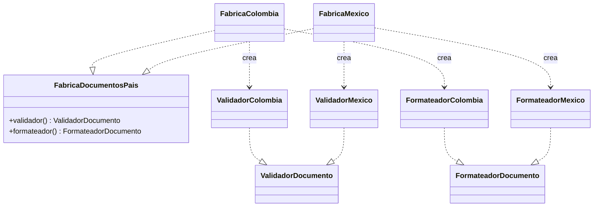
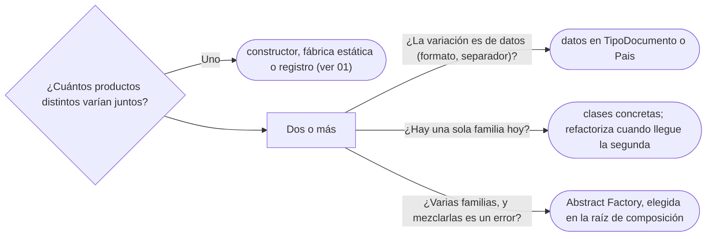

# 02 — Abstract Factory

> Reconocer cuándo hay **familias** de objetos que deben ir juntos —el validador y el formateador de un
> mismo país—, darles un solo punto de creación, y decir cuándo no hay familia ninguna y el patrón es
> ceremonia. **Nivel: B.** Asume leído [`01` — Factory Method y fábricas estáticas](01-factory-method.md).
>
> **Vigencia:** 2026-10-03.
>
> **Versiones ejecutadas:** GCC 14.4 (C++23) · JDK 21.0.12, 17.0.20 y 25.0.4 · mermaid-cli 11.17.0 (2026-10-04).

---

## 1. 🎯 El problema

Cada país tiene su forma de validar un número de documento y su forma de mostrarlo: en Colombia la cédula
se imprime con puntos (`1.020.304.050`), y en México el pasaporte va tal cual. El servicio que registra un
documento elige las dos piezas por separado:

```java
public void registrar(Persona titular, Documento d) {
    ValidadorDocumento validador = d.emisor().esColombia() ? new ValidadorColombia() : new ValidadorMexico();
    FormateadorDocumento formato  = d.emisor().esColombia() ? new FormateadorColombia() : new FormateadorMexico();
    validador.validar(d);
    titular.agregarDocumento(d);
    notificador.avisar(titular, "Registrado: " + formato.formatear(d));
}
```

- La misma pregunta —¿de qué país es?— se hace dos veces, y en el servicio de exportación se hace otra
  vez. Con un tercer país hay que tocar todos los sitios donde se pregunta.
- Nada impide la mezcla: un `ValidadorColombia` con un `FormateadorMexico` compila, pasa los tests de cada
  pieza por separado y produce un aviso con un número validado con una regla y mostrado con otra.

Las dos piezas forman una **familia**: tienen sentido juntas y solo juntas. El patrón existe para que la
familia se elija **una vez** y no se pueda mezclar.

---

## 2. 🧱 El mecanismo

**La intención, en una frase del GoF:** proporcionar una interfaz para crear familias de objetos
relacionados o dependientes sin especificar sus clases concretas.



- **Abstract Factory** (`FabricaDocumentosPais`): una interfaz con un método de creación por producto de la
  familia. Las tres de arriba son interfaces; Mermaid no lo marca y aquí se dice en el texto.
- **Concrete Factory** (`FabricaColombia`, `FabricaMexico`): una por familia. Es la única clase que sabe qué
  validador va con qué formateador.
- **Abstract Product** y **Concrete Product**: las interfaces `ValidadorDocumento` y `FormateadorDocumento`
  y sus implementaciones por país.
- **Client**: el servicio. Recibe **una** fábrica y nunca nombra una clase concreta.

Fíjate en el tamaño: dos productos y dos familias ya son **nueve tipos**. Es el número que hay que tener
en la cabeza antes de proponerlo.

---

## 3. 💻 Código

**Java**, con la fábrica elegida una vez y recibida por constructor:

```java
public interface FabricaDocumentosPais {
    ValidadorDocumento validador();
    FormateadorDocumento formateador();
}

public final class FabricaColombia implements FabricaDocumentosPais {
    public ValidadorDocumento validador()     { return new ValidadorColombia(); }
    public FormateadorDocumento formateador() { return new FormateadorColombia(); }
}

public final class RegistroDocumentos {
    private final Map<Pais, FabricaDocumentosPais> fabricas;   // la elección, en un solo sitio
    private final Notificador notificador;

    public RegistroDocumentos(Map<Pais, FabricaDocumentosPais> fabricas, Notificador notificador) {
        this.fabricas = Map.copyOf(fabricas);
        this.notificador = notificador;
    }

    public void registrar(Persona titular, Documento d) {
        FabricaDocumentosPais pais = fabricas.get(d.emisor());   // se pregunta una vez
        pais.validador().validar(d);
        titular.agregarDocumento(d);
        notificador.avisar(titular, "Registrado: " + pais.formateador().formatear(d));
    }
}
```

- El servicio ya no puede mezclar: las dos piezas salen del mismo objeto. Un país nuevo es una clase
  `FabricaPeru` y una entrada en el mapa, que se arma en la raíz de composición.
- Cada método de la fábrica (`validador()`, `formateador()`) es, mirado de cerca, un Factory Method: el GoF
  lo dice así. La diferencia con [`01`](01-factory-method.md) es que aquí la variación se elige
  **inyectando un objeto**, no subclasificando al cliente.

**C++, como contraste**: la misma estructura, con la propiedad en los tipos.

```cpp
struct FabricaDocumentosPais {
    virtual ~FabricaDocumentosPais() = default;
    virtual std::unique_ptr<ValidadorDocumento>   validador() const = 0;
    virtual std::unique_ptr<FormateadorDocumento> formateador() const = 0;
};

struct FabricaColombia final : FabricaDocumentosPais {
    std::unique_ptr<ValidadorDocumento> validador() const override {
        return std::make_unique<ValidadorColombia>();
    }
    std::unique_ptr<FormateadorDocumento> formateador() const override {
        return std::make_unique<FormateadorColombia>();
    }
};
```

- En C++ la familia también se puede fijar **en compilación**: una clase de rasgos (`struct Colombia { using
  Validador = ValidadorColombia; using Formateador = FormateadorColombia; };`) que se pasa como parámetro de
  plantilla. Sin heap ni llamada virtual, y con la mezcla imposible por construcción; a cambio, el país se
  elige al compilar, no al leer el documento.

---

## 4. ⚖️ Con qué se confunde

| Se confunde con | La diferencia, en una frase |
|---|---|
| **Factory Method** | Factory Method es **un método** que crea **un** producto y se elige subclasificando; Abstract Factory es **un objeto** que crea **una familia** y se elige inyectándolo |
| **Un registro de fábricas** | El registro elige **una** fábrica por código; si cada entrada da varias piezas que van juntas, cada entrada es un Abstract Factory |
| **Builder** | El Builder arma **un** objeto en pasos; el Abstract Factory entrega **varios** objetos distintos y coherentes entre sí |
| **Un Service Locator** | El localizador devuelve cualquier servicio por nombre; la fábrica abstracta tiene un método tipado por producto y una sola familia |

**La sobregeneralización.** "Abstract Factory es un Factory Method más grande" mezcla dos ejes. No es
cuestión de tamaño sino de **qué** se crea (una familia coherente, no un objeto) y de **cómo** se elige
(composición, no herencia).

---

## 5. 🔭 Dónde aparece de verdad

- **`org.w3c.dom.Document`** es el ejemplo más limpio del JDK: `createElement`, `createTextNode` y
  `createAttribute` crean nodos de la misma implementación, y la Javadoc avisa de que un nodo creado por un
  documento no se puede insertar en otro (`WRONG_DOCUMENT_ERR`). Es la regla "no mezclar familias", hecha
  error de ejecución.
- **`DocumentBuilderFactory`** es la puerta de entrada: `DocumentBuilderFactory.newInstance()` es una
  fábrica estática que elige la implementación de JAXP (por propiedad del sistema, por `ServiceLoader` o la
  de serie), y desde ahí todo lo que se crea pertenece a esa implementación.
- **JDBC**: una `Connection` crea `Statement`, `PreparedStatement` y `Blob` del mismo driver. No se puede
  ejecutar un `PreparedStatement` de PostgreSQL en una conexión de Oracle.
- **El ejemplo de libro**, los *widgets* de interfaz por sistema operativo (botón, menú y ventana del mismo
  aspecto), es el del propio GoF y hoy apenas se escribe a mano: lo resuelven los *toolkits*.

---

## 6. 🏷️ Cuándo sí y cuándo no

**El precio.** Una interfaz de fábrica, una clase por familia y una interfaz más una clase por producto
y familia: con `p` productos y `f` familias, `1 + f + p + p × f` tipos. Añadir una **familia** es barato
(una clase fábrica y sus productos); añadir un **producto** es caro: un método nuevo en la interfaz y en
**todas** las fábricas. La indirección también se paga al leer: para saber qué validador corre, hay que
saber qué fábrica se inyectó.

**Cuándo sí.**

- Cuando hay de verdad **dos o más productos** que deben ir juntos y **dos o más familias** vivas.
- Cuando mezclar piezas de familias distintas es un error de negocio, no una curiosidad.
- Cuando la familia se elige en un sitio (la raíz de composición, la lectura del documento) y se usa en
  muchos.

**Cuándo no.**

- **Un solo producto.** Una "fábrica abstracta" con un método es un Factory Method o una estrategia con
  otro nombre.
- **Una sola familia**, "por si mañana llega otra". Es generalización especulativa ([`12/02` §9](../12-antipatrones/02-code-smells-entre-clases.md#9-️-lazy-element-data-class-y-speculative-generality)): nueve tipos para lo
  que hoy son dos clases.
- **Cuando la variación es de datos.** Si lo que cambia entre países es un patrón de formato y un
  separador, eso va en `TipoDocumento` o en `Pais` como datos, sin ninguna jerarquía.

> **Veredicto:** Abstract Factory cuando hay varias piezas que solo tienen sentido juntas y varias
> familias reales; la ganancia es que nadie pueda mezclarlas. Con un solo producto o una sola familia,
> es ceremonia: un constructor o un registro lo hacen con una fracción de los tipos.

---

## 7. 🧭 Cómo se elige



**La frase en voz alta:** *"Abstract Factory si tengo una familia de piezas que no se pueden mezclar,
como el validador y el formateador de un país; si es una sola pieza, me basta una fábrica o un mapa."*

---

## ⚠️ Errores frecuentes

| Se dice | Lo preciso |
|---|---|
| "Abstract Factory es un Factory Method más grande" | Crea una familia coherente y se elige por composición; el Factory Method crea un producto y se elige por herencia |
| "Abstract Factory facilita añadir cosas" | Facilita añadir familias; añadir un producto obliga a tocar todas las fábricas |
| "Cualquier interfaz con métodos `crear` es un Abstract Factory" | Sin una familia de productos que deban ir juntos, es una fábrica con otro nombre |
| "Hay que preparar el código para otros países" | Una sola familia no justifica nueve tipos; se refactoriza cuando llega la segunda |
| "`DocumentBuilderFactory` es el Abstract Factory del JDK" | Es la puerta de entrada; la familia la materializa `Document` con sus métodos `create*` |

---

## 📚 Para profundizar

- **Libro** — Gamma, Helm, Johnson y Vlissides, *Design Patterns* (Addison-Wesley, 1994), cap. 3,
  "Creational Patterns", sección "Abstract Factory", y el caso de estudio del cap. 2 ("Supporting Multiple
  Look-and-Feel Standards"), donde el patrón nace. **El que destaca.**
- **Libro** — Freeman y Robson, *Head First Design Patterns*, 2.ª ed. (O'Reilly, 2021), cap. 4, "The
  Factory Pattern": Abstract Factory contado justo después del Factory Method, con la diferencia entre los
  dos.
- [Java 21 API — `org.w3c.dom.Document`](https://docs.oracle.com/en/java/javase/21/docs/api/java.xml/org/w3c/dom/Document.html):
  los métodos de fábrica de los nodos y la nota de por qué viven en el documento.
- [Java 21 API — `DocumentBuilderFactory`](https://docs.oracle.com/en/java/javase/21/docs/api/java.xml/javax/xml/parsers/DocumentBuilderFactory.html):
  cómo `newInstance()` elige la implementación.
- **Tutorial** — [Refactoring Guru — Abstract Factory](https://refactoring.guru/design-patterns/abstract-factory):
  el diagrama de familias por variante.

---

## 🧠 Preguntas

Sin respuestas aquí. Todas, con enunciado literal y respuesta en tres capas, en
[`09` — Respuestas](09-respuestas.md#02--abstract-factory).

1. ¿Cuál es la intención de Abstract Factory? 🟢
2. ¿Qué es una familia de productos, en el sentido del patrón? 🟢
3. ¿Qué papel tiene `org.w3c.dom.Document` como Abstract Factory? 🟢
4. ¿Qué diferencia hay entre Abstract Factory y Factory Method? 🟡
5. ¿Qué diferencia hay entre Abstract Factory y un registro de fábricas? 🟡
6. ¿Qué diferencia hay entre añadir una familia y añadir un producto? 🟡
7. ¿Qué cambia entre un Abstract Factory en Java y una clase de rasgos como parámetro de plantilla en
    C++? 🟡
8. ¿Por qué "Abstract Factory es un Factory Method más grande" es impreciso? 🟠
9. ¿Cuándo un Abstract Factory es ceremonia? 🟠
10. ¿Dónde se elige la fábrica concreta, y por qué ahí? 🟠
11. Rediseña el `registrar` de §1 para que validador y formateador no se puedan mezclar, y di cuántos
    tipos añades. 🔴
12. Un compañero propone `FabricaNotificaciones` con un solo método `crearNotificacion()` y una sola
    implementación. Revísalo. 🔴

---

**Anterior:** [`01` — Factory Method y fábricas estáticas](01-factory-method.md) ·
**Siguiente:** [`03` — Builder](03-builder.md) ·
**Relacionado:** [`01` — Factory Method y fábricas estáticas](01-factory-method.md)
