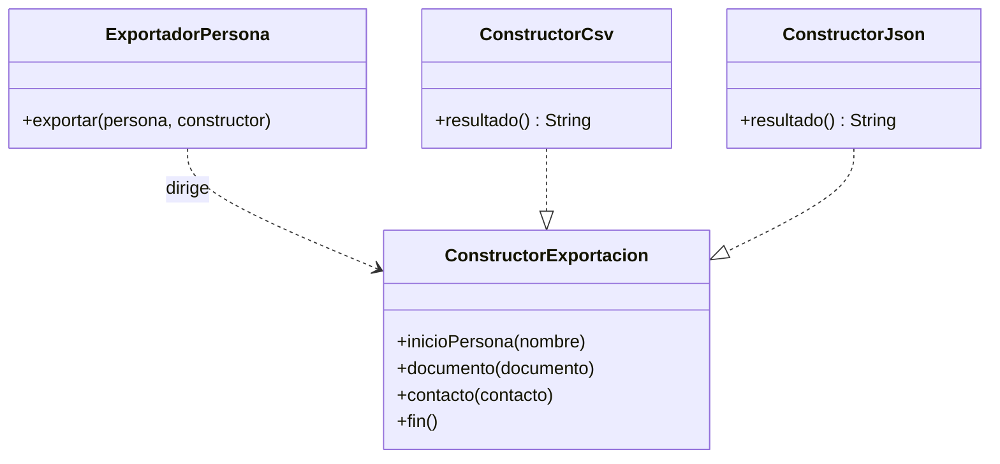
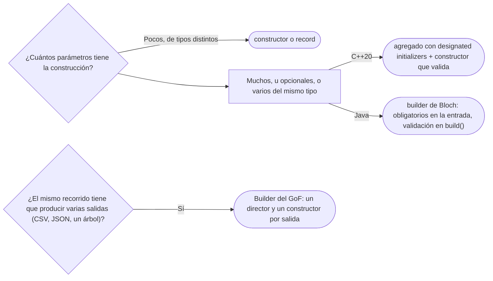

# 03 — Builder

> Construir objetos con muchos campos opcionales sin constructores telescópicos ni objetos a medias, y
> distinguir los **dos patrones que comparten el nombre**: el Builder del GoF (un director y varias
> representaciones) y el de Bloch (un constructor con nombre por argumento que valida al final).
> **Nivel: A.** Asume leído
> [`01/03` — Inmutabilidad y objetos especiales](../01-modelo-de-objetos/03-inmutabilidad-y-objetos-especiales.md)
> y [`01` — Factory Method y fábricas estáticas](01-factory-method.md).
>
> **Vigencia:** 2026-10-03.
>
> **Versiones ejecutadas:** GCC 14.4 (C++23) · JDK 21.0.12, 17.0.20 y 25.0.4 · mermaid-cli 11.17.0 (2026-10-04).

---

## 1. 🎯 El problema

`Persona` tiene dos campos obligatorios —nombre y fecha de nacimiento— y ocho opcionales: segundo
apellido, nombre preferido, nacionalidad, tutor, email, teléfono, dirección de domicilio y profesión. Las
dos formas que salen primero son estas:

```java
// 1. Constructores telescópicos: uno por cada combinación que alguien necesitó
new Persona("Ana Rojas Medina", LocalDate.of(1988, 3, 14));
new Persona("Ana Rojas Medina", LocalDate.of(1988, 3, 14), null, "Ana", COLOMBIA, null,
            "ana.rojas@example.com", "+57 301 555 0101", null, "Jefa de sistemas");

// 2. JavaBeans: constructor vacío y setters
Persona luis = new Persona();
luis.setNombre("Luis Rojas Paz");
luis.setFechaNacimiento(LocalDate.of(2013, 9, 2));
registro.guardar(luis);          // se guardó un menor sin tutor: el setTutor iba en la línea siguiente
luis.setTutor(ana);
```

- En el telescópico, diez argumentos posicionales donde email y teléfono son ambos `String`: invertirlos
  compila. Y los `null` no dicen qué campo se está dejando vacío.
- En JavaBeans, el objeto **existe a medias** entre el `new` y el último setter: alguien lo usa en ese
  intervalo y el invariante "un menor tiene tutor" no se cumple. Y con setters públicos, `Persona` ya no
  puede ser inmutable.

Lo que se necesita es nombrar cada argumento, poder omitir los opcionales y **no entregar el objeto hasta
que esté completo y validado**.

---

## 2. 📐 La estructura

Bajo el nombre "Builder" viven **dos patrones distintos**, y la entrevista suele preguntar por la
diferencia.

**El Builder de Bloch** (*Effective Java*, ítem 2) resuelve el problema de §1: un objeto auxiliar recibe
los campos uno por uno con métodos con nombre, y un `build()` final valida y construye el objeto
inmutable. No tiene diagrama que valga la pena: es una clase anidada.

**El Builder del GoF** resuelve otro: **separar la construcción de un objeto complejo de su
representación**, para que el mismo proceso produzca representaciones distintas.



- **Director** (`ExportadorPersona`): conoce el **orden** de construcción —primero la persona, luego sus
  documentos, luego sus contactos— y no sabe nada del formato.
- **Builder** (`ConstructorExportacion`): la interfaz con un paso por parte.
- **Concrete Builder** (`ConstructorCsv`, `ConstructorJson`): cada uno arma su **representación** y la
  entrega con `resultado()`, que no está en la interfaz porque cada uno devuelve algo distinto.

| | Builder del GoF | Builder de Bloch |
|---|---|---|
| Problema | Un proceso, varias representaciones | Muchos parámetros opcionales |
| Quién decide el orden | El director | Quien llama, en cualquier orden |
| Cuántos builders | Varios, intercambiables | Uno por clase |
| Lo que entrega | Una representación (CSV, JSON, un árbol) | Un objeto de la clase, validado e inmutable |

---

## 3. 🏛️ Cómo nació

El GoF lo presenta con un lector de RTF que convierte a ASCII, a TeX o a un widget de texto. En C++98, con
el dominio:

```cpp
class ConstructorExportacion {
public:
    virtual ~ConstructorExportacion() {}
    virtual void inicioPersona(const std::string& nombre) = 0;
    virtual void documento(const Documento& d) = 0;
    virtual void fin() = 0;
};

class ExportadorPersona {                              // el director: el orden, sin el formato
public:
    void exportar(const Persona& p, ConstructorExportacion& c) {
        c.inicioPersona(p.nombre());
        for (std::size_t i = 0; i < p.documentos().size(); ++i)
            c.documento(p.documentos()[i]);
        c.fin();
    }
};
```

- Cambiar de CSV a JSON es pasar otro constructor; el director no se toca.
- En la versión del libro, los pasos de la interfaz base tienen cuerpo vacío en lugar de ser abstractos,
  para que cada constructor concreto sobrescriba solo los que le interesan.

---

## 4. 💻 C++ moderno

El Builder del GoF se escribe igual en C++ moderno, con `= default`, `override` y `std::string_view`. Lo
que C++20 cambia es el **otro** problema, el de Bloch: los ***designated initializers*** (inicializadores
con nombre de campo) dan argumentos con nombre sin escribir ningún builder.

```cpp
struct DatosPersona {                                   // un agregado: solo campos públicos
    std::string nombre;
    std::chrono::year_month_day nacimiento;
    std::optional<std::string> segundoApellido;
    std::optional<Pais> nacionalidad;
    const Persona* tutor = nullptr;                     // no posee: la tutora vive aparte
    std::optional<std::string> email;
    std::optional<std::string> telefono;
};

class Persona {
public:
    explicit Persona(DatosPersona d);                   // aquí se valida: un menor necesita tutor
};

Persona luis{{.nombre = "Luis Rojas Paz",
              .nacimiento = std::chrono::year{2013} / 9 / 2,
              .tutor = &ana}};                          // los campos omitidos quedan con su valor por defecto
```

- Cada argumento lleva su nombre y los omitidos toman el inicializador del campo. El constructor de
  `Persona` recibe el agregado completo y valida antes de que el objeto exista: es el `build()` de Bloch.
- **La restricción de C++**: los designadores tienen que ir **en el orden de declaración** de los campos.
  `{.tutor = &ana, .nombre = "..."}` no compila, a diferencia de C. Tampoco se admiten designadores
  anidados (`.direccion.ciudad`).
- El precio frente al builder de Java es que el agregado tiene que tener **todos sus campos públicos**: es
  un objeto de transporte, no el objeto de dominio. Por eso la validación va en `Persona`, no en él.

---

## 5. 💻 Java

El Builder de Bloch, con los obligatorios en la entrada y la validación en `build()`:

```java
public final class Persona {
    private final String nombre;
    private final LocalDate fechaNacimiento;
    private final Persona tutor;
    private final String email;
    private final Pais nacionalidad;

    private Persona(Builder b) {                       // solo el builder construye
        this.nombre = b.nombre;
        this.fechaNacimiento = b.fechaNacimiento;
        this.tutor = b.tutor;
        this.email = b.email;
        this.nacionalidad = b.nacionalidad;
    }

    public static Builder builder(String nombre, LocalDate fechaNacimiento) {
        return new Builder(nombre, fechaNacimiento);
    }

    public static final class Builder {
        private final String nombre;
        private final LocalDate fechaNacimiento;
        private Persona tutor;
        private String email;
        private Pais nacionalidad;

        private Builder(String nombre, LocalDate fechaNacimiento) {
            this.nombre = Objects.requireNonNull(nombre);
            this.fechaNacimiento = Objects.requireNonNull(fechaNacimiento);
        }
        public Builder tutor(Persona t)        { this.tutor = t; return this; }
        public Builder email(String e)         { this.email = e; return this; }
        public Builder nacionalidad(Pais p)    { this.nacionalidad = p; return this; }

        public Persona build(LocalDate hoy) {   // el invariante se comprueba una vez, con todo a la vista
            boolean menor = fechaNacimiento.plusYears(18).isAfter(hoy);
            if (menor && tutor == null) throw new IllegalStateException("un menor necesita tutor");
            return new Persona(this);
        }
    }
}

Persona luis = Persona.builder("Luis Rojas Paz", LocalDate.of(2013, 9, 2))
        .tutor(ana)
        .build(LocalDate.now(reloj));
```

- **Lo obligatorio va en la entrada** (`builder(nombre, fecha)`), no en un setter más: así no se puede
  olvidar, y `build()` solo tiene que validar las reglas que cruzan campos.
- El objeto **no existe** hasta `build()`, y cuando existe ya cumple el invariante. El problema de JavaBeans
  desaparece.
- `build` recibe la fecha de referencia porque la regla depende del reloj; es la misma decisión que en el
  bloque de principios, para poder probarla sin esperar a que pase el tiempo.

> ⚠️ **Advertencia.** Un builder que **no** valida en `build()` —el que generan muchas herramientas por
> defecto— reintroduce el objeto inválido de JavaBeans con una sintaxis más bonita. El valor del patrón
> está en el último método, no en el encadenamiento.

---

## 6. 🔀 Variantes

- **Record con builder.** Un `record` valida en su constructor compacto, y el builder solo junta los
  argumentos y llama al constructor canónico. La validación vive en el record, y el builder no puede
  saltársela.
- **Lombok `@Builder`.** Genera el builder entero. Se puede poner en una clase, en un constructor o en un
  método; **puesto en la clase**, construye por un constructor con todos los campos que no valida nada.
  Puesto en el constructor que valida, `build()` pasa por la validación. `toBuilder = true` da una copia
  modificable de un objeto existente.
- **Copiar con cambios.** Para objetos inmutables, el builder sirve también para "este, pero con otro
  email": `persona.toBuilder().email(nuevo).build(hoy)`. Java está estudiando hacerlo en el lenguaje para
  los records (JEP 468, *Derived Record Creation*), pero hoy es una JEP **candidata**, sin versión.
- **Builder por pasos** (*step builder*): cada método devuelve una interfaz distinta que solo ofrece el
  paso siguiente, y el compilador obliga al orden. Una interfaz por paso: se justifica en APIs públicas
  con un orden que importa, casi nunca en el dominio.
- **En Go**, el lugar del builder lo ocupan las *functional options*, funciones que se pasan al
  constructor y configuran un campo cada una; tienen su sitio en
  [`11/01`](../11-los-diferentes/01-go.md).

---

## 7. ⚖️ Con qué se confunde

| Se confunde con | La diferencia, en una frase |
|---|---|
| **El otro Builder** | GoF: un director y varias representaciones; Bloch: muchos opcionales y validación al final (tabla de §2) |
| **Fábrica estática** | La fábrica entrega el objeto de una llamada con los argumentos fijos; el builder lo arma en varias (ver [`01`](01-factory-method.md)) |
| **Abstract Factory** | El Abstract Factory entrega varios objetos de una familia; el builder, uno complejo (ver [`02`](02-abstract-factory.md)) |
| ***Fluent interface*** | Encadenar llamadas que devuelven `this` es un estilo de API; un builder es fluido casi siempre, pero un API fluido no tiene por qué construir nada |
| **Un objeto mutable con setters encadenados** | Es JavaBeans con otra sintaxis: el objeto existe y se usa mientras se arma |

---

## 8. 🔭 Dónde aparece de verdad

- **Bloch, en el JDK:** `HttpRequest.newBuilder()`, `Locale.Builder`, `Stream.builder()` y
  `ProcessBuilder`. `StringBuilder` es un borrador mutable que entrega un `String` inmutable: la misma
  idea, sin validación.
- **El GoF, en el JDK:** el parser SAX es el director y un `ContentHandler` es el constructor. El parser
  recorre el XML y llama a `startElement`, `characters` y `endElement` en orden; cada `ContentHandler`
  construye su representación —un árbol, un objeto de dominio, una cuenta de nodos—. Es, casi pieza por
  pieza, el lector de RTF del libro.
- **En Spring:** `UriComponentsBuilder` y los `MockMvcRequestBuilders` de las pruebas, ambos al estilo de
  Bloch.

---

## 9. 🏷️ Lo que cuesta, y cuándo no

**El precio**, en las cuatro monedas:

- **Indirección:** el builder de Bloch duplica cada campo —uno en la clase, otro en el builder— y añade una
  clase anidada que hay que mantener en sincronía. Un campo nuevo que se olvida en el builder no da error:
  queda siempre con su valor por defecto.
- **Acoplamiento:** quien llama depende del builder además de la clase; poco, porque son la misma unidad.
- **Legibilidad:** gana en la llamada (cada argumento con nombre) y pierde en la definición (el doble de
  código). El del GoF exige saber qué constructor concreto se pasó para saber qué sale.
- **Rendimiento:** un objeto más por construcción; despreciable salvo en bucles muy calientes.

**Cuándo no.**

- **Pocos campos.** Con tres o cuatro parámetros de tipos distintos, un constructor —o un `record`— se lee
  igual de bien y no duplica nada. Bloch habla de "muchos" parámetros, y el umbral práctico suele estar en
  cinco o más, o en varios del mismo tipo.
- **Todos obligatorios.** Si no hay opcionales, el builder solo cambia una lista de argumentos por una
  cadena de llamadas, y pierde la comprobación del compilador de que no falte ninguno.
- **El GoF sin varias representaciones.** Un director con un único constructor concreto es un método con
  pasos de más.

> **Veredicto:** Builder de Bloch cuando hay muchos opcionales o varios argumentos del mismo tipo, con lo
> obligatorio en la entrada y la validación en `build()`. Builder del GoF solo cuando el mismo recorrido
> produce de verdad varias representaciones. Con pocos campos, un constructor o un `record`.

---

## 10. 🧭 Cómo se elige



**La frase en voz alta:** *"Hay dos Builders. El que uso a diario es el de Bloch: lo obligatorio en la
entrada, lo opcional con nombre y la validación en `build()`, para que nunca exista un objeto a medias. El
del GoF es otro: un director que recorre algo y varios constructores que producen formatos distintos."*

---

## ⚠️ Errores frecuentes

| Se dice | Lo preciso |
|---|---|
| "El Builder del GoF y el de Bloch son el mismo patrón" | Comparten el nombre: el GoF separa el proceso de la representación; Bloch resuelve los muchos opcionales |
| "Con records ya no hace falta Builder" | Un record con diez componentes tiene un constructor de diez argumentos posicionales: el problema telescópico entero |
| "El builder es para encadenar setters" | El encadenamiento es la sintaxis; el valor está en que `build()` valide y el objeto nazca completo |
| "`@Builder` de Lombok valida" | No valida nada: pasa por el constructor en el que se ponga, y en la clase usa uno sin validación |
| "Siempre conviene un builder" | Con pocos campos de tipos distintos, un constructor se lee igual y no duplica cada campo |
| "Los obligatorios se ponen con su setter y se comprueban en `build()`" | Mejor en la entrada del builder: así no se pueden olvidar |
| "En C++ los designated initializers van en cualquier orden" | Tienen que seguir el orden de declaración; en cualquier orden es C, no C++ |

---

## 📚 Para profundizar

- **Libro** — Bloch, *Effective Java*, 3.ª ed. (Addison-Wesley, 2018), ítem 2, "Consider a builder when
  faced with many constructor parameters": telescópico, JavaBeans y builder, con el builder para
  jerarquías. **El que destaca** para el de Bloch.
- **Libro** — Gamma, Helm, Johnson y Vlissides, *Design Patterns* (Addison-Wesley, 1994), cap. 3,
  "Creational Patterns", sección "Builder": el lector de RTF y sus convertidores.
- [cppreference — Aggregate initialization](https://en.cppreference.com/cpp/language/aggregate_initialization):
  los *designated initializers* de C++20 y lo que C++ no admite de los de C.
- [Java 21 API — `HttpRequest.Builder`](https://docs.oracle.com/en/java/javase/21/docs/api/java.net.http/java/net/http/HttpRequest.Builder.html):
  un builder de Bloch en el JDK moderno.
- [Java 21 API — `ContentHandler`](https://docs.oracle.com/en/java/javase/21/docs/api/java.xml/org/xml/sax/ContentHandler.html):
  el constructor del Builder del GoF que dirige el parser SAX.
- [JEP 468 — Derived Record Creation](https://openjdk.org/jeps/468): la propuesta de copiar records con
  cambios, todavía candidata.
- [Project Lombok — `@Builder`](https://projectlombok.org/features/Builder): dónde se pone y qué genera.
- **Tutorial** — [Refactoring Guru — Builder](https://refactoring.guru/design-patterns/builder): el Builder
  del GoF con director.

---

## 🧠 Preguntas

Sin respuestas aquí. Todas, con enunciado literal y respuesta en tres capas, en
[`09` — Respuestas](09-respuestas.md#03--builder).

1. ¿Qué problema resuelve el Builder de Bloch? 🟢
2. ¿Cuál es la intención del Builder del GoF? 🟢
3. ¿Qué es un constructor telescópico? 🟢
4. ¿Qué son los *designated initializers* de C++20? 🟢
5. ¿Qué diferencia hay entre el Builder del GoF y el de Bloch? 🟡
6. ¿Qué diferencia hay entre un builder y el patrón JavaBeans? 🟡
7. ¿Qué diferencia hay entre un builder y una fábrica estática? 🟡
8. ¿Qué diferencia hay entre un builder de Java y un agregado con *designated initializers* en C++? 🟡
9. ¿Qué diferencia hay entre un builder y una *fluent interface*? 🟡
10. ¿Por qué "con records ya no hace falta Builder" es falso? 🟠
11. ¿Dónde van los campos obligatorios en un builder, y por qué? 🟠
12. ¿Qué pasa si pones `@Builder` de Lombok en la clase en lugar de en el constructor? 🟠
13. ¿Cuándo un builder es ceremonia? 🟠
14. Escribe el builder de `Persona` en Java con nombre y fecha obligatorios, tutor y email opcionales, y
    la regla "un menor necesita tutor". 🔴
15. Escribe el director y un constructor CSV del Builder del GoF que exporte a Ana con sus dos
    documentos. 🔴
16. Revisa este builder y di qué falla: `Persona build() { return new Persona(nombre, fecha, tutor); }`
    con `nombre` y `fecha` puestos por setters del builder. 🔴

---

**Anterior:** [`02` — Abstract Factory](02-abstract-factory.md) ·
**Siguiente:** [`04` — Prototype](04-prototype.md) ·
**Relacionado:** [`01/03` — Inmutabilidad y objetos especiales](../01-modelo-de-objetos/03-inmutabilidad-y-objetos-especiales.md)
