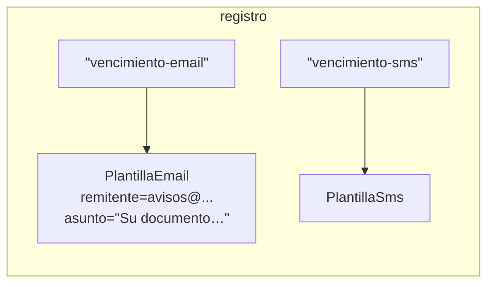

# 04 — Prototype

> Copiar un objeto **sin conocer su clase concreta**, pidiéndole a él que se copie; mantener un registro
> de prototipos ya configurados; y saber por qué en Java casi nunca se hace con `clone()`. **Nivel: B.**
> Asume leído [`01/04` — Copia, ciclo de vida y recursos](../01-modelo-de-objetos/04-copia-ciclo-de-vida-y-recursos.md).
>
> **Vigencia:** 2026-10-03.
>
> **Versiones ejecutadas:** GCC 14.4 (C++23) · JDK 21.0.12, 17.0.20 y 25.0.4 · .NET 10.0.12 (C# 14) (2026-10-04).

---

## 1. 🎯 El problema

El aviso de vencimiento de documentos sale por correo o por SMS. Cada canal tiene su plantilla configurada
una vez al arrancar —remitente, asunto, firma, longitud máxima—, y para cada persona se toma una **copia**
de la plantilla y se personaliza. El código que copia es este:

```java
PlantillaNotificacion copia;
if (plantilla instanceof PlantillaEmail e) {
    copia = new PlantillaEmail(e);                 // constructor de copia de cada clase
} else if (plantilla instanceof PlantillaSms s) {
    copia = new PlantillaSms(s);
} else {
    throw new IllegalStateException("plantilla desconocida: " + plantilla.getClass());
}
copia.personalizar(ana, pasaporte);
```

- Quien copia tiene que conocer **todas** las clases concretas. Cuando llegue la plantilla de WhatsApp,
  este `if` falla al ejecutar en el primer aviso que la use.
- Y no puede copiar con `new PlantillaNotificacion(plantilla)`: un constructor crea siempre la clase que
  nombra, nunca la del objeto que recibe.

La copia de un objeto polimórfico es una operación que **solo el objeto sabe hacer**, porque solo él
conoce su tipo dinámico. El patrón consiste en pedírsela.

---

## 2. 🧱 El mecanismo

**La intención, en una frase del GoF:** especificar los tipos de objetos a crear mediante una instancia
prototípica, y crear objetos nuevos copiando ese prototipo.

- **Prototype** (`PlantillaNotificacion`): declara una operación de copia, `copiar()`.
- **Concrete Prototype** (`PlantillaEmail`, `PlantillaSms`): la implementa, con su propio tipo y sus
  propios campos.
- **Client**: pide copias sin saber qué clase recibe.
- **Registro de prototipos** (opcional, pero es donde el patrón brilla): un mapa de nombre a prototipo ya
  configurado. Crear es buscar y copiar.



```text
uso
p = registro.get("vencimiento-email")
c = p.copiar()            ← tipo dinámico: PlantillaEmail
c.personalizar(ana, pasaporte)
(el prototipo no cambia: se copia, no se usa)
```

**La sobregeneralización.** "Prototype es `clone()`" confunde el patrón con un mecanismo de Java, y con
el peor. El patrón es la **copia polimórfica** pedida al propio objeto; cómo se implementa la copia —un
constructor de copia, una fábrica, `clone()`— es un detalle.

---

## 3. 💻 Código

**C++**, donde el patrón es más necesario que en ningún otro lenguaje: la copia por valor de un objeto
polimórfico **parte** el objeto (*slicing*). Las *C++ Core Guidelines* lo fijan en dos reglas: una clase
polimórfica suprime la copia pública (C.67), y la copia profunda se hace con una función virtual `clonar`
(C.130).

```cpp
class PlantillaNotificacion {
public:
    virtual ~PlantillaNotificacion() = default;
    virtual std::unique_ptr<PlantillaNotificacion> clonar() const = 0;
    virtual void personalizar(const Persona& p, const Documento& d) = 0;
protected:
    PlantillaNotificacion(const PlantillaNotificacion&) = default;   // copia solo para las derivadas
    PlantillaNotificacion& operator=(const PlantillaNotificacion&) = delete;
    PlantillaNotificacion() = default;
};

class PlantillaEmail final : public PlantillaNotificacion {
public:
    std::unique_ptr<PlantillaNotificacion> clonar() const override {
        return std::make_unique<PlantillaEmail>(*this);   // el constructor de copia, con el tipo correcto
    }
    void personalizar(const Persona& p, const Documento& d) override;
    PlantillaEmail(const PlantillaEmail&) = default;
private:
    std::string remitente, asunto, cuerpo;
};
```

- La copia pública está cerrada en la base: nadie puede escribir `PlantillaNotificacion c = plantilla;` y
  partir el objeto. La única puerta es `clonar()`.
- `clonar()` devuelve `std::unique_ptr` al tipo base: quien llama recibe la propiedad de una copia cuyo tipo
  dinámico no conoce. Dentro, la copia la hace el constructor de copia generado, que sí sabe los campos.

**Java**, con un constructor de copia detrás de un método polimórfico:

```java
public sealed interface PlantillaNotificacion permits PlantillaEmail, PlantillaSms {
    PlantillaNotificacion copiar();
    void personalizar(Persona p, Documento d);
}

public final class PlantillaEmail implements PlantillaNotificacion {
    private final String remitente;
    private String asunto, cuerpo;

    public PlantillaEmail(String remitente, String asunto, String cuerpo) { /* ... */ }
    private PlantillaEmail(PlantillaEmail otra) {             // copia campo a campo, decidida a mano
        this(otra.remitente, otra.asunto, otra.cuerpo);
    }
    public PlantillaEmail copiar() { return new PlantillaEmail(this); }   // retorno covariante
    public void personalizar(Persona p, Documento d) { /* ... */ }
}

Map<String, PlantillaNotificacion> registro = Map.of(
        "vencimiento-email", new PlantillaEmail("avisos@example.com", "Su documento vence", "..."),
        "vencimiento-sms",   new PlantillaSms(160, "Su documento vence el {fecha}"));

PlantillaNotificacion aviso = registro.get("vencimiento-email").copiar();
aviso.personalizar(ana, pasaporte);
```

- El `if` de §1 desapareció: añadir WhatsApp es una clase y una entrada en el registro.
- El constructor de copia es privado y **pasa por el constructor normal**, así que las validaciones se
  aplican también a las copias. Es lo que `clone()` no hace (ver [`01/04` §3](../01-modelo-de-objetos/04-copia-ciclo-de-vida-y-recursos.md#3--por-qué-clone-está-roto-en-java)).
- La interfaz sellada es opcional: `copiar()` funciona igual sin ella. Lo que aporta es que el compilador
  conoce la lista de plantillas.

> 📝 **En C#:** el patrón está en el lenguaje para los `record`. `aviso with { Asunto = "..." }` crea una
> copia con cambios, y el resultado tiene **el mismo tipo en tiempo de ejecución** que el original aunque
> la variable sea del tipo base: el compilador genera un método de copia virtual. La copia es
> superficial; para listas internas hay que declarar el constructor de copia a mano.

---

## 4. ⚖️ Con qué se confunde

| Se confunde con | La diferencia, en una frase |
|---|---|
| **`clone()` de Java** | Es un mecanismo, superficial y sin constructor; el patrón es la copia polimórfica, y se implementa mejor con un constructor de copia |
| **Constructor de copia** | Copia una clase que se nombra; el Prototype copia sin nombrarla, porque la copia la decide el objeto |
| **Factory Method** | La fábrica crea desde cero con una subclase por producto; el Prototype crea copiando un ejemplar ya configurado |
| **La herencia por prototipos de JavaScript** | En JS los objetos **heredan** de otro objeto vivo por delegación; el patrón **copia**, y la copia no sigue al original |

- JavaScript es el lenguaje de prototipos por excelencia, y por eso la confusión: allí `Object.create(p)`
  crea un objeto que delega en `p`, sin copiarlo. Tiene su sitio en
  [`11/02`](../11-los-diferentes/02-javascript-y-typescript.md).

---

## 5. 🔭 Dónde aparece de verdad

- **C++:** cualquier jerarquía que viva en un `std::vector<std::unique_ptr<Base>>` y necesite copiarse
  acaba con un `clonar()` virtual. Es la pregunta 18 de
  [`02/04`](../02-modelado-oo/04-agregacion-composicion-y-propiedad.md): una `Persona` con documentos
  polimórficos deja de ser copiable.
- **Java:** los arreglos, donde `clone()` funciona bien y es la forma idiomática de copiarlos. Fuera de
  ahí, el JDK prefiere constructores de copia (`new ArrayList<>(otra)`) y fábricas (`List.copyOf`).
- **Spring:** el *scope* `prototype` **no es este patrón**. Un bean `prototype` se crea de nuevo, desde su
  definición, cada vez que se pide; no se copia ninguna instancia. Solo comparte el nombre.
- **Videojuegos y editores:** los "spawners" que crean enemigos copiando uno configurado, y el "duplicar"
  de cualquier editor gráfico. Nystrom lo discute en *Game Programming Patterns* con una mirada crítica.

---

## 6. 🏷️ Cuándo sí y cuándo no

**El precio.** Cada clase concreta implementa su copia, y la decisión de qué es profundo y qué se comparte
se toma **en cada una**: un campo mutable nuevo que se olvida en el constructor de copia queda compartido
entre el prototipo y todas sus copias, y el bug aparece cuando una copia lo modifica. En C++ se suma una
asignación en el heap por copia. Y el registro de prototipos es estado configurado al arrancar, que hay
que proteger: si alguien personaliza el prototipo en lugar de una copia, todos los avisos siguientes salen
con el nombre de Ana.

**Cuándo sí.**

- Cuando hay que copiar objetos **polimórficos** sin conocer su clase: la razón de ser del patrón, y en
  C++ la única forma correcta.
- Cuando configurar un objeto desde cero es caro o largo, y hay pocas configuraciones base que se reutilizan
  (un registro de plantillas).

**Cuándo no.**

- **Objetos inmutables.** No hay nada que copiar: se comparten. Si las plantillas fueran inmutables y
  `personalizar` devolviera un objeto nuevo, el patrón desaparecería.
- **Clases no polimórficas.** Un constructor de copia, o la copia por valor en C++, basta.
- **En Java, con `clone()`.** El patrón sí; el mecanismo no.

> **Veredicto:** Prototype cuando necesitas copiar sin conocer la clase concreta; en C++ con un
> `clonar()` virtual que devuelve `unique_ptr`, en Java con un `copiar()` que llama a un constructor de
> copia. Si puedes hacer el objeto inmutable, no lo necesitas.

---

## ⚠️ Errores frecuentes

| Se dice | Lo preciso |
|---|---|
| "Prototype es `clone()`" | Es la copia polimórfica pedida al objeto; `clone()` es un mecanismo de Java, y el peor para implementarla |
| "Implementar `Cloneable` hace que la clase se pueda clonar" | `Cloneable` no declara ningún método: solo cambia el comportamiento de un `clone()` protegido de `Object` |
| "El *scope* `prototype` de Spring es el patrón Prototype" | Crea una instancia nueva desde la definición en cada petición; no copia nada |
| "Con un constructor de copia en la base basta" | Un constructor crea la clase que nombra; para copiar el tipo dinámico hace falta un método virtual |
| "En C++ se copia un polimórfico asignándolo a la base" | Eso parte el objeto (*slicing*); se cierra la copia pública y se copia con `clonar()` |
| "JavaScript usa el patrón Prototype" | Usa herencia por delegación a un prototipo vivo; el patrón copia y la copia queda independiente |

---

## 📚 Para profundizar

- **Libro** — Gamma, Helm, Johnson y Vlissides, *Design Patterns* (Addison-Wesley, 1994), cap. 3,
  "Creational Patterns", sección "Prototype": el registro de prototipos ("prototype manager") y el
  problema de la copia profunda. **El que destaca.**
- **Libro** — Bloch, *Effective Java*, 3.ª ed. (Addison-Wesley, 2018), ítem 13, "Override clone
  judiciously": por qué no `clone()`, y el constructor y la fábrica de copia como alternativa.
- **Libro** — Iglberger, *C++ Software Design* (O'Reilly, 2022), cap. 7, "The Bridge, Prototype, and
  External Polymorphism Design Patterns": Prototype en C++ moderno.
- [C++ Core Guidelines — C.130](https://isocpp.github.io/CppCoreGuidelines/CppCoreGuidelines#c130-for-making-deep-copies-of-polymorphic-classes-prefer-a-virtual-clone-function-instead-of-public-copy-constructionassignment):
  la copia profunda de clases polimórficas con un `clone` virtual.
- [C# — expresión `with`](https://learn.microsoft.com/en-us/dotnet/csharp/language-reference/operators/with-expression):
  la copia con cambios de los records, con el tipo en tiempo de ejecución del original.
- [Game Programming Patterns — Prototype](https://gameprogrammingpatterns.com/prototype.html): Nystrom,
  libre en línea; el patrón y por qué lo que más vale de él son los datos prototípicos.
- **Tutorial** — [Refactoring Guru — Prototype](https://refactoring.guru/design-patterns/prototype): el
  registro de prototipos.

---

## 🧠 Preguntas

Sin respuestas aquí. Todas, con enunciado literal y respuesta en tres capas, en
[`09` — Respuestas](09-respuestas.md#04--prototype).

1. ¿Cuál es la intención de Prototype? 🟢
2. ¿Qué es un registro de prototipos? 🟢
3. ¿Por qué un constructor no puede copiar un objeto polimórfico sin conocer su clase? 🟢
4. ¿Qué diferencia hay entre el patrón Prototype y `clone()` de Java? 🟡
5. ¿Qué diferencia hay entre el patrón Prototype y el *scope* `prototype` de Spring? 🟡
6. ¿Qué diferencia hay entre Prototype en C++, en Java y con `with` en C#? 🟡
7. ¿Por qué en C++ una clase polimórfica cierra su copia pública y ofrece `clonar()`? 🟠
8. ¿Por qué un objeto inmutable no necesita Prototype? 🟠
9. ¿Qué riesgo tiene un registro de prototipos, y cómo lo evitas? 🟠
10. ¿Qué bug aparece si añades un campo mutable y olvidas el constructor de copia? 🟠
11. Escribe `PlantillaSms` en Java con su `copiar()`, de modo que la copia pase por las validaciones del
    constructor. 🔴
12. Revisa este código y di qué falla: `class PlantillaEmail implements Cloneable { List<String>
    destinatarios; public PlantillaEmail clone() { return (PlantillaEmail) super.clone(); } }`. 🔴

---

**Anterior:** [`03` — Builder](03-builder.md) ·
**Siguiente:** [`05` — Singleton, y por qué casi nunca](05-singleton.md) ·
**Relacionado:** [`01/04` — Copia, ciclo de vida y recursos](../01-modelo-de-objetos/04-copia-ciclo-de-vida-y-recursos.md)
