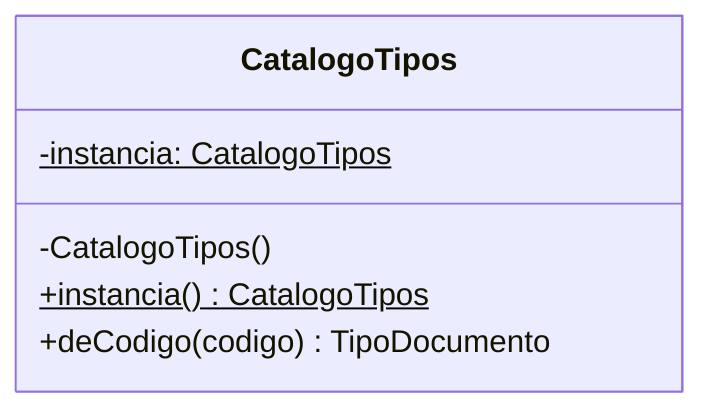
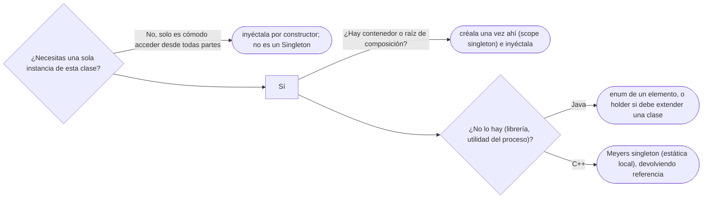

# 05 — Singleton, y por qué casi nunca

> Escribir un Singleton seguro entre hilos de tres formas en Java y una en C++, y argumentar por qué casi
> siempre la respuesta correcta es otra: una sola instancia creada por quien arma la aplicación y pasada
> por constructor. **Nivel: A.** Se lee suelto; lo que asume, en el recordatorio de §1. Para profundizar
> en lo que se toca: [`03/04` — Acoplamiento, cohesión y dependencias](../03-principios-de-diseno/04-acoplamiento-cohesion-y-dependencias.md)
> (inyección sin contenedor) y [`01/03` §7](../01-modelo-de-objetos/03-inmutabilidad-y-objetos-especiales.md#7--enums-objetos-con-identidad-garantizada)
> (enums).
>
> **Vigencia:** 2026-10-03.
>
> **Versiones ejecutadas:** GCC 14.4 (C++23) · JDK 21.0.12, 17.0.20 y 25.0.4 · mermaid-cli 11.17.0 (2026-10-04).

---

## 1. 🎯 El problema

**Recordatorio de lo que se asume.** Una **dependencia oculta** es un colaborador que una clase usa sin
que aparezca en su constructor ni en sus parámetros; la **inyección de dependencias** es recibir esos
colaboradores desde fuera, y la **raíz de composición** es el único sitio, cerca del `main`, donde se
crean y se conectan. Un `enum` de Java es una clase con un número fijo de instancias que crea la JVM.

El catálogo de tipos de documento (`CC`, `TI`, `PAS-CO`, `PAS-MX`) se carga de la base de datos al
arrancar. Cargarlo dos veces es lento, y dos catálogos darían dos `TipoDocumento` "CC" distintos, que
no son `==` y que pueden haberse cargado con datos de momentos diferentes. Hace falta **uno**, accesible
desde cualquier parte:

```java
public class CatalogoTipos {
    private static CatalogoTipos instancia;

    public static CatalogoTipos getInstance() {
        if (instancia == null) instancia = new CatalogoTipos();   // dos hilos pueden pasar a la vez
        return instancia;
    }
    private CatalogoTipos() { /* consulta la base y llena el mapa */ }
}

// en Documento, en el validador, en la exportación...
TipoDocumento cc = CatalogoTipos.getInstance().deCodigo("CC");
```

- La primera versión que sale **no es segura entre hilos**: dos peticiones que llegan juntas al arrancar
  pueden crear dos catálogos, y una se queda con el suyo.
- Y aunque se arregle, la línea de abajo tiene el problema que de verdad cuesta: `Documento` depende del
  catálogo **sin decirlo**, y ningún test puede darle un catálogo de prueba sin una base de datos.

El capítulo hace las dos cosas en orden: primero el Singleton bien escrito, porque te lo van a pedir en la
pizarra, y después por qué casi nunca es la respuesta.

---

## 2. 📐 La estructura

**La intención, en una frase del GoF:** asegurar que una clase tenga **una sola instancia** y dar un
**punto de acceso global** a ella.



- **Constructor privado:** nadie de fuera puede crear otra.
- **Instancia estática:** la clase guarda la única.
- **Método de acceso estático:** el punto global.

Son **dos promesas en una**, y conviene separarlas desde ya: "una sola instancia" y "acceso global". La
primera a veces es una regla del dominio. La segunda casi nunca es una virtud, y es la que trae los
problemas de §9.

---

## 3. 🏛️ Cómo nació

El GoF lo escribe en C++98 con un puntero estático y creación perezosa:

```cpp
class CatalogoTipos {
public:
    static CatalogoTipos* instancia() {
        if (instancia_ == 0) instancia_ = new CatalogoTipos();   // nadie lo borra nunca
        return instancia_;
    }
private:
    CatalogoTipos() {}
    CatalogoTipos(const CatalogoTipos&);                // copia declarada y no definida: así se "borraba"
    static CatalogoTipos* instancia_;
};
CatalogoTipos* CatalogoTipos::instancia_ = 0;
```

- En 1994 no había hilos en el estándar de C++, y la carrera del `if` no se veía. Hoy es el primer defecto.
- El objeto **nunca se destruye**, y si su destructor tenía que cerrar algo, no lo cierra.
- La alternativa de entonces, un objeto estático global, tenía el problema contrario: el **orden de
  inicialización** entre unidades de traducción no está definido, y un estático que usa otro durante su
  construcción puede encontrarlo sin construir.

---

## 4. 💻 C++ moderno

Desde C++11, una variable estática local se inicializa **una sola vez aunque varios hilos lleguen a la
vez**: el estándar lo garantiza y el compilador pone la sincronización. Es el ***Meyers singleton***:

```cpp
class CatalogoTipos {
public:
    static CatalogoTipos& instancia() {
        static CatalogoTipos unico;          // se construye la primera vez que se pasa por aquí, una sola vez
        return unico;
    }
    CatalogoTipos(const CatalogoTipos&) = delete;
    CatalogoTipos& operator=(const CatalogoTipos&) = delete;
    const TipoDocumento& deCodigo(std::string_view codigo) const;
private:
    CatalogoTipos();                         // consulta la base y llena el mapa
};
```

- Devuelve una **referencia**, no un puntero: no hay nada que borrar ni que comprobar contra `nullptr`.
- La construcción es perezosa y segura entre hilos, y la destrucción ocurre al terminar el programa, en
  orden inverso a la construcción.
- **Lo que sigue mordiendo**: si el destructor de otro estático usa el catálogo después de que se
  destruyó, el comportamiento es indefinido. Y si el constructor lanza, el siguiente que llame lo
  reintenta.

---

## 5. 💻 Java

Tres formas seguras entre hilos, de la más simple a la más robusta.

**Inicialización ansiosa.** La JVM inicializa la clase una sola vez, con los hilos sincronizados:

```java
public final class CatalogoTipos {
    private static final CatalogoTipos INSTANCIA = new CatalogoTipos();
    private CatalogoTipos() { /* carga */ }
    public static CatalogoTipos instancia() { return INSTANCIA; }
}
```

- Se crea al inicializar la clase, que en Java ya es perezoso: ocurre la primera vez que se usa la clase,
  no al arrancar. Solo sobra si la clase tiene otros estáticos que se usan antes.

**El *holder idiom*** (la clase portadora): la instancia vive en una clase anidada que solo se inicializa
cuando alguien llama a `instancia()`.

```java
public final class CatalogoTipos {
    private CatalogoTipos() { /* carga */ }

    private static final class Portador {
        static final CatalogoTipos INSTANCIA = new CatalogoTipos();
    }
    public static CatalogoTipos instancia() { return Portador.INSTANCIA; }   // aquí se inicializa Portador
}
```

- Es seguro sin `synchronized` ni `volatile` porque la inicialización de clases de la JLS (§12.4.2)
  adquiere un cerrojo por clase: el primer hilo inicializa y los demás esperan. Después, ningún costo.

**El `enum` de un solo elemento**, la forma que recomienda Bloch (ítem 3):

```java
public enum CatalogoTipos {
    INSTANCIA;

    private final Map<String, TipoDocumento> porCodigo = cargarDesdeBase();

    public TipoDocumento deCodigo(String codigo) { return porCodigo.get(codigo); }
}
```

- Es la única de las tres que resiste **reflexión** y **serialización** sin código extra: la JLS (§8.9)
  prohíbe instanciar un enum por reflexión, y la serialización de un enum guarda solo su nombre y al leerlo
  devuelve la constante existente. Las otras dos se rompen con `setAccessible(true)` sobre el constructor,
  y con deserializar, salvo que se escriba `readResolve`.
- Su límite: un enum no puede extender otra clase (sí implementar interfaces).

**La cuarta, que se nombra.** El *double-checked locking* (comprobar, sincronizar, volver a comprobar) es
correcto en Java desde Java 5 **solo si el campo es `volatile`**; sin él, otro hilo puede ver la referencia
antes que el objeto construido. El mecanismo y la autopsia completa son de [`10/06` §3](../10-concurrencia/06-inicializacion-perezosa-segura.md#3--autopsia-el-dcl-sin-volatile). Para un
Singleton no hace falta: el holder hace lo mismo sin riesgo.

> 📝 **En Java 25:** `StableValue` (JEP 502, en *preview*) da la inicialización perezosa con la optimización
> de un `final`: `static final Supplier<CatalogoTipos> CATALOGO = StableValue.supplier(CatalogoTipos::new);`
> y se usa con `CATALOGO.get()`. En JDK 26 la API se rediseñó como `LazyConstant` (JEP 526, segunda
> *preview*). No es un Singleton nuevo: es un holder sin clase anidada.

---

## 6. 🔀 Variantes

- **Multiton.** Una instancia **por clave** en lugar de una: un enum de varias constantes es el Multiton
  de Java. Tiene su ficha en [`07` — Más allá del GoF](07-mas-alla-del-gof.md).
- **Una por hilo.** `ThreadLocal<T>` da una instancia por hilo. No es un Singleton: es estado global
  partido por hilo, con su propia trampa de fugas en los *pools* de hilos.
- **La instancia única del contenedor.** El *scope* `singleton` de Spring —el de por defecto— crea **un
  objeto por definición de bean y por contenedor**, y lo inyecta por constructor. Cumple la primera
  promesa (una instancia) sin la segunda (acceso global). Es el sustituto, y tiene capítulo:
  [`06` — Contenedores de inyección e IoC](06-inyeccion-de-dependencias-e-ioc.md).

---

## 7. ⚖️ Con qué se confunde

| Se confunde con | La diferencia, en una frase |
|---|---|
| **El bean `singleton` de Spring** | Una instancia **por contenedor y por definición**, inyectada; el del GoF es una **por cargador de clases**, y se busca con un estático |
| **Una clase de utilidades estática** | No tiene instancia ni estado (`Math`); el Singleton tiene una instancia, con estado, y puede implementar interfaces |
| **Una variable global** | El Singleton es una variable global con constructor privado; tiene sus mismos problemas y solo evita las copias |
| **Una constante compartida** (`Collections.emptyList()`) | Un objeto inmutable que se comparte por eficiencia, sin prometer que no existan otros iguales |
| **Multiton** | Una instancia por clave, no una en total |

**La sobregeneralización**, en dos frases que se oyen mucho. "El Singleton garantiza una sola instancia":
la garantiza **por cargador de clases** en Java, y se rompe con reflexión, con serialización y con dos
*classloaders* (dos aplicaciones en el mismo servidor). Y "el bean singleton de Spring es el patrón
Singleton": la documentación de Spring dice exactamente lo contrario, y la diferencia es todo el punto.

---

## 8. 🔭 Dónde aparece de verdad

- **En el JDK:** `Runtime.getRuntime()`, el ejemplo de libro; `Desktop.getDesktop()`; y cada constante de
  un `enum`, que es una instancia única por diseño.
- **En C++:** `std::cout` y compañía son objetos globales únicos, inicializados con un truco propio de la
  librería para esquivar el problema del orden de inicialización.
- **En Spring:** todos los beans por defecto, como se dijo, sin el patrón.
- **En el código que se revisa:** `ConfiguracionGlobal.getInstance()`, `CacheManager.getInstance()`,
  `ConexionBD.getInstance()`. Casi siempre es la forma más corta de pasar un objeto a quien lo necesita,
  y por eso aparece tanto.

---

## 9. 🏷️ Lo que cuesta, y cuándo no

El Singleton está en el GoF y también en la lista de antipatrones (*Singletonitis*, en
[`12/04` §2](../12-antipatrones/04-el-patron-mal-usado.md#2-️-singletonitis)), y las dos cosas son ciertas. Lo que cuesta, en las cuatro monedas:

- **Acoplamiento oculto.** `Documento.esValido()` que llama a `CatalogoTipos.instancia()` depende del
  catálogo sin que su firma lo diga. Para saber qué necesita una clase hay que leer su código entero.
- **Pruebas.** No se puede dar un catálogo de prueba: el test de `Documento` necesita la base de datos, o
  un *mock* de un estático. Y como el estado sobrevive entre tests, el orden de los tests empieza a
  importar.
- **Estado global mutable.** Si el catálogo se puede recargar, cualquier parte del sistema puede ver un
  catálogo a medio recargar, y ningún hilo sabe quién lo cambió.
- **Ciclo de vida.** La instancia vive lo que viva el cargador de clases: no se puede reiniciar, no se puede
  tener una por inquilino ni una por test, y en C++ el orden de destrucción puede morder.

Las *C++ Core Guidelines* lo resumen en una regla, I.3: evita los singletons. La salida es separar las dos
promesas: **una instancia, sí; acceso global, no**.

```java
public final class ServicioDocumentos {
    private final CatalogoTipos catalogo;                 // la dependencia, en la firma

    public ServicioDocumentos(CatalogoTipos catalogo) { this.catalogo = catalogo; }

    public boolean esValido(Documento d, LocalDate hoy) {
        return catalogo.deCodigo(d.codigoTipo()).admite(d, hoy);
    }
}

// en la raíz de composición: una sola instancia, creada una vez y pasada a quien la necesita
var catalogo = CatalogoTipos.cargar(fuenteDatos);
var servicio = new ServicioDocumentos(catalogo);
```

- `CatalogoTipos` ya no tiene constructor privado ni estático: es una clase normal con una fábrica
  `cargar`. Sigue habiendo una sola, porque la raíz de composición crea una sola. En el test se crea otra con
  dos tipos escritos a mano, sin base de datos.

**Cuándo sí.** Cuando la unicidad es una **regla** y no una comodidad —un recurso del proceso que de verdad
es uno (el `Runtime` de la JVM)—, o en código sin contenedor ni raíz de composición donde el acceso global
es el menor de los males (una librería de *logging*). Incluso ahí, que el Singleton implemente una
interfaz y que el código de negocio reciba la interfaz.

> **Veredicto:** Singleton solo cuando la unicidad es una regla del dominio y no una comodidad de
> acceso. Para "una sola instancia compartida", deja que la cree el contenedor o la raíz de composición, y
> pídela por constructor.

---

## 10. 🧭 Cómo se elige



**La frase en voz alta:** *"Te escribo el Singleton con un enum o con el holder, que son seguros entre
hilos. Pero en un servicio con Spring no lo haría: el contenedor ya me da una instancia por bean, y la
recibo por constructor, que es lo que me deja probarlo."*

---

## ⚠️ Errores frecuentes

| Se dice | Lo preciso |
|---|---|
| "Singleton garantiza una sola instancia" | Una por cargador de clases, y la rompen la reflexión y la serialización, salvo con `enum` |
| "El bean singleton de Spring es el patrón Singleton" | Es una instancia por contenedor y por definición, inyectada; Spring lo distingue del GoF en su documentación |
| "Con `synchronized` en `getInstance` está resuelto" | Es correcto entre hilos, sincroniza cada llamada, y no resuelve ninguno de los problemas de diseño |
| "El DCL funciona igual con o sin `volatile`" | Sin `volatile`, otro hilo puede ver la referencia antes que el objeto construido |
| "El holder necesita sincronización" | La inicialización de clases de la JVM ya lo sincroniza (JLS §12.4.2) |
| "En C++ el Singleton necesita un `mutex`" | Desde C++11 la estática local se inicializa una sola vez entre hilos |
| "Singleton y clase estática son lo mismo" | El Singleton tiene una instancia con estado y puede implementar interfaces; la clase estática no |
| "El Singleton es un antipatrón siempre" | Lo es el acceso global; la unicidad como regla del proceso es legítima |

---

## 📚 Para profundizar

- **Libro** — Bloch, *Effective Java*, 3.ª ed. (Addison-Wesley, 2018), ítem 3, "Enforce the singleton
  property with a private constructor or an enum type", e ítem 5, "Prefer dependency injection to
  hardwiring resources". **El que destaca.**
- **Libro** — Gamma, Helm, Johnson y Vlissides, *Design Patterns* (Addison-Wesley, 1994), cap. 3,
  "Creational Patterns", sección "Singleton".
- **Libro** — Nystrom, *Game Programming Patterns* (2014), cap. "Singleton", libre en
  [su sitio](https://gameprogrammingpatterns.com/singleton.html): la crítica más clara del patrón.
- [Spring Framework — Bean Scopes](https://docs.spring.io/spring-framework/reference/core/beans/factory-scopes.html):
  el *scope* `singleton` y su diferencia explícita con el del GoF.
- [JLS 21 §12.4.2 — Detailed Initialization Procedure](https://docs.oracle.com/javase/specs/jls/se21/html/jls-12.html#jls-12.4.2):
  por qué el holder es seguro sin sincronizar.
- [JEP 502 — Stable Values (Preview)](https://openjdk.org/jeps/502): la inicialización perezosa de Java 25.
- [C++ Core Guidelines — I.3](https://isocpp.github.io/CppCoreGuidelines/CppCoreGuidelines#i3-avoid-singletons):
  "Avoid singletons".
- [cppreference — Storage duration](https://en.cppreference.com/cpp/language/storage_duration): la
  inicialización única de las estáticas locales entre hilos.

---

## 🧠 Preguntas

Sin respuestas aquí. Todas, con enunciado literal y respuesta en tres capas, en
[`09` — Respuestas](09-respuestas.md#05--singleton-y-por-qué-casi-nunca).

1. ¿Cuál es la intención del Singleton, y cuáles son sus dos promesas? 🟢
2. ¿Qué es el *holder idiom*? 🟢
3. ¿Qué es el *Meyers singleton*? 🟢
4. ¿Por qué Bloch recomienda el `enum` de un elemento? 🟢
5. ¿Qué diferencia hay entre el Singleton del GoF y el bean singleton de Spring? 🟡
6. ¿Qué diferencia hay entre un Singleton y una clase de utilidades estática? 🟡
7. ¿Qué diferencia hay entre la inicialización ansiosa y el holder en Java? 🟡
8. ¿Qué diferencia hay entre el Singleton en C++98 y en C++ moderno? 🟡
9. ¿Por qué el `getInstance` con `if (instancia == null)` no es seguro entre hilos? 🟠
10. ¿Por qué "con `synchronized` en `getInstance` está resuelto" es una respuesta incompleta? 🟠
11. ¿Por qué el *double-checked locking* necesita `volatile` en Java? 🟠
12. ¿Cómo rompen la reflexión y la serialización un Singleton, y cómo se protege? 🟠
13. ¿Por qué el Singleton dificulta las pruebas? 🟠
14. ¿Cuándo un Singleton sí está justificado? 🟠
15. Escribe el holder idiom para `CatalogoTipos` y explica por qué es seguro sin sincronizar. 🔴
16. Refactoriza `Documento.esValido()`, que llama a `CatalogoTipos.getInstance()`, para que se pueda probar
    sin base de datos. 🔴
17. Escribe el Meyers singleton en C++ y di qué pasa si su constructor lanza. 🔴
18. Revisa este código y di qué falla: `public static CatalogoTipos getInstance() { if (instancia == null)
    { synchronized (CatalogoTipos.class) { instancia = new CatalogoTipos(); } } return instancia; }`. 🔴

---

**Anterior:** [`04` — Prototype](04-prototype.md) ·
**Siguiente:** [`06` — Contenedores de inyección e IoC](06-inyeccion-de-dependencias-e-ioc.md) ·
**Relacionado:** [`03/04` — Acoplamiento, cohesión y dependencias](../03-principios-de-diseno/04-acoplamiento-cohesion-y-dependencias.md)
