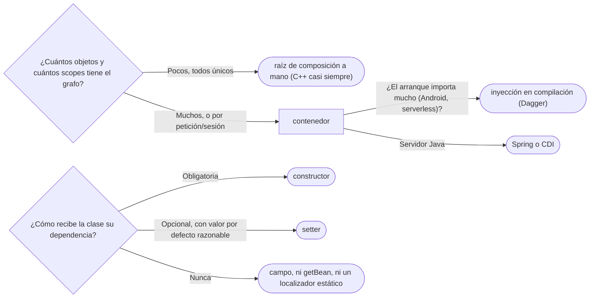

# 06 — Contenedores de inyección e IoC

> Explicar qué hace un contenedor de inversión de control —registrar, resolver, gestionar el ciclo de vida
> y los *scopes*—, por qué la inyección por constructor es la buena, y en qué se diferencia de un Service
> Locator. **Nivel: A.** Es el dueño del contenedor; la inyección como idea es de
> [`03/04` — Acoplamiento, cohesión y dependencias](../03-principios-de-diseno/04-acoplamiento-cohesion-y-dependencias.md#5--inyección-de-dependencias-sin-contenedor).
> Asume leído también [`05` — Singleton](05-singleton.md).
>
> **Vigencia:** 2026-10-03.
>
> **Versiones ejecutadas:** GCC 14.4 (C++23) · JDK 21.0.12, 17.0.20 y 25.0.4 · .NET 10.0.12 (C# 14) (2026-10-04).

---

## 1. 🎯 El problema

La raíz de composición del servicio de cuentas empezó con cinco líneas. Hoy es así, y sigue creciendo:

```java
public static void main(String[] args) {
    var fuente       = new FuenteDatos(System.getenv("URL_BD"));
    var reloj        = Clock.systemDefaultZone();
    var catalogo     = CatalogoTipos.cargar(fuente);
    var cuentas      = new RepositorioCuentasJdbc(fuente);
    var personas     = new RepositorioPersonasJdbc(fuente, catalogo);
    var auditoria    = new AuditoriaEnBaseDeDatos(fuente, reloj);
    var notificador  = new NotificadorCorreo(new ClienteSmtp(System.getenv("SMTP")), plantillas(catalogo));
    var transfer     = new ServicioTransferencias(cuentas, reloj, auditoria);
    var registro     = new RegistroPersonas(personas, catalogo, notificador, reloj);
    // ... treinta servicios más, en el orden correcto, a mano
    new ServidorHttp(transfer, registro /* , ... */).arrancar();
    Runtime.getRuntime().addShutdownHook(new Thread(fuente::cerrar));   // y cerrar en orden inverso
}
```

- Cada servicio nuevo obliga a encontrar dónde va en el orden de creación y a cambiar las líneas de los que
  lo usan.
- Algunos objetos tienen que ser **uno por petición** (el usuario que llama, una transacción), y el `main`
  solo sabe crear cosas una vez.
- Y el cierre ordenado de los recursos también es código a mano.

Nada de esto es incorrecto: es **inyección de dependencias pura**, y para un servicio pequeño es lo mejor.
Pero con cien objetos y tres *scopes*, escribir el grafo a mano es trabajo mecánico que una herramienta
puede hacer. Esa herramienta es el contenedor.

---

## 2. 📐 La estructura

Tres términos que se usan como sinónimos y no lo son:

| Término | Qué es | Ejemplo |
|---|---|---|
| **Inversión de control** (IoC) | Un **principio**: el marco llama a tu código, en lugar de tu código llamar a la librería ("no nos llames, nosotros te llamamos") | El contenedor de servlets llama a tu `doGet`; JUnit llama a tus métodos `@Test` |
| **Inyección de dependencias** (DI) | Una **técnica**: el objeto recibe sus colaboradores desde fuera | El constructor de `ServicioTransferencias` |
| **Contenedor de IoC** | Una **herramienta** que aplica DI automáticamente: crea los objetos y los conecta | Spring, Jakarta CDI, Guice, Dagger |

La inyección de dependencias es una **forma** de inversión de control —quien crea los colaboradores ya no
es el objeto— y el contenedor automatiza esa forma. El nombre "inyección de dependencias" lo propuso
Fowler en 2004, tras discutirlo con los autores de los contenedores, precisamente porque "inversión de
control" era demasiado genérico.

**Qué hace un contenedor**, en cuatro verbos:

```text
registrar  → aprende qué clases hay y cómo crearlas (anotaciones, @Bean, XML, código)
resolver   → para crear X, mira su constructor, crea antes lo que pide, recursivamente
gestionar  → decide cuántas instancias: una (singleton), una por petición, una nueva cada vez
cerrar     → al apagar, destruye en orden inverso y llama a los métodos de cierre
```

---

## 3. 💻 C++ moderno

C++ no tiene un contenedor de referencia ni la reflexión en tiempo de ejecución en la que se apoyan los de
Java, y el idioma habitual es la **raíz de composición a mano**, donde además se decide la propiedad:

```cpp
int main() {
    FuenteDatos fuente{std::getenv("URL_BD")};                // vive en main: los demás la referencian
    RepositorioCuentasPg cuentas{fuente};
    AuditoriaEnBaseDeDatos auditoria{fuente};
    ServicioTransferencias transfer{cuentas, auditoria};      // recibe referencias: no posee

    ServidorHttp servidor{[&](const Peticion& p) {            // lo que es por petición, se crea por petición
        ContextoUsuario usuario{p.cabecera("Authorization")};
        ControladorTransferencias c{transfer, usuario};
        return c.atender(p);
    }};
    servidor.arrancar();
}                                                             // los destructores cierran en orden inverso
```

- El orden de destrucción inverso al de construcción es **el cierre ordenado gratis**: RAII hace el cuarto
  verbo del contenedor sin pedirlo.
- El *scope* "por petición" es una variable local de la función que atiende la petición. Lo que en Java
  pide una anotación, en C++ es dónde se declara el objeto.

Existen librerías de inyección para C++, que resuelven el grafo en tiempo de compilación con plantillas;
se usan poco, porque la raíz a mano escala bien cuando la propiedad ya obliga a pensar el grafo.

---

## 4. 💻 Java

**Sin Spring: lo que un contenedor hace por dentro.** Un registro de fábricas por tipo, y una caché para los
que son únicos. Veinte líneas que desmitifican la herramienta:

```java
public final class Contenedor {
    private final Map<Class<?>, Function<Contenedor, ?>> fabricas = new HashMap<>();
    private final Map<Class<?>, Object> unicos = new ConcurrentHashMap<>();

    public <T> void registrar(Class<T> tipo, Function<Contenedor, T> fabrica) { fabricas.put(tipo, fabrica); }

    public <T> T obtener(Class<T> tipo) {                       // scope singleton: una por tipo
        Object o = unicos.get(tipo);
        if (o == null) {
            o = crear(tipo);                                    // primero se resuelven sus dependencias
            Object previo = unicos.putIfAbsent(tipo, o);
            if (previo != null) o = previo;                     // otro hilo ganó: se usa la suya
        }
        return tipo.cast(o);
    }
    private Object crear(Class<?> tipo) {
        var f = fabricas.get(tipo);
        if (f == null) throw new IllegalStateException("sin registrar: " + tipo.getName());
        return f.apply(this);                                   // la fábrica pide sus dependencias al contenedor
    }
}

contenedor.registrar(ServicioTransferencias.class, c -> new ServicioTransferencias(
        c.obtener(RepositorioCuentas.class), c.obtener(Clock.class), c.obtener(Auditoria.class)));
```

- Registrar, resolver recursivamente y cachear los únicos. Lo que Spring añade es descubrir los
  constructores **por reflexión** en lugar de escribir las fábricas, más *scopes*, ciclo de vida, AOP y
  configuración.
- Fíjate en que `ServicioTransferencias` **no sabe que hay un contenedor**: recibe sus tres dependencias
  por constructor, igual que con la raíz a mano. Esa es la propiedad que hay que proteger.

**Con Spring.** El mismo servicio, y la configuración que lo registra:

```java
@Service
public class ServicioTransferencias {
    private final RepositorioCuentas cuentas;
    private final Clock reloj;
    private final Auditoria auditoria;

    public ServicioTransferencias(RepositorioCuentas cuentas, Clock reloj, Auditoria auditoria) {
        this.cuentas = cuentas;
        this.reloj = reloj;
        this.auditoria = auditoria;
    }
}

@Configuration
class ConfiguracionInfra {
    @Bean Clock reloj() { return Clock.systemDefaultZone(); }    // lo que no es tuyo, con @Bean
}
```

- Con un solo constructor, Spring lo usa sin `@Autowired`: la clase no importa nada del contenedor salvo
  la anotación de registro, y se puede crear con `new` en un test.
- `Clock` es del JDK y no se le puede poner `@Service`: lo que no es tuyo se registra con un método `@Bean`.

**Las tres formas de inyectar**, y por qué gana la primera:

| Forma | Cómo se ve | Lo que da | Lo que cuesta |
|---|---|---|---|
| **Constructor** | `public Servicio(Repo r)` | Dependencias visibles en la firma, `final`, obligatorias; objeto completo al nacer; test con `new` | Un constructor largo delata una clase con demasiadas responsabilidades (y eso es información, no un costo) |
| **Setter** | `@Autowired void setRepo(Repo r)` | Dependencias opcionales, reconfigurables | Objeto a medias entre el `new` y el setter; campos no `final` |
| **Campo** | `@Autowired private Repo repo;` | Menos líneas | Dependencias ocultas de la firma; imposible crear el objeto sin el contenedor o reflexión; campos no `final` |

La documentación de Spring lo dice así: el equipo recomienda la inyección por constructor, porque permite
objetos inmutables y garantiza que las dependencias obligatorias no sean nulas, y reserva la de *setter*
para dependencias opcionales con un valor por defecto razonable.

---

## 5. 🔀 Variantes

- ***Scopes*.** `singleton` (por defecto: una por contenedor y definición), `prototype` (una nueva cada vez
  que se pide), y en web `request` y `session`. Un bean de *scope* corto inyectado en uno largo queda
  congelado: se resuelve con un proxy de *scope* o pidiéndolo a un `ObjectProvider<T>` en cada uso.
- **Inyección en compilación.** Dagger genera el código de la raíz de composición al compilar: sin
  reflexión, con errores de grafo en compilación y arranque rápido. Es muy usada en Android.
- **Calificadores.** Con dos implementaciones de la misma interfaz, `@Qualifier` o el nombre del bean dice
  cuál va. Si se necesitan muchos, la interfaz probablemente es demasiado genérica.

> 📝 **En C#:** .NET trae el contenedor en la plataforma (`Microsoft.Extensions.DependencyInjection`), con
> tres tiempos de vida —`Singleton`, `Scoped` y `Transient`—. En el entorno de desarrollo valida los
> *scopes* al construir el proveedor y falla si un servicio `Scoped` acaba resuelto desde la raíz, que lo
> convertiría en un singleton de hecho: el error de §5 detectado al arrancar.

---

## 6. ⚖️ Con qué se confunde

El contraste que la entrevista busca es el **Service Locator**: un registro global al que cada clase **le
pide** lo que necesita.

```java
public class ServicioTransferencias {
    public void transferir(CuentaId origen, CuentaId destino, Dinero monto) {
        var cuentas = LocalizadorServicios.obtener(RepositorioCuentas.class);   // lo busca él
        var reloj = LocalizadorServicios.obtener(Clock.class);
        // ...
    }
}
```

- Funciona, y desacopla de las implementaciones concretas. Pero las dependencias **desaparecen de la
  firma**: para saber qué necesita el servicio hay que leer todos sus métodos, y un test tiene que llenar un
  registro global antes de cada prueba. Es un Singleton con un mapa dentro. Seemann lo cataloga como
  antipatrón, y tiene su sitio en [`12/04` §3](../12-antipatrones/04-el-patron-mal-usado.md#3-️-service-locator).

| Se confunde con | La diferencia, en una frase |
|---|---|
| **Service Locator** | El objeto **pide** sus dependencias a un registro; con inyección, las **recibe** y no conoce el registro |
| **IoC contra DI** | IoC es el principio general (el marco te llama); DI es una de sus formas (te dan los colaboradores) |
| **DI contra DIP** | DI es cómo llega la dependencia; DIP es hacia dónde apunta (hacia la abstracción). Se puede inyectar una clase concreta, y depender de una interfaz sin inyectar |
| **Fábrica** | La fábrica crea un tipo de objeto; el contenedor crea y conecta el grafo entero y gestiona su vida |

**La sobregeneralización.** "IoC e inyección de dependencias son lo mismo" pierde que JUnit, un servlet o un
*callback* son inversión de control sin inyectar nada. Y "la inyección por campo es igual de buena" pierde
que ese objeto no se puede crear sin el contenedor.

---

## 7. 🔭 Dónde aparece de verdad

- **Spring** y Spring Boot, el estándar de facto en Java de servidor; **Jakarta CDI** en el mundo Jakarta EE;
  **Guice** como contenedor ligero; **Dagger** en Android.
- **Inversión de control sin contenedor:** el contenedor de servlets que llama a `service`, JUnit que llama
  a tus pruebas, cualquier `Comparator` que le pasas a `sort`.
- **Un `ApplicationContext.getBean(...)` dentro de un servicio** es un Service Locator escrito con Spring:
  el contenedor existe, pero la clase lo usa como registro global.

---

## 8. 🏷️ Lo que cuesta, y cuándo no

**El precio**, en las cuatro monedas:

- **Indirección:** el grafo de objetos ya no está escrito en ningún sitio que se pueda leer de arriba abajo;
  se deduce de anotaciones repartidas. "¿Qué implementación de `Auditoria` llega aquí?" exige conocer los
  perfiles activos y las condiciones de configuración.
- **Acoplamiento:** el contenedor entra en el código por las anotaciones. Si el dominio se llena de
  `@Autowired`, `@Value` y `@Lazy`, se acopla al marco que se suponía que lo desacoplaba.
- **Legibilidad:** los errores de grafo —una dependencia que falta, dos candidatas, un ciclo— aparecen
  **al arrancar**, no al compilar. Un ciclo de constructores se descubre como `BeanCurrentlyInCreationException`.
- **Rendimiento:** el escaneo y la reflexión cuestan tiempo de arranque y memoria; en funciones
  *serverless* o en CLI es justo lo que no sobra.

**Cuándo no.**

- **Aplicaciones pequeñas.** Diez objetos se conectan en un `main` que se lee en un minuto.
- **Librerías.** Una librería no exige un contenedor a quien la usa: expone constructores y deja que cada
  aplicación la conecte como quiera.
- **Objetos del dominio.** Las entidades y los objetos de valor (`Persona`, `Dinero`) no son beans: se crean
  con `new` o con fábricas, por miles, y no tienen dependencias de infraestructura.

> **Veredicto:** inyecta por constructor siempre; deja que un contenedor arme el grafo cuando sea grande o
> tenga varios *scopes*, y que nada de tu dominio sepa que el contenedor existe. Un `getBean` dentro de un
> servicio es un Service Locator, aunque lo haya escrito Spring.

---

## 9. 🧭 Cómo se elige



**La frase en voz alta:** *"El contenedor es una raíz de composición automática. Mis clases reciben todo por
constructor y no saben que existe Spring; por eso las pruebo con `new`. Inyectar por campo o pedir beans al
contexto es volver al Service Locator."*

---

## ⚠️ Errores frecuentes

| Se dice | Lo preciso |
|---|---|
| "IoC e inyección de dependencias son lo mismo" | IoC es el principio (el marco te llama); DI es una de sus formas; el contenedor es la herramienta |
| "La inyección por campo es igual de buena" | Oculta las dependencias, impide `final` y obliga al contenedor o a la reflexión para crear el objeto |
| "Sin Spring no hay inyección de dependencias" | Una raíz de composición en `main` es inyección completa; el contenedor la automatiza |
| "Service Locator es inyección de dependencias" | El objeto pide sus dependencias a un registro global; con inyección las recibe y no conoce el registro |
| "Con `@Autowired` en el constructor basta para que sea buena inyección" | Con un solo constructor ni hace falta la anotación; lo que importa es que la clase no dependa del contenedor |
| "Todo debería ser un bean" | Las entidades y los objetos de valor se crean con `new`; los beans son los servicios y la infraestructura |
| "Un ciclo de dependencias se arregla pasando a inyección por setter" | Así lo permite Spring, pero el ciclo casi siempre es un problema de diseño: una responsabilidad mal repartida |

---

## 📚 Para profundizar

- **Libro** — Seemann y van Deursen, *Dependency Injection Principles, Practices, and Patterns* (Manning,
  2019), cap. 4, "DI patterns" (Constructor, Method y Property Injection), cap. 5, "DI anti-patterns"
  (Service Locator) y cap. 8, "Object lifetime". **El que destaca.**
- **Libro** — Bloch, *Effective Java*, 3.ª ed. (Addison-Wesley, 2018), ítem 5, "Prefer dependency injection
  to hardwiring resources".
- [martinfowler.com — *Inversion of Control Containers and the Dependency Injection pattern*](https://martinfowler.com/articles/injection.html):
  el artículo que dio nombre a la técnica, con su comparación con Service Locator.
- [martinfowler.com — *InversionOfControl*](https://martinfowler.com/bliki/InversionOfControl.html): el
  principio, más amplio que la inyección.
- [Spring Framework — Dependency Injection](https://docs.spring.io/spring-framework/reference/core/beans/dependencies/factory-collaborators.html):
  constructor contra *setter*, la recomendación del equipo y los ciclos.
- [Spring Framework — Bean Scopes](https://docs.spring.io/spring-framework/reference/core/beans/factory-scopes.html):
  los *scopes* y el bean de *scope* corto dentro de uno largo.
- [Spring Framework — `ObjectProvider`](https://docs.spring.io/spring-framework/docs/current/javadoc-api/org/springframework/beans/factory/ObjectProvider.html):
  pedir un bean de forma perezosa sin convertirse en localizador.

---

## 🧠 Preguntas

Sin respuestas aquí. Todas, con enunciado literal y respuesta en tres capas, en
[`09` — Respuestas](09-respuestas.md#06--contenedores-de-inyección-e-ioc).

1. ¿Qué es la inversión de control? 🟢
2. ¿Qué hace un contenedor de inyección, en cuatro verbos? 🟢
3. ¿Qué es un Service Locator? 🟢
4. ¿Qué *scopes* tiene Spring, y cuál es el de por defecto? 🟢
5. ¿Qué diferencia hay entre IoC, inyección de dependencias y contenedor? 🟡
6. ¿Qué diferencia hay entre inyección de dependencias e inversión de dependencias? 🟡
7. ¿Qué diferencia hay entre un contenedor y un Service Locator? 🟡
8. ¿Qué diferencia hay entre la raíz de composición en C++ y un contenedor en Java? 🟡
9. ¿Por qué la inyección por constructor es la recomendada? 🟠
10. ¿Por qué la inyección por campo es peor, si funciona igual? 🟠
11. ¿Qué pasa si inyectas un bean de *scope* `request` en uno `singleton`, y cómo lo resuelves? 🟠
12. ¿Cuándo no usarías un contenedor? 🟠
13. ¿Qué indica un ciclo de dependencias entre constructores, y qué haces? 🟠
14. Reescribe este servicio para que no use el contenedor como localizador: `@Service class
    RegistroPersonas { @Autowired ApplicationContext ctx; void registrar(Persona p) {
    ctx.getBean(RepositorioPersonas.class).guardar(p); } }`. 🔴
15. Escribe un test de `ServicioTransferencias` sin levantar Spring, y di qué lo hace posible. 🔴
16. Un compañero tiene un constructor de once parámetros inyectados y propone pasar a inyección por campo
    "para que se lea mejor". ¿Qué le respondes? 🔴

---

**Anterior:** [`05` — Singleton](05-singleton.md) ·
**Siguiente:** [`07` — Más allá del GoF](07-mas-alla-del-gof.md) ·
**Relacionado:** [`03/04` — Acoplamiento, cohesión y dependencias](../03-principios-de-diseno/04-acoplamiento-cohesion-y-dependencias.md)
