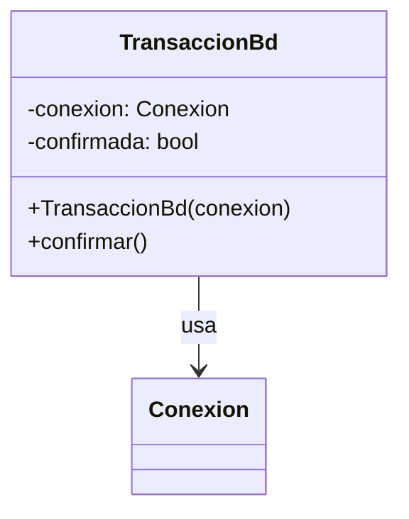
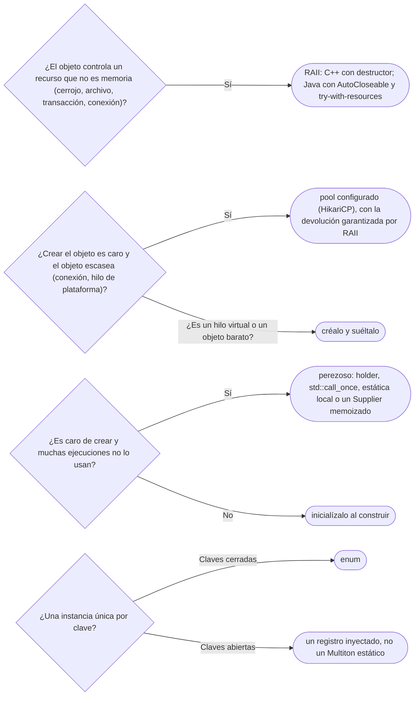

# 07 — Más allá del GoF

> Cuatro patrones creacionales que el GoF no nombra y que se usan todos los días: **RAII** (A), el dueño
> del patrón en el corpus; **Object Pool** (B); **Lazy Initialization** (B); y **Multiton** (C). Asume leído
> [`01/04` — Copia, ciclo de vida y recursos](../01-modelo-de-objetos/04-copia-ciclo-de-vida-y-recursos.md#7--raii-como-idea-y-lo-que-tiene-cada-lenguaje)
> (RAII como idea) y [`05` — Singleton](05-singleton.md).
>
> **Vigencia:** 2026-10-03.
>
> **Versiones ejecutadas:** GCC 14.4 (C++23) · JDK 21.0.12, 17.0.20 y 25.0.4 · mermaid-cli 11.17.0 (2026-10-04).

---

## 1. 🎯 El problema

Tres situaciones del servicio de cuentas que ninguno de los cinco creacionales del GoF resuelve:

- Una transferencia abre una transacción en la base de datos y toma el cerrojo de las dos cuentas. Si
  `debitar` lanza `SaldoInsuficienteException`, alguien tiene que hacer *rollback* y soltar el cerrojo,
  **en todos los caminos de salida**.
- Abrir una conexión a la base cuesta una conexión TCP, un saludo TLS y una autenticación: decenas de
  milisegundos. Abrir una por petición pone ese costo en cada transferencia.
- El catálogo de plantillas de notificación tarda en cargarse y la mitad de los procesos —la importación
  nocturna, por ejemplo— nunca lo usa.

Son problemas de **ciclo de vida** —cuándo se adquiere, cuándo se libera, cuántas veces se crea—, y cada uno
tiene su patrón. El cuarto, el Multiton, aparece porque el Singleton tiene un primo con clave.

---

## 2. 🧱 RAII

**Problema.** Liberar un recurso en todos los caminos de salida —el normal, el `return` temprano, la
excepción— a mano es frágil: el código que se olvida de un camino no falla en las pruebas, falla en
producción cuando lanza algo raro.

```cpp
void transferir(Cuenta& origen, Cuenta& destino, Dinero monto) {
    origen.cerrojo().lock();
    origen.debitar(monto);           // si lanza, el cerrojo queda tomado para siempre
    destino.acreditar(monto);
    origen.cerrojo().unlock();
}
```

**Estructura.** Un objeto cuyo **constructor adquiere** el recurso y cuyo **destructor lo libera**. Como el
destructor de un objeto local corre siempre al salir de su ámbito, la liberación no depende de nadie. El
diagrama no muestra el destructor (Mermaid usa `~` para los genéricos), pero es la mitad del patrón.



**Código.** En C++, RAII es el idioma natural: la librería trae los guardianes y los propios se escriben en
diez líneas.

```cpp
class TransaccionBd {
public:
    explicit TransaccionBd(Conexion& c) : conexion_{c} { conexion_.ejecutar("BEGIN"); }
    void confirmar() { conexion_.ejecutar("COMMIT"); confirmada_ = true; }
    ~TransaccionBd() { if (!confirmada_) conexion_.ejecutar("ROLLBACK"); }   // nunca lanza
    TransaccionBd(const TransaccionBd&) = delete;
    TransaccionBd& operator=(const TransaccionBd&) = delete;
private:
    Conexion& conexion_;
    bool confirmada_ = false;
};

void transferir(Conexion& bd, Cuenta& origen, Cuenta& destino, Dinero monto) {
    std::scoped_lock cerrojos{origen.cerrojo(), destino.cerrojo()};   // los dos, sin interbloqueo
    TransaccionBd tx{bd};
    origen.debitar(monto);           // si lanza: ROLLBACK y los cerrojos se sueltan, en ese orden
    destino.acreditar(monto);
    tx.confirmar();
}
```

- Los objetos se destruyen en orden inverso: primero la transacción (con su *rollback* si no se confirmó),
  después los cerrojos. El orden de declaración **es** el orden de liberación.
- `std::scoped_lock` (C++17) toma varios cerrojos con un algoritmo que evita el interbloqueo entre dos
  transferencias cruzadas.

En Java no hay destructores deterministas; el patrón se escribe con `AutoCloseable` y `try-with-resources`,
y la diferencia es que **quien usa el objeto tiene que acordarse del `try`**:

```java
public final class TransaccionBd implements AutoCloseable {
    private final Connection conexion;
    private boolean confirmada;

    public TransaccionBd(Connection c) throws SQLException { conexion = c; c.setAutoCommit(false); }
    public void confirmar() throws SQLException { conexion.commit(); confirmada = true; }
    @Override public void close() throws SQLException { if (!confirmada) conexion.rollback(); }
}

try (var tx = new TransaccionBd(conexion)) {
    origen.debitar(monto);
    destino.acreditar(monto);
    tx.confirmar();
}   // close() corre aquí, también si debitar lanza
```

**Con qué se confunde.** Con `finally`, `using` de C#, `with` de Python y `defer` de Go, que atan la
liberación a un **ámbito** que escribe quien usa el recurso; RAII la ata al **objeto**, y viaja con él. Y con
`Cleaner` de Java, que libera cuando el recolector reclama el objeto: una red de seguridad sin momento
garantizado, no RAII.

**La sobregeneralización.** "RAII es solo para memoria" confunde el ejemplo más famoso (`unique_ptr`) con el
patrón. La memoria es el caso **menos** interesante, porque es el único que un recolector ya gestiona: RAII
importa sobre todo para lo demás.

**Dónde aparece.** `std::unique_ptr` (memoria), `std::lock_guard` y `std::scoped_lock` (cerrojos),
`std::fstream` (archivos), `std::jthread` (hilos que se unen al destruirse). En Java, todo `AutoCloseable`:
`Connection`, `InputStream`, `ExecutorService` desde Java 19.

**Cuándo no.** En Java, cuando el recurso vive más que un bloque —una conexión guardada en un campo y usada
por varios métodos—: entonces su dueño tiene que ser `AutoCloseable` también, y alguien más arriba cierra
al dueño. Y nunca con un destructor que pueda lanzar: en C++, una excepción saliendo de un destructor durante
otra excepción termina el programa.

> **Veredicto:** todo recurso que no sea memoria del recolector —cerrojo, transacción, archivo, conexión—
> tiene un objeto dueño que lo libera. En C++ el destructor lo hace solo; en Java, `try-with-resources`
> sobre `AutoCloseable`, sin excepciones a la regla.

---

## 3. 🧱 Object Pool

**Problema.** Crear ciertos objetos cuesta mucho más que usarlos: una conexión a la base de datos, un hilo
de plataforma, un *buffer* grande. Crear uno por petición pone ese costo en cada petición.

**Mecanismo.** Un objeto mantiene un conjunto de instancias ya creadas; quien necesita una la **toma
prestada** y la **devuelve** al terminar, en lugar de crearla y destruirla. El pool decide cuántas crear,
cuántas como máximo y qué hacer cuando no queda ninguna (esperar, fallar, crear una más).

**Código.** En Java casi nunca se escribe: se configura. El pool de conexiones más usado detrás de Spring Boot
es HikariCP, y se usa a través de `DataSource`, donde `close()` **no cierra**: devuelve al pool.

```java
try (Connection c = fuenteDatos.getConnection();          // toma prestada una conexión ya abierta
     var tx = new TransaccionBd(c)) {
    // ... la transferencia
    tx.confirmar();
}                                                         // c.close() la devuelve al pool, no la cierra
```

- RAII y pool se combinan: el préstamo es un recurso, y `try-with-resources` garantiza la devolución. Un
  préstamo sin devolución es la **fuga de conexiones**, y el síntoma es un pool agotado bajo carga.

En C++ el contraste natural es un `unique_ptr` con un borrador propio que devuelve en lugar de borrar:

```cpp
class PoolConexiones {
public:
    using Prestamo = std::unique_ptr<Conexion, std::function<void(Conexion*)>>;
    Prestamo tomar() {
        std::scoped_lock l{m_};
        Conexion* c = libres_.back(); libres_.pop_back();    // sin control de vacío: el ejemplo es mínimo
        return Prestamo{c, [this](Conexion* x) { std::scoped_lock l{m_}; libres_.push_back(x); }};
    }
private:
    std::mutex m_;
    std::vector<Conexion*> libres_;     // las conexiones las posee el pool, en otro contenedor
};
```

**Cuándo sí y cuándo no.** Sí para lo que es **caro de crear y escaso**: conexiones, hilos de plataforma. No
para objetos baratos: en la JVM una asignación pequeña es poco más que mover un puntero en el área local
del hilo, y el recolector de generaciones está hecho para objetos de vida corta, así que un pool de `Movimiento` o de `StringBuilder`
añade sincronización, estado que hay que limpiar al devolver y fugas posibles, a cambio de nada. Y **nunca
para hilos virtuales**: la JEP 444 dice que son baratos y abundantes, y que no deben agruparse en pools; se
crea uno por tarea. Lo que limitaba el pool de hilos —cuántas peticiones a la vez contra la base— se limita
entonces con un semáforo o con el tamaño del pool de conexiones.

> **Veredicto:** un pool para lo caro y escaso, configurado y no escrito, y siempre con la devolución
> garantizada por RAII. Para objetos baratos o hilos virtuales, crear y soltar.

---

## 4. 🧱 Lazy Initialization

**Problema.** El catálogo de plantillas tarda en cargarse, y la mitad de los procesos no lo usa. Cargarlo
siempre al arrancar paga un costo que muchos no necesitan.

**Mecanismo.** Crear el objeto **la primera vez que se pide**, y guardar el resultado para las siguientes. La
dificultad es solo una: que dos hilos que piden a la vez no lo creen dos veces ni vean uno a medias.

**Código.** En Java, para un estático, el holder del capítulo anterior (ver [`05` §5](05-singleton.md#5--java)).
Para un campo de instancia, un `Supplier` memoizado:

```java
public final class Perezoso<T> implements Supplier<T> {
    private final Supplier<T> fabrica;
    private volatile T valor;                       // volatile: la publicación segura del valor

    public Perezoso(Supplier<T> fabrica) { this.fabrica = fabrica; }

    @Override public T get() {
        T v = valor;
        if (v == null) {
            synchronized (this) {
                v = valor;
                if (v == null) valor = v = fabrica.get();
            }
        }
        return v;
    }
}

private final Perezoso<CatalogoPlantillas> plantillas = new Perezoso<>(() -> CatalogoPlantillas.cargar(fuente));
```

- Es un *double-checked locking* bien escrito: el campo es `volatile`, se lee una vez en una variable
  local y se comprueba dos veces. El mecanismo y sus trampas son de [`10/06`](../10-concurrencia/06-inicializacion-perezosa-segura.md).

En C++, la estática local del Meyers singleton para un valor global, y `std::call_once` con un
`std::once_flag` para un miembro:

```cpp
const CatalogoPlantillas& ServicioAvisos::plantillas() const {
    std::call_once(cargadas_, [this] { plantillas_ = CatalogoPlantillas::cargar(fuente_); });
    return *plantillas_;                            // plantillas_ es un std::optional mutable
}
```

**Cuándo sí y cuándo no.** Sí cuando el objeto es caro **y** muchas ejecuciones no lo usan. No en lo demás:
Bloch (ítem 83) dice que, en la mayoría de los casos, la inicialización normal es preferible a la perezosa.
El costo se mueve del arranque a la primera petición, que es la que el usuario ve; los errores de carga
aparecen tarde, en mitad del trabajo; y cada acceso paga una comprobación. Y la carga perezosa de JPA —las
asociaciones `LAZY` que se cargan al recorrerlas— es este patrón implementado con un Proxy (ver
[`05/03`](../05-estructurales/03-proxy.md)), con su
`LazyInitializationException` cuando se recorre fuera de la sesión: ver
[`07/03`](../07-fowler-dominio-y-datos/03-comportamiento-objeto-relacional.md#4--lazy-load).

> **Veredicto:** inicializa al construir, y difiere solo lo que es caro y a menudo no se usa. Si difieres,
> usa el holder, `std::call_once` o la estática local, nunca un `if (x == null)` a pelo.

---

## 5. 🧱 Multiton

**Intención.** Una instancia **por clave**, y solo una: el Singleton generalizado a un registro de
instancias únicas. El GoF lo menciona de pasada, cuando dice que el Singleton puede controlar un número
variable de instancias.

**Ejemplo mínimo.** El JDK lo usa en `Currency`: su Javadoc dice que nunca hay más de una instancia por
moneda, y por eso no tiene constructor público.

```java
Currency cop = Currency.getInstance("COP");
boolean misma = cop == Currency.getInstance("COP");   // → true: una instancia por código
```

**Por qué hoy es raro.** Es estado global por clave: tiene todos los problemas del Singleton (acceso
estático, imposible de sustituir en un test, vive lo que vive el cargador de clases), multiplicados por el
número de claves y con el mapa compartido entre hilos.

**Qué lo reemplazó.** Para un conjunto **cerrado** de claves, un `enum`: cada constante es la instancia
única de su clave, sin mapa ni sincronización (ver [`01/03` §7](../01-modelo-de-objetos/03-inmutabilidad-y-objetos-especiales.md#7--enums-objetos-con-identidad-garantizada)).
Para un conjunto **abierto** —los tipos de documento, que crecen sin recompilar—, un registro normal creado
en la raíz de composición e inyectado: `CatalogoTipos` con su `deCodigo`, sin nada estático.

---

## 6. 🧭 Cómo se elige



**La frase en voz alta:** *"RAII no es para memoria: es para todo lo que hay que soltar. Y antes de un pool o
de algo perezoso, pregunto si crear el objeto de verdad es caro; casi nunca lo es, salvo conexiones e hilos
de plataforma."*

---

## ⚠️ Errores frecuentes

| Se dice | Lo preciso |
|---|---|
| "RAII es solo para memoria" | Es para cualquier recurso; la memoria es el caso menos interesante, porque el recolector ya la gestiona |
| "`try-with-resources` es RAII" | Es su aproximación por ámbito: la liberación depende de que quien usa el objeto escriba el `try` |
| "`Cleaner` o `finalize` cierran los recursos" | Corren cuando el recolector quiere, o nunca; son una red de seguridad, no un cierre |
| "Un pool siempre mejora el rendimiento" | Solo para objetos caros y escasos; para los baratos añade sincronización y fugas, y los hilos virtuales no se agrupan |
| "Cerrar una conexión de un pool la cierra" | La devuelve al pool; no devolverla es la fuga de conexiones |
| "Lo perezoso es más eficiente" | Mueve el costo a la primera petición y los errores a mitad del trabajo; Bloch lo desaconseja por defecto |
| "Multiton es una buena forma de cachear por clave" | Es estado global por clave; para claves cerradas, un enum; para abiertas, un registro inyectado |

---

## 📚 Para profundizar

- **Libro** — Stroustrup, *A Tour of C++*, 3.ª ed. (Addison-Wesley, 2022), cap. 5, "Classes", y cap. 6,
  "Essential Operations": constructores y destructores como gestión de recursos. **El que destaca** para
  RAII.
- **Libro** — Bloch, *Effective Java*, 3.ª ed. (Addison-Wesley, 2018), ítem 9, "Prefer try-with-resources to
  try-finally", ítem 8, "Avoid finalizers and cleaners", e ítem 83, "Use lazy initialization judiciously".
- **Libro** — Nystrom, *Game Programming Patterns* (2014), cap. "Object Pool", libre en
  [su sitio](https://gameprogrammingpatterns.com/object-pool.html): cuándo un pool compensa.
- [C++ Core Guidelines — R.1](https://isocpp.github.io/CppCoreGuidelines/CppCoreGuidelines#r1-manage-resources-automatically-using-resource-handles-and-raii-resource-acquisition-is-initialization):
  gestionar los recursos automáticamente con RAII.
- [cppreference — `std::call_once`](https://en.cppreference.com/cpp/thread/call_once): la inicialización
  única de un miembro entre hilos.
- [JEP 444 — Virtual Threads](https://openjdk.org/jeps/444): por qué los hilos virtuales no se agrupan en
  pools.
- [Java 21 API — `Currency`](https://docs.oracle.com/en/java/javase/21/docs/api/java.base/java/util/Currency.html):
  un Multiton del JDK.

---

## 🧠 Preguntas

Sin respuestas aquí. Todas, con enunciado literal y respuesta en tres capas, en
[`09` — Respuestas](09-respuestas.md#07--más-allá-del-gof).

1. ¿Qué es RAII? 🟢
2. ¿Qué es un Object Pool? 🟢
3. ¿Qué es la inicialización perezosa? 🟢
4. ¿Qué es un Multiton, y qué ejemplo tiene el JDK? 🟢
5. ¿Qué hace `std::scoped_lock` que no hace `std::lock_guard`? 🟢
6. ¿Qué diferencia hay entre RAII en C++ y `try-with-resources` en Java? 🟡
7. ¿Qué diferencia hay entre RAII y `Cleaner`? 🟡
8. ¿Qué diferencia hay entre un Multiton y un `enum`? 🟡
9. ¿Qué diferencia hay entre un holder y un `Supplier` memoizado para inicializar algo perezosamente? 🟡
10. ¿Por qué "RAII es solo para memoria" es falso? 🟠
11. ¿Por qué no se deben agrupar en un pool los hilos virtuales? 🟠
12. ¿Cuándo un Object Pool empeora el rendimiento? 🟠
13. ¿Por qué Bloch desaconseja la inicialización perezosa por defecto? 🟠
14. ¿Por qué un destructor de C++ no debe lanzar? 🟠
15. Escribe en Java una `TransaccionBd` que haga *rollback* si no se confirmó, y úsala en una
    transferencia. 🔴
16. Revisa este código y di qué falla: `Connection c = fuenteDatos.getConnection();
    c.prepareStatement(sql).executeUpdate(); c.close();`. 🔴
17. Escribe en C++ el acceso perezoso a un miembro con `std::call_once`. 🔴
18. Un compañero propone un pool de objetos `Movimiento` "para no crear tanta basura". Revísalo. 🔴

---

**Anterior:** [`06` — Contenedores de inyección e IoC](06-inyeccion-de-dependencias-e-ioc.md) ·
**Siguiente:** [`08` — Simulación de entrevista](08-simulacion-de-entrevista.md) ·
**Relacionado:** [`01/04` — Copia, ciclo de vida y recursos](../01-modelo-de-objetos/04-copia-ciclo-de-vida-y-recursos.md)
