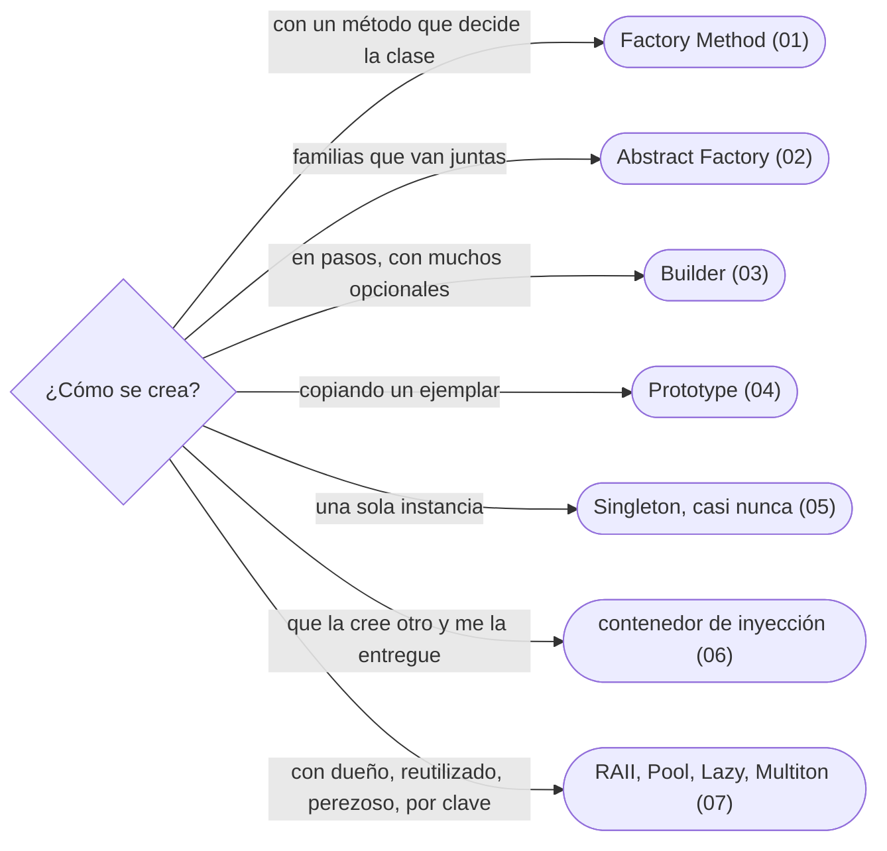

# 04 — Patrones creacionales

> Cómo nace un objeto cuando un `new` no basta: fábricas, Builder, Prototype, el Singleton y por qué casi nunca, el contenedor de inyección, y los creacionales que el GoF no nombra (RAII, Object Pool, Lazy Initialization, Multiton).
>
> **Vigencia:** 2026-10-03.

---

## 1. 🗺️ Índice

| | Documento | Tipo |
|---|---|---|
| [`01`](01-factory-method.md) | Factory Method y fábricas estáticas | Capítulo |
| [`02`](02-abstract-factory.md) | Abstract Factory | Capítulo |
| [`03`](03-builder.md) | Builder | Capítulo |
| [`04`](04-prototype.md) | Prototype | Capítulo |
| [`05`](05-singleton.md) | Singleton, y por qué casi nunca | Capítulo |
| [`06`](06-inyeccion-de-dependencias-e-ioc.md) | Contenedores de inyección e IoC | Capítulo |
| [`07`](07-mas-alla-del-gof.md) | Más allá del GoF | Capítulo |
| [`08`](08-simulacion-de-entrevista.md) | Simulación de entrevista | Simulación |
| [`09`](09-respuestas.md) | Respuestas | Solucionario |

**Orden de lectura.** En orden numérico. `05` y `06` van juntos: el problema del Singleton y la salida del contenedor. Al terminar los capítulos, la simulación con cronómetro, y solo después el solucionario.

---

## 2. 🧠 Mapa mental

---

## 3. 🏷️ Niveles de los patrones

A: se escribe y se defiende en la entrevista · B: se reconoce y se explica · C: ficha corta, con lo que lo reemplazó.

| Patrón | Nivel | Capítulo |
|---|---|---|
| Factory Method | A | [`01`](01-factory-method.md) |
| Abstract Factory | B | [`02`](02-abstract-factory.md) |
| Builder | A | [`03`](03-builder.md) |
| Prototype | B | [`04`](04-prototype.md) |
| Singleton | A | [`05`](05-singleton.md) |
| Contenedor de inyección e IoC | A | [`06`](06-inyeccion-de-dependencias-e-ioc.md) |
| RAII | A | [`07`](07-mas-alla-del-gof.md) |
| Object Pool | B | [`07`](07-mas-alla-del-gof.md) |
| Lazy Initialization | B | [`07`](07-mas-alla-del-gof.md) |
| Multiton | C | [`07`](07-mas-alla-del-gof.md) |

---

## 4. 🚫 Qué NO está aquí

El Double-Checked Locking y la inicialización perezosa entre hilos (`10/06`); el Type Object como alternativa a las subclases (`09/03`).

---

**Versiones ejecutadas:** GCC 14.4 (C++23) · JDK 21.0.12, 17.0.20 y 25.0.4 · .NET 10.0.12 (C# 14) · mermaid-cli 11.17.0 · Spring Boot 4.1.1 (Spring Framework 7.0.9, Hibernate 7.4.5, H2 2.4.240) (2026-10-04).

---

**Anterior:** [`03` — Principios de diseño](../03-principios-de-diseno/README.md) ·
**Corpus:** [README](../README.md) ·
**Siguiente:** [`05` — Patrones estructurales](../05-estructurales/README.md)
