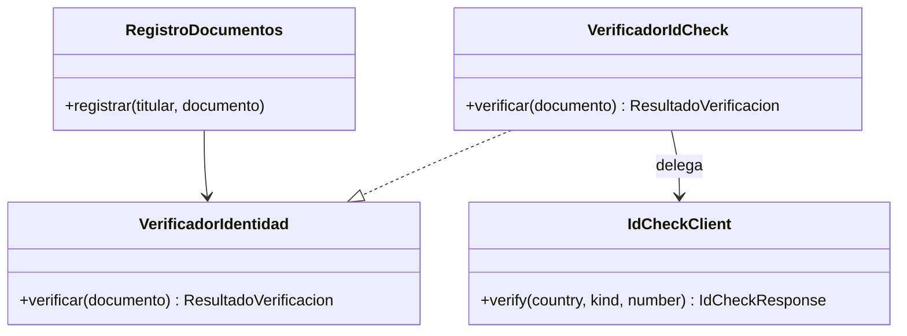
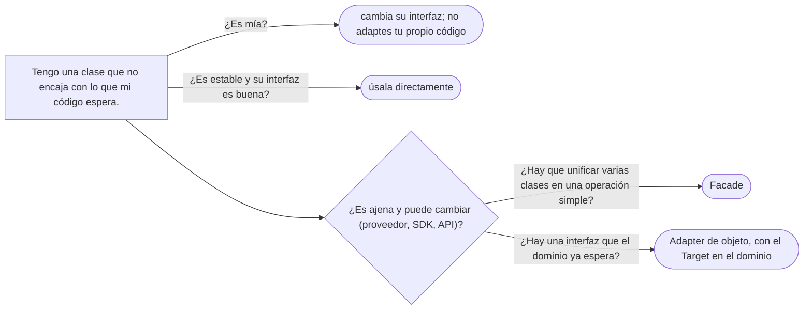

# 01 — Adapter

> Adaptar la interfaz de un componente ajeno a la que tu código espera, **sin que la ajena se filtre al
> dominio**; distinguir el adaptador de objeto del de clase; y reconocer los adaptadores que ya usas en el
> JDK. **Nivel: A.** Asume leído [`03/02` — SOLID sin catecismo](../03-principios-de-diseno/02-solid-sin-catecismo.md#6--dip-la-dependencia-apunta-a-la-política)
> (DIP).
>
> **Vigencia:** 2026-10-03.
>
> **Versiones ejecutadas:** GCC 14.4 (C++23) · JDK 21.0.12, 17.0.20 y 25.0.4 · mermaid-cli 11.17.0 (2026-10-04).

---

## 1. 🎯 El problema

Antes de registrar un documento, el sistema lo verifica contra un proveedor externo de verificación de
identidad. El proveedor da un SDK con su propia forma de ver el mundo:

```java
// no compila: firmas del SDK del proveedor, sin cuerpos; no se puede cambiar
public class IdCheckClient {
    public IdCheckResponse verify(String countryIso2, String docKind, String docNumber) throws IdCheckException;
}
public class IdCheckResponse {
    public int getStatus();          // 0 = válido, 1 = no encontrado, 2 = revocado, 9 = error interno
    public String getHolderName();
}
```

Y el servicio de registro lo usa tal cual:

```java
public void registrar(Persona titular, Documento d) {
    String tipo = switch (d.tipo().codigo()) {                    // traducir nuestros códigos a los suyos
        case "CC" -> "NATIONAL_ID";
        case "TI" -> "MINOR_ID";
        default   -> "PASSPORT";
    };
    try {
        IdCheckResponse r = idCheck.verify(d.emisor().codigoIso(), tipo, d.numero());
        if (r.getStatus() != 0) throw new DocumentoNoVerificadoException(d);
    } catch (IdCheckException e) {
        throw new IllegalStateException(e);
    }
    titular.agregarDocumento(d);
}
```

- El dominio conoce los códigos del proveedor (`"NATIONAL_ID"`), su número mágico de estado (`0`), su
  excepción y su clase de respuesta. Si mañana se cambia de proveedor, se toca la lógica de registro.
- Y no se puede probar el registro sin el SDK, porque `IdCheckClient` es una clase concreta de un tercero.

Lo que el dominio quiere es una pregunta en sus propios términos: "¿este documento es auténtico?". Alguien
tiene que traducir. Ese alguien es el adaptador.

---

## 2. 📐 La estructura

**La intención, en una frase del GoF:** convertir la interfaz de una clase en otra interfaz que los
clientes esperan, para que trabajen juntas clases que de otro modo no podrían por tener interfaces
incompatibles.



- **Target** (`VerificadorIdentidad`): la interfaz que el cliente espera, escrita **en el idioma del
  dominio**. Es una interfaz.
- **Client** (`RegistroDocumentos`): solo conoce el Target.
- **Adaptee** (`IdCheckClient`): la clase ajena, que no se puede o no se quiere cambiar.
- **Adapter** (`VerificadorIdCheck`): implementa el Target y por dentro llama al Adaptee, traduciendo
  nombres, códigos, unidades, excepciones y resultados.

Que la interfaz la defina el dominio y el adaptador viva en la infraestructura es DIP aplicado: la flecha va
de lo volátil (el proveedor) hacia lo estable (la pregunta del negocio).

---

## 3. 🏛️ Cómo nació

El GoF presenta dos variantes. La que más le interesaba en C++98 era el **adaptador de clase**, que usa
herencia múltiple: hereda públicamente la interfaz del Target y en privado la implementación del Adaptee.

```cpp
class VerificadorIdentidad {
public:
    virtual ~VerificadorIdentidad() {}
    virtual bool esAutentico(const Documento& d) = 0;
};

class VerificadorIdCheck : public VerificadorIdentidad, private IdCheckClient {   // adaptador de clase
public:
    bool esAutentico(const Documento& d) {
        IdCheckResponse r = verify(d.emisor().codigoIso(), tipoProveedor(d), d.numero());
        return r.getStatus() == 0;
    }
};
```

- La herencia privada dice "lo uso para implementarme, no soy uno": nadie de fuera ve los métodos del
  proveedor a través del adaptador.
- El adaptador **es** un `IdCheckClient`, así que no puede adaptar otra instancia ni una subclase del
  cliente; y puede sobrescribir métodos virtuales del Adaptee, que es la única ventaja de la variante.

---

## 4. 💻 C++ moderno

Hoy casi siempre se escribe el **adaptador de objeto**, por composición: el adaptador contiene al Adaptee
en lugar de heredar de él.

```cpp
struct ResultadoVerificacion { bool autentico; std::string motivo; };

class VerificadorIdentidad {
public:
    virtual ~VerificadorIdentidad() = default;
    virtual ResultadoVerificacion verificar(const Documento& d) = 0;
};

class VerificadorIdCheck final : public VerificadorIdentidad {
public:
    explicit VerificadorIdCheck(IdCheckClient& cliente) : cliente_{cliente} {}   // no lo posee
    ResultadoVerificacion verificar(const Documento& d) override {
        try {
            auto r = cliente_.verify(d.emisor().codigoIso(), tipoProveedor(d), d.numero());
            switch (r.getStatus()) {
                case 0:  return {true,  ""};
                case 2:  return {false, "documento revocado"};
                default: return {false, "no encontrado o error del proveedor"};
            }
        } catch (const IdCheckException& e) {
            throw ProveedorNoDisponible{e.what()};     // la excepción ajena no cruza el borde
        }
    }
private:
    IdCheckClient& cliente_;
    static std::string tipoProveedor(const Documento& d);   // "CC" → "NATIONAL_ID", …
};
```

- La traducción completa vive aquí: códigos, estados mágicos, excepción. El dominio ve
  `ResultadoVerificacion` y `ProveedorNoDisponible`, dos tipos suyos.
- La referencia dice que el adaptador **no posee** al cliente: el cliente del SDK, con sus conexiones, lo
  crea y lo destruye la raíz de composición. Si el adaptador fuera su dueño, sería un `std::unique_ptr`.

Cuando el Target es de una sola operación, el adaptador puede ser una lambda guardada en un
`std::function<ResultadoVerificacion(const Documento&)>`, sin clase ninguna.

---

## 5. 💻 Java

En Java, el adaptador de clase solo funciona si el Target es una interfaz (se hereda de una clase y se
implementan interfaces), y aun así expone los métodos públicos del Adaptee. El de objeto es el normal:

```java
public final class VerificadorIdCheck implements VerificadorIdentidad {
    private static final Map<String, String> TIPOS = Map.of(
            "CC", "NATIONAL_ID", "TI", "MINOR_ID", "PAS-CO", "PASSPORT", "PAS-MX", "PASSPORT");
    private final IdCheckClient cliente;

    public VerificadorIdCheck(IdCheckClient cliente) { this.cliente = cliente; }

    @Override
    public ResultadoVerificacion verificar(Documento d) {
        try {
            IdCheckResponse r = cliente.verify(d.emisor().codigoIso(), TIPOS.get(d.tipo().codigo()), d.numero());
            return switch (r.getStatus()) {
                case 0  -> ResultadoVerificacion.autentico();
                case 2  -> ResultadoVerificacion.rechazado("documento revocado");
                default -> ResultadoVerificacion.rechazado("no encontrado o error del proveedor");
            };
        } catch (IdCheckException e) {
            throw new ProveedorNoDisponibleException(e);
        }
    }
}

// el servicio, ya en el idioma del dominio
public void registrar(Persona titular, Documento d) {
    if (!verificador.verificar(d).esAutentico()) throw new DocumentoNoVerificadoException(d);
    titular.agregarDocumento(d);
}
```

- `RegistroDocumentos` ya no importa nada del SDK. Cambiar de proveedor es escribir otro adaptador; probar el
  registro es pasarle un `VerificadorIdentidad` falso que devuelve lo que el test necesita.
- El `switch` que devuelve un valor con `->` es de Java 14, así que vale en 17 y 21.

---

## 6. 🔀 Variantes

- **Adaptador de objeto y de clase.** El de objeto compone y puede adaptar cualquier instancia (incluso
  subclases del Adaptee); el de clase hereda, y solo tiene sentido en C++ o cuando hay que sobrescribir
  algo del Adaptee.
- **Adaptador bidireccional.** Implementa las dos interfaces para que las dos partes se vean entre sí. Raro,
  y suele indicar que falta una tercera abstracción.
- **El adaptador como puerto.** En una arquitectura de puertos y adaptadores (hexagonal), cada adaptador de
  infraestructura —base de datos, API externa, cola— es este patrón: el puerto es el Target que define el
  dominio.
- **En Go** el adaptador a menudo sobra, porque las interfaces se satisfacen implícitamente: si el tipo
  ajeno ya tiene los métodos, cumple la interfaz sin declararlo. Tiene su sitio en
  [`11/01`](../11-los-diferentes/01-go.md).

---

## 7. ⚖️ Con qué se confunde

| Se confunde con | La diferencia, en una frase |
|---|---|
| **Facade** | El Adapter **convierte** una interfaz en otra que ya existe y se espera; la Facade **crea** una interfaz nueva y más simple sobre varias clases (ver [`04` — Facade](04-facade.md)) |
| **Decorator** | El Decorator conserva la misma interfaz y **añade** comportamiento; el Adapter cambia la interfaz (ver [`02` — Decorator](02-decorator.md)) |
| **Proxy** | El Proxy conserva la misma interfaz y **controla el acceso** (ver [`03` — Proxy](03-proxy.md), dueño de la distinción) |
| **Bridge** | El Bridge separa una abstracción de su implementación **por diseño, de antemano**; el Adapter une dos cosas que ya existen y no encajan (ver [`06` — Bridge](06-bridge.md)) |

**La sobregeneralización.** "Adapter y Facade son lo mismo" nace de que los dos envuelven código ajeno. La
diferencia es la dirección: el Adapter parte de una interfaz que **ya existe** (la que el cliente espera) y
hace encajar una clase; la Facade inventa una interfaz **nueva** para un subsistema. Y un adaptador suele
envolver un objeto; una fachada, varios.

---

## 8. 🔭 Dónde aparece de verdad

- **`Arrays.asList(arreglo)`** adapta un arreglo a la interfaz `List`: la Javadoc dice que devuelve una
  lista de tamaño fijo **respaldada** por el arreglo. Es un adaptador de objeto puro: los cambios en uno se
  ven en el otro, y `add` lanza `UnsupportedOperationException` porque un arreglo no crece.
- **`InputStreamReader`** adapta un `InputStream` (bytes) a un `Reader` (caracteres), decodificando con un
  *charset*; su Javadoc lo llama "un puente de flujos de bytes a flujos de caracteres".
- **`Collections.enumeration`** y `Enumeration.asIterator()` adaptan entre las dos interfaces de iteración
  del JDK, la vieja y la nueva.
- **En Spring**, los `HandlerAdapter` de Spring MVC adaptan cada tipo de controlador a una interfaz común que
  el `DispatcherServlet` sabe llamar.
- **En C++**, `std::stack` y `std::queue` se llaman literalmente *container adaptors*: dan otra interfaz a un
  `std::deque` o un `std::vector`.

---

## 9. 🏷️ Lo que cuesta, y cuándo no

**El precio**, en las cuatro monedas:

- **Indirección:** una interfaz y una clase más por cada dependencia externa, y un salto más al depurar
  ("¿qué devolvió de verdad el proveedor?").
- **Acoplamiento:** el adaptador concentra **todo** el acoplamiento al proveedor. Es el precio que se quiere
  pagar, pero hay que pagarlo bien: si la traducción es incompleta (una excepción del SDK que se escapa, un
  tipo del SDK en la firma del Target), el acoplamiento se filtra igual.
- **Legibilidad:** buena si el Target está en el idioma del dominio; mala si el Target copia los métodos del
  proveedor con otros nombres, porque entonces solo se añadió una capa.
- **Rendimiento:** una llamada y, a veces, una conversión de datos por invocación. Irrelevante frente a la
  latencia de una llamada remota.

**Cuándo no.**

- **Cuando la librería ajena ya habla tu idioma.** Envolver `java.time` o `std::vector` "por si acaso" es
  ceremonia: son estables y su interfaz es buena.
- **Cuando el Target es un espejo del Adaptee.** Un `IVerificadorIdCheck` con los mismos tres parámetros y
  el mismo entero de estado no protege nada.
- **Dentro de tu propio código.** Si las dos interfaces son tuyas y no encajan, cambia una de las dos. El
  Adapter es para lo que no puedes cambiar.

> **Veredicto:** un adaptador por cada dependencia externa que no controlas y que puede cambiar, con el
> Target escrito en el idioma del dominio y la traducción completa —también las excepciones— dentro. Para
> lo que es tuyo o es estable, no.

---

## 10. 🧭 Cómo se elige



**La frase en voz alta:** *"El dominio define la pregunta en sus términos —¿este documento es auténtico?— y un
adaptador en la infraestructura la traduce al SDK del proveedor, con sus códigos y sus excepciones. Si cambio
de proveedor, cambio el adaptador."*

---

## ⚠️ Errores frecuentes

| Se dice | Lo preciso |
|---|---|
| "Adapter y Facade son lo mismo" | El Adapter hace encajar una clase en una interfaz que ya existe; la Facade crea una interfaz nueva y simple para un subsistema |
| "Un adaptador es un *wrapper* cualquiera" | Envuelve para **cambiar la interfaz**; el que envuelve con la misma interfaz es un Decorator o un Proxy |
| "Basta con renombrar los métodos del proveedor" | Si los tipos, códigos y excepciones del proveedor siguen cruzando, el dominio sigue acoplado |
| "El adaptador de clase es el habitual" | En C++ moderno y en Java se usa el de objeto; el de clase hereda y queda atado a una sola clase |
| "`Arrays.asList` copia el arreglo" | Lo adapta: la lista está respaldada por el arreglo y no puede crecer |
| "Hay que adaptar todas las librerías" | Solo las ajenas que pueden cambiar; envolver lo estable es ceremonia |

---

## 📚 Para profundizar

- **Libro** — Gamma, Helm, Johnson y Vlissides, *Design Patterns* (Addison-Wesley, 1994), cap. 4,
  "Structural Patterns", sección "Adapter": adaptador de clase y de objeto, y los adaptadores "enchufables".
  **El que destaca.**
- **Libro** — Freeman y Robson, *Head First Design Patterns*, 2.ª ed. (O'Reilly, 2021), cap. 7, "The Adapter
  and Facade Patterns": los dos juntos, con la diferencia.
- **Libro** — Iglberger, *C++ Software Design* (O'Reilly, 2022), cap. 6, "The Adapter, Observer, and CRTP
  Design Patterns": el adaptador en C++ moderno, también sin herencia.
- [Java 21 API — `Arrays.asList`](https://docs.oracle.com/en/java/javase/21/docs/api/java.base/java/util/Arrays.html):
  la lista de tamaño fijo respaldada por el arreglo.
- [Java 21 API — `InputStreamReader`](https://docs.oracle.com/en/java/javase/21/docs/api/java.base/java/io/InputStreamReader.html):
  de bytes a caracteres.
- **Tutorial** — [Refactoring Guru — Adapter](https://refactoring.guru/design-patterns/adapter): las dos
  variantes con diagramas.

---

## 🧠 Preguntas

Sin respuestas aquí. Todas, con enunciado literal y respuesta en tres capas, en
[`09` — Respuestas](09-respuestas.md#01--adapter).

1. ¿Cuál es la intención del Adapter? 🟢
2. ¿Cuáles son los participantes del Adapter, y cuál define el dominio? 🟢
3. ¿Qué hace `Arrays.asList`, y por qué es un adaptador? 🟢
4. ¿Qué es un *container adaptor* de la STL? 🟢
5. ¿Qué diferencia hay entre adaptador de objeto y adaptador de clase? 🟡
6. ¿Qué diferencia hay entre Adapter y Facade? 🟡
7. ¿Qué diferencia hay entre Adapter y Decorator? 🟡
8. ¿Qué cambia en el adaptador de clase entre C++ y Java? 🟡
9. ¿Por qué el Target lo define el dominio y no el proveedor? 🟠
10. ¿Por qué un adaptador que deja pasar la excepción del proveedor no cumple su función? 🟠
11. ¿Cuándo un adaptador es ceremonia? 🟠
12. ¿Qué relación hay entre el Adapter y la arquitectura de puertos y adaptadores? 🟠
13. Escribe en Java el adaptador de `IdCheckClient` a `VerificadorIdentidad`, con la traducción de estados y
    de excepciones. 🔴
14. Revisa esta interfaz y di qué falla: `interface VerificadorIdentidad { IdCheckResponse verify(String
    iso2, String kind, String number) throws IdCheckException; }`. 🔴

---

**Anterior:** [`04/08` — Simulación de entrevista](../04-creacionales/08-simulacion-de-entrevista.md) ·
**Siguiente:** [`02` — Decorator](02-decorator.md) ·
**Relacionado:** [`03` — Proxy, y los tres que se confunden](03-proxy.md)
