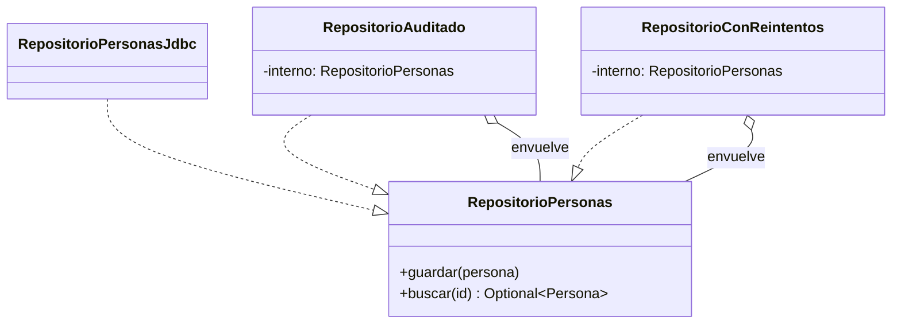
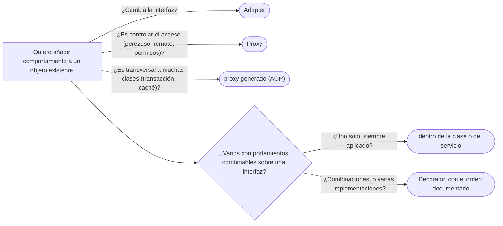

# 02 — Decorator

> Añadir comportamiento a un objeto **componiendo envoltorios** con su misma interfaz, en lugar de
> multiplicar subclases; reconocerlo en `java.io` y en las vistas de `Collections`; y decir lo que cuesta:
> una clase por comportamiento, el orden de composición y la identidad rota. **Nivel: A.** Se lee suelto; lo
> que asume, en el recordatorio de §1. Para profundizar:
> [`01/06` — Herencia vertical y horizontal](../01-modelo-de-objetos/06-herencia-vertical-y-horizontal.md)
> (composición antes que herencia).
>
> **Vigencia:** 2026-10-03.
>
> **Versiones ejecutadas:** GCC 14.4 (C++23) · JDK 21.0.12, 17.0.20 y 25.0.4 · mermaid-cli 11.17.0 (2026-10-04).

---

## 1. 🎯 El problema

**Recordatorio de lo que se asume.** **Componer** es que un objeto tenga a otro como campo y le delegue
trabajo; **heredar** es que una clase extienda a otra y reciba su implementación. La herencia se fija al
compilar y en una sola dimensión; la composición se arma al ejecutar y se combina libremente. Una
**interfaz** define qué operaciones ofrece un objeto sin decir cómo.

El repositorio de personas guarda y busca en la base de datos. Ahora hace falta **auditar** cada escritura y
**reintentar** cuando la base devuelve un error transitorio. La primera solución es heredar:

```java
class RepositorioPersonasJdbc implements RepositorioPersonas { /* ... */ }
class RepositorioPersonasAuditado extends RepositorioPersonasJdbc { /* guardar(): registra y llama a super */ }
class RepositorioPersonasConReintentos extends RepositorioPersonasJdbc { /* reintenta super.guardar() */ }
class RepositorioPersonasAuditadoConReintentos extends RepositorioPersonasJdbc { /* las dos cosas, copiadas */ }
```

- Dos comportamientos dan **cuatro** clases; con un tercero (métricas), ocho. Es la explosión combinatoria
  de la herencia: cada combinación es una clase.
- Y cada comportamiento queda atado a la implementación JDBC: el repositorio en memoria de los tests no
  puede tener auditoría sin otra jerarquía paralela.

Lo que se quiere es poner auditoría y reintentos **alrededor** de cualquier repositorio, en el orden que
convenga, y combinarlos al arrancar. Eso es el Decorator.

---

## 2. 📐 La estructura

**La intención, en una frase del GoF:** asignar responsabilidades adicionales a un objeto dinámicamente;
los decoradores son una alternativa flexible a la herencia para extender funcionalidad.



- **Component** (`RepositorioPersonas`): la interfaz común. Es una interfaz.
- **Concrete Component** (`RepositorioPersonasJdbc`): el objeto que hace el trabajo de verdad.
- **Decorator** (`RepositorioAuditado`, `RepositorioConReintentos`): **implementa la misma interfaz** y
  **contiene** otro objeto de esa interfaz, al que delega; antes o después añade lo suyo.

Las dos cosas a la vez son la esencia: por **implementar** la interfaz, un decorador se puede usar donde se
usaba el original; por **contener** otro de la misma interfaz, se puede envolver a otro decorador, y así se
apilan.

---

## 3. 🏛️ Cómo nació

El GoF lo presenta con una ventana de texto a la que se le añaden un borde y una barra de desplazamiento. En
C++98, con una clase base `Decorator` que guarda un puntero y reenvía todo:

```cpp
class RepositorioPersonas {
public:
    virtual ~RepositorioPersonas() {}
    virtual void guardar(const Persona& p) = 0;
};

class DecoradorRepositorio : public RepositorioPersonas {      // reenvía todo por defecto
public:
    explicit DecoradorRepositorio(RepositorioPersonas* interno) : interno_(interno) {}
    void guardar(const Persona& p) { interno_->guardar(p); }
protected:
    RepositorioPersonas* interno_;                             // ¿quién lo borra?
};

class RepositorioAuditado : public DecoradorRepositorio {
public:
    RepositorioAuditado(RepositorioPersonas* interno, Auditoria* a) : DecoradorRepositorio(interno), aud_(a) {}
    void guardar(const Persona& p) { aud_->registrar("guardar " + p.nombre()); DecoradorRepositorio::guardar(p); }
private:
    Auditoria* aud_;
};
```

- La clase base de reenvío existe para que cada decorador sobrescriba solo lo que le interesa. Con una
  interfaz de diez métodos, sin ella cada decorador reescribiría diez reenvíos.
- La propiedad, de nuevo, es lo que el tiempo dejó mal: una pila de tres decoradores es una cadena de
  punteros crudos, y no queda claro quién destruye a quién.

---

## 4. 💻 C++ moderno

Cada decorador **posee** lo que envuelve, con `std::unique_ptr`, y la pila se destruye en cadena sola:

```cpp
class RepositorioAuditado final : public RepositorioPersonas {
public:
    RepositorioAuditado(std::unique_ptr<RepositorioPersonas> interno, Auditoria& aud)
        : interno_{std::move(interno)}, aud_{aud} {}
    void guardar(const Persona& p) override {
        aud_.registrar(std::format("guardar {}", p.nombre()));
        interno_->guardar(p);
    }
private:
    std::unique_ptr<RepositorioPersonas> interno_;   // lo posee: lo destruye al destruirse
    Auditoria& aud_;                                  // no la posee
};

auto repo = std::make_unique<RepositorioConReintentos>(
                std::make_unique<RepositorioAuditado>(
                    std::make_unique<RepositorioPersonasPg>(fuente), auditoria),
                3);
```

- La expresión se lee de dentro hacia fuera: la base de datos, envuelta por la auditoría, envuelta por los
  reintentos. **Ese orden es el comportamiento**: cada reintento pasa por la auditoría y deja una entrada.
- `std::format` es de C++20. La auditoría se pasa por referencia porque la comparten todos los repositorios y
  no la posee ninguno.

Iglberger muestra en *C++ Software Design* una variante sin herencia: decoradores como **valores** con
*type erasure*, donde la pila es un objeto que se copia y se mueve como un `int`. Cuesta más escribirla y
compensa en librerías.

---

## 5. 💻 Java

```java
public final class RepositorioAuditado implements RepositorioPersonas {
    private final RepositorioPersonas interno;
    private final Auditoria auditoria;

    public RepositorioAuditado(RepositorioPersonas interno, Auditoria auditoria) {
        this.interno = interno;
        this.auditoria = auditoria;
    }
    @Override public void guardar(Persona p) {
        auditoria.registrar("guardar " + p.nombre());
        interno.guardar(p);
    }
    @Override public Optional<Persona> buscar(PersonaId id) { return interno.buscar(id); }   // reenvío puro
}

public final class RepositorioConReintentos implements RepositorioPersonas {
    private final RepositorioPersonas interno;
    private final int intentos;

    public RepositorioConReintentos(RepositorioPersonas interno, int intentos) {
        this.interno = interno;
        this.intentos = intentos;
    }
    @Override public void guardar(Persona p) {
        for (int i = 1; ; i++) {
            try { interno.guardar(p); return; }
            catch (ErrorTransitorioException e) { if (i == intentos) throw e; }
        }
    }
    @Override public Optional<Persona> buscar(PersonaId id) { return interno.buscar(id); }
}

RepositorioPersonas repo = new RepositorioAuditado(
        new RepositorioConReintentos(new RepositorioPersonasJdbc(fuente), 3), auditoria);
```

- Dos clases para dos comportamientos, y **cualquier** combinación se arma en la raíz de composición, también
  sobre el repositorio en memoria de los tests.
- Aquí el orden es el inverso al de C++: la auditoría está **fuera**, así que una escritura con dos
  reintentos deja **una** entrada de auditoría. Ninguno de los dos órdenes es el correcto en abstracto: hay
  que decidir qué significa auditar.
- Con interfaces grandes, una clase base abstracta que reenvía todos los métodos —lo que Bloch llama
  *forwarding class*— evita repetir los reenvíos en cada decorador.

---

## 6. 🔀 Variantes

- **Decorador con clase base de reenvío.** La forma del GoF y del ítem 18 de Bloch (`ForwardingSet`): una clase
  que solo delega, y decoradores que la extienden y sobrescriben lo que les interesa.
- **Decorador funcional.** Cuando la interfaz tiene un solo método, el decorador es una función que recibe una
  función y devuelve otra: `Function<Solicitud, Documento> conLog(Function<Solicitud, Documento> f)`. Las
  `Function.andThen` y `compose` del JDK son decoradores de este tipo.
- **Decoradores por AOP.** Spring aplica comportamiento transversal —transacciones, caché, seguridad—
  envolviendo el bean en un proxy generado. Por dentro es un decorador; en la nomenclatura del corpus es un
  Proxy, porque además controla el acceso y lo genera el marco. La distinción está en
  [`03` — Proxy](03-proxy.md).

**El falso amigo.** El `@decorator` de Python **no** es este patrón: es una función que recibe una función (o
una clase) y devuelve otra, aplicada al **definirla**, no un objeto que envuelve a otro al ejecutar. Puede
implementar un Decorator, pero también un registro o un Singleton. Tiene su sitio en
[`11/03`](../11-los-diferentes/03-python.md).

---

## 7. ⚖️ Con qué se confunde

| Se confunde con | La diferencia, en una frase |
|---|---|
| **Herencia** | La herencia añade comportamiento a **una clase**, al compilar y en una dimensión; el Decorator, a **un objeto**, al ejecutar y combinando |
| **Proxy** | Misma estructura; el Proxy **controla el acceso** al objeto (cuándo, si se permite, dónde está) y el Decorator **añade** comportamiento (ver [`03`](03-proxy.md)) |
| **Adapter** | El Adapter cambia la interfaz; el Decorator la conserva (ver [`01` — Adapter](01-adapter.md)) |
| **Chain of Responsibility** | En la cadena, un eslabón puede cortar y no pasar; un decorador siempre delega en el envuelto, salvo error |
| **Composite** | El Composite contiene **varios** hijos y los trata como uno; el Decorator contiene **uno** |

**La sobregeneralización.** "Decorator es herencia" sale de que el decorador implementa la interfaz del
componente. Pero no hereda **implementación** de nadie: hereda (o implementa) el **tipo**, para ser
intercambiable, y obtiene el comportamiento **componiendo**.

---

## 8. 🔭 Dónde aparece de verdad

- **`java.io`** es el ejemplo de libro: `new BufferedInputStream(new FileInputStream("documentos.csv"))`. El
  `BufferedInputStream` es un `InputStream` que contiene otro y le añade un búfer y `mark`/`reset`;
  `DataInputStream`, `GZIPInputStream` y `CheckedInputStream` se apilan igual.
- **`Collections.unmodifiableList(lista)`** devuelve una **vista** no modificable: un decorador que deja pasar
  las lecturas y lanza en las escrituras. `synchronizedList` y `checkedList` son decoradores del mismo tipo.
- **En Spring**, los `BeanPostProcessor` envuelven beans, y `TransactionAwareDataSourceProxy` envuelve un
  `DataSource`.
- **En C++**, los adaptadores de rangos de C++20 (`std::views::filter`, `std::views::transform`) envuelven un
  rango y dan otro con la misma forma; se componen con `|`.

---

## 9. 🏷️ Lo que cuesta, y cuándo no

El Decorator te deja componer auditoría y reintentos sin tocar la clase, y lo pagas en las cuatro monedas:

- **Indirección:** una clase por comportamiento, y una pila de llamadas que hay que atravesar al depurar:
  `RepositorioAuditado.guardar → RepositorioConReintentos.guardar → RepositorioPersonasJdbc.guardar`. Cada
  decorador además reenvía todos los métodos que no le interesan.
- **Acoplamiento:** el **orden de composición importa** y nadie lo documenta. Auditoría fuera de los reintentos
  da una entrada; dentro, una por intento. Una caché fuera de la auditoría hace que las lecturas cacheadas no
  se auditen.
- **Legibilidad e identidad:** el decorado **no es `==`** al original, y `equals` entre ellos suele dar
  `false`. Si alguien guardó el repositorio original en un `Set` o lo compara, el decorado es otro objeto.
  Y quien tiene el decorado no puede pedir el tipo concreto sin desenvolver.
- **Rendimiento:** una llamada virtual y un objeto por capa. Irrelevante frente a una base de datos; visible en
  un bucle caliente con diez capas.

> ⚠️ **Advertencia.** El problema **SELF** (Bloch, ítem 18): si el objeto envuelto se pasa a sí mismo —`this`—
> a otro objeto, por ejemplo al registrarse como oyente, las llamadas que lleguen por esa referencia **saltan
> el decorador**. Los decoradores no sirven para objetos que se entregan a sí mismos en *callbacks*.

**Cuándo no.**

- **Un solo comportamiento fijo.** Si el repositorio siempre se audita y nunca sin auditar, la auditoría puede
  ir en el propio repositorio o en el servicio. El decorador se justifica por la **combinación** o por
  aplicarlo a varias implementaciones.
- **Interfaces enormes.** Con treinta métodos, cada decorador reenvía treinta; la clase base de reenvío ayuda,
  pero la interfaz probablemente necesita partirse.
- **Comportamiento transversal a muchas clases.** Auditar cien repositorios con cien decoradores escritos a
  mano es el trabajo de un proxy generado (AOP).

> **Veredicto:** Decorator cuando hay varios comportamientos opcionales que combinar sobre una misma
> interfaz, o uno que aplicar a varias implementaciones. Documenta el orden de la pila, y no compares
> identidades a través de él.

---

## 10. 🧭 Cómo se elige



**La frase en voz alta:** *"Pondría la auditoría y los reintentos como decoradores del repositorio: dos clases
en lugar de cuatro subclases, y los combino al arrancar. Lo que hay que decidir y documentar es el orden: si la
auditoría va fuera de los reintentos, cada escritura deja una entrada; si va dentro, una por intento."*

---

## ⚠️ Errores frecuentes

| Se dice | Lo preciso |
|---|---|
| "Decorator es herencia" | Implementa el tipo para ser intercambiable, pero añade el comportamiento componiendo |
| "El `@decorator` de Python es el Decorator del GoF" | Es una función que transforma otra al definirla; puede implementar el patrón, o un registro, o un Singleton |
| "El orden de los decoradores da igual" | Es parte del comportamiento: auditoría fuera o dentro de los reintentos deja una entrada o varias |
| "El decorado es el mismo objeto" | Es otro objeto: `==` y `equals` contra el original dan `false` |
| "Proxy y Decorator son lo mismo" | Misma estructura; el Proxy controla el acceso y el Decorator añade comportamiento |
| "`unmodifiableList` copia la lista" | Es una vista decoradora: los cambios del original se ven a través de ella |
| "Un decorador sirve para cualquier objeto" | No para los que se pasan a sí mismos en *callbacks*: esas llamadas saltan el envoltorio |

---

## 📚 Para profundizar

- **Libro** — Gamma, Helm, Johnson y Vlissides, *Design Patterns* (Addison-Wesley, 1994), cap. 4,
  "Structural Patterns", sección "Decorator".
- **Libro** — Bloch, *Effective Java*, 3.ª ed. (Addison-Wesley, 2018), ítem 18, "Favor composition over
  inheritance": la clase de reenvío, el decorador `InstrumentedSet` y el problema SELF. **El que destaca.**
- **Libro** — Freeman y Robson, *Head First Design Patterns*, 2.ª ed. (O'Reilly, 2021), cap. 3, "The Decorator
  Pattern", con `java.io` como caso real.
- **Libro** — Iglberger, *C++ Software Design* (O'Reilly, 2022), cap. 9, "The Decorator Design Pattern": la
  versión clásica y la de valor.
- [Java 21 API — `BufferedInputStream`](https://docs.oracle.com/en/java/javase/21/docs/api/java.base/java/io/BufferedInputStream.html):
  el decorador de `java.io`.
- [Java 21 API — `Collections`](https://docs.oracle.com/en/java/javase/21/docs/api/java.base/java/util/Collections.html):
  las vistas `unmodifiable*`, `synchronized*` y `checked*`.
- **Tutorial** — [Refactoring Guru — Decorator](https://refactoring.guru/design-patterns/decorator).

---

## 🧠 Preguntas

Sin respuestas aquí. Todas, con enunciado literal y respuesta en tres capas, en
[`09` — Respuestas](09-respuestas.md#02--decorator).

1. ¿Cuál es la intención del Decorator? 🟢
2. ¿Qué dos cosas hace a la vez un decorador, y por qué las dos? 🟢
3. ¿Qué hace `BufferedInputStream` como decorador? 🟢
4. ¿Qué es una clase de reenvío (*forwarding class*)? 🟢
5. ¿Qué diferencia hay entre Decorator y herencia? 🟡
6. ¿Qué diferencia hay entre Decorator y Proxy? 🟡
7. ¿Qué diferencia hay entre el Decorator del GoF y el `@decorator` de Python? 🟡
8. ¿Qué diferencia hay entre `Collections.unmodifiableList` y `List.copyOf`? 🟡
9. ¿Qué cambia en un decorador entre C++98 y C++ moderno? 🟡
10. ¿Por qué importa el orden de composición? Da un ejemplo con auditoría y reintentos. 🟠
11. ¿Qué problemas de identidad trae un decorador? 🟠
12. ¿Qué es el problema SELF, y cuándo impide usar un decorador? 🟠
13. ¿Cuándo un decorador es ceremonia? 🟠
14. Escribe en Java un decorador que mida el tiempo de `guardar` en un `RepositorioPersonas`. 🔴
15. Reemplaza esta jerarquía por decoradores: `RepositorioJdbc`, `RepositorioJdbcConCache`,
    `RepositorioJdbcConAuditoria`, `RepositorioJdbcConCacheYAuditoria`. 🔴
16. Revisa este código y di qué falla: `Set<RepositorioPersonas> vistos = new HashSet<>(); vistos.add(jdbc);
    var repo = new RepositorioAuditado(jdbc, aud); boolean ya = vistos.contains(repo);`. 🔴

---

**Anterior:** [`01` — Adapter](01-adapter.md) ·
**Siguiente:** [`03` — Proxy, y los tres que se confunden](03-proxy.md) ·
**Relacionado:** [`01/06` — Herencia vertical y horizontal](../01-modelo-de-objetos/06-herencia-vertical-y-horizontal.md)
